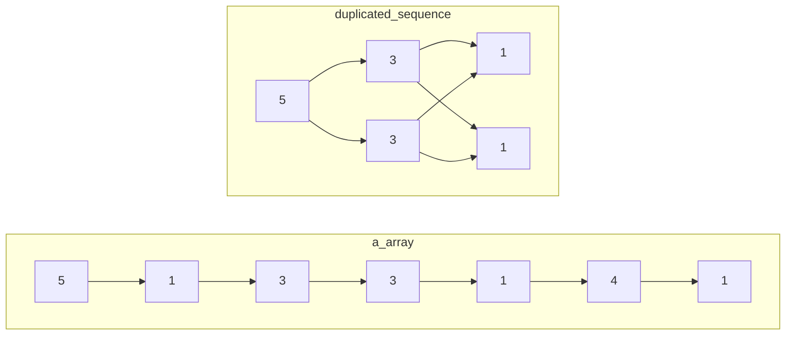
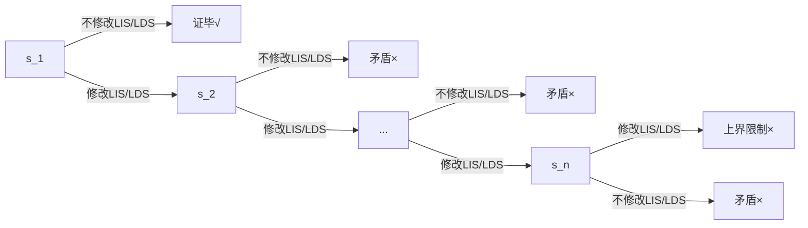
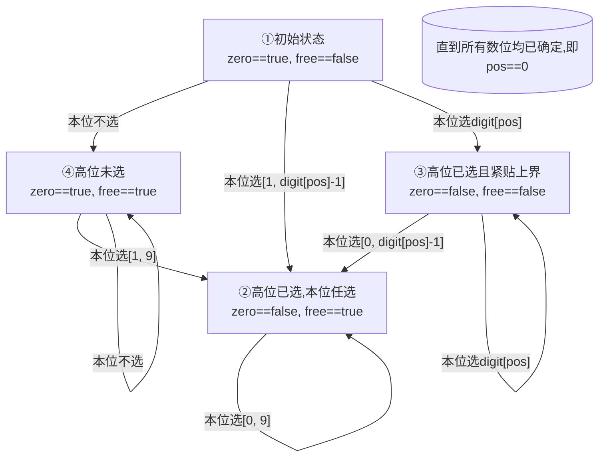

# §1 STL

## §1.1 `<iomainip>`

C++11起，`std::max()` 可以被传入`std::initializer_list`以处理多个参数，如：

```cpp
int a = max({9, 9, 12, 97301, 937});
```

还有，`printf` 支持输出保留小数点位数的数，其实 `std::cout` 也可以，但是需要包含头文件 `iomanip`，代码：

```cpp
cout << fixed << setprecision(位数) << 值;
```

## §1.2 `<algorithm>`

### §1.2.1 `std::sort()`

`std::sort(Iterator begin, Iterator end)`使用的是内省排序，默认从小到大排序。

该函数的完整签名为：

```c++
void std::sort(
	Iterator begin, 
	Iterator end,
	std::function(bool<const T &pre, const T &post>) comp; // pre是否应该在post的前面
);
```

`comp(pre, post)`接受两个形参，`pre`表示在序列中比较靠前/`begin`的元素，`post`表示在序列中比较靠后/`end`的元素。如果`comp()`返回`true`，则说明`pre`应该排在前面；如果返回`false`，则说明`post`应该排在前面。缺省时为`std::less<T>()`，表示升序输出。

### §1.2.2 `std::lower_bound()`/`std::upper_bound()`

> [CppReference](https://zh.cppreference.com/w/cpp/algorithm/lower_bound)：`std::lower_bound(Iterator begin, Iterator end, T value)`返回非严格单调递增容器从`begin`到`end`遍历，找到第一个大于等于`value`的位置，并返回这个位置的迭代器。

> [CppReference](https://zh.cppreference.com/w/cpp/algorithm/upper_bound)：`std::upper_bound(Iterator begin, Itertor end, T value)`返回非严格单调递增容器从`begin`到`end`遍历，找到第一个大于`value`的位置，并返回这个位置的迭代器。

这个最简单的定义没有涉及到STL实现这两个二分查找函数的本质。我们给出它们的完整签名：

```c++
template<class ForwardIt, class T, class Compare>
std::lower_bound(
    class ForwardIt first, 
    class ForwardIt last, 
    const T& value, 
    [](const T& iter_value, const T& value)->bool{};
);

template<Class ForwardIt, class T, class Compare>
std::upper_bound(
	class ForwardIt first,
    class ForwardIt last,
    const T& value,
    [](const T& value, const T& iter_value)->bool{};
)
```

> [CppReference](https://zh.cppreference.com/w/cpp/algorithm/lower_bound)：`std::lower_bound`的完整作用是：给定一段容器的首尾指针或迭代器`first`、`last`，这段容器靠近头部的元素值`forth_value`使得给函数或Lambda表达式传递的实参列表为`(forth_value, value)`时返回`true`，靠近尾部的元素值`back_value`使得给函数或Lambda表达式传递的形参列表为`(back_value, value)`时返回`false`，则返回从`first`到`last`的第一个使得函数或Lambda表达式返回`false`的指针或迭代器。若函数或Lambda表达式没有指定，则缺省等价地视为`std::less<T>()`。

> [CppReference](https://zh.cppreference.com/w/cpp/algorithm/upper_bound)：`std::upper_bound`的完整作用是：给定一段容器的首尾指针或迭代器`first`、`last`，这段容器靠近头部的元素值`forth_value`使得给函数或Lambda表达式传递的实参列表为`(value, forth_value)`时返回`false`，靠近尾部的元素值`back_value`使得给函数或Lambda表达式传递的形参列表为`(value, back_value)`时返回`true`，则返回从`first`到`last`的第一个使得函数或Lambda表达式返回`true`的指针或迭代器。若函数或Lambda表达式没有指定，则缺省等价地视为`std::less<T>()`。

$$
\begin{align}
\begin{array}{|c|c|c|c|c|c|c|}
	\hline
	\text{true} & \text{true} & \text{true} & \text{true} & \text{false} & \text{false} & \text{false} \\
	\hline
	& & & & \underset{\text{std::lower\_bound}}{\uparrow} & & \\
	\hline
\end{array} \\
\begin{array}{|c|c|c|c|c|c|c|}
	\hline
	\text{false} & \text{false} & \text{false} & \text{true} & \text{true} & \text{true} & \text{true} \\
	\hline
	& & & \underset{\text{std::upper\_bound}}{\uparrow} & & \\
	\hline
\end{array} \\
\end{align}
$$

STL提供了以下预置的比较函数：

- `std::less<T>`：`return a < b`
- `std::greater<T>`：`return a > b`
- `std::less_equal<T>`：`return a <= b`
- `std::greater_equal<T>`：`return a >= b`

根据以上定义，我们来分析以下实例：

- 给定递增容器`int a[5] = {0, 1, 2, 3, 4}`，使用`std::lower_bound(a, a + 5, 2)`的效果。首先函数或Lambda表达式没有指定，因此缺省为`std::less<int>()`。序列的首部元素值能满足`iter_value < 2`，末尾元素值不能满足`iter_value < 2`，因此符合`std::lower_bound()`对容器的元素排序要求。容易发现，第一个能让`iter_value < 2`为`false`的元素就是`a[2]`本身，因此返回`(int*)(a+2)`。
- 给定递减容器`int a[5] = {4, 3, 2, 1, 0}`，使用`std::upper_bound(a, a + 5, 2, std::greater<int>())`的效果。序列的首部元素`iter_value`较大，能使得`2 > iter_value`返回`false`；末尾元素的`2 > iter_value`为`true`，因此符合`std::upper_bound()`对容器的元素排序要求。容易发现，最后一个能让`iter_value > 2`为`true`的元素是`a[3]`，因此返回`(int*)(a+3)`。

### §1.2.3 `std::*_heap()`

C++11提供了一系列关于二叉堆的算法。传统二叉堆并不使用容器的第一个空间`heap[0]`，因此使用`2*i`和`2*i+1`获取`i`的左右子节点，然而STL提供的算法并不浪费任何空间，使用`2*i+1`和`2*i+2`获取`i`的左右子节点，因此额外引入了一次加法的时间常数。

`std::make_heap()`用于建立二叉堆。**其中`Compare comp`等价于`bool comp(const T &child, const T &root)`，默认为`std::less<T>()`**。

```c++
void std::make_heap(Iter first, Iter last); // 访问范围为[first, last)
void std::make_heap(Iter first, Iter last, Compare comp);
// comp = std::less<>() 生成大顶堆（默认）
// comp = std::greater<>() 生成小顶堆
```

`std::is_heap()`用于判断一个容器是否成堆。时间复杂度为$O(n)$。

```c++
bool std::is_heap(Iter first, Iter last);
bool std::is_heap(Iter first, Iter last, Compare comp);
```

`std::is_heap_until()`用于查找使得容器符合堆条件的最大尾指针。时间复杂度为$O(n)$
。
```c++
Iter std::is_heap_until(Iter first, Iter last);
Iter std::is_heap_until(Iter first, Iter last, Compare comp);
```

`std::push_heap()`用于将`last - 1`处的元素插入到堆`[first, last - 1)`中，形成一个`[first, last)`的堆。时间复杂度为$O(\log_{2}{n})$。

```c++
void std::push_heap(Iter first, Iter last);
void std::push_heap(Iter first, Iter last, Compare comp);
```

`std::pop_heap()`先交换`heap[first]`和`heap[last - 1]`，然后确保`[first, last - 1)`为堆。时间复杂度为$O(2\log_{2}{n})$。

```c++
void std::pop_heap(Iter first, Iter last);
void std::pop_heap(Iter first, Iter last, Compare comp);
```

`std::sort_heap()`对储存堆的容器进行排序，`comp`默认为`std::less<>()`表示升序，**必须与建堆时使用的`comp`保持一致**。时间复杂度为$O(2n\log_{2}{n})$，**甚至不如`std::sort()`的$O(n\log_{2}{n})$**，不推荐使用。

```c++
void std::sort_heap(Iter first, Iter last);
void std::sort_heap(Iter first, Iter last, Compare comp);
```

### §1.2.4 `std::unique()`

`T* std::unique(Iter first, Iter last)`用于将`[first, last)`中的相邻重复元素移动到容器末尾，并返回一个新的`T* unique_last`指针，表示相邻元素去重后的结果存放在`[first, unique_last)`中。**通常配合`std::sort()`预处理后，做整体去重，而非仅仅是相邻重复元素的去重**。

```c++
Iter<T> unique_last = std::unique(Iter first, Iter last);
Iter<T> unique_last = std::unique(Iter first, Iter last, BinaryPred pred(T &lhs, T &rhs));
```

## §1.3 `<iostream>`

### §1.3.1 动态截断输入

设想题目的`STDIN`给定了`n`个数，但是没有给定`n`的具体值。这时我们可以将`std::cin >> a[i++]`放在`while()`中。

```c++
int a[100], i;
while(std::cin >> a[i++]){
	;
}
```

之所以能这么做，是因为我们可以将这个流输入表达式转换成`bool`值。具体来说，在C++中，`std::cin`的继承关系如下图所示：

```
main.cpp: while(std::cin >> ...)
	iostream: extern "extern c++" istream cin
		iosfwd: using istream = basic_istream<char, char_traits<char>>
			istream: class basic_istream : virtual public basic_ios<_Elem, _Traits>
				ios: class basic_ios : public ios_base
					xiosbase: explicit operator ios_base::bool() const noexcept
```

`std::cin`的数据类型是`std::basic_istream<char, std::char_traits<char>>`，`std::cin >>`操作符返回的还是它自己的引用（`std::basic_istream&`）。沿着泛型实例化与静态类继承关系，一步步向上找，我们找到了这个关键的`bool()`类型转换函数：

```c++
extern "C++" class ios_base : public _Iosb<int> {
	// ...
    explicit operator bool() const noexcept {
        return !fail();
    }
    // ...
}
```

然而这个类型转换函数是被`explicit`修饰的，也就是说我们必须显式调用`(bool)`强制类型转换符才能转成`bool`，为什么我们可以不显式调用呢？这是因为在C++规定了[上下文转换](https://en.cppreference.com/w/cpp/language/implicit_conversion#Contextual_conversions)特性，在下面的六种情况中会自动转换成`bool`。

| 表达式位置                                | 注释       |
| ------------------------------------ | -------- |
| `if(...)`/`while(...)`/`for(;...;)`  |          |
| `!(...)`/`(...)&&(...)`/`...\|\|...` |          |
| `T func() noexcept { ... }`          |          |
| `static_assert([](){...}, str)`      |          |
| `...? :`                             | C++11及以后 |
| `explicit T func() { ... }`          | C++20及以后 |

当`std::cin`读到EOF或不符合格式的数据时，其`fail()`会返回`true`，于是`bool(std::cin)`返回`false`，可以作为终止输入的依据。

### §1.5.2 浮点数格式化输出

无论是`printf("%lf")`，还是`std::cout << double(...)`，默认情况下只会输出`6`位**有效数字（不是小数！）**。

- `std::fixed`：禁止使用科学计数法，一律使用定点表示法。
- `std::setprecision(...)`：设置数字输出时的有效数字（无`std::fixed`时），或小数点后位数（有`std::fixed`时）。

### §1.5.3 空行检测

> [洛谷P2222](https://www.luogu.com.cn/problem/P2222)：给定三组数据，每组数据包含至少一条数据`i, j, v`，组之间使用空行分割。行末可能包含空格、`\r`和`\n`。

这里我们创建一个字符串`std::string s`作为Buffer，直接使用`std::getline(std::cin, s)`读取一行数据，它会将空格与`\r`读入到字符串，丢弃`\n`。然后创建一个`std::stringstream ss(s)`，当作`std::cin`正常使用即可。

```c++
std::cin >> x >> y >> m >> n >> o >> p; 
std::getline(std::cin, s); // 吸收`\n`

while(std::getline(std::cin, s)) {
	while(!s.empty() && (s.back() == '\r' || s.back() == ' ')) { s.pop_back(); }
	if(s.empty()) { break; } // 数据组之间使用空行分隔
	std::stringstream ss(s); ss >> i_tmp >> j_tmp >> v_tmp;
}

while(std::getline(std::cin, s)) {
	while(!s.empty() && (s.back() == '\r' || s.back() == ' ')) { s.pop_back(); }
	if(s.empty()) { break; } // 数据组之间使用空行分隔
	std::stringstream ss(s); ss >> i_tmp >> j_tmp >> v_tmp;
}

while(std::getline(std::cin, s)) {
	while(!s.empty() && (s.back() == '\r' || s.back() == ' ')) { s.pop_back(); }
	if(s.empty()) { break; } // 数据组之间使用空行分隔
	std::stringstream ss(s); ss >> i_tmp >> j_tmp >> v_tmp;
}
```

## §1.4 `<queue>`

### §1.4.1 `std::priority_queue`

STL将堆进一步封装成优先队列。

```c++
std::queue<class T, class Container = std::vector<T>, std::function<bool(T&, T&)> Compare = std::less<T>> queue(
	T,
	std::vector<T>,
	[](const T &child, const T &root){ return true; } // 返回true时,root在堆顶
);
```

这里的`Compare`是类，而不是实例化的可调用对象，也不是函数指针。

```c++
// 方法一: Lambda表达式变量
auto comp = [](const Stuff &child, const Stuff &root){ return ...; };
std::priority_queue<Stuff, std::vector<Stuff>, decltype(comp)> queue(comp);

// 方法二: Lambda表达式
std::priority_queue<Stuff, std::vector<Stuff>, std::function<bool(Stuff&, Stuff&)>> queue(
	[](const Stuff &child, const Stuff &root){ return ...;}
);

// 方法三：重载仿函数bool Stuff(&lhs, &rhs);
struct Stuff {
	inline bool operator(const Stuff &child, const Stuff &root){
		return ...;
	}
}
std::priority_queue(Stuff, std::vector<Stuff>, Stuff) queue;
```

## §1.5 `<regex>`

> [洛谷P8791](https://www.luogu.com.cn/problem/P8791)：给定两种声明变量的语句：声明`int`/`long`/`String`的`type key1=value1,key2=value2;`；声明`int[]`/`long[]`的`type[] key1[100],key2[200];`。不计`String`的末尾`\0`字符，求定义的变量占用多少字节。

```c++
const int T_MAX = 10;
int t; std::string s, s_var;
int64_t ans; struct { std::string desc; int64_t v; } ans_out[4] = {
    {"B", 0},
    {"KB", 0},
    {"MB", 0},
    {"GB", 0},
};
std::regex type_regex(R"((\w+)((\[\])?)\s+)");
std::regex int_regex(R"((\w+)\s*=\s*(-?\d+)\s*[,;]\s*)");
std::regex int_arr_regex(R"((\w+)\s*=\s*new\s+\w+\[(\d+)\]\s*[,;]\s*)");
std::regex string_regex(R"((\w+)\s*=\s*\"(.*?)\"\s*[,;]\s*)");
int main() {
    std::cin >> t; std::cin.ignore();
    while(t--) {
        std::getline(std::cin, s);
        std::smatch type_smatch, variable_smatch;
        std::regex_search(s, type_smatch, type_regex);
        s_var = type_smatch.suffix();

        if(type_smatch[1] == "int") {
            if(type_smatch[2] != "[]") {
                while(std::regex_search(s_var, variable_smatch, int_regex)) { ans += 4; s_var = variable_smatch.suffix(); }
            } else if(type_smatch[2] == "[]") {
                while(std::regex_search(s_var, variable_smatch, int_arr_regex)) { ans += 4 * std::stoll(variable_smatch[2]); s_var = variable_smatch.suffix(); }
            }
        } else if(type_smatch[1] == "long") {
            if(type_smatch[2] != "[]") {
                while(std::regex_search(s_var, variable_smatch, int_regex)) { ans += 8; s_var = variable_smatch.suffix(); }
            } else if(type_smatch[2] == "[]") {
                while(std::regex_search(s_var, variable_smatch, int_arr_regex)) { ans += 8 * std::stoll(variable_smatch[2]); s_var = variable_smatch.suffix(); }
            }
        } else if(type_smatch[1] == "String") {
            while(std::regex_search(s_var, variable_smatch, string_regex)) { ans += 1 * variable_smatch[2].length(); s_var = variable_smatch.suffix(); }
        }
    }
    for(int i = 0; i < 4; ++i) {
        ans_out[i].v = i < 3 ? ans % 1024 : ans;
        ans /= 1024;
    }
    for(int i = 3; i >= 0; --i) {
        if(ans_out[i].v == 0) { continue; }
        std::cout << ans_out[i].v << ans_out[i].desc;
    }
}
```

# §2 动态规划

## §2.1 背包DP

- 同时用到先后两次的`dp[n][]`和`dp[n-1][]`，且背包容量`j`与体积代价`cost[i]`满足严格偏序关系，才能使用一行滚动数组`dp[j]=...dp[j-cost[i]]`
- 只用到`dp[n][]`单层的递推式，使用一行滚动数组存储完毕后必须再次初始化，防止干扰下一层。
- 不满足严格偏序关系，必须使用两行滚动数组`dp[(n++)&1][j]`，且使用新行之前必须初始化为新值，否则本次在该行未经更新的数值就是两轮之前 的`dp[n-2][j]`

### §2.1.1 0/1背包 & 完全背包

> [洛谷P1048](https://www.luogu.com.cn/problem/P1048)：给定容量为`capacity`的背包，`n`个体积和价值分别为`volume[i]`和`value[i]`的物品，使得背包容纳的物品总价值最大化。其中所有物品的体积和价值均大于0。

令`dp[i][j]`表示当背包容量为`j`时，在前`i`种物品中，能取得的最大物品总价值。其中`dp[0][j]`恒为0，表示什么都不选的情况。易得状态方程：
$$
\text{dp}[i][j]=\max\left(
	\text{dp}[i-1][j],
	\text{dp}[i-1][j-\text{volume}[i]]+\text{value}[i]
\right)
$$

```c++
long long int dp[101][1001];
long long int volume[101], value[101];
long long int capacity, n;
int main(){
    std::cin >> capacity >> n;
    for(long long int i = 1 ; i <= n ; ++i){
        std::cin >> volume[i] >> value[i];
    }

    for(long long int i = 1 ; i <= n ; ++i){
        for(long long int j = 0 ; j <= capacity ; ++j){
            dp[i][j] = dp[i - 1][j]; // 不选第i个物品
            if(j >= volume[i]){
                dp[i][j] = std::max(dp[i][j], dp[i - 1][j - volume[i]] + value[i]); // 选第i个物品
            }
        }
    }
    std::cout << dp[n][capacity];
    return 0;
}
```

该算法的空间复杂度显然为$O(\text{capacity}\cdot n)$，每个空间都要进行一次运算，因此时间复杂度也为$O(\text{capacity}\cdot n)$。

接下来考虑滚动数组优化。当我们把`dp`从二维数组变为一维数组时，受影响的地方有两处：

1. `dp[i][j] = dp[i - 1][j]`

   给`dp`直接砍掉一个维度，变成`dp[j] = dp[j]`，是否与原式等价呢？显然等价，因为`dp[j]`在赋值前的值是上一轮循环算出来的，因此就是`dp[i - 1][j]`本身，在赋值后的值是这一轮循环更新的，因此就是`dp[i][j]`本身。

2. `dp[i][j] = std::max(dp[i][j], dp[i - 1][j - volume[i]] + value[i])`

   给`dp`直接砍掉一个维度，变成`dp[j] = std::max(dp[j], dp[j - volume[i]] + value[i])`，是否与原式等价呢？在本次循环中，`dp[j - volume[i]`一定在`dp[j]`之前先被计算了出来，早就在本轮循环中被更新过，因此等价于`dp[i][j - volume[i]`，这与原式中的`dp[i - 1][j - volume[i]]`不等价。

   导致这一切的罪魁祸首是`dp[j - volume[i]`被抢先一步覆盖掉，只要不覆盖即可解决问题。于是我们想到改变第二层循环的循环顺序，将原来的从小到大变成从大到小即可。

```c++
long long int dp[1001]; // long long int dp[101][1001];
long long int volume[101], value[101];
long long int capacity, n;
int main(){
    std::cin >> capacity >> n;
    for(long long int i = 1 ; i <= n ; ++i){
        std::cin >> volume[i] >> value[i];
    }

    for(long long int i = 1 ; i <= n ; ++i){
        for(long long int j = capacity ; j >= 0 ; --j){ // for(long long int j = 0 ; j <= capacity ; ++j){
            ; // dp[i][j] = dp[i - 1][j] 简化为了 dp[j] = dp[j]
            if(j >= volume[i]){
                dp[j] = std::max(dp[j], dp[j - volume[i]] + value[i]); // dp[i][j] = std::max(dp[i][j], dp[i - 1][j - volume[i]] + value[i]);
            }
        }
    }
    std::cout << dp[capacity];
    return 0;
}
```

该算法的空间复杂度显然为$O(\text{capacity})$，每个空间都要进行$n$次运算，因此时间复杂度也为$O(\text{capacity}\cdot n)$。

各OJ通常还考察一处常数优化。在动态规划中，我们把一个问题拆成了几个子问题分别计算。现在有个问题：我们总共计算了这么多的子问题，真的都能用在后续的计算中吗？回想未经滚动数组优化的递推式，我们注意到：

1. 要求解第$N$层的$\text{dp}[N][\text{capacity}]$，我们只需要知道$\text{dp}[N-1][\text{capacity}]$和$\text{dp}[N-1][\text{capacity}-\text{volume}[N]]$这两个值即可，对应的第二维度的区间为$[\text{capacity}-\text{volume}[N],\text{capacity}]$。
2. 要求解第$N-1$层的$\text{dp}[N-1][\text{capacity}-\text{volumn}[N]]$，我们只需要知道$\text{dp}[N-2][\text{capacity}-\text{volume}[N]]$和$\text{dp}[N-1][\text{capacity}-\text{volume}[N]-\text{volume}[N-1]]$这两个值即可，对应的第二维度的区间为$[\text{capacity}-\text{volume}[N]-\text{volume}[N-1],\text{capacity}]$。
3. ......数学归纳法
4. 要求解第$p$层的值，对应的第二维度区间的左端点为$\text{capacity}-\sum_{j=p}^{n}\text{volume}[j]$。

从另一个角度来看，当我们已经确定前$p$组物品的$\text{dp}$情况后，至少要保证后面的其它物品都有可能被选取，甚至全部被选取的情况，才能保证不遗漏任何一种情况。这提示我们可以缩短第二层循环的枚举范围，也就是从原先的$[0,\text{capacity}]$缩短为$\left[\max\Big(\text{capacity}-\sum_{j=p}^{n}\text{volume}[j],\text{volume}[p]\Big),\text{capacity}\right]$。

```c++
long long int dp[1001];
long long int volume[101], value[101];
long long int capacity, n;
long long int volume_sum; // 计算sum(volume[i, n])
int main(){
    std::cin >> capacity >> n;
    for(long long int i = 1 ; i <= n ; ++i){
        std::cin >> volume[i] >> value[i];
        volume_sum += volume[i];
    }
    for(long long int i = 1 ; i <= n ; ++i){
        for(long long int j = capacity ; j >= std::max(capacity - volume_sum, volume[i]) ; --j){ // 收缩枚举范围
            if(j >= volume[i]){
                dp[j] = std::max(dp[j], dp[j - volume[i]] + value[i]);
            }
        }
        volume_sum -= volume[i]; // 维护sum(volumu[i, n])
    }
    std::cout << dp[capacity];
    return 0;
}
```

该优化在$\text{capacity}$特别大时非常有效。

为了优化时间，我们考虑上述常数优化的枚举范围。其左端点极度依赖于$\sum_{j=p}^{n}\text{volume}[j]$，我们希望这个值越大越好，这依赖于`volumn`数组的顺序。于是，当$\text{volume}[i]$非常大时，先处理代价（本题为体积）较大的物品能更缩小枚举范围。只需付出一点很小的排序时间开销，就能抵消大$\text{volume}[i]$造成的劣势。

```c++
long long int dp[100001];
std::vector<std::pair<long long int, long long int>> data(101); // volume, value
long long int capacity, n;
long long int volume_sum;
int main(){
    std::cin >> capacity >> n;
    for(long long int i = 1 ; i <= n ; ++i){
        std::cin >> data[i].first >> data[i].second;
        volume_sum += data[i].first;
    }
    std::sort(data.begin() + 1, data.begin() + 1 + n, [](const auto &lhs, const auto &rhs){
        return lhs.first > rhs.first;
    }); // 排序，让大的volumn物品在前，先被处理
    for(long long int i = 1 ; i <= n ; ++i){
        for(long long int j = capacity ; j >= std::max(capacity - volume_sum, data[i].first) ; --j){
            // 没有必要使用if(j >= data[i].first)，该条件以合并到上一行的边界中
            dp[j] = std::max(dp[j], dp[j - data[i].first] + data[i].second);
        }
        volume_sum -= data[i].first;
    }
    std::cout << dp[capacity];
    return 0;
}
```

为了优化空间，注意到在最外层循环中，遍历到第`p`个物品时，只有该物品的代价和价值参与了计算。因此我们可以不用一次性保存所有石子的全部数据，而是按需读入，即用即扔。空间复杂度$O(\text{capacity}\cdot n)$仍未改变，只是缩小了$O(n)$的常数而已。该做法与时间常数优化冲突，因为遍历到第`p`个物品时，我们只知道$\sum_{j=1}^{p}\text{volume}[j]$，而常数优化要求的是$\sum_{j=p}^{n}\text{volume}[j]$，我们无法提前“预知”后面物品的`volume`属性。

```c++
long long int dp[1001];
// long long int volume[101], value[101];
long long int capacity, n;
int main(){
    std::cin >> capacity >> n;
    // for(long long int i = 1 ; i <= n ; ++i){
    //     std::cin >> volume[i] >> value[i];
    // }
    for(long long int i = 1 ; i <= n ; ++i){
        long long int volume, value; std::cin >> volume >> value; // 在此处即时O(1)读入
        for(long long int j = capacity ; j >= 0 ; --j){
            if(j >= volume){
                dp[j] = std::max(dp[j], dp[j - volume] + value);
            }
        }
    }
    std::cout << dp[capacity];
    return 0;
}
```

> 给定容量为`capacity`的背包，`n`种供应量无穷大的，体积和价值分别为`volume[i]`和`value[i]`的物品，使得背包容纳的物品总价值最大化。其中所有物品的体积和价值均大于0。

令`dp[i][j]`表示当背包容量为`j`时，在前`i`种物品中，能取得的最大物品总价值。其中`dp[0][j]`恒为0，表示什么都不选的情况。与0/1背包不同，选中了第`i`个物品后还可以接着再选一次，因此状态转移方程为：
$$
\text{dp}[i][j]=\max\left(
	\text{dp}[i-1][j],
	\text{dp}[\textcolor{red}{i}][j-\text{volume}[i]]+\text{value}[i]
\right)
$$
这里我们直接考虑滚动数组优化。模仿上一节的分析，当砍掉`dp`数组的一个维度后，得到的代码与原式完全等价。

```c++
long long int dp[1001]; // long long int dp[101][1001];
long long int volume[101], value[101];
long long int capacity, n;
int main(){
    std::cin >> capacity >> n;
    for(long long int i = 1 ; i <= n ; ++i){
        std::cin >> volume[i] >> value[i];
    }

    for(long long int i = 1 ; i <= n ; ++i){
        for(long long int j = 0 ; j <= capacity ; ++j){    
            if(j >= volume[i]){
                dp[j] = std::max(dp[j], dp[j - volume[i]] + value[i]);
            }
        }
    }
    std::cout << dp[capacity];
    return 0;
}
```

该算法的空间复杂度显然为$O(\text{capacity})$，每个空间都要进行$n$次运算，因此时间复杂度也为$O(\text{capacity}\cdot n)$。

```c++
for (int i = 0; i < n; ++i) { // 遍历每种物品
	int itemCost = cost[i];
	int itemValue = value[i];

	// 更新当前选择的最小和最大代价范围
	minCost = max(0, min(minCost, minCost + itemCost));
	maxCost = min(maxCapacity, max(maxCost, maxCost + itemCost));

	for (int j = minCost; j <= maxCost; ++j) {
		if (j >= itemCost && dp[j - itemCost] != INF) {
			dp[j] = max(dp[j], dp[j - itemCost] + itemValue);
		}
	}
}
```

#### §2.1.1.1 混合背包

混合背包指的是上述背包问题中提到的物品特性混合起来。针对此类问题，我们只需对不同问题的物品分别套用不同的转移方程即可。

```
for i=1..N
    if 第i件物品属于01背包
        // ...
    else if 第i件物品属于完全背包
        // ...
    else if 第i件物品属于多重背包
        // ...
```

### §2.1.2 分组背包

> [洛谷P1757](https://www.luogu.com.cn/problem/P1757)：给定容量为`capacity`的背包，`n`个供应量无穷大的，体积、价值、类别分别为`volume[i]`、`value[i]`和`type[i]`的物品，每个类别中最多只能挑出一个物品装入背包，使得背包容纳的物品总价值最大化。其中所有物品的体积和价值均大于0。

本题在0/1背包的基础上引入了分组问题，显然`dp[i][j]`中的`i`指的不再是第`i`个物品，而是第`i`种类别。状态转移方程为：

$$
\text{dp}[i][j]=\max\bigg(
	\text{dp}[i-1][j],
	\max\big(
		\text{dp}[i][j-\text{volume}[i][k]]+\text{value}[i][k]
	\big)
\bigg)
$$

```c++
const long long int N_MAX = 1000, TYPE_MAX = 100, CAPACITY_MAX = 1000;
long long int n, capacity;
std::map<long long int, std::vector<std::tuple<long long int, long long int>>> data;
long long int dp[CAPACITY_MAX + 1];
int main(){
    std::cin >> capacity >> n;
    for(long long int i = 0 ; i < n ; ++i){
        long long int volume, value, type; std::cin >> volume >> value >> type;
        data[type].emplace_back(volume, value);
    }
    for(auto &group : data){
        for(long long int j = capacity ; j >= 0 ; --j){
            for(auto &item : group.second){
                if(j >= std::get<0>(item)){
                    dp[j] = std::max(
                        dp[j],
                        dp[j - std::get<0>(item)] + std::get<1>(item)
                    );
                }
            }
        }
    }
    std::cout << dp[capacity];
}
```

该算法的空间复杂度显然为$O(\text{capacity})$，每个空间都要进行$n$次运算，因此时间复杂度也为$O(\text{capacity}\cdot n)$。

### §2.1.3 多重背包

> [洛谷P1776](https://www.luogu.com.cn/problem/P1776)：给定容量为`capacity`的背包，`n`种数量为`count[i]`的，体积和价值分别为`volume[i]`和`value[i]`的物品，使得背包容纳的物品总价值最大化。其中所有物品的体积和价值均大于0。

一种显然的做法是将`count[i]`个相同的物品视作不同的物品，或者将状态转移方程中的$\max(\cdot)$参数列表填充为不选、仅选1个、仅选2个、...、仅选$\text{count}[i]$个，从而转化为01背包问题。但这会导致种类数$n$膨胀为$n\cdot\text{count}[i]$，导致超时。

这里我们引入二进制拆分优化。对于任意正整数`count[i]`，我们都可以将其拆分为二进制形式。因此我们只需要给$\max(\cdot)$的参数列表中填充为仅选$2^0$个、仅选$2^1$个、...、仅选$2^a$个，仅选$\text{count}[i]-\sum_{j=0}^{a}2^j$个。这些数字构成了一个集合，它的所有子集中的元素之和必定覆盖且仅覆盖$[0,\text{count}[i]]$中的每个正整数。例如正整数`25`可以拆分为`(1+2+4+8)+10`。种类数仅膨胀到$n\cdot\log_2(\text{count}[i])$。

```c++
const long long int N_MAX = 1e2, CAPACITY_MAX = 4e4, BINARY_N_MAX = 1e5;
long long int n, capacity, binary_n;
long long int volume[BINARY_N_MAX + 5], value[BINARY_N_MAX + 5];
long long int dp[CAPACITY_MAX + 1];
int main(){
    std::cin >> n >> capacity;
    for(long long int i = 1 ; i <= n ; ++i){
        long long int value_temp, volume_temp, count_temp; std::cin >> value_temp >> volume_temp >> count_temp;
        for(long long int j = 1 ; j <= count_temp ; j <<= 1){
            binary_n++;
            value[binary_n] = value_temp * j;
            volume[binary_n] = volume_temp * j;
            count_temp -= j;
        }
        if(count_temp > 0){
            binary_n++;
            value[binary_n] = value_temp * count_temp;
            volume[binary_n] = volume_temp * count_temp;
        }
    }
    for(long long int i = 1 ; i <= binary_n ; ++i){
        for(long long int j = capacity ; j >= 0 ; --j){
            if(j - volume[i] >= 0){
                dp[j] = std::max(dp[j], dp[j - volume[i]] + value[i]);
            }
        }
    }
    std::cout << dp[capacity];
}
```

该算法的空间复杂度显然为$O(\text{capacity})$，每个空间都要进行$n\cdot\log_2(\text{count}[i])$次运算，因此时间复杂度也为$O(\text{capacity}\cdot n\cdot\log_2(\text{count}[i]))$。

### §2.1.4 恰满背包

之前我们接触的背包题型往往带有$\sum\text{volume}_i\le \text{capacity}$的约束条件。本节讨论的是$\sum\text{volume}_i= \text{capacity}$。

- 以价值最大化问题为例，我们希望不合法的状态全为负无穷大，这样在$\max(\cdot)$的各参数大小竞争中，非法状态就会不起作用，等价于不存在。于是`dp[0][0]`为0，而`dp[0][1->n]`均为负无穷大。
- 以统计方案数问题为例，我们希望不合法的状态不对应任何方案，也就是0。于是`dp[0][0]`反而是一种合法的方案，因为什么都不选也能填满容量为0的背包，而`dp[0][1->n]`均为0。

> [洛谷P1284](https://www.luogu.com.cn/problem/P1284)：给定`n<=40`个长度分别为`a[i]<=40`的木棍，请用**所有的**木棍拼成三条边，且恰好能构成三角形。求三角形最大面积`ans`。如果三角形不存在则输出`-1`，如果存在则输出`(int64_t)(ans * 100)`。

预处理关于`a[]`的前缀和数组`a_presum[]`。令`bool dp[i][j][k]`表示给定前`i`个木棍，能否拼成三条长度分别为`j`、`k`、`a_presum[i] - j - k`的边，**注意这三条边不一定非要组成三角形**。于是给定一条新木棍`a[i]`，我们有三种选择：

- 把`a[i]`拼在长度为`j`的边：`dp[i][j][k] = dp[i][j][k] | dp[i][j - a[i]][k]`，前提是`j >= a[i]`。
- 把`a[i]`拼在长度为`k`的边：`dp[i][j][k] = dp[i][j][k] | dp[i][j][k - a[i]]`，前提是`k >= a[i]`。
- 把`a[i]`拼在长度为`a_presum[i] - j - k`的边：`dp[i][j][k] = dp[i][j][k] | dp[i][j][k]`，前提是`a_presum[i] - j - k >= a[i]`。

以上三种情况进行或运算即可。初始值`dp[0][0][0] = true`，其余`dp[0][*][*] = false`。注意到以上状态转移方程可以用滚动数组优化，把第一维砍成一行。

计算得到`dp[n][*][*]`后，只需遍历所有可以取到的三条边长度组合情况，带入海伦公式$\begin{cases}p = \displaystyle\frac{a+b+c}{2}\\S=\sqrt{p(p-a)(p-b)(p-c)}\end{cases}$求**能组成三角形**的所有情况的最大值即可。

```c++
const int N_MAX = 40, A_MAX = 40; const double INF = 1e18;
int n, a[1 + N_MAX], a_presum[1 + N_MAX]; bool dp[1 + N_MAX * A_MAX][1 + N_MAX * A_MAX]; double ans = -INF;
double calc_triangle_area(double a, double b, double c) {
    if(!(a + b > c && a + c > b && b + c > a)) { return -INF; }
    double p = (a + b + c) / 2;
    return std::sqrt(p * (p - a) * (p - b) * (p - c));
}
int main() {
    std::cin >> n;
    for(int i = 1; i <= n; ++i) { std::cin >> a[i]; a_presum[i] = a_presum[i - 1] + a[i]; }

    dp[0][0] = true;
    for(int i = 1; i <= n; ++i) {
        for(int j = a_presum[i]; j >= 0; --j) {
            for(int k = a_presum[i]; k >= 0; --k) {
                dp[j][k] = std::ranges::any_of(std::initializer_list<bool>{
                    j >= a[i] ? dp[j - a[i]][k] : false,
                    k >= a[i] ? dp[j][k - a[i]] : false,
                    a_presum[i] - j - k >= 0 ? dp[j][k] : false
                }, std::identity{});
            }
        }
    }
    for(int j = 0; j <= a_presum[n]; ++j) {
        for(int k = 0; k <= a_presum[n]; ++k) {
            if(dp[j][k] == true) {
                ans = std::max(ans, calc_triangle_area(j, k, a_presum[n] - j - k));
            }
        }
    }
    std::cout << (ans == -INF ? -1ll : (int64_t)(ans * 100));
}
```

### §2.1.5 依赖背包

> [洛谷P1064](https://www.luogu.com.cn/problem/P1064)：给定`m`个物品的价值`value[i]`和代价`cost[i]`。现将其分成若干组，每组物品均包含1个主物品和0~2个次物品。如果选择了某个子物品，则必须同时选择其组内的主物品。在各物品代价之和小于等于$n$的约束条件下，求物品价值之和的最大值。

？？？？？？？？？？？？？？？？？？？TODO：

> [洛谷P1455](https://www.luogu.com.cn/problem/P1455)：给定`n`个物品的价格`cost[i]`和价值`value[i]`，与`m`个捆绑销售关系。如果`i`和`j`是捆绑销售关系，则要么两者都不选，要么都选。给定预算`budget`，求价值最大值。

本题的关键在于意识到多个物品捆绑成了一个大物品。我们用并查集维护大物品的总价格和总价值，然后对`i:1->n`进行遍历，以`dsu_find(i) == i`为大物品的判断依据，对所有大物品使用0/1背包求解即可。

```c++
const int N_MAX = 1e4, M_MAX = 5e3, BUDGET_MAX = 1e4;
int dsu_parent[N_MAX + 1],  dsu_cost[N_MAX + 1], dsu_value[N_MAX + 1];
int n, m, budget, u_temp, v_temp, dp[BUDGET_MAX + 1];
int dsu_find(int x) { return dsu_parent[x] == x ? x : dsu_parent[x] = dsu_find(dsu_parent[x]); }
inline void dsu_unite(int child, int root) {
    int child_parent = dsu_find(child), root_parent = dsu_find(root);
    if(child_parent != root_parent) {
        dsu_cost[root_parent] += dsu_cost[child_parent];
        dsu_value[root_parent] += dsu_value[child_parent];
        dsu_parent[child_parent] = root_parent;
    }
}
int main() {
    std::cin >> n >> m >> budget;
    std::iota(dsu_parent + 1, dsu_parent + 1 + n, 1);
    for(int i = 1; i <= n; ++i) { std::cin >> dsu_cost[i] >> dsu_value[i]; }
    for(int i = 1; i <= m; ++i) {
        std::cin >> u_temp >> v_temp;
        dsu_unite(u_temp, v_temp);
    }
    for(int i = 1; i <= n; ++i) {
        if(dsu_find(i) != i) { continue; }
        for(int j = budget; j >= dsu_cost[i]; --j) {
            dp[j] = std::max(dp[j], dp[j - dsu_cost[i]] + dsu_value[i]);
        }
    }
    std::cout << dp[budget];
}
```

### §2.1.6 费用背包

我们将背包问题中出现的各种约束条件，统一地抽象为以下类型：

- 限制条件：必须满足`∑a[i] <= A`、`∑b[i] >= B`。例如背包不能装满、必须填满坑洞。
- 最优化条件：最大化/最小化`∑c[i]`的值，如果有多个方案满足要求则继续最大化最小化`∑d[i]`的值。

本节介绍的题型都是以上两种条件的排列组合。

#### §2.1.6.1 单限制单最优化

> [洛谷P1510](https://www.luogu.com.cn/problem/P1510)：给定一个体积为`v`的坑洞，需要用石子填满（允许体积溢出）。石子的体积和代价（附属值）分别为`v[i]`和`c[i]`，求完成该任务的代价最小值。

本题有两种状态定义的方式，为`dp`数组分别填充了不同的初值。

- `dp[i][j]`：用前`i`个石子填满**体积**为`j`的坑洞，所付出的代价最小值。

  考虑滚动数组优化，`dp[j]`的初值（也就是`dp[0][j]`）如何确定？首先`dp[0][0]`肯定是0，此时坑洞已满，无需花费任何代价。而当`j`大于1时，因为此时没有石子可以使用，所以无论花费多少代价都无法满足条件，也就是说初值均为无穷大。

  再考虑转移方程，分两种情况——新的第$i$个石子能恰好补上临门一脚，或者使用这个石子后依然不能填满坑洞：
  $$
  \text{dp}[j]=\begin{cases}
  	\min\left(\text{dp}[j],\text{dp}[j-v[i]] + c[i]\right) &,j\ge v[i],\text{新加的石子还是不能填满} \\
  	\textcolor{red}{\min\left(\text{dp}[j],c[i]\right)} &,j<v[i],\text{仅这一个石子就能填满}
  \end{cases}
  $$

  ```c++
  const long long int N_MAX = 1e4, V_MAX = 1e4;
  long long int v, n, c;
  long long int dp[V_MAX + 1];
  int main(){
      std::cin >> v >> n >> c;
      std::fill(dp + 1, dp + 1 + V_MAX, 1e9);
      for(long long int i = 1 ; i <= n ; ++i){
          long long int volume, effort; std::cin >> volume >> effort;
          for(long long int j = v ; j >= 0 ; --j){
              if(j >= volume){
                  dp[j] = std::min(dp[j], dp[j - volume] + effort);
              }else{
                  dp[j] = std::min(dp[j], effort);
              }
          }
      }
      if(c - dp[v] >= 0){
          std::cout << c - dp[v];
      }else{
          std::cout << "Impossible";
      }
  }
  ```

- `dp[i][j]`：用前`i`个石子，且其代价之和小于等于预算`j`时，能填满的坑洞体积最大值。**该方法的局限性在于题目必须给出预算的最大值，或者预算的最大值大的不那么离谱，否则每次二层循环遍历的状态过多，导致超时。**

  考虑数组滚动优化，`dp[j]`的初值（也就是`dp[0][j]`）如何确定？因为没有石子可以使用，所以即使给再多的代价预算，也无处可花，更别说填满坑洞了，因此能填满的坑洞提及最大值全部为0。

  再考虑转移方程，分两种情况——如果代价此时仍有预算，能使用该石子，那么就取最小值；如果无法支付该石子所需的代价，那么就没有办法使用该石子，直接跳过此情况：
  $$
  \text{dp}[j]=\begin{cases}
  	\max\left(\text{dp}[j],\text{dp}[j-c[i]]+v[i]\right) &,j\ge v[i] \\
  	\text{dp}[j] &,j<v[i]
  \end{cases}
  $$

  ```c++
  const long long int N_MAX = 1e4, V_MAX = 1e4, C_MAX = 1e4;
  long long int v, n, c;
  long long int dp[C_MAX + 1];
  int main(){
      std::cin >> v >> n >> c;
      for(long long int i = 1 ; i <= n ; ++i){
          long long int volume, effort; std::cin >> volume >> effort;
          for(long long int j = c ; j >= 0 ; --j){
              if(j >= effort){
                  dp[j] = std::max(dp[j], dp[j - effort] + volume);
              }
          }
      }
      if(dp[c] >= v){
          long long int min_c = std::lower_bound(dp, dp + c + 1, v) - dp; // 因为dp非严格递增，所以能用二分优化
          std::cout << c - min_c;
      }else{
          std::cout << "Impossible";
      }
  }
  ```

#### §2.1.6.2 多限制单最优化

> [洛谷P2340](https://www.luogu.com.cn/problem/P2340)：给定`n`个物品，每种物品都有两种代价`cost_1[i]`、`cost_2[i]`，代价可正可负。在物品的两种总代价均大于等于0的情况下，求这两种总代价之和的最大值。

令`dp[i][j]`表示前`i`个物品的第一种代价之和恰好为`j`时，第二种代价之和的最大值。于是有状态转移方程：
$$
\text{dp}[i][j] = \max(
	\text{dp}[i-1][j],
	\text{dp}[i-1][j-\text{cost\_1}[i]] + \text{cost\_2}[i]
)
$$
由于`cost_1[i]`可正可负，所以第二层遍历的顺序要随着其正负号而变化。

```c++
const long long int N_MAX = 400, COST_MAX = 1000, OFFSET = N_MAX * COST_MAX;
long long int n, dp[2 * OFFSET + 1];
int main(){
    std::cin >> n;
    std::fill(dp, dp + 2 * OFFSET + 1, INT32_MIN); dp[OFFSET] = 0;
    long long int left_bound = 0, right_bound = 0;
    for(int i = 1 ; i <= n ; ++i){
        long long int cost_1, cost_2; std::cin >> cost_1 >> cost_2;
        if(cost_1 < 0){
            left_bound += cost_1;
        }
        if(cost_1 > 0){
            right_bound += cost_1;
        }
        if(cost_1 >= 0){
            for(long long int j = right_bound ; j >= left_bound ; --j){
                dp[j + OFFSET] = std::max(dp[j + OFFSET], dp[j - cost_1 + OFFSET] + cost_2);
            }
        }else{
            for(long long int j = left_bound ; j <= right_bound ; ++j){
                dp[j + OFFSET] = std::max(dp[j + OFFSET], dp[j - cost_1 + OFFSET] + cost_2);
            }
        }
    }
    long long int result = INT32_MIN;
    for(long long int i = 0 ; i <= right_bound ; ++i){
        if(dp[i + OFFSET] < 0){
            continue;
        }
        result = std::max(result, dp[i + OFFSET] + i);
    }
    std::cout << result;
}
```

> [洛谷P2079](https://www.luogu.com.cn/problem/P2079)：给定`n<=100`个物品，每个物品含有属性`c[i]>=0`、`x[i]∈[-5,5]`、`y[i]∈[-1e3,1e3]`。请从中选出一些物品，要求`∑c[i]<=c_budget<=500`、`∑x[i]>=0`，求`∑y[i]`的最大值，如果其小于`0`则输出`-1`。

本题的关键在于`x[i]`的取值范围很小，因此可以作为DP状态。令`dp[i][j][k]`表示给定前`i`个物品，物品选择方案的`∑c[i]`恰好为`j`、`∑x[i]`恰好为`k`时，`∑y[i]`的最大值。于是有状态转移方程：

$$
\mathrm{dp}[i][j][k] = \max(
	\mathrm{dp}[i-1][j][k],
	\mathrm{dp}[i][j-c[i]][k-x[i]]  + y[i]
)
$$

用滚动数组可以把第一维压成一行。**由于`c[i]>=0`恒成立，因此循环第二维时要逆序遍历**。由于`x[i]`可正可负，所以第三维遍历的顺序要随着其正负号而变化。

```c++
const int N_MAX = 1e2, C_BUDGET_MAX = 500, X_MAX = 5, X_OFFSET = N_MAX * X_MAX, Y_MAX = 1e3, INF = 1e9;
int n, c_budget, c[1 + N_MAX], x[1 + N_MAX], y[1 + N_MAX], x_offset;
int dp[1 + C_BUDGET_MAX][1 + 2 * N_MAX * X_MAX], ans = -INF;
int main() { // 多约束单最优化
    std::cin >> n >> c_budget; x_offset = n * X_MAX;
    for(int i = 1; i <= n; ++i) { std::cin >> c[i] >> x[i] >> y[i]; }

    std::fill(&(dp[0][0]), &(dp[C_BUDGET_MAX][2 * N_MAX * X_MAX]) + 1, -INF); dp[0][0 + x_offset] = 0;
    for(int i = 1; i <= n; ++i) {
        for(int j = c_budget; j >= c[i]; --j) {
            if(x[i] >= 0) {
                for(int k = n * X_MAX; k >= -n * X_MAX + x[i]; --k) {
                    dp[j][k + x_offset] = std::max(dp[j - c[i]][k - x[i] + x_offset] + y[i], dp[j][k + x_offset]);
                }
            } else if(x[i] < 0) {
                for(int k = -n * X_MAX; k <= n * X_MAX - x[i]; ++k) {
                    dp[j][k + x_offset] = std::max(dp[j - c[i]][k - x[i] + x_offset] + y[i], dp[j][k + x_offset]);
                }
            }
        }
    }
    for(int j = 0; j <= c_budget; ++j) { for(int k = 0; k <= x_offset; ++k) { ans = std::max(ans, dp[j][k + x_offset]); } }
    std::cout << (ans < 0 ? -1 : ans);
}
```

> [洛谷P1855](https://www.luogu.com.cn/problem/P1855)：在0/1背包的基础上，总共引入了两个约束条件。

额外给`dp`引入一个新维度即可。状态转移方程为：
$$
\text{dp}[i][v][u]=\max\left(
	f[i-1][v][u],f[i-1][v-a[i]][u-b[i]]+w[i]
\right)
$$
滚动数组优化规则与前文相似，都要注意循环内的枚举顺序。

```c++
const long long int N_MAX = 1e2, MONEY_MAX = 2e2, TIME_MAX = 2e2;
long long int n, money_capacity, time_capacity;
long long int times[N_MAX + 1], moneys[N_MAX + 1], values[N_MAX + 1];
long long int dp[MONEY_MAX + 1][TIME_MAX + 1];
int main(){
    std::cin >> n >> money_capacity >> time_capacity;
    for(long long int i = 1 ; i <= n ; ++i){
        std::cin >> moneys[i] >> times[i];
        values[i] = 1;
    }
    for(long long int i = 1 ; i <= n ; ++i){
        for(long long int j = money_capacity ; j >= 0 ; --j){
            for(long long int k = time_capacity ; k >= 0 ; --k){
                if(j >= moneys[i] && k >= times[i]){
                    dp[j][k] = std::max(
                        dp[j][k],
                        dp[j - moneys[i]][k - times[i]] + values[i]
                    );
                }
            }
        }
    }
    std::cout << dp[money_capacity][time_capacity];
}
```

> [洛谷P1541](https://www.luogu.com.cn/problem/P1541)：给定一个`1×n`的棋盘，起点和终点在棋盘两侧。每个格子都有分数，每回合选择一个前进1步、2步、3步、4步的机会，这四种机会的使用次数上限分别为`card[1]`、`card[2]`、`card[3]`、`card[4]`。求分数最大值。

令`dp[a][b][c][d]`表示这四种机会分别使用了`a`、`b`、`c`、`d`次，达到第`1+1×a+2×b+3×c+4×d`个格子时，能达到的最大值。

```c++
const long long int N_MAX = 350, M_MAX = 120, CARD_MAX = 40;
long long int n, m, card[5], score[N_MAX + 1], dp[CARD_MAX + 1][CARD_MAX + 1][CARD_MAX + 1][CARD_MAX + 1];
int main(){
    std::cin >> n >> m;
    for(long long int i = 1 ; i <= n ; ++i){
        std::cin >> score[i];
    }
    for(long long int i = 1 ; i <= m ; ++i){
        long long int temp; std::cin >> temp;
        card[temp]++;
    }
    dp[0][0][0][0] = score[1];
    for(long long int a = 0 ; a <= card[1] ; ++a){
        for(long long int b = 0 ; b <= card[2] ; ++b){
            for(long long int c = 0 ; c <= card[3] ; ++c){
                for(long long int d = 0 ; d <= card[4] ; ++d){
                    long long int distance = a + 2 * b + 3 * c + 4 * d;
                    if(a >= 1){
                        dp[a][b][c][d] = std::max(dp[a][b][c][d], dp[a - 1][b][c][d] + score[1 + distance]);
                    }
                    if(b >= 1){
                        dp[a][b][c][d] = std::max(dp[a][b][c][d], dp[a][b - 1][c][d] + score[1 + distance]);
                    }
                    if(c >= 1){
                        dp[a][b][c][d] = std::max(dp[a][b][c][d], dp[a][b][c - 1][d] + score[1 + distance]);
                    }
                    if(d >= 1){
                        dp[a][b][c][d] = std::max(dp[a][b][c][d], dp[a][b][c][d - 1] + score[1 + distance]);
                    }
                    ;
                }
            }
        }
    }
    std::cout << dp[card[1]][card[2]][card[3]][card[4]];
}
```

> [洛谷P2732](https://www.luogu.com.cn/problem/P2732)：商店中售卖`n`种物品（$n\le 5$），原本单价为`price[i]`。现在商店提供`s`种无限使用的捆绑销售优惠策略，第`i`种策略将这`n`种物品分别取`s_product[i][j]`个打包，总计的优惠价格为`s_price[i]`。现在要求每种物品`i`分别恰好买`buy[i]`（$\text{buy}[i]\le 5$）个，求费用最小值。

令`dp[a][b][c][d][e]`表示5种商品恰好购买`a`、`b`、`c`、`d`、`e`个的费用最小值，既可以使用优惠策略，也可以单价购买。

```c++
const long long int S_MAX = 99, N_MAX = 5;
long long int product_count;
long long int s_product[S_MAX + 1][N_MAX + 1], s_price[S_MAX + 1], buy[N_MAX + 1], price[N_MAX + 1];
long long int dp[N_MAX + 1][N_MAX + 1][N_MAX + 1][N_MAX + 1][N_MAX + 1];
std::map<long long int , long long int> product_id_map;
int main(){
    long long int s; std::cin >> s;
    for(long long int i = 1 ; i <= s ; ++i){
        long long int s_product_type_count; std::cin >> s_product_type_count;
        for(long long int j = 1 ; j <= s_product_type_count ; ++j){
            long long int product_id, sale_product_count; std::cin >> product_id >> sale_product_count;
            if(product_id_map.count(product_id) == 0){
                product_id_map[product_id] = ++product_count;
            }
            product_id = product_id_map[product_id];
            s_product[i][product_id] = sale_product_count;
        }
        std::cin >> s_price[i];
    }
    long long int buy_count; std::cin >> buy_count;
    for(long long int i = 1 ; i <= buy_count ; ++i){
        long long int buy_product_id, buy_product_count, buy_price; std::cin >> buy_product_id >> buy_product_count >> buy_price;
        if(product_id_map.count(buy_product_id) == 0){
            product_id_map[buy_product_id] = ++product_count;
        }
        buy_product_id = product_id_map[buy_product_id];
        buy[buy_product_id] = buy_product_count;
        price[buy_product_id] = buy_price;
    }
    std::fill_n(dp[0][0][0][0], (N_MAX + 1) * (N_MAX + 1) * (N_MAX + 1) * (N_MAX + 1) * (N_MAX + 1), INT32_MAX);
    dp[0][0][0][0][0] = 0;
    for(long long int a = 0 ; a <= buy[1] ; ++a){
        for(long long int b = 0 ; b <= buy[2] ; ++b){
            for(long long int c = 0 ; c <= buy[3] ; ++c){
                for(long long int d = 0 ; d <= buy[4] ; ++d){
                    for(long long int e = 0 ; e <= buy[5] ; ++e){
                        if(a >= 1){dp[a][b][c][d][e] = std::min(dp[a][b][c][d][e], dp[a - 1][b][c][d][e] + price[1]);}
                        if(b >= 1){dp[a][b][c][d][e] = std::min(dp[a][b][c][d][e], dp[a][b - 1][c][d][e] + price[2]);}
                        if(c >= 1){dp[a][b][c][d][e] = std::min(dp[a][b][c][d][e], dp[a][b][c - 1][d][e] + price[3]);}
                        if(d >= 1){dp[a][b][c][d][e] = std::min(dp[a][b][c][d][e], dp[a][b][c][d - 1][e] + price[4]);}
                        if(e >= 1){dp[a][b][c][d][e] = std::min(dp[a][b][c][d][e], dp[a][b][c][d][e - 1] + price[5]);}
                        for(long long int i = 1 ; i <= s; ++i){
                            if(a >= s_product[i][1] && b >= s_product[i][2] && c >= s_product[i][3] && d >= s_product[i][4] && e >= s_product[i][5]){
                                dp[a][b][c][d][e] = std::min(
                                    dp[a][b][c][d][e],
                                    dp[a - s_product[i][1]][b - s_product[i][2]][c - s_product[i][3]][d - s_product[i][4]][e - s_product[i][5]] + s_price[i]
                                );
                            }
                        }
                    }
                }
            }
        }
    }
    std::cout << dp[buy[1]][buy[2]][buy[3]][buy[4]][buy[5]];
}
```

#### §2.1.6.3 多限制多最优化

> [洛谷P1509](https://www.luogu.com.cn/problem/P1509)：给定`n`个物品，第`i`个物品含有金钱代价`money[i]`、幸运代价`luck[i]`、时间代价`time[i]`和价值`value[i]`（本题恒为1）。现在金钱预算只有`money_budget`，幸运运算只有`luck_budget`。请求出一种方案，使得物品总价值最大化。如果有多种方式均能使得物品总价值到达最大值，则选取时间总代价最小的方案，并输出该方案所需的时间总代价。

本题涉及到的最优化变量有两个，因此要设置两个`dp`数组——`dp_value`表示前`i`个物品在预算约束内能达到的价值最大值；`dp_time`表示第`i`个物品在预算约束内达到价值最大值时，能达到的时间总代价最小值。

```c++
const long long int N_MAX = 100, MONEY_MAX = 1e2, LUCK_MAX = 1e2, TIME_MAX = 1e3;
long long int dp_value[MONEY_MAX + 1][LUCK_MAX + 1], dp_time[MONEY_MAX + 1][LUCK_MAX + 1];
long long int n, money_budget, luck_budget, money[N_MAX + 1], luck[N_MAX + 1], period[N_MAX + 1];
int main(){
    std::cin >> n;
    for(long long int i = 1 ; i <= n ; ++i){
        std::cin >> money[i] >> luck[i] >> period[i];
    }
    std::cin >> money_budget >> luck_budget;
    for(long long int i = 1 ; i <= n ; ++i){
        for(long long int j = money_budget ; j >= 0 ; --j){
            for(long long int k = luck_budget ; k >= 0 ; --k){
                if(j < money[i] || k < luck[i]){
                    continue; // 预算不足，无法选择
                }
                if(dp_value[j][k] < dp_value[j - money[i]][k - luck[i]] + 1){
                    // 总value可以增加，强制更新时间总代价（即使会升高）
                    dp_value[j][k] = dp_value[j - money[i]][k - luck[i]] + 1;
                    dp_time[j][k] = dp_time[j - money[i]][k - luck[i]] + period[i];
                }else if(dp_value[j][k] == dp_value[j - money[i]][k - luck[i]] + 1){
                    // 总value持平，时间总代价尝试降低
                    dp_time[j][k] = std::min(dp_time[j][k], dp_time[j - money[i]][k - luck[i]] + period[i]);
                }
            }
        }
    }
    std::cout << dp_time[money_budget][luck_budget];
}
```

### §2.1.7 泛化物品背包

在泛化物品背包问题中，物品的价值不再是一个定值，而是关于物品代价的函数。

> [洛谷P1336](https://www.luogu.com.cn/problem/P1336)：给定`n`种不限量供应的物品，某种物品选择`i`个时，这`i`个同类物品加起来的价值是`a[i]×i^b[i]`。在恰好选择`m`个物品的情况下，求总价值的最小值。

令`dp[i][j]`表示给定前`i`种物品，要求恰好选`j`个物品时的价值最小值，于是有状态转移方程：
$$
\text{dp}[i][j] = \min\begin{cases}
	\text{dp}[i-1][j] \\
	\text{dp}[i-1][j-1] + a[i]\times 1^{b[i]} \\
	\cdots \\
	\text{dp}[i-1][j-j] + a[i]\times j^{b[i]} \\
\end{cases}
$$
本题的陷阱在于：在第二层循环中，遍历顺序是从小到大还是从大到小。乍看本题，我们可能会认为每种物品无限供应，所以是完全背包，遍历顺序从小到大。但是观察上面的状态转移方程，我们发现得使用从大到小的顺序。

```c++
const long long int N_MAX = 20, PAPER_BUDGET_MAX = 200;
long long int n, paper_budget, a[N_MAX + 1], b[N_MAX + 1];
long long int dp[PAPER_BUDGET_MAX + 1]; // dp[i][j] 前i种物品分配j个指标
int main(){
    std::cin >> paper_budget >> n;
    std::fill(dp + 1, dp + 1 + paper_budget, 1e9);
    for(long long int i = 1 ; i <= n ; ++i){
        std::cin >> a[i] >> b[i];
    }
    for(long long int i = 1 ; i <= n ; ++i){
        for(long long int j = paper_budget ; j >= 0 ; --j){
            for(long long int k = 0 ; k <= j ; ++k){
                dp[j] = std::min(dp[j], dp[j - k] + a[i] * fast_power(k, b[i]));
            }
        }
    }
    std::cout << dp[paper_budget];
}
```

> [洛谷P1417](https://www.luogu.com.cn/problem/P1417)：给定`n`个物品，每个物品需要时间代价`c[i]`才能装入背包。当该物品装入背包时，记背包中的物品时间代价之和记为`t`（即已经过去了`t`个时间单位），则这个物品的价值为`a[i]-t×b[i]`。已知背包的时间预算为`t_budget`，求背包价值最大值。

在传统的背包问题中，物品的顺序不会影响最终答案。然而在本题中不是这样。考虑最简单的情况——只有两种物品，则两者的先后选择顺序对应的背包总价值分别为：
$$
\begin{align}
	\text{value}_{1,2} = (a[1] - c[1] \times b[1]) + (a[2] - (c[1] + c[2]) \times b[2]) \\
	\text{value}_{2,1} = (a[2] - c[2] \times b[2]) + (a[1] - (c[1] + c[2]) \times b[1]) \\
\end{align}
$$
我们不禁思考——到底哪种排列方式才是最优的呢？解不等式$\text{value}_{1,2}>\text{value}_{2,1}$可知$c[1]b[2]<c[2]b[1]$，即$\frac{c[1]}{b[1]}<\frac{c[2]}{b[2]}$。更进一步，给定含有`n`个物品的序列，对于其中任意的两个物品，将$\frac{c[i]}{b[i]}$更小的放在前面，总是能获得更大的价值。这提示我们尽可能将$\frac{c[i]}{b[i]}$更小的物品放在前面进行挑选，使用一轮排序即可。

```c++
const long long int N_MAX = 50, T_MAX = 1e5;
long long int t, n, dp[T_MAX + 1];
struct Object{
    long long int a, b, c;
};
Object object[N_MAX + 1];

int main(){
    std::cin >> t >> n;
    for(long long int i = 1 ; i <= n ; ++i){
        std::cin >> object[i].a;
    }
    for(long long int i = 1 ; i <= n ; ++i){
        std::cin >> object[i].b;
    }
    for(long long int i = 1 ; i <= n ; ++i){
        std::cin >> object[i].c;
    }
    std::sort(object + 1, object + n + 1, [](const auto &lhs, const auto &rhs){
        return lhs.c * rhs.b  < rhs.c * lhs.b;
    });
    for(long long int i = 1; i <= n ; ++i){
        for(long long int j = t ; j >= object[i].c ; --j){
            dp[j] = std::max(dp[j], dp[j - object[i].c] + object[i].a - object[i].b * j);
        }
    }
    std::cout << *(std::max_element(dp + 1, dp + t + 1));
}
```

> [洛谷P1987](https://www.luogu.com.cn/problem/P1987)：给定`n<=100`个物品，每个物品在第`j`天收入囊中的价值为`std::max(0, tree[i].a - (j - 1) * tree[i].b)`。现在给定`m<=100`，每天最多只能选择一个物品进入背包。求总价值最大值。

这个问题可以拆分成两个子问题——如何选择物品？按照什么时间顺序来取？后者容易回答，因为如果确定了选择的物品集合，那么`∑tree[i].a`是固定的，我们只希望每天的损失尽可能小，于是容器想到贪心策略，也就是先取`tree[i].b`最大的物品。基于此，我们为原先的物品按照`tree[i].b`降序排序。这样选出来的物品序列一定满足第二个问题，于是第一个问题转化为在排序物品序列上的0/1背包问题。其中背包容量为`j`、物品体积为`1`。

令`dp[i][j]`表示给定前`i`个物品、选出其中`j`个物品、且第`j`个选出的物品是在第`j`天选出的总价值最大值。**这里我们要注意：`dp[i][j]`不能解释为给定前`i`个物品，给定容量为`j`的背包的总价值最大值，这会导致出现`j > i`的情况，从而：（1）物品`i`不一定是在第`j`天取得的，使得价值表达式`tree[i].a - (j - 1) * tree[i].b`不成立；（2）不选第`i`个物品时，`dp[i - 1][j]`无法转移到`dp[i][j]`**。

然后考虑如何输出答案。你可能注意到了`n`与`m`的大小关系并不固定，所以可能草率地输出`dp[n][std::min(n, m)]`，然而这样是错误的。**由于本题的特殊性质，我们当然希望获取的物品越多越好，再不济物品的价值最低也是`0`。然而，我们的DP是给物品排过序的。以`tree[]={{10, 10}, {100, 50}}`这两个物品为例，排序后顺序不变，如果只选一个，那么显然选择第二个物品可以获得最高价值`100`，但是如果选择两个物品，那么第二个物品就只能在第二天选，价值为`10 + 50 = 60`**。在本题中，`dp[][j]`中的`j`不仅表示着选择的物品数量，还表示物品的选择顺序。**因此，我们要输出的是`std::max(dp[n][1->std::min(n, m)])`**。

```c++
const int Q_MAX = 10, N_MAX = 1e3, M_MAX = 1e3, A_MAX = 1e5, B_MAX = 1e3;
int n, m; struct Tree { int a, b; } tree[1 + N_MAX]; int dp[1 + N_MAX][1 + M_MAX], ans;
int main() {
    while((std::cin >> n >> m) && !(n == 0 && m == 0)) {
        for(int i = 1; i <= n; ++i) { std::cin >> tree[i].a; }
        for(int i = 1; i <= n; ++i) { std::cin >> tree[i].b; }
        std::sort(tree + 1, tree + n + 1, [](const Tree &lhs, const Tree &rhs){ return lhs.b > rhs.b; });

        std::fill((&dp[0][0]), &(dp[N_MAX][M_MAX]) + 1, 0);
        for(int i = 1; i <= n ; ++i) {
            for(int j = 1; j <= m; ++j) {
                dp[i][j] = std::max(dp[i - 1][j], dp[i - 1][j - 1] + std::max(0, tree[i].a - (j - 1) * tree[i].b));
            }
        }

        ans = 0;
        for(int i = 1; i <= std::min(n, m); ++i) { ans = std::max(ans, dp[n][i]); }
        std::cout << ans << '\n';
    }
}
```

> [洛谷P7381](https://www.luogu.com.cn/problem/P7381)：给定`n`组物品与对应的`n`个背包。单个物品的代价均为1，背包代价容量均为`m`，属于第`i`组的物品只能装到第`i`个背包中。对于任意一种物品，多个同种物品的价值之和与该种物品的总数有关，从数量到总价值的关系由`value[]`数组给出。现在第`i`个背包中已有`count[i]`个第`i`种物品，在此基础上还可以自由选择`budget`个物品。求最终各类物品总价值之和的最大值。

令`dp[i][j]`表示选择前`i`种物品，在`count[]`的基础上自由选择`j`个物品的总价值之和最大值。这里的`j`并不包含原有的`count[i]`。因此状态转移方程为：

$$
\text{dp}[i][j] = \max(
    \text{dp}[i-1][j-k]+\text{value}[\textcolor{red}{\text{count}[i]+k}]
)
$$

然后用滚动数组压缩到一行。注意到不是所有`dp[i][j]`状态的`j`都是合法的，于是解边界不等式进行常数优化即可。

```c++
const int N_MAX = 500, M_MAX = 500, BUDGET_MAX = 500, MOD = 2015;
int n, m, budget;
int count[N_MAX + 1], value[M_MAX + 1], dp[BUDGET_MAX + 1];
int main() {
    std::cin >> n >> m >> budget;
    for(int i = 1; i <= n; ++i) { std::cin >> count[i]; }
    for(int i = 0; i <= m; ++i) { std::cin >> value[i]; }
    int budget_right = 0;
    for(int i = 1; i <= n; ++i) {
        budget_right += (m - count[i]); // 可供使用的剩余背包代价预算
        for(int j = std::min(budget, budget_right); j >= 0; --j) { 
            for(int k = 0; k <= j; ++k) { // 对于第i组物品，在count[i]的基础上再选k个物品
                dp[j] = std::max(dp[j], dp[j - k] + value[count[i] + k]);
            }
        }
    }
    std::cout << dp[budget] << std::endl;
}
```

### §2.1.8 剔除物品背包

剔除物品背包在普通背包已经求解完毕的前提下，在可选择的物品列表中剔除某些物品，随后提问最优值。

> [洛谷P4141](https://www.luogu.com.cn/problem/P4141)：给定`n`个代价分别为`cost[i]`的物品和一个代价容量为`budget`的背包。要求现在从中抽离出第$i\in[1,n]$个物品，在剩下的`n-1`个物体中，能恰好填满容量为$j\in[1,\text{budget}]$背包的方案数`answer[i][j]`矩阵。（模`10`输出）

令`dp[i][j]`表示使用前`i`个物品能得到的代价之和恰好为`j`的方案数，`dp_unique[i][j]`表示在`n`个物品中抽离第`i`个物品后，代价之和恰好为`j`的方案数。那么显然`dp[n][j]`由两部分组成：

1. 不包含第`i`个物品的方案数。由定义可知等于`dp_unique[i][j]`。
2. 包含第`i`个物品的方案数。由假设可知，这些方案肯定都包含第`i`个物品。因此对于每种方案，我们将第`i`个物品剔除，对应背包容量缩小至`j-cost[i]`，都能对应到一种符合新条件的方案，这个新条件就是"在`n`个物品中剔除第`i`个物品，背包容量恰好为`j-cost[i]`"，由定义可知这部分方案数等于`dp_unique[i][j-cost[i]]`。当然，如果`j<cost[i]`，那么当前背包容量`j`不可能放下第`i`个物品，这部分方案数退化为0。

基于此，我们可以写出状态转移方程：
$$
\text{dp\_unique}[i][j] = \begin{cases}
	\text{dp}[n][j] - \text{dp\_unique}[i][j-\text{cost}[i]] & ,j\ge\text{cost}[i] \\
	\text{dp}[n][j] & ,j<\text{cost}[i] \\
\end{cases}
$$
然后考虑滚动数组优化。在推导`dp_unique`数组时，用到的都是`dp[n][j]`一行，因此可以直接退化为`dp[j]`。对于`dp_unique[i][j]`，我们只用到了`dp_unique[i][]`当前层的数值，与上一层无关，因此可以直接退化成`dp[]`。因为`j-cost[i]<=j`，用到了`dp_unique`已经在本层计算出的值，所以第二层循环的顺序为从左到右。**尤其要警惕第二层循环的左边界必须为`1`，不能为`cost[i]`，否则`dp_unique[j]`可能不是`dp[n][j]`这个预期的常数，而是上一层计算的值`dp[n][j]-dp_unique[i-1][cost[i-1]]`。**

```c++
const long long int N_MAX = 2000, BUDGET_MAX = 2000, MOD = 10;
long long int n, budget, dp[BUDGET_MAX + 1], dp_unique[BUDGET_MAX + 1], cost[N_MAX + 1];
int main(){
    std::cin >> n >> budget;
    for(long long int i = 1 ; i <= n ; ++i){
        std::cin >> cost[i];
    }
    dp[0] = 1 % MOD;
    for(long long int i = 1 ; i <= n ; ++i){
        for(long long int j = budget ; j >= cost[i] ; --j){
            dp[j] = (dp[j] + dp[j - cost[i]]) % MOD;
        }
    }
    dp_unique[0] = 1;
    for(long long int i = 1 ; i <= n ; ++i){
        for(long long int j = 1 ; j <= budget ; ++j){
            if(j >= cost[i]){
                dp_unique[j] = (dp[j] - dp_unique[j - cost[i]] + MOD) % MOD;
            }else{
                dp_unique[j] = dp[j];
            }
            std::cout << dp_unique[j];
        }
        std::cout << '\n';
    }
}
```

另一种思路是从撤销角度理解。背包的一个重要特点是物品顺序不影响最终结果，而这就是本题的关键。先讨论`n`个物品全部参与运算的情况：既然顺序不影响，我们可以认为`n-1`个物品先参与运算，而抽离的第`i`个物品最后参与运算。只要能根据`dp[n][]`将最后物品的第`n`次计算撤销掉，那么`dp[n-1][]`对应的第`n-1`次计算就是我们所求的值。

令`dp[i][j]`表示使用前`i`个物品能得到的代价之和恰好为`j`的方案数，`dp_unique[i][j]`表示将第`k`个物品放在最后，其余`n-1`个物品放在前面排序后，前`i`个物品代价之和恰好为`j`的方案数。那么根据上一段的结论可以得到这`dp[n][*]==dp_unique[n][*]`，我们要求的是`k`个`dp_unique[n-1][*]`。

`dp_unique[n][j]`（即`dp[n][j]`）由两部分组成：

1. 不包含第`i`个物品的方案数。因为不包含第`i`个物品，所以物品选择范围从`1->n`退化到`1->n-1`不会对这部分方案数造成影响。由定义可知这部分方案数等于`dp_unique[n-1][j]`。
2. 包含第`i`个物品的方案数。由假设可知，这些方案肯定都包含第`i`个物品。因此对于每种方案，我们将第`i`个物品剔除，对应背包容量缩小至`j-cost[i]`，都能对应到一种符合新条件的方案，这个新条件就是"在`n`个物品中剔除第`i`个物品，背包容量恰好为`j-cost[i]`"，由定义可知这部分方案数等于`dp_unique[n-1][j-cost[i]]`。当然，如果`j<cost[i]`，那么当前背包容量`j`不可能放下第`i`个物品，这部分方案数退化为0。

$$
\text{dp\_unique}[n-1][j] = \text{dp}[n][j] - \text{dp\_unique}[n-1][j-\text{cost}[k]]
$$

剩余步骤完全相同。

### §2.1.9 次优解/第`k`优解

> [洛谷P1858](https://www.luogu.com.cn/problem/P1858)：求0/1背包的前`k`个最优解之和。不同的解法之间的选择的物品组合禁止相同。

原先`dp[i][j]`表示背包容量为`j`时，给定前`i`种物品时的代价最大值。本题的思路是扩充`dp[i][j]`的含义，使其指向一个长度为`k`的数组，分别存储最优解、次优解、...、第k优解。显然`dp[i][j]`是递减的。为了得到`dp[i][j]`，我们将`dp[i-1][j]`和`dp[i-1][j-cost]+value`这两个长度均为`k`的数组合并起来，并维持递减的排序。

编程要注意细节：由于使用滚动数组优化，所以`dp[i][j]`和`dp[i-1][j]`共同使用了同一块空间，因此必须借助外部数组`merge_temp`暂时储存合并结果，然后复制到`dp[i][j]`的空间中。否则`dp[i-1][j]`一边读取同一块内存空间，`dp[i][j]`一边写入同一块内存空间，会覆盖掉`dp[i-1][j]`的内容，导致输出错误。

```c++
const long long int K_MAX = 50, V_MAX = 5000, N_MAX = 200;
long long int dp[V_MAX + 1][K_MAX + 1], merge_temp[K_MAX + 1];
long long int k, v, n;
int main(){
    std::cin >> k >> v >> n;
    for(long long int i = 0 ; i <= v ; ++i){
        for(long long int j = 0 ; j <= k ; ++j){
            dp[i][j] = INT32_MIN;
        }
    }
    dp[0][1] = 0;
    for(long long int i = 1 ; i <= n ; ++i){
        long long int cost, value; std::cin >> cost >> value;
        for(long long int j = v ; j >= cost ; --j){
            // 给定两个队列dp[j][*]和dp[j - cost][*], 从前向后遍历并合并
            long long int queue_head_index_1 = 1, queue_head_index_2 = 1;
            for(long long int a = 1 ; a <= k ; ++a){
                if(dp[j][queue_head_index_1] <= dp[j - cost][queue_head_index_2] + value){
                    merge_temp[a] = dp[j - cost][queue_head_index_2] + value;
                    queue_head_index_2++;
                }else{
                    merge_temp[a] = dp[j][queue_head_index_1];
                    queue_head_index_1++;
                }
            }
            std::copy(merge_temp + 1, merge_temp + k + 1, dp[j] + 1);
        }
    }
    std::cout << std::accumulate(dp[v] + 1, dp[v] + k + 1, 0ll);
}
```

### §2.1.10 面值背包

> [洛谷P2725](https://www.luogu.com.cn/problem/solution/P2725)：给定`n`种无限供应的、面值`value[i]`不同的硬币。从中最多选择`k`枚硬币，要求输出不能组合出的正整数面值的最小值。

令`dp[i][j]`表示给定前`i`种硬币，能组合出面值恰好为`j`所需的最少硬币数。

```c++
const long long int N_MAX = 50, BUDGET_MAX = 200, VALUE_MAX = 1e4;
long long int n, budget, value, value_sum;
int dp[2000000]; // 本题空间成谜，出的不好
int main(){
    std::cin >> budget >> n;
    std::fill(dp, dp + 2000000, BUDGET_MAX + 1);
    dp[0] = 0;
    for(long long int i = 1 ; i <= n ; ++i){
        std::cin >> value; value_sum += value; 
        long long int right_bound = value_sum * budget;
        for(long long int j = value ; j <= 2000000 ; ++j){
             dp[j] = std::min(dp[j], (dp[j - value] + 1));
        }
    }
    for(long long int i = 1 ; i <= BUDGET_MAX * VALUE_MAX; ++i){
        if(dp[i] > budget){
            std::cout << i - 1;
            return 0;
        }
    }
}
```

> [洛谷P2851](https://www.luogu.com.cn/problem/P2851)：现在有`n`种面额分别为`value[i]`的硬币，给定要购买的商品价格`t`。买方对于每种硬币只有`buyer_count[i]`枚，而卖方有无穷多硬币。定义找零金额`k`等于支付金额`k+t`减商品价格`t`。令`dp_buyer[i]`和`dp_sellor[i]`分别表示买方和卖方恰好凑出`i`元所需硬币的最少数量，求$\forall k\in[0,+\infty)$，`dp_buyer[k+t]+dp_seller[k]`的最小值。如果无解则输出-1。

本题的买方`dp_buyer`数组是二进制优化的多重背包，卖方`dp_sellor`数组是完全背包。分别求出即可。

本题的难点在于$\forall k\in[0,+\infty)$，我们肯定无法真正的求出$k\rightarrow+\infty$的情况，这样的话数组空间和计算耗时都撑不住，所以我们要给`k`的遍历指定一个上界。问题是：上界怎么求？

在求解之前，我们先介绍以下引理：

1. 如果支付方案和找零方案都包含某个面值相同的硬币，那么这个支付方案和找零方案一定都不是最优方案。因为此时这两个方案都可以移除这枚重复的硬币，从而减少硬币数。

2. 在最优的找零方案中，所有面值非最大面值的硬币总数一定小于等于最大面值`value_max`。

   使用反证法：假设大于`value_max`，那么此时找零金额大于$\text{value\_max}^2$。将这些面值严格小于`value_max`的、总数量大于`value_max`的硬币随意排成一行，第`i`枚硬币的面值记为`v'[i]`，我们可以为其生成一个长度大于`value_max`的面值前缀和`value_prefixsum[*]`数组。我们知道，一组整数对`value_max`取模至多会产生`value_max`个不同的结果，然而前缀和数组的长度大于`value_max`，因此根据抽屉原理，必定存在两个前缀和`value_prefixsum[i]`和`value_prefixsum[j]`对`value_max`同余。这两个数相减，可以得到$\sum_{k=i+1}^{j}v'[i]=k\cdot\text{value\_max}$，其中$k\ge 1$。将这$j-i$枚面值小于`value_max`的硬币换成`k`枚面值为`value_max`的硬币，可以进一步减少硬币数量。于是原找零方案不是最优的策略，与假设矛盾，证毕。

3. 在找零方案中，$\text{dp\_seller}[\text{value\_max}^2+k]$一定严格大于$\text{dp\_seller}[\text{value\_max}^2]$。首先，显然$\text{dp\_seller}[\text{value\_max}^2]=\text{value\_max}$本身，即所有硬币都是面值最大的硬币。使用反证法，假设两者之间是小于等于的关系，那么数量较少或持平的硬币显然无法凑出比$\text{value\_max}^2$还大`k`元的总金额，证毕。

接下来我们介绍几种上界及其证明方法：

- `k`的上界为$2\cdot\displaystyle\max_{1\le i\le n}(\text{value}[i])^2$（无法取等）

  这里我们对面值最大的硬币进行分类讨论。
  
  如果最优找零方案中含有面值最大的硬币，那么根据引理1，最优支付方案中不能含有面值最大的硬币。此时最优支付方案的硬币数量一定小于等于$\text{value\_max}$，这是因为如果最优支付方案的硬币数大于`value_max`，那么参照引理2的证明，这堆硬币中一定存在一小组硬币，它们的值相加等于$k\cdot\text{value\_max}$（$k\ge 1$），从而能抵消最优找零方案中的面值最大的硬币，因此这种情况不存在。因此硬币数量小于等于`value_max`，能取等；硬币最大面值小于`value_max`，不能取等，于是最优支付金额等于两者相乘，必定小于$\text{value\_max}^2$。设想找零方案中的面值最大硬币无限增加，这会导致支付价格增加，导致支付方案中的面值较小的硬币数量增加。而我们直到支付方案中的硬币数量是有上界的，这个上界就是我们之前推算得到的`value_max`。设找零方案中的面值最大的硬币数为$x$，则根据支付金额大于找零金额的不等式，我们有$\text{value\_max}^2>最优支付金额> 最优找零金额\ge x\cdot\text{value\_max}$，其中最右边的等号当且仅当最优找零金额只有最大面值硬币的参与，没有较小面值硬币参与时取得等号。解该不等式，我们得到$x<\text{value\_max}$。
  
  如果最优找零方案中没有面值最大的硬币，那么最优找零金额全部由面值较小的硬币贡献，而面值较小的硬币数量最大为`value_max`，每枚硬币的面值小于`value_max`，于是最优找零金额小于$\text{value\_max}^2$。
  
  综上所述，考虑最优找零方案：由引理2可知面值非最大的硬币数量小于等于`value_max`，面值非最大的硬币面值小于`value_max`，面值最大的硬币数量小于`value_max`，面值最大的硬币面额等于`value_max`，于是面额一定小于$2\cdot\text{value\_max}^2$，证毕。
  
- `k`的上界为$\displaystyle\max_{1\le i\le n}(\text{value}[i])^2$（可以取等）

  当找零金额小于$\text{value\_max}^2$时，结论成立。

  当找零金额等于$\text{value\_max}^2$时，显然最优找零方案的硬币数量恰好等于`value_max`，即只用最大面额的硬币。结论成立。

  当找零金额大于$\text{value\_max}^2$时，根据引理3，显然最优找零方案的硬币数量$x$一定大于`value_max`。那么最优支付金额只会更多，再根据引理3：最优支付方案所需的硬币也会大于`value_max`。于是根据抽屉原理，最优追回方案和最优支付方案都会存在一段连续的硬币，使得它们的面值之和为`value_max`的倍数，可以直接抵消掉，因此这不是最优方案，产生矛盾，这种情况不存在。

  综上所述，证毕。

本题的另一个陷阱在于：满足什么条件才能判定无解？

1. 买方的总金额买不起商品。
2. 可用的硬币面值十分刁钻，以至于不可能恰好凑出所需的面额。例如只有面值为2的硬币，商品价格为3，买卖双方都有充足多的硬币，显然不存在一个找零金额`k`，使得`k`和`k+3`同时被2整除，总有一个金额不能恰好找零。为了解决这一问题，我们利用`dp`初始化时指定的无穷大作为判断依据。

```c++
const long long int N_MAX = 100, PRICE_MAX = 10000, VALUE_MAX = 120, COIN_COUNT_MAX = 1e4;
long long int n, price, value[N_MAX + 1], coin_count[N_MAX + 1], coin_sum;
long long int dp_buyer[PRICE_MAX + 1 + VALUE_MAX * VALUE_MAX], dp_seller[VALUE_MAX * VALUE_MAX + 1];
int main(){
    std::cin >> n >> price;
    for(long long int i = 1; i <= n; ++i){
        std::cin >> value[i];
    }
    for(long long int i = 1; i <= n ; ++i){
        std::cin >> coin_count[i];
        coin_sum += coin_count[i] * value[i];
    }

    if(coin_sum < price){
        std::cout << -1;
        return 0;
    }

    long long int value_max = *std::max_element(value + 1, value + n + 1);
    std::fill(dp_seller + 1, dp_seller + value_max * value_max + 1, INT32_MAX);
    std::fill(dp_buyer + 1, dp_buyer + 1 + price + value_max * value_max, INT32_MAX);
    
    for(long long int i = 1 ; i <= n ; ++i){ // 计算dp_buyer
        if(coin_count[i] == 0){
            continue;
        }
        for(long long int j = value_max * value_max + price ; j >= 0 ; --j){
            long long k_bound = std::min(coin_count[i], j / value[i]);
            for(long long int k = 0 ; k <= k_bound ; ++k){
                dp_buyer[j] = std::min(dp_buyer[j], dp_buyer[j - k * value[i]] + k);
            }
        }
    }

    for(long long int i = 1 ; i <= n ; ++i){ // 计算dp_seller
        for(long long int j = value[i] ; j <= value_max * value_max ; ++j){
            dp_seller[j] = std::min(dp_seller[j], dp_seller[j - value[i]] + 1);
        }
    }

    long long int result = INT32_MAX;
    for(long long int i = 0 ; i <= value_max * value_max ; ++i){
        result = std::min(result, dp_buyer[price + i] + dp_seller[i]);
    }
    if(result == INT32_MAX){
        std::cout << -1;
    }else{
        std::cout << result;
    }
}
```

> [洛谷P5020](https://www.luogu.com.cn/problem/P5020)：规定一种货币系统由`n`种不同面值的硬币构成，硬币的面值分别为`a[i]`，该货币系统记为$(n, \mathbf{a})$。如果对于任意非负金额`x`，货币系统$(n,\mathbf{a})$和$(m,\mathbf{b})$要么都同时都能表示，要么都不能表示，则认为这两种货币系统等价。给定货币系统$(n,\mathbf{a})$，求所有与其等价的货币系统$(m,\mathbf{b})$中的`m`最小值。

不妨设想$(m,\mathbf{b})$已经给定，我们思考所有符合条件的$(n,\mathbf{a})$。当$m=n$时，这种情况过于平凡，直接输出`n`即可；当$m< n$时，根据抽屉原理，数组`a`中一定存在一种面额`x`，它在数组`b`中不存在。由于两种货币系统等价，而`x`一定能在$(n,\mathbf{a})$中表示出来，所以也一定能在$(m,\mathbf{b})$中表示。这说明`x`不是构成该货币系统的“基本面额”。

基于此，如果在$(n,\mathbf{a})$中存在面额`x`，能被数组`a`中的其它的面额表示出来，那么就删除这种面额。统计有多少面额符合以上删除的条件即可。

```c++
const long long int T_MAX = 20, N_MAX = 100, A_MAX = 25000;
long long int t, n, a[N_MAX + 1], dp[A_MAX + 1];

int main() {
    std::cin >> t;
    while(t--) {
        memset(a, 0, sizeof(a));
        memset(dp, 0, sizeof(dp));
        std::cin >> n;
        for(long long int i = 1; i <= n; ++i) {
            std::cin >> a[i];
            dp[a[i]] = 2; // 能被单个面额表示
        }
        std::sort(a + 1, a + n + 1);
        for(long long int i = 1; i <= a[n]; ++i) {
            if(dp[i] == 0) { // 不能被任何面额表示
                continue;
            }
            for(long long int j = 1; j <= n; ++j) { // 类似于素数筛与完全背包
                if(i + a[j] > a[n]) { // 防止越界
                    break;
                }
                dp[i + a[j]] = 1; // 能被其它面额表示，覆盖掉原来的2
            }
        }
        std::cout << std::count_if(a + 1, a + n + 1, [&](const long long int &x) { return dp[x] == 2; }) << '\n';
    }
}
```

### §2.1.11 树上背包

树上背包本质上完全等价于依赖背包，因为任何依赖关系都可以用树来表示。

> [洛谷P2014](https://www.luogu.com.cn/problem/P2014)/[洛谷U53204](https://www.luogu.com.cn/problem/U53204)：给定`n`门有依赖顺序的课程，每门课程只有一个先修课，第`i`门课程的价值为`value[i]`，其先修课序号为`master[i]`（无祖先则置为0）。如果要学一门课程，则需要先学完它的先修课、先修课的先修课、...，即学完所有祖先。从中最多选择`m`门课程学习，求价值最大值。

一种显然的暴力解法是：将每门课程对应的节点视为泛化物品，`dp[i][j]`表示将第`i`门课程所在的节点视为其子树的根，将`j`门课程的选择名额分给这个根节点能获得的最大价值。一次背包的时间复杂度为$O(m^2)$，每个物品都要进行一次背包运算，因此暴力解法的时间复杂度是$O(nm^2)$。这里我们使用DFS与记忆化搜索（其实树形结构不需要记忆化，因为其拓扑图不成环，不会出现重复操作）。令`son_count[i]`表示第`i`个节点的子节点总数，`son_index[i]`表示序号。

- 由于可能存在多门基础课程，这些基础课程的先修课序号为0，所以我们以虚拟的0号节点作为根节点，**由于也要选择根节点，因此课程数量限额`m`要加1**。
- 考虑每个根节点`i`的`dp[i]`初始值。初始时没有选择任何一门子课程，因此需要给`dp[i][>=cost=1]`的部分置为`value[i]`，表示只选择根节点时的价值。

```c++
const long long int N_MAX = 300, M_MAX = 300;
long long int n, m, visited[N_MAX + 1], value[N_MAX + 1], son_count[N_MAX + 1], son_index[N_MAX + 1][N_MAX + 1];
long long int dp[N_MAX + 1][M_MAX + 1];
void dfs(long long int root){
    std::fill(dp[root] + 1, dp[root] + m + 1, value[root]); // 只选择root的价值
    for(long long int i = 1 ; i <= son_count[root] ; ++i){
        long long int son = son_index[root][i];
        if(!visited[son]){ 
            dfs(son); 
        }
        visited[son] = true;
        for(long long int j = m ; j >= 1 ; --j){
            for(long long int k = 0 ; k <= j - 1 ; ++k){ // 必须给dp[root][至少为1]
                dp[root][j] = std::max(dp[root][j], dp[root][j - k] + dp[son][k]);
            }
        }
    }
}
int main(){
    std::cin >> n >> m; m += 1;
    for(long long int i = 1; i <= n; i++){
        long long int father; std::cin >> father >> value[i];
        son_count[father]++;
        son_index[father][son_count[father]] = i;
    }
    dfs(0);
    std::cout << dp[0][m] << '\n';
}
```

#### §2.1.11.1 伪常数优化

接下来介绍一种的伪常数优化方案。之所以将其称为伪常数，是因为它实际上将时间复杂度从$O(nm^2)$降低到了$O(nm)$。令`dp[x][i][j]`表示将第`x`个节点视为根节点，只考虑根节点与前`i-1`个子节点构成的泛化物品组，**恰好**分配`j`个单位的限额所能达到的最大价值。令`f[i][j]`表示给第`i`个节点及其子树分配`j`个单位的限额能达到的最大价值。于是显然有状态转移方程：

$$
\text{dp}[x][i][j] = \max\begin{cases}
	\text{dp}[x][i-1][j-0] + f[i][0] \\
	\text{dp}[x][i-1][j-1] + f[i][1] \\
	\text{dp}[x][i-1][j-2] + f[i][2] \\
	\cdots \\
	\text{dp}[x][i-1][1] + f[i][j-1] \\
	\text{dp}[x][i-1][0] + f[i][j]
\end{cases} = \max_{0\le k\le j}\text{dp}[x][i-1][j-k] + f[i][k]
$$

由于新的`dp`表示**恰好**消耗完代价限额，所以分配代价太多并不是一件好事，即使选择全部节点也容纳不下，导致`dp`的值仍然为0，相当于没有计算过一样。在上面的公式中，我们每次给根节点与前`i-1`棵子树分配`j-k`个代价限额，给第`i`棵子树分配`k`个代价限额。基于此分析各变量的遍历边界，我们可以得出一些优化条件：

1. 在单次状态转移时，总共分配的代价`k`最多不能超过总代价`m`，即$k\le m+1$恒成立。**这里的`m`加一是因为要选择0号虚拟节点**。
2. 在单次状态转移时，总共分配的代价`k`最多不能超过第`x`个节点本身、与其所属的前`j`棵子树的节点代价之和，否则分配的太多，即使全部选择也容纳不下。令`cost_part[x][i]`表示第`x`个节点形成的子树中，根节点与前`i-1`个子节点构成的子树中的所有节点代价之和。令`cost[i]`表示第`i`个节点及其子树的所有节点代价之和。即$k\le \text{cost\_part}[x][i]+\text{cost}[i]$。
3. 在单次状态转移时，我们每次给根节点与前`i-1`棵子树分配`j-k`个代价限额，这个数必须大于等于0（其实不能取等，参照第6条优化条件），小于等于`cost_part[x][i]`；给第`i`棵子树分配`k`个代价限额，这个数必须大于等于0，小于等于`cost[i]`。
4. 注意到`j==0`时没有任何代价限额可用，因此`dp`值必定为零，计算后不改变`dp`原先的值，因此遍历时可以忽略这种情况。
5. 注意到`k==0`时不会产生任何影响，所以可以遍历时可以忽略这种情况。
6. 注意到`k==j`时，每次给根节点与前`i-1`棵子树分配`0`个代价限额，而这是不可能的，**因为我们已知根节点的代价不为0**，又选了根节点`x`的第`i`棵子树，所以根节点`x`是必选的，这种情况把根节点也忽略了。因此需要排除这种情况。

解以上不等式组，我们得到了`j`和`k`的遍历边界：
$$
\begin{cases}
	j\in[
		1 ,
		\max(m+1, \text{cost\_part}[x][i]+\text{cost}[i])
	]\\
	k\in[
		\max(1,j-\text{cost\_part}[x][i]) ,
		\min(\text{cost}[i], j-1)
	]
\end{cases}
$$
现在考虑滚滚动数组优化。

- 注意到`cost_part[x][i]`就是`cost[x]`的一部分，于是我们可以将左边的`cost_part[x][i]`视为还没计算完毕的`cost[x]`，随着`i`逐渐增加而趋近于`cost[x]`，这样就干掉了`cost_part`数组。
- 注意到`dp[x][x的子树数量+1][j]`就是`f[x][j]`本身，也就是说`f[x][j]`本身就是由众多`f[i][j]`转移而来的，于是我们可以认为`dp[x][i][j]`通过`i`的遍历而更新，逐渐趋近于`f[x][j]`。我们用`f[x][j]`这块空间暂存计算中的`dp[x][i][j]`，这就干掉了`dp`数组。

```c++
const long long int N_MAX = 1000, M_MAX = 1000 + 1; // 因为有虚拟节点，所以要+1
long long int edge_count, edge_first[N_MAX + 1], edge_next[N_MAX + 1], edge_to[N_MAX + 1], cost_subtree[N_MAX + 1];

void add_edge(long long int root, long long int child){ // 用前向链表给树建图
    edge_count++; // 分配新的边序号
    edge_next[edge_count] = edge_first[root]; // 这条新的边的下一条边指向原先root邻接边列表的第一条边
    edge_first[root] = edge_count; // 这条新的边称为root的第一条邻接边
    edge_to[edge_count] = child; // 这条边指向的节点
}

long long int n, m, value[N_MAX + 1];
long long int f[N_MAX + 1][M_MAX + 1];
void dfs(long long int root){
    cost_subtree[root] = 1; // 根节点本身占用一个名额，代价为1
    f[root][1] = value[root]; // 什么子树也不选时，初始化f[root][0]=0, f[root][1]=value[root]，表示只能选根节点
    for(long long int i = edge_first[root] ; i != 0 ; i = edge_next[i]){ // 遍历所有与子节点相邻的边
        long long int child = edge_to[i];
        dfs(child); // 更新child的f[child]和cost_subtree[child]
        for(long long int j = std::min(m, cost_subtree[root] + cost_subtree[child]) ; j >= 1 ; --j){ // 这里不是m+1，因为main()已经加1了
            for(long long int k = std::max(1ll, j - cost_subtree[root]) ; k <= std::min(cost_subtree[child], j - 1) ; ++k){
                f[root][j] = std::max(f[root][j], f[root][j - k] + f[child][k]);
            }
        }
        cost_subtree[root] += cost_subtree[child];
    }
}
int main(){
    #ifndef _DISABLE_IOSTREAM_SYNC
    std::cin.tie(0);
    std::cout.tie(0);
    std::ios::sync_with_stdio(false);
    #endif

    fast_read(n); fast_read(m); m++; // m提前加1，表示还要选择虚拟零点
    for(long long int i = 1 ; i <= n ; ++i){
        long long int root; fast_read(root); fast_read(value[i]);
        add_edge(root, i);
    }

    dfs(0);
    std::cout << f[0][m];

    return 0;
}
```

在本题的[数据加强版](https://www.luogu.com.cn/problem/U53204)中，由于空间的严格限制，我们需要使用一些压空间的技巧，详见[§A.2.1 二维数组转一维数组](###§A.2.1 二维数组转一维数组)和[§A.2.2 把`long long`换成`int`](###§A.2.2 把`long long`换成`int`)两节，代码在[§A.2.2 把`long long`换成`int`](###§A.2.2 把`long long`换成`int`)末尾。

表面上单层`dfs()`函数仍然涉及三重循环，看似这是减小了常数的$O(nm^2)$。其实不然，实际上这种伪常数优化的时间复杂度是$O(nm)$。由于各个节点的内层遍历范围被`cost[x]`数组所钳制，因此单个节点的遍历复杂度至多为$O(m)$，一共有`n`个节点，于是总的时间复杂度为$O(nm)$。

#### §2.1.11.2 二重循环优化

令`dp[x][i][j]`表示对于根节点`x`的第`i`个子节点，在必须选择根节点`x`及其所有祖先节点、可以选择根节点`x`的前`i`个子节点及其子树的前提下，分配`j`个单位的代价限额（不必全部花完）能获得的最大价值。令`f[i][j]`表示`dp[x][i-1][j]`的基础上，在选择节点`i`及其所有祖先节点的情况下（可以不选择`i`节点下属的子树），分配`j`个代价限额能取得的价值最大值。

本节的优化用到了一个小技巧。假设`dp[x][i][j]`已经求出，则计算`dp[x][i+1][j]`时，我们注意到`f[i][*]`的初始值就是`dp[x][i][*]+cost[i]`本身，此时第`i`个节点及其子树节点什么都没选，但是已经选了其父节点`x`等所有祖先节点。

根据以上定义，我们可以迅速地给出状态转移方程：
$$
\begin{cases}
	\text{dp}[x][i][j] = \max\begin{cases}
		\text{dp}[x][i-1][j] \\
		f[i][j]
	\end{cases} 
	\\
	f[x][j] = \text{dp}[x][节点x的子节点数][j]
\end{cases}
$$
现在考虑滚动数组优化与边界常数优化。注意到随着`i`的增加，`dp[x][i][j]`会逐渐趋向于`f[i][j]`，于是可以用`f[i][j]`暂存`dp[x][i][j]`的运算结果，通过逐步更新半成品的`f[i][j]`使其趋近于真正的`f[i][j]`。对于`f[i][j]`而言，令`depth[i]`表示如果要选择第`i`个节点，则需要选择多少个祖先节点。如果`j<=depth[i]`的话，说明只能刚刚好选到第`i`个节点的父节点`x`，无法选中第`i`个节点本身。而根据`f[]`数组的定义，必须选中第`i`个节点，因此此时的价值就是0，不用参与计算。同理，当`j<=depth[i]`时，第`i`个节点及其子树不能被选中，所以不会对结果产生任何影响，所以状态更新之前的`f[x][j]`（即`dp[x][i-1][j]`）就能直接复制到状态更新之后的`f[x][j]`（即`dp[x][i][j]`），等价于不更新。这导致对于任意节点`x`，`dp[x][j<=depth[x]]`必定为0。

按照定义，虚拟根节点`0`的`depth[0]`为0。你可能会认为`dp[0][0]`原先由全零填充，但是这是错误的，因为确切的说，应该是`dp[0][-1]`全为0，我们为这个虚拟节点提供一个虚拟的代价份额，于是`dp[0][0][0]`仍为0，其它`dp[0][0][j>=1]`全为`value[0]`，本质还是0。就这样，我们通过调整`dp[0][0]`的初始值，隐形地增加了一个代价份额，然后将其立刻消耗掉，于是虚拟根节点占用的代价份额等价于0。因此`f[0][m+1]`就不必加1了，直接访问`f[0][m]`即可；输入的`m`也不必加1。

```c++
const long long int N_MAX = 1e4, M_MAX = 1e4 + 1; // 因为有虚拟节点，所以要+1
long long int edge_count, edge_first[N_MAX + 1], edge_next[N_MAX + 1], edge_to[N_MAX + 1], cost_subtree[N_MAX + 1];

void add_edge(long long int root, long long int child){ // 用前向链表给树建图
    edge_count++; // 分配新的边序号
    edge_next[edge_count] = edge_first[root]; // 这条新的边的下一条边指向原先root邻接边列表的第一条边
    edge_first[root] = edge_count; // 这条新的边称为root的第一条邻接边
    edge_to[edge_count] = child; // 这条边指向的节点
}

long long int n, m, value[N_MAX + 1], f[N_MAX + 1][M_MAX + 1];
void dfs(long long int root, long long int depth){
    for(long long int i = edge_first[root] ; i != 0 ; i = edge_next[i]){
        long long int child = edge_to[i];
        for(long long int j = depth + 1 ; j <= m ; ++j){ // 这个depth是root的，而不是子节点child的，因此要+1
            f[child][j] = f[root][j - 1] + value[child];
        }
        dfs(child, depth + 1);
        for(long long int j = depth + 1 ; j <= m ; ++j){ // 这个depth是root的，而不是子节点child的，因此要+1
            f[root][j] = std::max(f[root][j], f[child][j]);
        }
    }
}
int main(){
    #ifndef _DISABLE_IOSTREAM_SYNC
    std::cin.tie(0);
    std::cout.tie(0);
    std::ios::sync_with_stdio(false);
    #endif
    fast_read(n); fast_read(m); 
    for(long long int i = 1 ; i <= n ; ++i){
        long long int root; fast_read(root); fast_read(value[i]);
        add_edge(root, i);
    }
    dfs(0, 0);
    std::cout << f[0][m];
    return 0;
}
```

在这种优化方案中，单层`dfs()`函数只有二重循环，因此我们可以自信地断言总的时间复杂度是$O(nm)$。

> [洛谷P1273](https://www.luogu.com.cn/problem/P1273)：给定`n`个节点构成的二叉树，每个点都有价值`node_value[i]`、每条边都有代价`edge_cost[i]`。如果要选中某个节点，则必须同时选择其所有祖先节点。在总价值大于等于总代价的前提下，求选择的叶子节点的数量最大值。（本题中只有叶子节点才是正价值，其余节点价值为0）

令`dp[i][j]`表示第i个节点恰好服务j个用户的最大收益（即总价值减去总代价）。使用`node_leaf_sum()`数组统计当前节点线序遍历搜集到的叶子节点个数，进行常数优化即可。`dp[i][*]`初始时没有选择任何叶子节点，因此`dp[i][0]`就是0；`dp[i][1]`表示只选择本节点，于是`dp[i][1]`就是`node_value[i]`本身；由于状态转移方程涉及最大值，因此`dp[i][j>=2]`全部设为负无穷大。

```c++
const long long int N_MAX = 3000;
long long int edge_count, edge_first[N_MAX + 1], edge_next[N_MAX + 1], edge_to[N_MAX + 1], edge_cost[N_MAX + 1];
long long int n, m;
long long int node_value[N_MAX + 1], node_leaf_sum[N_MAX + 1], dp[N_MAX + 1][N_MAX + 1];
void add_edge(long long int root, long long int child, long long int cost){
    ++edge_count;
    edge_next[edge_count] = edge_first[root];
    edge_first[root] = edge_count;
    edge_to[edge_count] = child;
    edge_cost[edge_count] = cost;
}
void dfs(long long int root){
    if(node_value[root] > 0){ // 是叶子节点
        ++node_leaf_sum[root];
        dp[root][1] = node_value[root];
    }
    for(long long int i = edge_first[root]; i != 0; i = edge_next[i]){
        long long int child = edge_to[i];
        dfs(child);
        node_leaf_sum[root] += node_leaf_sum[child];
        for(long long int j = std::min(m, node_leaf_sum[root]); j >= 0 ; --j){
            for(long long int k = 1 ; k <= std::min(j, node_leaf_sum[child]); ++k){
                dp[root][j] = std::max(dp[root][j], dp[root][j - k] + dp[child][k] - edge_cost[i] + node_value[root]);
            }
        }
    }
}
int main(){
    std::cin >> n >> m;
    for(long long int i = 1 ; i <= n ; ++i){
        std::fill_n(&(dp[i][0]) + 1, m, INT32_MIN);
    }
    for(long long int i = 1 ; i <= n - m; ++i){
        long long int subnode_count; std::cin >> subnode_count;
        while(subnode_count--){
            long long int child, cost; std::cin >> child >> cost;
            add_edge(i, child, cost);
        }
    }
    for(long long int i = n - m + 1; i <= n; ++i){
        std::cin >> node_value[i];
    }
    dfs(1);
    for(long long int i = m ; i >= 0 ; --i){
        if(dp[1][i] >= 0){
            std::cout << i;
            return 0;
        }
    }
}
```

#### §2.1.11.3 空间最优做法

> [洛谷P2967](https://www.luogu.com.cn/problem/P2967)：给定`n`组物品，第`i`组物品中含有一个主物品和`game_count[i]`个副物品，它们的代价和价值分别为`host_cost[i]`和`0`、`game_cost[i][j]`和`game_value[i][j]`。如果选择副物品，则必须选择该组中的主物品。已给定代价预算`budget`，求价值最大值。

令`dp[i][j]`表示给定前`i-1`组物品与第`i`组主物品及其前`k`个子物品，且必须选择第`i`组主物品的情况下，给第`i`组的前`k`个子物品分配代价预算`j`时，能获得的价值最大值（这里的`dp[i][j]`已经经过了一次滚动数组压缩，即不显式声明地选取第`i`组的主物品与前`k`个子物品）；令`dp_final[i][j]`表示给定前`i`组物品与代价预算`j`的情况下，能获得的价值最大值。先看`dp_final[i]`数组，它从`dp_final[i-1]`转移过来时只有两种选择：要么不选择第`i`组物品（即直接继承），要么选择第`i`组物品（即必须先承受`host_cost[i]`的代价，然后考虑最大收益）。而`dp[i]`就是一个普通的0/1背包问题。于是得出状态转移方程：

$$
\begin{cases}
    \text{dp}[i][j] = \displaystyle\max_{1\le k\le \text{game\_count}[i]}(
        \text{dp}[i-1][j],
        \text{dp}[i-1][j-\text{game\_cost}[i][k]] + \text{game\_value}[i][k]
    ) \\
    \text{dp\_final}[i][j] = \max(
        \text{dp\_final}[i-1][j],
        \text{dp}[i][j-\text{host\_cost}[i]] + \text{host\_value}[i]
    )
\end{cases}
$$

考虑滚动数组优化。注意到`dp[i]`与`dp_final[i-1]`合并成`dp_final[i]`后，就再也没有使用过`dp[i-1]`，因此可以砍掉`dp[i][j]`的第一维。同理，注意到`dp_final[i-1]`与`dp[i]`合并成`dp_final[i]`后，就再也没有使用过`dp_final[i-1]`，因此也可以砍掉`dp_final[i][j]`的第一维。

考虑数组的初始值。先考察`dp_final[i][j]`的初始值，此时`dp_final[i-1][*]`已知，而`dp[i][j]`初始时在其基础上没有选择第`i`组中的任何子物品。如果初始时`dp[i][j]`达到最优，那么它一定不包括只有代价，价值为0的第`i`组主节点。因此`dp_final[i-1][j]`与初始化的`dp[i][j]`表示的是相同的物品选择情况，都是将j个代价预算全部用于前`i-1`组物品。这提示我们需要把`dp_final[i-1]`复制一份到`dp[i]`作为初始值。

考虑循环边界的常数优化。
- 如果`dp[i][j]`有意义，那么留给第`i`组子物品的代价预算为`j`，留给第`i`组物品的代价预算为`j+host_cost[i]`，这个值必须小于等于`budget`。于是我们得到了`j`的一个上界`budget-host_cost[i]`。
- 给定第`i`组的第`k`个新的子物品，根据状态转移方程`dp[i][j]=max(dp[i][j], dp[i][j-game_cost[i][k]]+game_value[i][k])`，显然当`j>=game_cost[i][k]`时才能有代价预算来选择此子物品，同时防止数组越界。

```c++
const long long int N_MAX = 50, BUDGET_MAX = 100000, GAME_MAX = 10;
long long int n, budget;
long long int dp[BUDGET_MAX + 1], dp_final[BUDGET_MAX + 1];
int main() {
    std::cin >> n >> budget;
    while(n--) {
        long long int host_cost, game_count;
        std::cin >> host_cost >> game_count;
        std::copy(dp_final, dp_final + budget - host_cost, dp);
        while(game_count--) {
            long long int game_cost, game_value;
            std::cin >> game_cost >> game_value;
            for(long long int j = budget - host_cost; j >= game_cost; --j) {
                dp[j] = std::max(dp[j], dp[j - game_cost] + game_value);
            }
        }
        for(long long int j = budget; j >= host_cost; --j) {
            dp_final[j] = std::max(dp_final[j], dp[j - host_cost]);
        }
    }
    std::cout << dp_final[budget];
}
```

> [洛谷P1270](https://www.luogu.com.cn/problem/P1270)：给定一棵满二叉树，每个叶子节点都有给定的价值`value[i]`（非叶子节点的价值为0），每条边都有一定的时间代价`cost[i]`。起始时从根节点出发，到达叶子节点时能获得价值，无论进入边还是退出边，都会付出时间代价。给定时间代价预算`budget`，在时间耗尽前回到根节点，求总价值最大值。

显然对于任何策略，经过的每条边都恰好使用了两次，因此视为代价加倍的边权即可。

```

```

> [洛谷P4516](https://www.luogu.com.cn/problem/P4516)：
#TODO：？？？？？

### §2.1.12 数量最少背包

> [洛谷P1687](https://www.luogu.com.cn/problem/P1687)：给定`n`个价值均为`1`、代价分别为`cost[i]`的物品。现有无限供应的背包，单个背包的代价容量最大值为`cost_budget`。要装载总价值恰好为`k`的物品，求至少使用的背包数量。与此同时，选择物品的编号`i`与背包编号`j`严格满足：不存在这样的$i_1,i_2$，使得$i_1$排在$i_2$的左边（即$i_1<i_2$），但是所在的背包编号反而$j_1>j_2$。

本题需要两个DP数组：`dp_count[][]`和`dp_occupy[][]`。其中`dp_count[i][j]`表示给定前`i`个物品、选中总价值恰为`j`的物品所需的背包最少数量；你可能会错误地认为`dp_occupy[i][j]`表示当`dp_count[i][j]`做出最优的物品选择决策时，这`dp_count[i][j]`个背包中的物品总代价的最小值，然而这样的物品选取方法不满足物品的编号`i`与背包编号`j`的关系，因此`dp_occupy[i][j]`应该指的是最右的一个背包（即编号最大的背包）中的物品总代价最小值。

接下来考虑状态转移方程。对于第`i`个物品：

- 选择第`i`个物品：
  
  这个物品会被优先放在剩余代价容量最大的背包中，如果连这个背包也放不下，那么才会拿一个新背包。这个判断条件可以用代码表示：`dp_occupy[i-1][j-value[i]] + cost[i] <= cost_budget`。

- 不选择第`i`个物品

  直接维持原状即可。

综上所述，状态转移方程为：

```c++
if(dp_occupy[i - 1][j - value[i]] + cost[i] > cost_budget) { // 如果要选第i个物品，则只能多用一个新背包
    if(dp_count[i - 1][j - value[i]] + 1 < dp_count[i - 1][j]) { // ①选择第i个物品为最佳方案
        dp_count[i][j] = dp_count[i - 1][j - value[i]] + 1;
        dp_occupy[i][j] = cost[i]; // 第i个物品独占新背包，这个背包成了编号最大的背包
    } else if (dp_count[i - 1][j - value[i]] + 1 == dp_count[i - 1][j]) { // ②无论是否选择第i个物品，都能使得背包最少
        dp_count[i][j] = dp_count[i - 1][j]; // 两个值都相等，填哪个都一样
        dp_occupy[i][j] = std::min(dp_occupy[i - 1][j], cost[i]); // 在第i件物品的选与不选之间，选择使得dp_occupy[i][j]最小的方案
    } else if (dp_count[i - 1][j - value[i]] + 1 > dp_count[i - 1][j]) { // ③不选第i个物品为最佳方案
        dp_count[i][j] = dp_count[i - 1][j];
        dp_occupy[i][j] = dp_occupy[i - 1][j]; // 维持原状，就像第i个物品从未存在过一样
    }
} else { // 可以用已有的背包装下第i个物品
    if(dp_count[i - 1][j - value[i]] < dp_count[i - 1][j]) { // ④选择第i个物品为最佳方案
        dp_count[i][j] = dp_count[i - 1][j - value[i]];
        dp_occupy[i][j] = dp_occupy[i - 1][j - value[i]] + cost[i]; // 由于最后一个背包已经有物品，所以第i个物品不能放在前面的背包里，而是只能放在最后一个背包里
    } else if(dp_count[i - 1][j - value[i]] == dp_count[i - 1][j]) { // ⑤
        dp_count[i][j] = dp_count[i - 1][j]; // 两个值都相等，填哪个都一样
        dp_occupy[i][j] = std::min(dp_occupy[i - 1][j], dp_occupy[i - 1][j - value[i]] + cost[i]); // 在第i件物品的选与不选之间，选择使得dp_occupy[i][j]最小的方案
    } else if(dp_count[i - 1][j - value[i]] > dp_count[i - 1][j]) { // ⑥
        dp_count[i][j] = dp_count[i - 1][j];
        dp_occupy[i][j] = dp_occupy[i - 1][j]; // 维持原状，就像第i个物品从未存在过一样
    }
}
```

需要注意的是，`dp_count[*][0]`虽然不需要选择任何物品就能满足条件，但是仍然需要一个背包，因此初始化的值应该为1，而不是0。

```c++
const long long int N_MAX = 3000, K_MAX = 3000;
int n, k, cost[N_MAX + 1], cost_budget = 119;
int dp_count[N_MAX + 1][K_MAX + 1], dp_occupy[N_MAX + 1][K_MAX + 1];
int main() {
    std::cin >> n >> k;
    for(int i = 1; i <= n; ++i) { std::cin >> cost[i]; }
    // 对于初始状态，dp_count[*][0]不选择任何物品就能实现目标，所以必为1
    //             dp_count[0][1->k]无法实现目标，所以必为+∞，使得在std::min()竞争中失败
    //             dp_occupy[*][0]不选择任何物品就能实现目标，所以必为0，在栈上无需显示初始化
    //             dp_occupy[0][1->k]无法实现目标，所以必为+∞，使得在std::min()竞争中失败
    for(int i = 0; i <= n; ++i) { dp_count[i][0] = 1; }
    std::fill(dp_count[0] + 1, dp_count[0] + k + 1, 1e9);
    std::fill(dp_occupy[0] + 1, dp_occupy[0] + k + 1, 1e9);
    for(int i = 1; i <= n; ++i) {
        for(int j = k; j >= 1; --j) { // j>=1防止j-1下标越界
            if(dp_occupy[i - 1][j - 1] + cost[i] > cost_budget) { // 如果要选第i个物品，则只能多用一个新背包
                if(dp_count[i - 1][j - 1] + 1 < dp_count[i - 1][j]) { // ①选择第i个物品为最佳方案
                    dp_count[i][j] = dp_count[i - 1][j - 1] + 1;
                    dp_occupy[i][j] = cost[i]; // 第i个物品独占新背包，这个背包成了编号最大的背包
                } else if (dp_count[i - 1][j - 1] + 1 == dp_count[i - 1][j]) { // ②无论是否选择第i个物品，都能使得背包最少
                    dp_count[i][j] = dp_count[i - 1][j]; // 两个值都相等，填哪个都一样
                    dp_occupy[i][j] = std::min(dp_occupy[i - 1][j], cost[i]); // 在第i件物品的选与不选之间，选择使得dp_occupy[i][j]最小的方案
                } else if (dp_count[i - 1][j - 1] + 1 > dp_count[i - 1][j]) { // ③不选第i个物品为最佳方案
                    dp_count[i][j] = dp_count[i - 1][j];
                    dp_occupy[i][j] = dp_occupy[i - 1][j]; // 维持原状，就像第i个物品从未存在过一样
                }
            } else { // 可以用已有的背包装下第i个物品
                if(dp_count[i - 1][j - 1] < dp_count[i - 1][j]) { // ④选择第i个物品为最佳方案
                    dp_count[i][j] = dp_count[i - 1][j - 1];
                    dp_occupy[i][j] = dp_occupy[i - 1][j - 1] + cost[i]; // 由于最后一个背包已经有物品，所以第i个物品不能放在前面的背包里，而是只能放在最后一个背包里
                } else if(dp_count[i - 1][j - 1] == dp_count[i - 1][j]) { // ⑤
                    dp_count[i][j] = dp_count[i - 1][j]; // 两个值都相等，填哪个都一样
                    dp_occupy[i][j] = std::min(dp_occupy[i - 1][j], dp_occupy[i - 1][j - 1] + cost[i]); // 在第i件物品的选与不选之间，选择使得dp_occupy[i][j]最小的方案
                } else if(dp_count[i - 1][j - 1] > dp_count[i - 1][j]) { // ⑥
                    dp_count[i][j] = dp_count[i - 1][j];
                    dp_occupy[i][j] = dp_occupy[i - 1][j]; // 维持原状，就像第i个物品从未存在过一样
                }
            }
        }
    }
    if(dp_count[n][k] == 1e9) {
        std::cout << "You can't do it.";
    } else {
        std::cout << dp_count[n][k];
    }
    return 0;
}
```

上面的分类讨论清晰易懂，但是编码较为复杂。注意到③⑥完全相同，因此我们可以等价地将其转化为下列代码：

```c++
// 先计算共同的③和⑥
dp_count[i][j] = dp_count[i - 1][j];
dp_occupy[i][j] = dp_occupy[i - 1][j];
if(dp_occupy[i - 1][j - 1] + cost[i] > cost_budget) {
    if(dp_count[i - 1][j - 1] + 1 < dp_count[i - 1][j]) { // 用①的结果覆盖③⑥
        dp_count[i][j] = dp_count[i - 1][j - 1] + 1;
        dp_occupy[i][j] = cost[i];
    } else if(dp_count[i - 1][j - 1] + 1 == dp_count[i - 1][j]) { // 用②的结果覆盖③⑥
        dp_count[i][j] = dp_count[i - 1][j];
        dp_occupy[i][j] = std::min(dp_occupy[i - 1][j], cost[i]);
    }
    // ③⑥已被计算，无需再次计算③
} else {
    if(dp_count[i - 1][j - 1] < dp_count[i - 1][j]) { // 用④的结果覆盖③⑥
        dp_count[i][j] = dp_count[i - 1][j - 1];
        dp_occupy[i][j] = dp_occupy[i - 1][j - 1] + cost[i];
    } else if(dp_count[i - 1][j - 1] == dp_count[i - 1][j]) { // 用⑤的结果覆盖③⑥
        dp_count[i][j] = dp_count[i - 1][j];
        dp_occupy[i][j] = std::min(dp_occupy[i - 1][j], dp_occupy[i - 1][j - 1] + cost[i]);
    }
    // ③⑥已被计算，无需再次计算⑥
}
```

最后注意到更新`dp_*[i][*]`时只用到了`dp[i-1][*]`的数据，因此可以用滚动数组压缩成两行，使用`i&1`而非`i%2`来切换滚动数组。再关闭流同步，`3000`内的数据范围把`int`改`short`。

```c++
const long long int N_MAX = 3000, K_MAX = 3000;
int n, k, cost, cost_budget = 119;
int dp_count[2][K_MAX + 1], dp_occupy[2][K_MAX + 1];
int main() {
    std::ios::sync_with_stdio(false);
    std::cin.tie(nullptr);
    std::cout.tie(nullptr);
    std::cin >> n >> k;
    // 对于初始状态，dp_count[*][0]不选择任何物品就能实现目标，所以必为1
    //             dp_count[0][1->k]无法实现目标，所以必为+∞，使得在std::min()竞争中失败
    //             dp_occupy[*][0]不选择任何物品就能实现目标，所以必为0，在栈上无需显示初始化
    //             dp_occupy[0][1->k]无法实现目标，所以必为+∞，使得在std::min()竞争中失败
    dp_count[0][0] = 1; dp_count[1][0] = 1; // 两个值都必须初始化!
    std::fill(dp_count[0] + 1, dp_count[0] + k + 1, 1e9);
    std::fill(dp_occupy[0] + 1, dp_occupy[0] + k + 1, 1e9);
    for(int i = 1; i <= n; ++i) {
        /*  由于本题中的value[i]=1，因此能保证每一层i的更新都能覆盖所有的j，于是不会出现dp[i][j]是dp[i-2][j]的情况
            可以省下下面两行的清空初始化 */
        // std::fill(dp_count[i % 2] + 1, dp_count[i % 2] + k + 1, 0);
        // std::fill(dp_occupy[i % 2] + 1, dp_occupy[i % 2] + k + 1, 0);

        /*  由于j>=1，所以dp_count[i][0]和dp_occupy[i][0]经过初始化后都不会被覆盖
            可以省下下面两行的初始化 */
        // dp_count[i % 2][0] = 1;
        // dp_occupy[i % 2][0] = 0;
        std::cin >> cost;
        for(int j = k; j >= 1; --j) { // j>=1防止j-1下标越界
            // 先计算共同的③和⑥
            dp_count[i % 2][j] = dp_count[(i - 1) % 2][j];
            dp_occupy[i % 2][j] = dp_occupy[(i - 1) % 2][j];
            if(dp_occupy[(i - 1) % 2][j - 1] + cost > cost_budget) { // 用①的结果覆盖③⑥
                if(dp_count[(i - 1) % 2][j - 1] + 1 < dp_count[(i - 1) % 2][j]) {
                    dp_count[i % 2][j] = dp_count[(i - 1) % 2][j - 1] + 1;
                    dp_occupy[i % 2][j] = cost;
                } else if(dp_count[(i - 1) % 2][j - 1] + 1 == dp_count[(i - 1) % 2][j]) { // 用②的结果覆盖③⑥
                    dp_count[i % 2][j] = dp_count[(i - 1) % 2][j];
                    dp_occupy[i % 2][j] = std::min(dp_occupy[(i - 1) % 2][j], cost);
                }
                // ③⑥已被计算，无需再次计算③
            } else {
                if(dp_count[(i - 1) % 2][j - 1] < dp_count[(i - 1) % 2][j]) { // 用④的结果覆盖③⑥
                    dp_count[i % 2][j] = dp_count[(i - 1) % 2][j - 1];
                    dp_occupy[i % 2][j] = dp_occupy[(i - 1) % 2][j - 1] + cost;
                } else if(dp_count[(i - 1) % 2][j - 1] == dp_count[(i - 1) % 2][j]) { // 用⑤的结果覆盖③⑥
                    dp_count[i % 2][j] = dp_count[(i - 1) % 2][j];
                    dp_occupy[i % 2][j] = std::min(dp_occupy[(i - 1) % 2][j], dp_occupy[(i - 1) % 2][j - 1] + cost);
                }
                // ③⑥已被计算，无需再次计算⑥
            }
        }
    }
    if(dp_count[n % 2][k] == 1e9) {
        std::cout << "You can't do it.";
    } else {
        std::cout << dp_count[n % 2][k];
    }
    return 0;
}
```

最后甚至像背包一样令`j`的便利顺序改成从大到小后，直接把滚动数组压成一行。开`-O2`能能在时间和内存上与洛谷前第一名持平，关`-O2`顺利拿下内存占用第一名。

```c++
const long long int N_MAX = 3000, K_MAX = 3000;
short n, k, cost, cost_budget = 119;
short dp_count[K_MAX + 1], dp_occupy[K_MAX + 1];
int main() {
    std::ios::sync_with_stdio(false);
    std::cin.tie(nullptr);
    std::cout.tie(nullptr);
    std::cin >> n >> k;
    // 对于初始状态，dp_count[*][0]不选择任何物品就能实现目标，所以必为1
    //             dp_count[0][1->k]无法实现目标，所以必为+∞，使得在std::min()竞争中失败
    //             dp_occupy[*][0]不选择任何物品就能实现目标，所以必为0，在栈上无需显示初始化
    //             dp_occupy[0][1->k]无法实现目标，所以必为+∞，使得在std::min()竞争中失败
    dp_count[0] = 1;
    memset(dp_count + 1, 0x3f, sizeof(dp_count) - 1 * sizeof(short));
    memset(dp_occupy + 1, 0x3f, sizeof(dp_occupy) - 1 * sizeof(short));
    for(int i = 1; i <= n; ++i) {
        std::cin >> cost;
        for(int j = k; j >= 1; --j) { // j>=1防止j-1下标越界
            // 先计算共同的③和⑥
            dp_count[j] = dp_count[j];
            dp_occupy[j] = dp_occupy[j];
            if(dp_occupy[j - 1] + cost > cost_budget) { // 用①的结果覆盖③⑥
                if(dp_count[j - 1] + 1 < dp_count[j]) {
                    dp_count[j] = dp_count[j - 1] + 1;
                    dp_occupy[j] = cost;
                } else if(dp_count[j - 1] + 1 == dp_count[j]) { // 用②的结果覆盖③⑥
                    dp_count[j] = dp_count[j];
                    dp_occupy[j] = std::min(dp_occupy[j], cost);
                }
                // ③⑥已被计算，无需再次计算③
            } else {
                if(dp_count[j - 1] < dp_count[j]) { // 用④的结果覆盖③⑥
                    dp_count[j] = dp_count[j - 1];
                    dp_occupy[j] = dp_occupy[j - 1] + cost;
                } else if(dp_count[j - 1] == dp_count[j]) { // 用⑤的结果覆盖③⑥
                    dp_count[j] = dp_count[j];
                    dp_occupy[j] = std::min(dp_occupy[j], static_cast<short>(dp_occupy[j - 1] + cost));
                }
                // ③⑥已被计算，无需再次计算⑥
            }
        }
    }
    if(dp_count[k] == 1e9) {
        std::cout << "You can't do it.";
    } else {
        std::cout << dp_count[k];
    }
    return 0;
}
```

### §2.1.13 物品选择策略

要输出**一种**最优策略下的物品选择策略，我们只需定义一个新的布尔数组`is_selected[i][j]`，表示给定前`i`个物品、代价预算为`j`的最优决策是否会选择第`i`个物品，在状态转移的时候更新这个数组，最后在输出方案时依照下列逻辑读取：

```c++
/* 伪代码 */
int budget_temp = budget;
for(int i = n; i >= 1; --i){
    if(is_selected[i][budget_temp]){
        std::cout << i << ' '; // 从大到小依次输出选择物品的序号
        budget_temp -= cost[i];
    }
}
```

要输出**多种**复合条件的物品选择策略，我们需要使用DFS进行DP状态转移，转移时向栈中压入或取出操作步骤。

> [洛谷P1329](https://www.luogu.com.cn/problem/P1329)：给定数列`a[1->n<=1e2]`与目标值`int64_t s`，其中`a[1] == 0`、相邻两项（`a[i]`和`a[i+1]`）之差为`1`或`-1`。求满足$\displaystyle\sum_{i=1}^{n}a_i = s$的数列`a[]`有多少种？答案对`2^64`取模后输出，并输出任意`100`符合条件的`a[]`序列。

设$x_i = a[i + 1] - a[i] \in \{1, -1\}$，于是我们有：

$$
\begin{cases}
	a_1 = 0 \\
	a_2 = a_1 + x_1 = x_1 \\
	a_2 = a_1 + x_2 = x_1 + x_2 \\
	a_3 = a_2 + x_3 = x_1 + x_2 + x_3 \\
	\cdots \\
	a_n = x_1 + x_2 + x_3 + \cdots + x_{n-1} = \displaystyle\sum_{i=1}^{n-1}x_i
\end{cases} \Longrightarrow
\begin{align}
	\sum_{i=1}^{n}a_i & = (n-1)x_1 + (n-2)x_2 + \cdots + (1)x_{n-1} \\
	& = \sum_{i=1}^{n-1}(n-i)x_i
\end{align}
$$

至此，我们的问题转化为有多少种符合条件的`x[1->n-1]`序列，使得$\displaystyle\sum_{i=1}^{n-1}(n-i)x_i = s$。这个问题有点像背包，我们在决定是否选中`x[i]`物品，选中的价值是`n-i`，不选的价值是`-(n-i)`。令`dp[i][j]`表示给定前`i`个物品，能让总价值恰好为`j`的选择方法数。由于价值可能是负数，因此要给`j`加上`OFFSET`，`j`的取值范围极值为选中/不选所有物品对应的情况。

然后考虑第二问，使用DFS与`x_stack[]`来保存临时路径。其中`dfs(i, presum)`表示已经对`[1, i)`区间内的物品进行决策，及其决策后得到的总价值`presum`，现在要决定是否选择第`i`个物品。这里还需要引入两个剪枝：
- 如果`[i, n-1]`区间内的所有物品，不足以弥补当前差距`std::abs(presum - s)`，则直接判定为非法，剪枝即可。
- 如果当前输出的答案数量`ans_cnt > 100`，则无需再寻找答案了，剪枝即可。

```c++
const int N_MAX = 1e2, M_MAX = N_MAX * (N_MAX + 1) / 2, OFFSET = M_MAX;
int n, m_max; int64_t s; uint64_t dp[2][1 + M_MAX * 2];
int x_stack[1 + (N_MAX - 1)], a[1 + N_MAX], ans_cnt;
void dfs(int i, int presum) {
    if(i == n) {
        if(presum != s) { return; }
        if(++ans_cnt > 100) { return; }
        a[1] = 0; for(int i = 2; i <= n; ++i) { a[i] = a[i - 1] + x_stack[i - 1]; }
        for(int i = 1; i <= n; ++i) { std::cout << a[i] << ' '; } std::cout << '\n';
        return;
    }
    if((n - i) * (n - i + 1) / 2 < std::abs(presum - s)) { return; } // 剪枝
    if(ans_cnt > 100) { return; } // 剪枝
    x_stack[i] = 1; dfs(i + 1, presum + (n - i));
    x_stack[i] = -1; dfs(i + 1, presum - (n - i));
}
int main() {
    std::cin >> n >> s; m_max = n * (n + 1) / 2;

    if(std::abs(s) > n * (n - 1) / 2) {  }
    dp[0 & 1][OFFSET] = 1;
    for(int i = 1; i <= n - 1; ++i) {
        for(int j = -m_max; j <= m_max; ++j) {
            dp[i & 1][j + OFFSET] = 0;
            dp[i & 1][j + OFFSET] += (j + (n - i) <= m_max ? dp[(i - 1) & 1][j + (n - i) + OFFSET] : 0);
            dp[i & 1][j + OFFSET] += (j - (n - i) >= -m_max ? dp[(i - 1) & 1][j - (n - i) + OFFSET] : 0);
        }
    }
    std::cout << dp[(n - 1) & 1][s + OFFSET] << '\n';

    dfs(1, 0);
}
```

#### §2.1.13.1 字典序物品选择策略

> [洛谷P1759](https://www.luogu.com.cn/problem/P1759)：给定一个二维费用背包问题。给定`n`个物品，其重力代价、阻力代价、价值分别为`weight[i]`、`friction[i]`、`value[i]`。背包的重力预算和阻力预算分别为`weight_budget`和`friction_budget`。求一种物品选择方案，使得总价值最大。**如果存在多个使得总价值达到最大值的方案，则输出字典序最小的一种。**

令`is_selected[i][j][k]`表示重力预算和阻力预算分别为`j`和`k`的情况下，给定前`i`种物品可供选择时，总价值最大且字典序最小的方案是否包含第`i`种物品。首先当`i=1`时，只有一种物品可选，字典里只有一个“单词”，所以`is_selcted[1][j][k]`一定能反映出总价值最大、字典序最小的方案。接下来我们需要找到`is_selected`的状态转移方程，使得`i>=2`时也是总价值最大、字典序最小的方案。

这里我们要介绍一些关于字典序的引理：

1. 如果已知`dp[i-1][j-weight[i]][k-friction[i]]`对应的最佳方案，且`dp[i][j][k] == dp[i-1][j-weight[i]][k-friction[i]]`，则`dp[i][j][k]`的最佳方案一定是保持`dp[i-1][j-weight[i]][k-friction[i]]`的前`i-1`个物品的选择策略不变，再额外选择第`i`个物品。令`dp[i][j][k]`对应的方案为`s1 a[i]`，`dp[i-1][j-weight[i]][k-friction[i]]`对应的方案为`s2`。使用反证法：

   - 如果`dp[i][j][k]`不选择第`i`个物品（即`a[i]==0`），那么最佳方案就变成了`dp[i-1][j][k]`的方案，记为`s3`，于是`dp[s1 a[i]] == dp[s3]`。由于预算更大，所以`dp[s3] >= dp[s2]`。然而由于u引理给出的前提条件`dp[s2] == dp[s1 a[i]]`，所以`dp[s3] >= dp[s1 a[i]]`。因为“预算更多，总价值越大”，所以`dp[s3] > dp[s1 a[i]]`不可能成立，因此只可能是`dp[s3] == dp[s1 a[i]]`。然而明眼人都能看出来，在`dp[s2]`的基础上多给`weight[i]`和`friction[i]`的代价预算，肯定能买得起第`i`个物品，导致`dp[s2] < dp[s1 a[i]]`，导致矛盾。所以必须选择第`i`个物品。
   
   - 如果前`i-1`个物品的选择策略发生改变（即`s1!=s2`），那么同样都是`dp[i-1][j-weight[i]][k-friction[i]]`，`s2`已经是字典序最小的解了，所以`s1 > s2`一定成立，导致`s1 a[i] > s2 a[i]]`，不是字典序最小的解，造成矛盾。于是保持前`i-1`个物品的选择策略不变。
   
2. 如果已知`dp[i-1][j-weight[i]][k-friction[i]]`对应的最佳方案，且`dp[i][j][k] == dp[i-1][j-weight[i]][k-friction[i]]`，`dp[i][j][k]`的前`i-1`种物品的最佳方案的字典序`s1`，必定小于等于`dp[i-1][j][k]`的前`i-1`种物品的字典序`s2`。
   
   证明：如果在`dp[i-1][j][k]`的基础上多选择第`i`个物品，且没有超出`j`和`k`的代价预算，则取到等号；如果超出代价预算，由引理`1`可知`dp[i][j][k]`必须选择第`i`个物品，因此只能从前`i-1`个物品种删除一些。记删除的物品序号最小为`l`。如果不存在需要添加的物品，那么`dp[i][j][k]`的字典序肯定大于`dp[i-1][j][k]`，还不如从一开始就不选第`i`个物品，这既说明`dp[i][j][k]`不是最优方案，也体现了这种情况与引理1冲突。因此肯定存在需要添加的物品。令添加物品序号的最小值为`r`，现在要证明`r<l`。首先`r!=l`，毕竟一个物品不能即选中又丢弃。如果`r>l`，那么字典序的决定权在序号最小的`l`手上，会导致`s1`的字典序大于`s2`，反而还不如从一开始就不选第`i`个物品，起码还能为`s1`保住`s2`这个上限，这既说明`dp[i][j][k]`不是最优方案，也体现了这种情况与引理1冲突。因此`r<l`。一旦`r<l`，就说明字典序的决定权在序号最小的`r`手上，而在`s1`中第`r`个物品是必选的，在`s2`中第`r`个物品是不选的，因此`s1<s2`成立。证毕。
   以下面的输入样例为例：
   ```
   重量预算：2 阻力预算：3 物品数量：3
   重量代价：1 阻力代价：2 价值：1
   重量代价：2 阻力代价：3 价值：2
   重量代价：1 阻力代价：1 价值：1
   ```
   考虑当`i=3`的时候，由于第3个物品不能与`dp[i-1][3][3]`作出的物品选择策略`2`一起选择，否则会超出代价预算上界，因此必须从前`i-1`个物品中删除几项。在本例中的`l==2`，`r==1`，这也证明了`r<l`。

综上所述，状态转移方程如下：
- 当`dp[j][k] < dp[j - weight[i]][k - friction[i]] + value[i]`时，必须选择第`i`个物品。因此要在给定前`i-1`个物品的最佳方案基础上，增加第`i`个物品。状态转移方程为：
  $$
  \begin{cases}
      \forall *\in[1, i), \text{is\_selected}[*][j][k] = \text{is\_selected}[*][j-\text{weight}[i]][k-\text{friction}[i]] \\
      \text{is\_selected}[i][j][k] = \text{true}
  \end{cases}
  $$
- 当`dp[j][k] == dp[j - weight[i]][k - friction[i]] + value[i]`时，有可能选择第`i`个物品。例如下面这组输入样例：
  ```
  重量预算：2 阻力预算：3 物品数量：3
  重量代价：1 阻力代价：2 价值：1
  重量代价：2 阻力代价：3 价值：2
  重量代价：1 阻力代价：1 价值：1
  ```
  容易发现`1 3`和`2`这两种物品选择方案都能让总价值最大化，但是题目要求输出字典序最小的`1 3`。这要求我们在遍历到`i=3`，也就是第3个物品时，注意到存在一个更靠前的已选1号物品。形式化地：
  - 在判断未结束的情况下，如果存在一个已选`l`号物品（即$\exists l\in[1, i$），使得`is_selected[l][j][k] && !is_selected[l][j-weight[i]][k-friction[i]]`成立，那么说明在总价值相同的情况下，选择第`i`个物品会使得第`l`个物品不能被选择，根据引理1可知，这会使得在总价值不变的情况下增大字典序，因此不能选择第`i`个物品，至此判断完成。
  - 在判断未结束的情况下，如果存在一个已选`l`号物品（即$\exists l\in[1, i$），使得`!is_selected[l][j][k] && is_selected[l][j-weight[i]][k-friction[i]]`成立，则选择第`i`个物品会使得第`l`个物品被选中，这符合引理2的情况。因此需要选择第`i`个物品，至此判断完成。
  - 以上两种情况分别总结了前`i-1`个物品中某些“从不选到选”和“从选到不选”的过程。对于另外两种情况“一直选”和“一直不选”的情况，直接忽略即可。注意枚举顺序必须是从1到`i-1`，方向不能相反，因为我们的重心放在寻找最小字典序身上，而字典序由序号最小的物品决定。根据引理2可证：在这段枚举范围中，一定存在某个物品满足以上两种情况之一。

```c++
const int WEIGHT_BUDGET_MAX = 200, FRICTION_BUDGET_MAX = 200, N_MAX = 100;
int weight_budget, friction_budget, n;
int dp[WEIGHT_BUDGET_MAX + 1][FRICTION_BUDGET_MAX + 1];
int weight[N_MAX + 1], friction[N_MAX + 1], value[N_MAX + 1];
bool is_selected[N_MAX + 1][WEIGHT_BUDGET_MAX + 1][FRICTION_BUDGET_MAX + 1];
int main() {
    std::cin >> weight_budget >> friction_budget >> n;
    for(int i = 1; i <= n; ++i) {
        std::cin >> weight[i] >> friction[i] >> value[i];
        for(int j = weight_budget; j >= weight[i]; --j) {
            for(int k = friction_budget; k >= friction[i]; --k) {
                if(dp[j][k] < dp[j - weight[i]][k - friction[i]] + value[i]) {
                    dp[j][k] = dp[j - weight[i]][k - friction[i]] + value[i];
                    for(int l = 1; l < i; ++l) { is_selected[l][j][k] = is_selected[l][j - weight[i]][k - friction[i]]; }
                    is_selected[i][j][k] = true;
                } else if(dp[j][k] == dp[j - weight[i]][k - friction[i]] + value[i]) {
                    for(int l = 1; l < i; ++l) {
                        if(is_selected[l][j][k] && !is_selected[l][j - weight[i]][k - friction[i]]) {
                            break;
                        }else if(!is_selected[l][j][k] && is_selected[l][j - weight[i]][k - friction[i]]) {
                            for(int m = 1; m < i; ++m) { is_selected[m][j][k] = is_selected[m][j - weight[i]][k - friction[i]]; }
                            is_selected[i][j][k] = true;
                            break;
                        }
                    }
                }
            }
        }
    }
    std::cout << dp[weight_budget][friction_budget] << '\n';
    for(int i = 1; i <= n; ++i) {
        if(is_selected[i][weight_budget][friction_budget]) {
            std::cout << i << ' ';
        }
    }
}
```

### §2.1.14 顺序物品背包

在一般的背包问题中，物品序列可以视为乱序，即无论如何排列选择物品的次序都不会影响最终答案。但在时间背包中，物品选择次序是固定的。即使背包容量充足，能否选择后面的物品也会取决于前面的物品的选择策略。

> [洛谷P8803](https://www.luogu.com.cn/problem/P8803)：给定`n`个物品，它们的价值和日期分别为`.v`和`.t`。现要求选出若干个物品，在总价值不超过`m`的情况下，且要求选择的**任意两个物品的时间满足$|t_i-t_j|\ge k$**，求总价值的最大值。

不妨将物品按时间升序排序，则选择的物品会构成一个子序列，于是题目条件翻译为子序列中的相邻两项时间之差大于等于`k`。令`dp[i][j]`表示给定前`i`个物品，背包容量为`j`的情况下，能选择的物品最大总价值。

现考虑`dp[i][j]`的状态转移：

- 如果不选择第`i`个物品，直接可以从`dp[i-1][j]`转移而来。
- 如果选择了第`i`个物品，则令**在它左边第一个不会发生时间冲突的物品编号为`pre_stuff[i]`，可以从`dp[pre_stuff[i]][j - stuff[i].v] + stuff[i].v`转移而来**。

于是易得状态转移方程——取两种情况的最大值即可。

```c++
const int N_MAX = 1e3, M_MAX = 5e3, K_MAX = 50;
int day_map[13] = {0, 31, 28, 31, 30, 31, 30, 31, 31, 30, 31, 30, 31};
int n, m, k, month_temp, day_temp, pre_stuff_pointer, dp[N_MAX + 1][M_MAX + 1];
struct Stuff { int t, v; } stuff[N_MAX + 1]; int pre_stuff[N_MAX + 1];
int main() {
    for(int i = 1; i <= 12; ++i) { day_map[i] += day_map[i - 1]; }
    std::cin >> n >> m >> k;
    for(int i = 1; i <= n; ++i) {
        std::cin >> month_temp >> day_temp >> stuff[i].v;
        stuff[i].t = day_map[month_temp - 1] + day_temp;
    }
    std::sort(stuff + 1, stuff + 1 + n, [](const Stuff &lhs, const Stuff &rhs) { return lhs.t < rhs.t; });
    stuff[0].t = INT32_MIN;
    for(int i = 1; i <= n; ++i) {
        while(stuff[pre_stuff_pointer + 1].t + k <= stuff[i].t) { ++pre_stuff_pointer; }
        pre_stuff[i] = pre_stuff_pointer;
    }
    for(int i = 1; i <= n; ++i) {
        for(int j = m; j >= stuff[i].v; --j) {
            dp[i][j] = std::max(dp[i - 1][j], dp[pre_stuff[i]][j - stuff[i].v] + stuff[i].v);
        }
    }
    std::cout << dp[n][m];
}
```

> [洛谷P1717](https://www.luogu.com.cn/problem/P1717)：现给定有顺序的、不限量供应的`n`种物品，背包代价限额为`12*h`，每个物品的代价均为`1`。当第`i`种物品选择`k`件时，这种物品的总收益为关于`k`的等差数列$\{f[i]-d[i]\cdot(k-1)\}_{k=1}^{\infty}$的前`k`项和$(2f[i]+(k-1)\cdot d[i])\cdot\displaystyle\frac{k}{2}$，其中`d[i]>=0`。**现在只能从第`1`种物品开始向后移动，每次从第`i-1`个物品移动到第`i`个物品，就要在背包中填充代价为`t[i-1]`、价值为`0`的无用物品。只有当前在第`i`种物品的位置，才有资格选择第`i`种物品**。求背包最终总价值的最大值。

本题的关键出在填充的无用物品上。设想这样一个场景——假设每个`t[]`都非常大，梭哈最后一种物品最划算，以至于前面的物品一概不选。但是要移动到最后一种物品所在的位置，会导致背包早已被无用物品填满。这意味着我们要维护“给定前`i`个物品、背包代价限额为`j`取得最优解时，背包中的代价总和”`cost_sum[i][j]`。以此是否超过背包原始代价限额，作为能否参与状态转移的依据。

TODO：？？？？

### §2.1.x 转化为背包问题

> [洛谷P1853](https://www.luogu.com.cn/problem/P1853)：给定`n`种无限供应的定期理财方案，每种定期理财方案的单位投入和单位纯收益分别为`price[i]`和`benefit[i]`，均耗时1个单位时间。现在总时间预算有`time_budget`个单位时间，初始资金为`money`，要求选择一种投资策略，使得最终资金最大化。（额外给定数据约束条件：`price[i]`必为1000的倍数，且`benefit[i]`不大于`price[i]`的10%，便于压缩状态。）

本题的物品是谁呢？仍然是`n`个理财方案。但本题的特殊之处在于，这是一道重复了`time_budget`次的完全背包问题。这是因为在前`i-1`个单位时间耗尽后，我们就得到了新的“初始资金”，此时抛开前`i-1`个单位时间不看，为了求解第`i`个单位时间的决策，我们可以认为问题转化为`time_bugdet`为1的情景。这类似于《概率论与数理统计》中的指数分布，都具有无记忆性。

基于此`dp[i][j]`指的是前`i`个理财方案内，初始资金为`j`的最大**总纯收益**，为了计算最终资金，可以将总纯收益与初始本金相加就能得到。基于此可以写出状态方程：

$$
\text{dp}[i][j] = \max\Big(
	\text{dp}[i-1][j], 
	\text{dp}[i-1][j-\text{price}[i]] + \text{benefit}[i]
\Big)
$$

```c++
const long long int MONEY_MAX = 1e6 / 1e3 * 100, TIME_MAX = 40, N_MAX = 10; // 最终money可能会很大，所以dp要多开空间(×100)，否则会RE
long long int money, time_budget, n;
long long int dp[MONEY_MAX + 1], price[N_MAX + 1], benefit[N_MAX + 1];
int main(){
    std::cin >> money >> time_budget >> n;
    for(long long int i = 1 ; i <= n ; ++i){
        std::cin >> price[i] >> benefit[i];
    }
    for(long long int tim = 1 ; tim <= time_budget ; ++tim){ // 重复计算time_budget次完全背包问题
        for(long long int i = 1 ; i <= n ; ++i){
            for(long long int j = 0 ; j <= money / 1000 ; ++j){ // 每种理财方案的价格均大于等于1000，因此舍去1000以下的余数并无大碍
                if(j >= price[i] / 1000){
                    dp[j] = std::max(dp[j], dp[j - price[i] / 1000] + benefit[i]);
                }
            }
        }
        money += dp[money / 1000]; // 下一轮的初始资金 = 这一轮的初始资金 + 这一轮的纯收益
        std::fill(dp, dp + 1 + MONEY_MAX, 0ll); // 每次计算背包问题前都要重置dp数组
    }
    std::cout << money;
}
```

> [洛谷P5662](https://www.luogu.com.cn/problem/P5662)：给定`n`种无限供应的纪念品，及其`t`天内每一天的价格`price[i][j]`（$1\le i\le t, 1\le j\le n$）。给定初始资金`money_budget`，通过倒卖纪念品赚取差价，求最终的本息之和最大值。

一开始容易想到令`dp[n_1][n_2]...[n_n]`分别表示手头持有纪念品的数量，但是这样做会导致状态空间爆炸。不妨这样想：由于可以瞬间买入和卖出，所以可以将手里的纪念品全部抛出，认为只有一种状态，也就是手头的资金数量。

```c++
const long long int TIME_MAX = 100, N_MAX = 100, MONEY_BUDGET_MAX = 10000;
long long int t, n, money_budget, price[TIME_MAX + 1][N_MAX + 1];
long long int dp[MONEY_BUDGET_MAX + 1];
// dp[i][j][k] = 第i时刻选择前j件物品，预算为k时的最大纯利润
// dp[i][j][k] = dp[i][j][k-cost[j]] + value[i+1][j] - value[i][j]
int main() {
    std::cin >> t >> n >> money_budget;
    for(long long int i = 1; i <= t; ++i) {
        for(long long int j = 1; j <= n; ++j) {
            std::cin >> price[i][j];
        }
    }
    for(long long int i = 1; i <= t - 1; ++i) { // 给定t个时刻的价格，只有中间的t-1个间隔才有赚取差价的机会
        for(long long int j = 1; j <= n; ++j) {
            if(price[i + 1][j] <= price[i][j]) { // 根据贪心思想，亏本交易不能做
                continue;
            }
            for(long long int k = price[i][j]; k <= money_budget; ++k) {
                dp[k] = std::max(
                    dp[k],
                    dp[k - price[i][j]] + price[i + 1][j] - price[i][j]
                );
            }
        }
        money_budget += dp[money_budget]; // 最终资金=原始资金+纯利润
        std::fill_n(dp, money_budget + 1, 0);
    }
    std::cout << money_budget;
}
```

> [洛谷P4832](https://www.luogu.com.cn/problem/solution/P4832)：给定`n`组物品，每组物品均包含`a[i]`个A物品和`b[i]`个B物品。有一些特殊的物品组选择方案，使得这几组物品中的A物品数量之和等于B物品数量之和，在此基础上求A物品数量之和的最大值。

本题的关键在于将`a[i]-b[i]`视为代价`cost[i]`，`a[i]`视为价值`value[i]`，`dp[i][j]`定义为前`i`组物品恰好花费`j`的物品A数量最大值，于是`dp[n][0]`即为本题所求。对应的状态转移方程为：
$$
\text{dp}[i][j] = \max\Big(
	\text{dp}[i-1][j],
	\text{dp}[i-1][j-\text{cost}[i]] + \text{value}[i]
\Big)
$$
本题相比于传统模板题的区别有以下三点：

1. 由于`cost[i]`可以为负值，取值范围为$[-\text{capacity\_max},+\text{capacity\_max}]$，所以在索引`dp`数组时需要手动增加偏移量`offset`，其值就是`CAPACITY_MAX`。这类似于《计算机组成原理》中的移码逻辑，将左右对称的正负区间映射到全为零或正数的区间。

2. 滚动数组的优化有所区别。在0/1背包和完全背包中，我们将`dp`数组的第一维从`n`压缩为1，是秉承着防止变量覆盖的原则的。然而在本题中，由于`cost[i]`可以为正，也可以为负，因此`j-cost[i]`即可能索引前面的值，也可能索引后面的值。在第二轮循环中，无论选择从小到大，还是从大到小的顺序，都有可能违背上述原则。因此本题只能将`dp`数组的第一维从`n`压缩为**2**。

   **注意`std::copy()`的复制源指针右边界，需要额外加一。**

   除了手动设置`dp[]`和`dp_old[]`数组外，也可以批量开辟`dp[2][]`，调用时使用模运算动态决定谁新谁旧：`dp[(n++)%2][]`。

3. 常数优化的边界需要重新考虑。在0/1背包中，`dp[i][-1]`是没有意义的，一律判为$-\infty$，因此第二层循环的左边界为`0`（当然可以进一步常数优化为$\max\Big(\text{capacity}-\sum_{j=p}^{n}\text{volume}[j],\text{volume}[p]\Big)$），右边界为`capacity`。但是在本题中，负数索引有了意义。在下面的代码中，我们动态地扩充枚举范围，从$[0,0]$起步，以极限思维分别扩充左右边界——当代价为负时扩充左边界，当代价为正时扩充右边界。

```c++
const long long int N_MAX = 50, CAPACITY_MAX = 1e6, OFFSET = CAPACITY_MAX;
long long int n;
long long int dp[2 * OFFSET + 1], dp_old[2 * OFFSET + 1]; // 虚拟的dp[0]对应的是物理的dp[CAPACITY]
int main(){
    std::cin >> n;
    long long int left_bound = 0, right_bound = 0; // 第二层循环的遍历区间，初始为[0, 0]
    std::fill(dp, dp + 2 * OFFSET + 1, INT64_MIN); dp[OFFSET] = 0;
    std::fill(dp_old, dp_old + 2 * OFFSET + 1, INT64_MIN); dp_old[OFFSET] = 0;
    for(long long int i = 1 ; i <= n ; ++i){
        std::string temp; std::cin >> temp;
        long long int 
            a_count = std::count(temp.begin(), temp.end(), 's'),
            b_count = std::count(temp.begin(), temp.end(), 'c'),
            value = a_count,
            cost = a_count - b_count;
        if(cost < 0){ left_bound += cost; } // 动态扩充左边界
        if(cost > 0){ right_bound += cost; } // 动态扩充右边界
        for(long long int j = left_bound ; j <= right_bound ; ++j){
            dp[j + OFFSET] = std::max(dp[j + OFFSET], dp_old[j + OFFSET - cost] + value);
        }
        std::copy(dp + left_bound + OFFSET, dp + right_bound + OFFSET + 1, dp_old + left_bound + OFFSET); // 暂存dp数组，以供下一轮使用
    }
    std::cout << dp[0 + OFFSET];
}
```

> [洛谷P2946](https://www.luogu.com.cn/problem/P2946)：给定`n`个物品，每种物品的价值为`value[i]`。现要求选择的物品价值总和恰好为`f`的倍数（不包括`0`），求有多少种不同的选法（输出结果对`1e8`取模）。

`dp[i][j]`表示在前`i`组物品中总价值模`f`恰为`j`的选择方法数量，初值`dp[0][0]`为1。由于`j-value`可正可负，所以也不能用一行滚动数组优化。

```c++
const long long int N_MAX = 2000, F_MAX = 1000, MOD = 1e8;
long long int n, f, mod, dp[2][F_MAX], flag;
int main(){
    std::cin >> n >> f;
    dp[flag % 2][0] = 1;
    for(long long int i = 1 ; i <= n ; ++i){
        long long int value; std::cin >> value; value %= f;
        for(long long int j = 0 ; j < f ; ++j){
            dp[(flag + 1) % 2][j] = (
                dp[flag % 2][j] + 
                dp[flag % 2][(j - value + f) % f]
            ) % MOD;
        }
        flag++;
    }
    std::cout << dp[flag % 2][0] - 1;
}
```

> [洛谷P3983](https://www.luogu.com.cn/problem/P3983)：在生产地给定`n`个物品，重量`weight[i]`均为1。多个小物品可以打包成一个大物品，大物品无法拆分成小物品，大物品的重量是各个小物品重量之和。在生产地融合之后，要通过船舶运输到售卖地。现有10种无限供应的船舶，最大运载量分别为1到10，运价分别为`price[i]`。在售卖地，重量为`j`的物品的售价为`benefit[j]`。求一种融合方案，使得总收益最大化，并输出其最大值。

这道题的本质是两道背包题融合在一起。

首先考虑船舶，我们希望船舶尽可能装满，因为单艘船舶的价格是固定的，那么依据贪心思想，给未装满的船舶再塞上一点额外的物品，这点额外的物品也能盈利。于是最大运载量为`i`的船舶一定存在理论收益最大值。这就转化为了一个子问题：给定重量从1到10全覆盖的、无限量供应的物品，船舶容量为`i`，求售卖额的最大值`dp_boat[i]`。该最大值减去船舶价格即为净收益`dp_boat[i]-price[i]`。

然后考虑生产地的物品。船舶不关心运载的物品是否经过打包，只要装满就能获得最多的利润。因此我们不必考虑物品合并了。问题转化为：给定10种无限量供应的船只，其代价分别为`i`，价值为`dp_boat-price[i]`，背包容量为`n`，请选择合适的船只组合方案，使得船只的代价之和小于等于为`n`（不是恰好为`n`，因为石头可以不卖出去，避免卖了还亏本），并让总价值最大化。

```c++
const long long int n = 10, COUNT_MAX = 1e5;
long long int count, boat_cost[n + 1] = {0, 1, 3, 5, 7, 9, 10, 11, 14, 15, 17}, benefit[n + 1];
long long int dp_boat[n + 1], dp[COUNT_MAX + 1];
int main(){
    std::cin >> count;
    for(long long int i = 1 ; i <= n ; ++i){
        std::cin >> benefit[i];
    }
    for(long long int i = 1 ; i <= n ; ++i){
        for(long long int j = 0 ; j <= n ; ++j){
            if(j >= i){
                dp_boat[j] = std::max(dp_boat[j], dp_boat[j - i] + benefit[i]);
            }
        }
    }
    for(long long int i = 1 ; i <= n ; ++i){
        dp_boat[i] -= boat_cost[i];
    }
    for(long long int i = 1 ; i <= n ; ++i){
        for(long long int j = i ; j <= count ; ++j){
            dp[j] = std::max(dp[j], dp[j - i] + dp_boat[i]);
        }
    }
    std::cout << dp[count];
}
```

> [洛谷P4158](https://www.luogu.com.cn/problem/P4158)：现有`n`条木板需要粉刷，每条木板含有`m`个格子。第`i`条木板的第`j`个格子原先含有颜色`color[i][j]`（本题中只有`0`和`1`两种颜色）。现允许`t`次粉刷操作，每次操作都选取某条木板`i`上的$[l,r]$区间覆盖成同一种颜色。若格子原来的颜色与覆盖后的颜色一致，则该格子粉刷正确。求粉刷正确的格子数的最大值。

令`dp[i][j][k][l]`表示将`k`次粉刷机会全部用于第`i`条木板的$[1,j]$区间中，且第`j`个格子的粉刷颜色为`l`，能正确粉刷的格子数最大值。针对`dp[i][j][k][l]`分成如下情况讨论：

- 直接从前一个格子刷过来，节省一次粉刷机会。对于前`j-1`个格子而言，它们能使用的粉刷次数仍然为`k`。
  $$
  \begin{align}
      &\text{dp}[i][j][k][\text{color}[i][j]] = \max\left(
          \text{dp}[i][j][k][\text{color}[i][j]], \text{dp}[i][j-1][k][\text{color}[i][j]] + \textcolor{red}{1}
      \right)
      \\
      &\text{dp}[i][j][k][\text{其它颜色}] = \max\left(
          \text{dp}[i][j][k][\text{其它颜色}], \text{dp}[i][j-1][k][\text{其它颜色}]
      \right)
  \end{align}
  $$

- 从本格开始使用一次新的粉刷机会。对于前`j-1`个格子而言，它们能使用的粉刷次数被第`j`个格子占用了一次，因此变为`j-1`。
  $$
  \begin{align}
  	& \text{dp}[i][j][k][\text{color}[i][j]] = \max\left(\begin{cases}
  		\text{dp}[i][j][k][\text{color}[i][j]]\\
  		\text{dp}[i][j-1][k-1][\text{任意颜色}]+1
  	\end{cases}\right) \\
  	& \text{dp}[i][j][k][\text{其它颜色}] = \max\left(\begin{cases}
  		\text{dp}[i][j][k][\text{其它颜色}]\\
  		\text{dp}[i][j-1][k-1][\text{任意颜色}]
  	\end{cases}\right) \\
  \end{align}
  $$

两种方案取最大值即可。

接下来讨论将`t`次机会分配给全部木板的情况。令`dp_final[i][j]`表示给前`i`个木板分配`j 		`次粉刷机会，能正确粉刷的格子数最大值。于是有状态转移方程：
$$
\text{dp\_final}[i][j] = \max\left(\begin{cases}
	\text{dp\_final}[i-1][j] + 0 \\
	\text{dp\_final}[i-1][j-1] + \text{dp}[i][m][1][任意颜色] \\
	\text{dp\_final}[i-1][j-2] + \text{dp}[i][m][2][任意颜色] \\
	\cdots \\
	\text{dp\_final}[i-1][j-j] + \text{dp}[i][m][j][任意颜色] \\
\end{cases}\right)
$$

```c++
const long long int N_MAX = 50, M_MAX = 50, T_MAX = 2500, COLOR_MAX = 2;
long long int n, m, t, color_count = 2, dp[M_MAX + 1][T_MAX + 1][COLOR_MAX], dp_final[T_MAX + 1];
int main(){
    std::cin >> n >> m >> t;
    for(long long int i = 1 ; i <= n ; ++i){ // 木板数量
        memset(dp, 0, sizeof(dp)); // 常数较大，可以只memset本题中需要的空间
        for(long long int j = 1 ; j <= m ; ++j){ // 格子数量
            long long int color;
            while((color = getchar()) < '0' || color > '9'){;}
            color -= '0';
            for(long long int k = 1 ; k <= t ; ++k){ // 粉刷次数
                dp[j][k][color] = std::max(dp[j][k][color], dp[j - 1][k][color] + 1);
                dp[j][k][!color] = std::max(dp[j][k][!color], dp[j - 1][k][!color]);
                dp[j][k][color] = std::max(dp[j][k][color], std::max(dp[j - 1][k - 1][color] + 1, dp[j - 1][k - 1][!color] + 1));
                dp[j][k][!color] = std::max(dp[j][k][!color], std::max(dp[j - 1][k - 1][color], dp[j - 1][k - 1][!color]));
            }
        }
        for(long long int j = t ; j >= 0 ; --j){
            for(long long int k = 0 ; k <= j ; ++k){
                dp_final[j] = std::max(dp_final[j], dp_final[j - k] + std::max(dp[m][k][0], dp[m][k][1]));
            }
        }
    }
    std::cout << dp_final[t];
}
```

> [洛谷P1504](https://www.luogu.com.cn/problem/P1504)：给定`n`组物品，每组物品均由`m[i]`个不同的物品构成，每个物品都有自己的价值`value[i]`。现在为使这`n`组物品的总价值相同，需要从中删除一些物品。求相同的总价值的最大值。

令`dp[i][j]`表示给定某组物品的前`i`个物品，从中删除一些物品，总价值能否恰好为`j`。则针对是否选择第`i`个物品，显然有状态转移方程：

$$
\text{dp}[i][j] = \text{dp}[i-1][j] \vee \text{dp}[i-1][j-\text{value}[i]]
$$

对每一组物品都进行这样的操作，最后从大到小遍历价值，找出能被`n`组物品同时取得的价值即可。具体在代码实现上，我们可以使用一个数组`count[]`，记录有多少组物品可以取得某个价值，则满足`count[j]==n`的最大价值`j`即为所求。

```c++
const int N_MAX = 100, M_MAX = 100, BUDGET_MAX = 10000;
int n, m, value[M_MAX + 2], count[BUDGET_MAX + 1];
bool dp[BUDGET_MAX + 1];
int main() {
    std::cin >> n;
    for(int i = 1; i <= n; ++i) {
        m = 0;
        while(true) {
            std::cin >> value[++m];
            if(value[m] == -1) { --m; break; }
        }
        int value_sum = 0;
        std::fill_n(dp + 1, BUDGET_MAX, false);
        dp[0] = true;
        for(int j = 1; j <= m; ++j) {
            value_sum += value[j]; // 常数优化
            for(int k = value_sum; k >= value[j]; --k) {
                dp[k] |= dp[k - value[j]];
            }
        }
        for(int j = value_sum; j >= 0; --j) {
            if(dp[j]) { ++count[j]; }
        }
    }
    for(int i = BUDGET_MAX; i >= 0; --i) {
        if(count[i] == n) {
            std::cout << i;
            return 0;
        }
    }
}
```

> [洛谷P1586](https://www.luogu.com.cn/problem/P1586)：数学上可以证明：任意一个正整数`n`都可以分解成不超过四个正整数的平方和。给定一个正整数`n`，求满足以上定理的分解方案。

本题可视为恰满计数背包的变体。令`dp[i][j]`表示正整数`n`分解成`j`个平方数的方案总数，则答案为`dp[n][1]+dp[n][2]+dp[n][3]+dp[n][4]`。状态转移方程为：

$$
\text{dp}[i][j] = \sum_{1\le k\le\sqrt{i}} \text{dp}[i - k^2][j - 1]
$$

初始值为`dp[0][0]=1`，其它状态均为`0`。本题的难点在于设计遍历顺序，以保证方案不重复。接下来看一种错误的解法：以`dp[5][2]`为例，对`k`进行遍历，容易发现`k=1`或`k=2`，于是`dp[5][2] = dp[4][1] + dp[1][1] = 1 + 1 = 2`，表面上看起来是两种方案，但是它们分别是`1^2+2^2`和`2^2+1^2`，本质上是完全重复的两种方案。

```c++
// 错误解法
for(int i = 1; i <= N_MAX; ++i) {
    for(int j = 1; j <= 4; ++j) {
        for(int k = 1; k * k <= i; ++k) {
            dp[i][j] += dp[i - k * k][j - 1];
        }
    }
}
```

本题的关键是背包思想：给定若干个无限量供应的物品，代价分别为`1^2`、`2^2`、`3^2`、...。令`dp[i][j][k]`表示选择前`i`种物品中的`k`个物品，恰好装满代价限额为`j`的背包的方案总数。这样，我们就将所有方案划分成“包含物品第`1`种物品”、“包含物品第`2`种物品”、“包含物品第`3`种物品”、...的几种分类。于是有状态转移方程：

$$
\text{dp}[i][j][k] = \max(
	\underset{选第i种物品}{\underbrace{\text{dp}[i][j - l^2][k-1]}},
	\underset{不选第i种物品}{\underbrace{\text{dp}[i-1][j][k]}}
)
$$

状态转移方程决定了：如果转移前的状态没有重复方案，则转移后的状态也没有重复状态。这样就解决了方案重复的问题。用滚动数组干掉`i`即可。

```c++
const int N_MAX = 32768;
int t, n, dp[N_MAX + 1][5];
int main() {
    dp[0][0] = 1;
    for(int i = 1; i * i <= N_MAX; ++i) { // 常数优化，不需要遍历那么多物品
        for(int j = i * i; j <= N_MAX; ++j) { // 防止越界dp[j - i * i]越界
            for(int k = 1; k <= 4; ++k) {
                dp[j][k] += dp[j - i * i][k - 1];
            }
        }
    }
    std::cin >> t;
    while(t--) {
        std::cin >> n;
        std::cout << std::accumulate(dp[n] + 1, dp[n] + 5, 0) << '\n';
    }
}
```

## §2.2 线性DP

给定一个数字序列，从中抽出一部分元素后，剩下的元素构成了一个新的子序列。

### §2.2.1 子序列极值

> [洛谷P1103](https://www.luogu.com.cn/problem/P1103)：给定一个长度为`n`的子序列，从中删除`k`个元素，形成了长度为`n-k`的新序列`s`。求$\displaystyle\min_{s}\mathcal{L}(s)=\displaystyle\min_{s}\sum_{i=1}^{n-k-1}|s[i+1]-s[i]|$。

令`dp[i][j]`表示给定前`i`个元素，选中其中的`j`个元素，且必定选中第`i`个元素，对应的$\displaystyle\min_{s}\mathcal{L}(s)$。对于第`i`个元素，它既可以另起炉灶，也可以与前面的元素序列拼接。即状态转移方程：

$$
\text{dp}[i][j] = \min_{k<i} \left(
	\text{dp}[k][j-1] + \left|s[i] - s[k]\right|
\right), i\ge j\ge 2
$$

考虑`dp[][]`的初始值。显然`j<=i`，在内层遍历时`j`会越来越小。对于`dp[*][1]`而言，序列中只有一个元素，所以`dp[*][1] = 0`。

```c++
const int N_MAX = 100;
int n, k, dp[N_MAX + 1][N_MAX + 1];
struct Element { int a, b; } s[N_MAX + 1];
int main() {
    std::cin >> n >> k;
    for(int i = 1; i <= n; ++i) { std::cin >> s[i].a >> s[i].b; }
    std::sort(s + 1, s + 1 + n, [](const Element &left, const Element &right)->bool { return left.a < right.a; });
    for(int i = 2; i <= n; ++i) {
        for(int j = 2; j <= i; ++j) {
            dp[i][j] = 1e9;
            for(int k = j - 1; k < i; ++k) { // k从j-1开始递增，避免访问dp[<j-1][j-1]，否则还得全局初始化dp为正无穷大
                dp[i][j] = std::min(dp[i][j], dp[k][j - 1] + std::abs(s[i].b - s[k].b));
            }
        }
    }
    int result = 1e9;
    for(int i = n - k; i <= n; ++i) { result = std::min(result, dp[i][n - k]); }
    std::cout << result;
}
```

### §2.2.2 最长单调子序列

> [洛谷P1020](https://www.luogu.com.cn/problem/P1020)：给定一个长度为`n`的数字序列`a[i]`，求：（1）最长单调不升子序列的长度。

令`dp[i]`表示在前`i`个数中，在选择第`i`个数的前提下，最长单调不升子序列的长度。于是对于`dp[i]`进行分类讨论：

- `a[i]`与`dp[i-1]`指示的序列相接。至于和谁相接，需要进行枚举。此时$\text{dp}[i]=\max(\text{dp}[i], \displaystyle\max_{j<i,a[j]\ge a[i]}(\text{dp}[j] +1))$。
- `a[i]`独成一派。此时$\text{dp}[i]=1$。

最后求出`dp`数组中的最大值即可。这种做法的时间复杂度是$O(n^2)$。

之所以该解法的时间复杂度这么大，是因为要找出所有满足$j<i$和$a[j]\ge a[i]$的`j`，还要找到符合最优化目标的解`j_max`，只能对`j`按照区间$[1,i]$的范围穷举。我们的最终目标是找到`dp[j_max]`，而不是`j_max`本身。

基于这种想法，我们可以进一步优化，不再将`a[*]`排成一列待查找符合条件$j<i$和$a[j]\ge a[i]$的`j`集合，而是将这些`dp[j]`直接排成一行待查找。这使得我们需要重新考虑`dp`的含义。我们重新令`dp[i][j]`表示在前`i`个数中，长度恰好为`j`的单调不升子序列的最后一个元素的最大值。之所以是最大值，是因为我们希望末尾元素越大越好，从而在后续的`i+1`层中提供更多的选择余地。

注意到`dp[i][*]`非严格单调递减。这是显然的，因为给定的元素固定，那么序列长度`j`越大，越有可能使得`dp[i][j]`变小。这使得我们可以使用二分查找的技巧。

现在考虑状态转移方程。由于第`i`个元素`a[i]`在`dp[i][]`指示的序列中排在最后，所以它有希望成为某个`dp[i][*]`的新的最大值，但到底是哪个`dp[i][*]`呢？

- 当`j`比较小，使得`dp[i-1][j]>a[i]`时，由于子序列长度`j`是固定的，所以对于`dp[i-1][j]`对应的序列来说，为`dp[i][j]`保留更大的`dp[i-1][j]`能留下更多空间，因此使用滚动数组时无需计算，直接继承自上一轮的值即可。
- 当`j`比较大，使得`dp[i][j]<=a[i]`首次成立时（记此时的`j`为`j_max`），我们希望`dp[i][j]`越大越好，于是完全可以抛弃`dp[i-1][j]`指向的那个元素（记为第`k`个元素，且`k<i`），而是替换为更大的第`i`个元素`a[i]`。这个过程舍弃了原本的`a[k]`，换上了现在的`a[i]`，因此子序列长度仍然为`j`，保证不变。
- 当`j`非常大，使得`dp[i-1][j]<=a[i]`第二次及以上成立时，由于`j_max`的存在，如果要换上现在的`a[i]`，则一定会导致舍弃至少两个及以上的`a[k]`，不能保证子序列长度不变。因此不会从`dp[i-1][j]`转移到`dp[i][j]`，`a[i]`的存在不会对从`dp[i-1][j]`到`dp[i][j]`的决策造成任何影响，第`i`个元素`a[i]`一定不会出现在`dp[i][j]`对应的子序列中。于是`dp[i][j]`保持不变，使用滚动数组时无需计算，直接继承自上一轮的值即可。

综上所述，列出状态转移方程。该方法的时间复杂度是$O(n\log n)$：
$$
\text{dp}[i][j] = \begin{cases}
	a[i] & ,j=j\_max\\
	\text{dp}[i-1][j] & ,j\ne j\_max\\
\end{cases}
$$
以这组样例输入`5 8 6 3 7 1 4 1 6 2`为例，下表展示了动态规划的计算过程：

|            | `[1]`    | `[2]`    | `[3]`    | `[4]`    | `[5]`    | `[6]` | `[7]` | `[8]` | `[9]` | `[10]` |
| ---------- | -------- | -------- | -------- | -------- | -------- | ----- | ----- | ----- | ----- | ------ |
| `dp[1][]`  | <u>5</u> |          |          |          |          |       |       |       |       |        |
| `dp[2][]`  | <u>8</u> |          |          |          |          |       |       |       |       |        |
| `dp[3][]`  | 8        | <u>6</u> |          |          |          |       |       |       |       |        |
| `dp[4][]`  | 8        | 6        | <u>3</u> |          |          |       |       |       |       |        |
| `dp[5][]`  | 8        | <u>7</u> | 3        |          |          |       |       |       |       |        |
| `dp[6][]`  | 8        | 7        | 3        | <u>1</u> |          |       |       |       |       |        |
| `dp[7][]`  | 8        | 7        | <u>4</u> | 1        |          |       |       |       |       |        |
| `dp[8][]`  | 8        | 7        | 4        | 1        | <u>1</u> |       |       |       |       |        |
| `dp[9][]`  | 8        | 7        | <u>6</u> | 1        | 1        |       |       |       |       |        |
| `dp[10][]` | 8        | 7        | 6        | <u>2</u> | 1        |       |       |       |       |        |

```c++
const long long int N_MAX = 1e5;
long long int n, a[N_MAX + 1], dp[N_MAX + 1];
int main(){
    while(std::cin >> a[++n]); --n;
    long long int right_bound = 1; // dp的闭区间右端点，初始为1，表示此时的递减子序列只有一个元素，为负无穷大
    for(long long int i = 1 ; i <= n ; ++i){
        if(a[i] <= dp[right_bound]){
            right_bound++;
            dp[right_bound] = a[i];
        }else{
            long long int j_max = std::upper_bound(dp + 1, dp + 1 + right_bound, a[i], std::greater<long long int>()) - dp;
            dp[j_max] = a[i];
        }
    }
    std::cout << right_bound << '\n';
}
```

> [洛谷P1108](https://www.luogu.com.cn/problem/P1108)：给定一个长度为`n`的数字序列`a[i]`。
>
> （1）求最长严格递减子序列的长度。
> （2）求符合第一小问条件的所有选法的数量。
> （3）如果两个序列选择元素不同，但是元素的值相同，导致序列的值相同，则认为是同一种序列，不参与重复计数。求符合第一小问条件的所有选法的数量。

本题的第一问在[§2.2.1 最长单调子序列长度](###§2.2.1 最长单调子序列长度)一节中有所介绍。难点在于第二问，它需要用到往轮的计算信息。然而如果第一问中使用$O(n\log n)$算法，则得到的`dp[]`含义有所变动，不能直接用于第二问中。这里我们先退化到$O(n^2)$的解法。更高效的$O(n\log n)$算法将在下题介绍。

考虑第二问。令`dp_n2[i]`表示在选择第`i`个数的前提下，前`i`个数能形成的最长子序列长度。该数组的求解过程详见[§2.2.1 最长单调子序列长度](###§2.2.1 最长单调子序列长度)。接下来我们令`f[i]`表示在选择第`i`个数的前提下，前`i`个数形成的最长子序列的选法总数。在动态规划中，我们已知`f[1]`、`f[2]`、`f[i-1]`的答案，那么新添的这个`a[i]`如果接在前文中`i-1`个数构成的最长子序列后面，导致形成的新序列长度恰好为`dp_n2[n]`，那么`f[i]`就能加上`f[j]`($j<i$)。具体来说，`f[i]`的状态转移方程为：

$$
f[i]=\begin{cases}
	1 & ,\text{dp}[i] = 1 \\
	\sum_{j=1}^{i-1}\left(
		\begin{cases}
			f[j] &, \text{dp}[j] + 1 =dp[i] \text{且} a[j] > a[i]\\
			0      &, \text{otherwise}
		\end{cases}
	\right) & ,\text{dp}[i] \ge 2
\end{cases}
$$

```c++
for(int i = 1 ; i <= n; i++) {
    if(dp_n2[i] == 1){  // 选中了第i个数，导致最长子序列长度为1，因此只有1种方案（即只选第i个数）
        f[i] = 1;
    }else{
        for(int j = 1; j < i; j++){
            if(dp_n2[i] == dp_n2[j] + 1 && a[i] < a[j]){
                f[i] += f[j];
            }
        }
    }
}
```



考虑第三问。以上图中给出的`a[7]={5,1,3,3,1,4,1}`为例，考虑两个重复的子序列，假设这个子序列的前`i=1`个值只映射到唯一一个元素，而`a[j=2]`和`a[k=3]`发生了值重复（$i<j<k$且$j\neq k$），也即是说同样的值对应着两个不同位置的元素，那么这种情况一定满足：

$$
\begin{cases}
	\text{dp}[i]+1 = \text{dp}[j] \\
	\text{dp}[i]+1 = \text{dp}[k] \\
	a[j] = a[k]
\end{cases}
\Rightarrow
\begin{cases}
	\text{dp}[j] = \text{dp}[k] \\
	a[j] = a[k]
\end{cases}
$$

第三问的坑就在于如何设计重置规则。假如这种情况真的发生了，那么在第二问中`f[j]`和`f[k]`蕴含的方案一定有所重复。由于要去重，所以要把后面的`f[k]`重置为0。问题是：**`f[k]`难道就永远是0了吗？`f[j]`和`f[k]`的方案完全重合吗？**答案是否定的。以`a[4]={3,1,4,1}`为例，虽然`a[2]=1`的出现断绝了`a[4]=1`与`a[1]=3`的拼接，但是并不妨碍与`a[3]=4`拼接。

一种错误的想法是：能不能对原始数组`a[n]`去除相邻重复值，然后套用第二问的代码。以`a[4]={3,1,4,1}`为例，这四个数没有任何的相邻重复值，但是依然会出现重复序列`(a[1],a[2])->(3,1)`和`(a[1],a[4])->(3,1)`。

下面是第三问的核心代码：

```c++
for(int i = 1 ; i <= n; i++) {
    if(dp_n2[i] == 1){
        f[i] = 1; // ①
    }
    for(int j = 1; j < i; j++){
        if(dp_n2[i] == dp_n2[j] + 1 && a[i] < a[j]){
            f[i] += f[j]; // ②
        }else if(dp_n2[i] == dp_n2[j] && a[i] == a[j]){
            f[i] = 0; // ③
        }
    }
}
```

在上面的逻辑中，①和②是互斥的。当`dp[i]==1`时，只会执行①③；当`dp[i]>=2`时，只会执行①③。

```c++
const long long int N_MAX = 5000;
long long int n, a[N_MAX + 1], dp_n2[N_MAX + 1], f[N_MAX + 1];
int main(){
    std::cin >> n;
    for(long long int i = 1 ; i <= n ; ++i){
        std::cin >> a[i];
    }
    for(long long int i = 1 ; i <= n ; ++i){
        dp_n2[i] = std::max(dp_n2[i], 1ll);
        for(long long int j = i - 1 ; j >= 1 ; --j){
            if(a[j] > a[i]){
                dp_n2[i] = std::max(dp_n2[i], dp_n2[j] + 1);
            }
        }
    }
    long long int longest_length = *std::max_element(dp_n2 + 1, dp_n2 + n + 1);
    for(int i = 1 ; i <= n; i++) {
        if(dp_n2[i] == 1) {
            f[i] = 1; // 选中了第i个数，导致最长子序列长度为1，因此只有1种方案（即只选第i个数）
        }
        for(int j = 1; j < i; j++){
            if(dp_n2[i] == dp_n2[j] + 1 && a[i] < a[j]){
                f[i] += f[j];
            }else if(dp_n2[i] == dp_n2[j] && a[i] == a[j]){
                f[i] = 0;
            }
        }
    }
    long long int count = 0;
    for(int i = 1 ; i <= n ; ++i){
        if(dp_n2[i] == longest_length){
            count += f[i];
        }
    }
    std::cout << longest_length << ' ' << count;
}
```

同理，仿照上述分析，容易给出严格单调上升子序列的最长长度。

```c++
const long long int N_MAX = 1e5;
int n, a[N_MAX + 1], dp[N_MAX + 1];
int main() {
    while(std::cin >> a[++n]); --n;
    int right_bound = 0; // 不能是1，否则结果普遍高出1。具体原因是a[1]不会被if()第二个分支捕获，而是被第一个捕获，导师right_bound先+1
    for(int i = 1; i <= n; ++i) {
        if(a[i] > dp[right_bound]) {
            ++right_bound;
            dp[right_bound] = a[i];
        } else {
            int j_max = std::upper_bound(dp + 1, dp + 1 + right_bound, a[i], std::less_equal<int>()) - dp;
            dp[j_max] = a[i];
        }
    }
    std::cout << right_bound;
}
```

> [洛谷P2782](https://www.luogu.com.cn/problem/P2782)：在一维数轴上给定`n`条有向线段，起点和终点坐标分别为$a_i$和$b_i$。现在要保证对于任意两条有向线段$(a_i,b_i),(a_j,b_j)$，都满足$(a_i-a_j)(b_i-b_j)\ge0$，所以需要删除一些有向线段。求最后留下的线段数量最大值。

题目给出了$(a_i-a_j)(b_i-b_j)\ge 0$条件，它的等价含义是$a_i,a_j$的大小关系等同于$b_i,b_j$的大小关系，或者起点或终点重合。**于是将这堆线段按$a_i$从小到大排序后，$b_i$也应该非严格单调递增，问题转变为求$b_i$的最长非严格上升子序列的长度。**

```c++
const long long int N_MAX = 2e5;
struct Line {
    int a, b;
} l[N_MAX];
int n, dp[N_MAX + 1];
int main() {
    std::ios::sync_with_stdio(false);
    std::cin.tie(nullptr);
    std::cout.tie(nullptr);
    std::cin >> n;
    for(int i = 0; i < n; ++i) { std::cin >> l[i].a >> l[i].b; }
    std::sort(l, l + n, [](const Line &left, const Line &right) { return left.a < right.a; });
    int right_bound = 0;
    for(int i = 0; i < n; ++i) {
        if(l[i].b >= dp[right_bound]) {
            ++right_bound;
            dp[right_bound] = l[i].b;
        } else {
            int j_max = std::upper_bound(dp + 1, dp + 1 + right_bound, l[i].b, std::less_equal<int>()) - dp;
            dp[j_max] = l[i].b;
        }
    }
    std::cout << right_bound;
}
```

> [洛谷P2362](https://www.luogu.com.cn/problem/P2362)：给定`n`个正整数构成的序列，求其最长严格递增子序列的长度，及其到达该长度的取法。

令`dp_len[i]`表示给定前`i`个数，并且选定第`i`个数时，形成的最长严格递增子序列长度；令`dp[j]`表示给定前`i`个数，则长度恰好为`j`的最长严格递增子序列的最后一个数的最小值。由此可见，`dp_len[]`就是$O(n^2)$解法使用的DP数组，`dp[]`就是$O(n\log n)$解法使用的DP数组。

令`f[i]`表示给定前`i`个数，并且选定第`i`个数时，形成的最长严格递增子序列的选取方法总数。在前文中，我们知道：要求解`f[]`就必须用到`dp[]`，然而直接求解`dp[]`的时间复杂度是$O(n^2)$，因此我们需要一种方法，从$O(n\log n)$的`dp_len[]`推出`dp[]`。根据`dp_len[]`的定义，不难得出转化代码：

```c++
int right_bound = 0;
for(int i = 1; i <= n; ++i) {
    if(a[i] >= dp[right_bound]) {
        ++right_bound;
        dp[right_bound] = a[i];
        dp_len[i] = right_bound; // 核心代码
    } else {
        int j_max = std::upper_bound(dp + 1, dp + right_bound + 1, a[i], std::less<int>()) - dp;
        dp[j_max] = a[i];
        dp_len[i] = j_max; // 核心代码
    }
}
```

于是得到$O(n\log n+n+n^2)$的解法。其中$n\log n$求解`dp[]`，$n$求解`dp_len[]`，$n^2$求解`f[]`，总体而言优于$O(2n^2)$的解法。

```c++
const int N_MAX = 20;
int m, n, a[N_MAX + 1], dp[N_MAX + 1], dp_len[N_MAX + 1], f[N_MAX + 1];
int main() {
    std::cin >> m;
    while(m--) {
        std::cin >> n;
        for(int i = 1; i <= n; ++i) { std::cin >> a[i]; }
        int right_bound = 0;
        for(int i = 1; i <= n; ++i) {
            if(a[i] >= dp[right_bound]) {
                ++right_bound;
                dp[right_bound] = a[i];
                dp_len[i] = right_bound;
            } else {
                int j_max = std::upper_bound(dp + 1, dp + right_bound + 1, a[i], std::less<int>()) - dp;
                dp[j_max] = a[i];
                dp_len[i] = j_max;
            }
        }
        std::cout << right_bound << ' ';
        int count = 0;
        for(int i = 1; i <= n; ++i) {
            if(dp_len[i] == 1) {
                f[i] = 1;
            } else {
                f[i] = 0; // 因为f[]要重复使用，所以初始时不一定总是初始化的0，也可能是上一组数据的值
                for(int j = 1; j < i; ++j) {
                    if(dp_len[j] + 1 == dp_len[i] && a[j] <= a[i]) { f[i] += f[j]; }
                }
            }
            if(dp_len[i] == right_bound) {
                count += f[i];
            }
        }
        std::cout << count << '\n'; 
    }
}
```

> [洛谷P2896](https://www.luogu.com.cn/problem/P2896)：给定一个全序关系的字符集（`int`），及其构成的长度为`n`的字符串`s`。现在要求修改其中的一些字符，使得`s`非严格单调递增或非严格单调递减。求修改字符的最少数量。

显然本题要分成LIS和LDS两种情况讨论。

首先证明一个引理：对于任意序列，可能存在多个等长的LIS/LDS。在修改字符最少数量的方案中，一定不会修改LIS/LDS上的字符。只要该字符位于任意一个LIS/LDS序列中，就认为这是LIS/LDS上的字符。证明如下：

- 给定序列`s_1`，如果最优方案不修改LIS/LDS上的字符，则证毕，也就是说需要修改不在LIS/LDS序列上的字符，个数为`a`。
- 给定序列`s_1`，如果最优方案修改LIS/LDS上的字符，字符数记为`b_1`，则考虑只修改这`b_1`个字符构成的新序列`s_2`。
	- 如果`s_2`的最优方案不修改LIS/LDS上的字符，则修改的字符总数为`a`。也就是说`s1`的最优方案修改的字符总数为`a + b_1`，这大于前文中的`a`，因此不是最优方案，矛盾。
	- 如果`s_2`的最优方案修改LIS/LDS上的字符，字符串记为`b_2`，则依次类推，由于`b_1 + b_2 + ...`存在上界`b = n - a`，所以必定存在`s_n`，它的最优方案不修改LIS/LDS上的字符，导致`a + b_1 + b_2 + ... + b_n > a`，矛盾。故证毕。



令最长不降子序列和最长不升子序列的长度分别为`a`、`b`，显然答案为`std::min(n - a, n - b)`。

```c++
const int N_MAX = 3e4;
int n, lis_len, lds_len, a[N_MAX + 1], dp[N_MAX + 1];
int main() {
    std::cin >> n;
    for(int i = 1; i <= n; ++i) { std::cin >> a[i]; }
    /* LIS(非严格) */
    lis_len = 0;
    for(int i = 1; i <= n; ++i) {
        if(a[i] >= dp[lis_len]) {
            ++lis_len;
            dp[lis_len] = a[i];
        } else {
            int j_max = std::upper_bound(dp + 1, dp + 1 + lis_len, a[i], std::less<int>()) - dp;
            dp[j_max] = a[i];
        }
    }
    memset(dp, 0, sizeof(dp));
    /* LDS(非严格) */
    lds_len = 1;
    for(long long int i = 1 ; i <= n ; ++i){
        if(a[i] <= dp[lds_len]){
            lds_len++;
            dp[lds_len] = a[i];
        }else{
            long long int j_max = std::upper_bound(dp + 1, dp + 1 + lds_len, a[i], std::greater<long long int>()) - dp;
            dp[j_max] = a[i];
        }
    }
    std::cout << std::min(n - lis_len, n - lds_len);
}
```

> [洛谷P1091](https://www.luogu.com.cn/problem/P1091)：给定一个长度为`n`的序列，求其严格单峰子序列的最大长度`k`，即满足$a_1<a_2<\cdots<a_i>a_{i+1}>a_{i+2}>\cdots>a_{k}$的序列。输出`n-k`即可。

对`i:1->n`进行遍历，求出要让`a[i]`作为单峰时的`k`最大值，取出最大的`k`值即可。分别从左到右、从右到左进行LIS的DP，求出$\max_{i\in[1,n]}(\text{dp\_lr\_len}[i] + \text{dp\_rl\_len}[i] - 1)$即可。

```c++
const long long int N_MAX = 100;
int n, a[N_MAX + 1], dp_lr[N_MAX + 1], dp_lr_len[N_MAX + 1], dp_rl[N_MAX + 1], dp_rl_len[N_MAX + 1];
int main() {
    std::cin >> n;
    for(int i = 1; i <= n; ++i) { std::cin >> a[i]; }
    int dp_lr_len_bound = 0;
    for(int i = 1; i <= n; ++i) {
        if(a[i] > dp_lr[dp_lr_len_bound]) {
            ++dp_lr_len_bound;
            dp_lr[dp_lr_len_bound] = a[i];
            dp_lr_len[i] = dp_lr_len_bound;
        } else {
            int j_max = std::upper_bound(dp_lr + 1, dp_lr + 1 + dp_lr_len_bound, a[i], std::less_equal<int>()) - dp_lr;
            dp_lr[j_max] = a[i];
            dp_lr_len[i] = j_max;
        }
    }
    int dp_rl_len_bound = 0;
    for(int i = n; i >= 1; --i) {
        if(a[i] > dp_rl[dp_rl_len_bound]) {
            ++dp_rl_len_bound;
            dp_rl[dp_rl_len_bound] = a[i];
            dp_rl_len[i] = dp_rl_len_bound;
        } else {
            int j_max = std::upper_bound(dp_rl + 1, dp_rl + 1 + dp_rl_len_bound, a[i], std::less_equal<int>()) - dp_rl;
            dp_rl[j_max] = a[i];
            dp_rl_len[i] = j_max;
        }
    }
    int result = 0;
    for(int i = 1; i <= n; ++i) { result = std::max(result, dp_lr_len[i] + dp_rl_len[i] - 1); }
    std::cout << n - result;
}
```

> [洛谷P1410](https://www.luogu.com.cn/problem/P1410)：给定`a[1->n<=2e3]<=1e9`（保证`n`为偶数），判断能否将其按顺序拆成两个长度均为`n/2`的严格单调递增子序列。如果能就输出`Yes!`，不能就输出`No!`。

令`dp[i][j]`表示给定`a[1->i]`，将其拆成两个严格单调自增子序列，且`a[i]`所在的子序列长度为`j`时，另一个长度为`i-j`的子序列的末尾最小值。考虑`a[i-1]`所在的子序列（记为A），以及不在的子序列（记为B），对应着`dp[i-1][j]`。其中A的长度为`j`，末尾值为`a[i-1]`；B的长度为`(i-1)-j`，末尾值为`dp[i-1][j]`。

我们的`a[i]`只有两种情况：

1. `a[i]`接到A末尾：这要求`a[i] > a[i-1]`。以`a[i]`为结尾的序列仍然为A，不以`a[i]`为结尾的序列依然为B，于是`dp[i][j] = std::min(dp[i][j], dp[i-1][j-1])`。
2. `a[i]`接到B末尾：这要求`a[i] > dp[i-1][j]`。以`a[i]`为结尾的序列为B，序列长度自增加`1`变为`(i-1)-j+1 => i-j`。于是`dp[i][i-j] = std::min(dp[i][i-j], a[i-1])`。

初始时`a[0] = -∞`，表示可以作为任意严格单调自增子序列的首元素。除了`dp[0][0] = -∞`之外，其余`dp[*][*]`均初始化为`+∞`。`dp[i][j]`需要满足`i>=j`才有意义，这也是我们DP转移时循环边界的依据之一。

```c++
const int N_MAX = 2000, INF = 1e9 + 1;
int n, a[N_MAX + 1], dp[N_MAX + 1][N_MAX + 1];
int main() {
    std::ios::sync_with_stdio(false); std::cin.tie(nullptr); std::cout.tie(nullptr);
    while(std::cin >> n) {
        for(int i = 1; i <= n; ++i) { std::cin >> a[i]; }
        
        std::fill(&(dp[0][0]), &(dp[0][0]) + (N_MAX + 1) * (N_MAX + 1), INF);
        a[0] = -INF; dp[0][0] = -INF;
        for(int i = 1; i <= n; ++i) {
            if(a[i] > a[i - 1]) {
                for(int j = 1; j <= i; ++j) {
                    dp[i][j] = std::min(dp[i][j], dp[i - 1][j - 1]);
                }
            }
            for(int j = 0; j <= i - 1; ++j) {
                if(a[i] > dp[i - 1][j]) {
                    dp[i][i - j] = std::min(dp[i][i - j], a[i - 1]);   
                }
            }
        }
        std::cout << (dp[n][n / 2] != INF ? "Yes!" : "No!") << '\n';
    }
}
```

#### §2.2.2.1 广义最长单调子序列

在最长单调子序列问题中，符合条件的子序列满足的是**单调关系**。我们将其广义的拓展为**二元关系**，也就是一个元素能否转移到另一个元素。对于普通二元关系来说，给定$n$个元素，我们需要打一张$O(n^2)$的表才能确认元素间能否转移。然而由于单调关系具有传递性，因此我们可以优化到$O(n\log n)$。

> [洛谷P2285](https://www.luogu.com.cn/problem/P2285)：给定一个$n\times n$（`n<=1e3`）的方格棋盘，初始时机器人可以在任意位置，每一回合可以保持不变，或移动到上下左右相邻的格子。给定`m<=1e4`个地鼠，第`i`个鼹鼠会在第`t[i]`回合时于`(x[i], y[i])`格子处露头，如果此时机器人也在这个格子，则视为敲了一个地鼠。请找出一种最佳初始位置与移动策略，最大化敲地鼠的数量，输出该最大值。

我们按照地鼠出现的时机进行升序排序，让`t[]`、`x[]`、`y[]`变成排序后的结果。这意味着由于受地鼠出现时机的制约，因此每一种敲地鼠的合法序列，一定是排序序列的一个子序列。于是问题转化为：预处理打一个$O(n^2)$的表`map`，其中`map[i][j]`判断打完第`i`个地鼠后，能否及时赶到第`j`个地鼠出现的位置。显然$\mathrm{map}[i][j] = \begin{cases}\mathrm{false} &, t[i]\le t[j] \Rightarrow i \le j \\ |x[j] - x[i]| + |y[j] - y[i]| \le t[j] - t[i] &, t[j] \ge t[i] \Rightarrow j \ge i\end{cases}$。

令`dp[i]`表示当最后一个被敲的地鼠是第`i`个地鼠时，所敲的地鼠数量最大值。于是显然有状态转移方程：

$$
\mathrm{dp}[i] = \max_{j\in[1, i) \wedge \mathrm{map}[j][i] = \mathrm{true}}\left\{\mathrm{dp}[j]\right\} + 1
$$

```c++
const int N_MAX = 1e3, M_MAX = 1e4;
int n, m; bool map[M_MAX + 1][M_MAX + 1]; int dp[M_MAX + 1];
struct Mouse { int t, x, y; } mouse[M_MAX + 1];
int main() {
    std::cin >> n >> m;
    for(int i = 1; i <= m; ++i) { std::cin >> mouse[i].t >> mouse[i].x >> mouse[i].y; }
    std::sort(mouse + 1, mouse + m + 1, [](const Mouse &lhs, const Mouse &rhs){ return lhs.t < rhs.t; });

    for(int i = 1; i <= m; ++i) {
        for(int j = 1; j <= m; ++j) {
            map[i][j] = (i <= j) ? (std::abs(mouse[j].x - mouse[i].x) + std::abs(mouse[j].y - mouse[i].y) <= mouse[j].t - mouse[i].t) : false;
        }
    }
    for(int i = 1; i <= m; ++i) {
        dp[i] = 1;
        for(int j = 1; j < i; ++j) {
            if(map[j][i]) {
                dp[i] = std::max(dp[i], dp[j] + 1);
            }
        }
    }
    std::cout << *std::max_element(dp + 1, dp + m + 1);
}
```

> [洛谷P1970](https://www.luogu.com.cn/problem/P1970)：给定一个长度为`n`的数字序列`a[]`，其子序列`b[]`满足：对于任意偶数$i\in[1,n]$，要么都满足`a[i-1]<a[i]>a[i+1]`，要么都满足`a[i-1]>a[i]<a[i+1]`。求`b[]`的最大长度。

#TODO：？？？？？ 

### §2.2.3 单调子序列划分

> [洛谷P1020](https://www.luogu.com.cn/problem/P1020)：给定一个长度为`n`的数字序列`a[i]`，求：（2）将`n`个元素按前后顺序划分成`k`个单调不升子序列，求`k`的最小值。

令`dp[i][j]`表示前`i`个数的最少不升子序列划分中第`j`个不升子序列的末尾元素的最大值。

考虑贪心。以这组样例输入`5 8 6 3 7 1 4 1 6 2`为例，下表展示了动态规划的计算过程：

|            | `[1]` | `[2]` | `[3]` | `[4]` | `[5]` | `[6]` | `[7]` | `[8]` | `[9]` | `[10]` |
| ---------- | ----- | ----- | ----- | ----- | ----- | ----- | ----- | ----- | ----- | ------ |
| `dp[1][]`  | 5     |       |       |       |       |       |       |       |       |        |
| `dp[2][]`  | 5     | 8     |       |       |       |       |       |       |       |        |
| `dp[3][]`  | 5     | 6     |       |       |       |       |       |       |       |        |
| `dp[4][]`  | 3     | 6     |       |       |       |       |       |       |       |        |
| `dp[5][]`  | 3     | 6     | 7     |       |       |       |       |       |       |        |
| `dp[6][]`  | 1     | 6     | 7     |       |       |       |       |       |       |        |
| `dp[7][]`  | 1     | 4     | 7     |       |       |       |       |       |       |        |
| `dp[8][]`  | 1     | 4     | 7     |       |       |       |       |       |       |        |
| `dp[9][]`  | 1     | 4     | 6     |       |       |       |       |       |       |        |
| `dp[10][]` | 1     | 2     | 6     |       |       |       |       |       |       |        |

```c++
const long long int N_MAX = 1e5;
long long int n, a[N_MAX + 1], dp_1[N_MAX + 1], dp_2[N_MAX + 1];
int main(){
    while(std::cin >> a[++n]); --n;
    long long int right_bound = 1; // dp的闭区间右端点，初始为1，表示此时的递减子序列只有一个元素，为负无穷大
    for(long long int i = 1 ; i <= n ; ++i){
        if(a[i] <= dp_1[right_bound]){
            right_bound++;
            dp_1[right_bound] = a[i];
        }else{
            long long int j_max = std::upper_bound(dp_1 + 1, dp_1 + 1 + right_bound, a[i], std::greater<long long int>()) - dp_1;
            dp_1[j_max] = a[i];
        }
    }
    std::cout << right_bound << '\n';
    right_bound = 0; // dp的闭区间右端点，初始为0，表示此时不需要构建递增子序列，数量为0
    for(long long int i = 1 ; i <= n ; ++i){
        if(a[i] > dp_2[right_bound]){
            right_bound++;
            dp_2[right_bound] = a[i];
        }else{
            long long int j_max = std::lower_bound(dp_2 + 1, dp_2 + 1 + right_bound, a[i]) - dp_2;
            dp_2[j_max] = a[i];
        }
    }
    std::cout << right_bound;
}
```

### §2.2.4 连续子序列划分

> [洛谷P1564](https://www.luogu.com.cn/problem/P1564)：给定一个仅由`0`/`1`构成的、长度为`n`的序列。现在要将其分割成`k`个连续的子序列，使得这些子序列中要么只由`0`或只由`1`组成，要么`0`/`1`出现频次之差小于等于`m`。求`k`的最小值。

显然令`dp[i]`表示给定原始序列中的前`i`个元素，对应的`k`最小值。本题的难点在于设计状态转移方程。考虑包含第`i`个元素的连续子序列，假设该连续子序列是原始序列中的`[j, i]`一段，则可能存在以下情况：

- 该连续子系列只包含`0`，不包含`1`。即$\displaystyle\sum_{k\in[j,i]}\text{count}_{1}[k] = 0$。
- 该连续子序列只包含`1`，不包含`0`。即$\displaystyle\sum_{k\in[j,i]}\text{count}_0[k] = 0$。
- 该连续子序列同时包含`0`和`1`，两者出现频次之差小于等于`m`。即$\left|\displaystyle\sum_{k\in[j,i]}\text{count}_{1}[k] - \displaystyle\sum_{k\in[j,i]}\text{count}_0[k]\right|\le m$。

对于第`i`个元素，我们既可以无条件地另起炉灶，也可以有条件地继承前面的连续子序列。在前文中，我们令`j`为包含第`i`个元素的连续子序列的首元素下标，则第`j`个元素一定是另起炉灶的，于是有状态转移方程：

$$
\begin{align}
	& \text{valid}(j, i) := 
		\left( \sum_{k\in[j,i]}\text{count}_1[k]=0 \right) \vee
		\left( \sum_{k\in[j,i]}\text{count}_0[k]=0 \right) \vee
		\left( \left|\sum_{k\in[j,i]}\text{count}_{1}[k] - \displaystyle\sum_{k\in[j,i]}\text{count}_0[k]\right|\le m \right)
		\\
	& \text{dp}[i] = \min \begin{cases}
		\text{dp}[i-1] + 1 & , \text{valid}(i,i) \\
		\text{dp}[i-2] + 1 & , \text{valid}(i-1,i) \\
		\cdots \\
		\text{dp}[1] + 1 & , \text{valid}(2,i) \\
		\text{dp}[0] + 1 & , \text{valid}(1,i) \\
	\end{cases} = \min_{\forall j\in[1,i], \text{valid}(j,i)}\left(
		\text{dp}[j-1] + 1
	\right), \text{dp}[0] = 0
\end{align}
$$

使用前缀和优化求和查询，最终时间复杂度为$O(n^2)$。

```c++
const int N_MAX = 2500;
int n, m, a[N_MAX + 1], count_0_prefixsum[N_MAX + 1], count_1_prefixsum[N_MAX + 1], dp[N_MAX + 1];
int main() {
    std::cin >> n >> m;
    for(int i = 1; i <= n; ++i) { std::cin >> a[i]; }
    for(int i = 1; i <= n; ++i) {
        count_0_prefixsum[i] = count_0_prefixsum[i - 1] + (a[i] == 1);
        count_1_prefixsum[i] = count_1_prefixsum[i - 1] + (a[i] == 2);
    }
    memset(dp, 0x3f, sizeof(dp)); dp[0] = 0; dp[1] = 1;
    for(int i = 2; i <= n; ++i) {
        for(int j = 1; j <= i; ++j) {
            int sum_0 = count_0_prefixsum[i] - count_0_prefixsum[j - 1];
            int sum_1 = count_1_prefixsum[i] - count_1_prefixsum[j - 1];
            if(sum_0 == 0 || sum_1 == 0 || std::abs(sum_0 - sum_1) <= m) {
                dp[i] = std::min(dp[i], dp[j - 1] + 1);
            }
        }
    }
    std::cout << dp[n];
}
```

> [洛谷P2072](https://www.luogu.com.cn/problem/P2072)：给定字符集（`int`）及其构成的长度为`n`的序列`a`。现在要求将其连续地划分成`m`段$s_1,s_2,\cdots,s_m$，每段连续子序列$s_i$中的元素种类$\text{count}(s_i)$均小于等于`k`，求`m`的最小值与$\min\displaystyle\sum_{i=1}^{m}\text{count}(s_i)$。

令`dp_m[]`和`dp_count[]`分别表示给定前`i`个物品时，两个待求解的最优化变量的值。

$$

$$

#TODO：？？？？？ 

> [洛谷P9147](https://www.luogu.com.cn/problem/P9147)：给定一个长度为`n`的整数序列`a[]`，只允许修改一个元素，求修改后最长严格递增连续子序列的长度。

一种朴素的想法是：修改一个元素`a[i]`后，能将前后两个相邻的严格递增连续子序列合并在一起，从而增加长度。于是我们需要知道以`a[i-1]`为结尾的、以`a[i+1]`为开头的严格递增连续子序列最长长度，分别记为`dp_end[i-1]`和`dp_start[i+1]`。

显然`dp_end[]`和`dp_start[]`可以通过以下状态转移方程得到：

$$
\begin{align}
	& \text{dp\_end}[i] = \begin{cases}
		\text{dp\_end}[i-1] + 1 & , a[i-1] < a[i] \\
		1 & , a[i-1] \ge a[i] \vee i=1
	\end{cases} \\
	& \text{dp\_start}[i] = \begin{cases}
		\text{dp\_start}[i+1] + 1 & , a[i] < a[i+1] \\
		1 & , a[i] \ge a[i+1] \vee i=n
	\end{cases}
\end{align}
$$

然后枚举要修改的元素`a[i]`，是否能将首尾两个严格递增连续子序列拼在一起，即`a[i-1] < ? < a[i+1]`，`?`可以任意更改。该判断条件等价于`a[i-1]<a[i+1]-1`。

```c++
const int N_MAX = 1e6;
int n, a[N_MAX + 2], dp_start[N_MAX + 2], dp_end[N_MAX + 2]; // a[1->n]存储数据，a[0]=+∞，a[n+1]=-∞
int main() {
    std::ios::sync_with_stdio(false);
    std::cin.tie(nullptr);
    std::cout.tie(nullptr);
    std::cin >> n;
    a[0] = INT32_MAX;
    a[n + 1] = INT32_MIN;
    for(int i = 1; i <= n; ++i) { std::cin >> a[i]; }
    dp_end[1] = 1;
    for(int i = 2; i <= n; ++i) { dp_end[i] = (a[i] > a[i - 1] ? dp_end[i - 1] + 1 : 1); }
    dp_start[n] = 1;
    for(int i = n - 1; i >= 1; --i) { dp_start[i] = (a[i] < a[i + 1] ? dp_start[i + 1] + 1 : 1); }
    int result = 0;
    for(int i = 1; i <= n; ++i) {
        if(a[i - 1] < a[i + 1] - 1) { // 向前后同时拼接
            result = std::max(result, dp_end[i - 1] + dp_start[i + 1] + 1);
        } else {
            result = std::max({
                result,
                dp_end[i - 1] + 1, // 向前拼接
                dp_start[i + 1] + 1, // 向后拼接
            });
        }
    }
    std::cout << result << std::endl;
}
```

> [洛谷P1594](https://www.luogu.com.cn/problem/P1594)：现在有`n`个要过桥的车辆排成一个序列，每个车辆的重量与过桥时间分别为`w[i]`和`t[i]`。现将其划分成若干个连续的子序列，每个子序列的重量之和不得超过桥梁载重上限`W`，其中所有车辆通行时间取子序列中最大的`t[]`，所有车辆过桥后才能轮到下一个子序列。求`n`个车辆的最短过桥时间。

本题使用到了区间DP的思想。令`dp_seg[i][j]`表示闭区间`[i ,j]`内车辆的最短通行时间，`dp[i]`表示闭区间`[1, i]`内车辆的最短通行时间。考虑最后一辆车`i`与前面哪些车辆组队，容易得出状态转移方程：

$$
\begin{cases}
	\text{dp\_seg}[i][j] := \displaystyle\max_{i\le k\le j}(t[k]) = \max(\text{dp\_seg}[i][j-1], t[j]) \\
	\text{dp}[i] = \displaystyle\min_{1\le j<i}(\text{dp}[j] + \text{dp\_seg}[j+1][i])
\end{cases}
$$

```c++
const int N_MAX = 1000;
long long int W, s, n, w[N_MAX + 1], v_temp;
double t[N_MAX + 1], dp_seg[N_MAX + 1][N_MAX + 1], dp[N_MAX + 1];
int main() {
    std::cin >> W >> s >> n;
    for(int i = 1; i <= n; ++i) {
        std::cin >> w[i] >> v_temp;
        t[i] = (double) s / v_temp * 60;
    }
    for(int i = 1; i <= n; ++i) { dp_seg[i][i] = t[i]; }
    for(int len = 2; len <= n; ++len) {
        for(int i = 1, j = len; j <= n; ++i, ++j) {
            dp_seg[i][j] = std::max(dp_seg[i][j - 1], t[j]);
        }
    }
    std::fill_n(dp + 1, n, 1e100);
    dp[1] = t[1];
    for(int i = 2; i <= n; ++i) {
        long long int weight_sum = 0;
        for(int j = i; j >= 1; --j) {
            weight_sum += w[j];
            if(weight_sum > W) { break; }
            dp[i] = std::min(dp[i], dp[j - 1] + dp_seg[j][i]);
        }
    }
    std::cout << std::fixed << std::setprecision(1) << dp[n];
}
```

> [洛谷P2679](https://www.luogu.com.cn/problem/P2679)：给定`char a[1->n<=1e3], b[1->m<=2e2]`两个字符串。要求从`a`中按顺序选出`p<=2e2`个互不重叠的子串，拼接后得到的字符串恰好为`b`，求选择方案的总数，模`1e9+7`后输出。

令`dp[i][j][k][p=0/1]`表示给定`a[1->i]`、`b[1->m]`、从`a[1->i]`选出互不重叠的`k`段，且最后一段恰好用到了`(p=1)`/没用到(`p=0`)`a[i]`的方案总数。显然有状态转移方程：

$$
\begin{align}
	\mathrm{dp}[i][j][k][0] & = \mathrm{dp}[i-1][j][k][0] + \mathrm{dp}[i-1][j][k][1] \\
	\mathrm{dp}[i][j][k][1] & = \begin{cases}
		0, & a[i] \neq b[j] \\
		\underset{不选a[i-1]}{\underbrace{\mathrm{dp}[i-1][j-1][k-1][0]}} + 
			\underset{选a[i-1],但a[i]自成一个新子串}{\underbrace{\mathrm{dp}[i-1][j][k][1]}} +
			\underset{选a[i-1],与a[i]共处同一个子串}{\underbrace{\mathrm{dp}[i-1][j-1][k-1][1]}} & , a[i] = b[j]
	\end{cases}
\end{align}
$$

初始条件为`dp[0][0][0][0] = 1`，如果上式遇到数组越界情况，一律视为`0`（即没有合法方案）。为了防止炸空间，可以使用滚动数组压掉`i`的维度。

```c++
const int N_MAX = 1000, M_MAX = 200, P_MAX = M_MAX; const int64_t MOD = 1e9 + 7;
int n, m, p; char a[N_MAX + 2], b[N_MAX + 2];
int64_t dp[2][M_MAX + 1][P_MAX + 1][2];
int main() {
    std::cin >> n >> m >> p >> *reinterpret_cast<char(*)[N_MAX + 1]>(a + 1) >> *reinterpret_cast<char(*)[M_MAX + 1]>(b + 1);

    dp[0 & 1][0][0][0] = 1;
    for(int i = 1; i <= n; ++i) {
        for(int j = 0; j <= m; ++j) {
            for(int k = 0; k <= p; ++k) {
                dp[i & 1][j][k][0] = dp[(i - 1) & 1][j][k][0] + dp[(i - 1) & 1][j][k][1]; dp[i & 1][j][k][0] %= MOD;
                dp[i & 1][j][k][1] = j >= 1 && k >= 1 && a[i] == b[j] ? dp[(i - 1) & 1][j - 1][k - 1][0] + dp[(i - 1) & 1][j - 1][k - 1][1] + dp[(i - 1) & 1][j - 1][k][1] : 0; dp[i & 1][j][k][1] %= MOD;
            }
        }
    }
    std::cout << (dp[n & 1][m][p][0] + dp[n & 1][m][p][1]) % MOD << '\n';
}
```

### §2.2.5 最长公共子序列（LCS）

给定两个序列`a`、`b`，若序列`c`既是`a`的子序列，又是`b`的子序列，则称`c`为`a`和`b`的公共子序列。最长公共子序列（LCS, Longest Common Subsequence）的长度。

令`dp[i][j]`表示`a`的前`i`个元素（即`a[1->i]`）构成的连续子序列、与`b`的前`j`个元素（即`b[1->j]`）构成的连续子序列，两者之间的公共子序列最大长度。根据`a[i]`是否等于`b[j]`，可以分为两种情况分类讨论：

- 当`a[i]==b[j]`时，显然使得最长公共子序列长度加一，即`dp[i][j] = dp[i-1][j-1] + 1`。
- 当`a[i]!=b[j]`时，显然`a[i]`和`b[j]`这两个元素的出现并不能同时结合在一起，使得LCS长度加一。它们可能分别与其它元素起作用。即`dp[i][j] = std::max(dp[i][j-1], dp[i-1][j])`。

综上所述，状态转移方程为：

$$
\text{dp}[i][j] = \begin{cases}
	\text{dp}[i-1][j-1] + 1 & , a[i]=b[j] \\
	\max(\text{dp}[i][j-1], \text{dp}[i-1][j]) & , a[i] \neq b[j]
\end{cases}
$$

需要警惕的是：该状态转移方程无法用滚动数组压成一行。这是因为该方程既可能引用`dp[i][j-1]`，也可能引用`dp[i-1][j-1]`，我们无法让`j`的遍历顺序既为递增，又为递减，因此只能压成两行。

```c++
const int STRING_LENGTH_MAX = 1000;
char a[STRING_LENGTH_MAX + 2], b[STRING_LENGTH_MAX + 2];
int len_a, len_b, dp[2][STRING_LENGTH_MAX + 1];
int main() {
    std::cin >> (a + 1) >> (b + 1);
    len_a = std::strlen(a + 1); len_b = std::strlen(b + 1);
    for(int i = 1; i <= len_a; ++i) {
        for(int j = 1; j <= len_b; ++j) {
            if(a[i] == b[j]) {
                dp[i & 1][j] = dp[(i - 1) & 1][j - 1] + 1;
            } else {
                dp[i & 1][j] = std::max(dp[(i - 1) & 1][j], dp[i & 1][j - 1]);
            }
        }
    }
    std::cout << dp[len_a & 1][len_b] << std::endl;
}

```

除此以外，还存在一种炫技的写法，将上述两种情况合并为一种。我们知道`dp[i][j]`在`i`和`j`上都是单调递增的，所以必定有`dp[i][j-1] >= dp[i-1][j-1]`和`dp[i-1][j] >= dp[i-1][j-1]`恒成立。所以合并后的状态转移方程为：`dp[i][j] = std::max({dp[i-1][j], dp[i][j-1], dp[i-1][j-1] + (a[i]==b[j])})`。**这种方法引入了额外的常数级`std::max()`调用开销，不建议使用。**

> [洛谷P1439](https://www.luogu.com.cn/problem/P1439)：给定一个包含`n<=1e5`种字符、字符数据类型为`int`的字符集。字符串`a`、`b`是这`n`种字符的两种排列，求两者的最长公共子序列长度。

如果仍然使用动态规划，那么$O(n^2)$的时间复杂度无法通过`1e5`的数据范围。**注意到在本题所给的两个序列中，每个字符都在这两个序列中出现过，且均只出现一次**。于是使用离散化与贪心思想优化后，转化成最长上升子序列问题，本题的最佳时间复杂度为$O(n\log n)$。

具体来说，我们令字符`a[i]`的编号为`i`，以此类推可以建立一套字符集编号表`encode[]`（从原始字符类型`int`到编号`int`）。于是字符序列`a[]`对应的编号序列`a_encoded[]`就是一串递增的数字`1,2,3,...,n`。将这套映射规则同样应用于`b[]`，我们就得到了`b_encoded[]`。

显然`a[]`和`b[]`的最长公共子序列长度，就是`a_encoded[]`和`b_encoded[]`的最长公共子序列长度。而`a_encoded[]`是严格递增序列，所以它们的公共子序列一定也是严格递增序列。**于是问题转化为求`b_encoded[]`的最长上升子序列长度。**

```c++
const int N_MAX = 1e5;
int n, temp, encode[N_MAX + 1], b_encoded[N_MAX + 1];
int main() {
    std::cin >> n;
    for(int i = 1; i <= n; ++i) {
        std::cin >> temp;
        encode[temp] = i;
    }
    for(int i = 1; i <= n; ++i) {
        std::cin >> b_encoded[i];
        b_encoded[i] = encode[b_encoded[i]];
    }
    int right_bound = 0;
    for(int i = 1; i <= n; ++i) {
        if(b_encoded[i] > b_encoded[right_bound]) {
            ++right_bound;
            b_encoded[right_bound] = b_encoded[i];
        } else {
            int j_max = std::upper_bound(b_encoded + 1, b_encoded + 1 + right_bound, b_encoded[i], std::less_equal<int>()) - b_encoded;
            b_encoded[j_max] = b_encoded[i];
        }
    }
    std::cout << right_bound;
}
```

> [洛谷P2364](https://www.luogu.com.cn/problem/P2364)：现在有一个未知的字符串`s`，在其中不同的位置插入若干干扰字符，分别形成了字符串`a`、`b`、`c`。给定这三个干扰过的字符串，求原始字符串`s`。

本题实质上是求三个字符串的最长公共子序列。令`dp[i][j][k]`表示分别取字符串`a`、`b`、`c`的前`i`、`j`、`k`个元素构成的子序列，它们能构成的最长公共子序列长度。于是有状态转移方程：

$$
\text{dp}[i][j][k] = \begin{cases}
	\text{dp}[i-1][j-1][k-1] + 1 & , a[i]=b[j]=c[k] \\
	\max\begin{cases}
		\text{dp}[i-1][j][k] \\
		\text{dp}[i][j-1][k] \\
		\text{dp}[i][j][k-1]
	\end{cases} & , a[i],b[j],c[k]不相等
\end{cases}
$$

然而本题要求的并不是长度，而是具体的最长公共子序列。最容易想到的方法是使用`std::string s[i][j][k]`记录最长公共子序列的内容。状态转移方程为：

$$
s[i][j][k] = \begin{cases}
	s[i-1][j-1][k-1] + a[i] & , a[i]=b[j]=c[k] \\
	\begin{cases}
		s[i-1][j][k] & ,\text{dp}[i-1][j][k]>\text{dp}[i][j][k] \\
		s[i][j-1][k] & ,\text{dp}[i][j-1][k]>\text{dp}[i][j][k] \\
		s[i][j][k-1] & ,\text{dp}[i][j][k-1]>\text{dp}[i][j][k]
	\end{cases} & , \underset{如果\text{dp}[i-1][j][k],\text{dp}[i][j-1][k],\text{dp}[i][j][k-1]相等，任选一个}{a[i],b[j],c[k]不相等}
\end{cases}
$$

```c++
if(a[i] == b[j] && b[j] == c[k]) {
	// 初始时dp[i][j][k]=0，一定能进入下面的分支
    if(dp[i - 1][j - 1][k - 1] + 1 > dp[i][j][k]) {
        dp[i][j][k] = dp[i - 1][j - 1][k - 1] + 1;
		s[i][j][k] = s[i - 1][j - 1][k - 1] + a[i];
    }
} else { // 初始时dp[i][j][k]=0，有可能无法进入下面任何一个分支，对应无字符添加
    if(dp[i - 1][j][k] > dp[i][j][k]) {
        dp[i][j][k] = dp[i - 1][j][k];
        s[i][j][k] = s[i - 1][j][k];
    }
    if(dp[i][j - 1][k] > dp[i][j][k]) {
        dp[i][j][k] = dp[i][j - 1][k];
        s[i][j][k] = s[i][j - 1][k];
    }
    if(dp[i][j][k - 1] > dp[i][j][k]) {
        dp[i][j][k] = dp[i][j][k - 1];
        s[i][j][k] = s[i][j][k - 1];
    }
}
```

这种方法存储了$O(n^3)$个状态，每个状态占用$O(n)$的字符串空间，因此会占用$O(n^4)$空间。这是我们无法接受的。

接下来介绍标记法，它只需要$O(n^3)$的空间。其核心思想是记录上述代码进入了四个分支的哪一个，存入`branch[i][j][k]`，最后使用`dfs()`从后向前遍历最长公共子序列的字符，通过控制`dfs()`内部代码执行顺序为“先深搜再输出”，实现逆序字符串的逆序输出。

```c++
const int N_MAX = 100;
char a[N_MAX + 2], b[N_MAX + 2], c[N_MAX + 2];
int len_a, len_b, len_c, dp[N_MAX + 1][N_MAX + 1][N_MAX + 1], branch[N_MAX + 1][N_MAX + 1][N_MAX + 1];
void dfs(int i, int j, int k) {
    if(i < 1 || j < 1 || k < 1) { return; }
    switch(branch[i][j][k]) {
        case 0:
            return;
        case 1:
            dfs(i - 1, j - 1, k - 1);
            std::cout << a[i];
            break;
        case 2:
            dfs(i - 1, j, k);
            break;
        case 3:
            dfs(i, j - 1, k);
            break;
        case 4:
            dfs(i, j, k - 1);
            break;
    }
}
int main() {
    std::cin >> (a + 1) >> (b + 1) >> (c + 1);
    len_a = std::strlen(a + 1), len_b = std::strlen(b + 1), len_c = std::strlen(c + 1);
    for(int i = 1; i <= len_a; ++i) {
        for(int j = 1; j <= len_b; ++j) {
            for(int k = 1; k <= len_c; ++k) {
                if(a[i] == b[j] && b[j] == c[k]) {
                    dp[i][j][k] = dp[i - 1][j - 1][k - 1] + 1;
                    branch[i][j][k] = 1;
                } else { // 若无法进入下面是在哪个分支，则branch[i][j][k]=0，在dfs中表示终止
                    if(dp[i - 1][j][k] > dp[i][j][k]) {
                        dp[i][j][k] = dp[i - 1][j][k];
                        branch[i][j][k] = 2;
                    }
                    if(dp[i][j - 1][k] > dp[i][j][k]) {
                        dp[i][j][k] = dp[i][j - 1][k];
                        branch[i][j][k] = 3;
                    }
                    if(dp[i][j][k - 1] > dp[i][j][k]) {
                        dp[i][j][k] = dp[i][j][k - 1];
                        branch[i][j][k] = 4;
                    }
                }
            }
        }
    }
    dfs(len_a, len_b, len_c);
}
```

> [洛谷P4303](https://www.luogu.com.cn/problem/P4303)：给定一个包含`m<=2e4`种字符、字符数据类型为`int`、字符取值范围为`[1, m]`的字符集。现给定长度均为`n=5×m`的字符串`a`和`b`，保证任意字符都恰好出现`T=5`次。求两者的最长公共子序列长度。

如果仍然使用动态规划，那么$O(n^2)$的时间复杂度无法通过`2e4`的数据范围。**注意到在本题所给的两个序列中，每个字符都在这两个序列中出现过，且均只出现`5`次**。于是转化成最长上升子序列问题，本题的最佳时间复杂度为$O(Tn\log n)$。

具体来说，我们不再让`dp[i][j]`表示`a[1->i]`与`b[1->j]`子串构成的最长公共子序列长度，而是表示`a[1->i]`与`b[1->n]`且**公共子序列以`b[j]`结尾**的最长公共子序列长度。于是我们有状态转移方程：

$$
	\mathrm{dp}[i][j] = \begin{cases}
		\mathrm{dp}[i-1][j] &, a[i]\neq b[j] \\
		\displaystyle\max_{\forall k\in [0, j)}\left(\mathrm{dp}[i-1][k]\right) + 1 &, a[i] = b[j]
	\end{cases}
$$

注意到这个式子可以用滚动数组压缩成一行。考虑DP转移过程，外层`dp[i:1->n][]`产生的$O(n)$是必须的，然而上面的状态转移方程只有在`a[i]==b[j]`时才会**递增地**改变值。于是我们用滚动数组压缩成一行后，只需要考虑给定`i`，有哪些`j`满足`a[i]==b[j]`，然后只对这些`j`使用状态转移方程即可。由题意知，对于任意`i`，一定存在`T=5`个满足条件的`j`，于是内层`dp[][j:{T=5}]`只需要$O(T)$。现在只需要维护$\displaystyle\max_{\forall k \in [1, j)}\left(\mathrm{dp}'[i-1][k]\right)$即可，线段树或树状数组均可以，单次更新和查询的时间复杂度为$O(\log n)$，这里我们使用树状数组。于是总的时间复杂度为$O(Tn\log n)$。

```c++
const int N_MAX = 2e5 * 5;
int n, a[N_MAX + 1], b[N_MAX + 1], dp[N_MAX + 1];
std::map<int, std::vector<int>> b_map; // 元素(a[],b[]的值域相同)->{b下标}集合
int bit_max_dp[N_MAX + 1];
inline int lowbit(const int &x) { return x & -x; }
inline void bit_max_update(int bit[], int x, const int &v) { for(; x <= n; x += lowbit(x)){ bit[x] = std::max(bit[x], v); } }
inline int bit_max_query(int const bit[], int x) { int ans = 0; for(; x > 0; x -= lowbit(x)) { ans = std::max(ans, bit[x]); } return ans; }
int main() { 
    std::cin >> n; n *= 5;
    for(int i = 1; i <= n; ++i) { std::cin >> a[i]; }
    for(int i = 1; i <= n; ++i) { std::cin >> b[i]; }
    for(int i = 1; i <= n; ++i) { b_map[b[i]].push_back(i); }
    for(int i = 1; i <= n; ++i) { 
        for(int iter = b_map[a[i]].size() - 1, j; iter >= 0; --iter) {
            j = b_map[a[i]][iter];
            dp[j] = bit_max_query(bit_max_dp, j - 1) + 1;
            bit_max_update(bit_max_dp, j, dp[j]);
        }
    }
 
    std::cout << bit_max_query(bit_max_dp, n);
    // std::cout << *std::max_element(dp + 1, dp + 1 + n);
}
```

### §2.2.6 最大子段和

> [洛谷P2642](https://www.luogu.com.cn/problem/P2642)：给定长度为`n`的整数序列，从中选出两段不相邻的连续子序列，求两者元素之和的最大值。

首先回忆一段连续子序列的元素之和最大值。令`dp[i]`表示给定前`i`个数，且选中第`i`个数构成的子序列元素之和最大值，需要使用以下状态转移方程：

$$
\begin{align}
	\text{dp}[i] & = \begin{cases}
		\text{dp}[i-1] + a[i] & , a[i] \ge 0 \\
		\max(\text{dp}[i-1] + a[i], a[i]) & , a[i] < 0
	\end{cases} \\
	& = \max(\text{dp}[i-1] + a[i], a[i])
\end{align}
$$

现在需要求两段不相邻连续子序列，我们不妨枚举两者之间间隔的位置`1<i<n`，以此为界限将原序列切割成`[1, i-1]`和`[i+1, n]`这不相邻的两段，分别求两段的元素之和最大值即可。为了更快地求出$\displaystyle\max_{i\in[1,i]}\text{dp}[i]$和$\displaystyle\max_{i\in[i,n]}\text{dp}[i]$，我们将其预处理为两个数组`summax_lr[i]`和`summax_rl[i]`。

```c++
const int N_MAX = 1e6;
long long int n, a[N_MAX + 1], dp[N_MAX + 1], summax_lr[N_MAX + 2], summax_rl[N_MAX + 2];
long long int max_temp, result;
int main() {
    std::ios::sync_with_stdio(false);
    std::cin.tie(nullptr);
    std::cout.tie(nullptr);
    std::cin >> n;
    for(int i = 1; i <= n; ++i) { std::cin >> a[i]; }
    for(int i = 1; i <= n; ++i) { dp[i] = std::max(a[i], dp[i - 1] + a[i]); }
    max_temp = -1e18;
    for(int i = 1; i <= n; ++i) {
        max_temp = std::max(max_temp, dp[i]);
        summax_lr[i] = max_temp;
    }
    for(int i = n; i >= 1; --i) { dp[i] = std::max(a[i], dp[i + 1] + a[i]); }
    max_temp = -1e18;
    for(int i = n; i >= 1; --i) {
        max_temp = std::max(max_temp, dp[i]);
        summax_rl[i] = max_temp;
    }
    result = -1e18;
    for(int i = 2; i < n; ++i) { result = std::max(result, summax_lr[i - 1] + summax_rl[i + 1]); }
    std::cout << result;
}
```

> [洛谷U593332](https://www.luogu.com.cn/problem/U593332)：给定长度为`n`的整数序列，首尾拼成一个环，从中选出一段连续子序列（可为空），求其元素之和的最大值。

第一种做法是顺着题意模拟，按以下两种情况分类讨论，计算各自的结果，取最大值即可。
- 如果最终的连续子序列没有横跨首尾，那么就直接破环为串即可，得到答案`ans`。
- 如果最终的连续子序列横跨首尾，那么它一定包含了`a[n]`和`a[1]`这两个元素，因此不妨将其拆分为两个部分：`a[1->i]`和`a[j->n]`。我们额外维护`a_presum_max[i]`表示`a_presum[1->i]`（给定`a[1->i]`这`i`个元素，且子序列必须包含`a[1]`）的最大值，因此我们只需枚举`j:n->1`，计算`ans = std::max(ans, a_postsum[j] + a_presum_max[j-1])`即可。

```c++
const int N_MAX = 5e6; const int64_t A_MAX = 1e9, INF = 1e18;
int n; int64_t a[1 + N_MAX + 1], a_presum[1 + N_MAX + 1], a_presum_max[1 + N_MAX + 1], a_postsum[1 + N_MAX + 1];
int64_t dp[1 + N_MAX + 1], ans = -INF;
int main() {
    std::ios::sync_with_stdio(false); std::cin.tie(nullptr);
    std::cin >> n;
    for(int i = 1; i <= n; ++i) { std::cin >> a[i]; }

    for(int i = 1; i <= n; ++i) { a_presum[i] = a_presum[i - 1] + a[i]; }
    for(int i = 1; i <= n; ++i) { dp[i] = std::max(dp[i - 1] + a[i], a[i]); }
    ans = *std::max_element(dp, dp + 1 + n); // dp[0]意味着空段

    for(int i = 1; i <= n; ++i) { a_presum_max[i] = std::max(a_presum_max[i - 1], a_presum[i]); }
    for(int i = n; i >= 1; --i) { a_postsum[i] = a_postsum[i + 1] + a[i]; }
    for(int j = n; j >= 1; --j) { ans = std::max(ans, a_postsum[j] + a_presum_max[j - 1]); }
    
    std::cout << ans;
}
```

第二种做法是使用逆向思维，按以下两种情况分类讨论，计算各自的结果，取最大值即可。
- 如果最终的连续子序列没有横跨首尾，那么就直接破环为串即可，得到答案`ans`。
- 如果最终的连续子序列横跨首尾，则剩下的元素构成了不会横跨首尾的新连续子序列。由于元素总和不变，因此求连续子序列之和最大值，就相当于求不在连续子序列中的元素之和的最小值。用总和减该最小值即可。

```c++
const int N_MAX = 5e6; const int64_t A_MAX = 1e9, INF = 1e18;
int n; int64_t a[1 + N_MAX + 1], a_sum, ans;
int64_t dp_max[1 + N_MAX + 1], dp_min[1 + N_MAX + 1];
int main() {
    std::cin >> n;
    for(int i = 1; i <= n; ++i) { std::cin >> a[i]; a_sum += a[i]; }

    for(int i = 1; i <= n; ++i) { dp_max[i] = std::max(dp_max[i - 1] + a[i], a[i]); }
    ans = *std::max_element(dp_max, dp_max + n + 1);
    
    for(int i = 1; i <= n; ++i) { dp_min[i] = std::min(dp_min[i - 1] + a[i], a[i]); }
    ans = std::max(ans, a_sum - *std::min_element(dp_min, dp_min + n + 1));

    std::cout << ans;
}
```

> [洛谷P1121](https://www.luogu.com.cn/problem/P1121)：给定长度为`n`的整数序列，首尾拼成一个环，从中选出两段连续子序列（不可为空），求其元素之和的最大值。

按以下两种情况分类讨论，计算各自的结果，取最大值即可。
- 如果首尾没有被某段连续子序列同时占用，则问题从环退化为串，$O(n)$枚举两段非空连续子序列的分隔点即可。
- 如果首尾被某段连续子序列同时占用，则剩下的元素构成了不会横跨首尾的新两段连续子序列，因此求两段连续子序列之和最大值，就相当于求不在连续子序列中的元素之和的最小值，问题转化为线性序列上的两段最小子段和问题。用总和减该最小值即可。

```c++

```

> [洛谷P1719](https://www.luogu.com.cn/problem/P1719)：给定一个矩阵`a[1->n<=120][1->n]`，求子矩形的元素之和最大值。

本题将“最大子段和”问题推广到了二维情形。容易想到朴素做法：枚举矩形的左上与右下位置，使用二维前缀和优化求和计算，时间复杂度为$O(n^4)$，显然会超时。

事实上，**本题存在$O(n^3)$的解法——我们只需遍历左右边界，用一维前缀和计算行元素之和，转化成列方向上的最大子段和问题即可**。

```c++
const int N_MAX = 120;
int n, a[1 + N_MAX][1 + N_MAX], a_presum[1 + N_MAX][1 + N_MAX], dp[1 + N_MAX], ans;
int main() {
    std::cin >> n;
    for(int i = 1; i <= n; ++i) { for(int j = 1; j <= n; ++j) { std::cin >> a[i][j]; } }
    for(int i = 1; i <= n; ++i) { for(int j = 1; j <= n; ++j) { a_presum[i][j] = a_presum[i][j - 1] + a[i][j]; } }

    for(int i = 1; i <= n; ++i) {
        for(int j = i; j <= n; ++j) {
            for(int k = 1; k <= n; ++k) {
                dp[k] = std::max(dp[k - 1] + (a_presum[k][j] - a_presum[k][i - 1]), a_presum[k][j] - a_presum[k][i - 1]);
            }
            ans = std::max(ans, *std::max_element(dp, dp + 1 + n));
        }
    }
    std::cout << ans;
}
```

### §2.2.A 杂项

> [洛谷P1799](https://www.luogu.com.cn/problem/P1799)：给定数组`a[1->n<=1e3]`，运载匀速从中删除任意多（包括`0`）个元素，形成新数组`a'[]`，求满足`a'[i] = i`的下标`i`的数量的最大值。

令`dp[i][j]`表示给定`a[1->i]`，从中删除`j`个元素，形成的新数组`a'[1->i-j]`中满足`a'[i] = i`的下标`i`的数量的最大值。

对于`a[i]`而言，我们有两种选择：
- 删除`a[i]`：`dp[i-1][j-1] -> dp[i][j]`。
- 不删除`a[i]`：我们需要考虑元素`a[i]`能否满足`a'[?] = ?`。显然`a[i]`对应着`a'[i-j]`，我们只需判断`a[i] == i - j`即可。也就是说`dp[i-1][j] + (a[i] == i-j) -> dp[i][j]`。

综上所述，我们有状态转移方程：`dp[i][j] = std::max(dp[i-1][j-1], dp[i-1][j] + (a[i] == i - j))`。答案为`dp[n][0->n]`的最大值。这里我们也可以使用滚动数组把`dp[][]`压缩一行`dp[]`，本题略。

```c++
const int N_MAX = 1e3;
int n, a[N_MAX + 1], dp[N_MAX + 1][N_MAX + 1];
int main() {
    std::cin >> n;
    for(int i = 1; i <= n; ++i) { std::cin >> a[i]; }

    for(int i = 1; i <= n; ++i) { dp[i][0] = dp[i - 1][0] + (a[i] == i); }
    for(int i = 1; i <= n; ++i) {
        for(int j = 1; j <= i; ++j) {
            dp[i][j] = std::max(dp[i - 1][j] + (a[i] == i - j), dp[i - 1][j - 1]);
        }
    }
    std::cout << *std::max_element(dp[n] + 1, dp[n] + n + 1);
}
```

> [洛谷P2267](https://www.luogu.com.cn/problem/P2267)：给定一个数组`a[1->n<=5e5]<=1e9`，取其所有非空子序列放入集合中去重，求集合的大小，模`MOD`输出。

令`dp[i]`表示`a[1->i]`的子序列（**可以为空子序列**）的种类数量。考虑从`dp[i-1]`向`dp[i]`的转移过程：
- 如果`a[i]`从未在`a[1->i-1]`出现过，则可以将`dp[i-1]`所有的子序列后面都可以追加或不追加一个`a[i]`，即`dp[i] = 2 * dp[i-1]`；
- 如果`a[i]`最近一次在`a[1->i-1]`的`a[a_last[a[i]]]`处出现过，那么`dp[i-1]`对应的子序列可以分为两类：
	- 一类是不以`a[a_last[a[i]]]`为结尾的，那么可以放心地`×2`。
	- 一类是以`a[a_last[a[i]]]`为结尾的，那么这群子序列既可以以前者为结尾，也可以以`a[i]`为结尾，那么只能`×1`，这等价于`×2`后减去`dp[a_last[i] - 1]`。

因此我们有状态转移方程：

$$
\mathrm{dp}[i] = 2 \times \mathrm{dp}[i-1] - \mathrm{dp}[\mathrm{a\_last}[i]-1]
$$

初始状态`dp[0] = 1`表示空序列。特殊地，我们令`dp[-1] = 0`。输出时要减去空序列的特殊情况。

```c++
const int N_MAX = 5e5; int64_t MOD;
int n, a[1 + N_MAX], a_cnt, a_last[1 + N_MAX], a_last_cur[1 + N_MAX]; int64_t dp[1 + N_MAX]; std::set<int> a_set; std::unordered_map<int, int> a_map;
int main() {
    std::cin >> n >> MOD;
    for(int i = 1; i <= n; ++i) { std::cin >> a[i]; }

    for(int i = 1; i <= n; ++i) { a_set.insert(a[i]); }
    for(const int &v : a_set) { a_map[v] = ++a_cnt; }
    for(int i = 1; i <= n; ++i) { a[i] = a_map[a[i]]; }
    for(int i = 1; i <= n; ++i) { a_last[i] = a_last_cur[a[i]]; a_last_cur[a[i]] = i; }
    
    dp[0] = 1;
    for(int i = 1; i <= n; ++i) { 
        if(a_last[i] == 0) {
            dp[i] = 2 * dp[i - 1];
        } else {
            dp[i] = 2 * dp[i - 1] - dp[a_last[i] - 1];
        }
        dp[i] = mod(dp[i], MOD);
    }
    std::cout << mod(dp[n] - 1, MOD);
}
```

> [洛谷P15360](https://www.luogu.com.cn/problem/P15360)：给定平面上的`n<=5e3`个横坐标递增的点`int x[1->n], y[1->n]`，依次做线性插值得到函数$f(x)$。现在删除其中除了首尾以外的`m`个点，剩余的点做线性插值得到函数$f'(x)$。若$|f(x)-f'(x)|\le d$恒成立，求`m`的最大值。

令`dp[i]`表示给定前`i`个点，且选中第`i`个点时，能删除的点的数量最大值。考虑在删除了若干个点的$f'(x)$中，第`i`个点的前面是点`j`，则在`x,y[j+1 -> i-1]`这`i-j-1`个点中，每个点都会对斜率造成一定的区间要求。最终要求第`i`点与第`j`的点形成的斜线斜率`k`需要属于这个斜率区间`[k_min, k_max]`内，**这等价于两个要求**：`k_min <= k_max`、`k_min <= k && k <= k_max`。本题对精度要求较高，要么用`long double`，要么用`Frac`分数板子。

```c++
const int N_MAX = 5e3, X_MAX = 1e9, Y_MAX = 1e9, D_MAX = 1e9;
int q, n, d, x[1 + N_MAX], y[1 + N_MAX], dp[1 + N_MAX];
Frac<int64_t> k, k_max, k_min;
int main() {
    std::cin >> q;
    while(q--) {
        std::cin >> n >> d;
        for(int i = 1; i <= n; ++i) { std::cin >> x[i]; }
        for(int i = 1; i <= n; ++i) { std::cin >> y[i]; }

        std::fill(dp, dp + 1 + n, 0); dp[1] = dp[2] = 0;
        for(int i = 3, j; i <= n; ++i) {
            k_min = {-Y_MAX - D_MAX, 1}; k_max = {Y_MAX + D_MAX, 1};
            for(j = i - 1; j >= 1; --j) {
                k = Frac<int64_t>{y[i] - y[j], x[i] - x[j]}; k.simplify();
                k_max = std::min(k_max, Frac<int64_t>{y[i] - y[j] + d, x[i] - x[j]}); k_max = k_max.simplify();
                k_min = std::max(k_min, Frac<int64_t>{y[i] - y[j] - d, x[i] - x[j]}); k_min = k_min.simplify();
                if(k_max < k_min) { break; }
                if(k_min <= k && k <= k_max) { dp[i] = std::max(dp[i], dp[j] + i - j - 1); }
            }
        }
        std::cout << dp[n] << '\n';
    }
}
```

## §2.3 棋盘DP

### §2.3.1 棋盘路径DP

> [洛谷P1004](https://www.luogu.com.cn/problem/P1004)：给定一个$n\times n$的二维棋盘，每个格子都有`bonus[i][j]`个食物。每次从左上角出发，到右下角结束，总共允许走两次，同一格的食物不能重复领取，求能够最多食物数量。

令`dp[i][j][k][l]`表示第一遍从$(1,1)$走到$(i,j)$、第二遍从$(1,1)$走到$(k,l)$能得到的最多食物数量。因为食物不能重复领取，所以两个右下角重叠时（即`i==k&&j==l`），应该只加一份`bonus[i][j]`（即`bonus[k][l]`）。于是有状态转移方程：

$$
\text{dp}[i][j][k][l]=\begin{cases}
	\textcolor{red}{\text{bonus}[i][j] + \text{bonus}[k][l]} + \max\Big(
		\text{dp}[i][j][k][l],
		\text{dp}[i - 1][j][k - 1][l],
		\text{dp}[i - 1][j][k][l - 1],
		\text{dp}[i][j - 1][k - 1][l],
		\text{dp}[i][j - 1][k][l - 1]
	\Big) & ,(i,j)\neq(k,l) \\
	\textcolor{red}{\text{bonus}[i][j]} + \max\Big(
		\text{dp}[i][j][k][l],
		\text{dp}[i - 1][j][k - 1][l],
		\text{dp}[i - 1][j][k][l - 1],
		\text{dp}[i][j - 1][k - 1][l],
		\text{dp}[i][j - 1][k][l - 1]
	\Big) & ,(i,j)=(k,l)
\end{cases}
$$

```c++
template<typename T>
T multi_max(std::initializer_list<T> list){
    return *std::max_element(list.begin(), list.end());
}

const long long int N_MAX = 9;
long long int n, bonus[N_MAX + 1][N_MAX + 1], dp[N_MAX + 1][N_MAX + 1][N_MAX + 1][N_MAX + 1];
int main(){
    std::cin >> n;
    while(true){
        long long int x, y, value; std::cin >> x >> y >> value;
        if(x == 0 & y == 0){
            break;
        }
        bonus[x][y] = value;
    }
    for(long long int i = 1 ; i <= n ; ++i){
        for(long long int j = 1 ; j <= n ; ++j){
            for(long long int k = 1 ; k <= n ; ++k){
                for(long long int l = 1 ; l <= n ; ++l){
                    dp[i][j][k][l] = multi_max({
                        dp[i][j][k][l],
                        dp[i - 1][j][k - 1][l],
                        dp[i - 1][j][k][l - 1],
                        dp[i][j - 1][k - 1][l],
                        dp[i][j - 1][k][l - 1]
                    }) + bonus[i][j] + bonus[k][l];
                    if(i == k && j == l){ // 如果路径重复就要减去重叠部分
                        dp[i][j][k][l] -= bonus[i][j];
                    }
                }
            }
        }
    }
    std::cout << dp[n][n][n][n];
}
```

为了压缩把时间和空间复杂度从四维压缩到三维，我们可以认为第一遍和第二遍同时进行，用`dp[i][j][k]`表示走了`i`步时（初始值为`2`），第一遍从$(1,1)$走到$(j,i-j)$，第二遍从$(1,1)$走到$(k,i-k)$能得到的最多食物数量。于是有状态转移方程：
$$
\text{dp}[i][j][k]=\begin{cases}
	\textcolor{red}{\text{bonus}[j][i-j] + \text{bonus}[k][i-k]} + \max\Big(
		\text{dp}[i][j][k],
		\text{dp}[i - 1][j][k],
		\text{dp}[i - 1][j][k - 1],
		\text{dp}[i - 1][j - 1][k],
		\text{dp}[i - 1][j - 1][k - 1]
	\Big) & ,(j,i-j)\neq(k,i-k),即j\neq k \\
	\textcolor{red}{\text{bonus}[j][i-j]} + \max\Big(
		\text{dp}[i][j][k],
		\text{dp}[i - 1][j][k],
		\text{dp}[i - 1][j][k - 1],
		\text{dp}[i - 1][j - 1][k],
		\text{dp}[i - 1][j - 1][k - 1]
	\Big) & ,(j,i-j)=(k,i-k),即j=k
\end{cases}
$$

- 对于`dp[i][][]`的第一维，显然要从左上角的`1+1=2`遍历到右下角的`n+n=2n`，一共计算`2n-1`条副对角线。因此第一维的遍历范围为$[2, 2n]$。
- 对于`dp[][j][k]`的第二维和第三维，首先要确保`j`和`k`在$[1,n]$范围之内，其次要保证$(j,i-j)$、$(k,i-k)$这两个点的四个坐标都落在区间$[1,n]$内。解不等式组可得第二维要满足$j\le n$和$j<i$，可以简写为$j\le\min(n, i+1)$，第三维同理。

```c++
const long long int N_MAX = 9;
long long int n, bonus[N_MAX + 1][N_MAX + 1], dp[2 * N_MAX + 1][N_MAX + 1][N_MAX + 1];
int main(){
    std::cin >> n;
    while(true){
        long long int x, y, value; std::cin >> x >> y >> value;
        if(x == 0 & y == 0){
            break;
        }
        bonus[x][y] = value;
    }
    for(long long int i = 2 ; i <= 2 * n ; ++i){ // 从(1,1)开始，因此路径长度初始值为1+1=2
        // 两条路线的终点坐标分别为(j, i-j)和(k, i-k)，要保证四个数都大于等于1，小于等于n
        for(long long int j = 1 ; j <= n && j < i ; ++j){
            for(long long int k = 1 ; k <= n && k < i ; ++k){
                dp[i][j][k] = multi_max({
                    dp[i][j][k],
                    (dp[i - 1][j][k]         >= 0 ? dp[i - 1][j][k]         : 0),
                    (dp[i - 1][j][k - 1]     >= 0 ? dp[i - 1][j][k - 1]     : 0),
                    (dp[i - 1][j - 1][k]     >= 0 ? dp[i - 1][j - 1][k]     : 0),
                    (dp[i - 1][j - 1][k - 1] >= 0 ? dp[i - 1][j - 1][k - 1] : 0),
                }) + bonus[j][i - j] + bonus[k][i - k];
                if(j == k){ // 如果路径重复就要减去重叠部分
                    dp[i][j][k] -= bonus[j][i - j];
                }
            }
        }
    }
    std::cout << dp[2 * n][n][n];
}
```

> [洛谷P1006](https://www.luogu.com.cn/problem/P1006)：给定一个$m\times n$的二维棋盘，每个格子都有`bonus[i][j]`个食物。每次从左上角出发，到右下角结束，总共允许走两次，禁止一个格子被走过两次（起点与终点除外），求能够最多食物数量。

类似于[洛谷P1004](https://www.luogu.com.cn/problem/P1004)，但是重复经过同一个格子的惩罚不再是无法再次获得食物，而是直接判定为非法，于是直接令非法状态对应的`dp[]`值为`-∞`即可，表示前功尽弃。

$$
\text{dp}[i][j][k][l]=\begin{cases}
	\textcolor{red}{\text{bonus}[i][j] + \text{bonus}[k][l]} + \max\Big(
		\text{dp}[i][j][k][l],
		\text{dp}[i - 1][j][k - 1][l],
		\text{dp}[i - 1][j][k][l - 1],
		\text{dp}[i][j - 1][k - 1][l],
		\text{dp}[i][j - 1][k][l - 1]
	\Big) & ,(i,j)\neq(k,l) \\
	\textcolor{red}{\text{bonus}[i][j]} + \max\Big(
		\text{dp}[i][j][k][l],
		\text{dp}[i - 1][j][k - 1][l],
		\text{dp}[i - 1][j][k][l - 1],
		\text{dp}[i][j - 1][k - 1][l],
		\text{dp}[i][j - 1][k][l - 1]
	\Big) & ,(i,j)=(k,l)\text{且在起/终点} \\
	-\infty & ,(i,j)=(k,l)\text{不在起/终点}
\end{cases}
$$

```c++
template<typename T>
T multi_max(std::initializer_list<T> list){
    return *std::max_element(list.begin(), list.end());
}

const long long int M_MAX = 50, N_MAX = 50;
long long int m, n, bonus[M_MAX + 1][N_MAX + 1], dp[M_MAX + 1][N_MAX + 1][M_MAX + 1][N_MAX + 1];
int main(){
    std::cin >> m >> n;
    for(int i = 1; i <= m; ++i) { for(int j = 1; j <= n; ++j) { std::cin >> bonus[i][j]; } }
    for(long long int i = 1 ; i <= m ; ++i){
        for(long long int j = 1 ; j <= n ; ++j){
            for(long long int k = 1 ; k <= m ; ++k){
                for(long long int l = 1 ; l <= n ; ++l){
                    dp[i][j][k][l] = multi_max({
                        dp[i - 1][j][k - 1][l],
                        dp[i - 1][j][k][l - 1],
                        dp[i][j - 1][k - 1][l],
                        dp[i][j - 1][k][l - 1]
                    }) + bonus[i][j] + bonus[k][l];
                    if(i == k && j == l){
                        if(i != 1 && i != m && j != 1 && j != n) { 
                            dp[i][j][k][l] = INT64_MIN; 
                        } else {
                            dp[i][j][k][l] -= bonus[i][j];
                        }
                    }
                }
            }
        }
    }
    std::cout << dp[m][n][m][n];
}
```

可用滚动数组优化，本题略。

> [洛谷P1373](https://www.luogu.com.cn/problem/P1373)：给定`n×m`个格子，每个格子上都有价值为`map[i][j]`的物品。现在允许从任意一个格子出发，每个回合只能向下或向右，经过偶数个格子($\ge 2$)后在任意格子结束。在行进的过程中，依次把物品交替放入甲背包和乙背包中（在起点把物品装入甲背包）。若两个背包中的总价值对`k+1`取模后恰好相同，求满足该条件的路径个数。

本题的第一个难点在于设计状态。本题的方案是令`dp[i][j][l][t]`表示走到`(i,j)`处，A背包减B背包为`l`，当前格子轮到`A/B`背包时的方法数。基于此容易推出状态转移方程：

$$
\text{dp}[i][j][l][0] = \text{dp}[i-1][j][(l-map[i][j])\%(k + 1)][1] + \text{dp}[i][j-1][(l-map[i][j])\%(k + 1)][1] \\
\text{dp}[i][j][l][1] = \text{dp}[i-1][j][(l-map[i][j])\%(k + 1)][0] + \text{dp}[i][j-1][(l-map[i][j])\%(k + 1)][0]
$$

本题的第二个难点在于确定`dp`数组的初始值。这里的初始指的是只选中了格子，但没有移动过。因此`dp[i][j][map[i][j]][0]=1`。

```c++
const long long int N_MAX = 800, M_MAX = 800, K_MAX = 15, MOD = 1000000007;
int n, m, k, map[N_MAX + 2][M_MAX + 2], dp[N_MAX + 2][M_MAX + 2][K_MAX + 1][2];
int main(){
    std::cin >> n >> m >> k;
    for(long long int i = 1; i <= n; i++){
        for(long long int j = 1; j <= m; j++){
            std::cin >> map[i][j];
            dp[i][j][map[i][j] % (k + 1)][0] = 1;
        }
    }
    for(long long int i = 1; i <= n; i++){
        for(long long int j = 1; j <= m; j++){
            for(long long int l = 0; l <= k; l++){
                // 从上侧走来，向下到达该格子
                dp[i][j][l][0] += dp[i - 1][j][(l - map[i][j] + k + 1) % (k + 1)][1]; dp[i][j][l][0] %= MOD; // 本格子轮到A背包
                dp[i][j][l][1] += dp[i - 1][j][(l + map[i][j] + k + 1) % (k + 1)][0]; dp[i][j][l][1] %= MOD; // 本格子轮到B背包
                // 从左侧走来，向右到达该格子
                dp[i][j][l][0] += dp[i][j - 1][(l - map[i][j] + k + 1) % (k + 1)][1]; dp[i][j][l][0] %= MOD; // 本格子轮到A背包
                dp[i][j][l][1] += dp[i][j - 1][(l + map[i][j] + k + 1) % (k + 1)][0]; dp[i][j][l][1] %= MOD; // 本格子轮到B背包
            }
        }
    }
    long long int result = 0;
    for(long long int i = 1 ; i <= n; i++){
        for(long long int j = 1; j <= m; j++){
            result += dp[i][j][0][1];
            result %= MOD;
        }
    }
    std::cout << result << std::endl;
    return 0;
}
```

> [洛谷P1544](https://www.luogu.com.cn/problem/P1544)：给定一个形状类似于方阵下三角的棋盘（包含对角线），每个格子上都有价值`v[i][j]`（可以为负值）。初始时从左上角`(1,1)`出发，每回合只能向右或向右下角，且不超出棋盘范围，最终到达下方的任意一点`(n,*)`就立即停止。在出发之前，可以任意选择任意`k<=1e18`个格子，使上面的价值变成`3×value[i][j]`。求获得的价值最大值。

令`dp[i][j][p]`表示到达第`(i,j)`个格子后，总共使用了`p`次机会，能达到的最大价值。显然有状态转移方程：

$$
\text{dp}[i][j][p] = \begin{cases}
	\text{dp}[i-1][j][p] + v[i][j] \\ 
	\text{dp}[i-1][j-1][p] + v[i][j] \\ 
	\text{dp}[i-1][j][p-1] + 3\times v[i][j] & , p \ge 1 \\ 
	\text{dp}[i-1][j-1][p-1] + 3\times v[i][j] & , p \ge 1
\end{cases}
$$

由于`v[i][j]`可能为负值，因此初始值为`dp[0][0][0]=0`，其他状态均为负无穷大。使用滚动数组压缩成两行时要注意：我们本意是`dp[0][0][0]=0`、`dp[1->n][0][0]=-∞`。然而压缩之后，`dp[0&1][0][0]`与`dp[2&1][0][0]`被压缩到了同一个位置。所以需要在`dp[0][0][0]`使用完毕之后立即重新赋值。

本题的一个陷阱是：是否需要给`p`开辟`K_MAX`个空间？这里需要我们敏锐地注意到：**就算`k`再多，路径经过的格子数固定0为`n`，所以只给`p`开辟`N_MAX`个空间即可**。

```c++
const int N_MAX = 100, K_MAX = 100;
long long int n, k, v[N_MAX + 1], dp[2][N_MAX + 1][K_MAX + 1];
int main() {
    std::ios::sync_with_stdio(false);
    std::cin.tie(nullptr);
    std::cout.tie(nullptr);
    std::cin >> n >> k;
    k = std::min(k, n);
    std::fill_n(dp[0][0], 2 * (N_MAX + 1) * (K_MAX + 1), -1e18);
    dp[0][0][0] = 0; // 初次赋值
    for(int i = 1; i <= n; ++i) {
        for(int j = 1; j <= i; ++j) { std::cin >> v[j]; }
        for(int j = 1; j <= i; ++j) {
            dp[i & 1][j][0] = std::max(dp[(i - 1) & 1][j][0] + v[j], dp[(i - 1) & 1][j - 1][0] + v[j]);
            for(int p = 1; p <= k; ++p) {
                dp[i & 1][j][p] = std::max({
                    dp[(i - 1) & 1][j][p] + v[j],
                    dp[(i - 1) & 1][j - 1][p] + v[j],
                    dp[(i - 1) & 1][j][p - 1] + v[j] * 3,
                    dp[(i - 1) & 1][j - 1][p - 1] + v[j] * 3
                });
            }
            dp[0][0][0] = -1e18; // 重新赋值
        }
    }
    long long int result = -1e18;
    for(int j = 1; j <= n; ++j) {
        for(int p = 0; p <= k; ++p) {
            result = std::max(result, dp[n & 1][j][p]); }
        }
    std::cout << result;
}
```

> [洛谷P7074](https://www.luogu.com.cn/problem/P7074)：给定一个`a[n<=1e3][m<=1e3]`（值可能为负）的棋盘，要求从左上角`a[1][1]`走到右下角`a[n][m]`，每次只能向右、上、下走一格，且路径不能重复。求路径上的元素之和最大值。

由于路径不能重复，于是当我们向右进入新的一列时，下一步一旦向上就只能永远向上，一旦向下就只能永远向下，直到下一次向右移动。于是令`dp[i][j][0/1]`表示从`a[1][1]`运动到`a[i][j]`、最近一步是向上/向下时形成的众多路径中的最佳路径。特殊地，如果上一步是向右，则`dp[i][j-1][k]`可以转移到`dp[i][j][0/1]`这两个状态。

$$
\begin{align}
	\mathrm{dp}[i][j][0] = a[i][j] + \max \begin{cases}
		\max(\mathrm{dp}[i][j-1][0], \mathrm{dp}[i][j-1][1]) &, 上一步为\rightarrow且j>1 \\
		\mathrm{dp}[i+1][j][0] &, 上一步为\uparrow且i<n
	\end{cases} \\
	\mathrm{dp}[i][j][1] = a[i][j] + \max \begin{cases}
		\max(\mathrm{dp}[i][j-1][0], \mathrm{dp}[i][j-1][1]) &, 上一步为\rightarrow且j>1 \\
		\mathrm{dp}[i-1][j][1] &, 上一步为\downarrow且i>1
	\end{cases}
\end{align}
$$

然后考虑初始状态。令`dp[2->n][0][0/1]=-∞`，表示第`0`列的元素`a[*][0]`不存在，第`0`列`dp[*][0][*]`无法转移至第`1`列`dp[*][1][*]`。同理，令`dp[0][1->m][0/1]=-∞`和`dp[n+1][1->m][0/1]=-∞`，表示第`0`行与第`n+1`行不参与状态转移。这里之所以让`dp[1][0][0/1]=0`，是为了让状态转移方程保持简洁，能够自然地在`for(i, j)`的二重循环的`i==1, j==1`情景下，假设`a[1][1]`的前一步是从`a[1][0]`向右移动得到的。

```c++
const int N_MAX = 1e3, M_MAX = 1e3;
int n, m, a[N_MAX + 1][M_MAX + 1]; int64_t dp[N_MAX + 2][M_MAX + 1][2];
int main() {
    std::cin >> n >> m;
    for(int i = 1; i <= n; ++i) { for(int j = 1; j <= m; ++j) { std::cin >> a[i][j]; } }

    for(int i = 2; i <= n; ++i) { dp[i][0][0] = dp[i][0][1] = -1e9; }
    for(int j = 1; j <= m; ++j) { dp[0][j][0] = dp[0][j][1] = -1e9; }
    for(int j = 1; j <= m; ++j) { dp[n + 1][j][0] = dp[n + 1][j][1] = -1e9; }
    dp[1][1][0] = dp[1][1][1] = a[1][1];
    for(int j = 1; j <= m; ++j) { 
        for(int i = n; i >= 1; --i) {
            dp[i][j][0] = a[i][j] + std::max({dp[i][j - 1][0], dp[i][j - 1][1], dp[i + 1][j][0]});
        } 
        for(int i = 1; i <= n; ++i) {
            dp[i][j][1] = a[i][j] + std::max({dp[i][j - 1][0], dp[i][j - 1][1], dp[i - 1][j][1]});
        }
    }
    std::cout << std::max(dp[n][m][0], dp[n][m][1]);
}
```

### §2.3.2 棋盘区域DP

> [洛谷P1387](https://www.luogu.com.cn/problem/P1387)：给定一个`n`行`m`列的0/1棋盘，棋盘上的数字为`map[i][j]`。试找出其中不包含`0`的最大正方形，并输出正方形的最大边长。

遵从DP的无后效性要求，我们令`dp[i][j]`表示以点`(i,j)`为符合条件的正方形的右下角时，该正方形的最大边长。以该点为基准，将正方形分为以下四份：

```
┏━━━━━━┳━┓
┃      ┃ ┃
┃   ①  ┃③┃
┃      ┃ ┃
┣━━━━━━╋━┫
┃   ②  ┃④┃<- (i,j)
┗━━━━━━┻━┛
```

根据定义，这个`dp[i][j]`对应的正方形中的元素全部为`1`，则其中的四个区域符合以下条件：

1. 对于①区域，根据定义，`dp[i-1][j-1]`必须大于等于`dp[i][j]-1`，这样才能保证`dp[i][j]`对应正方形的①区域全部为`1`。
2. 对于②区域，由于①能保证全部为`1`，所以`dp[i][j-1]`必须大于等于`dp[i][j]-1`，这样才能保证`dp[i][j]`对应正方形的②区域全部为`1`。
3. 对于③区域，由于①能保证全部为`1`，所以`dp[i-1][j]`必须大于`dp[i][j]-1`，这样才能保证`dp[i][j]`对应正方形的③区域全部为`1`。
4. 对于④区域，必须保证`map[i][j]`为`1`，否则该点不能形成正方形，对应的正方形边长为0。

综上所述，`dp[i][j]`的取值收到诸多条件的限制。解以上不等式组，就得到了状态转移方程：

$$
\text{dp}[i][j] = \begin{cases}
	0 & ,\text{map}[i][j] = 0 \\
	1 + \min\begin{cases}
		\text{dp}[i-1][j] \\
		\text{dp}[i][j-1] \\
		\text{dp}[i-1][j-1]
	\end{cases} & , \text{map}[i][j] = 1 \\
\end{cases}
$$

用滚动数组压缩成两行即可。

```c++
const int N_MAX = 100, M_MAX = 100;
int n, m, dp[2][M_MAX + 1], dp_max;
int main() {
    std::cin >> n >> m;
    for(int i = 1; i <= n; ++i) {
        for(int j = 1; j <= m; ++j) {
            char temp; std::cin >> temp;
            if(temp == '0') {
                dp[i & 1][j] = 0;
            } else {
                dp[i & 1][j] = std::min(std::min(dp[(i - 1) & 1][j], dp[i & 1][j - 1]), dp[(i - 1) & 1][j - 1]) + 1;
                dp_max = std::max(dp_max, dp[i & 1][j]);
            }
        }
    }
    std::cout << dp_max;
}
```

> [洛谷P1681](https://www.luogu.com.cn/problem/P1681)：给定一个`n`行`m`列的0/1棋盘，棋盘上的数字为`map[i][j]`。试找出其中`0`/`1`交替排列的最大正方形，也就是不存在两个相邻的`0`，不存在两个相邻的`1`。输出正方形的最大边长。

在[洛谷P1387](https://www.luogu.com.cn/problem/P1387)的基础上，这里我们需要额外引入一个状态，用于表示当前格子上面的数字。这是因为我们需要区分以下两种情况：

```
0 1       | 0 0
1 0 0     | 0 1
    0 1 0 | 
    1 0 1 | 
    0 1 0 | 
```

现在的问题是：当发生冲突时，应该将`dp[][]`置为多少？。如果置为`1`，即自己本身就是一个正方形，那么面对右边第二种情况时，`(2,2)`的左上角、左边、上边的`dp`全部为`1`，因此会导致`dp[2][2]=2`，然而实际上应该为`1`；如果置为`0`，那么在左边的情况中，`dp[3][3]=0`，导致`dp[5][5]=2`，然而实际上应该为`3`。

这两个例子告诉我们，`dp[][]`在不同情况下重置的值是不一样的。因此我们必须多引入一维状态，表示第`(i,j)`个格子上的数字为多少。对应的状态转移方程为：

$$
\begin{cases}
	\text{dp}[i][j][1] = \begin{cases}
		0 & , \text{map}[i][j] = 0\\
		\min(\text{dp}[i][j-1][0], \text{dp}[i-1][j][0], \text{dp}[i-1][j-1][1]) + 1 & , \text{map}[i][j] = 1
	\end{cases} \\
	\text{dp}[i][j][0] = \begin{cases}
	0 & , \text{map}[i][j] = 1 \\
		\min(\text{dp}[i][j-1][1], \text{dp}[i-1][j][1], \text{dp}[i-1][j-1][0]) + 1 & , \text{map}[i][j] = 0
	\end{cases}
\end{cases}
$$

```c++
const int N_MAX = 1500, M_MAX = 1500;
int n, m, dp[2][M_MAX + 1][2], dp_max;
char map[2][M_MAX + 1];
int main() {
    std::cin >> n >> m;
    for(int i = 1; i <= n; ++i) {
        for(int j = 1; j <= m; ++j) {
            std::cin >> map[i & 1][j];
            if(map[i & 1][j] == '0') {
                dp[i & 1][j][0] = std::min(std::min(dp[i & 1][j - 1][1], dp[(i - 1) & 1][j][1]), dp[(i - 1) & 1][j - 1][0]) + 1;
                dp[i & 1][j][1] = 0;
                dp_max = std::max(dp_max, dp[i & 1][j][0]);
            } else if(map[i & 1][j] == '1') {
                dp[i & 1][j][0] = 0;
                dp[i & 1][j][1] = std::min(std::min(dp[i & 1][j - 1][0], dp[(i - 1) & 1][j][0]), dp[(i - 1) & 1][j - 1][1]) + 1;
                dp_max = std::max(dp_max, dp[i & 1][j][1]);
            }
        }
    }
    std::cout << dp_max;
}
```

另一种节省常数空间的做法需要敏锐的注意力。由于要求矩形中的`0`和`1`交替排列，所以我们可以直接让符合`(i+j)%2==0`的格子`(i,j)`保持不变，**对`(i+j)%2==1`的格子上的数字取反**，这样就转化成了[洛谷P1387](https://www.luogu.com.cn/problem/P1387)的情景，相比上述代码能节省一个维度（即常数`2`）的状态空间。具体代码略。

> [洛谷P2733](https://www.luogu.com.cn/problem/P2733)：给定一个`n`行`n`列的0/1棋盘。如果存在边长为`i`的、只包含元素`1`的子正方形，则输出其数量。要求输出所有使得数量大于`0`的`i`及其数量。

在[洛谷P1387](https://www.luogu.com.cn/problem/P1387)的基础上，我们不仅要找到正方形边长最大值，还要找到所有边长的可取值，并且统计其数量。容易发现只需要维护一个前缀和即可。

```c++
const int N_MAX = 250;
int n, dp[N_MAX + 1][N_MAX + 1], count[N_MAX + 1];
char map;
int main() {
    std::ios::sync_with_stdio(false);
    std::cin.tie(nullptr);
    std::cout.tie(nullptr);
    std::cin >> n;
    for(int i = 1; i <= n; ++i) {
        for(int j = 1; j <= n; ++j) {
            std::cin >> map;
            if(map == '0') {
                continue;
            } else {
                dp[i][j] = std::min(std::min(dp[i - 1][j], dp[i][j - 1]), dp[i - 1][j - 1]) + 1;
                ++count[dp[i][j]];
            }
        }
    }
    for(int i = n; i >= 1; --i) { count[i - 1] += count[i]; }
    for(int i = 2; i <= n; ++i) {
        if(count[i] > 0) {
            std::cout << i << ' ' << count[i] << '\n';
        }    
    }
}
```

> [洛谷P2331](https://www.luogu.com.cn/problem/P2331)：给定一个`a[n<=100][m<=2]`（值可能为负数）的矩阵，从中选出`k<=10`个不重叠的子矩阵（**允许为空**），求这个`k`个子矩阵内元素之和的最大值。

一种错误的想法是令`dp[i][j][k]`为`a[1->i][1->j]`区域恰好选出`k`个子矩阵的元素之和最大值，然而这样做根本无法进行状态转移。本题的关键在于`m<=2`，于是令`dp[i][j][k]`表示给定`a[1->i][1]`与`a[1->j][2]`取并集形成的区域，取`k`个子矩阵的所求值。于是根据`a[i][1]`与`a[j][2]`是否参与到`k`个子矩阵中某个相同子矩阵的形成，且在这个子矩阵的底部，则有以下状态转移情况：

1. `a[i][1]`或`a[j][2]`未参与：那么无论有没有`a[i][1]`或`a[j][2]`都一样，即$\mathrm{dp}[i][j][k] = \max(\mathrm{dp}[i-1][j][k], \mathrm{dp}[i][j-1][k])$。
2. `a[i][1]`参与且`a[j][2]`未参与：即$\mathrm{dp}[i][j][k] = \displaystyle\max_{0\le x<i}(\mathrm{dp}[x][j][k-1]+\sum_{y=x+1}^{i}a[y][1])$。
3. `a[i][1]`未参与且`a[j][2]`参与：即$\mathrm{dp}[i][j][k] = \displaystyle\max_{0\le x<j}(\mathrm{dp}[i][x][k-1]+\sum_{y=x+1}^{j}a[y][2])$。
4. `a[i][1]`与`a[j][2]`未参与：这要求`i==j`必须成立，即$\mathrm{dp}[i][j][k] = \displaystyle\max_{0\le x<j}(\mathrm{dp}[x][x][k-1]+\sum_{y=x+1}^{j}(a[y][1]+a[y][2]))$。

其中$\displaystyle\sum{a[i][1/2]}$可以使用前缀和计算。于是总的时间复杂度为$O(kn^3)$。注意到`dp[*][*][k]`至少为`0`，对应选择`k`个空子矩阵的情况，于是`dp[*][*][*]`全部初始化为`0`。

```c++
const int N_MAX = 100, M_MAX = 2, K_MAX = 10;
int n, m, p, a[N_MAX + 1][M_MAX + 1], a_prefixsum[N_MAX + 1][M_MAX + 1], dp[N_MAX + 1][N_MAX + 1][K_MAX + 1];
int main() {
    std::cin >> n >> m >> p;
    for(int i = 1; i <= n; ++i) {
        for(int j = 1; j <= m; ++j) { 
            std::cin >> a[i][j];
            a_prefixsum[i][j] = a_prefixsum[i - 1][j] + a[i][j];
        }
    }

    for(int i = 0; i <= n; ++i) {
        for(int j = 0; j <= n; ++j) {
            for(int k = 1; k <= p; ++k) {
                dp[i][j][k] = std::max({dp[i][j][k], i > 0 ? dp[i - 1][j][k] : INT32_MIN, j > 0 ? dp[i][j - 1][k] : INT32_MIN});
                for(int x = 0; x <= i - 1; ++x) { dp[i][j][k] = std::max(dp[i][j][k], dp[x][j][k - 1] + a_prefixsum[i][1] - a_prefixsum[x][1]); }
                for(int x = 0; x <= j - 1; ++x) { dp[i][j][k] = std::max(dp[i][j][k], dp[i][x][k - 1] + a_prefixsum[j][2] - a_prefixsum[x][2]); }
                if(i == j) { for(int x = 0; x <= i - 1; ++x) { dp[i][j][k] = std::max(dp[i][j][k], dp[x][x][k - 1] + a_prefixsum[i][1] - a_prefixsum[x][1] + a_prefixsum[i][2] - a_prefixsum[x][2]); } }
            }
        }
    }
    std::cout << dp[n][n][p];
}
```

## §2.4 数位DP

对于数位DP问题而言，用DP思路解决反而很麻烦，因此我们首选记忆化搜索。数位DP问题不允许数字中含有前导零。因此在记忆化搜索的`dfs(pos, *, zero, free)`中，`pos`表示当前从高位向低位搜索到的数位，我们**至少**需要`bool zero`和`bool free`这两个状态转移变量，它们分别表示：当前搜索过的数字是否有前导零、当前搜索过的数字是否没有紧贴上界。

| 给定的上界   | 目前`dfs()`的状态        | 目前`dfs()`状态的`zero` | 目前`dfs()`状态的`free` | 状态含义                              |
| ------- | ------------------- | ------------------ | ------------------ | --------------------------------- |
| `30201` | `?????`（确定为`<=5`位数） | `true`             | `false`            | ①在首位，是初始状态                        |
| `30201` | `2????`（确定为`5`位数）   | `false`            | `true`             | ②高位选择的数码小于上界，本位可以在`0~9`中随便选       |
| `30201` | `3????`（确定为`5`位数）   | `false`            | `false`            | ③高位选择的数码均与上界一致，本位不能超过`digit[pos]` |
| `30201` | `0????`（确定为`<=4`位数） | `true`             | `true`             | ④高位均未选，来到了第`pos`位                 |

于是`(zero, free, *)`等**至少两个状态变量**构成的DFA**至少为**：



这样写出来的`dfs()`会产生四种分支。你当然可以把他们压缩成一个复杂的、`zero`和`free`均由复杂的逻辑表达式构成的单分支，但是这样做会降低可阅读性。

对于区间`[l, r]`内的计数查询，我们有两种策略：

1. 前缀和：`f(l,r) = f(1,r) - f(1,l-1)`。**适用于`l`可以减`1`的情况，例如`int64_t`、高精度**。
2. 特判前缀和：`f(l,r) = f(1,r) - f(1,l) + bool_check(l)`。**适用于`l`无法直接操作的情况，例如$10^{\textcolor{red}{\le10^{6}}}$**。

> [洛谷P2602](https://www.luogu.com.cn/problem/P2602)：求`[a, b]`内的所有正整数的十进制形式中，`0`~`9`这十个数码分别出现了多少次。

将问题转化为`[1, b]`内的答案减`[1, a-1]`内的答案即可。接下来我们将介绍两种方法：动态规划与记忆化搜索。

**在动态规划做法中**：令`dp[i]`表示所有**允许带有前导零填充的、长度为`i`的**十进制数$\displaystyle[\underset{i个}{\underbrace{00\cdots0}},\underset{i个}{\underbrace{99\cdots9}}]$的这$10^i$个数中，各个数位出现的次数。由于每个数位出现的次数相等，所以我们只需记任意一个即可。接下来考虑`dp[i]`的递推式，我们将数位分成以下两类：

- 在`1`位出现的数位。固定好第`1`位的数位后，剩余的后`i-1`个位可以随意变化，总共能创造出$10^{i-1}$个不同的数字，因此这部分的出现次数为$10^{i-1}$。
- 在后`i-1`个位中出现的数位。由于第`1`个数位有10种可能，因此由`dp`数组定义知，这部分的出现次数为`10×dp[i-1]`。

综上所述，`dp[i]`的状态转移方程如下：
$$
\begin{cases}
	\text{dp}[1] = 1 \\
	\text{dp}[i] = 10 \times \text{dp}[i-1] + 10^{i-1}
\end{cases}
\Rightarrow\begin{cases}
\text{dp}[i] = i \times 10^{i-1}
\end{cases}
$$

```c++
const int DIGIT_LEN_MAX = 18;
int64_t a, b, pow_10[DIGIT_LEN_MAX + 1], dp[DIGIT_LEN_MAX + 1];
std::array<int64_t, 10> ans_a, ans_b, ans;

void init() {
    pow_10[0] = 1;
    dp[0] = 0;
    for(int i = 1; i <= DIGIT_LEN_MAX; ++i) {
        pow_10[i] = pow_10[i - 1] * 10;
        dp[i] = dp[i - 1] * 10 + pow_10[i - 1]; // [1, i)数位的数码总数 + i数位的数码总数
    }
}
std::array<int64_t, 10> solve(int64_t x) {
    std::array<int64_t, 10> ans = {};
    std::array<int, DIGIT_LEN_MAX + 1> digit = {};
    int digit_cnt = 0;
    while(x > 0) {
        digit[++digit_cnt] = x % 10;
        x /= 10;
    }
    for(int i = digit_cnt; i >= 1; --i) {
        // 处理i位数在第[1, i-1]位出现的数码次数
        for(int j = 0; j <= 9; ++j) { ans[j] += digit[i] * dp[i - 1]; }

        // 处理i位数在第i位出现的数码次数
        if(digit[i] == 0) { ans[0] -= pow_10[i - 1]; } // 特判0数码: 如果digit[i]=0，则第i位(即数码0)与[1, i-1]构成的数字均含前导零而非法
        for(int j = 1; j < digit[i]; ++j) { ans[j] += pow_10[i - 1]; } // 特判[1, digit[i] - 1]数码
        int64_t temp = 0; for(int j = i - 1; j >= 1; --j) { temp = temp * 10 + digit[j]; } ans[digit[i]] += temp + 1; // 特判digit[i]数码，可以在[i, digit_cnt]均与x保持一致的情况下，均为合法情况(包括digit[i]=0)
    }
    return ans;
}
int main() {
    init();
    std::cin >> a >> b;
    ans_b = solve(b); ans_a = solve(a - 1);
    for(int i = 0; i <= 9; ++i) { ans[i] = ans_b[i] - ans_a[i]; }
    for(int i = 0; i <= 9; ++i) { std::cout << ans[i] << ' '; }
}
```

在记忆化搜索做法中，我们从高位至低位不断搜索。`dfs()`中的`target_digit`表示要搜索的数码，`pos`表示目前正在搜索从低到高数的第`pos`位，`is_limit`表示之前搜索确定的`[pos+1, digit_cnt]`是否与原数字保持一致，`has_prefix0`表示目前搜索的`[1, digit_cnt]`构成的数字是否含有前导`0`。

```c++
const int DIGIT_LEN_MAX = 18;
int64_t a, b, pow_10[DIGIT_LEN_MAX + 1], dp[DIGIT_LEN_MAX + 1][DIGIT_LEN_MAX + 1][2][2];
std::array<int, DIGIT_LEN_MAX + 1> digit_a, digit_b; int digit_a_len, digit_b_len;
std::array<int64_t, 10> ans_a, ans_b;

int64_t dfs(const std::array<int, DIGIT_LEN_MAX + 1> &digit, int target_digit, int pos, int sum, bool is_limit, bool has_prefix0) {
    if(pos == 0) { return sum; }
    if(dp[pos][sum][is_limit][has_prefix0] != -1) { return dp[pos][sum][is_limit][has_prefix0]; }
    int64_t ans = 0;
    for(int i = 0; i <= (is_limit ? digit[pos] : 9); ++i) {
        ans += dfs(digit, target_digit,
            pos - 1,
            sum + ((has_prefix0 == false || i > 0) && (i == target_digit)), // 无前导0时可以选，或者从这一位起不再有前导0
            is_limit && (i == digit[pos]),
            has_prefix0 == true && (i == 0)
        );
    }
    dp[pos][sum][is_limit][has_prefix0] = ans;
    return ans;
}
int main() {
    std::cin >> a >> b; --a;

    while(a > 0) { digit_a[++digit_a_len] = a % 10; a /= 10; }
    for(int i = 0; i <= 9; ++i) {
        std::fill(dp[0][0][0], dp[0][0][0] + (DIGIT_LEN_MAX + 1) * (DIGIT_LEN_MAX + 1) * 2 * 2, -1);
        ans_a[i] = dfs(digit_a, i, digit_a_len, 0, true, true);
    }
    
    while(b > 0) { digit_b[++digit_b_len] = b % 10; b /= 10; }
    for(int i = 0; i <= 9; ++i) {
        std::fill(dp[0][0][0], dp[0][0][0] + (DIGIT_LEN_MAX + 1) * (DIGIT_LEN_MAX + 1) * 2 * 2, -1);
        ans_b[i] = dfs(digit_b, i, digit_b_len, 0, true, true);
    }
    
    for(int i = 0; i <= 9; ++i) { std::cout << ans_b[i] - ans_a[i] << ' '; }
}
```

> [洛谷P1239](https://www.luogu.com.cn/problem/P1239)：求`[1, n<=1e9]`内的所有正整数的十进制形式中，`0`~`9`这十个数码分别出现了多少次。

[洛谷P2602](https://www.luogu.com.cn/problem/P2602)的数据弱化版。本题解改善了代码风格。

```c++
const int64_t N_MAX = 1e9; const int N_DEC_LEN_MAX = 10;
int64_t n; int n_dec[1 + N_DEC_LEN_MAX], n_dec_len;
int64_t dp[1 + N_DEC_LEN_MAX][1 + N_DEC_LEN_MAX][2][2], ans[10];
int64_t dfs(int target, int pos, int target_cnt, bool zero, bool free) {
    if(pos == 0) { return dp[pos][target_cnt][zero][free] = target_cnt; }
    if(dp[pos][target_cnt][zero][free] != -1) { return dp[pos][target_cnt][zero][free]; }
    int64_t ans = 0; int i_min = zero ? 1 : 0, i_max = free ? 9 : n_dec[pos];
    for(int i = i_min; i <= i_max; ++i) {
        ans += dfs(target, pos - 1, target_cnt + (i == target), false, free || i < i_max);
    }
    if(zero) { ans += dfs(target, pos - 1, target_cnt, true, true); }
    return dp[pos][target_cnt][zero][free] = ans;
}
int main() {
    std::cin >> n;
    for(int64_t n_temp = n; n_temp > 0; n_temp /= 10) { n_dec[++n_dec_len] = n_temp % 10; }

    for(int i = 0; i <= 9; ++i) {
        std::fill(&(dp[0][0][0][0]), &(dp[N_DEC_LEN_MAX][N_DEC_LEN_MAX][true][true]) + 1, -1);
        ans[i] = dfs(i, n_dec_len, 0, true, false);
        std::cout << ans[i] << '\n';
    }
}
```

> [洛谷P2657](https://www.luogu.com.cn/problem/P2657)：给定$\mathbb{N}^+$上的闭区间`[a, b]`，求其中不含前导零且相邻两个数字之差至少为`2`的正整数个数。

本题可以使用记忆化搜索。具体来说，我们对`[1, x]`中的数，按照十进制长度`digit_tmp_len`划分成`digit_tmp_len`种情况分类讨论。`dfs()`中的`pos`表示从高位向低位遍历，遍历到了从低位开始数的第`pos`位；`pre`表示上一个数码（特殊地，令`pre==10`表示什么也没选，甚至不是前导`0`）；`is_limit`表示前面的`[pos+1, digit_tmp_len]`数位是否与`x`保持一致；`has_prefix0`表示是否有前导`0`。本题添加了“相邻数字之差”的限制条件。这说明我们在`dfs()`要传递上一位选的数`pre`。

**下面这种做法中，`solve()`内`ans`每次`+=dfs()`时，都表示在十进制长度恰好为`i`的所有数字中的搜索结果**。

```c++
const int DIGIT_LEN_MAX = 18;
int64_t a, b, dp[DIGIT_LEN_MAX + 1][11][2][2];
std::array<int, DIGIT_LEN_MAX + 1> digit_tmp; int digit_tmp_len;

int64_t dfs(const std::array<int, DIGIT_LEN_MAX + 1> &digit, int pos, int pre, bool is_limit, bool has_prefix0) {
    if(dp[pos][pre][is_limit][has_prefix0] != -1) { return dp[pos][pre][is_limit][has_prefix0]; }
    if(pos == 0) { return 1; }
    int64_t ans = 0, i_min = (has_prefix0 ? 1 : 0), i_max = (is_limit ? digit[pos] : 9);
    for(int i = i_min; i <= i_max; ++i) {
        if(pre == 10 || std::abs(i - pre) >= 2) {
            ans += dfs(digit, pos - 1, i, is_limit && (i == i_max), 0);
        }
    }
    dp[pos][pre][is_limit][has_prefix0] = ans;
    return ans;
}
int64_t solve(int64_t x) {
    if(x == 0) { return 0; } // 警惕a-1可能为0，需要特判
    std::fill(dp[0][0][0], dp[0][0][0] + (DIGIT_LEN_MAX + 1) * 11 * 2 * 2, -1);
    int64_t ans = 0;
    digit_tmp_len = 0;
    while(x > 0) {
        digit_tmp[++digit_tmp_len] = x % 10;
        x /= 10;
    }
    for(int i = 1; i <= digit_tmp_len; ++i) {
        ans += dfs(digit_tmp, i, 10, i == digit_tmp_len, true);
    }
    return ans;
}

int main() {
    std::cin >> a >> b;
    int64_t ans_a = solve(a - 1), ans_b = solve(b);
    std::cout << ans_b - ans_a;
}
```

> [洛谷P2188](https://www.luogu.com.cn/problem/P2188)：求`1 <= [l, r] <= 1e18`内有多少十进制数字，满足任意两个相邻位的数字之差的绝对值`<=k`。

与[洛谷P2657](https://www.luogu.com.cn/problem/P2657)非常类似。本处省略解析。

```c++
const int64_t L_MAX = 1e18, R_MAX = 1e18, K_MAX = 8, DIGIT_LOG10_MAX = 18, INF = 1e18;
int64_t l, r; int k, digit[1 + DIGIT_LOG10_MAX + 1], digit_len;
int64_t dp[1 + DIGIT_LOG10_MAX + 1][11][2][2];
int64_t dfs(int digit[], int pos, int pre, bool zero, bool free) {
    if(dp[pos][pre][zero][free] != -INF) { return dp[pos][pre][zero][free]; }
    if(pos == 0) { return dp[pos][pre][zero][free] = 1; }
    int64_t ans = 0, i_min = (zero ? 1 : 0), i_max = (free ? 9 : digit[pos]);
    for(int i = i_min; i <= i_max; ++i) {
        if(pre == 10 || std::abs(i - pre) <= k) {
            ans += dfs(digit, pos - 1, i, false, free || i < i_max);
        }
    }
    return dp[pos][pre][zero][free] = ans;
}
int64_t solve(int64_t x) {
    if(x == 0) { return 0; }
    digit_len = 0; std::fill(&(dp[0][0][0][0]), &(dp[DIGIT_LOG10_MAX + 1][10][true][true]) + 1, -INF);
    while(x > 0) { digit[++digit_len] = x % 10; x /= 10; }
    int64_t ans = 0;
    for(int i = 1; i <= digit_len; ++i) {
        ans += dfs(digit, i, 10, true, i < digit_len);
    }
    return ans;
}
int main() {
    std::cin >> l >> r >> k;
    std::cout << solve(r) - solve(l - 1);
}
```

> [洛谷P4124](https://www.luogu.com.cn/problem/P4124)：给定$\mathbb{N}^+$上的闭区间`[l, r]`，求其中的十进制长度恰好为`11`的、至少有`3`个相邻数字相同的、`4`和`8`不能同时出现的正整数数量。数据保证`l, r`的长度均为`11`。

在DFS中额外维护当前位`i`与之前数码构成的连续长度`seq`与历史最大长度`seq_max`、维护`4`和`8`是否出现过的`exist4`和`exist8`。

```c++
const int DIGIT_LEN_MAX = 11;
int digit_tmp[DIGIT_LEN_MAX + 1], digit_tmp_cnt;
int64_t l, r, dp[DIGIT_LEN_MAX + 1][2][2][DIGIT_LEN_MAX + 1][DIGIT_LEN_MAX + 1][11][2];

int64_t dfs(int digit[], int pos, bool exist4, bool exist8, int seq, int seq_max, int pre, bool free) {
    if(dp[pos][exist4][exist8][seq][seq_max][pre][free] != -1) { return dp[pos][exist4][exist8][seq][seq_max][pre][free]; }
    if(exist4 && exist8) { return dp[pos][exist4][exist8][seq][seq_max][pre][free] = 0; }
    if(pos == 0) { return dp[pos][exist4][exist8][seq][seq_max][pre][free] = (!(exist4 && exist8)) && (seq_max >= 3); }
    int64_t ans = 0;
    if(pre == 10 && free == false) { // 首位
        for(int i = 1; i <= digit[pos]; ++i) {
            ans += dfs(digit, pos - 1, exist4 || (i == 4), exist8 || (i == 8), 1, 1, i, i < digit[pos]);
        }
    } else if(pre == 10 && free == true) { // 高位未选
        assert(false);
    } else if(pre != 10 && free == true) { // 高位不贴上界
        for(int i = 0; i <= 9; ++i) {
            ans += dfs(digit, pos - 1, exist4 || (i == 4), exist8 || (i == 8), (i == pre ? seq : 0) + 1, std::max(seq_max, (i == pre ? seq : 0) + 1), i, true);            
        }
    } else if(pre != 10 && free == false) { // 高位贴上界
        for(int i = 0; i <= digit[pos]; ++i) {
            ans += dfs(digit, pos - 1, exist4 || (i == 4), exist8 || (i == 8), (i == pre ? seq : 0) + 1, std::max(seq_max, (i == pre ? seq : 0) + 1), i, i < digit[pos]);
        }
    }
    return dp[pos][exist4][exist8][seq][seq_max][pre][free] = ans;
}
int64_t solve(int64_t x) {
    if(x < 10000000000) { return 0; }
    std::fill(dp[0][0][0][0][0][0], dp[0][0][0][0][0][0] + (DIGIT_LEN_MAX + 1) * 2 * 2 * (DIGIT_LEN_MAX + 1) * (DIGIT_LEN_MAX + 1) * 11 * 2, -1);
    digit_tmp_cnt = 0;
    while(x > 0) {
        digit_tmp[++digit_tmp_cnt] = x % 10;
        x /= 10;
    }
    return dfs(digit_tmp, digit_tmp_cnt, false, false, 0, 0, 10, false);
}
int main() {
    std::cin >> l >> r;
    int64_t ans_r = solve(r), ans_l = solve(l - 1);
    std::cout << ans_r - ans_l;
    return 0;
}
```

> [洛谷P8764]()：求`[1, n]`中的所有二进制正整数中，有多少个恰好有`K>=1`个`1`数码？

板子题，在`dfs()`额外记录`[pos+1, digit_tmp_cnt]`中的`1`数码总数即可。

```c++
const int DIGIT_LEN_MAX = 64, K_MAX = 50;
int digit_tmp[DIGIT_LEN_MAX + 1], digit_tmp_len, k;
int64_t dp[DIGIT_LEN_MAX + 1][K_MAX + 1][2][2], n;

int64_t dfs(int digit[DIGIT_LEN_MAX + 1], int pos, int cnt_1, bool zero, bool free) {
    if(dp[pos][cnt_1][zero][free] != -1) { return dp[pos][cnt_1][zero][free]; }
    if(cnt_1 > k) { return dp[pos][cnt_1][zero][free] = 0; }
    if(pos == 0) { return dp[pos][cnt_1][zero][free] = (cnt_1 == k); }
    int64_t ans = 0;
    if(zero == true && free == true) { // 一直到第pos-1位都没有选过数码
        ans += dfs(digit, pos - 1, cnt_1, true, true);
        ans += dfs(digit, pos - 1, cnt_1 + 1, false, true);
    } else if(zero == true && free == false) { // 首位
        ans += dfs(digit, pos - 1, cnt_1, true, true); // 当前位不选
        ans += dfs(digit, pos - 1, cnt_1 + 1, false, false);
    } else if(zero == false && free == true) { // 前面已经选了更小的数码
        ans += dfs(digit, pos - 1, cnt_1, false, true);
        ans += dfs(digit, pos - 1, cnt_1 + 1, false, true);
    } else if(zero == false && free == false) { // 直到第pos位都是紧贴上界的
        if(digit[pos] == 0) {
            ans += dfs(digit, pos - 1, cnt_1, false, false);
        } else if(digit[pos] == 1) {
            ans += dfs(digit, pos - 1, cnt_1, false, true);
            ans += dfs(digit, pos - 1, cnt_1 + 1, false, false);
        }
    }
    return dp[pos][cnt_1][zero][free] = ans;
}
int64_t solve(int64_t x) {
    std::fill(dp[0][0][0], dp[0][0][0] + (DIGIT_LEN_MAX + 1) * (K_MAX + 1) * 2 * 2, -1);
    while(x > 0) {
        digit_tmp[++digit_tmp_len] = x % 2;
        x /= 2;
    }
    return dfs(digit_tmp, digit_tmp_len, 0, true, false);
}
int main() {
    std::cin >> n >> k;
    std::cout << solve(n);
}
```

> [洛谷P6754(`int64_t`)](https://www.luogu.com.cn/problem/P6754)/[洛谷P3413(数据加强版)](https://www.luogu.com.cn/problem/P3413)：查询闭区间内`[a, b]`有多少个正整数的十进制格式中，至少包含一个长度大于等于`2`的回文子串。答案模`MOD`输出，本题的数据范围为$l<r\le10^{1000}$。

本题范围巨大，只能用字符串存储数字，不方便运算`l-1`，所以直接对`l`用`check()`做特判即可。

**至少包含一个长度大于等于`2`的回文子串，等价于存在合法的`i`满足`digit[i]==digit[i-1] || digit[i]==digit[i-2]`**。所以仅需在`dfs()`传入前两位数字`pre2`和`pre1`作为描述状态的参数即可。

```c++
const int DIGIT_LEN_MAX = 1e3 + 1, MOD = 1e9 + 7;
int digit[DIGIT_LEN_MAX + 1], digit_len;
char s_l[DIGIT_LEN_MAX + 1], s_r[DIGIT_LEN_MAX + 1];
int64_t dp[DIGIT_LEN_MAX + 1][2][11][11][2];

int64_t dfs(int digit[], int pos, bool pre_dup, int pre_2, int pre_1, bool free) {
    if(dp[pos][pre_dup][pre_2][pre_1][free] != -1) { return dp[pos][pre_dup][pre_2][pre_1][free]; }
    if(pos == 0) { return dp[pos][pre_dup][pre_2][pre_1][free] = pre_dup; }
    int64_t ans = 0;
    if(pre_1 == 10 && free == false) { // 首位
        ans += dfs(digit, pos - 1, false, pre_1, 10, true); ans %= MOD;
        for(int i = 1; i <= digit[pos]; ++i) {
            ans += dfs(digit, pos - 1, false, pre_1, i, i < digit[pos]); ans %= MOD;
        }
    } else if(pre_1 == 10 && free == true) { // 高位未选
        ans += dfs(digit, pos - 1, false, pre_1, 10, true); ans %= MOD;
        for(int i = 1; i <= 9; ++i) {
            ans += dfs(digit, pos - 1, false, pre_1, i, true); ans %= MOD;
        }
    } else if(pre_1 != 10 && free == false) { // 高位紧贴上界
        for(int i = 0; i <= digit[pos]; ++i) {
            ans += dfs(digit, pos - 1, pre_dup || (pre_1 != 10 && pre_1 == i) || (pre_2 != 10 && pre_2 == i), pre_1, i, i < digit[pos]);  ans %= MOD;
        }
    } else if(pre_1 != 10 && free == true) { // 高位小于上界
        for(int i = 0; i <= 9; ++i) {
            ans += dfs(digit, pos - 1, pre_dup || (pre_1 != 10 && pre_1 == i) || (pre_2 != 10 && pre_2 == i), pre_1, i, true);  ans %= MOD;
        }
    }
    return dp[pos][pre_dup][pre_2][pre_1][free] = ans;
}
int64_t solve(char s[]) {
    std::fill(dp[0][0][0][0], dp[0][0][0][0] + (DIGIT_LEN_MAX + 1) * 2 * 11 * 11 * 2, -1);
    digit_len = std::strlen(s);
    for(int i = 0; i < digit_len; ++i) { digit[digit_len - i] = s[i] - '0'; }
    return dfs(digit, digit_len, false, 10, 10, false) % MOD;
}
bool check(char s[]) { // 是否包含长度>=2的回文子串
    digit_len = std::strlen(s);
    for(int i = 1; i < digit_len; ++i) {
        if(s[i] == s[i - 1]) { return true; }
    }
    for(int i = 2; i < digit_len; ++i) {
        if(s[i] == s[i - 2]) { return true; }
    }
    return false;
}
int main() {
    std::cin >> s_l >> s_r;
    std::cout << ((solve(s_r) - solve(s_l) + check(s_l)) % MOD + MOD) % MOD;  
}
```

> [洛谷P3286](https://www.luogu.com.cn/problem/P3286)：定义$f(x,\mathrm{base})$：给定`x<=1e15`，将`x`转换成`base`进制下的、长度为`x_base_len`的、经过逆序处理的字符串`x_base[1->x_base_len]`，选择其中一个数码下标作为轴`to`，计算其它数码下标到`to`的具体，乘以其它数码本身的数字，将得到的乘积累加起来，能取得的最小值就是**代价**，也就是$f(x,\mathrm{base})$，可以形式化地表示为$f(x,\mathrm{base}) = \displaystyle\min_{\forall \mathrm{to}\in[1, \mathrm{x\_base\_len}]}\left( \sum_{i=1}^{\mathrm{x\_base\_len}} \mathrm{x\_base}[i] \times |i - \mathrm{to}| \right)$。例如计算$f(12321, 10)$，显然以`to = 3`为轴，可以得到所求的最小值$1\times 2 + 2 \times 1 + 3\times 0 + 2 + \times 1 + 1 \times 2 = 8$。给定`l,r<=1e15`与`2<=base<=20`，求$\displaystyle\sum_{x=l}^{r}f(x, \mathrm{base})$。

本题的思路是：先通过`dfs_1()`求出`to = 1`时的答案，再通过`dfs_2()`不断地尝试从`to`转移到`to + 1`来**降低代价**。

`dfs_1()`很好写，就是一个普通的数位DP，统计`[l, r]`内所有数字到最低位（`to = 1`）的代价之和。其中`sum`表示前面的`n_base[pos+1->n_base_len]`位置上的数码造成的代价之和。

```c++
int64_t dfs_1(int n_base[], int pos, int sum, bool zero, bool free) { // 求出所有数位之和
    if(pos == 0) { return dp[pos][sum][zero][free] = sum; }
    if(dp[pos][sum][zero][free] != -1) { return dp[pos][sum][zero][free]; }
    int64_t ans = 0;
    for(int i = (zero ? 1 : 0); i <= (free ? base - 1 : n_base[pos]); ++i) {
        ans += dfs_1(n_base, pos - 1, sum + i * (pos - 1), false, free || i < n_base[pos]);
    }
    if(zero) { ans += dfs_1(n_base, pos - 1, sum, true, true); }
    return dp[pos][sum][zero][free] = ans;
}
```

这里需要注意DP数组开多大空间：
- DP的第一维`pos`：显然当`base = 2`时，转换得到的字符串长度$f_1(x, \mathrm{base}) = \lceil\log_{base}{x + 1}\rceil$最大，带入`N_MAX = 1e15`得到$\mathrm{N\_BASE\_LEN\_MAX} = \mathrm{N\_BASE2\_LEN\_MAX} = f_1(10^{15}, 2) = 50$。
- DP的第二位`sum`：每个数位的最大值为`base - 1`，于是单个数字`x`的最大代价为$f_2(x,\mathrm{base}) = \displaystyle\sum_{i\in[1, f_1(x,\mathrm{base})]}|\mathrm{x\_base}[i] \times |i-1|| \overset{等差数列求和}{=} (\mathrm{base - 1}) \times \frac{f_1(x,\mathrm{base} \cdot (f_1(x,\mathrm{base}) - 1))}{2}$。我们只需求出$\displaystyle\max_{\mathrm{base}\in[2, 20]}{f_2(10^{15}, \mathrm{base})} = 1254$，这个最优化函数并不是随`base`单调变化的，因此需要打表才能求出。

然后考虑`dfs_2()`，它表示从`to-1 -> to`的过程中最多能减少多少`[l, r]`中每个数字的代价之和。注意到满足`pos>=to`的数码，都会因为`to-1->to`而距离`to`更近了，于是这一部分的代价会减少$\displaystyle\sum_{i=\mathrm{to}}^{\mathrm{n\_base\_len}}\mathrm{n\_base}[i]$；满足`pos<to`的数码，都会因为`to-1->to`而距离`to`更远了，于是这一部分的代价会增加$\displaystyle\sum_{i=1}^{\mathrm{to}-1}\mathrm{n\_base}[i]$。因此总代价会减少$g(\mathrm{to}) = \displaystyle\sum_{i=\mathrm{to}}^{\mathrm{n\_base\_len}}\mathrm{n\_base}[i] - \displaystyle\sum_{i=1}^{\mathrm{to}-1}\mathrm{n\_base}[i]$。注意到$g(\mathrm{to})$是单峰函数，随着`to`的增加会先增加后减少。**当$g(\mathrm{to}) < 0$时，将`to - 1 -> to`已经无法减少代价，因此这时我们直接返回`0`，用这种方式来表示对于`[l, r]`中使得`g(to)`最后一次大于等于`0`的数字`x`对应的最优解`to`，并且之后返回`0`，表示一直停留在最优解**。同理，由于这是一个单峰函数，因此当我们第一次检测到`sum_delta < 0`时，说明随着`pos`减小，`sum_delta`也会一直减小，从而永远`< 0`，因此没有计算的必要了，可以提前剪枝。

```c++
int64_t dfs_2(int n_base[], int to, int pos, int sum_delta, bool zero, bool free) {
    if(sum_delta < 0) { return 0; } // 从第to-1位移动到第to位无法减少代价,直接判定为非法,也能防止数组越界
    if(pos == 0) { return dp[pos][sum_delta][zero][free] = sum_delta; }
    if(dp[pos][sum_delta][zero][free] != -1) { return dp[pos][sum_delta][zero][free]; }
    int64_t ans = 0;
    for(int i = (zero ? 1 : 0); i <= (free ? base - 1 : n_base[pos]); ++i) {
        ans += dfs_2(n_base, to, pos - 1, sum_delta + (pos >= to ? i : -i), false, free || i < n_base[pos]);    
    }
    if(zero) { ans += dfs_2(n_base, to, pos - 1, sum_delta, true, true); }
    return dp[pos][sum_delta][zero][free] = ans;
}
```

合在一起就能得到最终代码。注意每次调用`dfs_1()`或`dfs_2()`前都要清空`dp`数组。

```c++
const int64_t N_MAX = 1e15; const int N_BASE2_LEN_MAX = 49 + 1, N_BASE_LEN_MAX = N_BASE2_LEN_MAX; // f_1(base) = ceil(log(base, N_MAX + 1))
const int BASE_MAX = 20, N_BASE_SUM_MAX = 1254; // max(base:2->20, (base-1) * (f_1(base) * (f_1(base) - 1) / 2))
int64_t l, r; int base, n_base[1 + N_BASE_LEN_MAX], n_base_len;
int64_t dp[1 + N_BASE_LEN_MAX][1 + N_BASE_SUM_MAX][2][2];
int64_t dfs_1(int n_base[], int pos, int sum, bool zero, bool free) { // 求出所有数位之和
    if(pos == 0) { return dp[pos][sum][zero][free] = sum; }
    if(dp[pos][sum][zero][free] != -1) { return dp[pos][sum][zero][free]; }
    int64_t ans = 0;
    for(int i = (zero ? 1 : 0); i <= (free ? base - 1 : n_base[pos]); ++i) {
        ans += dfs_1(n_base, pos - 1, sum + i * (pos - 1), false, free || i < n_base[pos]);
    }
    if(zero) { ans += dfs_1(n_base, pos - 1, sum, true, true) ; }
    return dp[pos][sum][zero][free] = ans;
}
int64_t dfs_2(int n_base[], int to, int pos, int sum_delta, bool zero, bool free) {
    if(sum_delta < 0) { return 0; } // 从第to-1位移动到第to位无法减少代价,直接判定为非法,也能防止数组越界
    if(pos == 0) { return dp[pos][sum_delta][zero][free] = sum_delta; }
    if(dp[pos][sum_delta][zero][free] != -1) { return dp[pos][sum_delta][zero][free]; }
    int64_t ans = 0;
    for(int i = (zero ? 1 : 0); i <= (free ? base - 1 : n_base[pos]); ++i) {
        ans += dfs_2(n_base, to, pos - 1, sum_delta + (pos >= to ? i : -i), false, free || i < n_base[pos]);    
    }
    if(zero) { ans += dfs_2(n_base, to, pos - 1, sum_delta, true, true); }
    return dp[pos][sum_delta][zero][free] = ans;
}
int64_t solve(int64_t n, int base) {
    if(n == 0) { return 0; }
    n_base_len = 0; for(int64_t n_temp = n; n_temp > 0; n_temp /= base) { n_base[++n_base_len] = n_temp % base; }
    int64_t ans = 0;
    for(int to = 1; to <= n_base_len; ++to) {
        std::fill(&(dp[0][0][false][false]), &(dp[N_BASE_LEN_MAX][N_BASE_SUM_MAX][true][true]) + 1, -1);
        if(to == 1) { ans += dfs_1(n_base, n_base_len, 0, true, false); }
        if(to >= 2) { ans -= dfs_2(n_base, to, n_base_len, 0, true, false); }
    }
    return ans;
}
int main() {
    std::cin >> l >> r >> base;
    std::cout << solve(r, base) - solve(l - 1, base);
}
```

### §2.4.1 有后效性数位DP

在上面的简单例题中，高位的状态参数不会影响低位的状态参数，确定某个数字是否符合条件，仅需判定`pos==0`时的状态参数是否满足$f(状态参数)=0$即可。然而有些例题，它们的判定条件是$h(g(x), f(状态参数))=0$，必须得到最终数字$x$才能判定。为了解决这类问题，我们直接提前遍历$g(x)$值域中的所有元素，分别为每个元素开一个桶。于是`solve()`函数就需要提前确定`g(x)=v`的值，最后让每个桶的结果相加即可。

> [洛谷P1831](https://www.luogu.com.cn/problem/P1831)：对于一个`int64_t`内的十进制数字`char digit[1->digit_len]`，如果$\exists p\in[1, \text{digit\_len}]$，使得$\displaystyle\sum_{i\in[1,\text{digit\_len}]}(i-p)\cdot \text{digit}[i]=0$，则称这个数为杠杆数。求`[l, r]`内的杠杆数的数量。

**注意到如果一个数是杠杆数，那么它只能有一个支点，因为向左或向右都会导致左右两侧力矩失衡**。本题的关键在于，我们事先无法知道哪个$p$能作为支点。于是直接为`p`开`digit_len`个桶，分别枚举即可。令`dp[i][j][zero][free]`表示**以第`p`位为支点时**，从高位向低位枚举到第`i`位时、**以第`p`为支点时的力矩总和（可能为负数，需要加`OFFSET`）为`j`时**、`zero`和`free`均给定时的杠杆数总数，于是答案为$\displaystyle\sum_{p\in[1,\text{digit\_len}]}\text{dp}_p[i][j][1][0]$。

```c++
const int DIGIT_LEN_MAX = 64, DIGIT_SUM_MAX = 9 * ((DIGIT_LEN_MAX + 1) * DIGIT_LEN_MAX / 2 - DIGIT_LEN_MAX), DIGIT_SUM_OFFSET = DIGIT_SUM_MAX;
int digit[DIGIT_LEN_MAX + 1], digit_len;
int64_t l, r, dp[DIGIT_LEN_MAX + 1][DIGIT_SUM_OFFSET * 2 + 1][2][2];

int64_t dfs(int digit[], int pos, int pos_fulcrum, int sum, bool zero, bool free) {
    if(dp[pos][sum + DIGIT_SUM_OFFSET][zero][free] != -1) { return dp[pos][sum + DIGIT_SUM_OFFSET][zero][free]; }
    if(pos == 0) { return dp[pos][sum + DIGIT_SUM_OFFSET][zero][free] = (zero == false) && (sum == 0); } // 0不算杠杆数
    int64_t ans = 0;
    if(zero == true && free == false) { // 首位
        ans += dfs(digit, pos - 1, pos_fulcrum, sum, true, true);
        for(int i = 1; i <= digit[pos]; ++i){
            ans += dfs(digit, pos - 1, pos_fulcrum, sum + (pos - pos_fulcrum) * i, false, i < digit[pos]);
        }
    } else if(zero == true && free == true) { // 高位未选
        ans += dfs(digit, pos - 1, pos_fulcrum, sum, true, true);
        for(int i = 1; i <= 9; ++i){
            ans += dfs(digit, pos - 1, pos_fulcrum, sum + (pos - pos_fulcrum) * i, false, true);
        }
    } else if(zero == false && free == false) { // 高位紧贴上界
        for(int i = 0; i <= digit[pos]; ++i) {
            ans += dfs(digit, pos - 1, pos_fulcrum, sum + (pos - pos_fulcrum) * i, false, i < digit[pos]);
        }
    } else if(zero == false && free == true) { // 高位小于上界
        for(int i = 0; i <= 9; ++i) {
            ans += dfs(digit, pos - 1, pos_fulcrum, sum + (pos - pos_fulcrum) * i, false, true);
        }
    }
    return dp[pos][sum + DIGIT_SUM_OFFSET][zero][free] = ans;
}
int64_t solve(int64_t x) { // 0不算杠杆数
    if(x == 0) { return 0; }
    digit_len = 0;
    while(x > 0) {
        digit[++digit_len] = x % 10;
        x /= 10;
    }
    int64_t ans = 0;
    for(int i = 1; i <= digit_len; ++i) {
        std::fill(dp[0][0][0], dp[0][0][0] + (DIGIT_LEN_MAX + 1) * (DIGIT_SUM_MAX * 2 + 1) * 2 * 2, -1);
        ans += dfs(digit, digit_len, i, 0, true, false);
    }
    return ans;
}
int main() {
    std::cin >> l >> r;
    std::cout << solve(r) - solve(l - 1);
}
```

> [洛谷P3107](https://www.luogu.com.cn/problem/P3107)：给定一个十进制正整数`x`，如果其中有至少一半的数字是同一个数码，则称这个数为"半多数"。求区间`[l, r]`中的半多数数量。

本题的关键在于：不枚举到最后一位，我们根本不知道哪个数码是最多的。而且`dp`数组也不能给`0~9`单独开`10`个长度为`DIGIT_LEN_MAX + 1`的维度。**不妨假设数码$i\in[0, 9]$是符合条件的数码**，我们给`i`开`0~9`这`10`个桶，依次枚举即可。于是`dfs_1()`仅需携带一个表示“数码`i`出现次数、一个表示“非`i`的数码出现次数”/“目前为止的有效数字个数”用于判定即可。

然而这样做会导致重复计数。例如数字`12`，其中的数码`1`和数码`2`均符合要求，因此这个数字会被重复计数两次。我们需要将重复的数字删去。**注意到：如果`x`会导致歧义，那么这个数中导致歧义的两个数码一定占据了相同的数量，且两者的并集就是整个数**。不妨再用一个`dfs_2()`对这两个数码开桶枚举。**由于`dfs_2()`枚举的数字只包含两种数码，因此只需要为当前数位枚举两个数码即可**。

```c++
const int DIGIT_LEN_MAX = 18 + 1;
int digit[DIGIT_LEN_MAX + 1], digit_len;
int64_t l, r, dp[DIGIT_LEN_MAX + 1][DIGIT_LEN_MAX + 1][DIGIT_LEN_MAX + 1][2][2];

int64_t dfs_1(int digit[], int pos, int target, int target_cnt, int non_target_cnt, bool zero, bool free) {
    if(dp[pos][target_cnt][non_target_cnt][zero][free] != -1) { return dp[pos][target_cnt][non_target_cnt][zero][free]; }
    if(pos == 0) { return dp[pos][target_cnt][non_target_cnt][zero][free] = zero == false && target_cnt >= non_target_cnt; }
    int64_t ans = 0;
    if(zero == true) { // 首位 / 高位未选，本位不选
        ans += dfs_1(digit, pos - 1, target, target_cnt, non_target_cnt, true, true);
    }
    for(int i = (zero ? 1 : 0); i <= (free ? 9 : digit[pos]); ++i) { // 本位要选
        ans += dfs_1(digit, pos - 1, target, target_cnt + (i == target), non_target_cnt + (i != target), false, free || i < digit[pos]);
    }
    return dp[pos][target_cnt][non_target_cnt][zero][free] = ans;
}
int64_t dfs_2(int digit[], int pos, int target_1, int target_2, int target_1_cnt, int target_2_cnt, bool zero, bool free) {
    if(dp[pos][target_1_cnt][target_2_cnt][zero][free] != -1) { return dp[pos][target_1_cnt][target_2_cnt][zero][free]; }
    if(pos == 0) { return dp[pos][target_1_cnt][target_2_cnt][zero][free] = zero == false && target_1_cnt == target_2_cnt; }
    int64_t ans = 0;
    if(zero == true) {
        ans += dfs_2(digit, pos - 1, target_1, target_2, target_1_cnt, target_2_cnt, true, true);
    }
    for(int i = (zero ? 1 : 0); i <= (free ? 9 : digit[pos]); ++i) {
        if(i == target_1 || i == target_2) {
            ans += dfs_2(digit, pos - 1, target_1, target_2, target_1_cnt + (i == target_1), target_2_cnt + (i == target_2), false, free || i < digit[pos]);
        }
    }
    return dp[pos][target_1_cnt][target_2_cnt][zero][free] = ans;
}
int64_t solve(int64_t x) {
    if(x <= 0) { return 0; }
    digit_len = 0;
    while(x > 0) {
        digit[++digit_len] = x % 10;
        x /= 10;
    }
    int64_t ans = 0;
    for(int i = 0; i <= 9; ++i) {
        std::fill(dp[0][0][0][0], dp[0][0][0][0] + (DIGIT_LEN_MAX + 1) * (DIGIT_LEN_MAX + 1) * (DIGIT_LEN_MAX + 1) * 2 * 2, -1);
        ans += dfs_1(digit, digit_len, i, 0, 0, true, false);
    }
    for(int i = 0; i <= 9; ++i) {
        for(int j = 0; j < i; ++j) {
            std::fill(dp[0][0][0][0], dp[0][0][0][0] + (DIGIT_LEN_MAX + 1) * (DIGIT_LEN_MAX + 1) * (DIGIT_LEN_MAX + 1) * 2 * 2, -1);
            ans -= dfs_2(digit, digit_len, i, j, 0, 0, true, false);
        }
    }
    return ans;
}
int main() {
    std::cin >> l >> r;
    std::cout << solve(r) - solve(l - 1);
}
```

> [洛谷P4127](https://www.luogu.com.cn/problem/P4127)/[洛谷P10959(数据加强版)](https://www.luogu.com.cn/problem/P10959)：执行`1`次/`q<=3000`次查询。每次查询求闭区间`[l, r]⊆[1, 1e18]`/`[l, r]⊆[1, 2^31)`中有多少个正整数`x`，使得`x`恰好是`x`的所有十进制数位之和`x_dec_sum`的倍数？

容易想到令`dp[pos][x_dec_part][x_dec_sum][zero][free]`表示从高位向低位枚举、低位还剩`pos`位未确定、已确定的高位数字为`x_dec_part`、之和为`x_dec_sum`、是否有前导零、是否已经脱离上界对应的合法数字总数。注意到`x`与`x_dec_part`的状态空间高达`1e18`，因此不妨让`x_dec_part`对`x_dec_sum`取模，这样就能存储了。既然如此，那么我们根本不用记录完整的`x_dec_part`，只需要递归地维护`x_dec_part`取模的结果`x_part = (x_part * 10 + i) % x_dec_sum`即可。本题的关键在于：不枚举到最后一位，我们根本不知道`x_dec_sum`到底是多少，而我们设计的DP状态要求必须在每次转移时，都使用`x_dec_sum`进行取模。因此这是一个有后效性数位DP问题。

注意到`x_dec_sum`的取值范围是有限的，`1e18`最多有`19`位十进制数字，考虑每个位均为`9`的极端情况，`x_dec_sum`的上界为`19 × 9 = 171`，会产生`x_dec_part`落在区间`(0, 171)`范围内的`170`种情况。因此我们直接假设`x_dec_sum`就为枚举的某个值`p`，统计所有`x_dec_sum`恰好为`p`的、`x_dec_part`恰好为`0`的数字个数即可。最后将`p∈(0, 171)`的答案累加起来。

```c++
const int64_t N_MAX = 1e18, N_DEC_LEN_MAX = 19, N_DEC_SUM = N_DEC_LEN_MAX * 9;
int64_t l, r; int n_dec[1 + N_DEC_LEN_MAX], n_dec_len; int64_t dp[1 + N_DEC_LEN_MAX][N_DEC_SUM][1 + N_DEC_SUM][2][2];
int64_t dfs(int p, int pos, int x_dec_part, int x_dec_sum, bool zero, bool free) {
    if(pos == 0) { return x_dec_sum == p && x_dec_part == 0 ? 1 : 0; }
    if(dp[pos][x_dec_part][x_dec_sum][zero][free] != -1) { return dp[pos][x_dec_part][x_dec_sum][zero][free]; }
    int64_t ans = 0; int i_min = zero ? 1 : 0, i_max = free ? 9 : n_dec[pos];
    for(int i = i_min; i <= i_max; ++i) {
        ans += dfs(p, pos - 1, (x_dec_part * 10 + i) % p, x_dec_sum + i, false, free || i < i_max);
    }
    if(zero) { assert(x_dec_part == 0 && x_dec_sum == 0); ans += dfs(p, pos - 1, 0, 0, true, true); }
    return dp[pos][x_dec_part][x_dec_sum][zero][free] = ans;
}
int64_t solve(int64_t n) {
    if(n == 0) { return 0; }
    n_dec_len = 0; for(int64_t n_temp = n; n_temp > 0; n_temp /= 10) { n_dec[++n_dec_len] = n_temp % 10; }
    int64_t ans = 0;
    for(int p = 1; p < N_DEC_SUM; ++p) {
        std::fill(&(dp[0][0][0][false][false]), &(dp[N_DEC_LEN_MAX][N_DEC_SUM - 1][N_DEC_SUM][true][true]) + 1, -1);
        ans += dfs(p, n_dec_len, 0, 0, true, false);
    }
    return ans;
}
int main() {
    std::cin >> l >> r;
    std::cout << solve(r) - solve(l - 1);
}
```

现在考虑数据加强版。如果每次查询都使用单次查询的逻辑，则意味着我们需要计算`q<=3000`次`dp[pos][x_dec_part][s_dec_sum][2][2]`，总时间复杂度高达$O(3000\times 11 \times 91 \times 90 \times 2 \times 2)\approx O(1.08\times 10^9)$，显然无法接受。

虽然我们的`dp`数组虽然与每次`solve(n)`传入的`n`紧密相关，不同的`n`对应的`dp`值并不一致，**但是注意到`free==true`的`dp`值是总是完全一致的**。因为`n`影响`dp`值的唯一途径就是限制每一位的上界`i_max = free ? 0 : n_dec[pos]`，如果`free==true`，则我们的状态转移路径就不会再受`n`的影响。**这意味着我们可以面向全体不同的`n`值，为`free==true`的DP状态提供全局的记忆化搜索**。在代码实现中，我们只需不为`free==false`的DP状态提供记忆化搜索即可。这样我们就平摊了`q`次查询时间成本，近似成`1`次查询。

```c++
const int64_t N_MAX = INT32_MAX, N_DEC_LEN_MAX = 10, N_DEC_SUM = N_DEC_LEN_MAX * 9;
int64_t l, r; int n_dec[1 + N_DEC_LEN_MAX], n_dec_len; int64_t dp[1 + N_DEC_LEN_MAX][N_DEC_SUM][1 + N_DEC_SUM][2][2][N_DEC_SUM];
int64_t dfs(int p, int pos, int x_dec_part, int x_dec_sum, bool zero, bool free) {
    if(x_dec_sum > p) { return dp[pos][x_dec_part][x_dec_sum][zero][free][p] = 0;} // 剪枝
    if(pos == 0) { return x_dec_sum == p && x_dec_part == 0 ? 1 : 0; }
    if(free == true && dp[pos][x_dec_part][x_dec_sum][zero][free][p] != -1) { return dp[pos][x_dec_part][x_dec_sum][zero][free][p]; }
    int64_t ans = 0; int i_min = zero ? 1 : 0, i_max = free ? 9 : n_dec[pos];
    for(int i = i_min; i <= i_max; ++i) {
        ans += dfs(p, pos - 1, (x_dec_part * 10 + i) % p, x_dec_sum + i, false, free || i < i_max);
    }
    if(zero) { assert(x_dec_part == 0 && x_dec_sum == 0); ans += dfs(p, pos - 1, 0, 0, true, true); }
    return dp[pos][x_dec_part][x_dec_sum][zero][free][p] = ans;
}
int64_t solve(int64_t n) {
    if(n == 0) { return 0; }
    n_dec_len = 0; for(int64_t n_temp = n; n_temp > 0; n_temp /= 10) { n_dec[++n_dec_len] = n_temp % 10; }
    int64_t ans = 0;
    for(int p = 1; p < N_DEC_SUM; ++p) {
        ans += dfs(p, n_dec_len, 0, 0, true, false);
    }
    return ans;
}
int main() {
    std::fill(&(dp[0][0][0][false][false][0]), &(dp[N_DEC_LEN_MAX][N_DEC_SUM - 1][N_DEC_SUM][true][true][N_DEC_SUM - 1]) + 1, -1);
    while(std::cin >> l >> r) {
        std::cout << solve(r) - solve(l - 1) << '\n';
    }
}
```

### §2.4.2 找规律数位DP

> [洛谷P2235](https://www.luogu.com.cn/problem/P2235)：定义函数$f(x)$为：$\begin{cases}f(1)=1,f(3)=3\\f(2n)=f(n)\\f(4n+1)=2f(2n+1)-f(n)\\f(4n+3)=3f(2n+1)-2f(n)\end{cases}$。求闭区间`[1, n]`中有多少正整数满足方程$f(x)=x$？数据范围满足$n\le 10^{100}$。

不妨先打个表：

```c++
int f[128];
int main() {
    f[1] = 1; f[2] = 1; f[3] = 3;
    for(int i = 4; i < 128; ++i) {
        if(i % 4 == 0 || i % 4 == 2) {
            f[i] = f[i / 2];
        } else if(i % 4 == 1) {
            f[i] = 2 * f[i / 4 * 2 + 1] - f[i / 4];
        } else if(i % 4 == 3) {
            f[i] = 3 * f[i / 4 * 2 + 1] - 2 * f[i / 4];
        }
    }
    for(int i = 1; i < 128; ++i) {
		if(f[i] == i) { std::cout << std::setw(4) << std::setfill(' ') << i << ' ' << std::bitset<10>(f[i]).to_string() << '\t'; }
    }
}
```

```
1   0000000001	   3 0000000011	   5 0000000101	   7 0000000111	   
9   0000001001	  15 0000001111	  17 0000010001	  21 0000010101	  
27  0000011011	  31 0000011111	  33 0000100001	  45 0000101101	  
51  0000110011	  63 0000111111	  65 0001000001	  73 0001001001	  
85  0001010101	  93 0001011101	  99 0001100011	 107 0001101011	 
119 0001110111	 127 0001111111
```

注意到满足$f(x)=x$时，$x$的二进制形式均为回文字符串。**事实上，$f(x)$代表着$x$的二进制形式的、经过`std::reverse()`首尾反转的数字**。以下用数学归纳法证明：

- 对于$f(1)=1$和$f(3)=3$，结论显然成立。
- 对于$f(2n)=f(n)$，假设$f(n)$结论成立。令$n$的二进制形式表示为$n=\overline{a_1 a_2 \cdots a_k}_{(2)}$，则$2n=\overline{a_1a_2\cdots a_k 0}_{(2)}$。于是$f(2n)=f(n)=\overline{a_k\cdots a_2 a_1}_{(2)}$，结论成立。
- 对于$f(4n+1)=2f(2n+1)-f(n)$，假设$f(2n+1)$和$f(n)$结论成立。令$n$的二进制形式表示为$n=\overline{a_1 a_2 \cdots a_k}_{(2)}$，$2n+1=\overline{a_1 a_2 \cdots a_k 1}_{(2)}$，$4n+1=\overline{a_1 a_2 \cdots a_k 0 1}_{(2)}$，于是：
  $$
  \begin{align}f(4n+1) & = 2f(2n+1)-f(n) \\ & = \overline{1a_k\cdots a_2a_10}_{(2)}-\overline{a_k\cdots a_2 a_1}_{(2)} \\
  & = \textcolor{red}{\overline{1a_k\cdots a_2a_1}_{(2)}+\overline{1a_k\cdots a_2a_1}_{(2)}}-\overline{a_k\cdots a_2 a_1}_{(2)} \\
  & = \overline{1a_k\cdots a_2a_1}_{(2)} + \textcolor{green}{\overline{10\cdots 00}_{(2)}} \\
  & = \overline{10a_k\cdots a_2a_1}_{(2)}
  \end{align}
  $$
  结论成立。
- 对于$f(4n+3)=3f(2n+1)-2f(n)$，假设$f(2n+1)$和$f(n)$结论成立。令$n$的二进制形式表示为$n=\overline{a_1 a_2 \cdots a_k}_{(2)}$，$2n+1=\overline{a_1 a_2 \cdots a_k 1}_{(2)}$，$4n+3=\overline{a_1 a_2 \cdots a_k 1 1}_{(2)}$，于是：
  $$
    \begin{align}f(4n+3) & = 3f(2n+1)-2f(n) 
    \\ & = \overline{1a_k\cdots a_2a_1}_{(2)} + \textcolor{red}{\overline{1a_k\cdots a_2a_1}_{(2)} + \overline{1a_k\cdots a_2a_1}_{(2)} - \overline{a_k\cdots a_2 a_1}_{(2)} - \overline{a_k\cdots a_2 a_1}_{(2)}} \\
  & = \overline{1a_k\cdots a_2a_1}_{(2)} + \textcolor{red}{\overline{10\cdots 00}_{(2)}+\overline{10\cdots 00}_{(2)}} \\
  & = \overline{1a_k\cdots a_2a_1}_{(2)} + \textcolor{red}{\overline{100\cdots 00}_{(2)}} \\
  & = \overline{11a_k\cdots a_2a_1}_{(2)}
  \end{align}
  $$
  结论成立。

问题转化为如何统计二进制回文数的数量。**本题规律较简单，无需使用记忆化搜索或DP**，只需令所求区间`[1, n]`的右端点十进制形式为$\overline{a_1a_2\cdots a_k}_{(10)}$：

1. 对于十进制位数`k'`小于`k`的数字来说，首先首尾两个数位只能为`1`，剩下中间的`k'-2`个数位可以在构成回文串的前提下自由选择。如果`k'`为偶数，则只有高位的`k'/2`个数位可以自由选择，另一半低位的数位由回文串特性唯一确定；同理可得，如果`k'`为奇数，则只有`(k'+1)/2`位可以自由选择；综上所述，只有`((k'-2)+1)/2`位可以自由选择。这一部分的数量之和为$\displaystyle\sum_{k'\in[1, k)}{2^{\lfloor\frac{k'-1}{2}\rfloor}}$。
2. 对于十进制位数`k'`等于`k`的数字来说，我们仍然只关于左边一半的数位，**不妨以"高位是否小于上界"（`free`）作为分类讨论的依据**。由于最高位和最低位均为`1`，所以`free`的判断仅需考虑中间即可。如果左边一半的数位满足`free==true`，则显然右边一半的数位组合起来符合小于等于`n`的要求；如果满足`free==false`，则需要特判左右数位结合后的回文串数字是否大于`n`，此处的判断，该部分的数量可能为`1`或`0`。

本题没有对答案要求取模，因此只能用高精度运算板子。

```c++
struct Num { /* ... */ }; // 高精度板子略
template<typename T> inline T fast_power(T base, int power) {
    T result = 1;
    while(power > 0) {
        if(power % 2) { result *= base; }
        base = base * base;
        power /= 2;
    }
    return result;
}
std::string num_to_binary_string(Num n) {
    std::string ans;
    if(n == 0) { ans.push_back('0'); }
    while(n > 0) {
        ans.push_back(n % 2 == 1 ? '1' : '0');
        n /= 2;
    }
    std::reverse(ans.begin(), ans.end());
    return ans;
}
Num binary_string_to_num(const std::string &s) {
    Num ans;
    for(int i = 0; i < s.length(); i++) {
        ans = ans * 2 + (s[i] == '1');
    }
    return ans;
}
std::string n_str, n_str_left, n_str_left_wo_highbit, n_str_left_mirrored, n_str_right;
int digit_len;
Num n, n_left, n_left_wo_highbit, n_left_mirrored, n_right, ans;
int main() {
    std::cin >> n_str; n = Num(n_str.c_str()); n_str = num_to_binary_string(n); digit_len = n_str.length();

    n_str_left = n_str.substr(0, (digit_len + 1) / 2);
    n_left = Num(n_str_left.c_str());

    n_str_left_wo_highbit = n_str.substr(1, (digit_len + 1) / 2 - 1);
    n_left_wo_highbit = binary_string_to_num(n_str_left_wo_highbit);

    n_str_left_mirrored = n_str.substr(0, (digit_len + 1) / 2); std::reverse(n_str_left_mirrored.begin(), n_str_left_mirrored.end());
    n_left_mirrored = Num(n_str_left_mirrored.c_str());

    n_str_right = n_str.substr(digit_len / 2, (digit_len + 1) / 2);
    n_right = Num(n_str_right.c_str());

    for(int i = 1; i < digit_len; ++i) { ans += fast_power<Num>(2, (i - 1) / 2); }
    ans += n_left_wo_highbit;
    if(n_left_mirrored <= n_right) { ans += 1; }
    
    std::cout << ans;
}
```

> [洛谷P2518](https://www.luogu.com.cn/problem/P2518)：给定一个无前导零的十进制数`n<=1e50`，现在可以删掉这个数中的任意多个数码`0`（或不删）并将其他的数位任意重新排序，则能产生出多少个互不相同的、比`n`还小的、无前导零的十进制数？

**删除数码`0`等价于把它放到前导零的位置，因此问题转化为：求`n`的各个数码的全排列中，有多少个不同的数严格小于`n`**？令`solve(n)`为**小于等于`n`的**答案。由于本题的`n<=1e50`，所以不方便用`solve(n-1)`求解，于是求出`solve(n)-1`即可。

对长度为`l`的`n`的各个数码（`0~9`）做频次统计，得到`p[0->9]`数组。在不考虑小于等于的限制时，根据排列组合，全排列总数为$C_{l}^{p[0]}C_{l-p[0]}^{p[1]}C_{l-p[0]-p[1]}^{p[2]}\cdots C_{l-p[0]-p[1]-\cdots-p[8]}^{p[9]}$。当考虑小于等于的限制时，我们只需要枚举最高位的可选数字，然后对后面的`l-1`个数码重复上述操作即可。

`solve()`本质上是可重复元素的排列组合问题。假设现在已经从高位向低位枚举到了第`pos`位，根据`free`有两种选择：选择比`digit[pos]`更小的数使得`free==true`；选择恰好等于`digit[pos]`的数使得`free==false`。

```c++
const int N_LEN_MAX = 50;
char digit[N_LEN_MAX + 2]; int digit_len, digit_cnt[10];
int64_t ans, comb[N_LEN_MAX + 1][N_LEN_MAX + 1];

int64_t get_comb(int n, int m) {
    assert(n >= m && m >= 0);
    if(comb[n][m] > 0) { return comb[n][m]; }
    if(m == 0) { return comb[n][m] = 1; }
    if(n == m) { return comb[n][m] = 1; }
    return comb[n][m] = get_comb(n - 1, m) + get_comb(n - 1, m - 1);
}
int64_t solve(char digit[], int digit_cnt[], int digit_avail_cnt) {
    int64_t ans = 1;
    for(int i = 0; i <= 9; ++i) {
        ans *= get_comb(digit_avail_cnt, digit_cnt[i]);
        digit_avail_cnt -= digit_cnt[i];
    }
    return ans;
}
int main() {
    std::cin >> (digit + 1); digit_len = std::strlen(digit + 1);
    for(int i = 1; i <= digit_len; ++i) { ++digit_cnt[digit[i] - '0']; }
    for(int i = 1; i <= digit_len; ++i) { // 枚举位数
        // 还没确定第i位时，前面的高位一定紧贴上界，对应着free=false，zero=true
        
        // 第i位填入[0, digit[i])的数码，free转移到true，zero转移到true或false
        for(int j = 0; j < digit[i] - '0'; ++j) {
            if(digit_cnt[j] == 0) { continue; }
            --digit_cnt[j];
            ans += solve(digit, digit_cnt, digit_len - i); // 保证每次ans+=时free均为true，即严格小于n
            ++digit_cnt[j];
        }

        // 第i位填入digit[i]，对应着free转移到false，zero转移到false（因为首位非零，一旦zero=false则永远是false）
        --digit_cnt[digit[i] - '0'];
    }
    std::cout << ans;
}
```

### §2.4.3 分段数位DP

> [洛谷P3883](https://www.luogu.com.cn/problem/B3883)：求闭区间`[1, n<=1e100]`中十进制形式为回文串的正整数数量。

假设`n`的十进制长度为`l`，则对`[1, n]`中的某个正整数`i`做分类讨论。

对于所有长度`l'<l`的数字`i`来说，这部分的回文数数量就是`100...001`至`999...999`。尝试打表找规律，容易发现通项。于是这一部分的回文数数量为$\displaystyle\sum_{l'\in[1, l)}9\cdot 10^{\lceil\frac{l'}{2}\rceil - 1}$。
```
len==1  [1] ~ [9]            9 = 9 * 1     ceil(len/2) - 1 = 0
len==2  [1]1 ~ [9]9          9 = 9 * 1     ceil(len/2) - 1 = 0
len==3  [10]1 ~ [99]9        90 = 9 * 10   ceil(len/2) - 1 = 1
len==4  [10]01 ~ [99]99      90 = 9 * 10   ceil(len/2) - 1 = 1
len==5  [100]01 ~ [999]99    900 = 9 * 100 ceil(len/2) - 1 = 2
len==6  [100]001 ~ [999]999  900 = 9 * 100 ceil(len/2) - 1 = 2
```

对于所有长度`l'==l`且本身小于等于`n`的数字来说，我们考虑`n`的高位半部分。例如`n = 421`时，我们取其高位半部分`n_high_half = 42`。给定一个长度同样为`l`的数字`x`，只要它的`x_high_half < n_high_half`，则显然`x`也可以通过高位半部分构建一个`< n`的回文数；如果`x_high_half == n_high_half`，则需要额外判断构建的回文数是否超过`n`。

```c++
const int N_LOG100_MAX = 100, N_LEN_MAX = 101; const int64_t MOD = 20091119;
char n[1 + N_LEN_MAX + 1]; int n_len;
int64_t pow10[1 + N_LOG100_MAX], n_high_half, ans;
int main() {
    pow10[0] = 1; for(int i = 1; i <= N_LOG100_MAX; ++i) { pow10[i] = mul_mod(pow10[i - 1], 10, MOD);}

    std::cin >> *(reinterpret_cast<char(*)[N_LEN_MAX + 1]>(n + 1));
    n_len = std::strlen(n + 1);

    // 统计l'>=l的情况
    for(int i = 1; i < n_len; ++i) { ans += mul_mod(9, pow10[(i - 1) / 2], MOD); }
    
    // 统计l'==l且free==true的情况
    for(int i = 1; i <= (1 + n_len) / 2; ++i) { n_high_half = mod(mul_mod(n_high_half, 10, MOD) + (n[i] - '0'), MOD); }
    ans += mod(n_high_half - pow10[(1 + n_len) / 2 - 1], MOD);

    // 统计l'==l且free==false的情况
    bool can_free = true; // 初始时假设一直紧贴n_high_half上限，合法
    for(int i = (1 + n_len) / 2; i >= 1 ; --i) {
        if(n[i] - '0' < n[n_len - i + 1] - '0') { // 超出n_high_half限制，判定为非法
            can_free = true; 
            break; 
        }
        if(n[i] - '0' > n[n_len - i + 1] - '0') { // 小于n_high_half限制，判定为free==true，合法
            can_free = false;
            break;
        }
    }
    ans = mod(ans + can_free, MOD);

    std::cout << ans;
}
```

### §2.4.5 特殊函数数位DP

传统的计数数位DP通常求的是$\displaystyle\sum_{x=l}^{r} \mathbb{1}_{f(x)=\mathrm{true}}$。然而国内比赛（OI、ICPC）经常喜欢考察$\displaystyle\sum_{x=l}^{r}f(x)$。

> [洛谷P4067](https://www.luogu.com.cn/problem/P4067)：执行`q<=5e3`次查询。每次查询给定`n, m, k <= 1e18`，求$\mathcal{L}(n,m) = \displaystyle\sum_{i\in[0, n)}\sum_{j\in[1, m)}\max\begin{cases}(i\oplus j) - k\\ 0\end{cases}$。答案模`p<=1e9`输出。

显然`k`可以看作$f(i,j)=i\oplus j$的“斩杀线”。很自然的，我们想统计出未被斩杀的`(i, j)`二元对数量`dp_cnt`，及其对应的$f(i,j)$之和`dp_sum`。这两个值都可以使用数位DP来维护。

具体来说，我们逐Bit地计算$(i\oplus j) - k$的值，将每个Bit的结果加起来就是最终所求的$\mathcal{L}(n,m)$。于是我们分别令`dp_cnt[pos][free_i][free_j][free_k]`与`dp_sum[pos][free_i][free_j][free_k]`表示已确定`n,m,k`的高位Bit的、尚未确定低`pos`位Bit的、是否已脱离`i`的**上限**、是否已脱离`j`的**上限**、是否已脱离`k`的**下限**时，所对应的尚未触发“斩杀线”的数字总数，及其低`pos`位造成的$f(i,j)$之和。

在下文中，我们使用`i`/`j`来表示枚举`[0, n)`/`[0, m)`数字的第`pos`位Bit值。我们已经知道，在传统数位DP中，我们用`free_i`和`free_j`来保证我们在这一Bit枚举的数字，不会导致得到的数字超过上界`n-1`/`m-1`，于是我们可以把`n-1`和`m-1`称为**斩杀线**。这里我们重点介绍`free_k`是如何转移的——我们希望在这一Bit枚举的数字`i ^ j`，同样不会低于`k`在这一BIt的数字。例如给定前面高位的若干Bit异或结果为`101?`，给定`k=1011`，那么我们肯定不希望`?=0`，这样才能大于等于`k`。如果`is_free == false`，我们仍需警惕异或结果小于`k`这个下限，因此我们把`k`也称作**斩杀线**。
- 如果`is_free == true`，那么我们就放心了。例如`11?`与`k=101`，此处无论`?`是什么，都不会低于`k`斩杀线。
- 如果`is_free == false && (i ^ j) == k_bin[pos]`，那么我们仍需警惕。例如`11?`与`111`，我们的`?`仍然不自由，还是不能随便选，这回约束`i^j`结果的合法性。
- 如果`is_free == false && (i ^ j) < k_bin[pos]`，则说明越过了斩杀线，直接判定为非法，剪枝即可。例如`10?`与`k=110`，无论`?`是什么都是非法状态。

`dp_cnt[]`的转移非常经典，就是一个普通的计数数位DP。这里我们重点讨论如何转移`dp_sum[]`。对于每一次`dfs()`返回的`{dp_cnt_tmp, dp_sum_tmp}`：
- 当前第`pos`位Bit：正负为`(i ^ j) - k_bin[pos]`，绝对值为`1 << (pos - 1)`，剩下的低`pos-1`个Bit总共含有`dp_cnt_tmp`种情况，三者相乘后，对于每一次`dfs()`累加即可。**这里可能是负数，要警惕对负数取模**。
- 剩下的低`pos-1`个Bit：`dp_sum_tmp`，直接累加即可。

```c++
constexpr inline int64_t mod(const int64_t &x, const int64_t &p) { return (x % p + p) % p; }
inline int64_t mul_mod(const int64_t &x, const int64_t &y, const int64_t &p) { return (mod(x, p) * mod(y, p)) % p; }

const int64_t N_MAX = 1e18, M_MAX = 1e18, K_MAX = 1e18, P_MAX = 1e9, BIN_LEN_MAX = 60;
int q; int64_t n, m, k, p; int n_bin[1 + BIN_LEN_MAX], m_bin[1 + BIN_LEN_MAX], k_bin[1 + BIN_LEN_MAX], n_bin_len, m_bin_len, k_bin_len;
int64_t pow2[1 + BIN_LEN_MAX], dp_cnt[1 + BIN_LEN_MAX][2][2][2], dp_sum[1 + BIN_LEN_MAX][2][2][2];
std::pair<int64_t, int64_t> dfs(const int64_t &p, int pos, bool free_n, bool free_m, bool free_k) {
    if(pos == 0) { return {dp_cnt[pos][free_n][free_m][free_k] = 1, dp_sum[pos][free_n][free_m][free_k] = 0}; }
    if(dp_cnt[pos][free_n][free_m][free_k] != -1) { return {dp_cnt[pos][free_n][free_m][free_k], dp_sum[pos][free_n][free_m][free_k]}; }
    int64_t dp_cnt_ans = 0, dp_sum_ans = 0; int i_min = 0, i_max = free_n ? 1 : n_bin[pos], j_min = 0, j_max = free_m ? 1 : m_bin[pos];
    for(int i = i_min; i <= i_max; ++i) {
        for(int j = j_min; j <= j_max; ++j) {
            if(free_k == false && (i ^ j) < k_bin[pos]) { continue; } // 小于斩杀线，剪枝
            auto [dp_cnt_tmp, dp_sum_tmp] = dfs(p, pos - 1, free_n || i < i_max, free_m || j < j_max, free_k || (i ^ j) > k_bin[pos]);
            dp_cnt_ans += dp_cnt_tmp; dp_cnt_ans %= p;
            dp_sum_ans += mod(((i ^ j) - k_bin[pos]) * mul_mod(dp_cnt_tmp, pow2[pos - 1], p), p) + dp_sum_tmp; dp_sum_ans %= p;
        }
    }
    return {dp_cnt[pos][free_n][free_m][free_k] = dp_cnt_ans, dp_sum[pos][free_n][free_m][free_k] = dp_sum_ans};
}
int64_t solve(int64_t n, int64_t m, int64_t k, const int64_t &p) {
    n_bin_len = 0; std::fill(n_bin + 1, n_bin + 1 + BIN_LEN_MAX, 0); for(int64_t n_temp = n; n_temp > 0; n_temp /= 2) { n_bin[++n_bin_len] = n_temp % 2; }
    m_bin_len = 0; std::fill(m_bin + 1, m_bin + 1 + BIN_LEN_MAX, 0); for(int64_t m_temp = m; m_temp > 0; m_temp /= 2) { m_bin[++m_bin_len] = m_temp % 2; }
    k_bin_len = 0; std::fill(k_bin + 1, k_bin + 1 + BIN_LEN_MAX, 0); for(int64_t k_temp = k; k_temp > 0; k_temp /= 2) { k_bin[++k_bin_len] = k_temp % 2; }
    pow2[0] = 1; for(int i = 1; i <= BIN_LEN_MAX; ++i) { pow2[i] = (pow2[i - 1] * 2) % p; }
    std::fill(&(dp_cnt[0][false][false][false]), &(dp_cnt[BIN_LEN_MAX][true][true][true]) + 1, -1);
    std::fill(&(dp_sum[0][false][false][false]), &(dp_sum[BIN_LEN_MAX][true][true][true]) + 1, -1);

    return dfs(p, std::max({n_bin_len, m_bin_len, k_bin_len}), false, false, false).second;
}
int main() {
    std::cin >> q;
    while(q--) {
        std::cin >> n >> m >> k >> p;
        std::cout << solve(n - 1, m - 1, k, p) << '\n';
    }
}
```

## §2.5 计数DP

### §2.5.1 环上计数

> [洛谷P2233](https://www.luogu.com.cn/problem/P2233)：环上有`n=8`个节点，起始位置为第0个节点，结束节点为第4个节点，每回合只能传送到当前位置左右两侧的相邻节点。如果经过`k`个回合后，恰好能从起始节点移动到结束节点，并且除了最后一回合，从未路经结束节点，求移动方案总数。（结果模1000后输出）

本题的难点在于除了最后一回合，从未路经结束节点。因此在前`j-1`回合中，我们永远不能到达结束节点，这等价于去除结束节点，将环在此处断开变成一条线。保持节点编号不变，令`dp[i][j]`表示在线上从起始节点出发后恰好经过`i`回合到达第`j`个节点的方案总数，最终答案显然为`dp[i-1][end-1]+dp[i-1][end+1]`（`j`为模意义下的节点编号）。

接下来考虑状态转移方程。注意到每个回合只能传送到相邻的节点，所以一般情况下`dp[i][j]=dp[i-1][j-1]+dp[i-1][j+1]`（`j`保留取模意义）。如果遇到断开处则只能加一项。拿滚动数组压缩成两行即可。

```c++
const int N_MAX = 8, MOD = 1000;
int n = 8, k, start = 0, end = 4, dp[2][N_MAX];
int main() {
    std::cin >> k;
    dp[0][start] = 1;
    for(int i = 1; i <= k - 1; ++i) {
        for(int j = 0; j < n; ++j) {
            if((j + n) % n == (end + n) % n) {
                continue;
            } else if((j + 1 + n) % n == (end + n) % n) { 
                dp[i % 2][j] = dp[(i - 1) % 2][(j - 1 + n) % n];
            } else if((j - 1 + n) % n == (end + n) % n) {
                dp[i % 2][j] = dp[(i - 1) % 2][(j + 1 + n) % n];
            } else {
                dp[i % 2][j] = (dp[(i - 1) % 2][(j - 1 + n) % n] + dp[(i - 1) % 2][(j + 1 + n) % n]) % MOD;
            }
        }
    }
    std::cout << (dp[(k - 1) % 2][(end + 1 + n) % n] + dp[(k - 1) % 2][(end - 1 + n) % n]) % MOD << std::endl;
}
```

本题的正解是对这`n`个节点设立一个邻接矩阵$\mathbf{A}\in\mathbb{R}^{n\times n}$，其中$\mathbf{A}$反映了节点在环上的无向图关系。特殊地，令终止节点的出度为0。最后使用矩阵快速幂计算$\mathbf{A}^k$即可。相比于动态规划的时间复杂度$O(nm)$，本题固定$n=8$较小，因此图论做法能快到$O(n^3\log_2{m})$。

### §2.5.2 表达式计数

> [洛谷P2401](https://www.luogu.com.cn/problem/P2401)：给定$1,2,3,\cdots,n$共计`n`个自然数。对于这`n`个元素的$A_n^n$种全排列方式，任选其中的一种排列方式将数字排成一行，在相邻两个数字中插入符合大小关系的大于号或小于号。请统计小于号个数恰好为`k`的排列方式总数。

令`dp[i][j]`表示上述给出的前`i`个数字的全排列中，小于号个数恰好为`j`的排列方式总数。本题的关键在于：新插入的第`i`个数字总是目前为止最大的数字。于是就有如下分类讨论：

- 第`i`个数字插入到前`i-1`个数字队列的最左边：此时一定会新添一个大于号`i>`，小于号数量不变。
- 第`i`个数字插入到前`i-1`个数字队列的最右边：此时一定会新添一个小于号`<i`，大于号数量不变。
- 第`i`个数字插入到前`i-1`个数字队列的中间：无论原先是`?<?`还是`?>?`，插入后都会变成`?<i>?`。如果原先是小于号，那么小于号数量不变；如果原先是大于号，那么小于号数量加一。

对于`dp[i][j]`而言，第`i`个数字的存在可能让`j`加零或加一。因此状态`dp[i][j]`可以从`dp[i-1][j]`和`dp[i-1][j-1]`转移而来。对于`dp[i-1][j]`而言，已知小于号的数量为`j`，大于号和小于号数量之和为`i-2`，所以大于号数量为`i-j-2`。同理，对于`dp[i-1][j-1]`而言，小于号的数量为`j-1`，大于号的数量为`i-j-1`。

综上所述：当且仅当第`i`个数字插入队首（1种情况）或大于号（`i-j-1`种情况）的位置，小于号数量才会加一；如果第`i`个数字插入队尾（1种情况）或小于号（`j`种情况）的位置，那么小于号的数量不变。因此状态转移方程为：

$$
\text{dp}[i][j] = (i-j)\text{dp}[i-1][j-1] + (1+j)\text{dp}[i-1][j]
$$

用滚动数组压成一行即可。

```c++
const int N_MAX = 1000, K_MAX = 1000, MOD = 2015;
int n, k, dp[K_MAX + 1];
int main() {
    std::cin >> n >> k;
    // i==1或i==0时，dp[i][0]均为1，dp[i][1->k]均为0
    dp[0] = 1;
    for(int i = 2; i <= n; ++i) {
        for(int j = std::min(k, i - 1); j >= 1; --j) {
            dp[j] = ((i - j) * dp[j - 1] + (1 + j) * dp[j]) % MOD;
        }
    }
    std::cout << dp[k];
}
```

### §2.5.3 区间计数

> [洛谷P3205](https://www.luogu.com.cn/problem/P3205)：给定一个长度为`n`、元素互异的数组`a[]`，对其中的元素从`a[0]`到`a[i-1]`，依次通过以下操作转换成数组`b[]`：对于`a[0]`，直接插入到空白的数组`b`中；对于后面的数`a[i]`，如果它小于插入的前一个数`a[i-1]`，就插入到数组`b`的最左边，如果大于就插入到最右边。现在已给定数组`b[]`，求有多少个数组`a[]`经过上述操作后可以转换为数组`b[]`。最终答案模`MOD`后输出。

本题应用到了区间DP的思想——将区间的两个端点视为一种状态。令`dp_left[i][j]`表示在`b[]`对应的区间中，最后一个插入的数`a[?]`从最左边进入的方案数（此时这个最后插入的数必定为`b[i]`）；`dp_right[i][j]`表示在`b[]`对应的区间中，最后一个插入的数`a[?]`从最右边进入的方案数（此时这个最后插入的数必定为`b[j]`）。

- 对于`dp_left[i][j]`而言，既然`b[i]`是从最左边进入的，因此`b[i]`肯定小于前一个数。而前一个数有可能从最左边进入，也有可能从最右边进入。
  - 如果`b[i]<b[i+1]`，那么`b[i+1]`可能就是前一个数，导致`b[i]`只能插在最左侧。因此`dp_left[i][j]`可以从`dp_left[i+1][j]`转移而来。
  - 如果`b[i]<b[j]`，那么同理`b[j]`可能就是前一个数。因此`dp_left[i][j]`可以从`dp_right[i+1][j]`转移而来。
- 对于`dp_right[i][j]`而言，同理可得：
  - 如果`b[j]>b[j-1]`，那么`b[j-1]`可能就是前一个数，因此`dp_right[i][j]`可以从`dp_right[i][j-1]`转移而来。
  - 如果`b[j]>b[i]`，那么`b[i]`可能就是前一个数，因此`dp_right[i][j]`可以从`dp_left[i][j-1]`转移而来。

最后考虑初始值。当`dp[i][j]`对应的区间长度为1时（即`dp[i][i]`），显然属于一开始添加`a[0]`的情况，这时无论向最左边还是最右边添加都是等价的，这里我们认为一律向左添加，于是`dp_left[i][i]`初始为`1`，`dp_right[i][i]`初始为`0`，其余值暂且没有计算方案总数，初始化为0。

考虑最后输出的结果：在区间`b[0,n-1]`中，最后一个插入的数要么插入到最左边，对应的方案数为`dp_left[0][n-1]`；要么插入到最右边，对应的方案数为`dp_right[0][n-1]`。两种情况相加再取模，输出即可。

```c++
const int N_MAX = 1000, MOD = 19650827;
int n, b[N_MAX + 1], dp_left[N_MAX + 1][N_MAX + 1], dp_right[N_MAX + 1][N_MAX + 1];
int main() {
    std::cin >> n;
    for(int i = 0; i < n; ++i) { std::cin >> b[i]; }
    for(int i = 0; i < n; ++i) { dp_left[i][i] = 1; }
    for(int len = 2; len <= n; ++len) {
        for(int i = 0, j = i + len - 1; j < n; ++i, ++j) {
            if(b[i] < b[i + 1]) { dp_left[i][j] = (dp_left[i][j] + dp_left[i + 1][j]) % MOD; }
            if(b[i] < b[j]) { dp_left[i][j] = (dp_left[i][j] + dp_right[i + 1][j]) % MOD; }
            if(b[j] > b[j - 1]) { dp_right[i][j] = (dp_right[i][j] + dp_right[i][j - 1]) % MOD; }
            if(b[j] > b[i]) { dp_right[i][j] = (dp_right[i][j] + dp_left[i][j - 1]) % MOD; }
        }
    }
    std::cout << (dp_left[0][n - 1] + dp_right[0][n - 1]) % MOD << std::endl;
}
```

但这样做使用了两个`dp`数组，并不是最优的空间复杂度解法。注意到`dp_left[i][j]`和`dp_right[i][j]`都对下标有着`i<=j`的限制，因此都只使用了一半空间。我们可以将这两半空间同时挤在`dp[i][j]`中，使得`i>j`时表示`dp_left[i][j]`，`i<j`时表示`dp_right[j][i]`。代码略。

### §2.5.4 染色计数

> [洛谷P4019](https://www.luogu.com.cn/problem/P4019)：给定环上的`n`个节点，与`c`个互不相同的颜色（颜色编号从1到`c`）。现在要给每个节点染色，相邻节点颜色不能相同。染色过程给定以下三种限制条件：（1）第`i`个节点必须为颜色`p`；（2）第`i`个节点禁止使用颜色`p`；（3）相邻两个节点`i`、`i+1`的颜色必须相同。求可行的染色方案数量，模`MOD`输出。**本题的第三种限制不会涉及首尾两个相邻节点**。

令`dp[i][j]`表示给定前`i`个节点，第`i`个节点染色为颜色`j`的方案数。如果没有本题中的三类限制条件，那么状态转移方程显然为：

$$
\text{dp}[i][j] = \sum_{k=1,\textcolor{red}{k\neq j}}^{c}\text{dp}[i-1][k]
$$

接下来分类讨论三种限制条件：

1. 第`i`个节点必须为颜色`p`
   
   只有`dp[i][p]`才是合法状态，使用上述状态转移方程。其它状态`dp[i][*]`均为非法状态，直接忽略。

2. 第`i`个节点禁止为颜色`p`

    `dp[i][p]`是非法状态，不参与状态转移即可。

3. 第`i`个节点与第`i-1`个节点的颜色必须一致

   等价于第`i-1`个节点的颜色随意选，第`i`个节点只能复制上一个颜色。于是只转移`dp[i][j] = dp[i-1][j]`即可。

具体到代码实现上，针对第一、二条规则，使用数组`visitable[i][j]`表示第`i`个节点能否使用第`j`个颜色。针对第三条规则，我们总是认为等价于第`i-1`个节点的颜色随意选，第`i`个节点只能复制上一个颜色，于是使用数组`bound[i]`记录第`i`个节点的颜色是否必须与第`i-1`个节点的颜色一致。

然后考虑`dp`数组的初始化与循环方式。一种错误的想法是：显然对于第一个节点来说，只有第一、二条规则能约束它的颜色，一旦允许则将状态的值置为1，而不是累加。于是在代码实现上，我们直接给`dp[0][*]`置零，同时给第`1`个节点应用第三种限制，这样就能在拷贝的同时筛选出合格的状态。然而这是错误的，如果简单的使用三重循环，则无法保证环上的首尾两个相邻节点颜色不同，此时`dp[n-1][*]`已经掺杂了第`1`个节点颜色的所有情况，无法分离。

因此正确的做法是：需要在最外层再加一层循环，遍历第`1`个节点的`c`种颜色中符合第一、二种限制条件的颜色。于是第二层循环对闭区间`[2,n]`内的节点进行颜色上的枚举。初始化时只给`dp[1][*]`中的一个合法颜色置为1，其余均为零。算出最终的`dp[n][*]`后，将其全部相加暂存，然后清空整个`dp[][]`数组，令`dp[1][*]`的下一个合法颜色为1，重复上述操作。时间复杂度为$O(c^3 n)$。

```c++
const int N_MAX = 5e4, M_MAX = 1000, C_MAX = 10, MOD = 987654321;
int n, m, c;
bool visitable[N_MAX + 1][C_MAX + 1], bound[N_MAX + 1];
int dp[N_MAX + 1][C_MAX + 1];
int main() {
    std::ios::sync_with_stdio(false);
    std::cin.tie(nullptr);
    std::cout.tie(nullptr);
    std::cin >> n >> m >> c;
    std::fill_n(&visitable[0][0], (N_MAX + 1) * (C_MAX + 1), true);
    while(m--) {
        int type, x, y;
        std::cin >> type >> x >> y;
        switch (type) {
            case 1:
                for(int j = 1; j <= c; ++j) {
                    if(j != y) { visitable[x][j] = false; } // 非颜色y肯定不能选，颜色y可能禁止选，这里要避免覆盖
                } // 所以这个循环不能简单地写成std::fill_n(visitable[x] + 1, C_MAX, false); visitable[x][y] = true;
                break;
            case 2:
                visitable[x][y] = false;
                break;
            case 3:
                bound[std::max(x, y)] = std::min(x, y);
                break;
        }
    }

    int result = 0;
    for(int l = 1; l <= c; ++l) {
        if(!visitable[1][l]) {
            continue;
        }
        memset(dp, 0, sizeof(dp));
        dp[1][l] = 1;
        for(int i = 2; i <= n; ++i) {
            for(int j = 1; j <= c; ++j) {
                if(!visitable[i][j]) { continue; }
                if(i == n && j == l) { continue; } // 首尾节点颜色不同
                if(bound[i]) { // 第三条规则生效，限制了可选的颜色范围
                    dp[i][j] = dp[i - 1][j];
                } else { // 只有第一、二条规则生效
                    for(int k = 1; k <= c; ++k) {
                        if(j == k) { continue; }
                        dp[i][j] = (dp[i][j] + dp[i - 1][k]) % MOD;
                    }
                }
            }
        }
        for(int i = 1; i <= c; ++i) { result = (result + dp[n][i]) % MOD; }
    }
    std::cout << result << std::endl;
    return 0;
}
```

本题实际上存在多用$O(n)$空间将时间复杂度降至$O(c^2 n)$的做法。注意到原始状态转移方程有着很多重复计算的加法，于是我们可以维护一个总和数组`sum[]`，将原始状态转移方程优化为：

$$
\begin{cases}
    \text{sum}[i] = \displaystyle\sum_{k=1}^{c}\text{dp}[i][k] \\
    \text{dp}[i][j] = \displaystyle\sum_{k=1,\textcolor{red}{k\neq j}}^{c}\text{dp}[i-1][k] = \text{sum}[i-1] \textcolor{red}{-\text{dp}[i-1][j]}
\end{cases}
$$

```c++
const int N_MAX = 5e4, M_MAX = 1000, C_MAX = 10, MOD = 987654321;
int n, m, c;
bool visitable[N_MAX + 1][C_MAX + 1], bound[N_MAX + 1];
int dp[N_MAX + 1][C_MAX + 1], sum[N_MAX + 1];
int main() {
    std::ios::sync_with_stdio(false);
    std::cin.tie(nullptr);
    std::cout.tie(nullptr);
    std::cin >> n >> m >> c;
    std::fill_n(&visitable[0][0], (N_MAX + 1) * (C_MAX + 1), true);
    while(m--) {
        int type, x, y;
        std::cin >> type >> x >> y;
        switch (type) {
            case 1:
                for(int j = 1; j <= c; ++j) {
                    if(j != y) { visitable[x][j] = false; }
                }
                break;
            case 2:
                visitable[x][y] = false;
                break;
            case 3:
                bound[std::max(x, y)] = std::min(x, y);
                break;
        }
    }

    int result = 0;
    for(int l = 1; l <= c; ++l) {
        if(!visitable[1][l]) {
            continue;
        }
        memset(dp, 0, sizeof(dp));
        memset(sum, 0, sizeof(sum));
        dp[1][l] = 1;
        sum[1] = 1;
        for(int i = 2; i <= n; ++i) {
            for(int j = 1; j <= c; ++j) {
                if(!visitable[i][j]) { continue; }
                if(i == n && j == l) { continue; }
                if(bound[i]) {
                    dp[i][j] = dp[i - 1][j];
                } else {
                    dp[i][j] = (sum[i - 1] - dp[i - 1][j] + MOD) % MOD;
                }
            }
            for(int k = 1; k <= c; ++k) { // 维护sum数组
                sum[i] = (sum[i] + dp[i][k]) % MOD;
            }
        }
        result = (result + sum[n]) % MOD;
    }
    std::cout << result << std::endl;
    return 0;
}
```

本题还可以使用滚动数组压成两行。本题略。

### §2.5.5 序列计数

> [洛谷P1077](https://www.luogu.com.cn/problem/P1077)：给定`n`种编号从`1`到`n`数量分别为`a[i]`的物品，要用这些物品的其中`m`个物品排成一队，要求队列中物品的编号非严格单调递增。求有多少种互异的排队方式？（若两个元素属于同种物品则视为完全相同）

本题需要抽象建模。由于给定了各个物品选择的数量后，就能确定唯一的队列，因此问题转化为：给定一个长度为`n`的数列$a[i]$，求满足$b_i\ge0,\sum{b_i}=m$的数列$b[i]$的所有选法。

记`dp[i][j]`表示前`i`种物品凑出长度为`j`的符合要求的队列数量，于是易得状态转移方程：
$$
\text{dp}[i][j] = \sum_{k=1}^{\min(j,a[i])}\text{dp}[i-1][j-k]
$$
经滚动数组压缩后，容易发现可维护一个前缀和来快速计算求和，本题略。

```c++
const long long int N_MAX = 100, M_MAX = 100, MOD = 1e6 + 7;
long long int n, m, a[N_MAX + 1], dp[M_MAX + 1];
int main(){
    std::cin >> n >> m;
    for(long long int i = 1; i <= n; i++){
        std::cin >> a[i];
    }
    dp[0] = 1;
    for(long long int i = 1; i <= n; ++i){
        for(long long int j = m ; j >= 0 ; --j){
            for(long long int k = 1 ; k <= std::min(j, a[i]) ; ++k){
                dp[j] += dp[j - k];
                dp[j] %= MOD;
            }
        }
    }
    std::cout << dp[m];
}
```

> [洛谷P2193](https://www.luogu.com.cn/problem/P2193)：给定一种长度为`p`的正整数数列，这种数列的后一个数是前一个数的正整数倍，而且所有的数都小于等于`n`。求符合以上条件的数列种类总数，答案对`MOD`取模。

本题的难点在于设计状态。这里我们直接给出答案：`dp[i][j]`表示长度为`i`、**最后一个元素`x[i]==j`**、各个元素均小于等于`n`的数列种类总数。于是立即有状态转移方程：

$$
\forall k, s.t. j\times k \le n,\begin{cases}
    \text{dp}[i][j\times k] \text{+=} \text{dp}[i-1][j] 
\end{cases}
$$

初始值`dp[1][1->n]`全部置为1，然后用滚动数组压缩成两行即可。

```c++
const int N_MAX = 2e3, P_MAX = 2e3, MOD = 1e9 + 7;
int n, p, dp[2][N_MAX + 1];
int main() {
    std::cin >> n >> p;
    std::fill(&(dp[1][0]) + 1, &(dp[1][0]) + 1 + n, 1);
    for(int i = 2; i <= p; ++i) {
        std::fill(&(dp[i & 1][0]) + 1, &(dp[i & 1][0]) + 1 + n, 0);
        for(int j = 1; j <= n; ++j) {
            for(int k = j; k <= n; k += j) {
                dp[i & 1][k] = (dp[i & 1][k] + dp[(i - 1) & 1][j]) % MOD;
            }
        }
    }
    int reuslt = 0;
    for(int i = 1; i <= n; ++i) { reuslt = (reuslt + dp[p & 1][i]) % MOD; }
    std::cout << reuslt;
}
```

> [洛谷P1758](https://www.luogu.com.cn/problem/P1758)：给定分别有`n<=500`和`m<=500`个小球的栈`a[1->n]`和栈`b[1->m]`，小球有`'A'`/`'B'`两种颜色。每回合从栈尾取出一个小球放入队列`c`末尾，经过`n+m`个回合后，队列`c[1->n+m]`形成一个序列。在$C_{n+m}^{2}$中取出小球的顺序中，会产生`k`种不同的`c[]`序列，设第`i`种序列对应着`x[i]`种取出方式，显然$\displaystyle\sum_{i=1}^{k}=C_{n+m}^2$。求$\displaystyle\sum_{i=1}^{k}x_i^2$的值，模`1024523`输出。

这个$\displaystyle\sum_{i=1}^{k}x_i^2$非常难办，我们无法直接计算，但是注意到它对应着一个等价问题：将`a[1->n]`和`b[1->m]`分别复制一份，得到上部分的`a1[1->n]`、`b1[1->m]`，与下部分的`a2[1->n]`、`b2[1->m]`。同时从两个部分取出一个小球，放入格子的`c1[]`与`c2[]`序列末尾。此时能保证`c1[]`与`c2[]`相同的取出方式即为$\displaystyle\sum_{i=1}^{k}x_i^2$。

令`dp[i][j][k]`表示经过`i`回合，从`a1[]`中取出`j`个小球、从`b1[]`中取出`i-j`个小球、从`a2[]`中取出`k`个小球、从`b2[]`中取出`i-k`个小球，恰好使得`c1[]`与`c2[]`相同的取出方式，显然有状态转移方程：

$$
\mathrm{dp}[i][j][k] = \sum\begin{cases}
	\mathrm{dp}[i-1][j-1][k-1] &, a[j  ] = a[k  ] & \wedge & j   \ge 1 & \wedge & k   \ge 1 \\
	\mathrm{dp}[i-1][j-1][k]   &, a[j  ] = b[i-k] & \wedge & j   \ge 1 & \wedge & i-k \ge 1 \\
	\mathrm{dp}[i-1][j][k-1]   &, b[i-j] = a[k  ] & \wedge & i-j \ge 1 & \wedge & k   \ge 1 \\
	\mathrm{dp}[i-1][j][k]     &, b[i-j] = b[i-k] & \wedge & i-j \ge 1 & \wedge & i-k \ge 1 \\
\end{cases}
$$

初始值除了`dp[0][0][0] = 1`以外，其余均为`dp[*][*][*] = 0`。为了防止爆空间，需要用滚动数组。

```c++
const int N_MAX = 500, M_MAX = 500, MOD = 1024523;
int n, m; char a[1 + N_MAX + 1], b[1 + M_MAX + 1];
int dp[2][N_MAX + 1][N_MAX + 1];
int main() { 
    std::cin >> n >> m >> *(reinterpret_cast<char (*)[N_MAX + 1]>(a + 1)) >> *(reinterpret_cast<char (*)[M_MAX + 1]>(b + 1)); 
    dp[0 & 1][0][0] = 1;
    for(int i = 1; i <= n + m; ++i) {
        for(int j = 0; j <= n; ++j) {
            for(int k = 0; k <= n; ++k) {
                dp[i & 1][j][k]  = (j >= 1 && k >= 1         && a[j] == a[k] ? dp[(i - 1) & 1][j - 1][k - 1] : 0); dp[i & 1][j][k] %= MOD;
                dp[i & 1][j][k] += (j >= 1 && i - k >= 1     && a[j] == b[i - k] ? dp[(i - 1) & 1][j - 1][k] : 0); dp[i & 1][j][k] %= MOD;
                dp[i & 1][j][k] += (i - j >= 1 && k >= 1     && b[i - j] == a[k] ? dp[(i - 1) & 1][j][k - 1] : 0); dp[i & 1][j][k] %= MOD;
                dp[i & 1][j][k] += (i - j >= 1 && i - k >= 1 && b[i - j] == b[i - k] ? dp[(i - 1) & 1][j][k] : 0); dp[i & 1][j][k] %= MOD;
            }
        }
    }
    std::cout << dp[(n + m) & 1][n][n];
}
```


> [洛谷P6434](https://www.luogu.com.cn/problem/P6434)：给定`n<=2e6`个价值分别为`a[i]<=1e9`的互异物品，从中挑选出`k`个物品，重新排列后形成长度为`k`的、任意相邻元素满足$\frac{\text{dp}[i+1]}{\text{dp}[i]}\in[l,r]\subseteq[\mathbb{N}^+,\mathbb{N}^+]$的新数组`b[i]`。试求：（1）符合条件的数组`b[i]`的种类总数；（2）数组`b[]`的总价值最大值。答案均对`MOD`取模后输出。

注意到$l\ge 1$，所以数组`b[i]`是递增的。这提醒我们预先对`a[i]`进行升序排序。本题的数据范围十分刁钻。乍一看本题设计状态的思路与[洛谷P2193](https://www.luogu.com.cn/problem/P2193)相同，但是`a[i]<=1e9`，这导致我们不能将价值作为状态的一部分，而是使用物品的下标表示价值。

注意到一旦选定了`k`个物品，则最终的`b[]`数组受递增限制，是唯一确定的。令`dp_count[i][j]`表示已经选了`j`个物品，且最后一个物品的编号恰好为`i`的方案总数。于是显然有状态转移方程：

$$
\text{dp\_count}[i][j] = \sum_{\forall k, \frac{a[i]}{a[k]}\in[l, r]} \text{dp}[k][j - 1]
$$

初始化时，令`dp[1->n][1]`为1。上面的状态转移方程的时间复杂度是$O(n^2k)$，然而`n`取值范围是`n<=2e6`。这迫使我们寻找更高效的状态转移方程。

注意到数组`a[i]`已经经过排序而变得单调递增，所以上式中`k`的取值范围一定是一个连续的闭区间。因此我们只需对每个物品`i`维护其`k`取值范围区间的左右端点`k_min[i]`、`k_max[i]`即可。经过简单的单调性分析，可以证明：`k_max[]`、`k_min[]`同样也是递增的。于是在代码实现上，我们维护两个递增指针，分别表示当前的`k_min[i]`和`k_max[i]`，就能以$O(n)$的时间复杂度建表。注意：这里的`k`区间指的是左开右闭的区间`(k_min[i], k_max[i]]`。

```c++
for(int i = 1; i <= n; ++i) {
    int k_min_temp = 1, r_max_temp = 1;
    while(a[k] * l > a[i]) { k_min_temp++; }
    while(a[k] * r < a[i]) { r_max_temp++; }
    k_min[i] = k_min_temp;
    r_max[i] = r_max_temp;
}
```

其次，原状态转移方程中的求和也是造成时间复杂度暴涨的原因之一，通常的解决方案是前缀和，然而本题无法提前建立能够复用的前缀和数组。这里需要我们敏锐地注意到`dp[][]`本身就是可以使用的前缀和数组。

#TODO:？？？？？？？？？？？？

### §2.5.6 集合映射计数

> [洛谷P3795](https://www.luogu.com.cn/problem/P3795)：给定集合$A=\lbrace 1, 2, 3, ... ,n \rbrace$，则在所有双射$f:A\rightarrow A$中，求满足$\forall a\in A, f(f(a))=a$的双射种类总数。

令`dp[i]`表示`n`为`i`时的答案。本题的难点在于如何设计状态转移方程。

- 如果`f(i)==i`，则`f(i)`的映射规则已定，`f(1->i-1)`的映射规则可以自由调整，因此所有`dp[i-1]`的状态都能直接转移到`dp[i]`。
- 如果`f(i)!=i`，设`f(i)=j`，其中`j`有`i-1`种不同的取值方式。根据`f(f(i))==i`可知`f(j)==i`，导致`f(i)`和`f(j)`的映射规则已经确定，剩余的`i-2`个数可以自由调整。于是这一部分的情况总数为`(i-2)×dp[i-2]`。

综上所述，状态转移方程为：

$$
\begin{cases}
	\text{dp}[0] = 1,\text{dp}[1] = 1\\
	\text{dp}[i] = \text{dp}[i-1] + (i-1)\text{dp}[i-2] \\
\end{cases}
$$

用滚动数组压成三行即可。

```c++
const int N_MAX = 1e7, MOD = 14233333;
long long int n, dp[3];
int main() {
    std::cin >> n;
    dp[0] = dp[1] = 1;
    for(int i = 2; i <= n; ++i) { dp[i % 3] = (dp[(i - 1) % 3] + dp[(i - 2) % 3] * (i - 1)) % MOD; }
    std::cout << dp[n % 3];
}
```

### §2.5.7 等差数列计数

> [洛谷P4933](https://www.luogu.com.cn/problem/P4933)：给定`a[1->n<=1e3]<=2e4`，求它有多少个非空子序列能构成等差数列？特别的，我们认为只有一个或两个元素的子序列一律为等差数列。答案模`998244353`输出。

令`dp[i][d]`表示给定`a[1->i]`这前`i`个数字，以`a[i]`为尾项、`d`为公差的**长度大于等于`2`的**等差数列总数。只有一个元素的子序列不存在公差这一说，因此我们需要分开考虑。

我们枚举等差子序列的最后两项的下标`j, i`（`1<=j<i<=n`），得到公差$d = a[i] - a[j]$，于是显然有状态转移方程：

$$
\mathrm{dp}[i][d] = \sum_{j=1}^{i}\left(\mathrm{dp}[j][d] + 1\right)
$$

我们在DP中统计了长度大于等于`2`的等差数列数量，而长度恰好为`1`的等差数列显然为`n`个，两者相加取模即可。

```c++
const int N_MAX = 1e3, V_MAX = 2e4, V_OFFSET = V_MAX; const int64_t MOD = 998244353;
int n, a[N_MAX + 1], d; int64_t dp[N_MAX + 1][V_MAX * 2 + 1], ans;
int main() {
    std::cin >> n;
    for(int i = 1; i <= n; ++i) { std::cin >> a[i]; }
    for(int i = 1; i <= n; ++i) {
        for(int j = 1; j < i; ++j) {
            d = a[i] - a[j] + V_OFFSET;
            dp[i][d] = (dp[i][d] + dp[j][d] + 1) % MOD;
            ans = (ans + dp[j][d] + 1) % MOD; // 多出来的+1代表新生成的长度为2的等差数列[a[j],a[i]]
        }
    }
    ans = (ans + n) % MOD;
    std::cout << ans;
}
```

### §2.5.8 伪状压计数

> [洛谷P2051](https://www.luogu.com.cn/problem/P2051)：给定一个`n×m<=100×100`的格子棋盘，每个格子都可以放置一个中国象棋的炮，于是棋盘总共有$2^{nm}$种状态。求其中有多少个状态，使得不存在任何两个棋子能互相攻击。

中国象棋的炮能隔子打子，容易发现本题条件等价于任意行与列的棋子数量都必须`<=2`。令`dp[i:1->n][j:1->m][k:1->m]`表示给定前`i`行、已经有`j`列不包含任何棋子、有`k`列仅包含一个棋子、有`m-j-k`列仅包含两个棋子的合法拜访方式总数。于是有状态转移方程：

$$
\mathrm{dp}[i][j][k] = \sum\begin{cases}
	\mathrm{dp}[i - 1][j][k] & 第i行含有0个棋子 \\
	\mathrm{dp}[i - 1][j + 1][k - 1] \times C_{j+1}^{1} & 第i行含有1个棋子,摆放在j \\
	\mathrm{dp}[i - 1][j][k + 1] \times C_{k+1}^{1} & 第i行含有1个棋子,摆放在k \\
	\mathrm{dp}[i - 1][j + 2][k - 2] \times C_{j+2}^{2} & 第i行含有2个棋子,摆放在jj \\
	\mathrm{dp}[i - 1][j + 1][k] \times C_{j+1}^{1} \times C_{k}^{1} & 第i行含有2个棋子,摆放在jk \\
	\mathrm{dp}[i - 1][j][k + 2] \times C_{k+2}^{2} & 第i行含有2个棋子,摆放在kk \\
\end{cases}
$$

初始值`dp[0][m][0] = 1`，其余`dp[0][*][*] = 0`。这里我们使用的是填表法，要防止数组越界。

```c++
const int N_MAX = 100, M_MAX = 100; const int64_t MOD = 9999973;
int n, m; int64_t C[M_MAX + 1][M_MAX + 1], dp[N_MAX + 1][M_MAX + 1][M_MAX + 1], ans;
int main() {
    std::cin >> n >> m;
    for(int i = 0; i <= std::max(n, m); ++i) {
        C[i][0] = C[i][i] = 1;
        for(int j = 1; j < i; ++j) {
            C[i][j] = (C[i - 1][j] + C[i - 1][j - 1]) % MOD;
        }
    }

    dp[0][m][0] = 1;
    for(int i = 1; i <= n; ++i) {
        for(int j = 0; j <= m; ++j) {
            for(int k = 0; k <= m - j; ++k) {
                dp[i][j][k] += dp[i - 1][j][k]; dp[i][j][k] %= MOD;
                dp[i][j][k] += k >= 1 ? dp[i - 1][j + 1][k - 1] * C[j + 1][1] : 0; dp[i][j][k] %= MOD;
                dp[i][j][k] += j + k + 1 <= m ? dp[i - 1][j][k + 1] * C[k + 1][1] : 0; dp[i][j][k] %= MOD;
                dp[i][j][k] += k >= 2 ? dp[i - 1][j + 2][k - 2] * C[j + 2][2] : 0; dp[i][j][k] %= MOD;
                dp[i][j][k] += j + 1 + k <= m ? dp[i - 1][j + 1][k] * C[j + 1][1] * C[k][1] : 0; dp[i][j][k] %= MOD;
                dp[i][j][k] += j + k + 2 <= m ? dp[i - 1][j][k + 2] * C[k + 2][2] : 0; dp[i][j][k] %= MOD;
            }
        }
    }
    for(int j = 0; j <= m; ++j) { for(int k = 0; k <= m - j; ++k) { ans += dp[n][j][k]; ans %= MOD; } }
    std::cout << ans;
}
```

## §2.6 状压DP

状压DP的核心是用`bitset`描述表示一个用整数表示的集合状态。

> [洛谷P1433（旅行商问题）](https://www.luogu.com.cn/problem/P1433)：给定`n`个点的坐标，其中第一个点坐标必为`(0,0)`。要求从`(0,0)`出发，节点不重复地遍历其它`n-1`个节点，使得路径的欧氏距离最小。输出该最小距离。

用`dp[s][i]`表示遍历完集合`s`中的所有节点，最终停在节点`i`所需的最小距离，其中集合`s`中包含哪些元素用二进制表示。令节点序号从0开始数，则`s >> i & 1`表示集合`s`中是否存在第`i`个节点。易得出状态转移方程：

$$
\begin{cases}
    数学描述：\text{dp}[s][j] = \displaystyle\min_{\forall k\in (s-\{j\})}(
        \text{dp}[s][j], dp[s-\{j\}][k] + \text{distance}[k][j]
    )
    \\
    位运算描述：\text{dp}[s][j] = \displaystyle\min_{\forall k, s\oplus(1 \ll j) \gg k \& 1}(
        \text{dp}[s][j], \text{dp}[s\oplus (1 \ll j)][k] + \text{distance}[k][j]
    )
\end{cases}
$$

对于初始值，`dp[1][0]`表示从原点出发，只经过原点，又回到原点，因此路径长度为0。其它距离初始时均设为无穷大。

因为要遍历集合`s`的总共$2^n$中状态，每种状态都需要遍历两层的$n$，因此总的时间复杂度为$O(2^nn^2)$。

```c++
const long long int N_MAX = 16;
std::pair<double, double> point[N_MAX];
double distance[N_MAX][N_MAX], dp[1 << N_MAX][N_MAX];
int n;
int main() {
    std::cin >> n; ++n;
    for(int i = 1; i < n; ++i) {
        std::cin >> point[i].first >> point[i].second;
    }
    for(int i = 0; i < n; ++i) {
        for(int j = 0; j <= i; ++j) {
            distance[i][j] = std::sqrt(
                (point[i].first - point[j].first) * (point[i].first - point[j].first) +
                (point[i].second - point[j].second) * (point[i].second - point[j].second)
            );
            distance[j][i] = distance[i][j];
        }
    }
    std::fill(dp[0], dp[0] + (1 << N_MAX) * N_MAX, 1e18);
    dp[1][0] = 0; // 设定初始值
    for(int s = 1; s < (1 << n); ++s) {
        for(int j = 0; j < n; ++j) {
            if((s >> j) & 1) { // 从0开始数，第j个点是否在集合s中
                for(int k = 0; k < n; ++k) {
                    if(s ^ (1 << j) >> k & 1) { // 从0开始数，第k个点是否在集合s-{j}中
                        dp[s][j] = std::min(dp[s][j], dp[s ^ (1 << j)][k] + distance[k][j]);
                    }
                }
            }
        }
    }
    double ans = 1e18;
    for(int i = 1; i < n; ++i) { ans = std::min(ans, dp[(1 << n) - 1][i]); }
    std::cout << std::fixed << std::setprecision(2) << ans;
}
```

> [洛谷P1990](https://www.luogu.com.cn/problem/P1990)：给定无限数量的、允许旋转的两种砖块：`2×1`的长方形砖块、覆盖`3`个格子的L形砖块。用它们覆盖`2×n`的区域，有多少种平铺方案？答案模`10000`输出。

令`dp[i][s]`表示前`i-1`列均被砖块覆盖、`i+1->∞`列均无被覆盖、第`i`的覆盖情况二进制状态为`s`的方案总数。显然有状态转移方程，如代码所示。

```c++
const int N_MAX = 1e6, MOD = 10000;
int n, dp[N_MAX + 1][4];
int main() {
    std::cin >> n;

    dp[1][0] = 1; dp[1][1] = 0; dp[1][2] = 0; dp[1][3] = 1;
    dp[2][0] = 1; dp[2][1] = 1; dp[2][2] = 1; dp[2][3] = 2;
    for(int i = 3; i <= n; ++i) {
        dp[i][0] = dp[i - 1][0] + dp[i - 1][3];
        dp[i][1] = dp[i - 1][2] + dp[i - 2][3];
        dp[i][2] = dp[i - 1][1] + dp[i - 2][3];
        dp[i][3] = dp[i - 1][3] + dp[i - 2][3] + dp[i - 1][1] + dp[i - 1][2];
        dp[i][0] %= MOD; dp[i][1] %= MOD; dp[i][2] %= MOD; dp[i][3] %= MOD;
    }
    std::cout << dp[n][3];
}
```


> [洛谷P2704](https://www.luogu.com.cn/problem/P2704)：给定`n`行`m`列的布尔矩阵`map`，只有`map[i][j] == true`时才能占用这个格子，同时会导致它的上下左右四个方向、向外延伸两格之内的区域都无法选中。求最多能占用多少格子（不计入波及周围而无法选中的格子）。

考虑沿行从上到下遍历。显然第`i`行会收到第`i-1`、`i-2`行的波及，因此我们令状态`d[i][s1][s2]`表示遍历到第`i`行时，本行状态为`s1`，上一行状态为`s2`时能占用的最多格子。显然状态转移方程为：

$$
\forall s1, s2, \text{满足}\begin{cases}
    s1本身不横向重叠 \\
    s2本身不横向重叠 \\
    s1与s2不纵向重叠
\end{cases},
\text{dp}[i][s1][s2] = \max_{\forall s3, \text{满足}s3与s1,s2不纵向重叠}(
    \text{dp}[i-1][s2][s3] + \text{line\_count}(s1)
)
$$

```c++
const long long int N_MAX = 100, M_MAX = 10;
const long long int LINE_VALID_COUNT_MAX = 60; // 预处理得到
char map[N_MAX][M_MAX + 1]; // 存储\0
int n, m, line[N_MAX], line_valid[LINE_VALID_COUNT_MAX], line_valid_count;
int dp[N_MAX][LINE_VALID_COUNT_MAX][LINE_VALID_COUNT_MAX];

inline int line_count(int i, int s1) { // 统计考虑map时，第i行处于s1状态时有多少选中的格子
    int sum = 0;
    for(int j = 0; j < m; ++j) {
        if(s1 & (1 << j) && map[i][j] == 'P') { sum++; }
    }
    return sum;
}

int main() {
    std::cin >> n >> m;
    for(int i = 0; i < n; ++i) {
        std::cin >> map[i];
        for(int j = 0; j < m; ++j) { line[i] = (line[i] << 1) + (map[i][j] == 'P'); }
    }

    for(int i = 0; i < 1 << m; ++i) { // 在不考虑地形、只考虑单行内格子影响范围是否重叠的情况下，一行有多少合法状态
        if((i & (i << 1)) || (i & (i >> 1)) || (i & (i << 2)) || (i & (i >> 2))) { continue; }
        line_valid[line_valid_count++] = i;
    }

    for(int i = 0; i < n; ++i) {
        for(int j = 0; j < line_valid_count; ++j) { // 枚举第i行合法状态
            const int &s1 = line_valid[j];
            for(int k = 0; k < line_valid_count; ++k) { // 枚举第i-1行合法状态
                const int &s2 = line_valid[k];
                if(i == 0) {
                    dp[i][j][k] = line_count(i, s1);
                } else {
                    if(s1 & s2) { continue; } // 第i行与第i-1行同一列发生重叠
                    for(int l = 0; l < line_valid_count; ++l) { // 枚举第i-2行合法状态
                        const int &s3 = line_valid[l];
                        if((s1 & s3) || (s2 & s3)) { continue; } // 第i-2行与第i行/第i-1行在同一列发生重叠
                        dp[i][j][k] = std::max(dp[i][j][k], dp[i - 1][k][l] + line_count(i, s1));
                    }
                }
            }
        }
    }

    int max = 0;
    for(int s1 = 0; s1 < line_valid_count; ++s1) {
        for(int s2 = 0; s2 < line_valid_count; ++s2) {
            max = std::max(max, dp[n - 1][s1][s2]);
        }
    }
    std::cout << max;

    return 0;
}
```

> [洛谷P1879](https://www.luogu.com.cn/problem/P1879)：给定一个`m`行`n`列的地图`map`，只有当`map[i][j]==true`时才能选择`(i,j)`处的格子。某格子一旦选中，会导致上下左右四个相邻的格子也不能选择。求选择格子的方案总数，输出结果对`1e8`取模。

思路与上题一致。由于本题的格子影响范围都在上下相邻一行之内，所以令`dp[i][s1]`表示第`i`行的状态为`s1`时的选择格子方案总数。易得状态转移方程：

$$
\forall s1, \text{满足}\begin{cases}
    s1本身不横向重叠 \\
    s1与地形不冲突
\end{cases},
\text{dp}[i][s1] = \sum_{\forall s2, \begin{cases}s2本身不横向重叠 \\ s2与s1不纵向重叠 \\ s2与地形不冲突\end{cases}}{}(
    \text{dp}[i-1][s2]
)
$$

```c++
const long long int M_MAX = 12, N_MAX = 12, MOD = 100000000;
const long long int LINE_VALID_COUNT_MAX = 377; // 预处理得到
unsigned int map[M_MAX], line_valid[LINE_VALID_COUNT_MAX], line_valid_count;
int dp[M_MAX][LINE_VALID_COUNT_MAX];
int m, n;

int main() {
    std::cin >> m >> n;
    for(int i = 0; i < m; ++i) {
        for(int j = 0; j < n; ++j) {
            int temp; std::cin >> temp;
            map[i] = (map[i] << 1) + temp;
        }
    }

    for(int s1 = 0; s1 < (1 << n); ++s1) {
        if((s1 & (s1 << 1)) || (s1 & (s1 >> 1))) { continue; }
        line_valid[line_valid_count++] = s1;
    }

    for(int i = 0; i < m; ++i) {
        for(int j = 0; j < line_valid_count; ++j) { // 遍历第i行的行内合法状态
            const unsigned int &s1 = line_valid[j];
            if(s1 & (~map[i])) { continue; } // 禁止第i行与地形冲突
            if(i == 0) {
                dp[i][j] = 1;
            } else {
                for(int k = 0; k < line_valid_count; ++k) { // 遍历第i-1行的行内合法状态
                    const unsigned int &s2 = line_valid[k];
                    if(s1 & s2) { // 禁止第i行和第i-1行存在列交集
                        continue;
                    }
                    if(i == 0) {
                        dp[i][j] = 1;
                    } else {
                        if(s2 & (~map[i - 1])) { continue; } // 禁止第i-1行与地形冲突
                        dp[i][j] = (dp[i][j] + dp[i - 1][k]) % MOD;
                    }
                }
            }
        }
    }
    int result = 0;
    for(int i = 0; i < line_valid_count; ++i) {
        result = (result + dp[m - 1][i]) % MOD;
    }
    std::cout << result;
    return 0;
}
```

> [洛谷P8687](https://www.luogu.com.cn/problem/P8687)：给定`m<=20`种物品和`n`组物品，每组物品中均包含`k`个物品，物品所属种类为`a[i:1->n][j:1->k]`。要覆盖所有的`m`种物品，至少需要从`n`组物品中选择多少组物品？

令`dp[i]`表示在状态`i`下，选定其表示的物品种类，所需的最少组物品数。直接用状压DP即可。这里我们不记录`a[][]`的值，而是即用即读，用完就抛，从而节省内存。

```c++
const int N_MAX = 100, M_MAX = 20, K_MAX = 20;
int n, m, k, dp[1 << M_MAX], temp, status;
int main() {
    std::cin >> n >> m >> k;
    memset(dp, 0x3f, sizeof(dp));
    dp[0] = 0;
    for(int i = 0; i < n; ++i) {
        status = 0;
        for(int j = 1; j <= k; ++j) {
            std::cin >> temp; --temp; 
            status |= (1 << temp);
        }
        for(int j = 0; j < (1 << m); ++j) { dp[j | status] = std::min(dp[j | status], dp[j] + 1); }
    }
    std::cout << (dp[(1 << m) - 1] == 0x3f3f3f3f ? -1 : dp[(1 << m) - 1]);
}
```

## §2.7 表达式DP

> 洛谷P6509(https://www.luogu.com.cn/problem/P6509)：给定一个只由数字和`=`构成的不成立的恒等式`A=B`，可以通过给`A`添加`+`的方式使等式成立。求使得等式成立需要添加的最少加号。例如`5025=30`可以只添加一个`+`变成`5+025=30`使等式成立。数据范围规定$A\le 10^{1000}, B\le 5000$。

将输入的字符串视为`A=B`两部分。令`dp[i][j]`表示`A`的前`i`位数字经处理后相加之和恰好为`j`至少使用了多少个`+`。考虑第`i`个数字最多与之前多少个数字构成一个完整的十进制数，就能列出状态转移方程：

$$
\text{dp}[i][j] = \min_{k\in[1,i-1]}(\text{dp}[k][j-\text{stoi}(k+1,i)] + 1)
$$

其中`stoi(i,j)`表示从字符串`A`中截取闭区间`[i,j]`的子串转换成整数。在本题中由于受到`B`的取值范围限制，所以计算一次`stoi(i, j)`的时间复杂度不会超过$O(5)$，完全可以现场计算，而不必打表。

这样的时间复杂度是$O(n^3)$，还可以通过下面的方式进行常数优化：

- 如果`stoi(k+1,i)`没有前导零，那么显然`k`每减少一位都会使`stoi(k+1,i)`以十倍的速度增长，很快就能突破`B`的上界，使得状态转移方程中的`j-stoi(k+1,j)`溢出为负数。因此在没有前导零的情况下，对于任意$j\in[0,5000]$，`k`的遍历范围只能是`[i-4,i-1]`。
- 如果`stoi(k+1,j)`存在前导零，那么当$k\in[i-4,i-1]$时，与上面的情况一致。如果`k`更小，那么也可以保证`j-stoi(k+1,j)>=0`。然而就怕`k`继续减小到一定程度后，`stoi(k+1,i)`的开头突然冒出来一个非零数字，不但会破坏`j-stoi(k+1,j)>=0`，甚至可能会干出`long long int`的表示范围。以`100001=2`为例，我们发现当`stoi(k+1,j)`存在前导零时，`stoi(k+1,j)`是完全不变的。于是`1+0000+1`肯定不是最优解，因为中间的`0`不必单独拆成一段。我们将`A`的前`i`位拆成`A1 a 000...000 a[i]`三部分，其中`A1`表示任意数字，`a`为非零数字，`a[i]`表示第`i`位数字。由于`a`的存在，我们还需要保证`a 000...000`构成的数字小于`B`的上界，因此只需要枚举`a`后面的`4`个连续`0`即可。如果`a`不存在，即从`A`开头就有一堆前导零（例如`000123=123`），那么直接忽略即可，将`A`指针移动到前导零的末尾后一位。

综上所述，令`last[i]`表示使得`a.substr(i+1)`全部为0的最小`i`值（即上文中`a`的下标）

#TODO:

## §2.8 体力DP

> [洛谷P1353](https://www.luogu.com.cn/problem/P1353)：给定一段无穷长的直线跑道。选手如果在第`i`分钟选择前进，则这一分钟可以前进`distance[i]`米，同时疲劳值加一；如果在第`i`分钟选择休息，或疲劳值达到上限`fatigure_budget`而必须休息，则每分钟降低一个单位的疲劳值，且必须等到疲劳值恢复至0才能选择前进。给定`n`分钟的时间限制，还需保证时间耗尽时疲劳值恰好为0，求能前进的最大距离。

本题容易想到的一种状态设计方案是：令`dp[i][j]`表示经过前`i`分钟，疲劳值恰好为`j`时能前进的最大距离。在本题所给的数据范围中，这种方案会占用约`1e7`个`int`，相当于`38.1MB`空间，所以在可以接受的范围之内。由题意可知`dp[i][j]`可由三种情况转移而来：

1. 一直休息到疲劳值归零：`dp[i][0] = dp[i-j][j], j=1->i`
2. 即使疲劳值归零也休息：`dp[i][0] = dp[i-1][0]`
3. 提高疲劳值并前进：`dp[i][j] = dp[i-1][j-1]`

```c++
const int N_MAX = 1e4, FATIGURE_BUDGET_MAX = 500;
int n, fatigure_budget, distance[N_MAX + 1];
int dp[N_MAX + 1][FATIGURE_BUDGET_MAX + 1];
int main() {
    std::cin >> n >> fatigure_budget;
    for(int i = 1; i <= n; ++i) { std::cin >> distance[i]; }
    for(int i = 1; i <= n; ++i) {
        for(int j = 1; j <= std::min(i, fatigure_budget); ++j) {
            dp[i][0] = std::max(dp[i][0], dp[i - j][j]);
        }
        dp[i][0] = std::max(dp[i][0], dp[i - 1][0]);
        for(int j = 1; j <= fatigure_budget; ++j) {
            dp[i][j] = std::max(dp[i][j], dp[i - 1][j - 1] + distance[i]);
        }
    }
    std::cout << dp[n][0];
}
```

然而这并不是空间最优解。仔细思考前进的过程，疲劳值的初始值为0，结束值还是0。因此令`dp[i]`表示在经过`i`分钟后且疲劳值为0的情况下，能前进的最长距离。我们只须关注从0疲劳值到0疲劳值的状态转移方程即可：

1. 如果第`i-1`分钟的疲劳值已经归零，那么第`i`分钟可以选择继续休息。即`dp[i]=dp[i-1]`。
2. 如果第`i-1`分钟的疲劳值已经归零，那么从第`i`分钟起，可以选择先跑`j`分钟，然后休息`j`分钟，回到疲劳值恰好为0的状态。即`dp[i+2*j-1]=dp[i-1]+sum(distance+i, distance+i+j-1)`。这段连续求和使用前缀和预处理即可。

```c++
const int N_MAX = 1e4, FATIGURE_BUDGET_MAX = 500;
int n, fatigure_budget, distance_prefixsum[N_MAX + 1];
int dp[N_MAX + 1];
int main() {
    std::cin >> n >> fatigure_budget;
    for(int i = 1; i <= n; ++i) {
        std::cin >> distance_prefixsum[i];
        distance_prefixsum[i] += distance_prefixsum[i - 1];
    }
    for(int i = 1; i <= n; ++i) {
        dp[i] = std::max(dp[i], dp[i - 1]);
        for(int j = 1; j <= std::min(fatigure_budget, (N_MAX + 1 - i) / 2); ++j) { // 防止dp[i + 2 * j - 1]越界
            dp[i + 2 * j - 1] = std::max(dp[i + 2 * j - 1], dp[i - 1] + distance_prefixsum[i + j - 1] - distance_prefixsum[i - 1]);
        }
    }
    std::cout << dp[n];
}
```

> [洛谷P1156](https://www.luogu.com.cn/problem/P1156)：给定`n`个物品，其中第`i`个物品从时间`t[i]`起可以使用：可以用于瞬间增加`f[i]`个体力，或者用于瞬间增加`h[i]`个价值，只能从两种用途中选择其中一种。每个单位时间消耗1个单位体力，当体力变为负数时直接死亡（体力为0时依然可以存活）。初始时体力为10，求总价值到达`d`所需要的最早时间，如果不能到达则输出最长存活时间。

将原始物品按照可以使用的时刻进行从小到大的排序。令`dp[i][j]`表示给定前`i`个物品，第`i`个物品恰好转变为可用的一瞬间，作出最佳决策后，总价值恰好为`j`时的**最长存活时间**。如果`dp`表达的是体力最大值，那么不容易判断选择物品时是否会中途耗尽体力而夭折。易得状态转移方程：

$$
当\text{dp}[i-1][j] \ge t[i]时，体力尚未耗尽，可以转移：\\
\begin{cases}
    \text{dp}[i][j+h[i]] = \max(\text{dp}[i][j+h[i]], \text{dp}[i-1][j])   &, 第i个物品用于增加价值 \\
    \text{dp}[i][j] = \text{dp}[i-1][j] + f[i] &, 第i个物品用于增加体力
\end{cases}
$$

用滚动数组压缩成一维即可：

```c++
const int N_MAX = 1000, D_MAX = 100, H_MAX = 25;
int d, n;
struct Node {
    int t, f, h;
} node[N_MAX + 1];
int dp[D_MAX + 1 + H_MAX];
int main() {
    std::cin >> d >> n;
    for(int i = 1; i <= n; ++i) { std::cin >> node[i].t >> node[i].f >> node[i].h; }
    std::sort(node + 1, node + n + 1, [](const Node &a, const Node b) { return a.t < b.t; });

    dp[0] = 10;
    for(int i = 1; i <= n; ++i) {
        for(int j = d; j >= 0; --j) {
            if(dp[j] < node[i].t) { continue; } // 体力耗尽，不能转移
            if(j + node[i].h >= d) {
                std::cout << node[i].t;
                return 0;
            }
            dp[j + node[i].h] = std::max(dp[j + node[i].h], dp[j]); // 使用第i个物品增加价值后
            dp[j] += node[i].f; // 使用第i个物品增加体力后
        }
    }
    std::cout << dp[0];
}
```

> [洛谷P1095](https://www.luogu.com.cn/problem/P1095)：初始时从`0`出发，向终点`S<=1e8`前进。初始时体力为`10`。每个时间单位可以进行三种操作：（1）走路前进`17`个单位距离；（2）若体力大于等于`10`，则跑步前进`60`个单位距离；（3）原地休息，恢复`4`个体力值。求给定`T<=3e5`个单位时间能前进的最长距离。

本题的难点在于设计状态。注意到`S<=1e8`，所以距离肯定不能用于决定状态。本题令`dp[i][j][0/1]`表示在第`i`个时间单位处，体力值为`j`时，上一个时间单位是否选择不休息，能达到的距离最大值。

现在考虑状态转移方程，能转移到`dp[i][j][0/1]`的状态有以下几种情况：

- 若上一刻仍在休息，则`dp[i][j][0] = std::max(dp[i-1][j-4][0], dp[i-1][j-4][1])`。
- 若上一刻走路而来，则`dp[i][j][1] = std::max(dp[i-1][j][0], dp[i-1][j][1]) + 17`。
- 若上一刻跑步而来，则`dp[i][j][1] = std::max(dp[i-1][j+10][0], dp[i-1][j+10][1]) + 60`。

综上所述，状态状态转移方程为：

$$
\begin{cases}
	\text{dp}[i][j][0] = \max(\text{dp}[i-1][j-4][0], \text{dp}[i-1][j-4][1]) & , j \ge 4 \\
	\text{dp}[i][j][1] = \max\begin{cases}
		\max(\text{dp}[i-1][j][0], \text{dp}[i-1][j][1]) + 17 \\
		\max(\text{dp}[i-1][j+10][0], \text{dp}[i-1][j+10][1]) + 60
	\end{cases} & , 任意情况
\end{cases}
$$

#TODO：？？？？？ 

## §2.9 区间DP

区间DP使用一段区间的左右端点表示一个状态。该题型最常见的状态转移，就是要求一个大区间的`dp`值，只需在该区间内选择一个切分位置，对这个切分位置进行枚举，将大区间切分成两个小区间，从而转换成求解小区间的`dp`值。

在未经任何优化的前提下，区间DP的时间复杂度为$O(n^3)$。

### §2.9.1 相邻合并区间DP

> [洛谷P1775](https://www.luogu.com.cn/problem/P1775)：给定`n`堆沿直线排成一**行**的石子，每堆石子的数字分别为`a[i]`。现在要求任意选择两堆相邻的石子进行合并，合并一次的代价规定为两堆石子数量之和。显然经过`n-1`次合并操作后只剩一堆石子，求总代价最小值。

抛弃`i==0`空间不用，令`dp[i][j]`表示合并第`i`堆至第`j`堆（共`j-i+1`堆）石子的总代价最小值，显然我们最终求的是`dp[1][n]`。考虑最后一次合并的两堆石子，记左边石子对应区间的右端点为`k`，则显然有状态转移方程：

$$
\text{dp}[i][j] = \min_{k\in[i.j)}\left(
    \text{dp}[i][k] + \text{dp}[k+1][j] + \sum_{k=i}^{j}(a[i])
\right)
$$

观察上面的状态转移方程，不难看出需要**先计算小区间的**`dp`值。这对我们的枚举顺序提出了要求：为了枚举区间`[i,j]`，首先令`j`的枚举顺序为从小到大，然后**令`i`的枚举顺序为从大到小**，`k`的枚举顺序随意，这样才能保证枚举的区间范围是逐渐从小到大的。

最后考虑初始化。显然`dp[i][i]=0`表示仅一堆石子不需要任何代价，其余`dp[i][j]`均设为无穷大即可。$\sum_{k=i}^{j}(a[i])$用前缀和计算即可。

```c++
const int N_MAX = 300;
int n, a_prefixsum[N_MAX + 1], dp[N_MAX + 1][N_MAX + 1];
int main() {
    std::cin >> n;
    for(int i = 1; i <= n; ++i) {
        std::cin >> a_prefixsum[i];
        a_prefixsum[i] += a_prefixsum[i - 1];
    }
    memset(dp, 0x3f, sizeof(dp));
    for(int i = 1; i <= n; ++i) { dp[i][i] = 0; }
    for(int j = 2; j <= n; ++j) {
        for(int i = j - 1; i >= 1; --i) {
            for(int k = i; k < j; ++k) {
                dp[i][j] = std::min(dp[i][j], dp[i][k] + dp[k + 1][j] + a_prefixsum[j] - a_prefixsum[i - 1]);
            }
        }
    }
    std::cout << dp[1][n];
}
```

除此以外还有另一种遍历方法。由于状态转移方程是从小区间转移到大区间，因此我们只需先求出所有长度为`len-1`的区间，然后就能自然地转移到所有长度为`len`的区间。基于这种思路，我们令`len`从小到大遍历，区间断点`i`和`j`一起从小到大遍历，`k`的遍历顺序任意选择即可。

```c++
const int N_MAX = 300;
int n, a_prefixsum[N_MAX + 1], dp[N_MAX + 1][N_MAX + 1];
int main() {
    std::cin >> n;
    for(int i = 1; i <= n; ++i) {
        std::cin >> a_prefixsum[i];
        a_prefixsum[i] += a_prefixsum[i - 1];
    }
    memset(dp, 0x3f, sizeof(dp));
    for(int i = 1; i <= n; ++i) { dp[i][i] = 0; }
    for(int len = 2; len <= n; ++len) {
        for(int i = 1, j = i + len - 1; j <= n; ++i, ++j) {
            for(int k = i; k < j; ++k) {
                dp[i][j] = std::min(dp[i][j], dp[i][k] + dp[k + 1][j] + a_prefixsum[j] - a_prefixsum[i - 1]);
            }
        }
    }
    std::cout << dp[1][n];
}
```

> [洛谷P1880](https://www.luogu.com.cn/problem/P1880)：给定`n`堆沿直线排成一**圈**的石子，每堆石子的数字分别为`a[i]`。现在要求任意选择两堆相邻的石子进行合并，合并一次的代价规定为两堆石子数量之和。显然经过`n-1`次合并操作后只剩一堆石子，求总代价最小值和最大值。

本题的场景从直线变成了环，我们不妨思考变成环之后会产生哪些影响。首先最关键的就是首尾两组石头变成了相邻的关系，因此两组石头可以合并。考虑对链上的石头堆进行循环左移或右移的操作，那么环上的最优方案一定对应着链上某次循环左移或右移形成的新的链。于是我们考虑保持链上的最后一个元素`a[n]`不变，将前`n-1`个元素按顺序复制一遍，粘贴到链的最后，形成一个长度为`2*n-1`的新链，则这条新链的所有长度为`n`的连续子序列一定一一对应着原链的某次循环左移或右移操作。于是我们只需要计算哪个长度为`n`的连续子序列能达到最大值$\displaystyle\max_{i\in[1, n)}\text{dp}[i][i+n-1]$即可。

```c++
const int N_MAX = 100 * 2;
int n, a_prefixsum[N_MAX + 1], dp_min[N_MAX + 1][N_MAX + 1], dp_max[N_MAX + 1][N_MAX + 1];
int main() {
    std::cin >> n;
    for(int i = 1; i <= n; ++i) {
        std::cin >> a_prefixsum[i];
        a_prefixsum[i] += a_prefixsum[i - 1];
    }
    for(int i = 1; i <= n; ++i) {
        a_prefixsum[i + n] += a_prefixsum[i + n - 1];
        a_prefixsum[i + n] += a_prefixsum[i] - a_prefixsum[i - 1];
    }
    int n_new = n * 2 - 1;

    // 求最小值
    memset(dp_min, 0x3f, sizeof(dp_min));
    for(int i = 1; i <= n_new; ++i) { dp_min[i][i] = 0; }
    for(int len = 2; len <= n_new; ++len) {
        for(int i = 1, j = i + len - 1; j <= n_new; ++i, ++j) {
            for(int k = i; k < j; ++k) {
                dp_min[i][j] = std::min(dp_min[i][j], dp_min[i][k] + dp_min[k + 1][j] + a_prefixsum[j] - a_prefixsum[i - 1]);
            }
        }
    }
    int result = 0x3f3f3f3f;
    for(int i = 1; i <= n; ++i) { result = std::min(result, dp_min[i][i + n - 1]); }
    std::cout << result << '\n';

    // 求最大值
    for(int len = 2; len <= n_new; ++len) {
        for(int i = 1, j = i + len - 1; j <= n_new; ++i, ++j) {
            for(int k = i; k < j; ++k) {
                dp_max[i][j] = std::max(dp_max[i][j], dp_max[i][k] + dp_max[k + 1][j] + a_prefixsum[j] - a_prefixsum[i - 1]);
            }
        }
    }
    result = 0;
    for(int i = 1; i <= n; ++i) { result = std::max(result, dp_max[i][i + n - 1]); }
    std::cout << result << '\n';
}
```

> [洛谷P1063](https://www.luogu.com.cn/problem/P1063)：给定环上的`n`个物品，每个物品的头标记、尾标记分别为`head[i]`和`tail[i]`。数据保证对于任意`i`，都有`tail[i] == head[i+1]`成立（此处`i`为模`n`意义下的下标）。现允许将任意两个相邻的物品合并成一个头标记为`head[i]`、尾标记为`tail[i+1]`的新物品，并产生`head[i]*tail[i]*tail[i+1]`的价值。现在进行`n-1`这样的合并操作，使得串上只有一个物品，求总价值的最大值。

由于任意两个相邻的物品都能合并，因此这是一道非常套路的区间DP题。

```c++
const int N_MAX = 100;
int n, head[N_MAX * 2], dp[N_MAX * 2][N_MAX * 2];
// 复制前占用空间n，复制后占用空间2n，之所以不是2n-1是因为保证head[j+1]越界时依然访问正确的值
int main() {
    std::cin >> n;
    for(int i = 0; i < n; ++i) {
        std::cin >> head[i];
        head[i + n] = head[i]; // 完全复制了n个元素，但是遍历时的右边界是n-1，多出来的一个用于head[j+1]越界时索引
    }
    int n_new = 2 * n - 1;
    for(int len = 2; len <= n; ++len) {
        for(int i = 0, j = len - 1; j < n_new; ++i, ++j) {
            for(int k = i; k < j; ++k) {
                dp[i][j] = std::max(
                    dp[i][j],
                    dp[i][k] + dp[k + 1][j] + head[i] * head[k + 1] * head[j + 1]
                );
            }
        }
    }
    int result = 0;
    for(int i = 0, j = n - 1; j < n_new; ++i, ++j) { result = std::max(result, dp[i][j]); }
    std::cout << result;
}
```

> [洛谷P3146](https://www.luogu.com.cn/problem/P3146)：给定`n`个排成一串的物品，每个物品都有预置的正整数等级`a[i]`。如果两个物品相邻，且等级相同，则可以合成一个等级加一的新物品。允许无穷多次合成操作，直到无法合成为止，求此时物品的等级最大值。

在前面的例题中，`dp[i][j]`表示将闭区间`[i,j]`中的物品合并后的最大价值。然而本题开始对相邻物品的合成作出了条件限制，因此有些小状态无法转移到大状态。例如`3 3 2 4`，显然`dp[0][2]`不能合并成一个物品，因此转移关系`dp[0][3]=f(dp[0][2], dp[3][3])`不成立。这使得我们重新思考`dp[i][j]`的含义。在本类题型中，`dp[i][j]`的含义多了一层：如果闭区间`[i,j]`中的所有元素不能合并成一个物品，则置为0。

```c++
const int N_MAX = 248;
int n, a[N_MAX], dp[N_MAX][N_MAX];
int main() {
    std::cin >> n;
    for(int i = 0; i < n; ++i) { std::cin >> a[i]; }
    for(int i = 0; i < n; ++i) { dp[i][i] = a[i]; } // 这里可以优化空间，直接把std::cin写入到dp[i][i]，同时完成输入和dp初始化

    int result = 0;
    for(int i = 0; i < n; ++i) { result = std::max(result, dp[i][i]); }
    for(int len = 2; len <= n; ++len) {
        for(int i = 0, j = len - 1; j < n; ++i, ++j) {
            for(int k = i; k < j; ++k) {
                // dp[i][k]、dp[k+1][j]都不能为0，才能保证小区间内的所有物品可以合并成一个物品
                // 若同时满足下面if()的两个条件，则能保证dp[k+1][j]也不为0
                if(dp[i][k] != 0 && dp[i][k] == dp[k + 1][j]) {
                    dp[i][j] = dp[i][k] + 1;
                    result = std::max(result, dp[i][j]);
                }
            }
        }
    }
    std::cout << result;
}
```

事实上本题有时间更优的$O(40n\log{n})$DP做法，使用了倍增的思想，但这种做法太过特殊，不具有普适性。本节略，详见[洛谷题解](https://www.luogu.com.cn/article/3zhrb4e5)。

> [洛谷P1622](https://www.luogu.com.cn/problem/P1622)：给定一个长度为`n`的全`true`布尔序列`{true, true, true, ..., true}`与`m`个待重置为`false`的位置`a[1->m]`。每当一个位置被重置为`false`时，以当前位置向两侧扩张至另一个`false`或序列尽头，统计一共能遇到多少个`true`元素，本次重置操作就会产生多少代价。要删除这`m`个位置的数字，求总代价最小值。

为了简化操作，不妨在原始序列两侧同时添加一个`0`，于是越界判定转化为`0`判定。**令`dp[i][j]`表示在闭区间`[a[i], a[j]]`以外的重置操作全部执行完毕、以内的重置操作都没有执行的情况下，进行闭区间以内的重置操作产生的总代价最小值**。

$$
\begin{array}{c|c|c|c}
	\hline \cdots & a[i-1] & \cdots & a[i] & \cdots & a[k] & \cdots & a[j] & \cdots & a[j+1] & \cdots \\
	\hline 1 & 0 & 1 & 1 & 1 & \textcolor{red}{1\rightarrow 0} & 1 & 1 & 1 & 0 & 1 \\
	\hline
\end{array}
$$

如果首先对闭区间内的`a[k]`进行重置操作，则产生的代价为`a[j+1] - a[i-1] - 2`。自此划分成的两个子区间`[a[i], a[k-1]]`和`[a[k+1], a[j]]`互不影响，于是得到状态转移方程：

$$
\text{dp}[i][j] = \max_{k\in(i,j)} \left( \text{dp}[i][k-1] + \text{dp}[k+1][j] \right) + (a[j+1]-a[i-1]-2)
$$

根据定义，`len==1`时的`dp[i][j]`为`0`。然而上式并没有给出`len==2`时的状态转移方程。经过手动校验，我们发现$\displaystyle\max_{k\in(i,j)}$完全可以换成$\displaystyle\max_{k\in[i,j]}$，前提是接受`i>=j`时`dp[i][j]`一律为`0`。

```c++
const int N_MAX = 1e3, M_MAX = 1e2;
int n, m, a[M_MAX + 2], dp[M_MAX + 1][M_MAX + 1];

int main() {
    std::cin >> n >> m;
    for(int i = 1; i <= m; ++i) { std::cin >> a[i]; }
    a[0] = 0; a[m + 1] = n + 1;
    for(int len = 1; len <= m; ++len) {
        for(int i = 1, j = i + len - 1; j <= m; ++i, ++j) {
            dp[i][j] = 1e9;
            for(int k = i; k <= j; ++k) {
                dp[i][j] = std::min(dp[i][j], dp[i][k - 1] + dp[k + 1][j] + (a[j + 1] - a[i - 1] - 2));
            }
        }
    }
    std::cout << dp[1][m];
}
```

> [洛谷P4170](https://www.luogu.com.cn/problem/P4170)/[洛谷P7414](https://www.luogu.com.cn/problem/P7414)：给定`n<=50`/`n<=300`个排成一行的格子，起始时均无颜色，结束时颜色为`a[1->n]`。每个回合可以选择一个闭区间，将其中的格子涂成每种颜色，后涂的颜色会覆盖先涂的颜色。求回合数的最小值。

把玩一下本题，容易发现次数最少的方案有很多种。例如序列`ABB`，既可以`A:[1->1], B:[2->3]`，也可以`A:[1->3] + B:[2->3]`，这些最优方案的次数都是`2`。我们有一种直觉：如果存在一种最优涂色方案，使得首格子或尾格子被重复涂色，则一定可以转化为另一种最优方案，使得首格子和尾格子都只被涂色一次——把涂色区间“收缩”一下就行。**本文后面提到的最优方案均为后者**。

考虑任意一段闭区间`a[l->r]`。由于首格子和尾格子都只被涂色一次，所以自然考虑它们能否被同一回合所涂色。

- 若`a[l] == a[r]`，则当然可以被同一回合所涂色，相当于给整个闭区间打个底。这次涂色的区间可以向内收——砍去首格子或尾格子都可以，因为内部小区间向外多涂一个格子就是顺手的事。但是不能都砍，因为不一定能保证砍去首尾两个格子后，对于中间剩下的`r-l-1`个格子来说，这次涂色是依然是有必要的。具体来说，只有当开区间`(l, r)`中仍然存在这次涂色的颜色才需要保留。为了避免这种判定所需的额外开销，我们这里有个技巧：一次只砍一个格子，保证总有另一个格子仍然需要这次涂色。
- 若`a[l] != a[r]`，则涂首格子与尾格子必定不在同一回合中。这两个回合的涂色区间可以不重叠，于是可以枚举这两个区间断开的位置`x`，从而将`[l, r]`拆成两个子区间——`[l, x]`与`[x+1. r]`。

$$
\mathrm{dp}[i][j] = \begin{cases}
	\min(\mathrm{dp}[i+1][j], \mathrm{dp}[i][j-1]) &, a[i]=a[j] \\
	\displaystyle\min_{k\in[i, j)}(\mathrm{dp}[i][k] + \mathrm{dp}[k+1][j]) &, a[i]\neq a[j]
\end{cases}
$$

初始值`dp[i][i] = 1`，只有一个格子当然只需涂一次色。其它状态初始时均为`+∞`。时间复杂度为$O(n^3)$。

```c++
const int N_MAX = 50;
int n; char a[1 + N_MAX + 1];
int dp[N_MAX + 1][N_MAX + 1];
int main() {
    std::cin >> *reinterpret_cast<char(*)[N_MAX + 1]>(a + 1);
    n = std::strlen(a + 1);

    std::fill(&(dp[0][0]), &(dp[N_MAX][N_MAX]) + 1, INT32_MAX);
    for(int i = 1; i <= n; ++i) { dp[i][i] = 1; }
    for(int l = 2; l <= n; ++l) {
        for(int i = 1, j = i + l - 1; j <= n; ++i, ++j) {
            if(a[i] == a[j]) {
                dp[i][j] = std::min(dp[i + 1][j], dp[i][j - 1]);
            } else {
                for(int k = i; k < j; ++k) {
                    dp[i][j] = std::min(dp[i][j], dp[i][k] + dp[k + 1][j]);
                }
            }
        }
    }
    std::cout << dp[1][n];
}
```

> [洛谷P4290](https://www.luogu.com.cn/problem/P4290)：给定一个由`m=4`个字符构成的字符集`{'W','I','N','G'}`，每个字符`i`都有`m_cnt[i]<=16`条从单字符`i`映射到双字符串`m_str[i][j:1->m_cnt][1->2]`的替换规则，显然每替换一次就会导致字符串长度自增加`1`。现在已知一个从单字符开始，经过若干次替换得到的字符串`s[1->n<=20]`。求其原始单字符的所有可能取值。

令`dp[i][j][u]`表示`s[i->j]`是否能由单字符`u`经过若干次替换得到。考虑其最后一次替换，显然要满足以下条件：

- 枚举最后一次替换的分割点`k∈[i,j)`，左子区间可以由字符`v`转移而来（`dp[i][k][v] == true`），右子区间可以由字符`w`转移而来（`dp[k+1][j][w] == true`）。
- 恰好存在一条替换规则`u->vw`，也就是`chk[v][w][u] == true`。`chk[1->m][1->m][1->m]`可以通过打表预处理得到。

综上所述，状态转移方程为$\mathrm{dp}[i][j][u] = \displaystyle\bigcup_{\begin{align}&\forall k\in[i, j)\\&\forall (v, w)\in[1, m]^2\end{align}}\mathrm{chk}[v][w][u] \wedge \mathrm{dp}[i][k][v] \wedge \mathrm{dp}[k+1][j][w]$，时间复杂度为$O(n^3m^3)$。

```c++
const int N_MAX = 200, M_MAX = 4, M_CNT_MAX = 16;
const std::map<char, int> m_map{{'W', 1}, {'I', 2}, {'N', 3}, {'G', 4}};
const std::map<int, char> m_inv_map{{1, 'W'}, {2, 'I'}, {3, 'N'}, {4, 'G'}};
int n, m = M_MAX, m_cnt[M_MAX + 1]; char m_str[M_MAX + 1][M_CNT_MAX + 1][2 + 1]; int m_int[M_MAX + 1][M_CNT_MAX + 1][2];
char s[1 + N_MAX + 1];
bool chk[M_MAX + 1][M_MAX + 1][M_MAX + 1], dp[N_MAX + 1][N_MAX + 1][M_MAX + 1];
int main() {
    for(int i = 1; i <= m; ++i) { std::cin >> m_cnt[i]; }
    for(int i = 1; i <= m; ++i) { for(int j = 1; j <= m_cnt[i]; ++j) { std::cin >> m_str[i][j]; m_int[i][j][0] = m_map.at(m_str[i][j][0]); m_int[i][j][1] = m_map.at(m_str[i][j][1]); } }
    for(int i = 1; i <= m; ++i) { for(int j = 1; j <= m_cnt[i]; ++j) { chk[m_int[i][j][0]][m_int[i][j][1]][i] = true; } }
    std::cin >> *reinterpret_cast<char(*)[N_MAX + 1]>(s + 1); n = strlen(s + 1);

    for(int i = 1; i <= n; ++i) { dp[i][i][m_map.at(s[i])] = true; }
    for(int l = 2; l <= n; ++l) {
        for(int i = 1, j = i + l - 1; j <= n; ++i, ++j) {
            for(int u = 1; u <= m; ++u) {
                for(int k = i; k < j; ++k) {
                    for(int v = 1; v <= m; ++v) {
                        for(int w = 1; w <= m; ++w) { 
                            dp[i][j][u] |= chk[v][w][u] && dp[i][k][v] && dp[k + 1][j][w]; 
                        }
                    }
                }
            }
        }
    }
    for(int i = 1; i <= m; ++i) { if(dp[1][n][i]) { std::cout << m_inv_map.at(i); } }
    if(std::none_of(&dp[1][n][0] + 1, &dp[1][n][0] + m + 1, [](const bool &x) { return x; })) { std::cout << "The name is wrong!"; }
}
```

> [洛谷P1430](https://www.luogu.com.cn/problem/P1430)：执行`q<=10`次查询。每次查询给定一个数组`a[1->n<=1e3]`，甲乙二人玩一种回合制游戏——如果当前回合轮到某个人，那么他可以选择从队列左边，或队列右边开始，连续取若干个（`>=1`）数，直到队列被取完为止。甲先手，求双方在最佳策略下，甲能获得的元素之和最大值。

令`dp_l[i][j]`表示在当前回合时，队列中只剩`a[i->j]`，当前人在最优策略下，**从队列左边**开始选，能获得的元素之和最大值。`dp_r[i][j]`同理，只不过是**从队列右边**开始选。

以`dp_l[i][j]`为例考虑转移方程，当前方有三种策略：
1. 选完`a[i]`后，接着选`a[i+1]`，于是`a[i] + dp_l[i+1][j] -> dp_l[i][j]`。
2. 选完`a[i]`后，把回合让给对方，对方从队列左边开始选。对方选了之后才能轮到我们，此时我们的选择余地需要通过总量减对方选择量才能得到。于是`a[i] + (∑a[i+1->j] - dp_l[i+1][j]) -> dp_l[i][j]`。
3. 选完`a[i]`后，把回合让给对方，对方从队列右边开始选。同理可得，`a[i] + (∑a[i+1->j] - dp_r[i+1][j])`。
这是一个零和博弈，一旦我们把回合让给对方，对方跟定会让我们的剩余收益最小化，这意味着我们要对第2、3种情况取最小值。

`dp_r[i][j]`同理，此处略。于是我们就得到了状态转移方程：

$$
\begin{align}
	& \mathrm{dp}_l[i][j] = \max\begin{cases}
		a[i] + \mathrm{dp}_l[i+1][j] \\
		a[i] + \min\left(\displaystyle\sum_{k=i+1}^{j}a[k] - \mathrm{dp}_l[i+1][j], \sum_{k=i+1}^{j}a[k] - \mathrm{dp}_r[i+1][j] \right)
	\end{cases} \\
	& \mathrm{dp}_r[i][j] = \max\begin{cases}
		a[j] + \mathrm{dp}_r[i][j-1] \\
		a[j] + \min\left(\displaystyle\sum_{k=i}^{j-1}a[k] - \mathrm{dp}_l[i][j-1], \sum_{k=i}^{j-1}a[k] - \mathrm{dp}_r[i][j-1] \right)
	\end{cases} \\
\end{align}
$$

```c++
const int Q_MAX = 10, N_MAX = 1e3;
int q, n, a[1 + N_MAX], a_presum[1 + N_MAX], dp_l[1 + N_MAX][1 + N_MAX], dp_r[1 + N_MAX][1 + N_MAX];
int main() {
    std::cin >> q;
    while(q--) {
        std::cin >> n;
        for(int i = 1; i <= n; ++i) { std::cin >> a[i]; a_presum[i] = a_presum[i - 1] + a[i]; }

        for(int i = 1; i <= n; ++i) { dp_l[i][i] = dp_r[i][i] = a[i]; }
        for(int l = 2; l <= n; ++l) {
            for(int i = 1, j = i + l - 1; j <= n; ++i, ++j) {
                dp_l[i][j] = a[i] + std::max(dp_l[i + 1][j], a_presum[j] - a_presum[i] - std::max(dp_l[i + 1][j], dp_r[i + 1][j]));
                dp_r[i][j] = a[j] + std::max(dp_r[i][j - 1], a_presum[j - 1] - a_presum[i - 1] - std::max(dp_l[i][j - 1], dp_r[i][j - 1]));
            }
        }
        std::cout << std::max(dp_l[1][n], dp_r[1][n]) << '\n';
    }
}
```

### §2.9.2 不重叠区间优化DP

有许多区间DP题满足下面的特征：这类问题需要你找到一种最佳策略，将整个大区间分割成若干**不相交**的小区间，对每个小区间使用一种或多种策略，各个小区间使用的策略产生的局部影响之间是**独立的**，最后求解关于某个变量的最优化问题。

> [洛谷P2426](https://www.luogu.com.cn/problem/P2426)：给定一个长度为`n`的整数数组`x[i]`。现在允许每次操作从最左边或最右边连续地取出$k$个数，记这段连续的区间为`[x[i], x[j]]`，并且会产生`f(x[i], x[j], i, j)`的价值。重复若干遍这样的操作，直到数组中的数字被全部取出，求总价值的最大值。

显然令`dp[i][j]`表示给定`[x[i], x[j]]`中的数为数组`x[]`，将其中的数全部取出能产生的最大价值。易得状态转移方程：

$$
\text{dp}[i][j] = \max\begin{cases}
	f(x[i], x[j], i ,j) \\
	\forall k\in[i,j), \text{dp}[i][k] + \text{dp}[k+1][j]
\end{cases}
$$

```c++
const int N_MAX = 100;
int n, x[N_MAX + 1], dp[N_MAX + 1][N_MAX + 1];
int main() {
    std::cin >> n;
    for(int i = 1; i <= n; ++i) { std::cin >> x[i]; }
    for(int len = 1; len <= n; ++len) {
        for(int i = 0, j = len - 1; j <= n; ++i, ++j) {
            dp[i][j] = (i != j ? std::abs(x[j] - x[i]) * len : x[i]);
            for(int k = i; k < j; ++k) {
                dp[i][j] = std::max(dp[i][j], dp[i][k] + dp[k + 1][j]);
            }
        }
    }
    std::cout << dp[1][n];
}
```

仔细考虑本题的条件，会发现这道区间DP题符合本节指出的条件：每次取出的一段连续数字构成了**不相交**的小区间。每段小区间要么是从数组最左边取出，要么是从数组最右边取出。又因为每段小区间产生的价值`f(x[i], x[j], i, j)`是**独立的**，所以可以认为小区间一律从数组最左边取出，这样也不会影响最终的最优化问题求解。

至此，我们重新令`dp[i]`表示给定数组中位于区间`[x[1], x[i]]`内的数字，取出这段数字能获得的最大价值。状态转移方程为：

$$
\text{dp}[i] = \max_{k\in[0,i)} \left(
    \text{dp}[k] + f(x[k+1], x[i], k+1, x)
\right)
$$

```c++
const int N_MAX = 100;
int n, x[N_MAX + 1], dp[N_MAX + 1];
inline int f(int i, int j) {
    if(i == j) {
        return x[i];
    } else {
        return std::abs(x[i] - x[j]) * (j - i + 1);
    }
}
int main() {
    std::cin >> n;
    for(int i = 1; i <= n; ++i) { std::cin >> x[i]; }
    for(int i = 1; i <= n; ++i) {
        dp[i] = f(1, i);
        for(int j = 0; j < i; ++j) {
            dp[i] = std::max(dp[i], dp[j] + f(j + 1, i));
        }
    }
    std::cout << dp[n];
}
```

经过优化后，空间复杂度从$O(\frac{1}{2}n^2)$下降至$O(n)$，时间复杂度从$O(\frac{1}{2}n^3)$下降至$O(\frac{1}{2}n^2)$。

> [洛谷P4677](https://www.luogu.com.cn/problem/P4677)：现有`n`个村庄排成一线，第`i`个村庄与第`i+1`个村庄的距离记为`d[i]`，显然`n`个村庄会产生`n-1`个距离。现在要选`m`个村庄分别在当地建立一所小学，其它村庄会选择距离最近的小学。求各村庄到其最近的小学距离之和的最小值。

一种最容易想到的状态设计方案是：令`dp[i][j][k]`表示在前`i`个村庄到第`j`个村庄（即闭区间`[i,j]`）设立`k`所小学的总距离最小值，那么状态转移方程显然为：

$$
\text{dp}[i][j][k] = \min_{\forall l\in[0,j),\forall m\in[0,k]}\left(
    \text{dp}[i][l][m] + \text{dp}[l+1][j][k-m]
\right)
$$

这种做法的空间复杂度为$O(n^2m)$，时间复杂度更是达到了$O(n^3m)$，这是完全不能接受的。因此我们需要设计新的状态及其转移方程。

容易发现对小区间内小学数量$m\in[0,k]$的枚举是导致时间复杂度上升的重要原因。因此令`dp[i][j]`表示在闭区间`[1，i]`内建立`j`所小学，前`i`个村庄只能到这`j`所小学的距离之和最小值；`s[i][j]`表示在闭区间`[i, j]`内只建立一所小学，这段小区间的村庄全部都到这一所小学的距离之和最小值。于是有`dp[][]`的状态转移方程：

$$
\text{dp}[i][j] = \min\left(
    \text{dp}[k][j-1] + \text{s}[k+1][i]
\right)
$$

接下来考虑如何计算`s[i][j]`。先从连续的情况开始考虑——假设小学可以建在路上的任意一点，而不必局限于村庄，那么函数`s[i][j]`与小学的建址坐标`x`的最优化问题可表示为：

$$
x = \argmin_{x\in[x_i,x_j]} s(i,j) = \argmin_{x\in[x_i,x_j]} \sum_{a=i}^{j} \left| x - x_a \right|
$$

该最优化问题使用小学奥数知识可解：考虑原求和的`j-i+1`项绝对值，从两侧开始，每次分别剥开两侧的绝对值凑成一对，直到恰好剥完或只剩一个绝对值为止。第一对绝对值$|x-x_i|+|x-x_j|$显然在$x\in[x_i, x_j]$时取得最小值，后面的几对分析同理。于是要让所有绝对值对同时取得最小值，$x$必须满足$x\in[x_{\lfloor\frac{i+j}{2}\rfloor}, x_{\lceil\frac{i+j}{2}\rceil}]$。切换到离散的情况，注意到$x_{\lfloor\frac{i+j}{2}\rfloor}$一定在目标区间中。所以直接索引`x[(i+j)/2]`即可获取小区间内唯一小学的最优位置。

```c++
const int N_MAX = 500;
int n, m, x[N_MAX + 1], dp[N_MAX + 1][N_MAX + 1], s[N_MAX + 1][N_MAX + 1];
int main() {
    std::cin >> n >> m;
    for(int i = 2; i <= n; ++i) {
        std::cin >> x[i];
        x[i] += x[i - 1];
    }
    // 考虑dp初始值，上三角与对角线为0，下三角为正无穷大
    for(int i = 0; i <= n; ++i) {
        for(int j = 0; j < i; ++j) {
            dp[i][j] = 0x3f3f3f3f;
        }
    }
    for(int i = 1; i <= n; ++i){
        for(int j = i + 1; j <= n; ++j) {
            int mid = (i + j) / 2;
            for(int k = i; k <= j; ++k) {
                s[i][j] += std::abs(x[mid] - x[k]);
            }
        }
    }
    for(int i = 2; i <= n; ++i) {
        for(int j = 1; j <= m && j < i; ++j) {
            for(int k = j - 1; k < i; ++k) {
                dp[i][j] = std::min(dp[i][j], dp[k][j - 1] + s[k + 1][i]);
            }
        }
    }
    std::cout << dp[n][m];
}
```

> [洛谷P1220](https://www.luogu.com.cn/problem/P1220)：给定`n<=50`个位置分别为`x[i]`的、功率分别为`a[i]`的路灯排成一行，初始时在`x[s]`位置。现在需要关闭所有路灯，必须走到`x[i]`才能瞬间关闭路灯，行走速度为`1`。求耗费的焦耳数最小值。

令`dp[i][j][0/1]`表示目前只关闭了`[i, j]`闭区间内的路灯，且目前在区间最左/右侧时，已经耗费的焦耳数最小值。下一回合，我们既可以关闭左侧尚未关闭的路灯，也可以惯有右侧的。于是有状态转移方程：

$$
\begin{align}
	\mathrm{dp}[i][j][0] = \min\begin{cases}
		\displaystyle \mathrm{dp}[i+1][j][0] + (x[i+1] - x[i]) \cdot \left(\sum_{k\in[1,i]\cup[j+1,n]} a[k]\right) \\
		\displaystyle \mathrm{dp}[i+1][j][1] + (x[j] - x[i]) \cdot \left(\sum_{k\in[1,i]\cup[j+1,n]} a[k]\right) \\
	\end{cases} \\
	\mathrm{dp}[i][j][1] = \min\begin{cases}
		\displaystyle \mathrm{dp}[i][j-1][1] + (x[j] - x[j-1]) \cdot \left(\sum_{k\in[1,i-1]\cup[j,n]} a[k]\right) \\
		\displaystyle \mathrm{dp}[i][j-1][0] + (x[j] - x[i]) \cdot \left(\sum_{k\in[1,i-1]\cup[j,n]} a[k]\right) \\
	\end{cases}
\end{align}
$$

初始时除了`dp[s][s][0] = dp[s][s][1] = 0`以外，其余`dp[i][i][0] = dp[i][i][1] = +∞`。最后输出`std::min(dp[1][n][0], dp[1][n][1])`即为答案。

```c++
const int N_MAX = 50, A_MAX = 100; const int64_t INF = 1e18;
int n, s, x[1 + N_MAX], a[1 + N_MAX], a_presum[1 + N_MAX];
int64_t dp[1 + N_MAX][1 + N_MAX][2];
int main() {
    std::cin >> n >> s;
    for(int i = 1; i <= n; ++i) { std::cin >> x[i] >> a[i]; a_presum[i] = a_presum[i - 1] + a[i]; }

    for(int i = 1; i <= n; ++i) { dp[i][i][0] = dp[i][i][1] = INF; } dp[s][s][0] = dp[s][s][1] = 0;
    for(int l = 2; l <= n; ++l) {
        for(int i = 1, j = i + l - 1; j <= n; ++i, ++j) {
            dp[i][j][0] = std::min(
                dp[i + 1][j][0] + (x[i + 1] - x[i]) * (a_presum[i] - a_presum[0] + a_presum[n] - a_presum[j]),
                dp[i + 1][j][1] + (x[j] - x[i]) * (a_presum[i] - a_presum[0] + a_presum[n] - a_presum[j])
            );
            dp[i][j][1] = std::min(
                dp[i][j - 1][1] + (x[j] - x[j - 1]) * (a_presum[i - 1] - a_presum[0] + a_presum[n] - a_presum[j - 1]),
                dp[i][j - 1][0] + (x[j] - x[i]) * (a_presum[i - 1] - a_presum[0] + a_presum[n] - a_presum[j - 1])
            );
        }
    }
    std::cout << std::min(dp[1][n][0], dp[1][n][1]);
}
```

### §2.9.3 二维区间DP

> [洛谷P1436]()：给定一个`n × n`的棋盘（`n==8`），每个格子上都有值`x[1->n][1->n]∈[0, 100]`。接下来进行`m<=15`个回合，每回合沿横线或竖线，将棋盘切成两个矩形非空子棋盘，选择其中的一个作为下一回合要切割的棋盘，最终会得到`m+1`块矩形子棋盘。将每个子棋盘上的`x[][]`相加并平方作为分数值，求`m`个分数值相加得到的最小值。

令`dp[a][b][c][d][e]`表示给定一块左上角格子坐标为`(a, b)`、右下角格子为`(c, d)`、经过`e`次切割得到的`e + 1`块棋盘的分数平方和最小值。于是每次切割的时候，我们可以选择横切/竖切、选择左或上/右或下部分的子棋盘进行下一次切割，由笛卡尔积得到四种转移情况。状态转移方程为：

$$
\mathrm{dp}[a][b][c][d][e] = \min\begin{cases}
	\mathrm{dp}[a][b][u][d][e - 1] + \mathrm{dp}[u + 1][b][c][d][0] &, 横切,保留下半部分,下次切割上半部分 \\
	\mathrm{dp}[a][b][u][d][0] + \mathrm{dp}[u + 1][b][c][d][e - 1] &, 横切,保留上半部分,下次切割下半部分 \\
	\mathrm{dp}[a][b][c][v][e - 1] + \mathrm{dp}[a][v + 1][c][d][0] &, 竖切,保留右半部分,下次切割左半部分 \\
	\mathrm{dp}[a][b][c][v][0] + \mathrm{dp}[a][v + 1][c][d][e - 1] &, 竖切,保留左半部分,下次切割右半部分
\end{cases}
$$

初始状态`dp[a][b][c][d][0]`可以使用二维前缀和来快速求和，再进行平方即可。其余`dp[*][*][*][*][1->m] = +∞`。

```c++
const int N_MAX = 8, M_MAX = 15, INF = 1e9;
int n = 8, m, x[N_MAX + 1][N_MAX + 1], x_presum[N_MAX + 1][N_MAX + 1], dp[N_MAX + 1][N_MAX + 1][N_MAX + 1][N_MAX + 1][M_MAX + 1];
int main() {
    std::cin >> m; --m;
    for(int i = 1; i <= n; ++i) { for(int j = 1; j <= n; ++j) { std::cin >> x[i][j]; } }
    for(int i = 1; i <= n; ++i) { for(int j = 1; j <= n; ++j) { x_presum[i][j] = x_presum[i][j - 1] + x[i][j];} }
    for(int j = 1; j <= n; ++j) { for(int i = 1; i <= n; ++i) { x_presum[i][j] += x_presum[i - 1][j]; } }

    std::fill(&(dp[0][0][0][0][0]), &(dp[0][0][0][0][0]) + (N_MAX + 1) * (N_MAX + 1) * (N_MAX + 1) * (N_MAX + 1) * (M_MAX + 1), INF);
    for(int a = 1; a <= n; ++a) {
        for(int b = 1; b <= n; ++b) {
            for(int c = a; c <= n; ++c) {
                for(int d = b; d <= n; ++d) {
                    dp[a][b][c][d][0] = x_presum[c][d] - x_presum[a - 1][d] - x_presum[c][b - 1] + x_presum[a - 1][b - 1];
                    dp[a][b][c][d][0] *= dp[a][b][c][d][0];
                }
            }
        }
    }
    for(int lx = 1; lx <= n; ++lx) {
        for(int a = 1, c = a + lx - 1; c <= n; ++a, ++c) {
            for(int ly = 1; ly <= n; ++ly) {
                for(int b = 1, d = b + ly - 1; d <= n; ++b, ++d) {
                    for(int e = 1; e <= m; ++e) {
                        for(int u = a; u < c; ++u) {
                            dp[a][b][c][d][e] = std::min({
                                dp[a][b][c][d][e], 
                                dp[a][b][u][d][e - 1] + dp[u + 1][b][c][d][0],
                                dp[a][b][u][d][0] + dp[u + 1][b][c][d][e - 1]
                            });
                        }
                        for(int v = b; v < d; ++v) {
                            dp[a][b][c][d][e] = std::min({
                                dp[a][b][c][d][e], 
                                dp[a][b][c][v][e - 1] + dp[a][v + 1][c][d][0],
                                dp[a][b][c][v][0] + dp[a][v + 1][c][d][e - 1]
                            });
                        }
                    }
                }
            }
        }
    }
    std::cout << dp[1][1][n][n][m];
}
```

## §2.10 插头DP/轮廓线DP

轮廓线DP是对于二维网格上状压DP问题的一种优化方法。在未经优化的二维网格状压DP中，每一行要遍历$(2^m)^2$个状态，因此时间复杂度为$O(n4^{m})$。在前面的二维网格状压DP中，我们通常从`1<<m`种状态中筛选符合条件的状态进行优化，从数学上易证合法状态数量$N$就是服从$a_1=2,a_2=3$的斐波纳挈数列，通项公式为$N(m)=\frac{1}{\sqrt{5}}\left(\left(\frac{1+\sqrt{5}}{2}\right)^m-\left(\frac{1-\sqrt{5}}{2}\right)^m\right)$，于是经过优化后的状压DP的时间复杂度约为$O(\frac{1}{5}n\cdot2.618^m)$。本节介绍的轮廓线DP能将时间复杂度压缩至$O(nm2^m)$，当$m\ge17$时明显优于预处理优化的状压DP，即使数据规模较小，也不会造成太大差距——最坏情况为$m=16$，会多出大约$70000$次运算，但是当$m=17$时能节省$320000$次运算。时间复杂度比较详见[Desmos图表](https://www.desmos.com/calculator/dlzytwpzu8)。

> [洛谷P1879](https://www.luogu.com.cn/problem/P1879)：给定一个`m`行`n`列的地图`map`，只有当`map[i][j]==true`时才能选择`(i,j)`处的格子。某格子一旦选中，会导致上下左右四个相邻的格子也不能选择。求选择格子的方案总数，输出结果对`1e8`取模。

定义动态规划数组为`dp[i][j][s]`，表示将地图视野从上到下，从左到右地逐个扩张，扩张至第`i`行第`j`列时，轮廓线状态恰好为`s`的方案总数。其中轮廓线状态`s`也是一个`n`比特的二进制数字，它的前`j-1`位表示第`i`行的前`j-1`个格子是否被选择，后`m-j+1`位表示第`i-1`行的后`m-j+1`个格子是否被选择。

```asciiart
            ┏━━━┓        ┏━┓        ┏━┓
Line i-1    ┃0│1┃       0┃1┃       0┃1┃
          ┏━┛─ ─┃ -> ┏━━━┛─┃ or ┏━━━┛─┃
Line  i   ┃0│?│ ┃    ┃0│1│ ┃    ┃0│0│ ┃
          ┗━━━━━┛    ┗━━━━━┛    ┗━━━━━┛
```

以上图为例，我们先考虑忽略地形的影响（即认为所有格子均能选），并观察它的状态转移方程。显然图中的这三个状态分别为`dp[i][1][0b001]`、`dp[i][2][0b011]`、`dp[i][2][0b001]`。显然当`(i,j)`格子可以选择时（地形适宜且无相邻冲突），状态转移方程为：

```c++
if(j < n - 1) { // 防止列坐标j+1撞墙越界
    dp[i][j+1][s] += dp[i][j][s]; // 不选择格子(i,j)
    dp[i][j+1][s|(1<<j)] += dp[i][j][s] // 选择格子(i,j)
}
```

如果当`(i,j)`格子不能被选择时（地形限制或有相邻冲突），那么我们只能走“不选择格子(i,j)”这条路。特殊的，当格子在第一行或第一列时，对应的上侧或左侧格子不构成冲突。

然后考虑滚动数组优化。我们的状态转移方程需要用到 #TODO:

## §2.11 后效性DP

> [洛谷P1412](https://www.luogu.com.cn/problem/P1412)：先有一个耐久度`p`初始为`w`的钻头，然后按顺序给定`n`个物品，物品有两种类型：使用A类物品会得到`a[i]×p`的价值，同时造成`p <- p×(1-0.01×k)`；使用B类物品会消耗`a[i]×p`的价值，同时造成`p <- p×(1+0.01×c)`。价值可以透支，求最终总价值的最大值。

本题的难点在于从前`i-1`个物品开始考虑会破坏无后效性。因为前`i-1`个物品的不同选择策略会导致`dp[i]`的耐久度不一致，因此无法将小问题合并成一个大问题。

注意到钻头耐久度的每一次变化都等价于在原先基础上乘以一个系数，记为$w_i$，于是最终总价值可以表示为：

$$
\begin{align}
    \frac{\mathcal{L}(\mathbf{w})}{w} & = a[1]+w_1a[2]+w_1w_2a[3]+\cdots+\prod_{i=1}^{n-1}w_ia[i] \\
    & = a[1] + w_1(a[2] + w_2(a[3] + w_3(\cdots + w_{n-1}(a[n]))))
\end{align}
$$

注意到最终目标函数有着特殊的递归结构：只要内层括号确定后，外层的系数$w_i$就与括号中的具体子问题无关，至于这一整个括号小整体有关，因此符合无后效性的条件，这使得我们设计`dp[i]`时，不再表示前`i`个物品，而是后`i`个物品。

易得状态转移方程：

$$
\text{dp}[i] = \begin{cases}
    \max(\text{dp}[i+1], (1-0.01k)\text{dp}[i+1] + a[i]) &, A型物品 \\
    \max(\text{dp}[i+1], (1+0.01c)\text{dp}[i+1] - a[i]) &, B型物品
\end{cases}
$$

用滚动数组压缩到$O(2)$空间即可，通过牺牲滚动数组切换所需的模运算时间换取洛谷空间复杂度最优解。本题最终结果的有效数字最多为11位，因此需要用`double`储存。

```c++
const int N_MAX = 100000;
int n, w, a[N_MAX + 1];
bool type[N_MAX + 1];
double k, c, dp[2];
int main() {
    std::cin >> n >> k >> c >> w;
    k = 1 - 0.01 * k;
    c = 1 + 0.01 * c;
    for(int i = 0; i < n; ++i) {
        int temp;
        std::cin >> temp >> a[i];
        if(temp == 1) { type[i] = true; }
    }

    for(int i = n - 1; i >= 0; --i) {
        if(type[i]) {
            dp[i & 1] = std::max(dp[(i + 1) & 1], k * dp[(i + 1) & 1] + a[i]);
        } else {
            dp[i & 1] = std::max(dp[(i + 1) & 1], c * dp[(i + 1) & 1] - a[i]);
        }
    }
    std::cout << std::fixed << std::setprecision(2) << w * dp[0 & 1];
}
```

> [洛谷P1434](https://www.luogu.com.cn/problem/solution/P1434)：给定一个`r`行`c`的数字矩阵。从中任选一个作为起点，每回合都可以从上下左右四个方向中选择一个值更小的格子作为目的地，以此类推，构成一条严格单调下降路径。求这种路径的最大长度（即最多能经过多少个格子，从`1`开始数）。

令`dp[i][j]`表示以`(i,j)`为路径终点时，严格单调下降路径的最大长度。显然有状态转移方程：

$$
\text{dp}[i][j] = 1 + \max\begin{cases}
	\text{dp}[i][j+1] & , \text{map}[i][j] > \text{map}[i][j+1] \wedge j < n \\
	\text{dp}[i][j-1] & , \text{map}[i][j] > \text{map}[i][j-1] \wedge j > 1 \\
	\text{dp}[i+1][j] & , \text{map}[i][j] > \text{map}[i+1][j] \wedge i < n \\
	\text{dp}[i-1][j] & , \text{map}[i][j] > \text{map}[i-1][j] \wedge i > 1 \\
	缺省为0
\end{cases}
$$

然而这是一个有后效性的状态转移方程，我们无法保证要转移的这些状态都已经被转移过。我们敏锐地察觉到：只有小值的格子才能向大值的格子转移，而反过来不行。这就让我们想到：先转移小值，再转移大值。于是我们对各个格子按值从小到大排序，然后依次调用状态转移方程。

```c++
const int R_MAX = 100, C_MAX = 100;
int r, c, count, map[R_MAX + 2][C_MAX + 2], dp[R_MAX + 2][C_MAX + 2];
struct Point {
    int x, y, value;
} point[R_MAX * C_MAX];
int main() {
    std::cin >> r >> c;
    for(int i = 1; i <= r; ++i) {
        for(int j = 1; j <= c; ++j) {
            std::cin >> map[i][j];
            point[count].x = i;
            point[count].y = j;
            point[count].value = map[i][j];
            ++count;
        }
    }
    std::sort(point, point + count, [](const Point &a, const Point &b) { return a.value < b.value; });
    int max = 0;
    for(int i = 0; i < count; ++i) {
        if(map[point[i].x][point[i].y] > map[point[i].x - 1][point[i].y]) { dp[point[i].x][point[i].y] = std::max(dp[point[i].x][point[i].y], dp[point[i].x - 1][point[i].y]); }
        if(map[point[i].x][point[i].y] > map[point[i].x + 1][point[i].y]) { dp[point[i].x][point[i].y] = std::max(dp[point[i].x][point[i].y], dp[point[i].x + 1][point[i].y]); }
        if(map[point[i].x][point[i].y] > map[point[i].x][point[i].y - 1]) { dp[point[i].x][point[i].y] = std::max(dp[point[i].x][point[i].y], dp[point[i].x][point[i].y - 1]); }
        if(map[point[i].x][point[i].y] > map[point[i].x][point[i].y + 1]) { dp[point[i].x][point[i].y] = std::max(dp[point[i].x][point[i].y], dp[point[i].x][point[i].y + 1]); }
        dp[point[i].x][point[i].y] += 1;
        max = std::max(dp[point[i].x][point[i].y], max);
    }
    std::cout << max;
}
```

> [洛谷P6858](https://www.luogu.com.cn/problem/P6858)：给定状态转移方程$\mathrm{dp}[i][j]=\displaystyle\frac{i}{i+j}\mathrm{dp}[i-1+j][1]+\frac{j}{i+j}\mathrm{dp}[i][j-1]+1$，其中$\mathrm{dp}[0][j]=j$。求解`dp[i<=1e14][j<=1e6]`的值，分数模`998244353`后输出。

本题显然是后效性DP。不妨记$f_j(i)=\mathrm{dp}[i][j]$，尝试带入特殊值：

- `j==0`时，$\mathrm{dp}[i][0]=\mathrm{dp}[i-1][0]+1$。解该等差数列得到$f_0(i)=\mathrm{dp}[i][0]=i$。
- `j==1`时，$\mathrm{dp}[i][1]=\displaystyle\frac{i}{i+1}\mathrm{dp}[i][1]+\frac{1}{i+1}\mathrm{dp}[i][0]+1$。移项整理得到$\mathrm{dp}[i][1]=\mathrm{dp}[n-1][1]+n+2$。移项后使用累加法，解得该数列通项公式为$f_1(n)=\mathrm{dp}[i][1]=\displaystyle\frac{n^2+5n+2}{2}$。
- `j==j`时，$\mathrm{dp}[i][j]=\displaystyle\frac{i}{i+j}\mathrm{dp}[i-1+j][1]+\frac{j}{i+j}\mathrm{dp}[i][j-1]+1$。也就是$f_j(i)=\displaystyle\frac{i}{i+j}f_1(i-1+j)+\frac{j}{i+j}f_{j-1}(i)$。**注意到$f_j(i)$和$f_{j-1}(i)$构成了递推数列关系**，再求出初始值$f_0(i)=\mathrm{dp}[i][0]=i$即可完成递推。

```c++
const int64_t N_MAX = 1e14, M_MAX = 1e6, MOD = 998244353;
int64_t quickpow(int64_t a, int64_t b) {
    int64_t res = 1;
    for(; b; b >>= 1, a = a * a % MOD)
        if(b & 1) res = res * a % MOD;
    return res;
}
int64_t calc(int64_t x) { return ((x * x + x * 5 + 2) / 2) % MOD; }
int64_t frac(int64_t x, int64_t y, int64_t p) { return (x * quickpow(y, p - 2)) % p; }
int64_t frac_mod_2(int64_t a, int64_t b) { return (a * fast_pow(b, MOD - 2, MOD)) % MOD; }
int64_t n, m, ans;
int main() {
    std::cin >> n >> m;
    n %= MOD;
    ans = ((frac_mod(mul_mod(n - 1, n + 4, MOD), 2, MOD) + 1) + 1) % MOD; // f(n, 0)
    for(int i = 1; i <= m; ++i) {
        ans = (
            mul_mod(frac_mod_2(n, n + i), calc(n + i - 1), MOD) + 
            mul_mod(frac_mod_2(i, n + i), ans, MOD) + 1
        ) % MOD;
    }
    std::cout << ans;
}
```

## §2.12 树形DP

> [洛谷P1122](https://www.luogu.com.cn/problem/P1122)/[洛谷P8625](https://www.luogu.com.cn/problem/P8625)：给定一颗由`n`个节点构成的无向无根树，每个节点都有价值`v[i]`。现取其一个**非空**（洛谷P1122）或**可空**（洛谷P8625）的连通分量，求这部分的节点价值之和最大值。

由于是无根树，所以我们可以认为随便选择某个节点，都可以成为根。**任意连通分量总是可以看作以任意节点为根的有根子树**，所以选谁为根不影响最终结果。这里我们令`1`号节点为根即可，问题转化为了有根树。令`dp[i]`表示在有根树中，以第`i`个节点为子树根节点能获得的最大价值。显然有状态转移方程：

$$
\text{dp}[i] = v[i] + \sum_{j\in\text{Child}(i),\text{dp}[j]>0}\text{dp}[j]
$$

```c++
const int N_MAX = 16000; // 洛谷P1122
const int N_MAX = 1e5; // 洛谷P8625
int n, v[N_MAX + 1], edge_first[N_MAX * 2], edge_next[N_MAX * 2], edge_to[N_MAX * 2], edge_count, dp[N_MAX + 1];
int root_temp, child_temp;
inline void add_edge(int root, int child) {
    ++edge_count;
    edge_next[edge_count] = edge_first[root];
    edge_first[root] = edge_count;
    edge_to[edge_count] = child;
}
void dfs(int root, int father) {
    dp[root] = v[root]; // dp[i]一定包含v[i]
    for(int i = edge_first[root]; i; i = edge_next[i]) {
        int child = edge_to[i];
        if(child == father) { continue; }
        dfs(child, root);
        if(dp[child] > 0) { dp[root] += dp[child]; }
    }
}
int main() {
    std::cin >> n;
    for(int i = 1; i <= n; ++i) { std::cin >> v[i]; }
    for(int i = 1; i <= n - 1; ++i) {
        std::cin >> root_temp >> child_temp;
        add_edge(root_temp, child_temp);
        add_edge(child_temp, root_temp);
    }
    dfs(1, 0);

    // 洛谷P1122，连通分量不能为空
    std::cout << *std::max_element(dp + 1, dp + n + 1);

    // 洛谷P8625，连通分量可以为空，空时为0
    std::cout << std::max(*std::max_element(dp + 1, dp + n + 1), 0ll);
}
```

> [洛谷P3183](https://www.luogu.com.cn/problem/P3183)：给定一个无环有向图。求以入度为`0`的节点为起点，以出度为`0`的节点为终点，路径长度至少为`2`的路径有多少条。

本题用到了树形DP的思想，DP的遍历顺序由拓扑排序给定。令`dp[i]`表示以入度为`0`的节点为起点，以第`i`个节点为终点，路径长度至少为`2`的路径有多少条。显然有状态转移方程：

$$
\text{dp}[\text{child}] = \sum_{\forall \text{root},\text{root}\rightarrow\text{child}}\text{dp}[\text{root}]
$$

初始时所有入度为`0`的节点的`dp[i]`均为`1`，没有边相连的孤立点（出度为`0`）除外，我们通过`edge_first[i]`是否为`0`来判断出度是否为`0`。

```c++
const int N_MAX = 1e5, M_MAX = 2e5;
int edge_first[N_MAX + 1], edge_next[M_MAX + 1], edge_to[M_MAX + 1], edge_count;
int n, m, in_degree[N_MAX + 1], dp[N_MAX + 1], root_temp, child_temp;
long long int result;
std::queue<int> queue;
inline void add_edge(int root, int child) {
    ++edge_count;
    edge_next[edge_count] = edge_first[root];
    edge_first[root] = edge_count;
    edge_to[edge_count] = child;
}
int main() {
    std::cin >> n >> m;
    for(int i = 1; i <= m; ++i) {
        std::cin >> root_temp >> child_temp;
        ++in_degree[child_temp];
        add_edge(root_temp, child_temp);
    }
    for(int i = 1; i <= n; ++i) {
        if(in_degree[i] == 0 && edge_first[i] != 0) { // 保证路径长度至少为2
            queue.emplace(i);
            dp[i] = 1;
        }
    }
    while(!queue.empty()) {
        int root = queue.front(); queue.pop();
        if(edge_first[root] == 0) { // 出度为0，说明遇到了终点
            result += dp[root];
            continue;
        }
        for(int i = edge_first[root]; i != 0; i = edge_next[i]) {
            int child = edge_to[i];
            dp[child] += dp[root];
            --in_degree[edge_to[i]];
            if(in_degree[edge_to[i]] == 0) { // 拓扑排序
                queue.emplace(edge_to[i]);
            }
        }
    }
    std::cout << result;
}
```

> [洛谷P1922](https://www.luogu.com.cn/problem/P1922)：给定一颗有根树，所有叶子节点均可以染成红色、蓝色或不染色。如果对于所有非叶子节点，在该节点对应的子树（包括该节点）中，红色节点数量均等于蓝色节点数量，则求这颗有根树的红色节点最大数量。

令`dp[i]`表示以第`i`个节点为根节点的子树（包括第`i`个节点本身）构成的子树满足上述要求时，红色节点的最大数量。显然题目求的是`dp[1]`。

接下来考虑状态转移方程。考虑第`i`个节点旗下的非叶子子节点`j`，子节点的`dp[j]`已经符合了条件，因此肯定能直接叠加到`dp[i]`上，即`dp[i] += dp[j]`。

真正棘手的是如何处理叶子节点，它关系着`dp[]`的初始值从何而来。如果`j`是叶子节点，那么`dp[j]=0`。**注意到叶子子节点与根节点都是可以自由操控的，非叶子子节点的最优策略已经固定了**。因此我们得到了完整的状态转移方程：

$$
\text{dp}[i] = \sum_{\forall j, i \rightarrow j}(\text{dp}[j]) + \left\lfloor\frac{\#(i的叶子子节点) + 1}{2}\right\rfloor
$$

由于我们只需判定`root`的子节点`child`是否为叶子节点，所以可以不用统计入度是否为`1`，占用额外$O(n)$空间，而是确保目标节点`child`只有一条边，且这条边指向根节点`root`即可。

```c++
const int N_MAX = 1e5, M_MAX = (N_MAX - 1) * 2;
int n, x_temp, y_temp, dp[N_MAX + 1];
int edge_first[N_MAX + 1], edge_to[M_MAX + 1], edge_next[M_MAX + 1], edge_count;
inline void add_edge(int root, int child) {
    ++edge_count;
    edge_next[edge_count] = edge_first[root];
    edge_first[root] = edge_count;
    edge_to[edge_count] = child;
}
void dfs(int root, int father) {
    int leaf_child_count = 0;
    for(int i = edge_first[root]; i; i = edge_next[i]) {
        int child = edge_to[i];
        if(child == father) { continue; }
        if(edge_to[edge_first[child]] == root && edge_next[edge_first[child]] == 0) { ++leaf_child_count; }
        dfs(child, root);
        dp[root] += dp[child];
    }
    dp[root] += (leaf_child_count + 1) / 2;
}
int main() {
    std::cin >> n;
    for(int i = 1; i <= n - 1; ++i) {
        std::cin >> x_temp >> y_temp;
        add_edge(x_temp, y_temp);
        add_edge(y_temp, x_temp);
    }
    dfs(1, 0);
    std::cout << dp[1];
}
```

> [洛谷P2700](https://www.luogu.com.cn/problem/P2700)：给定一个带边权的无向图。现在给定了`k`个顶点，要求删除一些边，使得这`k`个顶点互不连通。每条边的删除代价为`cost[i]`，求总代价最小值。

#TODO：？？？？？？虚树DP？感觉应该放在图论里介绍

## §2.13 换根DP

> [洛谷P3478](https://www.luogu.com.cn/problem/P3478)：给定含有`n<=1e6`个节点的无向树。定义节点`i`的深度$\mathrm{depth}_{u}(i)$为节点`i`到根节点`u`的简单路径上边的数量。请问以哪个节点`u`为根节点，可以让所有结点的深度之和能取得最大值？请输出`u`的编号，如果有多个`u`能使得所求函数值达到最大值，则输出最小的`u`。形式化地，求$\displaystyle\min_{u}\underset{u}{\mathrm{argmax}}\sum_{\forall i\in[1,n]}\mathrm{depth}_{u}(i)$。

令`dp[i]`表示以`i`为根节点时，所有节点的深度之和。令`subtree_count[i]`表示此时结点`i`的子树内的节点数量。容易通过一次DFS求出`dp[1]`的情景，然后在第二次DFS使用换根DP。具体来说：给定一条边`(u, v)`，当根节点从`u`变为`v`时，在根节点`u`的视角下考虑子树，可以把所有节点分为两部分：

1. 在`v`的子树内的节点：这些节点的数量为`subtree_count[v]`，深度都减少了`1`。因此这些节点为所有节点深度之和贡献了`-subtree_count[v]`的变化量。
2. 不在`v`的子树内的节点：这些节点的数量为`n - subtree_count[v]`，深度都增加了`1`。因此这些节点为所有节点深度之和贡献了`n - subtree_count[v]`的变化量。

于是对于根节点`u`及其任意子节点`v`，有状态转移方程：

$$
\mathrm{dp}[v] = \mathrm{dp}[u] + n - 2 \times \mathrm{subtree\_count}[v]
$$

```c++
const int N_MAX = 1e6, M_MAX = (N_MAX - 1) * 2;
int n, m, u_temp, v_temp, edge_first[N_MAX + 1], edge_to[M_MAX + 1], edge_next[M_MAX + 1], edge_count;
int64_t subtree_count[N_MAX + 1], dp[N_MAX + 1];
int ans_n; int64_t ans_dp = INT64_MIN;
inline void add_edge(int root, int child) {
    ++edge_count;
    edge_next[edge_count] = edge_first[root];
    edge_first[root] = edge_count;
    edge_to[edge_count] = child;
}

void dfs_1(const int &father, const int &u, int depth) {
    subtree_count[u] = 1;
    for(int j = edge_first[u], v; j != 0; j = edge_next[j]) {
        v = edge_to[j]; if(father == v) { continue; }
        dfs_1(u, v, depth + 1);
        subtree_count[u] += subtree_count[v]; dp[1] += depth + 1;
    }
}
void dfs_2(const int &father, const int &u) {
    for(int j = edge_first[u], v; j != 0; j = edge_next[j]) {
        v = edge_to[j]; if(father == v) { continue; }
        dp[v] = dp[u] + n - 2 * subtree_count[v];
        dfs_2(u, v);
    }
}

int main() {
    std::ios::sync_with_stdio(false); std::cin.tie(nullptr); std::cout.tie(nullptr);
    std::cin >> n;
    m = n - 1;
    for(int i = 1; i <= m; ++i) {
        std::cin >> u_temp >> v_temp;
        add_edge(u_temp, v_temp);
        add_edge(v_temp, u_temp);
    }

    dfs_1(0, 1, 0); // 节点u的深度depth为0
    dfs_2(0, 1);

    for(int i = 1; i <= n; ++i) {
        if(dp[i] > ans_dp) { 
            ans_n = i;
            ans_dp = dp[i];
        }
    }
    std::cout << ans_n;
    return 0;
}
```

> [洛谷P2986](https://www.luogu.com.cn/problem/P2986)：题目背景与[洛谷P3478](https://www.luogu.com.cn/problem/P3478)一致，并在此基础上增加了点权`vertex_weight[1->n]`和边权`edge_weight[1->2*(m-1)]`。形式化地，令$P(i, j)$表示从节点`i`到节点`j`的简单路径的集合，求$\displaystyle\underset{u}{\mathrm{min}}\sum_{\forall i\in[1,n]}\left(\mathrm{vertex\_weight}[i]\cdot\sum_{\forall j\in P(u, i)}\mathrm{edge\_weight}[j]\right)$。

照猫画虎即可。

```c++
const int N_MAX = 1e5, M_MAX = (N_MAX - 1) * 2;
int n, m, u_temp, v_temp, edge_weight_temp;
int edge_first[N_MAX + 1], edge_to[M_MAX + 1], edge_next[M_MAX + 1], edge_weight[M_MAX + 1], edge_count;
int64_t vertex_subtree_count[N_MAX + 1], vertex_weight[N_MAX + 1], vertex_path_weight[N_MAX + 1];
int64_t dp[N_MAX + 1];
int ans_n; int64_t ans_dp = INT64_MAX;
inline void add_edge(int root, int child, int edge_weight_temp) {
    ++edge_count;
    edge_next[edge_count] = edge_first[root];
    edge_first[root] = edge_count;
    edge_to[edge_count] = child;
    edge_weight[edge_count] = edge_weight_temp;
}

void dfs_1(const int &father, const int &u, int vertex_path_weight_temp) {
    vertex_subtree_count[u] = vertex_weight[u];
    vertex_path_weight[u] = vertex_path_weight_temp;
    for(int j = edge_first[u], v; j != 0; j = edge_next[j]) {
        v = edge_to[j]; if(father == v) { continue; }
        dfs_1(u, v, vertex_path_weight_temp + edge_weight[j]);
        vertex_subtree_count[u] += vertex_subtree_count[v];
    }
}
void dfs_2(const int &father, const int &u) {
    for(int j = edge_first[u], v; j != 0; j = edge_next[j]) {
        v = edge_to[j]; if(father == v) { continue; }
        dp[v] = dp[u] + (vertex_subtree_count[1] - 2 * vertex_subtree_count[v]) * edge_weight[j];
        dfs_2(u, v);
    }
}

int main() {
    std::ios::sync_with_stdio(false); std::cin.tie(nullptr); std::cout.tie(nullptr);
    std::cin >> n; m = n - 1;
    for(int i = 1; i <= n; ++i) { std::cin >> vertex_weight[i]; }
    for(int i = 1; i <= m; ++i) {
        std::cin >> u_temp >> v_temp >> edge_weight_temp;
        add_edge(u_temp, v_temp, edge_weight_temp);
        add_edge(v_temp, u_temp, edge_weight_temp);
    }

    dfs_1(0, 1, 0);

    for(int i = 1; i <= n; ++i) { dp[1] += vertex_weight[i] * vertex_path_weight[i]; }
    dfs_2(0, 1);

    for(int i = 1; i <= n; ++i) {
        if(dp[i] < ans_dp) { 
            ans_n = i;
            ans_dp = dp[i];
        }
    }
    std::cout << ans_dp;
    return 0;
}
```

## §2.A DP优化

### §2.A.1 状态转移方程简化

在状态转移方程中，一个状态可能由多个状态转移而来，然而有时可以证明：并不是所有状态都可能成为符合条件的最优化解，或者其它状态已经包含在某个状态之中，因此根本不必转移这些状态。

> [洛谷P3399](https://www.luogu.com.cn/problem/P3399)：链上有`n+1`个城市，起始时从第`0`个城市出发。每个回合都允许前进一个城市或原地休息，在第`j`天恰好到达第`i`个城市需要耗费`d[i]×c[j]`的代价。现要求在`m`个回合内到达终点，求总代价最小值。

令`dp[i][j]`为经过第`j`回合的决策后位于第`i`个城市的总代价。如果处于`dp[i][j]`状态，则可能是上一回合赶过来的，也可能是前`k`回合一直在休息，在第`k-1`回合赶过来的。因此状态转移方程为：

$$
\text{dp}[i][j] = \min\begin{cases}
    \text{dp}[i-1][j-1] + d[i]\times c[j] \\
    \text{dp}[i-1][j-2] + d[i]\times c[j-1] \\
    \text{dp}[i-1][j-3] + d[i]\times c[j-2] \\
    \cdots \\
    \text{dp}[i-1][i-1] + d[i]\times c[i]
\end{cases} = \min_{k\in[i,j]} \left( \text{dp}[i-1][k-1] + d[i]\times c[k] \right)
$$

这种做法的时间复杂度是$O(n^3)$。为了进行简化，我们注意到`dp[i][j-1]`已经包含了很多状态：

$$
\text{dp}[i][j-1] = \min\begin{cases}
    \textcolor{red}{\text{dp}[i-1][j-2] + d[i]\times c[j-1]} \\
    \textcolor{red}{\text{dp}[i-1][j-3] + d[i]\times c[j-2]} \\
    \textcolor{red}{\cdots} \\
    \textcolor{red}{\text{dp}[i-1][i-1] + d[i]\times c[i]}
\end{cases}
$$

于是将上式代入到原状态转移方程中：

$$
\text{dp}[i][j] = \min\begin{cases}
    \text{dp}[i-1][j-1] + d[i]\times c[j] \\
    \textcolor{red}{\text{dp}[i-1][j-2] + d[i]\times c[j-1]} \\
    \textcolor{red}{\text{dp}[i-1][j-3] + d[i]\times c[j-2]} \\
    \textcolor{red}{\cdots} \\
    \textcolor{red}{\text{dp}[i-1][i-1] + d[i]\times c[i]} \\
\end{cases} = \min\begin{cases}
    \text{dp}[i-1][j-1] + d[i]\times c[j] \\
    \textcolor{red}{\text{dp}[i][j-1]} \\
\end{cases}
$$

这样的时间复杂度就降到了$O(n^2)$。然后再用滚动数组把`dp[i][j]`中表示城市序号的`i`维度干掉。同时用到了第`i`层和第`i-1`的同一个位置的`j-1`（即`dp[i][j-1]`和`dp[i-1][j-1]`），压缩成一行的`dp[j-1]`不能同时存这两个数，因此只能压缩成两行。

```c++
const int N_MAX = 1000, M_MAX = 1000, D_MAX = 1000, C_MAX = 1000;
int n, m, d[N_MAX + 1], c[M_MAX + 1], dp[2][M_MAX + 1];
int main() {
    std::cin >> n >> m;
    for(int i = 1; i <= n; ++i) { std::cin >> d[i]; }
    for(int i = 1; i <= m; ++i) { std::cin >> c[i]; }
    for(int i = 1; i <= n; ++i) {
        std::fill(dp[i & 1], dp[i & 1] + m + 1, 0x3f3f3f3f);
        for(int j = 1; j <= m; ++j) {
            dp[i & 1][j] = std::min(dp[i & 1][j - 1], dp[(i - 1) & 1][j - 1] + d[i] * c[j]);
        }
    }
    std::cout << dp[n & 1][m];
}
```

> [洛谷P5004](https://www.luogu.com.cn/problem/P5004)：`n<=1e18`个格子排成一行，初始时位于`1`号格子的左边无穷远处，第一回合跳跃至第`1`个格子及其右边的任意格子，从第二回合起每回合至少向右跳跃`m+1<=16`格，求跳跃到`n+1`号格子及其右边的跳跃方案总数。

令`a[i]`表示从左边无穷远处向右**恰好**跳跃到`i`号格子的方法总数。考虑某种跳跃方案最后一次跳跃的起点，显然所求答案为$a_{-\infty}+\displaystyle\sum_{i=1}^{n}a_i$，记为$1+S_n$。

显然有状态转移方程：

$$
\begin{align}
	& a_n = a_1 + a_2 + a_3 + \cdots + a_{n-m-1} = \sum_{i=1}^{n-m-1}a_i \\
	& a_{-\infty} = 1, a_{\le 0} = 0, a_1 = a_2 = a_3 = \cdots = a_m = 1, 因为只能从a_{-\infty}=1转移而来 \\
\end{align}
$$

注意到：$\begin{cases}\displaystyle a_n = \sum_{i=1}^{n-m-1} a_i \\ \displaystyle a_{n+1} = \sum_{i=1}^{n-m} a_i \end{cases}$，两者取差分立即得到$a_{n+1} = a_n + a_{n-m}$，即$a_n = a_{n-1} + a_{n-m-1}$。现在就可以用矩阵快速幂了。

$$
\mathbf{dp}_n = \left[\begin{matrix}
	a_n \\ a_{n-1} \\ a_{n-2} \\ \vdots \\ a_{n-m+1} \\ a_{n-m} \\ S_n
\end{matrix}\right]_{(m+2)\times(1)} = \left[\begin{matrix}
	1 & 0 & 0 & \cdots & 0 & 1 & 0 \\
	1 & 0 & 0 & \cdots & 0 & 0 & 0 \\
	0 & 1 & 0 & \cdots & 0 & 0 & 0 \\
	\vdots & \vdots & \ddots & \ddots & \vdots & \vdots & \vdots \\
	0 & 0 & 0 & \ddots & 0 & 0 & 0 \\
	0 & 0 & 0 & \cdots & 1 & 0 & 0 \\
	1 & 0 & 0 & \cdots & 0 & 1 & 1 \\
\end{matrix}\right] \times \left[\begin{matrix}
	a_{n-1} \\ a_{n-2} \\ a_{n-3} \\ \vdots \\ a_{n-m} \\ a_{n-m-1} \\ S_{n-1}
\end{matrix}\right] = \mathbf{A}^{1} \times \mathbf{dp}_{n-1} 
= \mathbf{A}^{n-m} \times \mathbf{dp}_m
= \mathbf{A}^{n-m} \times \left[\begin{matrix}
	1 \\ 1 \\ 1 \\ \vdots \\ 1 \\ 0 \\ m
\end{matrix}\right]
$$

```c++
/* 省略矩阵快速幂板子 */

const int64_t MOD = 1e9 + 7, M_MAX = 15;
int64_t n, m;
Matrix<int64_t> A(M_MAX + 2, M_MAX + 2), dp(M_MAX + 2, 2);
int main() {
    std::cin >> n >> m; A.n = A.m = dp.n = m + 2;

    A[1][1] = A[1][m + 1] = 1;
    for(int i = 2; i <= m + 1; ++i) { A[i][i - 1] = 1; }
    A[m + 2][1] = A[m + 2][m + 1] = A[m + 2][m + 2] = 1;

    for(int i = 1; i <= m; ++i) { dp[i][1] = 1; }
    dp[m + 2][1] = m;

    if(n <= m) { std::cout << (dp[n - m + 1][1] + 1) % MOD; return 0; }
    dp = A.fast_pow(n - m, MOD).multiply(dp, MOD);
    std::cout << (dp[m + 2][1] + 1) % MOD;
}
```

> [洛谷P1025](https://www.luogu.com.cn/problem/P1025)：给定`n`个无序号的苹果，放到`k`个无序号的筐里，要求每个筐非空，求总共有多少种不同的放置方案？

令`dp[i][j]`表示给定`i`个苹果和`j`个筐的、每个筐非空的方案总数。由于`dp[i][j]`已经能保证每个筐非空，因此每个筐内至少有`1`个苹果。我们有以下两种思路来推导出状态转移方程：

1. 考虑哪些状态可以转移到`dp[i][j]`。第一种情况是新加一个只有一个苹果的筐，对应的状态是`dp[i-1][j-1]`。第二种是给所有框都加一个苹果，对应的状态是`dp[i-j][j]`。
2. `i`个苹果放入`j`个非空筐的方案数，完全等价于`i-j`个苹果放入`k:1->j`个非空筐的方案数之和，这是因为后者中的`j`个筐苹果数均`+1`即可唯一对应一种前者。

$$
\begin{align}
	\mathrm{dp}[i][j] & = \mathrm{dp}[i - j][1] + \mathrm{dp}[i-j][2] + \cdots + \mathrm{dp}[i-j][j] \\
	 & = \displaystyle\sum_{k=1}^{j}\left(\mathrm{dp}[i-j][k]\right) = \textcolor{red}{\displaystyle\sum_{k=1}^{j-1}\left(\mathrm{dp}[(i-1) - (j-1)][k]\right)} + \mathrm{dp}[i-j][j] \\
	 & = \textcolor{red}{\mathrm{dp}[i-1][j-1]} + \mathrm{dp}[i-j][j]
\end{align}
$$

显然初始状态为`dp[0][0] = 1`。这里我们可以用滚动数组干掉`j`的维度，本处略。

```c++
const int N_MAX = 200, K_MAX = 6;
int n, k, dp[N_MAX + 1][K_MAX + 1];
int main() {
    std::cin >> n >> k;
    dp[0][0] = 1;
    for(int i = 1; i <= n; ++i) {
        for(int j = 1; j <= k && j <= i; ++j) {
            dp[i][j] = dp[i - 1][j - 1] + dp[i - j][j];
        }
    }
    std::cout << dp[n][k];
}
```

本题的另一种做法是DFS搜索。由于苹果和筐都没有序号，所以我们不妨将它们按照苹果数量升序排序，按照这个升序条件来搜索。

```c++
const int N_MAX = 200, K_MAX = 6;
int n, k, ans;

// 给定x个苹果与k个筐，要求k个筐所盛的苹果数量非严格递增，且第1个筐的苹果数量>=x_last的方案书
int dfs(int x, int x_last, int dep) {
    if(dep == 0) { return x == 0 ? 1 : 0; } // 筐用完了，只有当苹果也分配完毕的时候才算作一个合法方案
    int ans = 0;
    for(int i = x_last; i <= x / dep; ++i) { // 若第1个筐的苹果数量>x/dep，则后面必有一个筐的苹果<x/dep，违反升序约束
        ans += dfs(x - i, i, dep - 1); // 第1个筐的苹果数量为i，下一个筐的苹果数量必须大于等于i，还剩x-i个苹果要放到dep-1个筐
    }
    return ans;
}
int main() {
    std::cin >> n >> k;
    std::cout << dfs(n, 1, k);
}
```

### §2.A.2 等价问题转化

> [洛谷P1806](https://www.luogu.com.cn/problem/P1806)：现在有`n`个台阶，初始时在第`0`个台阶。每回合至少前进一次，且这次的前进阶数必须大于上一次的前进阶数。**最终花费了至少两个回合**，且恰好落在第`n`个台阶上，求符合以上条件的前进方案总数。

很容易想到令`dp[i][j]`表示从第`0`个台阶出发，**至少经过一回合**，最终落在第`i`个台阶上，且上一次移动前进了`j`个台阶的方案总数，立即有状态转移方程：

$$
\forall i \ge j \ge 1, 
\text{dp}[i][j] = \sum_{k = 1}^{i - j}\text{dp}[i-j][k]
$$

这样做的时间复杂度为$O(n^3)$，显然会超时。

一种简化方式是将本题视为恰满0/1背包计数DP，将已经登上的台阶视为代价，最终第`n`个台阶的终点视为背包容量。具体来说，给定`n`个物品，每个物品的代价为`i`，背包的代价限额为`n`。现要求背包恰好装满，求可选的方案总数。于是令`dp[i][j]`表示给定第`i`个物品，总代价恰好为`j`的方案数。针对是否选择第`i`个物品进行分类讨论，立即有状态转移方程：

$$
\text{dp}[i][j] = \text{dp}[i-1][j-i] + \text{dp}[i-1][j]
$$

**注意要删除“一步到位”的情况**。用滚动数组压成一行即可。

```c++
const int N_MAX = 500;
long long int n, dp[N_MAX + 1];
int main() {
    std::cin >> n;
    dp[0] = 1; // 即dp[0][0] = 1
    for(int i = 1; i <= n; ++i) {
        for(int j = n; j >= i; --j) {
            dp[j] = dp[j] + dp[j - i];
        }
    }
    std::cout << dp[n] - 1 << std::endl;
}
```

### §2.A.3 单调队列优化

单调队列优化专门用于形如下式的状态转移方程：

$$
\begin{align}
    \text{dp}[i] & = \underset{j\in[L(i), R(i)]}{\min/\max} \left( \text{dp}[i], \text{dp}[j] + a[i] + b[j] \right) \\
    & = \underset{j\in[L(i),R(i)]}{\min/\max}\left(\text{dp}[j]+b[j]\right)+ a[i]
\end{align}
$$

在上面的状态转移方程中，对于任意给定的`i`都存在对应的`j`取值范围区间$[L(i), R(i)]$，而若干这样的区间存在重叠部分，这就给我们的优化创造了前提条件。于是我们将重叠的、只与`j`有关的部分$\text{dp}[j]+b[j]$提取出来，记为`ds[i]`。在计算`ds[i]`的过程中，我们只关心最`min`/`max`的一批`j`，因此使用单调队列就是顺理成章的事情。每个$\forall j\in[1,n]$只会入队并出队一次，因此计算一整批`ds[*]`的时间复杂度是$O(n)$。而每个单调队列转移到`dp[i]`的时间复杂度是$O(1)$，两者相乘，得到整体时间复杂度为$O(n)$。

**由于STL提供的双端队列`std::deque`效率十分低下，所以实际编程时通常使用自己打的板子**。

> [洛谷P1725](https://www.luogu.com.cn/problem/P1725)：给定无穷多个从0开始递增编号的格子，排成一行，每个格子的上都有价值`a[i]`。起始时从第零个格子出发，每回合向前移动的距离必须在闭区间`[l, r]`内，每到达一个格子就会获得对应的价值。如果所在的格子编号大于`n`，则停止拾取当前格子的价值，并结束前进过程。求总价值最大值。

一种思路是对`i`从前往后遍历（`i:1->n`）。令`dp[i]`表示给定前`i+1`个格子，最终恰好落在第`i`个格子并停止前进时，获得的总价值最大值。扩充`dp[]`的下标含义，允许为负数，对应的`dp[<0]`全部为0，则显然状态转移方程为：

$$
\begin{align}
	\text{dp}[i] 
	& = \max_{j\in[i-r,i-l]} \left( \text{dp}[j] + a[i] \right)
	= \max_{j\in[i-r,i-l]} \left( \text{dp}[j] \right) + a[i] \\
	& = \max_{j\in[i-r,i-l]} \left( \text{ds}[j] \right) + a[i]
	= \text{ds\_max}[i] + a[i]
\end{align}
$$

我们使用单调队列来维护所求的最大值。对于一次新的回合`i`，需要把新元素`a[i-l]`放入队列中，将超出范围（即`i-r`）的元素移出队列。

```c++
while(deuqe_head < deque_tail && dp[deque[deque_tail - 1]] < dp[i - l]) { 
    --deque_tail; 
}
deque[deque_tail++] = i - l;  
while(deuqe_head < deque_tail && deque[deuqe_head] < i - r) { 
    ++deuqe_head; 
}
```

然后考虑初始化。当`0<i<l`时，这些格子无法到达，因此不必参与状态转移。这种思路的陷阱在于：并不是每个`i`都有资格进行转移，只有从第`0`的数字出发，能被`[i+l,i+r]`的区间覆盖的`i`才有资格进行转移。如果`dp[]`初始时全都为0，则对于`l=r=2`的输入样例，最优方案可能是从第`1`个数字出发，然而这个数字根本不可能到达，更别提从上面出发了。为了解决这一问题，`dp[0]`初始为`a[0]`，其它的`dp[1->n]`初始为负无穷大，表示都不可到达。由于`dp[0]=0`，所以只有可以转移的状态`i`才有机会摆脱负无穷大的限制，从而在`std::max()`的竞争中脱颖而出。

最后，如果位置已经非常靠近终点，在这一步既可以向前再吃一个格子，也可以直接跳出`>n`结束回合，那么就假设直接跳出终点，记录此时的价值最大值。你可能认为可以再贪一个格子，但是贪完之后仍然符合上述条件，同样能记录最终的价值最大值。

```c++
const int N_MAX = 2e5;
int n, l, r, a[N_MAX + 1], dp[N_MAX + 1];
int deque[N_MAX + 1], deuqe_head = 0, deque_tail = 0;
int main() {
    std::cin >> n >> l >> r;
    for(int i = 0; i <= n; ++i) { std::cin >> a[i]; }
    int result = 0xcfcfcfcf;
    memset(dp, 0xcf, sizeof(dp));
    dp[0] = a[0];
    for(int i = l; i <= n; ++i) {
        while(deuqe_head < deque_tail && dp[deque[deque_tail - 1]] < dp[i - l]) { --deque_tail; }
        deque[deque_tail++] = i - l;   
        while(deuqe_head < deque_tail && deque[deuqe_head] < i - r) { ++deuqe_head; }
        dp[i] = dp[deque[deuqe_head]] + a[i];
        if(i + r > n) {
            result = std::max(result, dp[i]);
        }
    }
    std::cout << result;
}
```

另一种思路是对`i`从后往前遍历（`i:n->1`）。令`dp[i]`表示令第`i`个数为起点，能获得的最大价值。于是有状态转移方程：

$$
\text{dp}[i] = \max_{j\in[i+l, i+r]}\left( \text{dp}[j] \right) + a[i]
$$

我们使用单调队列来维护所求的最大值。对于一次新的回合`i`，需要把新元素`a[i+l]`放入队列中，将超出范围（即`i+r`）的元素移出队列。

```c++
while(deque_head < deque_tail && a[deque[deque_tail - 1]] < a[i + l]){ 
    --deque_tail; 
}
deque[deque_tail++] = i + l;
while(deque_head < deque_tail && deque[deque_head] > i + r) {
    ++deque_head; 
}
```

观察状态转移方程的特点，一种空间压缩方法是让`dp[]`和`a[]`共用同一块空间，让`a[i] += ds_max[i]`，自增后的`a[i]`就实际上表示着`dp[i]`。由于`dp[>n]`时全部为0，所以当`i>n-l`时，`dp[i]`一旦前进就会超出`n`的限制，因此只能获取当前格子的价值，全部为`a[i]`。结合上面的空间压缩方法，无需对这部分`i`进行遍历，只需遍历`dp[i:[0->n-l]]`即可。

初始时，队列中必须包含一个元素`j=n+1`（所以数组`deque[]`需要多开一个空间用于存储，`a[]`需要多开一个空间用于索引），这是为了防止新入队的元素`a[(n-l)+l]==a[n]`为负数，导致`ds_max[n-l]`从队首取元素时取到负数，这表示从`a[n-l]`跳到`a[n]`，然而实际上可以跳到`a[n+1->n+r]`的任意位置，因此`ds_max[n-l]`最小应该为`0`。为了解决这一问题，我们初始时给队列新加一个空元素即可。

```c++
const int N_MAX = 2e5;
int n, l, r, a[N_MAX + 2]; // 多开一个空间，记录队列初始元素
int deque[N_MAX + 2], deque_head = 0, deque_tail = 0; // 多开一个空间，用于a[deque[deque_head]]==a[n+1]进行索引
int main() {
    std::cin >> n >> l >> r;
    for(int i = 0; i <= n; ++i) { std::cin >> a[i]; }
    deque[deque_tail++] = n + 1;
    for(int i = n - l; i >= 0; --i) {
        while(deque_head < deque_tail && a[deque[deque_tail - 1]] < a[i + l]) { --deque_tail; }
        deque[deque_tail++] = i + l;
        while(deque_head < deque_tail && deque[deque_head] > i + r) { ++deque_head; }
        a[i] = a[i] + a[deque[deque_head]];
    }
    std::cout << a[0];
}
```

> [洛谷P3957](https://www.luogu.com.cn/problem/P3957)：给定位于数轴原点的起点，和`n`个排成一行的宝箱。每个宝箱里都有价值`a[i]`，距离起点的距离为`x[i]`。初始时从起点出发，每次都能向右移动$[\max(1,d-g),d+g]$中的任意距离，如果移动后的位置上有宝箱，则获得其中的价值。现要求总价值至少为`k`，求`g`的最小值。

令`dp[i]`表示给定前`i`个宝箱，从起点出发，最终达到第`i`个宝箱，能获得的总价值最大值。易得状态转移方程：

$$
\text{dp}_{g}[i] = \min_{\textcolor{red}{x[j]}\in[i + \max(1,d-g), i + d + g]} \left(
	\text{dp}_{g}[j]
\right) + a[i]
$$

仿照上题，实时维护总价值最大值作为最终答案$\text{result}(g)$，显然这是一个非严格单调自增函数，题目求的是$\underset{g}{\text{argmin}}(\text{result}(g)\ge k)$，显然可用二分查找。`g`的左边界`g_left`最左显然为`0`。随着`g`的增大，区间$[i+\max(1,d-g), i+d+g]\subseteq[0,x[n]]$可能会碰到左边界`0`，也可能碰到右边界`x[n]`，因此`g_right = max(d, x[n]-d)`能保证同时触碰到这两个边界。

本题的一个很大的变动在于宝箱直接不是紧挨的，而是引入了`x[i]`这个距离。于是在某些极端情况下，两个宝箱之间的距离太大，以至于超出了最远移动距离`d+g`，导致后面的宝箱都无法到达，不能参与状态转移。针对这一点，我们维护一个实时宝箱个数`n_valid`，表示从前往后数，第一个不能入队的宝箱序号（详见下图）。值得注意的是在`g`特别大的情况下，`n_valid`可能会大于`i`，这也符合状态转移方程的特点。令`n_valid`初始值为0。这里我们认为原点处有一个价值为`0`的宝箱，不造成干扰。

```
┏━━━━┯━━━━┯━━━━┯━━━━┯━━━━┯━━━━┓┄┄┄┄┄┄┄┏━━━━┓
┃tail│    │    │    │    │head┃不能入队┃ i  ┃
┗━━━━┷━━━━┷━━━━┷━━━━┷━━━━┷━━━━┛┄┄┄┄┄┄┄┗━━━━┛
 出队                      入队 
```

对`i`进行从小到大的遍历（即`dp[i:1->n]`）。考虑使用单调队列优化。令`deque[]`储存`x[j]`在目标区间内的所有`j`：

- 入队元素：入队的元素`j`必须在当前`i`对应的区间中，具体来说是不能超出右边界，即`x[n_valid]`要保证恰好超出边界，也就是说`x[n_valid] + l > x[i]`。在这轮`n_valid`递增更新的过程中，每个`n_valid-1`都是合法的宝箱序号，应该入队。
- 出队元素：如果队头元素对应的宝箱，无法直接转移到现在的第`i`个元素（即`x[deque[deque_head]] + r < x[i]`），则队头已经不能满足要求，应该出队。
- **不可达性判定**：有些宝箱可能根本不能到达。在上题中，我们的方案是给每个`dp[1->n]`都设为负无穷，`dp[0]`初始可达设为`0`。在本题中，我们换一种思路：**如果队列为空，则说明不存在任何一个宝箱`j`能直接转移到当前宝箱`i`，因此这时的`dp[i]`就当成设置成负无穷。**

```c++
const int N_MAX = 5e5;
int n, d, k, x[N_MAX + 1], a[N_MAX + 1], deque[N_MAX + 1];
long long int dp[N_MAX + 1];
int main() {
    std::cin >> n >> d >> k;
    for(int i = 1; i <= n; ++i) { std::cin >> x[i] >> a[i]; }
    int g_left = 1, g_right = std::max(x[n] - k, x[n]), ans = -1;
    while(g_left <= g_right) { // 开始二分
        int g_mid = (g_left + g_right) >> 1;
        int l = std::max(1, d - g_mid), r = d + g_mid, n_valid = 0, deque_head = 0, deque_tail = 0;
        long long int result = 0;
        for(int i = 1; i <= n; ++i) { // 给定g(也就是mid)，进行dp转移
            while(n_valid < n && l + x[n_valid] <= x[i]) {
                while(deque_head < deque_tail && dp[deque[deque_tail - 1]] < dp[n_valid]) { --deque_tail; }
                deque[deque_tail++] = n_valid;
                ++n_valid;
            }
            while(deque_head < deque_tail && x[deque[deque_head]] + r < x[i]) { ++deque_head; }
            dp[i] = (deque_head == deque_tail ? -1e18 : a[i] + dp[deque[deque_head]]);
            result = std::max(result, dp[i]);
        }
        if(result >= k) { // 二分指针移动
            ans = g_mid;
            g_right = g_mid - 1;
        } else {
            g_left = g_mid + 1;
        }
    }
    std::cout << ans;
}
```

> [洛谷P3089](https://www.luogu.com.cn/problem/P3089)：给定`n`个排成一行的宝箱。每个宝箱里都有价值`a[i]`，距离起点的距离为`x[i]`。初始时从任意一个宝箱出发，并且之后只能从左右中选死一个方向进行移动。每次移动时，都必须保证终点恰好落在某个宝箱上，且移动的距离大于等于上一次移动的距离。求总价值最大值。

原始数据不保证宝箱按数轴顺序给出。令`dp[i][j]`表示最后一步从第`j`个宝箱跳到第`i`个宝箱，能获得的总价值最大值。特殊地，当`i==j`时，说明此处是起点。由于要选死一个方向，所以要分类讨论：

$$
\begin{cases}
	\begin{align}
		\text{向右跳}: \forall i>j, \text{dp}[i][j] & = \underset{\forall k\le j, x[i]-x[j]\ge x[j]-x[k]}{\max} \left(\text{dp}[j][k] + a[i] \right) \\
		& = \underset{k\in[\underset{k}{\text{argmin}}(x[k]\ge 2x[j]-x[i]), j]}{\max} \left(\text{dp}[j][k]\right) + a[i] \\
		& = \underset{k\in[\underset{k}{\text{argmin}}(x[k]\ge 2x[j]-x[i]), j]}{\max} \left(\text{ds}_j[k]\right) + a[i] \\
		& = \text{ds\_max}_{j}[i] + a[i] \\
		
	\end{align}\\
	\text{向左跳}: \forall j>i, \text{dp}[i][j] = \underset{\forall k>j, x[j]-x[i]\ge x[k]-x[j]}{\max} \left(
		\text{dp}[j][k] + a[i]
	\right)
\end{cases}
$$

考虑使用单调队列优化。在单轮单调队列中，只有`i`在递增遍历。为了覆盖所有的`j`，我们只能把`j`的遍历放在最外层循环，`i`的遍历放在内层循环。以向右移动为例，在给定`j`的情况下，随着`i`的增大，由状态转移方程可知，$k\in[\underset{k}{\text{argmin}}(x[k]\ge 2x[j]-x[i]), j)$。这个区间十分特殊，它意味着该单调队列只进不出。这个特性决定了我们实际上无需使用双端队列，而是只需维护所有入过队列的元素的最大值即可。

```
┏━━━━┯━━━━┯━━━━┯━━━━┯━━━━┯━━━━┓┄┄┄┄┄┄┄┏━━━━┓┄┄┄┄┄┄┏━━━━┓
┃tail│    │    │    │    │head┃       ┃ j  ┃      ┃ i  ┃
┗━━━━┷━━━━┷━━━━┷━━━━┷━━━━┷━━━━┛┄┄┄┄┄┄┄┗━━━━┛┄┄┄┄┄┄┗━━━━┛
 入队                      出队         j固定       i递增
```

- `i`遍历范围：由于`i>j`，因此内层循环中`i:[j+1->n]`。
- 入队元素：随着`i`的增大，`x[i]-x[j]>=x[j]-x[k]`可以让`k`越来越小。令第一个仍未入队的元素为`n_valid`，初始时为`j`

```c++
const int N_MAX = 1000;
int n, dp[N_MAX + 1][N_MAX + 1], dp_max;
struct Point { int x, a; } p[N_MAX + 1];
#define a(i) p[i].a
#define x(i) p[i].x
int main() {
    std::cin >> n;
    for(int i = 1; i <= n; ++i) { std::cin >> x(i) >> a(i); };
    std::sort(p + 1, p + 1 + n, [](const Point &a, const Point &b) -> bool {
        return a.x < b.x;
    });
    for(int j = 1; j <= n; ++j) {
        dp[j][j] = a(j); // 初始化
        for(int i = j + 1, now = j; i <= n; i++) {
            dp[i][j] = dp[i - 1][j] - a(i - 1); // 此时dp[i][j]实际上存储的是ds[i-1][j]，即ds_max
            while(now > 0 && x(j) - x(now) <= x(i) - x(j)) {
                dp[i][j] = std::max(dp[i][j], dp[j][now]); // 让新元素ds_
                --now;
            }
            dp[i][j] += a(i);
            dp_max = std::max(dp_max, dp[i][j]);
        }
    }
    for(int j = n; j >= 1; --j) {
        dp[j][j] = a(j);
        for(int i = j - 1, now = j; i >= 1; --i) {
            dp[i][j] = dp[i + 1][j] - a(i + 1); // 此时dp[i][j]
            while(now <= n && x(now) - x(j) <= x(j) - x(i)) {
                dp[i][j] = std::max(dp[i][j], dp[j][now]);
                ++now;
            }
            dp[i][j] += a(i);
            dp_max = std::max(dp_max, dp[i][j]);
        }
    }
    std::cout << dp_max;
    return 0;
}
```

> [洛谷P3572](https://www.luogu.com.cn/problem/P3572)：给定`n`个排成一行的格子，每个格子含有属性`a[i]`。初始时从第一个格子出发，到达第`n`个格子结束。若某时刻已在第`i`个格子上，则下一刻可以到$j\in[i+1,i+k]$中的任意一个格子。在移动的过程中，若格子上的属性值大于等于所处前一个格子的属性值，则总代价加`1`。求总代价最小值。

令`dp[i]`表示走到第`i`个格子所需的最小代价。易得状态转移方程：

$$
\text{dp}[i] = \min_{j\in[i-k,i-1]} \left( \text{dp}[\textcolor{red}{j}] + \mathbb{1}_{a[\textcolor{red}{j}]\le a[i]} \right)
$$

本题的难点在于：我们无法干净地分离状态转移方程中的`j`。如果把$\mathbb{1}_{a[j]\le a[i]}$也纳入到单调队列中，则单调队列内部的值会随着`j`的位置而动态变化。归根结底，只有$\text{dp}[j]$宽松递增，而$\mathbb{1}_{a[j]<a[i]}$没有单调性。

如何让$\mathbb{1}_{a[j]<a[i]}$具有相同的单调性呢？我们需要谨慎选择`j`的遍历范围。原先只有遍历下标`j`本身具有单调性，**现在还需要保证`a[j]`也具有单调性，最好是呈递减趋势**。这样就能让$\mathbb{1}_{a[j]<a[i]}$呈上升趋势。为了避免`i`的出现导致单调队列中的值发生变化，我们将其剔除在外。**此时，如果`dp[j]`取到最小值，那么$\mathbb{1}_{a[j]<a[i]}$也必取得最小值，所以整体`dp[i]`也取到最小值**。

不妨设想在上面的状态转移方程中，有多个`j`都能让$\text{dp}[j]+\mathbb{1}_{a[j]<a[i]}$取到最大值，那么应该让谁保留在单调队列里呢？**根据贪心思想，我们不想让后面产生不得不选的上升代价，就必须让当前位置的`a[j]`尽可能高。所以应该保留`a[j]`更大的`j`**。当`dp[j] + (a[j]<a[i])`和`a[j]`均取得最大值时，都取得如此良好的性质时，我们希望`j`越大越好，因为它更新，更晚才被踢出单调队列，尽量延长其利用时间。**这说明如果单调队列中的相邻两项相等，则选择后者，两者不能共存。于是`a[j]`严格递减**。

综上所述，$\{j_1, j_2, \cdots\} \subseteq [i-k,i-1]$，对$j_1, j_2, \cdots$排序，先按`\text{dp}[j]`递减，再按`a[j]`递减。状态转移方程改写为：

$$
\begin{align}
	\text{dp}[i] & = \min_{j\in[i-k,i-1]} \left( \text{dp}[{j}] + \mathbb{1}_{a[{j}]\le a[i]} \right) \\
	& = \min_{j\in[i-k,i-1]} (\text{dp}[j]) + \min_{j\in[i-k,i-1]} (\mathbb{1}_{a[j]\le a[i]}) \\
	& = \min_{i\in[j+1,j+k]}(\text{ds}_j[i]) + \min_{j\in[i-k,i-1]} (\mathbb{1}_{a[j]\le a[i]}) \\
	& = \text{ds\_min}_j[i] + \mathbb{1}_{a[j]\le a[i]}\big{|}_{j=\underset{j\in[i-k,i-1]}{\text{argmin}}\ \text{dp}[j]}
\end{align}
$$

单调队列的更新逻辑如下所示：

```c++
给定第i个物品:
	while(deque_head < deque_tail && deque[deque_head] < i - k) { 
		++deque_head; 
	}
	dp[i] = dp[deque[deque_head]] + (a[deque[deque_head]] <= a[i]);
	while(
		deque_head < deque_tail && (
			dp[deque[deque_tail - 1]] > dp[i] || 
			(dp[deque[deque_tail - 1]] == dp[i] && a[deque[deque_tail - 1]] <= a[i])
		)
	) {
		--deque_tail;
	}
	deque[deque_tail++] = i;
```

当`i==1`时，注意到单调队列中并无元素，却引用了`deque[deque_head]`的值。为避免这一情况，我们手动处理`i==1`时的情况，将该循环拖到`i:2->n`处理。

```c++
const int N_MAX = 1e6;
int n, q, k, a[N_MAX + 1], dp[N_MAX + 1];
int deque[N_MAX + 1], deque_head, deque_tail;

int main(){
    std::cin >> n;
    for(int i = 1; i <= n; ++i) { std::cin >> a[i]; }
    a[0] = INT32_MAX;
    std::cin >> q;
    while(q--) {
        std::cin >> k;
        deque_head = 0; deque_tail = 0;
        deque[deque_tail++] = 1; dp[1] = 0;
        for(int i = 2; i <= n; ++i) {
            while(deque_head < deque_tail && deque[deque_head] < i - k) { ++deque_head; }
            dp[i] = dp[deque[deque_head]] + (a[deque[deque_head]] <= a[i]);
            while(deque_head < deque_tail && (dp[deque[deque_tail - 1]] > dp[i] || (dp[deque[deque_tail - 1]] == dp[i] && a[deque[deque_tail - 1]] <= a[i]))) { --deque_tail; }
            deque[deque_tail++] = i;
        }
        std::cout << dp[n] << '\n';
    }
}
```

> [洛谷P2627](https://www.luogu.com.cn/problem/P2627)/[洛谷P2034](https://www.luogu.com.cn/problem/P2034)：给定一个长度为`n`数组`a[]`，从中选出一些元素，但是不能在原数组中连续地选择大于`k`个元素，求子序列各元素之和的最大值。

令`dp[i]`表示给定前`i`个元素时，符合条件的子序列的各元素之和最大值。由于引入了第`i`个元素，所以我们要考虑第`i`个元素是否参与构成了连续相同部分。如果构成了，则构成的连续部分的长度至多为`k`，且与前面的连续部分之间至少要间隔一个元素；如果没构成，则直接从`dp[j-1]`转移而来。因此可以得出状态转移方程：

$$
\begin{align}
	\text{dp}[i] & = \max_{\forall j\in[1,k]} \begin{cases}
		\text{dp}[i - 1] \\
		\text{dp}[i-j-1] + \displaystyle\sum_{k=i-j+1}^{i}a[i]
	\end{cases} \\
	& = \max_{\forall j\in[i-k,i], j\ge 1}\left(
		\text{dp}[j-1] + \text{a\_prefixsum}[i] - \text{a\_prefixsum}[j]
	\right) \\
	& = \textcolor{red}{\max_{\forall j\in[i-k,i], j\ge 1}\left(
		\text{dp}[j-1] - \text{a\_prefixsum}[j]
	\right)} + \text{a\_prefixsum}[i] \\
	& = \textcolor{red}{\max_{\forall j\in[i-k,i], j\ge 1}\left(
		\text{ds}[j]
	\right)} + \text{a\_prefixsum}[i] \\
	& = \textcolor{red}{\text{ds\_max}[i]} + \text{a\_prefixsum}[i]
\end{align}
$$

其中`ds_max[i]`从单调队列头指针直接获得。在具体的代码实现中，双端队列的排列依据虽然是`ds[j]`，但是为了维护`j`的所属区间，队列中实际储存的是下标`j`，而不是`ds[j]`，只有在比较时才根据`j`现场查找`ds[j]`。

`ds[]`的初始值藏着很大的坑。如果初始时队列为空，那么`dp[1]=dp[0]-a_prefixsum[1]+a_prefixsum[1]`，计算得到`dp[i]==0`。然而显然正确答案是`dp[1]==x[i]`。问题出在哪儿呢？观察转移方程最初的形态：

$$
\text{dp}[i] = \max_{\forall j\in[1,k]} \begin{cases}
	\text{dp}[i - 1] \\
	\text{dp}[i-j-1] + \displaystyle\sum_{k=i-j+1}^{i}a[i]
\end{cases} \overset{\text{代入}i=j=1}{\Longrightarrow} 
	\text{dp}[-1] + a[1]
$$

只要我们广义地认为`dp[-1]==0`就没问题，这对应着不选第`i`种物品的情况。在后续的变形中，当$j=0$时也复现了上面的情况。然而为了防止`dp[j-1]->dp[-1]`越界，导致`ds[j]->ds[0]`也发生越界，$j\in[i-k,i], j\ge 1$在无形之中排除了这种情况。因此我们迫切想要让`dp[-1]`（也代表着`ds[0]`）成为一个有意义的概念来参与到决策中。

原先只有`ds[1->i]`有资格进出双端队列，现在`ds[0]`也可以了，扩充定义后显然`ds[0]=dp[-1]-a_prefixsum[0]=0`。于是在对`i:[1->n]`遍历前，我们在初始化阶段就让`ds[0]`入队。

```c++
const int N_MAX = 1e5;
long long int n, k, a_prefixsum[N_MAX + 1], ds[N_MAX + 1], dp[N_MAX + 1];
int deque[N_MAX + 1], deque_head = 0, deque_tail = 1;
int main() {
    std::cin >> n >> k;
    for(int i = 1; i <= n; ++i) {
        std::cin >> a_prefixsum[i];
        a_prefixsum[i] += a_prefixsum[i - 1];
    }
    for(int i = 1; i <= n; ++i) {
        ds[i] = dp[i - 1] - a_prefixsum[i];
        while(deque_head < deque_tail && ds[deque[deque_tail - 1]] < ds[i]) {
            deque_tail--;
        }
        deque[deque_tail++] = i;
        while(deque_head < deque_tail && deque[deque_head] < i - k) {
            deque_head++;
        }
        dp[i] = ds[deque[deque_head]] + a_prefixsum[i];
    }
    std::cout << dp[n];
}
```

> [洛谷P1776](https://www.luogu.com.cn/problem/P1776)：给定容量为`capacity`的背包，`n`种数量为`count[i]`的，体积和价值分别为`volume[i]`和`value[i]`的物品，使得背包容纳的物品总价值最大化。其中所有物品的体积和价值均大于0。

这是一道多重背包问题，我们已经知道了它的二进制拆分解法的时间复杂度为$O(\text{capacity}\times n\times \log(\text{count}[i]))$。接下来我们使用单调队列将其优化到$O(\text{capacity}\times n)$。

未经二进制拆分优化的状态转移方程为：

$$
\text{dp}[j] = \max_{k\in[1,\lfloor\frac{j}{\text{cost}[i]}\rfloor]}\left(
	\text{dp}[j], \text{dp}[j - k\times\text{cost}[i]] + k \times \text{count}[i]
\right)
$$

乍一看该状态转移方程与单调队列优化的通用格式相差甚远。这是因为按照`j`的循环遍历顺序，`dp[j-k×cost[i]]`使用的`j-k×cost[i]`的所有可能取值构成的集合，既不是一个连续的区间，也没有发生重叠。

```
     ┏━━━┳━━━━━━━━━━━┳━━━━━━━━━━━━━┳━━━━━━━━━━━━━┳━━━━━━━━━━━┳━━━┓
j   :┃...┃j-2×cost[i]┃             ┃             ┃j-1×cost[i]┃...┃
     ┣━━━╋━━━━━━━━━━━╋━━━━━━━━━━━━━╋━━━━━━━━━━━━━╋━━━━━━━━━━━╋━━━┫
j+1 :┃...┃           ┃j+1-2×cost[i]┃             ┃           ┃...┃
     ┣━━━╋━━━━━━━━━━━╋━━━━━━━━━━━━━╋━━━━━━━━━━━━━╋━━━━━━━━━━━╋━━━┫
j+2 :┃...┫           ┃             ┃j+2-3×cost[i]┃           ┃...┃
     ┗━━━┻━━━━━━━━━━━┻━━━━━━━━━━━━━┻━━━━━━━━━━━━━┻━━━━━━━━━━━┻━━━┛
```

这是因为我们认为`j:[capacity->1]`每次递减1。如果每次递减`cost[i]`，则又能观察到重叠现象。这提醒我们，只有`j%capacity`相同的一批`j`才能参与到单调队列的优化。具体来说，从最原始的状态转移方程可以看出，在前`i-1`种物品的基础上给定第`i`种物品，那么第`i`种物品最多能买$\text{k\_max}=\min(\text{count}[i],\lfloor\frac{j}{\text{cost}[i]}\rfloor)$个。令$\text{mod}$表示当前预算$j$与价格$\text{cost}[i]$的余数，则`k_max`就是除法结果向下取整（即$j\div\text{cost}[i]=\text{k\_max}\cdots \text{mod}$）。基于这样的思想，对于任意第`i`个物品，我们都可以将`j`拆成`k×cost[i]+mod`两部分相加（其中`k<=k_max`）。于是改写状态转移方程为：

$$
\begin{cases}
\forall j\in[0, \text{capacity}], 即 \forall\text{mod}\in[0,\text{capacity}), \text{k\_max} = \min(\text{count}[i],\lfloor\frac{\text{capacity}}{\text{cost}[i]}\rfloor), \forall k\in[0,\text{k\_max}], \\
\begin{align}
	\text{dp}[j] = \text{dp}[k\times\text{cost}[i]+\text{mod}] & =
		\max_{\forall \textcolor{red}{k'}\in[0, \min(\text{count}[i], k)]}\left(
			\text{dp}[k\times\text{cost}[i] + \text{mod} - \textcolor{red}{k'\times\text{cost}[i]}] + \textcolor{red}{k'\times\text{value}[i]}
		\right) \\
	& = \max_{\forall \textcolor{red}{k'}\in[0, \min(\text{count}[i], k)]}\left(
		\text{dp}[(k\textcolor{red}{-k'}) \times \text{cost}[i] + \text{mod}] + \textcolor{red}{k'\times\text{value}[i]}
	\right) \\
	& \text{令}\textcolor{red}{j'} = k - \textcolor{red}{k'}, \text{使得}\text{dp}[k-\textcolor{red}{k'}]以k-\textcolor{red}{k'}为自变量 \\
	& = \max_{\forall \textcolor{red}{j'}\in[
			k-\min(\text{count}[i],k), k
		]}\left(
		\text{dp}[\textcolor{red}{j'} \times \text{cost}[i] + \text{mod}] + \textcolor{red}{(k - j')\times\text{value}[i]}
	\right) \\
	& = \max_{\forall \textcolor{red}{j'}\in[
			\textcolor{yellow}{k-\min(\text{count}[i],k)}, k
		]}\left(
		\textcolor{green}{\text{dp}[j' \times \text{cost}[i] + \text{mod}] - j' \times \text{value}[i]} + k \times \text{value}[i]
	\right) \\
	& = \max_{\forall \textcolor{red}{j'}\in[
			\textcolor{yellow}{\max(0, k - \text{count}[i])}, k
		]}\left(
		\textcolor{green}{\text{ds}[j']} + k \times \text{value}[i]
	\right) \\
	& = \textcolor{green}{\text{ds\_max}_k[i]} + k \times \text{value}[i] \\
\end{align}
\end{cases}
$$

注意到当`mod`不变时，随着`k`的增加，$[\textcolor{yellow}{\max(0, k - \text{count}[i])}, k]$可被视为滑动窗口，这证明了我们可以使用单调队列来进行优化。在代码实现中，我们对`dp[j]`的遍历顺序从`j:1->capacity`变为**如图所示的对`cost[i]`取模得到同余类、从上到下、从左到右**的遍历顺序：

$$
\begin{align}
	& \\
	&  \begin{array}{c|c|c|c|c|}
		\mod \text{cost}[i] & 0 & 1 & 2 & \cdots\cdots & \text{cost}[i]-2 & \text{cost}[i]-1 \\
		\hline
		k = 0 & \text{dp}[0] & \text{dp}[1] & \text{dp}[2] & \cdots\cdots & \text{dp}[\text{cost}[i]-2] & \text{dp}[\text{cost}[i]-1] \\
		\hline
		k = 1 & \text{dp}[\text{cost}[i]] & \text{dp}[\text{cost}[i]+1] & \text{dp}[\text{cost}[i]+2] & \cdots\cdots & \text{dp}[2\cdot\text{cost}[i]-2] & \text{dp}[2\cdot\text{cost}[i]-1] \\
		\hline
		k = 2 & \text{dp}[2\cdot\text{cost}[i]] & \text{dp}[2\cdot\text{cost}[i]+1] & \text{dp}[2\cdot\text{cost}[i]+2] & \cdots\cdots & \text{dp}[3\cdot\text{cost}[i]-2] & \text{dp}[3\cdot\text{cost}[i]-1] \\
		\hline
		k = \cdots & \cdots & \cdots & \cdots & \cdots\cdots & \cdots & \cdots \\
		\hline
		k=\text{k\_max} & \text{dp}[\text{k\_max}\cdot\text{cost}[i]] & \text{dp}[\text{k\_max}\cdot\text{cost}[i]+1] & \text{dp}[\text{k\_max}\cdot\text{cost}[i]+2] & \cdots\cdots & \text{dp}[\text{budget}] \\
		\hline
	\end{array}
\end{align}
$$

分析这个滑动窗口的区间，随着`k`的增加，队尾不断有$j'=k$进入，对应的进入元素为$\text{ds}[j']=\text{ds}[k]=\text{dp}[k\times\text{cost}[i]+\text{mod}]-k\times\text{value}[i]$；队头不断有$j'<\max(0,k-\text{count}[i])$退出。

需要警惕的是，在实际编程中，由于我们对`k`和`mod`的每种可能都取了一遍，因此给定`k=k_max`时，`mod`的取值范围理应缩小，但是我们仍然让`mod: 0 ~ cost[i] - 1`。因此必定存在一个`mod`，使得`k_max*cost[i] + mod > budget`导致数组`dp[budget + 1]`越界。**因此还需要给`dp`多扩充`COST_MAX`个空间，或者每次给`dp[j]`赋值时都检测是否越界**。

```c++
const int N_MAX = 100000, COST_MAX = 10000; // 题目数据很水，甚至没给COST_MAX，实测改成0都可以过
int n, capacity, dp[N_MAX + 1 + COST_MAX], deque_ds[N_MAX + 1], deque_j[N_MAX + 1];
int main() {
    std::cin >> n >> capacity;
    for(int i = 1; i <= n; ++i) {
        int value, cost, count;
        std::cin >> value >> cost >> count;
        int k_max = capacity / cost; // 之所以不能取std::min(count, capacity/cost)，是因为必须保证k=capacity/cost使得dp[capacity]被更新
        for(int mod = 0; mod < cost; ++mod) {
            int deque_head = 0, deque_tail = 0;
            for(int k = 0; k <= k_max; ++k) {
                int ds_temp = dp[mod + k * cost] - k * value;
                while(deque_head < deque_tail && deque_ds[deque_tail - 1] <= ds_temp) { --deque_tail; }
                deque_ds[deque_tail] = ds_temp;
                deque_j[deque_tail] = k;
                ++deque_tail;
                while(deque_head < deque_tail && deque_j[deque_head] < std::max(0, k - count)) { ++deque_head; }
                dp[mod + k * cost] = deque_ds[deque_head] + k * value;
            }
        }
    }
    std::cout << dp[capacity];
}
```

> [洛谷P1070](https://www.luogu.com.cn/problem/P1070)：给定一个含有`n<=1e3`个节点与`n`条有向边的静态点权`a[1->n]`、动态边权`b[1->n][1->m<=1e3]`环，按顺时针顺序给点和边标号`1, 2, ..., n`，第`i`条边从`i`号节点到`i+1`号节点。给定`m`个可供使用的回合，每个回合`t∈[1,m]`可以选择如下两种操作的一种：（1）如果场上不存在机器人，可以花费`a[i]`个金币，在第`i`个点放置一个机器人，设定它接下来行走的次数`∈[1,p<=m]`；（2）让机器人按顺时针行走到下一个节点，同时拾取道路上的`b[t][i]`个金币，如果行走结束后恰好到达次数上限，则立即判定为死亡，可以再执行操作1。求最终收集的金币总数最大值。

本题的天才之处在于：与其处理一个顺时针移动的机器人，不如认为机器人不动，而是节点和边在逆时针旋转。于是：

- 原先表示第`i`个节点的静态点权`a_old[1->n]`，变成表示第`i`个位置的点在第`j`回合的动态点权`a[i:1->n][j:1->m]`。两者满足`a[i][j] = a_old[(i+(j-1)-1)%n+1][j]`
- 原先表示第`i`条边在第`j`回合的动态边权`b_old[1->n][1->m]`，变成表示在第`i`个位置的边在第`j`回合的动态边权`b[1->n][1->m]`。两者满足`b[i][j] = b_old[(i+(j-1)-1)%n+1][j]`。

令`dp[i]`表示给定前`i`个回合，最终所能收集的金币最大值。容易写出状态转移方程：

$$
\begin{align}
	\mathrm{dp}[i] & = \max_{\begin{cases}j\in[1, i)\\i-j\in[1,p]\end{cases}} \left(
		\underset{t\in[1, j]的金币收益}{\underbrace{\mathrm{dp}[j]}} + 
		\underset{t\in[j+1,i]的金币收益}{\underbrace{
			\textcolor{red}{购买机器人开销} + \textcolor{green}{道路金币收益}
		}}
	\right) \\
	& = \max_{\begin{cases}j\in[1, i)\\j\in[i-p,i-1]\end{cases}} \left(
		\mathrm{dp}[j] + \max_{k\in[1,n]}\left(
			\textcolor{red}{a[j][k]} + 
			\textcolor{green}{\sum_{t\in[j+1,i]}b[k][t]}
		\right)
	\right) \\
	& = \max_{j\in[\max(i-p,1),i-1]} \left(
		\mathrm{dp}[j] + \max_{k\in[1,n]}\left(
			\textcolor{red}{a[j][k]} + 
			\textcolor{green}{\sum_{t\in[j+1,i]}b[k][t]}
		\right)
	\right) \\
\end{align}
$$

到了这一步，它的时间复杂度由四层循环组成，从外到里分别是遍历`dp[i:1->n]`、遍历上一个机器人的死亡时间`j∈[max(i-p,1),i-1]`、遍历这一次机器人的购买地点`k∈[1,n]`、道路金币收益按时间求和`t∈[j+1,i]`，合计为$O(n^2m^2)$，显然无法接受，需要考虑优化：

$$
\begin{align}
	\mathrm{dp}[i] & = \max_{j\in[\max(i-p,1),i-1]} \left(
		\mathrm{dp}[j] + \max_{k\in[1,n]}\left(
			\textcolor{red}{a[j][k]} + 
			\textcolor{green}{\sum_{t\in[j+1,i]}b[k][t]}
		\right)
	\right) \\
	& = \max_{j\in[\max(i-p,1),i-1]} \left(
		\mathrm{dp}[j] + \max_{k\in[1,n]}\left(
			\textcolor{red}{a[j][k]} + 
			\underset{前缀和优化}{\underbrace{\textcolor{green}{
				\mathrm{b\_presum}[k][i] - \mathrm{b\_presum}[k][j]
			}}}
		\right)
	\right) \\
	& = \max_{k\in[1,n]}\textcolor{green}{\mathrm{b\_presum}[k][i]} + \max_{j\in[\max(i-p,1),i-1]} \left(
		\mathrm{dp}[j] + \max_{k\in[1,n]}\left(
			\textcolor{red}{a[j][k]} -
			\textcolor{green}{\mathrm{b\_presum}[k][j]}
		\right)
	\right) \\
	& = 
		\underset{最大值打表}{\underbrace{\mathrm{b\_presum\_max}[i]}} + 
		\max_{j\in[\max(i-p,1),i-1]} \left( \max_{k\in[1,n]} \left(
			\mathrm{dp}[j] + \textcolor{blue}{a[j][k] - \mathrm{b\_presum}[k][j]}
		\right)
	\right) \\
	& = 
		\mathrm{b\_presum\_max}[i] + 
		\underset{单调队列优化}{\underbrace{\max_{j\in[\max(i-p,1),i-1]} \textcolor{blue}{\mathrm{ds}[j]}}}
	\\
\end{align}
$$

## §2.B 疑难DP构造收集

神仙才能设计出来的DP状态。

> [洛谷P9173](https://www.luogu.com.cn/problem/solution/P9173)：给定两个长度分别为`len_a`、`len_b`的空白数列`a`、`b`，现要求在每个元素的位置上填入一个正整数，使得两个数列均严格单调递增。每个正整数只能使用一次，并且每个元素位置对填入数字的奇偶性作出了要求（通过`a[]`、`b[]`给出，`1`奇`0`偶）。在所有填入方案中，求使用的最大正整数的最小值。

**我们直接给出`dp`的状态定义**：令`dp[i][j][0/1]`表示给定`a[]`的前`i`个空位、给定`b[]`的前`j`个空位，最后一个填入的数字在`a[]`/`b[]`末尾时，使用的最大正整数的最小值。

接下来考虑状态转移方程：

- 对于`dp[i][j][0]`而言，最后一个数填入了`a[]`的末尾。那么撤销这步操作，容易发现`dp[i-1][j][?]`可以转移到`dp[i][j][?]`。
	- `dp[i-1][j][0]`转移到`dp[i][j][0]`。如果`a[i-1]==a[i]`，则对奇偶性的要求相同，在`a[i]`填入的数字只能比`a[i-1]`还大`2`；如果`a[i-1]!=a[i]`，则对奇偶性要求不同，只需大`1`即可。
	- `dp[i-1][j][1]`转移到`dp[i][j][0]`。同理，`b[j]==a[i]`时加`2`，`b[j]!=a[i]`时加`1`。
- 对于`dp[i][j][1]`而言，最后一个数填入了`b[]`的末尾。同理可得：
	- `dp[i][j-1][0]`转移到`dp[i][j][1]`。如果`a[i]==b[j]`就加`2`，`a[i]!=b[j]`就加`1`。
	- `dp[i][j-1][1]`转移到`dp[i][j][1]`。如果`b[j-1]==b[j]`就加`2`，`a[i]!=b[j]`就加`1`。

```c++
const int N_MAX = 5000;
int a[N_MAX + 1], b[N_MAX + 1], len_a, len_b, dp[N_MAX + 1][N_MAX + 1][2];
int main() {
    std::cin >> len_a;
    for(int i = 1; i <= len_a; ++i) { std::cin >> a[i]; }
    std::cin >> len_b;
    for(int i = 1; i <= len_b; ++i) { std::cin >> b[i]; }

    dp[1][0][0] = (a[1] % 2 ? 1 : 2);
    dp[1][0][1] = 1e9;
    for(int i = 2; i <= len_a; ++i) {
        dp[i][0][0] = dp[i - 1][0][0] + (a[i - 1] == a[i] ? 2 : 1);
        dp[i][0][1] = 1e9;
    }
    dp[0][1][1] = (b[1] % 2 ? 1 : 2);
    dp[0][1][0] = 1e9;
    for(int i = 2; i <= len_b; ++i) {
        dp[0][i][1] = dp[0][i - 1][1] + (b[i - 1] == b[i] ? 2 : 1);
        dp[0][i][0] = 1e9;
    }

    for(int i = 1; i <= len_a; ++i) {
        for(int j = 1; j <= len_b; ++j) {
            dp[i][j][0] = std::min(dp[i - 1][j][0] + (a[i - 1] == a[i] ? 2 : 1), dp[i - 1][j][1] + (b[j] == a[i] ? 2 : 1));
            dp[i][j][1] = std::min(dp[i][j - 1][0] + (a[i] == b[j] ? 2 : 1), dp[i][j - 1][1] + (b[j - 1] == b[j] ? 2 : 1));            
        }
    }
    std::cout << std::min(dp[len_a][len_b][0], dp[len_a][len_b][1]);
}
```

> [洛谷P1651](https://www.luogu.com.cn/problem/P1651)：给定`n>=1`个物品，每个物品的价值为`v[i]`。现从中挑出物品，**允许最终剩余某些物品未使用**，汇成两组，请问能否使其总价值相同？如果能，请输出某组物品总价值最大值，反之输出`-1`。

令`dp[i][j]`表示给定前`i`个物品，从中挑选物品汇成两组，左组与右组的物品总价值之差为`j`时，左组总价值的最大值。问题转化为求解`dp[n][0]`。每次给定新的第`i`个物品，都有三种选择策略：

$$
\text{dp}[i][j] = \text{max}\begin{cases}
	\text{dp}[i-1][j] & , 不使用第i个物品 \\
	\text{dp}[i-1][j-v[i]] + v[i] & , 把第i个物品放在左组 \\
	\text{dp}[i-1][j+v[i]] & , 把第i个物品放在右组 \\
\end{cases}
$$

初始时，除了`dp[0][0] = 0`以外，其余`dp[i][j]`均为负无穷大，表示不可能达到该状态。由于`dp[i][j]`中的`j`可能为负数，所以编程实现时要给这一维度加上`V_OFFSET`的偏移量。为防止状态转移方程中出现`j-v[i]<=-V_SUM_MAX`或`j+v[i]>=V_SUM_MAX`的情形导致数组越界，需要让`dp[i-1][越界]`返回负无穷大。

```c++
const int N_MAX = 50, V_SUM_MAX = 5e5, V_OFFSET = V_SUM_MAX;
int n, v[N_MAX + 1], dp[2][V_SUM_MAX * 2 + 1];

int main() {
    std::cin >> n;
    for(int i = 1; i <= n; ++i) { std::cin >> v[i]; }
    std::fill(dp[0], dp[0] + 2 * (V_SUM_MAX * 2 + 1), INT32_MIN);
    dp[0][V_OFFSET] = 0;
    int v_min = 0, v_max = 0;
    for(int i = 1; i <= n; ++i) {
        v_min -= v[i]; v_max += v[i];
        for(int j = v_min; j <= v_max; ++j) {
            dp[i % 2][V_OFFSET + j] = std::max({
                dp[(i - 1) % 2][V_OFFSET + j],
                j - v[i] >= v_min ? dp[(i - 1) % 2][V_OFFSET + j - v[i]] + v[i] : INT32_MIN, 
                j + v[i] <= v_max ? dp[(i - 1) % 2][V_OFFSET + j + v[i]] : INT32_MIN
            });
        }
    }
    std::cout << (dp[n % 2][V_OFFSET] > 0 ? dp[n % 2][V_OFFSET] : -1) << std::endl;
}
```

> [洛谷P4310](https://www.luogu.com.cn/problem/P4310)：给定`int a[1->n<=1e5]<=1e9`，保证存在长度大于等于`2`的子序列，使得子序列相邻两项的与运算结果均不为`0`。求满足该条件的最长子序列长度。

本题给定的数据范围决定了一个`a[i]`可以拆成`32`个Bit。考虑一个满足条件的序列，相邻两项之所以能放在一起，是因为两者都有一个位置相同的`1`bit作为桥梁。如果说桥梁本质上是一条单向边，那么这$32n$个Bit都对应着各自的节点。我们使用`dp[i:1->n][j:0->31]`表示：以这个Bit为终点，最长可以构建多"长"的路径，这里的长度指的就是本题所求的最长子序列长度。

考虑`dp[i][j]`对应节点的来源，也就是它在路径中最近的上一个节点，它有以下三种情况：
1. 它没有最近的上一个节点，整条路径只有自己，此时序列只有`a[i]`这一个数字，即`dp[i][j] = 1`。
2. 它最近的上一个节点来自于前`i-1`个数字`dp[k:1->i-1][j]`，这要求`a[i]`与`a[k]`的第`j`个Bit均为`1`，此时序列得到延续，长度加`1`，即`dp[i][j] = dp[k][j] + 1`。
3. 它最近的上一个节点来自于第`i`个数字`dp[i][k:!=j]`，这要求`a[i]`的第`k`个Bit为`1`，此时`dp[i][j] = dp[i][k]`。

以`a[] = {1, 2, 0, 3}`为例，这三种情况会创建以下有向边：

- 第一种情况：`虚空节点(0) --+1--> dp[*][*]`。
- 第二种情况：`dp[1][0] --+1-> dp[4][0]`、 `dp[2][1] --+1-> dp[4][1]`。
- 第三种情况：`dp[1][0] --+0-> dp[1][1]`、`dp[2][1] --+0-> dp[2][0]`、`dp[4][0] <--+0--> dp[4][1]`。

基于此，我们可以写出状态转移方程，其中`bit(a[i], j) = a[i] & (1<<j)`。注意到第二种情况可以打表维护，使用`dq[i][j]`表示给定`a[1->i]`这`i`个数，序列最后一个元素满足第`j`个Bit为`1`的最长序列长度。时间复杂度为$O(32n)$。

$$
\begin{align}
	\mathrm{dp}[i][j] & = \max\left\{
		\underset{第一种情况}{\underbrace{1}} , 
		\underset{第二种情况}{\underbrace{\max_{\forall k\in[1, i),\begin{cases}\mathrm{bit}(a[i],j) = 1 \\ \mathrm{bit}(a[k],j) = 1\end{cases}}{\mathrm{dp}[k][j]} + 1}} ,
		\underset{第三种情况}{\underbrace{\max_{\forall k\in[0, 32),\begin{cases}k\neq j \\ \mathrm{bit}(a[i],k) = 1\end{cases}}{\mathrm{dp}[i][k]}}}
	\right\} \\
	& = \max\left\{
		\underset{第一种情况}{\underbrace{1}}, 
		\underset{第二种情况,O(1)维护与查询}{\underbrace{\mathrm{dq}[i-1][j]}}, 
		\underset{第三种情况,O(32)查询}{\underbrace{\max_{\forall k\in[0, 32),\begin{cases}k\neq j \\ \mathrm{bit}(a[i],k) = 1\end{cases}}{\mathrm{dp}[i][k]}}}
	\right\}
\end{align}
$$

```c++
const int N_MAX = 1e5;
int n, a[N_MAX + 1], dp[N_MAX + 1][32], dq[N_MAX + 1][32], dq_max_temp;
int main() {
    std::cin >> n;
    for (int i = 1; i <= n; ++i) { std::cin >> a[i]; }
    
    for(int i = 1; i <= n; ++i) {
        for(int j = 0; j < 32; ++j) { 
            dq[i][j] = dp[i - 1][j] + (a[i] & (1 << j) ? 1 : 0); // 加上第一/二条路径
        } 
        dq_max_temp = 0;
        for(int j = 0; j < 32; ++j) { 
            if(a[i] & (1 << j)) { dq_max_temp = std::max(dq_max_temp, dq[i][j]); } // 计算第三条路径 
        }
        for(int j = 0; j < 32; ++j) { 
            dp[i][j] = a[i] & (1 << j) ? dq_max_temp : dq[i][j]; // 加上第三条路径
        }
    }
    std::cout << *std::max_element(dp[n], dp[n] + 32);        
}
```

> [洛谷P1633]()：给定三个整数`int x[1->3]<=2^30`及其二进制字符串长度`x_bin_len[1->3]`。请构造三个整数`y[1->3]`及其二进制字符串长度`y_bin_len[1->3]`，使得`popcount(x[i]) == popcount(y[i])`、`y_bin_len[i] <= x_bin_len_max`、`y[1] + y[2] == y[3]`。求`y[3]`的最小值，如果不存在这样的`y[1->3]`则输出`-1`。

令`dp[i][a][b][c][0/1]`表示满足`y[1] + y[2] == y[3]`的、只考虑二进制形式的低`i`位的`y[1]/y[2]/y[3]`的二进制形式含有`a/b/c`个`1`Bit的、`y[1] + y[2]`是否会向低`i+1`位进位的三个整数`y[1->3]`的`y[3]`最小值。

例如，如果`y[1]`的第`i`个Bit为`0`，`y[2]`的第`i`个Bit为1，第`i-1`位产生了一次进位，则`y[3]`的第`i`个Bit一定为`0`，同时在第`i`位产生了一次进位，**由于此时我们只考虑`dp[i][][][][]`的情景，所以`y[3]`无需加上这个进位**。如果砍去第`i`个Bit，则`popcount(y[1])`自减`0`、`popcount(y[2])`自减`1`、`popcount(y[3])`自减`0`。于是存在状态转移：`dp[i-1][a][b-1][c][1] + (1<<(i-1)) -> dp[i][a][b][c][1]`。这里的`(1<<(i-1))`表示第`i-1`个Bit产生的进位。

以此类推，`y[1]`的第`i`个Bit为`0`、`y[2]`的第`i`个Bit、第`i-1`位是否产生进位，总共会产生`2×2×2=8`种情景，于是我们有状态转移方程：

$$
\begin{align}
	& \mathrm{dp}[i][a][b][c][0] = \begin{cases}
		\begin{array}{cccl}
			\mathrm{bit}(y[1])_i & \mathrm{bit}(y[2])_i & 进位 & 状态转移 \\ \hline
			0 & 0 & 0 & \hline \mathrm{dp}[i-1][a][b][c][0] \\
			0 & 0 & 1 & \hline \mathrm{dp}[i-1][a][b][c-1][1] + 2^{i-1} \\
			0 & 1 & 0 & \hline \mathrm{dp}[i-1][a][b-1][c-1][0] \\
			1 & 0 & 0 & \hline \mathrm{dp}[i-1][a-1][b][c-1][0] \\
		\end{array}
	\end{cases}
	\\
	& \mathrm{dp}[i][a][b][c][1] = \begin{cases}
		\begin{array}{cccl}
			\mathrm{bit}(y[1])_i & \mathrm{bit}(y[2])_i & 进位 & 状态转移 \\ \hline
			0 & 1 & 1 & \hline \mathrm{dp}[i-1][a][b-1][c][1] + 2^{i-1} \\
			1 & 0 & 1 & \hline \mathrm{dp}[i-1][a-1][b][c][1] + 2^{i-1} \\
			1 & 1 & 0 & \hline \mathrm{dp}[i-1][a-1][b-1][c][0] \\
			1 & 1 & 1 & \hline \mathrm{dp}[i-1][a-1][b-1][c-1][1] + 2^{i-1} \\
		\end{array}
	\end{cases}
\end{align}
$$

初始时除了`dp[0][0][0][0][0] = 0`以外，其余`dp[*][*][*][*][*] = +∞`。答案即为`dp[x_bin_len_max][x_popcount[1]][x_popcount[2]][x_popcount[3]][0]`，这里要确保不再进位，从而满足`y_bin_len[i] <= x_bin_len_max`。**这里的DP第一个维度要加一，因为`2^30`的二进制字符串最高可达`31`**。时间复杂度为$O(32^4\times 2)\approx O(2\times 10^6)$。

```c++
const int T_MAX = 10, X_ARRAY_LEN_MAX = 3, X_LOG2_MAX = 30, X_MAX = 2 << X_LOG2_MAX; const int64_t INF = 1e18;
int t; int64_t x[X_ARRAY_LEN_MAX + 1]; int x_popcount[X_ARRAY_LEN_MAX + 1], x_bin_len[X_ARRAY_LEN_MAX + 1], x_bin_len_max; 
int64_t dp[1 + X_LOG2_MAX + 1][X_LOG2_MAX + 1][X_LOG2_MAX + 1][X_LOG2_MAX + 1][2], ans;
int main() {
    std::cin >> t;
    while(t--) {
        for(int i = 1; i <= X_ARRAY_LEN_MAX; ++i) { 
            std::cin >> x[i]; 
            x_popcount[i] = popcount(x[i]); 
            x_bin_len[i] = std::format("{:b}", x[i]).length();
        }
        x_bin_len_max = std::max({x_bin_len[1], x_bin_len[2], x_bin_len[3]});

        std::fill(&(dp[0][0][0][0][0]), &(dp[X_LOG2_MAX][X_LOG2_MAX][X_LOG2_MAX][X_LOG2_MAX][1]) + 1, INF);
        dp[0][0][0][0][0] = 0;
        for(int i = 1; i <= x_bin_len_max; ++i) {
            for(int a = 0; a <= x_popcount[1]; ++a) {
                for(int b = 0; b <= x_popcount[2]; ++b) {
                    for(int c = 0; c <= x_popcount[3]; ++c) {
                        dp[i][a][b][c][0] = std::min({
                            dp[i - 1][a][b][c][0],
                            c >= 1 ?dp[i - 1][a][b][c - 1][1] + (1 << (i - 1)) : INF,
                            b >= 1 && c >= 1 ? dp[i - 1][a][b - 1][c - 1][0] + (1 << (i - 1)) : INF,
                            a >= 1 && c >= 1 ? dp[i - 1][a - 1][b][c - 1][0] + (1 << (i - 1)) : INF
                        });
                        dp[i][a][b][c][1] = std::min({
                            b >= 1 ? dp[i - 1][a][b - 1][c][1] : INF,
                            a >= 1 ? dp[i - 1][a - 1][b][c][1] : INF,
                            a >= 1 && b >= 1 ? dp[i - 1][a - 1][b - 1][c][0] : INF,
                            a >= 1 && b >= 1 && c >= 1 ? dp[i - 1][a - 1][b - 1][c - 1][1] + (1 << (i - 1)) : INF
                        });
                    }
                }
            }
        }
        ans = dp[x_bin_len_max][x_popcount[1]][x_popcount[2]][x_popcount[3]][0];
        std::cout << (ans >= INF ? -1 : ans) << '\n';
    }
}
```

## §2.C 填表法与刷表法

DP的转移方式可以分为两种，一种是填表法（`dp[i] = f(dp[i - 1])`），另一种是刷表法`dp[i + g(i)] += h(dp[i])`。具体应用哪种，取决于`f()`和`g()`/`h()`两者哪个更容易确定。

> [洛谷P2182](https://www.luogu.com.cn/problem/P2182)：给定`n<=100`个硬币，其中有`diff`个反面朝上，`n - diff`个正面朝上。每次操作选择其中`p`枚硬币翻转，则经过`m<=100`次操作后所有硬币恰好均正面朝上的方案数量是多少？答案模`1e9+7`输出。

令`dp[i][j]`表示经过`i`次操作后恰好有`j`枚硬币朝上的方案总数，显然初始化条件`dp[0][n - diff] = 1`，其余为`0`。使用刷表法容易得出DP递推式：

$$
\mathrm{dp}[i][j] = \sum_{k=\max(0, j - p)}^{n, j + p} \left( \mathrm{dp}[i][k] \cdot C_{k}^{\frac{p+j-k}{2}} C_{n-k}^{\frac{p-j+k}{2}} \right)
$$

然而，并不是所有范围内的`k`都能让`dp[i][k]`转移到`dp[i][j]`。比如`n=10, j=10, p=5`时，`k`的范围是`[5, 10]`，而`dp[][6]`无法转移到`dp[][10]`，这是因为此时$C_{k}^{\frac{p+j-k}{2}}$会得到小数，并且`6/10`枚正面硬币翻转`5`个硬币后只能得到的正面硬币结果有`1/10`、`3/10`、`5/10`、`7/10`、`9/10`等等，不可能得到`10/10`。因此这里使用刷表法更合适。

```c++
const int N_MAX = 1e2, T_MAX = 1e2, M_MAX = N_MAX; const int64_t MOD = 1e9 + 7;
int n, t, m; char s1[1 + N_MAX + 1], s2[1 + N_MAX + 1], s[1 + N_MAX + 1]; int s_same, s_diff;
int64_t C[1 + N_MAX][1 + N_MAX], dp[1 + T_MAX][1 + N_MAX];

int main() {
    std::cin >> n >> t >> m >> *(reinterpret_cast<char(*)[N_MAX + 1]>(s1 + 1)) >> *(reinterpret_cast<char(*)[N_MAX + 1]>(s2 + 1));
    for(int i = 1; i <= n; ++i) { s[i] = (s1[i] - '0') ^ (s2[i] - '0'); s_same += !s[i]; s_diff += s[i]; }
    for(int i = 0; i <= n; ++i) { C[i][0] = C[i][i] = 1; for(int j = 1; j < i; ++j) { C[i][j] = (C[i - 1][j] + C[i - 1][j - 1]) % MOD; } }

    dp[0][s_same] = 1;
    for(int i = 1; i <= t; ++i) {
        for(int j = 0; j <= n; ++j) {
            for(int k = std::max(0, m - j); k <= std::min(m, n - j); ++k) {
                dp[i][j] += mul_mod(
                    mul_mod( dp[i - 1][j + 2 * k - m],  C[j + 2 * k - m][k],  MOD),
                    C[n + m - j - 2 * k][m - k],
                    MOD
                ); dp[i][j] %= MOD;
            }
        }
    }
    std::cout << dp[t][n];
}
```

> [洛谷P1773](https://www.luogu.com.cn/problem/P1773)：给定一个正整数`n<=1e1000`与模数`m<=50`，现在可以在相邻数位中添加`k`个乘号，最终得到模`m`意义下的乘积`s`。求`s`的最小值与最大值，以及对应的乘号个数最小值。

令`dp[i:0->n][j:0->m-1]`表示给定正整数的`n[1->i]`部分，得到乘积`j`所需的乘法操作数数量最小值，其值减`1`即为所求的乘号数量最小值。考虑最后一个乘法操作数的起点`k+1`，显然有状态转移方程：

$$
\mathrm{dp}[i][j\times(n_{k+1\rightarrow j}) \% m] = \min \left\{
	\mathrm{dp}[i][j\times(n_{k+1\rightarrow j}) \% m],
	\mathrm{dp}[k][j]
\right\}
$$

其中$n_{i\rightarrow j}$表示`n`的十进制字符串的第`i`位到第`j`位构成的数字（模`m`意义下），可以通过$O(n^2)$打表预处理得到，这里使用刷表法非常直观。`dp[*][*]`初值为`+∞`，`dp[0][1] = 0`除外。时间复杂度为$O(n^2m)$。

```c++
const int N_MAX = 1e3, M_MAX = 50, INF = 2e9;
int n, m; char s[1 + N_MAX + 1]; int s_mod[1 + N_MAX][1 + N_MAX];
int dp[1 + N_MAX][M_MAX];
int main() {
    std::cin >> *reinterpret_cast<char(*)[1 + N_MAX]>(s + 1) >> m; n = std::strlen(s + 1);
    for(int i = 1; i <= n; ++i) {
        for(int j = i; j <= n; ++j) {
            s_mod[i][j] = (s_mod[i][j - 1] * 10 + s[j] - '0') % m;
        }
    }

    std::fill(&(dp[0][0]), &(dp[N_MAX][M_MAX - 1]) + 1, INF); dp[0][1] = 0;
    for(int i = 1; i <= n; ++i) {
        for(int j = 0; j < m; ++j) {
            for(int k = 0; k < i; ++k) {
                dp[i][j * s_mod[k + 1][i] % m] = std::min(dp[i][j * s_mod[k + 1][i] % m], dp[k][j] + 1);
            }
        }
    }
    for(int i = 0; i < m; ++i) { if(dp[n][i] != INF) { std::cout << i << ' ' << dp[n][i] - 1 << ' '; break; } }
    for(int i = m - 1; i >= 0; --i) { if(dp[n][i] != INF) { std::cout << i << ' ' << dp[n][i] - 1 << ' '; break; } }
}
```

## §2.D 经典问题

### §2.D.1 约瑟夫环

> [洛谷P8671](https://www.luogu.com.cn/problem/P8671)：给定编号为`0->n-1`的`n<1e6`个人按顺时针围成一圈，从`0`号人开始顺时针从`0`递增报数，数到`k-1`的人会被淘汰并被移除，不参与以后的报数，并且被淘汰的下一个人又要从`0`开始数。求圈中最后留下的人的序号，加`1`输出。

本题中的`n`个人围成一圈，这提示我们展开成无限循环的链。以`n==5,k==3`为例：

```
[ 0 -> 1 ->[2]-> 3 -> 4 ] -> [ 0 -> 1 -> 2 -> 3 -> 4 ] -> ...
[ 3 -> 4 ->[0]-> 1 ] -> [ 3 -> 4 -> 0-> 1 ] -> ...
[ 1 -> 3 ->[4]] -> [ 1 -> 3 -> 4 ] -> ...
[ 1 -> 3 ] -> [[1]-> 3 ] -> ...
[ 3 ] -> [ 3 ] -> [[3]] -> ...
```

在这里，我们将每轮被移除的编号的后一个编号，作为下一轮循环链的开头。

注意到：如果场上（即环上）还有`i`个人时，展开成链的循环节长度则为`i`。被淘汰的人位于这条链上的第`k-1`处（从`0`开始数），也就是在环上的第`(k-1)%i`处（从`0`开始数）。

假设当前循环链有`i`个元素，形如`a1 -> ... ->[b1]-> b2 -> b3 -> ...`，被删除的元素是`x`，则下一轮的循环链一定以`b2`开头，形如`b2 -> b3 -> ...`。显然，下一轮循环链中的下标`x`对应的元素，在本轮循环链中的下标一定为`k+x`，在本轮环中的下标一定为`(k+x)%i`。

基于此，令`dp[i]`表示给定`n`和`k`时，场上还剩`i`个人时，最后一个被淘汰的人在环上的位置（从`0`开始数）。于是`dp[1] = 0`，`dp[i] = (k + dp[i-1]) % i`。递推即可解决。

```c++
const int N_MAX = 1e6;
int n, k, dp[N_MAX + 1];
int main() {
    std::cin >> n >> k; // dp[0] = 0;
    for(int i = 1; i <= n; ++i) { dp[i] = (k + dp[i - 1]) % i; }
    std::cout << dp[n] + 1;
}
```

# §3 基础算法

## §3.1 搜索

### §3.1.1 深度优先搜索（DFS）

深度优先搜索板子：

```c++
char map[150][150];
bool visited[150][150];
long long int count = 0;
void dfs(char map[150][150], bool visited[150][150], long long int x, long long int y, long long int n, long long int m, bool is_new){
    if(!isInRange(x, y, n, m)){
        return;
    }
    if(visited[x][y]){
        return;
    }
    visited[x][y] = true;
    if(map[x][y] == '.'){
        return;
    }
    if(map[x][y] == 'W' && is_new){
        count++;
    }
    dfs(map, visited, x + 1, y, n, m, false);
    dfs(map, visited, x - 1, y, n, m, false);
    dfs(map, visited, x, y + 1, n, m, false);
    dfs(map, visited, x, y - 1, n, m, false);
    dfs(map, visited, x + 1, y + 1, n, m, false);
    dfs(map, visited, x - 1, y - 1, n, m, false);
    dfs(map, visited, x - 1, y + 1, n, m, false);
    dfs(map, visited, x + 1, y - 1, n, m, false);
}
int main(){    
    long long int n, m; std::cin >> n >> m;
    for(long long int i = 0 ; i < n ; ++i){
        for(long long int j = 0 ; j < m ; ++j){
            std::cin >> map[i][j];
        }
    }
    for(long long int i = 0 ; i < n ; ++i){
        for(long long int j = 0 ; j < m ; ++j){
            if(map[i][j] == 'W'){
                dfs(map, visited, i, j, n, m, true);
            }
        }
    }
    std::cout << count << std::endl;
    std::cout << std::flush;
    return 0;
}
```

> [洛谷P1123](https://www.luogu.com.cn/problem/P1123)：给定`n×m`个数字，要求上下左右斜向不相邻地选出若干个数字，使其之和最大。

本题我们按照从左到右、从上到下的顺序遍历每一个格子。若选择当前格子，就要给周围`3×3`范围内的所有`visited[i][j]`加一，作为是否能被选择的依据。

```c++
const long long int N_MAX = 6, M_MAX = 6;
const long long int direction[8][2] = {{1, 0}, {1, 1}, {0, 1}, {-1, 1}, {-1, 0}, {-1, -1}, {0, -1}, {1, -1}};
long long int t, n, m, sum, answer, map[N_MAX + 2][M_MAX + 2], visited[N_MAX + 2][M_MAX + 2];
void dfs(long long int i, long long int j) {
    if(i > n){ // 数组越界，说明本轮DFS已搜索完毕
        answer = std::max(answer, sum);
        return;
    }
    long long int next_i = i, next_j = j + 1;
    if(next_j > m){
        ++next_i;
        next_j = 1;
    } // 获取从左往右、从上到下要搜索的下一个格子
    if(visited[i][j] == 0){ // 可以尝试取这个格子的值
        ++visited[i][j]; for(long long int k = 0; k < 8; k++) { ++visited[i + direction[k][0]][j + direction[k][1]]; } sum += map[i][j];
        dfs(next_i, next_j);
        --visited[i][j]; for(long long int k = 0; k < 8; k++) { --visited[i + direction[k][0]][j + direction[k][1]]; } sum -= map[i][j];
    }
    dfs(next_i, next_j); // 不选这个格子
}
int main() {
    std::cin >> t;
    while(t--){
        memset(map, 0, sizeof(map));
        memset(visited, 0, sizeof(visited));
        sum = 0; answer = 0;
        std::cin >> n >> m;
        for(long long int i = 1; i <= n; i++) {
            for(long long int j = 1; j <= m; j++) {
                std::cin >> map[i][j];
            }
        }
        dfs(1, 1);
        std::cout << answer << '\n';
    }
    return 0;
}
```

#### §3.1.1.1 剪枝

剪枝是DFS中常用的一种技术。当DFS进入到一种不可能触及目标的状态时，就可以舍弃掉该状态下的子树代表的状态空间。

> [洛谷P2383](https://www.luogu.com.cn/problem/P2383)：给定`n`个长度分别为`l[i]`的木棍，要求全部利用完这些木棍，拼成四个长度相同的长木棍。请判断这`n`个木棍能否实现该目标。

本题适用DFS来保存中间状态。容易写出以下代码：

```c++
/* 伪代码 */
int l[N];
bool dfs(int i, int l1, int l2, int l3, int l4){
    if(i >= n){
        return l1 == l2 && l2 == l3 && l3 == l4;
    }else{
        dfs(i + 1, l1 + l[i], l2, l3, l4);
        dfs(i + 1, l1, l2 + l[i], l3, l4);
        dfs(i + 1, l1, l2, l3 + l[i], l4);
        dfs(i + 1, l1, l2, l3, l4 + l[i]);
    }
}
```

这样做的时间复杂度是$O(4^n)$，显然是无法接受的。为此，我们可以根据以下原则进行剪枝：

1. 将所有木棍的长度加起来，记为`sum`。如果`sum % 4 != 0`，那么从一开始就不可能构成四个长度相同的长木棍，不必启动搜索过程。
2. 如果某个长木棍（`l1`、`l2`、`l1`、`l4`）的长度大于`sum / 4`，则该木棍的长度不可能与其它木棍长度相同，即“一山不容二虎”。
3. 为了让第二条更快地触及“一山不容二虎”，我们想一开始就让各个长木棍的长度冲破`sum / 4`这个上线。为此可以将`n`个木棍长度降序排序。

```c++
const long long int N_MAX = 20;
int t, n, sum, l[N_MAX];
bool dfs(int i, int l1, int l2, int l3, int l4) {
    if(i >= n) { return l1 == l2 && l2 == l3 && l3 == l4; }
    if(l1 > sum / 4 || l2 > sum / 4 || l3 > sum / 4 || l4 > sum / 4) {
        return false;
    }
    return dfs(i + 1, l1 + l[i], l2, l3, l4) ||
           dfs(i + 1, l1, l2 + l[i], l3, l4) ||
           dfs(i + 1, l1, l2, l3 + l[i], l4) ||
           dfs(i + 1, l1, l2, l3, l4 + l[i]);
}
int main() {
    std::cin >> t;
    while(t--) {
        std::cin >> n;
        for(int i = 0; i < n; ++i) { std::cin >> l[i]; }
        sum = std::accumulate(l, l + n, 0ll);
        std::sort(l, l + n, std::greater<int>());
        std::cout << (dfs(0, 0, 0, 0, 0) ? "yes" : "no") << '\n';
    }
    return 0;
}
```

> [洛谷P1120](https://www.luogu.com.cn/problem/P1120)：给定`n<=65`个长度为`a[1->n]∈[1,50]`的木条，现在需要将其划分成若干组，并将组内的木条首尾相接形成一个粘木条。要求所有粘木条的长度均相等，求粘木条长度的最小值。**时间限制为`260ms`**。

令`bool dfs(const int &ans, int i, int l_cur)`表示已经使用了`a[1->n]`中的`i-1`个木条，并尝试进行配对，剩余的所有未能凑成一个总长度恰好为`ans`的粘木条的总长度为`l_cur`时，能否满足题目的要求。注意到答案`ans`一定大于等于木条长度的最大值`a_max`，也一定小于等于所有木条长度之和`a_sum`，于是我们得以确定`dfs()`中`ans`实参的遍历范围`[a_max, a_sum]`。容易写出以下朴素DFS代码：

```c++
const int N_MAX = 65, A_MAX = 50;
int n, a[1 + N_MAX], a_sum, a_max; bool vis[1 + N_MAX];
bool dfs(const int &ans, int i, int l_cur) {
    if(i > n && l_cur == ans) { return true; }
    if(i <= n && l_cur == ans) { return dfs(ans, i, 0); }
    for(int j = 1; j <= n; ++j) {
        if(vis[j] || l_cur + a[j] > ans) { continue; }
        vis[j] = true;
        if(dfs(ans, i + 1, l_cur + a[j])) { return true; }
        vis[j] = false;
    }
    return false;
}
int main() {
    std::cin >> n;
    for(int i = 1; i <= n; ++i) { std::cin >> a[i]; }
    a_sum = std::accumulate(a + 1, a + 1 + n, 0);
    a_max = *std::max_element(a + 1, a + 1 + n);

    for(int ans = a_max; ans <= a_sum; ++ans) {
        std::fill(vis + 1, vis + 1 + n, false);
        if(dfs(ans, 1, 0)) { std::cout << ans; return 0; }
    }
}
```

**本题是剪枝的集大成之作**，在时间上卡的很死，需要使用大量剪枝技巧：

1. 由于最终的答案`ans`会使得每组的粘木条长度均相等，而粘木条的长度之和`a_sum`保持不变，因此必须满足`a_sum % ans == 0`。
	1. 在代码实现上，我们计算`dfs(ans: a_max -> a_sum)`前需要先判断`a_sum % ans == 0`是否成立。
	2. 可以进一步优化，不去枚举`ans: a_max -> a_sum`，而是枚举`a_sum / ans: 1 -> n`。
2. 在每轮`dfs(i)`中，我们之前已经取出了`i-1`个木条，现在要决定取出哪个木条作为第`i`个。在这个决定过程中，我们朴素的策略是从头开始查找，扫描`a[1->n]`范围内所有未被选择过的、选择后不会超出`ans`限制的的合法木条，做了很多重复的计算。在代码实现上，我们可以向`dfs()`传入一个变量`j_used`，表示`[1, j_used)`内的木条都已被选择过，这次只需要遍历`s[j_used->n]`即可。
3. 如果某个`dfs()`最终会返回`false`，那么我们希望它尽快地返回`false`。显然如果选择了长木条，则留给`l_cur + a[j] <= ans`的`j`取值范围会急剧缩小，从而减少向下递归的`dfs()`次数，尽快返回`false`。在代码实现上，我们可以先给`a[1->n]`从大到小排序，让较长的木条排在前面，被优先选择。
4. 如果两个合法木条的长度相同，已经通过一次`dfs()`证明了前面的木条不满足条件，则无需再计算后面木条对应的`dfs()`，直接同样判定为不满足条件即可。
5. 主函数`main()`每次执行`dfs()`前都要清空`vis[]`数组，这是因为我们的`dfs()`并不能保证严格回溯，而是一旦查找到合法方案后就一路`return`，不会重置`vis[j] = false;`。在代码实现上，我们可以为每个`dfs()`维护一个`bool res`，初始时为`false`，一旦查找到合法方案就更新为`true`，以此为依据`break`掉后续的遍历。
6. 如果`dfs()`检测到还没选第`i`个木条时，就满足了`l_cur == ans`，则不必再递归调用一次`dfs(ans, i, l_cur=0)`，而是直接将`l_cur = 0`，从而省下一次递归调用。
7. 由于优化3的存在，我们的`a[1->n]`现在已经是递减的了。我们希望找到的`j`满足`l_cur + a[j] <= ans`，这意味这我们可以使用二分查找，得到一个恰好能使`l_cur + a[j] <= ans`成立的位置`j_start`，作为遍历的起点。与优化2结合，我们的二分查找起始位置可以移动到`a + j_left`。
8. 在某次`dfs(i)`中，如果我们选出的第`i`个木条为`a[j]`，之后的`dfs(i+1)`判定为失败，则说明`a[j]`添加到`l_cur`所在的组后，无法让所有的组能形成一个长度为`ans`的粘木条。
	1. 如果此时``ans - l_cur == a[j]``，则我们不得不使用更多的短木条来填补`ans - l_cur`的空隙。那么补完`l_cur`的这一组后，剩下的木条总长度不变，但是数量减少，这不利于最终目的。以上结论显然成立，使用贪心+反证即可得证。因此没有继续搜索的必要了，直接`break`跳出循环，`return false;`即可。
	2. 如果此时`l_cur == 0`，则说明只要有`a[j]`参与，那么就无法满足要求。而`a[j]`又是必须参与的，因此没有继续搜索的必要了，直接`break`跳出循环，`return false;`即可。
9. DFS缓存记忆化搜索。这里我们使用的缓存表`std::unordered_set`标记某个状态是否访问过。这里需要注意：只有`l_cur == 0`时才可以使用缓存表，这是因为如果`l_cur != 0`，则我们不知道`l_cur`具体由哪些木条组成，而这会影响最终能否满足题目要求。如果`l_cur == 0`，则我们就知道了——`l_cur`不由任何木条组成。
10. 由于优化3与优化7的存在，我们还可以使用`j_fail`变量维护二分查找的起点。如果`l_cur + a[j] == ans`，则我们下一轮需要从第一个未使用的较长木条开始尝试；如果`l_cur + a[j] < ans`，那么由于`a[j<]`的更长木条已验证行不通，那么我们只需从`a[j>]`处开始搜索即可。

```c++
const int N_MAX = 65, A_MAX = 50;
int n, a[1 + N_MAX], a_sum, a_max; 
bool vis[1 + N_MAX]; uint64_t vis_hash; std::unordered_set<uint64_t> vis_cache(1000); // 优化9

bool dfs(const int &ans, int i, int l_cur, int j_used, int j_fail) { // 优化2
    if(i > n && l_cur == ans) { return true; }
    if(l_cur == ans) { l_cur = 0; } // 优化6
    if(l_cur == 0 && vis_cache.count(vis_hash) == 1) { return false; } // 优化9
    if(l_cur == 0) { vis_cache.insert(vis_hash); } // 优化9

    int j_start = std::lower_bound(a + j_fail, a + n + 1, ans - l_cur, std::greater<>()) - a; // 优化7 + 优化10
    for(int j = j_start, j_invalid = -1; j <= n; ++j) { // 优化2 + 优化7
        if(vis[j] || l_cur + a[j] > ans) { continue; }
        // if(j_invalid != -1 && a[j_invalid] == a[j]) { continue; } // 优化4.1
        if(j_invalid != -1 && a[j_invalid] == a[j]) { continue; } // 优化4.2
        
        vis[j] = true;
        vis_hash ^= (1ull << j); // 优化9
        bool is_found = dfs(
            ans, 
            i + 1, 
            l_cur + a[j], 
            j_used + (j == j_used),
            (l_cur + a[j] == ans) ? (j_used + (j == j_used)) : (j + 1) // 优化10
        );
        vis[j] = false; // 优化5
        vis_hash ^= (1ull << j); // 优化9

        if(is_found) { // 优化2
            return true; // 优化5
        } else {
            j_invalid = j; // 优化4
            if(ans - l_cur == a[j]) { break; } // 优化8.1
            if(l_cur == 0) { break; } // 优化8.2
        }
    }
    return false; // 优化5
}
int main() {
    std::ios::sync_with_stdio(false); std::cin.tie(nullptr);
    std::cin >> n;
    for(int i = 1; i <= n; ++i) { std::cin >> a[i]; }
    a_sum = std::accumulate(a + 1, a + 1 + n, 0);
    a_max = *std::max_element(a + 1, a + 1 + n);
    std::sort(a + 1, a + 1 + n, std::greater<>()); // 优化3

    // for(int ans = a_max; ans <= a_sum; ++ans) { // 优化1.1
    //     if(a_sum % ans != 0) { continue; } // 优化1.1
    //     std::fill(vis + 1, vis + 1 + n, false); // (未)优化5
    //     if(dfs(ans, 1, 0, 1)) {
    //          std::cout << ans; return 0; 
    //     }
    // }
    for(int i = n; i >= 1; --i) { // 优化1.2
        if(a_sum % i != 0) { continue; } // 优化1.2
        if(a_sum / i < a_max) { continue; }
        int ans = a_sum / i;
        vis_cache.clear();
        if(dfs(ans, 1, 0, 1, 1)) { std::cout << ans; return 0; }
    }
}
```

#### §3.1.1.2 回溯

回溯是一种特殊的DFS。普通DFS将当前所有状态全部传给下一层的DFS，**状态转移是单向的**。而回溯会有选择性地转移部分状态，如果没有搜索到，就撤销当前DFS对状态的改动，**状态转义是可以撤销的**。

> [洛谷P11041](https://www.luogu.com.cn/problem/solution/P11041)：给定一个`n×n`（`n<=20`）的棋盘，从左上角`(0, 0)`处出发，每次只能在上下左右任选其中一个方向前进一步，且不能超出棋盘范围，每个格子最多只能访问一次，最终到达右下角`(n-1, n-1)`。已知存在一种路径，使得第`i`行/第`j`列的`n`个格子中，恰好有`x_max[i]`/`y_max[j]`个格子在路径中，求这个路径按顺序经过的各个格子。数据保证答案存在且唯一。

本题我们DFS递归时，如果每个状态均携带`n`个行/列的路径格子信息，与当前坐标`(x, y)`，则每个状态均需要`2n+2`个变量储存。不妨使用递归，每次进入一个格子时，如果合法，则直接编辑`x_max`和`y_max`本身；如果当前DFS分支搜索失败，则撤销对`x_max`和`y_max`的编辑。

```c++
const int N_MAX = 20, directions[4][2] = {{1, 0}, {0, 1}, {-1, 0}, {0, -1}};
int n, x_max[N_MAX], y_max[N_MAX], stack[N_MAX * N_MAX + 1], stack_top = 0;
bool visited[N_MAX][N_MAX];
void dfs(int x, int y){
    if(x < 0 || y < 0 || x >= n || y >= n) { return; }
    if(visited[x][y] == true) { return; }
    if(x_max[x] <= 0 || y_max[y] <= 0) { return; }
    --x_max[x]; --y_max[y]; visited[x][y] = true; stack[++stack_top] = x * n + y;
    if(x == n - 1 && y == n - 1 && std::all_of(x_max, x_max + n, [](int &x){ return x == 0; }) && std::all_of(y_max, y_max + n, [](int &y){ return y == 0; })) {
        for(int i = 1; i <= stack_top; ++i) { std::cout << stack[i] << ' '; }
        exit(0);
    }
    for(int i = 0; i < 4; ++i) { dfs(x + directions[i][0], y + directions[i][1]); }
    ++x_max[x]; ++y_max[y]; visited[x][y] = false; --stack_top;
}
int main(){
    std::cin >> n;
    for(int i = 0; i < n; ++i){ std::cin >> y_max[i]; }
    for(int i = 0; i < n; ++i){ std::cin >> x_max[i]; }
    dfs(0, 0);
}
```

#### §3.1.1.3 正则匹配

> [洛谷P8650](https://www.luogu.com.cn/problem/solution/P8650)：给定一个只由`x`、`(`、`)`、`|`构成的正则表达式`s`，求其能匹配的最长字符串的长度。例如`x((x|xx)|xxx)`的最长匹配字符串长度为`4`。

假设读取字符串到了`char *c`的位置，令`regex_dfs()`表示当前括号层级内的最长长度`len_max`，我们不妨考虑其DFA：

- 如果`*c == 'x'`，则所求的最长长度可以加`1`，即`++len_max`。
- 如果`*c == '\0'`，则说明当前层级遇到了尽头，应该结束并`return len_max`。

有了以上规则，我们已经能处理不带括号的情形，例如`xxx`。

- 如果`*c == '('`，则说明当前层级需要更深一步才能求解，求解完毕后应该与之前求解的部分叠加长度，也就是说`len_max += regex_dfs()`。
- 如果`*c == ')'`，则说明当前层级遇到了尽头，应该结束并`return len_max`。

有了以上规则，我们已经能括号嵌套的情形，例如`((x)x)x`。

- 如果`*c == '|'`，则说明后面的部分可以单独成一个平行层级，后面的部分计算完毕后，与前面的部分取`max`就可以直接`return std::max(len_max, regex_dfs())`了。**这里千万不能`len_max = std::max(len_max, regex_dfs())`，而是必须要提前`return`。以输入`(x|)`为例，导致`|`被返回的是`)`，它被用与回溯`|`后，就没有与`(`配对的右括号了，从而导致越界**。

有了以上规则，我们就完成了本题。例如`x|xx|xxx`就会被等价地处理为`max(x, max(xx, xxx))`。

```c++
const int S_LEN_MAX = 100;
char s[S_LEN_MAX + 2]; char const *c = s;
int regex_dfs() {
    int len_max = 0;
    while(true) {
        ++c;
        if(*c == 'x') { ++len_max; continue; }
        if(*c == '\0') { break; }
        if(*c == '(') { len_max += regex_dfs(); continue; }
        if(*c == ')') { break; }
        if(*c == '|') { return std::max(len_max, regex_dfs()); }
    }
    return len_max;
}
int main() {
    std::cin >> (s + 1);
    std::cout << regex_dfs();
}
```

#### §3.1.1.4 表达式插入运算符

> [洛谷P1874]()：给定一个十进制数字字符串`s`，可以在任意字符之间添加`+`号，使最后的表达式计算结果恰好为`n`。请输出需要添加`+`号的最少数量，如果不存在这样的添加方法，则输出`-1`。本题中的所有数字均可以携带任意个前导零。

TODO：？？？？

> [洛谷P1473](https://www.luogu.com.cn/problem/P1473)：给定一个从首字符`1`起向后数字逐渐递增至`n`的字符串（即`"1234...n"`），其中$3\le n\le 9$。每两个数字之间可以添加`+`或`-`号，添加空格表示相邻两个数字构成一个更大的十进制数。按字典序输出最后构造的所有表达式，使其运算结果恰为0。

TODO：？？？？

### §3.1.2 广度优先搜索（BFS）

广度优先搜素板子：

```c++
const long long int N_MAX = 1e3, M_MAX = 1e5;
char map[N_MAX][N_MAX];
long long int n, m;
bool visited[N_MAX][N_MAX];
const long long int direction[4][2] = {
    {1, 0}, {-1, 0}, {0, 1}, {0, -1}
};

void bfs_floodfill(long long int i, long long int j){
    if(visited[i][j]){
        return;
    }
    std::queue<std::pair<long long int, long long int>> queue;
    queue.push({i, j});
    while(!queue.empty()){
        const auto point = queue.front(); queue.pop();
        if(visited[point.first][point.second]){
            continue;
        }
        visited[point.first][point.second] = true;
        for(long long int k = 0 ; k < 4 ; ++k){
            if(!isInRange(point.first + direction[k][0], point.second + direction[k][1], n, n)){
                continue;
            }
            queue.emplace(point.first + direction[k][0], point.second + direction[k][1]);
        }      
    }
}
```

除了上面给出的通用做法以外，注意到本题的各项条件都较为优良，例如格子的遍历顺序具有明显的顺序性。因此我们可以简化`visited`状态。要判断一个新格子是否能被选中，我们只需要判断左、左上、上、右上这四个方向是否有格子存在即可，于是`visited[i][j]`可以从`long long int`渐弱为`bool`，可以省空间；也可以在更新状态时只检查上述四个方向、只更新所在的一个格子，可以省常数时间。本题略。

> [洛谷P1363](https://www.luogu.com.cn/problem/P1363)：给定一个二维网格上的无限棋盘，由`n×m <= 1.5e3×1.5e3`的循环节`bool map[n][m]`密铺而成，其中`false`表示墙壁，`true`表示道路。给定起点坐标，从此出发任意游走，请判定能否从起点到达无穷远处。

这里我们直接给出结论：本题等价于判定无穷棋盘上是否存在两个可达点，它们的横纵坐标模`n`/`m`后相等。设计BFS状态时，令`vis[x%n][y%m][0/1/2]`表示是否经过/第一次经过时的横坐标/第二次经过时的纵坐标。如果某个点`vis[x%n][y%m][0] == false`未被访问过，或者已经被访问过但是两次经过的横纵坐标都相等，则剪枝，不加入到队列中。

**本题数据量较大，因此每次向队列插入后，都必须打上`vis`标记，以供后续紧接着的入队请求来剪枝。**

```c++
const int N_MAX = 1500, M_MAX = 1500;
int n, m; char s_temp; bool map[N_MAX][M_MAX]; int vis[N_MAX][M_MAX][3]; bool ans;
struct Point { int x, y; };
int main() {
    while(std::cin >> n >> m) {
        std::queue<Point> q; ans = false;
        for(int i = 0; i < n; ++i) {
            for(int j = 0; j < m; ++j) {
                std::cin >> s_temp;
                vis[i][j][0] = 0;
                if(s_temp == '#') { map[i][j] = false; }
                if(s_temp == '.' || s_temp == 'S') { map[i][j] = true; }
                if(s_temp == 'S') { q.emplace(i, j); }
            }
        }
        while(!q.empty()) {
            Point p = q.front(); q.pop(); // 取出的点一定是尚未访问的/已经访问但坐标不同的非墙点
            if(vis[mod(p.x, n)][mod(p.y, m)][0] == 1 && (p.x != vis[mod(p.x, n)][mod(p.y, m)][1] || p.y != vis[mod(p.x, n)][mod(p.y, m)][2])) { ans = true; break; }
            if(vis[mod(p.x, n)][mod(p.y, m)][0] == 0) {  vis[mod(p.x, n)][mod(p.y, m)][0] = 1; vis[mod(p.x, n)][mod(p.y, m)][1] = p.x; vis[mod(p.x, n)][mod(p.y, m)][2] = p.y; }
            const std::function<void(const int &, const int &)> queue_push_check = [&q](const int &x, const int &y) {
                int x_mod = mod(x, n), y_mod = mod(y, m);
                if(map[x_mod][y_mod] == false || (vis[x_mod][y_mod][0] == 1 && x == vis[x_mod][y_mod][1] && y == vis[x_mod][y_mod][2])) { return; }
                if(vis[x_mod][y_mod][0] == 0) { vis[x_mod][y_mod][0] = 1; vis[x_mod][y_mod][1] = x; vis[x_mod][y_mod][2] = y; } // 提前打vis标记，以供后续queue_push_check()剪枝，否则超时
                q.emplace(x, y);
            };
            queue_push_check(p.x + 1, p.y);
            queue_push_check(p.x - 1, p.y);
            queue_push_check(p.x, p.y + 1);
            queue_push_check(p.x, p.y - 1);
        }
        std::cout << (ans ? "Yes" : "No") << '\n';
    }
}
```

#### §3.1.2.1 双向广度优先搜索（BBFS）

设BFS进行`x`次迭代的时间复杂度为$O(f(x))$，则BBFS的时间复杂度为$O\left(2f\left(\displaystyle\frac{x}{2}\right)\right)$，$f(x)$增长越快，BBFS就优化得越明显。

### §3.1.3 `A*`搜索

给定起始状态$s_1$，则当前状态$x$到目标状态$s_2$的代价可以表示为$f(x)=g(x)+h(x)$，其中$g(x)$表示起始状态到当前状态的代价，$h(x)$表示当前状态到目标状态的代价。在实际的搜索过程中，我们只知道$g(x)$，而不知道$h(x)$的确切表达式，所以我们常用自定义的$h^*(x)$估计。

| 大小关系          | 搜索范围 | 搜索效率 | 能否保证最优解 |
| ------------- | ---- | ---- | ------- |
| $h(x)>h^*(x)$ | 大    | ❌    | ✔       |
| $h(x)=h^*(x)$ | 中    | ✔    | ✔       |
| $h(x)<h^*(x)$ | 小    | ✔    | ❌       |

我们常设计$h^*(x)\le h(x)$，以保证绝对能找到最优解，又让$h^*(x)$尽可能地大，以提高搜索效率。在实际编程中，我们可以给自定义函数乘以一个系数，使得同时满足上面的两点要求。

> [洛谷P5507](https://www.luogu.com.cn/problem/P5507)：给定模`m`意义的序列`int a[1->n]`。现允许执行若干次单点操作，每次针对`a[i]`的单点操作都会让`a[i]`和`a[trans_table[i][a[i]]]`同时自增`1`后对`m`取模。请问至少要经过多少次这样的操作，才能让`a[1->n]`全都是`0`？请输出每次单点操作的元素下标，保证答案存在，且答案长度小于等于`PATH_LEN_MAX == 17`。

考虑如何设计$h^*(x)$函数。在不考虑`++a[trans_table[i][a[i]]]`的情况下，每次让一个元素`a[i]`变成`0`，需要进行`(m - a[i]) % m`次操作。现在考虑`++a[trans_table[i][a[i]]]`的存在，颇有"一虎杀两羊"的效果，一次操作造成两个元素自增。因此，最优情况下，即$h(x)$的下确界为$\displaystyle\frac{1}{2}\displaystyle\sum_{i=1}^{12}(m-a[i])\%m$，令该式为$h^*(x)$即可。

```c++
const int N_MAX = 12, M_MAX = 4, PATH_LEN_MAX = 17;
int n = N_MAX, m = M_MAX, trans_table[N_MAX][M_MAX], status_digit_temp[N_MAX];
uint32_t m_temp;
struct Status {
    uint32_t hash;
    int path_len, cost;
    int path[1 + PATH_LEN_MAX + 1];
    friend bool operator<(const Status &a, const Status &b) { return a.cost > b.cost; }
} status_temp;
std::priority_queue<Status> queue;
std::set<uint32_t> set;

int get_cost(const uint32_t &hash) {
    int cost = 0;
    for(int i = 0; i < n; ++i) {
        int status_i = hash >> (2 * i) & 0b11;
        cost += (m - status_i) % m;
    }
    return cost / 3;
}

int main() {
    for(int i = 0; i < n; ++i) {
        std::cin >> m_temp; --m_temp;
        status_temp.hash |= (m_temp << (2 * i));
        for(int j = 0; j < m; ++j) {
            std::cin >> trans_table[i][j]; --trans_table[i][j];
        }
    }
    status_temp.cost = get_cost(status_temp.hash);
    queue.push(status_temp);
    while(queue.empty() == false) {
        status_temp = queue.top(); queue.pop();
        if(set.count(status_temp.hash) == 1) { continue; }
        set.insert(status_temp.hash);
        if(status_temp.hash == 0) {
            std::cout << status_temp.path_len << '\n';
            for(int i = 1; i <= status_temp.path_len; ++i) {
                std::cout << status_temp.path[i] << ' ';
            }
            return 0;
        }
        for(int i = 0; i < n; ++i) {
            for(int j = 0; j < n; ++j) { status_digit_temp[j] = status_temp.hash >> (2 * j) & 0b11; }
            int pending_trans_digit = trans_table[i][status_digit_temp[i]];
            status_digit_temp[i] = (status_digit_temp[i] + 1) % m;
            status_digit_temp[pending_trans_digit] = (status_digit_temp[pending_trans_digit] + 1) % m;
            uint32_t hash_temp = 0;
            for(int j = 0; j < n; ++j) { hash_temp |= (status_digit_temp[j] << (2 * j)); }
            Status pending_status_temp = {hash_temp, status_temp.path_len + 1, status_temp.cost +get_cost(hash_temp)};
            std::copy(status_temp.path + 1, status_temp.path + 1 + status_temp.path_len, pending_status_temp.path + 1);
            pending_status_temp.path[status_temp.path_len + 1] = i + 1;
            queue.push(pending_status_temp);
        }
    }
}
```

## §3.2 二分

有些题目满足这些特征：要直接求解答案很难，但是验证某个答案是否正确却很简单。**二分的魅力在于：我们不直接求解答案，而是用二分猜答案**。由于二分是对数级别的时间复杂度，因此我们可以猜很大的范围。

### §3.2.1 整数域二分

为了查找二分查找的左指针和右指针，我们给出以下模版。这种模版要求值较小时符合条件，较大时不符合。`[left, right]`的初始值是闭区间，不会受到`mid = (left + right) / 2`向零取整的影响，且最终`right`指向最后一个满足`check()`的位置，`left`指向第一个不满足`check()`的位置，`assert(left == right + 1)`严格成立。

$$
\begin{array}{c|c|c|c|c|c|c|}
	\hline \text{check()}返回值 & \text{true} & \text{true} & \text{true} & \text{false} & \text{false} & \text{false} \\
	\hline & & & \underset{\text{right}}{\uparrow} & \underset{\text{left}}{\uparrow} & & \\
	\hline
\end{array}
$$

```c++
inline bool check(int64_t x) {
    // ......
}
int main() {
    int left = 0, right = 9, mid;
    while(left <= right) {
        mid = (left + right) / 2;
        if(check(mid)) {
            left = mid + 1;
        } else {
            right = mid - 1;
        }
    }
    assert(left == right + 1);
    std::cout << right << ' ' << left;
}
```

> [洛谷P2855](https://www.luogu.com.cn/problem/P2855)&[洛谷P2678](https://www.luogu.com.cn/problem/P2678)/[洛谷P3853](https://www.luogu.com.cn/problem/P3853)：给定数轴上`n+2`个位置`x[]<=1e9`，现在允许从中间的`n<=5e4`个位置中删除/添加`m`个位置，求新序列中的`n+2-m`个/`n+2+m`位置之间间隔的最小值的最大值/最大值的最小值。

先看[洛谷P2855](https://www.luogu.com.cn/problem/P2855)&[洛谷P2678](https://www.luogu.com.cn/problem/P2678)。令删除位置后的序列为`x'[]`，设最小值为`ans`，于是一个合法的删除方案恒有不等式成立$\forall i, x'[i]-x'[i-1]\ge \mathrm{ans}$。问题转化为判定`ans`是否为合法的最小值，`ans`较小则显然合法，较大则不合法，因此可以二分查找`ans`。在每次查找中，我们使用贪心策略——一旦发现有两个相邻位置的间隔小于`ans`，则删除后者，维护删除计数器`m_cnt++`。若`m_cnt++ >= m`，则判定为无法通过删除来做到要求，即非法。

再看[洛谷P3853](https://www.luogu.com.cn/problem/P3853)。我们在每次查找中同样使用贪心策略，不断地在`d_last`与`d[i]`之间补充位置，直到`d[i] - d_last <= ans`位置，**最后记得还要更新`d_last <- d[i]`**。

```c++
/* 洛谷P2885 & 洛谷P2678 */
const int L_MAX = 1e9, N_MAX = 5e4;
int l, n, m, d[1 + N_MAX + 1];
inline bool check(const int &ans_mid) {
    for(int i = 1, d_last = d[0], m_cnt = 0; i <= n + 1; ++i) {
        if(d[i] - d_last >= ans_mid) { 
            d_last = d[i]; 
        } else if(d[i] - d_last < ans_mid) {
            if(m_cnt++ >= m) { return false; }
        }
    }
    return true;
}
int main() {
    std::cin >> l >> n >> m;
    for(int i = 1; i <= n; ++i) { std::cin >> d[i]; } d[0] = 0; d[n + 1] = l; std::sort(d, d + n + 2);

    int ans_left = 0, ans_right = l, ans_mid;
    while(ans_left <= ans_right) {
        ans_mid = (ans_left + ans_right) / 2;
        if(check(ans_mid)) {
            ans_left = ans_mid + 1;
        } else {
            ans_right = ans_mid - 1;
        }
    }
    std::cout << ans_right;   
}
```

```c++
/* 洛谷P3853 */
const int L_MAX = 1e7, N_MAX = 1e5, K_MAX = 1e5;
int l, n, k, d[1 + N_MAX + 1];
inline bool check(const int &ans_mid) {
    for(int i = 0, d_last = d[0], k_cnt = 0; i <= n + 1; ++i) {
        while(d[i] - d_last > ans_mid) {
            if(++k_cnt > k) { return false; }
            d_last += ans_mid;
        }
        d_last = d[i];
    }
    return true;
}
int main() {
    std::cin >> l >> n >> k;
    for(int i = 1; i <= n; ++i) { std::cin >> d[i]; } d[0] = 0; d[n + 1] = l; std::sort(d, d + n + 2);

    int ans_left = 0, ans_right = l, ans_mid;
    while(ans_right >= ans_left) {
        ans_mid = (ans_left + ans_right) / 2;
        if(check(ans_mid)) {
            ans_right = ans_mid - 1;
        } else {
            ans_left = ans_mid + 1;
        }
    }
    std::cout << ans_left;
}
```

> [洛谷P1314](https://www.luogu.com.cn/problem/P1314)：给定`n<=2e5`及数组`v[1->n]<=1e6`，`m<=2e5`及数组`w[1->n]<=1e6, l[1->n]<=n, r[1->n]<=n`，`s<=1e12`。令$f(x) = \displaystyle\sum_{i=1}^{m}\left(\left(\sum_{j=l[i]}^{r[i]}{\mathbb{1}_{w[j]\ge x}}\right) \times \left(\sum_{j=l[i]}^{r[i]}{\mathbb{1}_{w[j]\ge x}\cdot v[i]}\right)\right)$，求$\min |f(x) - s|$。

首先注意到$f(x)$单调递减，于是我们可以对`x`进行二分搜索，找到恰好满足与恰好不满足$f(x)\ge s$的两个位置$x_1, x_2$，它们构成了$g(x)=f(x)-x$的零点所在的范围，因此我们只需输出$\min(g(x_1), g(x_2))$即为答案。

然后考虑如何高效地计算$f(x)$。面对这种阈值计数问题，我们首先想到树状数组，但是我们要查询`m`次，所以单次查询$O(n\log_2{w} + m\log_2{w})$的时间复杂度无法承受，因此不如现场打个前缀和数组，单次查询的时间复杂度仅为$O(n+m)$。

```c++
const int N_MAX = 2e5, M_MAX = 2e5, W_MAX = 1e6, V_MAX = 1e6; const int64_t S_MAX = 1e12;
int n, m, l[1 + M_MAX], r[1 + M_MAX]; int64_t s, w[1 + N_MAX], v[1 + N_MAX];
int64_t f1_presum[1 + N_MAX], f2_presum[1 + N_MAX];
int64_t calc(const int64_t &ans_mid) {
    for(int i = 1; i <= n; ++i) {
        f1_presum[i] = f1_presum[i - 1] + (w[i] >= ans_mid);
        f2_presum[i] = f2_presum[i - 1] + (w[i] >= ans_mid ? v[i] : 0);
    }
    int64_t res = 0; for(int i = 1; i <= m; ++i) { res += (f1_presum[r[i]] - f1_presum[l[i] - 1]) * (f2_presum[r[i]] - f2_presum[l[i] - 1]); }
    return res;
}
int main() {
    std::cin >> n >> m >> s;
    for(int i = 1; i <= n; ++i) { std::cin >> w[i] >> v[i]; }
    for(int i = 1; i <= m; ++i) { std::cin >> l[i] >> r[i]; }

    int64_t ans_left = 0, ans_right = W_MAX, ans_mid;
    while(ans_left <= ans_right) {
        ans_mid = (ans_left + ans_right) / 2;
        if(calc(ans_mid) >= s) {
            ans_left = ans_mid + 1;
        } else {
            ans_right = ans_mid - 1;
        }
    }
    std::cout << std::min(std::abs(calc(ans_left) - s), std::abs(calc(ans_right) - s));
}
```

> [洛谷P1281](https://www.luogu.com.cn/problem/P1281)：给定序列`int a[1->n<=5e2]`，将其划分成互不相交的、连续的`k`段子序列（允许子序列为空）。将每个子序列中的元素相加，得到`k<=5e2`个总和。求一种划分策略，使得这`k`个总和的最大值取得最小值，并输出对应的区间端点。**如果有多种划分方式均能取得最小值，则选择使得靠前区间的元素总和更小的方案**。

如果使用区间DP，令`dp[1][i][j]`表示区间`[1, i]`内划分`j`段互不相交的连续子序列对应的答案，则需要固定区间左端点为`1`，枚举右端点`i`，枚举`[1, i]`内的分割点`t`，枚举划分区间数`j`，所以时间复杂度为$O(n^2k)$，**虽然本题数据范围非常宽松，但不是时间上最优的解法**。

**注意到答案具有单调性， 不妨尝试对答案进行二分查找**。令答案的取值范围为$[1, s]\subseteq [1, 2^{64})$，则共要查找$\log_2{s}$次，每次查找都按贪心的思路遍历一遍序列，故总时间复杂度为$O(n\log_2{s})\le O(64n)$。

具体来说，每次查找使用的判定函数，使用了贪心的思路——定义双指针`x, y`表示划分子序列`a[x->y-1]`的首尾位置，**不断向后**移动`y`，直到`a[x->y-1]`内的元素之和恰好不大于`mid`为止，将这段区间定义为一个符合要求的子序列，然后将`x`移动到`y`的位置，开始下一轮循环。如果产生的子序列总数小于等于`k`，则说明`mid`符合条件。

下面证明贪心一定能取得最优解：

- 令最优解$S_0$的划分策略为`[l[1], r[1]], [l[2], r[2]],..., [l[k], r[k]]`，其中`l[1]==1`、`r[k]==n`。使用反证法：如果贪心无法得到最优解，则说明最优解中存在一个划分区间`[l[i], r[i]]`，给定贪心起点`l[i]`，得到的贪心终点为`r'[i]`，且两者并不相同。由于`r'[i]`本身就是最大的极限，所以`r[i] < r'[i]`。我们把`a[r'[i]+1 -> r[i]]`内的元素重新分配给第`i`个区间，有贪心可知，第`i`个区间的元素之和并未超出`mid`限制，第`i+1`个区间的元素之和因此减小，也不会超出`mid`限制。所以我们用这种方式构造了一个新的最优解$S_1$。
- 令最优解$S_1$的划分策略为......，如果贪心无法得到最优解，则......，我们用相同的方法干掉这个不符合贪心条件的区间，得到了一个新的最优解$S_2$。
- 依次类推，由于区间数量有限，因此不符合贪心条件的区间总有被干完的一天。令最终的最优解为$S_m$，则$S_m$中的所有区间都符合贪心条件，故与假设矛盾，证毕。

然而本题要求：**如果有多种划分方式均能取得最小值，则选择使得靠前区间的元素总和更小的方案**。上面的贪心做法选择的是**总和更大**的方案。该怎么办呢？**只需要让贪心的搜索方向变为"从后往前"即可，让后面区间的元素总和尽可能大**。

```c++
const int N_MAX = 500, K_MAX = 500;
int n, k, a[N_MAX + 1], l[K_MAX + 1], r[K_MAX + 1];

bool check(int ans) {
    int k_count = 0, x = n, y = n, sum_temp = 0;
    while(x >= 1) { // 开始遍历一个新的连续子区间
        sum_temp = a[y];
        while(x >= 1 && sum_temp <= ans) { sum_temp += a[--x]; }
        if(x == y && sum_temp > ans) { return false; } // 特判单个元素就大于ans的情况
        ++k_count; l[k_count] = x + 1; r[k_count] = y; y = x; // 超过ans,保存当前贪心子区间[x, y),开启下一轮循环
    }
    for(int i = k_count + 1; i <= k; ++i) { l[i] = r[i] = 0; }
    return k_count <= k;
}
int main() {
    std::cin >> n >> k;
    for(int i = 1; i <= n; ++i) { std::cin >> a[i]; }
    int left = 1, right = 1e9, left_pointer = left, right_pointer = right;
    while(left <= right) {
        int mid = (left + right) / 2;
        if(!check(mid)) {
            left_pointer = mid;
            left = mid + 1;
        } else {
            right_pointer = mid;
            right = mid - 1;
        }
    }
    check(right_pointer); // right_pointer即为所求的minmax,现在用check()将区间端点写入l[]/r[]中
    for(int i = k; i >= 1; --i) { std::cout << l[i] << ' ' << r[i] << '\n'; }
}
```

> [洛谷P10389](https://www.luogu.com.cn/problem/P10389)：给定序列`a[1->n]`。从中抽取一个子序列`a[1->m]`，如果这`m`个数中存在`k`个数，使得这`k`个数的方差小于给定的阈值`T`，求`m`的最小值。若不存在这样的`m`，则输出`-1`。

**注意到：如果`k`个数方差最小，则它们彼此之间挨得很近，也就是说排序后它们也连在一起**。将方差展开成$\displaystyle\frac{\sum{X^2} - \frac{(\sum{X})^2}{k}}{k}$，用前缀和求解即可。

显然对`m`在`[k, n]`上二分，要枚举$O(\log_2{(n-k)})$次。设单次枚举的`m`为`i`，则处理两个前缀和`a_prefixsum[1->i]`和`a_square_prefixsum[1->i]`的时间复杂度为$O(2i)$，排序的时间复杂度为$O(i\log_2{i})$，`i-k`次长度为`k`的滑动窗口的时间复杂度为$O(i-k)$。综上所述，二分的总时间复杂度为：

$$
\begin{align}
O(\log_2{(n-k)})\cdot\sum_{i\in\{1,2,4,...,n\}}(i\log_2{i}) & = 
O(\log_2{(n-k)})\cdot\sum_{i\in[1,\log_2{n}]}(2^i\cdot{i}) \\
& = O(\log_2{(n-k)})\cdot\int_{1}^{\log_2{n}}{2^i\cdot i} \text{d}i \\
& = O(\log_2{(n-k)})\cdot O(n\log_2n) \\
& = O(n\log_2^2{n})
\end{align}
$$

```c++
const int N_MAX = 1e5, K_MAX = 1e5;
int n, k, T; double a[N_MAX + 1], a_copy[N_MAX + 1], a_prefixsum[N_MAX + 1], a_square_prefixsum[N_MAX + 1];

bool check(int ans) {
    std::copy(a + 1, a + ans + 1, a_copy + 1);
    std::sort(a_copy + 1, a_copy + ans + 1);
    for(int i = 1; i <= ans; ++i) {
        a_prefixsum[i] = a_prefixsum[i - 1] + a_copy[i];
        a_square_prefixsum[i] = a_square_prefixsum[i - 1] + a_copy[i] * a_copy[i];
    }
    for(int i = 1, j = k; j <= ans; ++i, ++j) {
        if((a_square_prefixsum[j] - a_square_prefixsum[i - 1] - (a_prefixsum[j] - a_prefixsum[i - 1]) * (a_prefixsum[j] - a_prefixsum[i - 1]) / k) / k < T) {
            return true;
        }
    }
    return false;
}
int main() {
    std::cin >> n >> k >> T;
    for(int i = 1; i <= n; ++i) { std::cin >> a[i]; }
    int left = k, right = n, left_pointer = left - 1, right_pointer = right + 1;
    while(left <= right) {
        int mid = (left + right) / 2;
        if(!check(mid)) {
            left_pointer = mid;
            left = mid + 1;
        } else {
            right_pointer = mid;
            right = mid - 1;
        }
    }
    std::cout << (right_pointer == n + 1 ? -1 : right_pointer);
}
```

> [洛谷P8666](https://www.luogu.com.cn/problem/P8666)：给定一个三维数组`a[1->A][1->B][1->C]`（$A,B,C\le 10^6, n=ABC\le 10^6$），现按顺序执行`q<=1e6`次区块编辑，每次区块编辑让区块`a[x1->x2][y1->y2][z1->z2]`中的元素同时自减`h`（`h>=0`）。求至少执行完第几次区块编辑后，`a[][][]`中出现负数元素？输出该次数`q'`。

注意到随着`q'`的增长，`a[][][]`中会突然出现小于`0`的元素。于是考虑对`q'`进行二分。每次二分判断函数`check()`使用三维差分数组维护区块编辑操作，时间复杂度为$O(q'+n)$。于是时间均摊复杂度为$O((q+n)\log_2(q))$。

```c++
const int A_B_C_MAX = 1e6, A_AVG_MAX = 1e2, B_AVG_MAX = 1e2, C_AVG_MAX = 1e2, A_B_C_AVG_MAX = (A_AVG_MAX + 1) * (B_AVG_MAX + 1) * (C_AVG_MAX + 1), Q_MAX = 1e6;
// 即ABC<=1e6,则(A+1)(B+1)(C+1)<=(1e2+1)^3
int a, b, c, q; int64_t map_array[A_B_C_AVG_MAX + 1], map_delta_array[A_B_C_AVG_MAX + 1];
struct Edit { int x1, x2, y1, y2, z1, z2, v; } edit[Q_MAX + 1];
inline int64_t &map(int i, int j, int k) { return map_array[(i * b + j) * c + k]; }
inline int64_t &map_delta(int i, int j, int k) { return map_delta_array[(i * b + j) * c + k]; }
bool check(int q) {
    std::fill(map_delta_array, map_delta_array + A_B_C_AVG_MAX + 1, 0);
    for(int i = 1; i <= q; ++i) {
        map_delta(edit[i].x1, edit[i].y1, edit[i].z1) += edit[i].v;
        map_delta(edit[i].x2 + 1, edit[i].y1, edit[i].z1) -= edit[i].v;
        map_delta(edit[i].x1, edit[i].y2 + 1, edit[i].z1) -= edit[i].v;
        map_delta(edit[i].x1, edit[i].y1, edit[i].z2 + 1) -= edit[i].v;
        map_delta(edit[i].x2 + 1, edit[i].y2 + 1, edit[i].z1) += edit[i].v;
        map_delta(edit[i].x2 + 1, edit[i].y1, edit[i].z2 + 1) += edit[i].v;
        map_delta(edit[i].x1, edit[i].y2 + 1, edit[i].z2 + 1) += edit[i].v;
        map_delta(edit[i].x2 + 1, edit[i].y2 + 1, edit[i].z2 + 1) -= edit[i].v;
    }
    for(int i = 1; i <= a; ++i) {
        for(int j = 1; j <= b; ++j) {
            for(int k = 1; k <= c; ++k) {
                map_delta(i, j, k) = map_delta(i, j, k)
                    + map_delta(i - 1, j, k) + map_delta(i, j - 1, k) + map_delta(i, j, k - 1)
                    - map_delta(i - 1, j - 1, k) - map_delta(i - 1, j, k - 1) - map_delta(i, j - 1, k - 1)
                    + map_delta(i - 1, j - 1, k - 1);
                if(map_delta(i, j, k) > map(i, j, k)) {
                    return false;
                }
            }
        }
    }
    return true;
}
int main() {
    std::cin >> a >> b >> c >> q;
    for(int i = 1; i <= a; ++i) {
        for(int j = 1; j <= b; ++j) {
            for(int k = 1; k <= c; ++k) {
                std::cin >> map_array[(i * b + j) * c + k];
            }
        }
    }
    for(int i = 1; i <= q; ++i) { std::cin >> edit[i].x1 >> edit[i].x2 >> edit[i].y1 >> edit[i].y2 >> edit[i].z1 >> edit[i].z2 >> edit[i].v; }
    int left = 0, right = q, left_pointer = left - 1, right_pointer = right + 1;
    while(left <= right) {
        int mid = (left + right) / 2;
        if(check(mid)) {
            left_pointer = mid;
            left = mid + 1;
        } else {
            right_pointer = mid;
            right = mid - 1;
        }
    }
    std::cout << right_pointer;
}
```

> [洛谷P2898](https://www.luogu.com.cn/problem/P2898)：给定一个未知的序列`a[1->n<=1e6]`，按顺序依次施加`q_total`个限制条件，第`i`个条件要求$\displaystyle\min_{i\in[l_i,r_i]}a[i]=x_i$。请问施加到哪一条条件时，会发生矛盾？如果没有矛盾，则输出`0`。

显然对`q`在`[1, q]`范围内二分。

接下来考虑单次二分的判定函数。令`master_q[i:1->n]`表示`a[i]`已经被哪条规则限制。这些最小值限制条件在什么情况下会产生矛盾呢？**我们敏锐地观察到：如果某个条件规定的`[l[i], r[i]]`内的所有元素，都已经被前面的某条规则限制，且前面的规则都不会出现**

TODO：？？？

### §3.2.2 浮点数域二分

做法类似于整数域二分，但是无需`left = mid + 1`，而是通过`right - left >= 1e-9`来判定退出。Linux-X86-64指令集支持`long double`的`80`Bit浮点数，很多题目会卡`double`的精度，所以推荐使用`long double`。

```c++
long double left = 0, right = 100.00, mid;
while(right - left >= EPS) {
	mid = (left + right) / 2;
	if(check(mid)) {
		left = mid;
	} else {
		right = mid;
	}
}
```

> [洛谷P1570](https://www.luogu.com.cn/problem/P1570)：给定`n<=200`个物品，每个物品都有自己的价值`v[i]`与代价`c[i]`。从中选出`m`个物品，求它们构成的$\max\left(\displaystyle\frac{\sum v_i}{\sum c_i}\right)$，保留三位小数。

令`ans`为所求答案，于是显然有不等式成立：$\displaystyle\frac{\sum v_i}{\sum c_i}\ge \mathrm{ans}$，即$\sum{v_i} - \mathrm{ans}\cdot\sum{c_i}\ge 0$。显然`ans`可以二分，`ans`较小则满足不等式，较大则不满足，于是令`w[i] = v[i] - ans * c[i]`，选出前`m`大个`w[]`值，累加判断是否大于等于`0`即可。

```c++
const int N_MAX = 200, M_MAX = 200, C_MAX = 1e4, V_MAX = 1e4; const double ANS_MAX = 1e3, EPS = 1e-9;
int n, m, c[1 + N_MAX], v[1 + N_MAX]; double w[1 + N_MAX];
inline bool check(const double &ans_mid) {
    for(int i = 1; i <= n; ++i) { w[i] = v[i] - c[i] * ans_mid; }
    std::sort(w + 1, w + 1 + n, [](const double &lhs, const double &rhs){ return lhs > rhs; });
    return std::accumulate(w + 1, w + 1 + m, static_cast<double>(0)) >= 0;
}
int main() {
    std::cin >> n >> m;
    for(int i = 1; i <= n; ++i) { std::cin >> v[i]; }
    for(int i = 1; i <= n; ++i) { std::cin >> c[i]; }

    double ans_left = 0, ans_right = ANS_MAX, ans_mid;
    while(ans_right - ans_left >= EPS) {
        ans_mid = (ans_left + ans_right) / 2;
        if(check(ans_mid)) {
            ans_left = ans_mid;
        } else {
            ans_right = ans_mid;
        }
    }
    std::cout << std::fixed << std::setprecision(3) << ans_right;
}
```

### §3.2.3 三分

> [洛谷P3382](https://www.luogu.com.cn/problem/P3382)：给定一个多项式函数$f(x)$，求其在`[l, r]`区间内唯一的极大值点位置。

本题可以使用二分来做。具体来说，我们比较$f(x-\epsilon)$与$f(x+\epsilon)$的大小，来近似计算$f'(x)$的正负，据此来更新二分区间，时间复杂度为$O(\log_{\textcolor{red}{2}}(r-l))$。

```c++
const int N_MAX = 13; const double L_MIN = -10, R_MAX = 10, EPS = 1e-9;
int n; double l, r, a[1 + N_MAX]; 
inline double calc(const double &x_mid) {
    double res = 0, x_pow_cur = 1;
    for(int i = 0; i <= n; ++i) {
        res += a[i] * x_pow_cur;
        x_pow_cur *= x_mid;
    }
    return res;
}
int main() {
    std::cin >> n >> l >> r;
    for(int i = 0; i <= n; ++i) { std::cin >> a[i]; } std::reverse(a, a + 1 + n);

    double ans_left = l, ans_right = r, ans_mid;
    while(ans_right - ans_left >= EPS) {
        ans_mid = (ans_left + ans_right) / 2;
        if(calc(ans_mid - EPS) < calc(ans_mid + EPS)) {
            ans_left = ans_mid;
        } else {
            ans_right = ans_mid;
        }
    }
    std::cout << std::fixed << std::setprecision(10) << ans_left;
}
```

三分的思想是类似的。我们在查询区间内取两个中间点`lmid`/`rmid`，让`r <- rmid`或`l <- lmid`来缩小区间。如果两个中间点在区间三等分点的位置，那么时间复杂度为$O(2\log_{\textcolor{red}{3}}(r-l))$。在上面的作法中，我们可以认为`x-ε`与`x+ε`分别为`lmid`与`r_mid`，同时让`ans_left = x-ε`、`ans_right = x+ε`即可。

## §3.3 贪心

贪心是一种特殊的动态规划。我们直到动态规划的前提是任务可以拆分成若干个子任务，而贪心的前提是满足**贪心选择性质**——各个子任务的最优解组合起来恰好是任务的最优解。贪心的时间复杂度是线性级别的。

> [洛谷P8719](https://www.luogu.com.cn/problem/P8719)：给定字符集`[a-z]`及其字典序规定的全序关系（字符集规模为$S=26$），请输出逆序对个数恰好为`m`的、长度最短的（记为`n`）、如果有多个长度最短则字典序最小的字符串`s`。

引理一：当长度为`x`的字符串`s`的逆序对数量达到最大值时，`s`一定是宽松递减的。利用反证法易证：如果存在某个严格递增子序列，则在这一段内交换位置，能产生更多的逆序对，因此原字符串的逆序对数量不是最大的，矛盾，证毕。

引理二：记长度为`x`的字符串的逆序对最大数量为$f(x)$，则长度为`x`的字符串的逆序对数量取值范围一定为`[0, f(x)]`，也就是说可以取到该区间中的任意值。证明如下：逆序对本身就等价于冒泡排序的交换次数，消灭一个逆序对就等价于进行了一次冒泡排序的交还。考虑其逆向步骤，于是产生一个逆序对的过程可以视作一步逆向交换，于是逆序对的取值范围一定是连续的，证毕。**依据该引理，所求字符串的最短长度就是$\underset{m\le f(x)}{\text{min}}x$**。

引理三：当$x\ge 26$时，如果字符串$s_{x+1}$、$s_{x}$的逆序对数量分别为$f(x+1)$、$f(x)$，且字典序均取得最小值，则$s_{x}$一定能通过在其自身基础上添加一个字符变为$s_{x+1}$。证明如下：首先易证`s_x`一定可以添加一个字符形成$s'_{x+1}$，使得$s'_{x+1}$的逆序对数量达到$f(x+1)$，现在只需证明$s'_{x+1}$的字典序可以达到最小即可。根据引理一，$s_{x+1}$和$s_{x}$都是宽松递减的。使用数学归纳法。当`x==26`时，显然`f(27)`一定使用完`26`种字符，导致出现重复的字符，而`f(26)`中每种字符恰好出现一次，故成立。当`x>26`时，`f(x)`可以视为在`f(26)`的基础上添加了`x-26`个字符而成，`f(x-1)`同理。假设对于任意`x∈[26,x]`，`f(x)`均可以添加一个字符转移到`f(x+1)`，则`f(x+1)`添加一个字符，等价于`f(x)`添加两个字符，可以转移到`f(x+2)`，这其中每一个字符串的字典序均为最小值，故证毕。

先考虑长度最短。现在考虑`f(x)`的具体表达式。字符集只有`26`个字符。当`x<=26`时，字符串`s`内的每一个字符都可以是不同的，此时能产生最多的逆序对，于是$f(x)=\frac{x(x-1)}{2}, x\le 26$。当`x>26`时，`s`中一定会出现重复的字符。我们将`s`拆为三部分：开头的相同字符`char c1`们、末尾的相同字符`char c2`们、夹在中间的其它字符。现在要在其中某个位置添加一个字符`char c3`，使得逆序对数量最多，容易发现最优的添加位置就是“抱团”，即`s`中`c3`所在的区间，会额外产生$x-\#(\mathrm{c_3})$个逆序对。为了让产生的逆序对数量最大化，我们希望$\#(\mathrm{c_3})$越小越好。**也就是说，我们希望字符串中各字符的数量尽可能相等**。

$$
\underset{字符数量}{字符串}:
\begin{array}
	 & 
		\underset{\text{count}[\mathrm{z}]}{\underbrace{\mathrm{z\cdots z}}} & 
		\underset{\text{count}[\mathrm{y}]}{\underbrace{\mathrm{y\cdots y}}} & 
		\cdots & 
		\underset{\text{count}[\mathrm{c_3}]}{\underbrace{\mathrm{c_3\cdots c_3}}} & 
		\cdots & 
		\underset{\text{count}[\mathrm{b}]}{\underbrace{\mathrm{b\cdots b}}} & 
		\underset{\text{count}[\mathrm{a}]}{\underbrace{\mathrm{a\cdots a}}} \\
\end{array}
$$

综上所述，$f(x)=\begin{cases}f(x-1)+(x-1)或\frac{x(x-1)}{2} &,x\le 26 \\ f(x-1)+\min_{\mathrm{c_3}}\#_{s_{x-1}}(\mathrm{c_3})或f(x-1)+(x-1-(x-1)\%26)&,x>26\end{cases}$。根据$m \le f(n_\text{max})$、$m\le 10000$可解得$n\le 145$。$f(x)$对应的最小字典序$s_x$为：

$$
\begin{align}
	& s_1=\mathrm{\textcolor{red}{a}} & s_{27}=\mathrm{zyx\cdots cb\textcolor{red}{aa}} \\
	& s_2=\mathrm{\textcolor{red}{b}a} & s_{28}=\mathrm{zyx\cdots c\textcolor{red}{bb}aa} \\
	& s_3=\mathrm{\textcolor{red}{c}ba} & s_{29}=\mathrm{zyx\cdots \textcolor{red}{cc}bbaa} \\
	& \cdots & \cdots \\
	& s_{26}=\mathrm{\textcolor{red}{z}yx\cdots cba} & s_{52}=\mathrm{\textcolor{red}{zz}yyxx\cdots ccbbaa} \\
\end{align}
$$

再考虑字典序最小。由于我们已经确定了$n$，且$m\in[0, f(n)]$，所以可以继续使用贪心：我们从前往后确定`n`位字符串`s`的各位字符（即`s[i:1->n]`地遍历）。依据字典序的贪心思想，我们希望`s[i]`尽可能小，但它又不能特别小，否则无法形成足够数量的逆序对。于是我们可以让`s[i]`恰好增长到符合要求的那一刻，**指望调整后面的`s[i+1->n]`部分以取得最多的逆序对**，即$s[i]=\underset{\max(\#_{s[i]确定后,s整体能形成的逆序对})\ge m}{\text{min}}({s[i]})$。当`s[i]`确定后，`s`能形成的逆序对个数取值范围会进一步收窄，但是`m`始终在这个范围内。根据引理一，我们总能保证可以让逆序对个数恰好为`m`，所以贪心一定能找到解。

引理四：**指望调整后面的`s[i+1->n]`部分以取得最多的逆序对**，只需要**忽略未确定字符的存在**，依次引入`s[i+1]`、`s[i+2]`、...、`s[n]`时，保证每一次引入都取得了最多的逆序对即可。证明略。

在编程实践中，为了计算调整后面的`s[i+1->n]`部分以取得的逆序对数量最大值，我们将逆序对分成三部分：构成逆序对的元素中最靠前的那个元素在`s[1->i-1]`内、在`s[i]`上、在`s[i+1->n]`内。第一部分`m_pre`可以从上一状态转移而来；第二部分`m_curr`需要统计`s[1->i-1]`中的字符数量`count_pre['a'->'z']`，由$\displaystyle\sum_{\text{ch\_step}\in[\text{ch+1}, \mathrm{z}]}\text{count\_pre}[\text{ch\_step}]$给出；第三部分`m_post`使用引理四的结论，当`s[i]`确定后，对剩余的长度为`n_pending = n-i`的`s[i+1->n]`部分从前往后逐个遍历即可。容易发现第三部分由`n_pending`个部分组成，每次确定一个字符都要将本次结果叠加到`m_post`上。假设已经确定了前`l-1`个部分，要求解第`l`个部分时，由于**后面的部分均未确定，需要忽略它们的存在**，于是只需要考虑引入第`l`个部分`s[i+l+1] == ch_step`产生的逆序对：在`s[i+1->i+l]`中，自己不能和自己产生逆序对（需要减`1`），与自己是同一个字符的位置不能产生逆序对（需要减`count_post[ch_step]`）；在`s[i]`中，需要手动判断`ch > ch_step`是否成立，实践中合并到第一部分；在`s[1->i-1]`中，需要计算$\displaystyle\sum_{i\in[\text{ch\_step}+1, \mathrm{z}]}\text{count\_pre[i]}$。

本方法的时间复杂度为$O(n^2S^2)\le O(145^2 26^2)$。

```c++
const int M_MAX = 2e5, N_MAX = 500, CHARSET_SIZE = 26; // 本题数据范围有坑,存在输入大于10000的评测点
int n, m, m_pre, count_pre[CHARSET_SIZE + 1], count_post[CHARSET_SIZE + 1], f[N_MAX + 1];

void init_f() {
    for(int i = 1; i <= 26; ++i) { f[i] = f[i - 1] + i - 1; }
    for(int i = 27; i <= N_MAX; ++i) { f[i] = f[i - 1] + (i - 1 - (i - 1) / 26); }
}
bool check(int ch, int n_pending) {
    int m_curr = std::accumulate(count_pre + (ch + 1), count_pre + 1 + CHARSET_SIZE, 0);
    ++count_pre[ch]; // 令s[i] = ch
    std::fill(count_post, count_post + 1 + CHARSET_SIZE, 0);
    int m_post = 0;
    for(int l = 1; l <= n_pending; ++l) {
        int m_post_step = -1, ch_max_step = -1, m_post_part3_step = 0;
        for(int ch_step = 26; ch_step >= 1; --ch_step) {
            if(m_post_step < l - 1 - count_post[ch_step] + m_post_part3_step) {
                m_post_step = l - 1 - count_post[ch_step] + m_post_part3_step;
                ch_max_step = ch_step;
            }
            m_post_part3_step += count_pre[ch_step];
        }
        m_post += m_post_step;
        ++count_post[ch_max_step];
    }
    if(m_pre + m_curr + m_post >= m) {
        m_pre += m_curr;
        return true;
    } else {
        --count_pre[ch]; // 发现s[i]不满足要求，只能撤回
        return false;
    }
}
int main() {
    std::cin >> m;
    init_f(); n = std::upper_bound(f + 1, f + N_MAX + 1, m, std::less_equal<int>()) - f;
    for(int i = 1; i <= n; ++i) {
        for(int j = 1; j <= 26; ++j) {
            if(check(j, n - i)) {
                std::cout << static_cast<char>(j - 1 + 'a');
                break;
            }
        }
    }
}
```

### §3.3.1 逆序贪心

> [洛谷P8769](https://www.luogu.com.cn/problem/P8769)：给定`n`种物品的数量`.count`、单价`.cost`和保质期`.t`，若当前时间`t`大于保质期，则不能选择该物品。现在请为时刻`1~t_total`分别选择一件物品，使得总价格最小。若选不够`t`个物品，则输出`-1`。

本题乍一看，每天只需要选择数量大于`0`、未过保质期、单价最小的物品即可，用堆即可维护。然而这种正序贪心不能保证得到最优解。例如下面这组样例：

```
为时刻1~2分别选择物品
物品1: 数量1, 单价1, 保质期2
物品2: 数量1, 单价2, 保质期1
物品3: 数量+∞, 单价+∞，保质期+∞
```

容易发现，最优解是给`t==1`选择物品`2`，给`t==2`选择物品`1`。然而按照正序贪心`t: 1->t_total`的策略，我们在`t==1`选择物品`1`，会导致`t==2`只能选择物品`3`。因此正序贪心会导致因小失大。

不妨考虑逆序贪心，考虑分别给`t: t_total->1`的`t_total`个时刻分配物品。用堆维护数量大于`0`、"重返"保质期的物品。逆序贪心从时间上杜绝了这种“机不可失，时不再来”的遗憾，因为**我们一直在获得物品选择权，而不是因过期而失去物品选择权**。

```c++
const int N_MAX = 1e5, T_MAX = 1e5;
int t_total, n, heap_size = 0, stuff_tail = 1;
struct Stuff {
    int count, t;
    long long int cost;
    friend bool operator>(const Stuff &lhs, const Stuff &rhs) { return lhs.cost > rhs.cost; }
} stuff[N_MAX + 1], stuff_heap[N_MAX];
long long int cost_sum;

int main() {
    std::cin >> t_total >> n;
    for(int i = 1; i <= n; ++i) { std::cin >> stuff[i].cost >> stuff[i].t >> stuff[i].count; }
    std::sort(stuff + 1, stuff + 1 + n, [](const Stuff &lhs, const Stuff &rhs) { return lhs.t > rhs.t; });
    for(int t = t_total; t >= 1; --t) {
        while(stuff_tail <= n && stuff[stuff_tail].t >= t) { // 在heap中加入"重返保质期"的物品
            stuff_heap[heap_size++] = stuff[stuff_tail++];
            std::push_heap(stuff_heap, stuff_heap + heap_size, std::greater<Stuff>());
        }
        while(heap_size > 0 && stuff_heap[0].count <= 0) { // 防止选择当前类物品的数量为0
            std::pop_heap(stuff_heap, stuff_heap + heap_size--, std::greater<Stuff>());
        }
        if(heap_size == 0) {
            std::cout << -1;
            return 0;
        }
        --stuff_heap[0].count;
        cost_sum += stuff_heap[0].cost;
    }
    std::cout << cost_sum;
}
```

### §3.3.2 证明方法

#### §3.3.2.1 充要条件证明法

> [洛谷P8775](https://www.luogu.com.cn/problem/P8775)：给定`n`个排成一行的格子及其序列`a[1->n]`，其中`a[0]`与`a[n+1]`均为无穷大。每次离开某个格子`i`，都会导致`a[i]--`。当`a[i]<=0`时，该格子不能再踏入。若某时刻在第`i`个格子上，则接下来可以往前进方向跳到`[i+1, i+k]`中的任意位置。现在从起点`a[0]`出发，到`a[n+1]`为止，再调换起点和终点，回到`a[0]`。如果能重复该路程共`x`次往返，则求`k`的最小值。

首先注意到：`x`次双向往返完全等价于`2x`次单向前进。这里我们直接给出本题的答案：$\displaystyle\min_{\forall l \le r \in[1, n], \sum_{i\in[l, r]}{a[i]}\ge 2x}(r-l+1)$，使用双指针即可求解。

证明如下：

- 充分性：对于任意区间`[l, l+k]`，任何情况都不能一次性跨过这个范围，因为它必被经过`2x`次。没被经过一次就会导致整体之和减`1`，所以$\displaystyle\sum_{i\in[l, l+k]}{a[i]}\ge 2x$必成立。
- 必要性：如果一个区间`[l, r]`满足$\displaystyle\sum_{i\in[l, r]}{a[i]}\ge 2x$，则它一定能承受住`2x`次的、初始位置为`a[l-1]`的、终点为`a[r+1]`的路程。同理，如果所有区间都满足上面的条件，那么这些区间的并集形成的全集`[1, n]`也一定能承受住`2x`次的、初始位置为`a[0]`的、终点为`a[n+1]`的路程。

```c++
const int N_MAX = 1e5;
int n, x, a[N_MAX + 1], a_sum_temp;

int main() {
    std::cin >> n >> x; x *= 2; --n;
    for(int i = 1; i <= n; ++i) { std::cin >> a[i]; }
    int ans = 0;
    for(int i = 1, j = 0; j <= n; a_sum_temp -= a[i++]) { // a_sum_temp表示a[i->j]内的元素之和
        while(j <= n && a_sum_temp < x) { a_sum_temp += a[++j]; } // 向右移动j
        ans = std::max(ans, j - i + 1);
        // 在for(<1>;<2>;<3>)的<3>中向右移动i
    }
    std::cout << ans;
}
```

#### §3.3.2.2 反证法

> [洛谷P2431](https://www.luogu.com.cn/problem/P2431)：给定闭区间`[l, r]`，求$\displaystyle\max_{i\in[l, r]}\text{popcount}(i)$。

这里我们直接给出答案：从`l`的末位开始向高位遍历，贪心地将每个遇到的`0`数码变为`1`，直到恰好小于等于`r`为止。

反证法证明如下——假设用上述策略得到的二进制数字`i`拥有`popcount(i)`个数码`1`，且没有达到理论最大值`popcount(i) + k`（`k>=1`），则假设`i'`达到了理论最大值。考虑`i'`和`i`的区别：由于`i`的贪心策略已经使其低位全部变成`1`，所以`i'`多出来的`k`位数码`1`必须放在高位，这会使得`i' > r`超出范围，矛盾，故证毕。

```c++
uint64_t l, r;
int main(){
    std::cin >> l >> r;
    uint64_t ans = l;
    while((ans | (ans + 1)) <= r) {
        ans |= (ans + 1);
    }
    std::cout << popcount(ans);
}
```

#### §3.3.2.3 邻项交换法

邻项交换法使用以下方法确定任意两个选项的交换次序：令先`A`后`B`时可以达到更优，而先`B`后`A`时不能达到更优，这两条规则分别对应着两个约束条件，解不等式即可得到判定更优的依据。

> [洛谷P3619](https://www.luogu.com.cn/problem/P3619)：给定`n`个物品，选择第`i`个物品会获得权值`b[i]`，初始权值为`v`。只有当目前权值之和满足`v > a[i]`时才能选择第`i`个物品，且要求任何时刻必须有`v > 0`。请问是否存在一种物品选择次序，可以选择全部的物品？**数据`b[i]`范围有正有负**。

本题要为物品分成两类：`b[i]>=0`（即`stuff_1[]`）和`b[i]<0`（即`stuff_0[]`）。

- 首先我们希望`v`越大越好，因此需要先处理`b[i] >= 0`的物品。对于`b[i]>=0`的物品而言，显然可以贪心地对`a[i]`升序排序，然后依次选择这些物品。假如选择过程中出现`v <= a[i]`的情况，则说明无法选择所有`b[i] >= 0`的物品。
- 然后需要确定选择`b[i]<=0`的策略。使用邻项交换法——令当前权值之和为`v`，现给定两个不同的物品`i`和`j`。假设先选`i`再选`j`可以选完所有物品，而先选`j`再选`i`不能选完所有物品，则这两条规则分别对应着`v + b[i] > a[j]`和`v + b[j] <= a[i]`，消除`v`解不等式组易得`a[i] + b[i] >= a[j] + b[j]`，这就是我们所求的贪心顺序判定条件。对`b[i]<=0`的物品按`a[i] + b[i]`降序排序，并按该顺序贪心即可。假如选择过程中出现`v <= a[i]`的情况，则说明无法选择所有`b[i] < 0`的物品。

```c++
const int N_MAX = 1e5, Q_MAX = 10;
int n, q, stuff_0_cnt, stuff_1_cnt; int64_t v, a_temp, b_temp;
struct Stuff { int64_t a, b, a_b_sum; } stuff_0[N_MAX + 1], stuff_1[N_MAX + 1];

int main() {
    std::cin >> q;
    while(q--) {
        std::cin >> n >> v;
        stuff_0_cnt = stuff_1_cnt = 0;
        for(int i = 1; i <= n; ++i) {
            std::cin >> a_temp >> b_temp;
            if(b_temp >= 0) { stuff_1[++stuff_1_cnt] = {a_temp, b_temp, a_temp + b_temp}; }
            if(b_temp < 0) { stuff_0[++stuff_0_cnt] = {a_temp, b_temp, a_temp + b_temp}; }
        }
        std::sort(stuff_1 + 1, stuff_1 + 1 + stuff_1_cnt, [](const Stuff &lhs, const Stuff &rhs) { return lhs.a < rhs.a; });
        std::sort(stuff_0 + 1, stuff_0 + 1 + stuff_0_cnt, [](const Stuff &lhs, const Stuff &rhs) { return lhs.a_b_sum > rhs.a_b_sum; });
        bool is_success = true;
        for(int i = 1; i <= stuff_1_cnt; ++i) {
            if(v <= stuff_1[i].a) { is_success = false; break; }
            v += stuff_1[i].b;
        }
        for(int i = 1; i <= stuff_0_cnt; ++i) {
            if(v <= stuff_0[i].a) { is_success = false; break; }
            v += stuff_0[i].b;
            if(v <= 0) { is_success = false; break; }
        }
        std::cout << (is_success ? "+1s" : "-1s") << '\n';
    }
}
```

> [洛谷P7095](https://www.luogu.com.cn/problem/P7095)：给定`n`个物品，选择第`i`个物品`Stuff {int64_t a_limit, b_limit, a_incre, b_incre}`会获得A类权值`a_incre[i]`和B类权值`b_incre[i]`。只有当目前权值之和`a`、`b`同时满足`a>=a_limit[i]`和`b>=b_limit[i]`时才能选择第`i`个物品。请问初始权值`a_init`、`b_init`至少为多少，才能保证存在某种物品选择次序，使得可以选完所有的物品？请输出优先A类权值最小的答案，如果在此基础上有多个答案，则输出B类权值最小的答案。**数据保证`*_incre[*]>=0`**。

本题涉及到两个维度的限制。一种错误的思路是同时考虑这两个维度——分别按`a_limit`、`b_limit`升序排序，然后从头便利一遍物品，缺多少补多少。这种思路是错误的，因为它的排序策略不是正确的贪心策略。以`{0, 2, 0, 0}`、`{2, 0, 0, 0}`、`{1, 1, 9, 9}`这三个物品为例，显然最佳策略是先选第三个物品，获取充足的`a`和`b`，再"零元购"第一个和第二个物品。然而按照错误的排序策略，无论把谁作为优先排序依据，都不会先选第三个物品。

既然同时考虑这两个维度难度很高，我们不妨将两者解耦——**先考虑只有`a`限制时的`a_init`最小值，保证答案的第一条优先级；再以`a = a_init`的前提下考虑只有`b`限制时的`b_init`最小值，保证答案的第二条优先级**。

```c++
const int N_MAX = 1e5;
int q, n; int64_t a_init, b_init, a, b;
struct Stuff { int64_t a_limit, b_limit, a_incre, b_incre; } stuff[N_MAX + 1];

int main() {
    std::cin >> q >> n;
    for(int i = 1; i <= n; ++i) { std::cin >> stuff[i].a_limit >> stuff[i].b_limit >> stuff[i].a_incre >> stuff[i].b_incre; }
    std::sort(stuff + 1, stuff + 1 + n, [](const Stuff &lhs, const Stuff &rhs) {
        if(lhs.a_limit != rhs.a_limit) { return lhs.a_limit < rhs.a_limit; }
        return lhs.b_limit < rhs.b_limit;
    });
    a = 0; // 开始第一轮
    for(int i = 1; i <= n; ++i) {
        if(a < stuff[i].a_limit) {
            a_init += (stuff[i].a_limit - a);
            a = stuff[i].a_limit;
        }
        a += stuff[i].a_incre;
    }
    a = a_init; b = 0; int stuff_pointer = 1; // 开始第二轮，将[1, i)区间中的物品加入到优先队列中
    std::priority_queue<Stuff, std::vector<Stuff>, std::function<bool(Stuff&, Stuff&)>> queue([](const Stuff &child, const Stuff &root) { return child.b_limit > root.b_limit; });
    for(int i = 1; i <= n ; ++i) { // 每个回合消耗一个物品
        while(stuff_pointer <= n && a >= stuff[stuff_pointer].a_limit) {
            queue.push(stuff[stuff_pointer++]);
        }
        Stuff stuff_temp = queue.top(); queue.pop();
        if(b < stuff_temp.b_limit) {
            b_init += (stuff_temp.b_limit - b);
            b = stuff_temp.b_limit;
        }
        a += stuff_temp.a_incre;
        b += stuff_temp.b_incre;
    }
    std::cout << a_init << ' ' << b_init << '\n';
}
```

> [洛谷P1080](https://www.luogu.com.cn/problem/P1080)：给定`n+1`个排成一行的格子，每个格子携带两个正整数权重`a[i:0->n]`和`b[i:0->n]`，定义第`i`个格子的价值为$f(i)=\displaystyle\left\lfloor\frac{\prod_{j=0}^{i-1}a_j}{b_i}\right\rfloor$。现在允许任意重新排列后`n`个格子的次序，求$\displaystyle\min_{i\in[1,n]}f(i)$。

假设当前次序交换第`i`个和第`i+1`个格子后，恰好能取到最小值。注意到此时只有$f(i)$和$f(i+1)$的值发生了变化，因此目标函数在交换前等于$\displaystyle\max\left(\frac{\prod_{j=0}^{i-1}a_j}{b_i},\frac{\prod_{j=0}^{i}a_j}{b_{i+1}}\right)$，在交换后等于$\displaystyle\max\left(\frac{\prod_{j=0}^{i-1}a_j}{b_{i+1}},\frac{\prod_{j=0}^{i-1}a_j\cdot a_{i+1}}{b_{i}}\right)$，我们的不等式约束要求后者更小。注意到显然有$\displaystyle\frac{\prod_{j=0}^{i-1}a_j}{b_i}\le \frac{\prod_{j=0}^{i-1}a_j\cdot a_{i+1}}{b_{i}}$和$\displaystyle\frac{\prod_{j=0}^{i}a_j}{b_{i+1}}\ge\frac{\prod_{j=0}^{i-1}a_j}{b_{i+1}}$。如果要使得前者更大，后者更小，我们肯定不希望目标函数在交换前取$\displaystyle\frac{\prod_{j=0}^{i-1}a_j}{b_i}$，否则按照前文的显然结论，必不可能满足不等式约束。因此我们希望目标函数在交换前等于$\displaystyle\frac{\prod_{j=0}^{i}a_j}{b_{i+1}}$，这就引入了第二个不等式约束。

$$
\begin{cases}
	第一个不等式约束:交换取得最优解 \ \displaystyle\frac{\prod_{j=0}^{i}a_j}{b_{i+1}} \ge \frac{\prod_{j=0}^{i-1}a_j\cdot a_{i+1}}{b_{i}} \\
	第二个不等式约束:交换前目标函数值 \ \displaystyle\frac{\prod_{j=0}^{i}a_j}{b_{i+1}} \ge \frac{\prod_{j=0}^{i-1}a_j}{b_i}
\end{cases}
$$

均解得$a_ib_i\ge a_{i+1}b_{i+1}$。反过来就是序列满足$a_ib_i < a_{i+1}b_{i+1}$时取得最优解。

#### §3.3.2.4 拆分子问题

这种方法的思路是：确定最佳操作方式中必然存在的一个步骤，考虑执行这个步骤之后的子问题，对子问题进行如法炮制的分析。

> [洛谷P1031](https://www.luogu.com.cn/problem/P1031)：给定`n`个人排成一**行**，每个人初始时持有`a[i]`个苹果，数据保证苹果之和恰好为人数的倍数，记为`a_avg = ∑a[i] / n`。给定以下两个子问题：
> （1）每回合只能让左右相邻的两个人传递一个苹果；
> （2）每回合只能让左右相邻的两个人传递任意个苹果；
> 求最少经过多少回合，才能让每个人均持有`a_avg`个苹果？只需输出（2）的答案即可。

先看（1）的答案。首先考虑`a[1->n]`中最左侧的第`1`个人，他手里初始时持有`a[i]`个苹果，如果最后要变成`a_avg`个，必须经过`std::abs(a[1] - a_avg)`个回合，将手里多的/缺的苹果通过若干次传递来送出去/补回来，也就是说这`std::abs(a[1] - a_avg)`个回合是必须花费的。花费之后，问题转换为`a[2->n]`中最左侧的第`2`个人，也必定需要以上步骤才能把自己的苹果数量转变为`a_avg`。依此类次，递推贪心，将每次交换的次数累加得到`ans_1`即可，时间复杂度为$O(n)$。

再看（2）的答案，显然只需要判定是否需要交换即可，每次交换为答案`ans_2`自增加`1`。

```c++
const int N_MAX = 100, A_MAX = 10000;
int n, a[1 + N_MAX], a_sum, a_avg, ans_1, ans_2;
int main() {
    std::cin >> n;
    for(int i = 1; i <= n; ++i) { std::cin >> a[i]; a_sum += a[i]; }
    a_avg = a_sum / n;

    for(int i = 1; i < n; ++i) {
        ans_1 += (a[i] != a_avg);
        ans_2 += std::abs(a[i] - a_avg);
        a[i + 1] += a[i] - a_avg;
    }
    std::cout << ans_1;
}
```

> [洛谷P2512](https://www.luogu.com.cn/problem/P2512)：给定`n<=1e6`个人排成一**圈**，每个人初始时持有`a[i]`个苹果，数据保证苹果之和恰好为人数的倍数，记为`a_avg = ∑a[i] / n`。每回合只能让左右相邻的两个人传递一个苹果，求最少经过多少回合，才能让每个人均持有`a_avg`个苹果？

在[洛谷P1031](https://www.luogu.com.cn/problem/P1031)中，我们讨论了`n`个人排成一**行**的情景。在本题中，我们需要使用更普适的方法来解决一**圈**的问题。令$x_i$表示第`i`个人向第`i+1`个人传递的苹果数量，特殊地，如果值为负，则表示第`i+1`个人向第`i`个人传递苹果。由于苹果的总数保持不变，因此$\displaystyle\sum_{i=1}^{n}x_i = 0$，且存在以下等式成立：

$$
\begin{aligned}
	& a_i - x_{i-1} + x_i = a_{\mathrm{a\_avg}} \\
	& \left( \begin{cases}
		a_{1} + x_{n} - x_{1} = a_{\mathrm{avg}} \\
		a_{2} + x_{1} - x_{2} = a_{\mathrm{avg}} \\
		a_{3} + x_{2} - x_{3} = a_{\mathrm{avg}} \\
		\cdots \\
		a_{n-1} + x_{n-2} - x_{n-1} = a_{\mathrm{avg}} \\
		a_{n} + x_{n-1} - x_{n} = a_{\mathrm{avg}} \\
	\end{cases} \right)
\end{aligned}
\Longleftrightarrow
\begin{aligned}
	& x_{i} = x_{i-1} + a_\mathrm{avg} - a_{i} \\
	& \left( \begin{cases}
		x_{1} = x_{n} + a_\mathrm{avg} - a_{1} \\
		x_{2} = x_{1} + a_\mathrm{avg} - a_{2} \\
		x_{3} = x_{2} + a_\mathrm{avg} - a_{3} \\
		\cdots \\
		x_{n-1} = x_{n-2} + a_\mathrm{avg} - a_{n-1} \\
		x_{n} = x_{n-1} + a_\mathrm{avg} - a_{n} \\
	\end{cases} \right)
\end{aligned}
\Longleftrightarrow
\begin{aligned}
	x_{i} & = x_{i-1} + (a_\mathrm{avg} - a_i) \\
	& = x_{i-2} + (a_\mathrm{avg} - a_{i-1}) + (a_{\mathrm{avg}} - a_i) \\
	& = x_{i-3} + (a_\mathrm{avg} - a_{i-2}) + (a_\mathrm{avg} - a_{i-1}) + (a_{\mathrm{avg}} - a_i) \\
	& \cdots \\
	& = x_{1} + \textcolor{red}{\sum_{j=2}^{i}(a_{\mathrm{avg}} - a_j)} \\ 
	& = x_{1} - \textcolor{red}{\sum_{j=2}^{i}(a_j - a_{\mathrm{avg}})} = x_i - \textcolor{red}{b_i} \\
\end{aligned}
$$

而题目所求的表达式为：

$$
	\min_{\begin{aligned}&x_1, x_2, \cdots, x_n \in \mathbb{Z}\\ &\sum_{i=1}^{n}x_i=0\end{aligned}} \left(\sum_{i=1}^{n}|x_i|\right)
	= \min_{x_1 \in \mathbb{Z}}\left(\sum_{i=1}^{n}|x_1 - b_i|\right) 
	= \sum_{i=1}^{n}|x_{1} - b_i| \Bigg|_{x_1 = \{b_i\}_{i=1}^{n}的中位数}
$$

```c++
const int N_MAX = 1e6; const int64_t A_MAX = 1.5e9;
int n; int64_t a[1 + N_MAX], a_sum, a_avg, b[1 + N_MAX], b_mid, ans;
int main() {
    std::cin >> n;
    for(int i = 1; i <= n; ++i) { std::cin >> a[i]; a_sum += a[i]; }
    a_avg = a_sum / n;
    
    b[1] = 0; for(int i = 2; i <= n; ++i) { b[i] = b[i - 1] + (a[i] - a_avg); }
    std::nth_element(b + 1, b + 1 + n / 2, b + n + 1);
    b_mid = b[1 + n / 2];

    for(int i = 1; i <= n; ++i) { ans += std::abs(b_mid - b[i]); }
    std::cout << ans;
}
```

> [洛谷P3817](https://www.luogu.com.cn/problem/P3817)：给定`n`个人排成一**行**，每个人初始时持有`a[i]`个苹果。每个回合允许一个人吃掉自己的一个苹果，**吃完为止**。求最少经过多少回合，才能让每两个相邻的人持有的苹果数量之和`<=x`？。

最终的序列既然能保证任意两个相邻的人持有的苹果数量之和`<=x`，那么也包括第一个人与第二个人，具体可分类讨论：

1. 如果`a[1] + a[2] <= x`，那么符合条件，无需操作`a[1]`，问题转化为子问题`a[2->n]`。
2. 如果`a[1] + a[2] > x`，要解决这两个不符合条件的人，那么显然应该贪心地先扣减`a[2]`，因为这样做也有利于让`a[2] + a[3] <= x`。我们必定需要扣减`ans_temp = x - a[1] - a[2]`次。
	- **如果`a[2] >= ans_temp`，那么我们只需操作`a[2]`即可**。
	- **如果`a[2] < ans_temp`，那么我们才需要继续操作`a[1]`**。
	操作完毕后，`a[1] + a[2] == x`，回到了第一种情况，问题转化为子问题`a[2->n]`。

按以上步骤线性贪心即可。

```c++
const int N_MAX = 1e5; const int64_t A_MAX = 1e9;
int n; int64_t a[1 + N_MAX], x, ans;
int main() {
    std::cin >> n >> x;
    for(int i = 1; i <= n; ++i) { std::cin >> a[i]; }
    
    for(int i = 2; i <= n; ++i) {
        if(a[i - 1] + a[i] <= x) { continue; } // 复合条件，无需操作，跳过
        
        ans += a[i - 1] + a[i] - x;
        a[i] = std::max(x - a[i - 1], static_cast<int64_t>(0ll)); // 优先减右边
        a[i - 1] -= std::max(static_cast<int64_t>(0), x - a[i]); // 如果仍然a[i-1]+a[i]>=x，则最后减左边
    }
    std::cout << ans;
}
```

> [洛谷P5019](https://www.luogu.com.cn/problem/P5019)/[洛谷P1969](https://www.luogu.com.cn/problem/P1969)/[洛谷P3078](https://www.luogu.com.cn/problem/P3078)：给定一个数组`a[1->n<=1e5]∈[0,1e4/1e4/1e5]`。每回合可以选择一个闭区间`[l, r]`，将`a[l->r]`全部自减`1`。最终要让`a[1->n]`全部变成`0`，求所需的最少回合数。

要让`a[i->n]`全部变成`0`，一定也会让`a[i]`变成`0`，这一定会耗费`a[i]`个回合。现在我们考虑对`a[i]`操作的时候，能不能顺带操作`a[i+1]`：

- 如果`a[i] >= a[i+1]`，则`a[i]`耗费的`a[i]`个回合就能覆盖`a[i+1]`变成`0`的需求。
- 如果`a[i] < a[i+1]`，则显然需要**多耗费`a[i+1] - a[i]`个回合**。

于是问题转化为`a[i+1->n]`变为`0`的子问题。不妨令`a[0] = 0`，**初始时耗费的操作显然为`0`**。重复上述操作，将**多耗费的回合**累加起来，就能得到最终答案。

```c++
const int N_MAX = 1e5, A_MAX = 1e5;
int n, a[1 + N_MAX]; int64_t ans;
int main() {
    std::cin >> n;
    a[0] = 0; for(int i = 1; i <= n; ++i) { std::cin >> a[i]; }
    
    for(int i = 0; i < n; ++i) {
        ans += std::max(0, a[i + 1] - a[i]);
    }
    std::cout << ans;
}
```

### §3.3.3 区间调度问题

#### §3.3.3.1 最多区间调度问题

> [洛谷P1803](https://www.luogu.com.cn/problem/P1803)：给定`n<=1e6`个开区间$s_i=(l_i, r_i)$，在保证各个开区间互不重叠的前提下，求最多可以选多少个开区间。

令$W(s)$表示与$s$重叠的开区间构成的集合：

1. 如果各个开区间只能放在闭区间上`[1, R]`，则`R`越大，可以选择的开区间个数越多，呈非严格单调递增趋势。该结论显然成立。
2. 不妨考虑其最优方案的最靠左区间，即右端点最小的区间$s_{\text{min}}=\underset{s_i}{\text{argmin}}(r_i)$。我们希望这个区间尽可能短，即右端点尽可能小，使得剩余空间更多。
3. 由于$s_{\text{min}}$的存在，$W(s_\text{min})$不可能参与最优方案。因此从`n`个集合中删除$\{s_{\text{min}}\}\cup W(s_\text{min})$问题，转换为区间数量更少的子问题。

于是贪心思路呼之欲出：先按$r_i$对开区间升序排序，再按$l_i$对开区间降序排序（为了方便计算$W(s)$），重复上述操作即可。

```c++
const int N_MAX = 1e6;
int n, ans, i_temp;
struct Inteval { int i, l, r; } interval[N_MAX + 1];
int main() {
    std::cin >> n;
    for(int i = 1; i <= n; ++i) {
        interval[i].i = i;
        std::cin >> interval[i].l >> interval[i].r;
    }
    std::sort(interval + 1, interval + n + 1, [](const Inteval &lhs, const Inteval &rhs) {
        return (lhs.r != rhs.r) ? (lhs.r < rhs.r) : (lhs.l > rhs.l);
    });

    int i = 1;
    while(i <= n) {
        // 此时的i(即i_temp)一定属于最优解
        i_temp = i; ++ans; ++i;
        while(i <= n && interval[i].l < interval[i_temp].r) {
            ++i; // 删除与i_temp重叠的区间
        }
    }
    std::cout << ans;
}
```

#### §3.3.3.2 最少区间覆盖问题

> [力扣1024](https://leetcode.cn/problems/video-stitching/description/)：给定`n`个闭区间$s_i=[l_i, r_i]$，请选择尽可能少的闭区间，使得它们的并集覆盖指定的区间`[0, time]`。

我们将`n`个闭区间**按左端点升序排序**。每次循环时，我们先选择当前的闭区间`interval[i]`，然后向下查找所有左端点小于等于当前`r_cur`的区间的右端点最大值`r_cur_tmp`（这一过程可以通过**其次按右端点降序排序**加速实现），然后将该最大值更新到`r_cur`中。直到`r_cur >= time`为止，表示已经覆盖完毕。或者遍历完`n`个区间后依然无法覆盖，此时`r_cur < time`，判定为无法覆盖。

```c++
class Solution {
public:
    int videoStitching(vector<vector<int>>& clips, int time) {
        std::sort(clips.begin(), clips.end(), [](const std::vector<int> &lhs, const std::vector<int> &rhs){
	        return lhs[0] < rhs[0] || (lhs[0] == rhs[0] && lhs[1] > rhs[1]);
        });
        int ans = 0, n = clips.size();
        for(int i = 0, r_cur = 0, r_cur_tmp = 0; i < n && clips[i][0] <= r_cur; ) {
	        ++ans;
	        while(i < n && clips[i][0] <= r_cur) {
		        r_cur_tmp = std::max(r_cur_tmp, clips[i][1]); ++i;
	        }
	        r_cur = r_cur_tmp;
	        if(r_cur >= time) { return ans; }
        }
        return -1;
    }
};
```

> [洛谷P1514](https://www.luogu.com.cn/problem/P1514)：给定`m`个排成一行的格子，以及`m`个格子范围区间$s_i=[l_i\sim r_i]$，请选择尽可能少的闭区间，使得它们的并集覆盖所有格子。

继承上题思路即可，目标覆盖格子范围区间为`[1, m]`，注意`r_cur = r_cur_tmp + 1`需要加`1`。或者注意到$[l_i\sim r_i]$号格子完全等价于$[l_i - 1, r_i]$闭区间，转化为上例问题。

```c++
const int N_MAX = 500, M_MAX = 500;
int n, m, h[N_MAX + 1][M_MAX + 1], l[N_MAX + 1][M_MAX + 1], r[N_MAX + 1][M_MAX + 1], unreachable_count, ans;
struct Interval { int l, r; } interval[M_MAX + 1];
bool visited[N_MAX + 1][M_MAX + 1];
const int direction[4][2] = {{0, 1}, {0, -1}, {1, 0}, {-1, 0}};
void dfs(int x, int y) {
	if(x <= 0 || x > n || y <= 0 || y > m) return;
	if(visited[x][y]) { return; } visited[x][y] = true;
	for(int i = 0; i < 4; ++i) {
		int nx = x + direction[i][0], ny = y + direction[i][1];
		if(nx <= 0 || nx > n || ny <= 0 || ny > m) { continue; }
		if(h[nx][ny] >= h[x][y]) { continue; }
		dfs(nx, ny);
		l[x][y] = std::min(l[x][y], l[nx][ny]);
		r[x][y] = std::max(r[x][y], r[nx][ny]);
	}
}
int main() {
	std::cin >> n >> m;
	for(int i = 1; i <= n; ++i) { for(int j = 1; j <= m; ++j) { std::cin >> h[i][j]; l[i][j] = INT_MAX; r[i][j] = INT_MIN; } }
	for(int j = 1; j <= m; ++j) { l[n][j] = r[n][j] = j; }
	for(int j = 1; j <= m; ++j) { if(!visited[1][j]) { dfs(1, j); } }
	for(int j = 1; j <= m; ++j) { if(!visited[n][j]) { ++unreachable_count; } }
	if(unreachable_count > 0) {
		std::cout << 0 << '\n' << unreachable_count;
	} else if(unreachable_count == 0) {
		for(int j = 1; j <= m; ++j) { interval[j].l = l[1][j]; interval[j].r = r[1][j]; }
		std::sort(interval + 1, interval + m + 1, [](const Interval &lhs, const Interval &rhs) { return lhs.l < rhs.l; });
		for(int i = 1, r_cur = 1, r_cur_tmp = r_cur; i <= m && interval[i].l <= r_cur; ) { // 找到所有左端点小于等于r_cur的线段，取其端点最大值是否大于等于r_cur
			++ans;
			while(i <= m && interval[i].l <= r_cur) {
				r_cur_tmp = std::max(r_cur_tmp, interval[i].r);
				++i;
			}
			r_cur = r_cur_tmp + 1;
			if(r_cur > m) { break; } // 已经全部覆盖完毕
		}
		std::cout << 1 << '\n' << ans;
	}
}
```

> [洛谷P2434](https://www.luogu.com.cn/problem/P2434)：给定`n`个闭区间$s_i=[l_i, r_i]$，请选择尽可能少的闭区间，使它们的并集恰好等于$\displaystyle\bigcup_{i}s_i$。按升序输出。

1. 选出$\displaystyle\bigcup_{i}s_i$中贡献最左元素的区间，即左端点最小的区间$s_{\text{min}}=\underset{s_i}{\text{argmin}}(l_i)$。我们希望这个区间尽可能长，即右端点尽可能大，使得占用空间尽可能多。
2. 接着删除$s_\text{min}$即可，不断维护当前临时闭区间的左右端点。直到临时区间不得不断裂为止，此时输出原临时区间，并生成新的临时区间。重复以上步骤，直到遍历完所有`n`个闭区间为止。

```c++
const int N_MAX = 1e6;
int n, start_temp, end_temp;
struct Inteval { int i, l, r; } interval[N_MAX + 1];
int main() {
    std::cin >> n;
    for(int i = 1; i <= n; ++i) {
        interval[i].i = i;
        std::cin >> interval[i].l >> interval[i].r;
    }
    std::sort(interval + 1, interval + n + 1, [](const Inteval &lhs, const Inteval &rhs) {
        return (lhs.l != rhs.l) ? (lhs.l < rhs.l) : (lhs.r > rhs.r);
    });

    start_temp = interval[1].l, end_temp = interval[1].r;
    for(int i = 2; i <= n; ++i) {
        if(end_temp < interval[i].l) { // 生成新临时区间
            std::cout << start_temp << ' ' << end_temp << '\n';
            start_temp = interval[i].l; end_temp = interval[i].r;
        } else { // 扩展原临时区间
            // start_temp = std::min(start_temp, interval[i].l); // interval保证.l非严格单调递增
            end_temp = std::max(end_temp, interval[i].r);
        }
    }
    std::cout << start_temp << ' ' << end_temp << '\n';
}
```

> [力扣452](https://leetcode.cn/problems/minimum-number-of-arrows-to-burst-balloons/description/)：给定`n`个闭区间$s_i=[l_i, r_i]$构成的集合$S$，显然必定存在集合$X$，使得$\forall s_i\in S, \exists x_j\in X$，使得$x_j\in s_i$。求$\min{\#(X)}$。

```c++
class Solution {
public:
    int findMinArrowShots(vector<vector<int>>& points) {
        std::sort(points.begin(), points.end(), [](const vector<int> &lhs, const vector<int> &rhs){
            return lhs[1] != rhs[1] ? lhs[1] < rhs[1] : lhs[0] < rhs[0];
        });
        int ans = 0, r_cur = points[0][1];
        for(int i = 0; i < points.size();) {
            ++ans;
            while(i < points.size() && points[i][0] <= r_cur) {
                ++i;
            }
            if(i < points.size()) {
                r_cur = points[i][1];
            }
        }
        return ans;
    }
};
```

#### §3.3.3.3 最大区间重合问题

### §3.3.4 反悔贪心

> [洛谷P4053](https://www.luogu.com.cn/problem/P4053)：给定`n`个任务，第`i`个任务耗时`t_cost[i]`，且必须在截止时间`t_due[i]`之前**结束**才算完成。现在的时间`t_cur`为`0`，求最多能完成多少任务。

考虑贪心序。如果先完成第`j`个任务会导致无法完成第`i`个任务，反之则可以，则显然有不等式组：

$$
\begin{cases}
	t + \text{t\_cost}[i] + \text{t\_cost}[j] \le \text{t\_due}[j] \\
	t + \text{t\_cost}[j] + \text{t\_cost}[i] >   \text{t\_due}[i]
\end{cases} \Rightarrow \begin{cases}
	\text{t\_due}[i] < \text{t\_due}[j]
\end{cases}
$$

于是我们需要先抢救快要过期的任务，排序即可。令`heap`维护已经完成的任务列表，且按照耗时`t_cost[]`排序成大根堆。初始时我们计划完成所有任务，将这些完成的任务加入到`heap`中，直到发现超时，这时我们从`heap`选出最耗时的任务，撤销即可，直到时间又够用为止。这样虽然完成任务的总数一样，但是时间更宽裕了，这也是一种贪心。最坏情况下，`heap`中最耗时的任务就是当前任务自己，所以只需选出一个最耗时的任务即可。

```c++
const int N_MAX = 1.5e5;
int n; int64_t t_cur, ans;
struct Building { int i; int64_t t_cost, t_due; } x[N_MAX + 1];
std::priority_queue<Building, std::vector<Building>, std::function<bool(Building&, Building&)>> heap(
	[](const Building &lhs, const Building &rhs){ return lhs.t_cost < rhs.t_cost; }
);
int main() {
	std::ios::sync_with_stdio(false); std::cin.tie(nullptr); std::cout.tie(nullptr);
	std::cin >> n;
	for(int i = 1; i <= n; ++i) { x[i].i = i; std::cin >> x[i].t_cost >> x[i].t_due; }
	std::sort(x + 1, x + 1 + n, [](const Building &lhs, const Building &rhs){return lhs.t_due < rhs.t_due;});
	for(int i = 1; i <= n; ++i) {
		++ans; t_cur += x[i].t_cost; heap.push(x[i]); // 尝试完成这个任务
		if(t_cur > x[i].t_due) { // 发现超时了
			--ans; t_cur -= heap.top().t_cost; // 反悔，撤销之前最耗时的一个任务, heap.top().t_cost >= x[i].cost恒成立
			heap.pop();
		}
	}
	while(!heap.empty()) { std::cerr << heap.top().i << ' '; heap.pop(); } std::cerr << '\n'; // 输出选中的任务编号
	std::cout << ans;
}
```

> [洛谷P11328](https://www.luogu.com.cn/problem/P11328)：给定`n`个任务，第`i`个任务耗时`t_cost[i]`，且必须在截止时间`t_due[i]`之前**开始做**才算完成。现在的时间`t_cur`为`0`，求最多能完成多少任务。

考虑贪心序。如果先完成第`j`个任务会导致无法完成第`i`个任务，反之则可以，则显然有不等式组：

$$
\begin{cases}
	t + \text{t\_cost}[i] \le \text{t\_due}[j] \\
	t + \text{t\_cost}[j] >   \text{t\_due}[i]
\end{cases} \Rightarrow \begin{cases}
	\text{t\_due}[i] + \text{t\_cost}[i] < \text{t\_due}[j] + \text{t\_cost}[j]
\end{cases}
$$

于是按`t_cost[i]+t_due[i]`排序即可。再使用反悔贪心，撤销已经完成的、`t_cost[]`最大的任务即可。这里需要注意：**反悔任务时，必须检查反悔后是否能选择当前任务**。

```c++
const int N_MAX = 5e5;
int n, ans; int64_t t_cur;
struct Task { int64_t t_cost, t_due; } x[N_MAX + 1];
std::priority_queue<Task, std::vector<Task>, std::function<bool(Task&, Task&)>> heap(
	[](const Task &child, const Task &root){ return child.t_cost < root.t_cost; }
);
int main() {
	std::cin >> n;
	for(int i = 1; i <= n; ++i) { std::cin >> x[i].t_cost;  }
	for(int i = 1; i <= n; ++i) { std::cin >> x[i].t_due;  }
	std::sort(x + 1, x + 1 + n, [](const Task &lhs, const Task &rhs){
		return lhs.t_due + lhs.t_cost < rhs.t_due + rhs.t_cost;
	});
	for(int i = 1; i <= n; ++i) {
		if(t_cur <= x[i].t_due) { // 如果能选第i个任务，直接选
			++ans; t_cur += x[i].t_cost; heap.push(x[i]);
			continue;
		}
		if(!heap.empty() && heap.top().t_cost > x[i].t_cost && t_cur - heap.top().t_cost <= x[i].t_due) { // 如果不能选第i个任务，且能更换任务
			--ans; t_cur -= heap.top().t_cost; heap.pop();
			++ans; t_cur += x[i].t_cost; heap.push(x[i]);
			continue;
		}
	}
	std::cout << ans;
}
```

> [洛谷P2949]()：给定`n`个任务，完成第`i`个的收益为`val[i]`，但是必须在截止时间`t_due[i]`之前才算完成。现在的时间`t_cur`为`0`，求收益最大值。

先确定贪心序，按截止时间对任务进行升序排序，证明略。采用反悔贪心思路：每次都完成前`i`个任务，直到第`i`个任务超时，这时从小根堆中取出之前完成任务中收益最小的那个任务，反悔即可。

```c++
const int N_MAX = 1e5;
int n; int64_t t_cur, ans;
struct Building { int i; int64_t t_due, val; } x[N_MAX + 1];
std::priority_queue<Building, std::vector<Building>, std::function<bool(Building&, Building&)>> heap(
	[](const Building &lhs, const Building &rhs){ return lhs.val > rhs.val; }
);
int main() {
	std::ios::sync_with_stdio(false); std::cin.tie(nullptr); std::cout.tie(nullptr);
	std::cin >> n;
	for(int i = 1; i <= n; ++i) { x[i].i = i; std::cin >> x[i].t_due >> x[i].val; }
	std::sort(x + 1, x + 1 + n, [](const Building &lhs, const Building &rhs){return lhs.t_due < rhs.t_due;});
	for(int i = 1; i <= n; ++i) {
		++t_cur; ans += x[i].val; heap.push(x[i]);
		if(t_cur > x[i].t_due) {
			--t_cur; ans -= heap.top().val;
			heap.pop();
		}
	}
	while(!heap.empty()) { std::cerr << heap.top().i << ' '; heap.pop(); } std::cerr << '\n';
	std::cout << ans;
}
```
#### §3.3.4.1 不相邻格子选择

> [洛谷P3620](https://www.luogu.com.cn/problem/P3620)：给定`n<=1e5`个格子排成一行，每个格子具有代价`x[i].v >= 0`。现在要求在其中选出`k`个互不相邻的格子，求总代价最小值。数据保证一定能选出`k`个格子。

乍一看本题可以使用动态规划——令`dp[i][j]`表示前`i`个格子选出`j`个互不相邻格子的总代价最小值，则容易写出转移方程`dp[i][j] = std::min(dp[i-1][j], dp[i-2][j-1]+x[i].v)`。然而注意到`n<=1e5`，这样的话时间复杂度$O(n^2)$肯定会超时。

一个容易想到的错误贪心做法是：维护一个`x[].v`的小根堆，每次贪心地选出最小值。然而考虑这个样例：`{2, 1, 2, 9}`，最优解是选择`{2, 2}`，但是按上面的思路做会得出`{1, 9}`。这是因为我们的选择是有后效性的，因此我们需要让这个选择操作可以反悔。

本题我们使用反悔贪心策略。我们令“失效区间”定义为：该区间内的所有格子都无法被再次选中。例如选中了第`i`个格子，对应的失效区间为`[i-1, i+1]`；例如选中了第`i-1`和第`i+1`个格子，则失效区间为`[i-2, i+2]`。当我们从小根堆中弹出的是第`i`个格子时，失效区间为`[i-1, i+1]`，对应的三个格子全部失效，需要从小根堆中移除。为了能反悔，我们在小根堆中添加一个新值，其值为`x[i-1].v + x[i+1].v - x[i].v`，这样在小根堆根顶恰好选择该值时，等价于撤销选择`x[i]`，并重新选择`x[i-1]`和`x[i+1]`，对应的失效区间扩充为`[i-2, i+2]`，并向小根堆中添加一个新值，其值为`x[i-2].v + x[i+2].v - x[i].v`。

在代码实现中，我们用双向链表的前后指针维护失效区间，用小根堆维护权值最小值（需要令双向链表头尾节点的值定义为`+∞`）。我们在双向链表中删除`x[i]`、`x[x[i].pre]`、`x[x[i].next]`三个节点时，如何在小根堆中也删除呢？答案是延时删除。维护`visited[]`数组。由于我们要删除三个节点，增加一个反悔节点，所以代码实现中我们只令`x[x[i].pre]`、`x[x[i].next]`在`visited[]`中标记为删除，同时更改`x[i].v`的值。从小根堆取值时，把`visited[]==true`的根节点全部弹出，直到遇到未删除节点。

```c++
const int N_MAX = 1e5, K_MAX = N_MAX / 2, INF_MAX = INT32_MAX;
int n, k; int64_t ans;
struct LinkedNode { int pre, next; int64_t v; bool visited; } x[N_MAX + 1];
struct HeapNode { int i; int64_t v; };
std::priority_queue<HeapNode, std::vector<HeapNode>, std::function<bool(HeapNode&, HeapNode&)>> heap(
	[](const HeapNode &child, const HeapNode &root){
		return child.v > root.v;
	}
);
int main() {
	std::cin >> n >> k;
	for(int i = 0; i < n; ++i) { std::cin >> x[i].v; x[i].pre = i - 1; x[i].next = i + 1; }
	for(int i = n - 1; i > 0; --i) { x[i].v -= x[i - 1].v;; }
	x[0] = {0, 1, INF_MAX}; x[n] = {n - 1, n, INF_MAX}; --n; 

	for(int i = 1; i <= n; ++i) { heap.push({i, x[i].v}); }
	for(int i = 1; i <= k; ++i) {
		while(x[heap.top().i].visited == true) { heap.pop(); }
		HeapNode node = heap.top(); heap.pop();
		x[x[node.i].pre].visited = true; x[x[node.i].next].visited = true;
		
		ans += node.v;
		x[node.i].v = x[x[node.i].pre].v + x[x[node.i].next].v - x[node.i].v; // 在双向链表中更新当前节点的值，作为返回节点
		x[node.i].pre = x[x[node.i].pre].pre; x[node.i].next = x[x[node.i].next].next; x[x[node.i].pre].next = node.i; x[x[node.i].next].pre = node.i; // 在双向链表中删除两侧节点

		heap.push({node.i, x[node.i].v});
	}
	std::cout << ans;
}
```

> [洛谷P1792](https://www.luogu.com.cn/problem/P1792)：给定`n<=2e5`个格子排成一个环，每个格子具有价值`x[i].v >= 0`。现在要求在其中选出`k`个互不相邻的格子（`1`和`n`两个格子也视为相邻），求总价值最大值。若无法选出`k`个格子，则输出`-1`。

思路与上题一样，都是反悔贪心。这里注意要先判断`n / 2 >= k`是否成立，这决定了能否选出`k`个格子。

```c++
const int N_MAX = 2e5, K_MAX = N_MAX / 2, INF_MAX = INT32_MAX;
int n, k; int64_t ans;
struct LinkedNode { int pre, next; int64_t v; bool visited; } x[N_MAX + 1];
struct HeapNode { int i; int64_t v; };
std::priority_queue<HeapNode, std::vector<HeapNode>, std::function<bool(HeapNode&, HeapNode&)>> heap(
	[](const HeapNode &child, const HeapNode &root){
		return child.v < root.v;
	}
);
int main() {
	std::cin >> n >> k;
	for(int i = 1; i <= n; ++i) { std::cin >> x[i].v; x[i].pre = i - 1; x[i].next = i + 1; }
	x[1].pre = n; x[n].next = 1;

	if(n / 2 < k) { std::cout << "Error!"; return 0; }

	for(int i = 1; i <= n; ++i) { heap.push({i, x[i].v}); }
	for(int i = 1; i <= k; ++i) {
		while(!heap.empty() && x[heap.top().i].visited == true) { heap.pop(); }
		HeapNode node = heap.top(); heap.pop();
		x[x[node.i].pre].visited = true; x[x[node.i].next].visited = true;
		
		ans += node.v;
		x[node.i].v = x[x[node.i].pre].v + x[x[node.i].next].v - x[node.i].v; // 在双向链表中更新当前节点的值，作为返回节点
		x[node.i].pre = x[x[node.i].pre].pre; x[node.i].next = x[x[node.i].next].next; x[x[node.i].pre].next = node.i; x[x[node.i].next].pre = node.i; // 在双向链表中删除两侧节点

		heap.push({node.i, x[node.i].v});
	}
	std::cout << ans;
}
```

> [洛谷P1484](https://www.luogu.com.cn/problem/P1484)：给定`n<=3e5`个格子排成一行，每个格子具有价值`x[i].v`（可正可负）。现在要求在其中选出不超过`k`个互不相邻的格子，求总价值最大值。

思路与上题一样，都是反悔贪心。如果`k`太大导致优先队列为空，则直接退出循环。如果优先队列对顶的最大价值也才为`0`，则没必要选，也直接退出循环。

```c++
const int N_MAX = 3e5, K_MAX = N_MAX / 2, INF_MAX = INT32_MAX, INF_MIN = INT32_MIN;
int n, k; int64_t ans;
struct LinkedNode { int pre, next; int64_t v; bool visited; } x[N_MAX + 2];
struct HeapNode { int i; int64_t v; };
std::priority_queue<HeapNode, std::vector<HeapNode>, std::function<bool(HeapNode&, HeapNode&)>> heap(
	[](const HeapNode &child, const HeapNode &root){
		return child.v < root.v;
	}
);
int main() {
	std::cin >> n >> k;
	for(int i = 1; i <= n; ++i) { std::cin >> x[i].v; x[i].pre = i - 1; x[i].next = i + 1; }
	x[0].pre = 0; x[0].v = INF_MIN; x[n + 1].next = n; x[n + 1].v = INF_MIN;

	for(int i = 1; i <= n; ++i) { heap.push({i, x[i].v}); }
	for(int i = 1; i <= k; ++i) {
		while(!heap.empty() && x[heap.top().i].visited == true) { heap.pop(); }
		if(heap.empty()) { break; }
		HeapNode node = heap.top(); heap.pop();
		if(node.v <= 0) { break; }

		x[x[node.i].pre].visited = true; x[x[node.i].next].visited = true;
		ans += node.v;
		x[node.i].v = x[x[node.i].pre].v + x[x[node.i].next].v - x[node.i].v; // 在双向链表中更新当前节点的值，作为返回节点
		x[node.i].pre = x[x[node.i].pre].pre; x[node.i].next = x[x[node.i].next].next; x[x[node.i].pre].next = node.i; x[x[node.i].next].pre = node.i; // 在双向链表中删除两侧节点

		heap.push({node.i, x[node.i].v});
	}
	std::cout << ans;
}
```

### §3.3.5 数位贪心

数位贪心的题型常常求一个位运算的结果最大值。我们知道，只要最高位Bit为`1`，则我们根本不用考虑低位Bit的情况，因为低位Bit已经无法推翻当前最高位形成的最大值了。这提示我们从高位向低位贪心。

> [洛谷P10512](https://www.luogu.com.cn/problem/P10512)：给定序列`int a[1->n<=2e5]<(2^30)`，现在允许`k<n`次操作，每次操作取出序列中的两个数`a[i]`、`a[j]`，将其或运算`a[i] | a[j]`放回序列中。最终序列中只有`n - k`个元素，求这`n - k`个元素的与运算最大值。

不妨从高位向低位遍历`(1 << i)`这个Bit，贪心地尝试所求最大值的这个Bit能否为`1`。以下面的样例为例：

```
给定输入: n = 4, k = 2, a[] = { 1000b, 0100b, 0010b, 1011b };

当前ans = 0000b, 考虑(1 << 3)，也就是能否取到ans_temp = 1000b: 显然需要k_temp = 2次，k_temp <= k，所以能取到
当前ans = 1000b, 考虑(1 << 2), 也就是能否取到ans_temp = 1100b; 显然需要k_temp = 3次，k_temp > k，所以取不到
当前ans = 1000b, 考虑(1 << 1), 也就是能否取到ans_temp = 1010b; 显然需要k_temp = 1次，k_temp <= k，所以能取到
当前ans = 1010b, 考虑(1 << 0), 也就是能否取到ans_temp = 1011b; 显然需要k_temp = 3次，k_temp > k，所以取不到
综上所述, ans = 1010b
```

现在的问题是，每给定一个`ans_temp`，如何求出所需的最小或运算融合次数`k_temp`。假设`x`个`a[]`或运算的值未满足`ans_temp`中的所有Bit要求，但是再与另`1`个`a[]`或运算的值恰好满足，则我们将这`x+1`个元素打包成一组，经过`x`次或运算即可让这一组元素满足要求。就这样，我们可以把`n`个元素拆成`q`组，这`q`组元素代表的`q`个或运算结果无需再做或运算，直接与运算即可满足`ans_temp`。于是，这`q`组元素对应的`∑x`，就是我们所求的最小或运算融合次数`k_temp`。

```c++
const int N_MAX = 2e5, K_MAX = 2e5;
int n, k, a[N_MAX + 1], ans, ans_temp, a_temp, k_temp;
int main() {
    std::cin >> n >> k;
    for(int i = 1; i <= n; ++i) { std::cin >> a[i]; }
    for(int i = 30 - 1; i >= 0; --i) {
        a_temp = 0; k_temp = 0; ans_temp = ans | (1 << i);
        for(int j = 1; j <= n; ++j) {
            a_temp |= a[j];
            if((a_temp & ans_temp) != ans_temp) { 
                ++k_temp; // ∑x
            } else {
                a_temp = 0; // 开始计算下一组
            }
        }
        if(k_temp <= k) { ans = ans_temp; }
    }
    std::cout << ans;
}
```

> [洛谷P1106](https://www.luogu.com.cn/problem/P1106)：给定一个使用字符串表示的正整数`char n[1->n<=250]`，请从中删除`k`个字符，使得剩下的字符按原顺序拼在一起得到的正整数取得最小值（允许存在前导零），并输出这个最小值（不要输出前导零）。

为了输出最小值，我们容易想到从高位向低位贪心——只要不择手段地让高位尽量小，则低位再怎么大都不重要。我们先计算最高位，显然要在`n[1->n-k+1]`中删除`n-k`个数字，选出一个最靠前的、最小的值，这能既能保证贪心地最小，又能保证最后可以完成删除剩余`k-1`个数字的任务，于是我们就确定了第一位，问题转化为了确定第二位的子问题。模拟上述过程，我们很容易写出$O(n^2)$的朴素解法，本处略。

现在考虑如何加速这个过程。我们原本想遍历出最靠前的、最小的值，**该问题等价于向右查找第一个小于自己的元素，检查该元素是否存在**，这正是单调栈的用途之一。事实上，以上过程可以使用非严格递增的单调栈，以$O(n)$的时间复杂度来实现，其中把元素踢出单调栈的次数不得大于`k`。

- 如果单调栈中的元素数量恰好等于`n-k`，直接输出即可。
- 如果单调栈中的元素数量大于`n-k`，由于栈内元素单调递增，所以只需贪心地输出前`n-k`个字符即可。
- 如果单调栈中的元素数量小于`n-k`，这是不可能发生的，因为把元素踢出单调栈的次数不得大于`k`。

```c++
const int N_LEN_MAX = 250;
char n[1 + N_LEN_MAX + 1]; int n_len, k; 
char stack[1 + N_LEN_MAX]; int stack_top; // (0, stack_top]
int main() {
    std::cin >> *(reinterpret_cast<char(*)[N_LEN_MAX + 1]>(n + 1)) >> k;
    n_len = std::strlen(n + 1);
    
    for(int i = 1, stack_pop_count = 0; i <= n_len; ++i) {
        while(stack_top >= 1 && stack[stack_top] > n[i] && stack_pop_count < k) {
            --stack_top;
            ++stack_pop_count;
        }
        stack[++stack_top] = n[i];
    }

    if(stack_top == 1) { 
        std::cout << stack[1]; // 特判答案为0，此时必须输出"前导零"
    } else if(stack_top >= 1) {
        int i = 1;
        while(stack[i] == '0') { ++i; } // 过滤前导零
        for(; i <= std::min(n_len - k, stack_top); ++i) { 
            std::cout << stack[i]; 
        }
    }
}
```

### §3.3.A 杂项

> [洛谷P6155](https://www.luogu.com.cn/problem/P6155)：给定`a[1->n]`，如果要给`a[i]`自增加一则需要消耗`b[i]`的代价，直到使得`a[i]`中的元素互不相同。在所有自增操作开始前，允许任意交换`b[]`中的元素。求代价最小值。

需要注意到以下结论：

- 由于`b[]`可以任意交换，我们肯定希望更改的`a[i]`对应的`b[i]`尽可能小。这是显然的，最符合直觉的贪心。
- **修改的`a[]`元素个数尽可能少**。不妨考虑以下输入范例：`a[]={1,1,2}, b[]={1,2,3}`。我们既可以让后两个元素自增成`a'[]={1,2,3}`，也可以只让第一个元素自增成`a'[]={3,1,2}`。然而，自增的元素个数越多，`b[]`的小元素提供的“优惠劵”就用的越多，导致有些元素不得不使用更大的`b[]`。证毕。

不妨给`a[]`增序排序。为了实现第二条结论，我们不难发现，如果有多个相邻的`a[]`相等，我们优先更改靠前的元素，并让它自增非常多次，变成一个较大的值。例如`a[]={1,1,1,1}`会变成`a'[]={4,3,2,1}`。令链表`a_inc[a_inc_point]`表示`a[]`中自增元素的自增次数，再降序排序。令`b[]`升序排序，答案显然为$\displaystyle\sum_{1\le i\le \text{a\_inc\_point}}{\text{a\_inc}[i]\cdot\text{b}[i]}$。例如我们期望上例的`a_inc[]={3,2,1}`，排序后是`{3,2,1}`。

令栈`s`表示当前小于等于`x`的待处理`a[]`元素下标。

```c++
const int N_MAX = 1e6;
uint64_t n, a[N_MAX + 1], b[N_MAX + 1], a_inc[N_MAX + 1], a_inc_ptr, ans;
std::stack<int>s;
int main() {
	std::ios::sync_with_stdio(false); std::cin.tie(nullptr); std::cout.tie(nullptr);
	std::cin >> n;
	for(int i = 1; i <= n; ++i) { std::cin >> a[i]; } std::sort(a + 1, a + n + 1);
	for(int i = 1; i <= n; ++i) { std::cin >> b[i]; } std::sort(b + 1, b + n + 1);
	for(int i = 1, x = a[i]; x <= a[n] || !s.empty(); ) { // 确保x至少遍历到a[]最大值
		while(i <= n && a[i] == x) { // 如果存在a[i]元素与待分配数字x冲突，则记录a[]元素下标
			s.push(i); ++i;
		}
		if(s.empty()) { x = a[i]; continue; } // 栈为空，说明不存在任何待处理的a[]元素，直接让x快进到a[i]
		if(x != a[s.top()]) { // 需要把a[栈顶]更改为x，也就是把x分配给a[栈顶]
			a_inc[++a_inc_ptr] = x - a[s.top()];
		}
		s.pop(); // a[栈顶]处理完毕
		++x; // x已经分配完毕，下一步尝试分配x+1
	}
	std::sort(a_inc + 1, a_inc + a_inc_ptr + 1, std::greater<int>());
	for(int i = 1; i <= a_inc_ptr; ++i) { ans += a_inc[i] * b[i]; }
	std::cout << ans;
}
```

> [洛谷P4447](https://www.luogu.com.cn/problem/P4447)：给定`int a[1->n<=1e5] ∈ [-1e9, 1e9]`这`n`个，将其划分成若干个组，每个组内的元素必须在数值上连续。例如`{-1, 0, 1, 2, 3}`是一个合法的组，而`{-1, 1, 2}`、`{1, 2, 3, 3}`都是非法的组。这些组包含的元素数量会有一个最小值，请找到一种划分方式，使得这个最小值取得最大值，并直接输出所求最大值。

题目中所给的组是无序的，不妨假设组内的元素递增排列。每次给定一个新元素，如果它能加入到某个组内，则说明它要么是组内最小值减`1`，要么是组内最大值加`1`。**同时考虑这两种情况太麻烦了，不如对`a[1->n]`升序排序，让每次给定的新元素越来越大，于是它只能是组内最大值加`1`**。

经过以上预处理后，我们可以分类讨论给定一个新元素`a[i]`的情况：
- 如果恰好存在一个组，它的组内最大值`+1`等于`a[i]`，则直接把`a[i]`放在该组内即可。
- 如果存在若干个组，它们的组内最大值`+1`都等于`a[i]`，则**按照贪心思想，优先把元素加入到元素数量更少的组中，也就是优先扶持更可能成为最小值的组**。
- 如果不存在组，使得它的组内最大值`+1`等于`a[i]`，则只能让`a[i]`独占一组。

为了快速查找组内最大值为`a[i]-1`的、元素数量最少的组，我们可以使用`std::map<int, std::priority_queue>`来通过组内最大值获取小根堆，从小根堆中获取最小值。最终输出所有小根堆中的栈顶元素最小值即可。时间复杂度为$O(n\log_2{n})$。

```c++
const int N_MAX = 1e5;
int n, a[1 + N_MAX], ans = INT32_MAX;
std::map<int, std::priority_queue<int, std::vector<int>, std::greater<int>>> queue_map;
int main() {
    std::cin >> n;
    for(int i = 1; i <= n; ++i) { std::cin >> a[i]; }
    std::sort(a + 1, a + n + 1);

    for(int i = 1; i <= n; ++i) {
        auto &queue_pre = queue_map[a[i] - 1], &queue_cur = queue_map[a[i]];
        if(queue_pre.empty() == false) {
            queue_cur.push(queue_pre.top() + 1);
            queue_pre.pop();
        } else if(queue_pre.empty() == true) {
            queue_cur.push(1);
        }
    }

    for(auto &[i, q] : queue_map) {
        if(q.empty()) { continue; }
        ans = std::min(ans, q.top());
    }
    std::cout << ans;
}
```
## §3.4 差分


## §3.5 前缀和

> [洛谷P1659](https://www.luogu.com.cn/problem/P1659)：请设计满足以下条件的高效数据结构。
> - 给定一个正整数`i`，给区间$[1,2i-1]$之内的奇数索引对应的值全部加1。
> - 给定一个正奇数整数`i`，输出编号为`i`的索引对应的值。

本题的关键在于排除偶数索引的影响。稍加思考就能发现，偶数索引不会对答案造成任何干扰，就算增加$[i,2i-1]$中的所有索引，也只是让偶数索引也增加，而我们的查询操作不涉及任何偶数，因此当成普通的前缀和即可。令`p`为前缀和数组，添加操作让`p[1]`加1，让`p[2*i]`减1。

### §3.5.1 二维前缀和

给定一个编号从`1`到`n`/`m`的二维数组`a[i][j]`，则定义其二维前缀和`s[i][j]`为：

$$
s[i][j] = \displaystyle\sum_{i\in[1,i],j\in[1,j]}{a[i][j]}
$$

考虑建立二维前缀和，我们有两种方法。

1. 使用容斥原理进行DP递推，状态转移方程为$s[i][j]=s[i-1][j]+s[i][j-1]-s[i-1][j-1]+a[i]$。这种方法的时间常数太大，时间复杂度为$O(4nm)$，且拓展到三维前缀和时常数呈指数级增长，因此不推荐使用。
2. 先逐行求一维前缀和，再逐行求二维前缀和。这种方法的时间常数小，时间复杂度为$O(2nm)$，推荐使用。

```c++
/* 第一种方法：使用容斥原理进行DP递推 */
for(int i = 1; i <= n; ++i){
    for(int j = 1; j <= m; ++j){
        s[i][j] = s[i-1][j] + s[i][j-1] - s[i-1][j-1] + a[i][j];
    }
}

/* 第二种方法：多次维护一维前缀和 */
for(int i = 1; i <= n; ++i){
    for(int j = 1; j <= m; ++j){
	    s[i][j] = s[i][j-1] + a[i][j];
    }
}
for(int j = 1; j <= m; ++j){
	for(int i = 1; i <= n; ++i){
		s[i][j] += s[i-1][j];
	}
}

/* 第二种做法，但是复用a[][]数组，节省一半空间 */
for(int i = 1; i <= n; ++i){
    for(int j = 1; j <= m; ++j){
	    std::cin >> a[i][j]; // 移到循环外面也可以
	    s[i][j] += s[i][j-1];
    }
}
for(int j = 1; j <= m; ++j){
	for(int i = 1; i <= n; ++i){
		s[i][j] += s[i-1][j];
	}
}
```

> [洛谷P2280](https://www.luogu.com.cn/problem/P2280)：给定二维平面上的$1\le x,y\le \text{MAX}$的矩形，在该范围内的正整数坐标上分布着`n`个位置各异，坐标分别为`(x[i], y[i])`、价值为`v[i]`的目标。现在给定一个长宽与坐标轴平行的、边长为`m`的正方形（不包含边界），求能覆盖的目标的总价值最大值。

令`s[i][j]`表示在`x<=i`、`y<=j`的区域中所有目标的价值之和。这里我们使用了常数优化：实时维护当前`x`、`y`轴坐标的最大值`x_max`、`y_max`，只需前缀和只需遍历到`(x_max, y_max)`坐标即可。然后使用滑动窗口求得区域内之和的最大值即可。**由于目标的坐标可能为`(0,0)`，这不利于构建前缀和数组，所以我们将每个坐标都加1即可。**

本题虽然强调不包含边界，但是我们可以可以将正方形放在坐标为`0.5`的奇数倍的位置上，这样覆盖点的范围仍然是`m×m`。

最后考虑一种特殊情况：如果所选区域边长`m`过大，使得滑动窗口根本无法移动，那么我们有两种方案：

第一种方案：强行使其滑动。之前我们为了缩小常数，将遍历区域从`(X_MAX,Y_MAX)`缩小至`(x_max, y_max)`。于是我们将`m`缩小至**恰好能覆盖矩形区域`(x_max, y_max)`的程度，即`xy_max = std::max(x_max, y_max)`**（注意必须是`std::max`）。缩小之后的`m`可表示为`m = std::min(m,std::max(x_max,y_max))`。显然覆盖的矩形区域为`(xy_max,xy_max)`。为了保证`s[xy_max][xy_max]`存在，**我们需要在构建二维前缀和时就维护到该坐标。**

```c++
const int X_MAX = 5e3, Y_MAX = 5e3;
int n, m, x_max, y_max, xy_max, s[X_MAX + 2][Y_MAX + 2];
int main() {
    std::ios::sync_with_stdio(false);
    std::cin.tie(nullptr);
    std::cout.tie(nullptr);
    std::cin >> n >> m;
    for(int i = 1; i <= n; ++i) {
        int x, y, v;
        std::cin >> x >> y >> v; ++x; ++y;
        x_max = std::max(x_max, x);
        y_max = std::max(y_max, y);
        s[x][y] += v;
    }
    xy_max = std::max(x_max, y_max);
    m = std::min(m, xy_max);
    for(int i = 1; i <= xy_max; ++i) {
        for(int j = 1; j <= xy_max; ++j) {
            s[i][j] += s[i][j - 1];
        }
    }
    for(int j = 1; j <= xy_max; ++j) {
        for(int i = 1; i <= xy_max; ++i) {
            s[i][j] += s[i - 1][j];
        }
    }
    int max = 0;
    for(int i = m; i <= xy_max; ++i) {
        for(int j = m; j <= xy_max; ++j) {
            max = std::max(max, s[i][j] - s[i - m][j] - s[i][j - m] + s[i - m][j - m]);
        }
    }
    std::cout << max;
}
```

第二种方案：检测到窗口过大而无法滑动时，直接输出答案。根据`x`轴能否滑动、`y`轴能否滑动，我们可以分成以下四种情况进行分类讨论：

```c++
const int X_MAX = 5e3, Y_MAX = 5e3;
int n, m, x_max, y_max, xy_max, s[X_MAX + 2][Y_MAX + 2];
int main() {
    std::ios::sync_with_stdio(false);
    std::cin.tie(nullptr);
    std::cout.tie(nullptr);
    std::cin >> n >> m;
    for(int i = 1; i <= n; ++i) {
        int x, y, v;
        std::cin >> x >> y >> v; ++x; ++y;
        x_max = std::max(x_max, x);
        y_max = std::max(y_max, y);
        s[x][y] += v;
    }
    xy_max = std::max(x_max, y_max);
    for(int i = 1; i <= xy_max; ++i) {
        for(int j = 1; j <= xy_max; ++j) {
            s[i][j] += s[i][j - 1];
        }
    }
    for(int j = 1; j <= xy_max; ++j) {
        for(int i = 1; i <= xy_max; ++i) {
            s[i][j] += s[i - 1][j];
        }
    }
    if(m >= x_max && m >= y_max) { // x轴与y轴都不能滑动
        std::cout << s[x_max][y_max];
    } else if(m >= x_max && m < y_max) { // x轴不能滑动，y轴可以滑动
        int max = 0;
        for(int j = m; j <= y_max; ++j) { max = std::max(max, s[x_max][j] - s[0][j] - s[x_max][j - m] + s[0][j - m]); }
        std::cout << max;
    } else if(m < x_max && m >= y_max) { // x轴可以滑动，y轴不能滑动
        int max = 0;
        for(int i = m; i <= x_max; ++i) { max = std::max(max, s[i][y_max] - s[i - m][y_max] - s[i][0] + s[i - m][0]); }
        std::cout << max;
    } else if(m < x_max && m < y_max) { // x轴与y轴都可以滑动
        int max = 0;
        for(int i = m; i <= x_max; ++i) {
            for(int j = m; j <= y_max; ++j) {
                max = std::max(max, s[i][j] - s[i - m][j] - s[i][j - m] + s[i - m][j - m]);
            }
        }
        std::cout << max;
    }
}
```


### §3.4.1 高维差分

#### §3.4.1.1 一维差分

考虑关于一维数组`a[1->n]`的差分数组`a_delta[1->n]`。对定义式$a[i] = \displaystyle\sum_{p\in[1, i]}\text{a\_delta}[p]$两侧同时做差分可得：

```c++
for(int i = 1; i <= n; ++i) {
	a_delta[i] = a[i] - a[i-1];
}
```

进行一次`[l, r]`（`l<=r`）上的区间编辑，需要进行以下操作：

```c++
a_delta[l] += C;
a_delta[r+1] -= C
```

在`a_dalta[]`的原空间上重建`a[]`的操作如下所示：

```c++
for(int i = 1; i <= n; ++i) {
	a_delta[i] = a_delta[i] + a_delta[i - 1];
}
```

#### §3.4.1.2 二维差分

考虑关于二维数组`a[1->n][1->m]`的差分数组`a_delta[1->n][1->m]`。对定义式$a[i][j] = \displaystyle\sum_{p\in[1,i]}\sum_{q\in[1,j]}\text{a\_delta}[p][q]$两侧同时做差分可得：

```c++
for(int i = 1; i <= n; ++i) {
	for(int j = 1; j <= m; ++j) {
		a_delta[i][j] = a[i][j] - a[i-1][j] - a[i][j-1] + a[i-1][j-1];
	}
}
```

进行一次`[x1, y1] -> [x2, y2]`（`x1<=x2, y1<=y2`）上的区域编辑，需要执行以下操作：

```c++
a_delta[x1][y1] += C;
a_delta[x1][y2+1] -= C;
a_delta[x2+1][y1] -= C;
a_delta[x2+1][y2+1] += C;
```

在`a_dalta[][]`的原空间上重建`a[][]`的操作如下所示：

```c++
for(int i = 1; i <= n; ++i) {
	for(int j = 1; j <= m; ++j) {
		a_delta[i][j] = a_delta[i][j] 
			+ a_delta[i-1][j] + a_delta[i][j-1]
			- a_delta[i-1][j-1];
	}
}
```

#### §3.4.1.3 三维差分

考虑关于三维数组`a[1->n][1->m][1->o]`的差分数组`a_delta[1->n][1->m][1->o]`。对定义式$a[i][j][k] = \displaystyle\sum_{p\in[1,i]}\sum_{q\in[1,j]}\sum_{r\in[1,k]}\text{a\_delta}[p][q][r]$两侧同时做差分可得：

```c++
for(int i = 1; i <= n; ++i) {
	for(int j = 1; j <= m; ++j) {
		for(int k = 1; k <= o; ++k) {
			a_delta[i][j][k] = a[i][j][k] 
				- a[i-1][j][k] - a[i][j-1][k] - a[i][j][k-1] 
				+ a[i-1][j-1][k] + a[i-1][j][k-1] + a[i][j-1][k-1]
				- a[i-1][j-1];
		}
	}
}
```

进行一次`[x1, y1, z1] -> [x2, y2, z2]`（`x1<=x2, y1<=y2, z1<=z2`）上的区块编辑，需要执行以下操作：

```c++
a_delta[x1][y1][z1] += C;
a_delta[x2+1][y1][z1] -= C;
a_delta[x1][y2+1][z1] -= C;
a_delta[x1][y1][z2+1] -= C;
a_delta[x2+1][y1][z2+1] += C;
a_delta[x2+1][y2+1][z1] += C;
a_delta[x1][y2+1][z2+1] += C;
a_delta[x2+1][y2+1][z2+1] -= C`
```

在`a_dalta[][][]`的原空间上重建`a[][][]`的操作如下所示：

```c++
for(int i = 1; i <= n; ++i) {
	for(int j = 1; j <= m; ++j) {
		for(int k = 1; k <= o; ++k) {
			a_delta[i][j][k] = a_delta[i][j][k] 
				+ a[i-1][j][k] + a[i][j-1][k] + a[i][j][k-1] 
				- a[i-1][j-1][k] - a[i-1][j][k-1] - a[i][j-1][k-1]
				+ a[i-1][j-1][k-1];
		}
	}
}
```

### §3.4.2 高阶差分

> [洛谷P4231](https://www.luogu.com.cn/problem/P4231)：维护一个初始均为`0`的`int64_t a[1->n<=1e7]`的序列，进行`m<=3e5`次区间加等差数列操作（`l, r, s, e`分别表示起始位置、终止位置、首项值、末项值，保证公差`d`为整数）后，输出`a[1->n]`的异或和与最大值。

令`a[]`的一阶差分为`b[i] = b[i - 1] + a[i]`，二阶差分为`c[i] = c[i - 1] + b[i]`。记区间加等差操作之前与之后的数组分别为`a[], b[], c[]`和`a'[], b'[], c'[]`，两者之差记为`Δa[i] = a'[i] - a[i]`、`Δb[i] = b'[i] - b[i]`、`Δc[i] = c'[i] - c[i]`。于是`Δb[i] = Δa[i] - Δa[i-1]`、`Δc[i] = Δb[i] - Δb[i-1]`。如下表所示：

$$
\begin{array}{|c|c|c|c|c|c|c|}
	\hline
	 & \cdots & l & l+1 & l + 2 & \cdots & r-1 & r & r + 1 & r + 2 & \cdots \\
	\hline
	a[] & \cdots & a[l] & a[l+1] & a[l+2] & \cdots & a[r-1] & a[r] & a[r+1] & a[r+2] & \cdots \\
	\hline
	a’[] & \cdots & a[l] + s & a[l+1] + s + d & a[l+2] +s + 2d & \cdots & a[r-1] + s + (r-l-1)d & a[r] + s + (r-l)d & a[r+1] & a[r+2] & \cdots \\
	\hline
	\Delta a[] & \cdots & s & s + d & s+2d & \cdots & s+(r-l-1)d & s + (r-l)d & 0 & 0 & \cdots \\
	\hline
	\Delta b[] & \cdots & s & d & d & \cdots & d & d & -s-(r-l)d & 0 & \cdots \\
	\hline
	\Delta c[] & \cdots & s & d-s & 0 & \cdots & 0 & 0 & -s-(r-l+1)d & s+(r-l)d & \cdots \\
	\hline
\end{array}
$$

可见，每次区间加等差数列操作，只会影响`c[]`中的`c[l], c[l+1], c[r+1], c[r+2]`这四个位置的数。由于`c[r+1]`和`c[r+2]`的存在，因此要给`c[]`多开两个空间。

```c++
const int N_MAX = 1e7, M_MAX = 3e5;
int n, m, l_temp, r_temp; int64_t s_temp, e_temp, d_temp;
int64_t a[N_MAX + 1], b[N_MAX + 1], c[N_MAX + 1 + 2], ans_xor, ans_max;
int main() {
    std::ios::sync_with_stdio(false); std::cin.tie(nullptr); std::cout.tie(nullptr);
    std::cin >> n >> m;
    while(m--) {
        std::cin >> l_temp >> r_temp >> s_temp >> e_temp; d_temp = (e_temp - s_temp) / (r_temp - l_temp);
        c[l_temp] += s_temp;
        c[l_temp + 1] += d_temp - s_temp;
        c[r_temp + 1] += -e_temp - d_temp;
        c[r_temp + 2] += e_temp;
    }
    
    for(int i = 1; i <= n; ++i) { b[i] = b[i - 1] + c[i]; a[i] = a[i - 1] + b[i]; }
    ans_xor = std::accumulate(a + 1, a + n + 1, 0ll, [](const int64_t &a, const int64_t &b) { return a ^ b; });
    ans_max = *std::max_element(a + 1, a + n + 1);
    std::cout << ans_xor << ' ' << ans_max;
}
```

## §3.6 排序

在ACM中，我们只需一个`std::sort()`就行。本节的内容只能用于力扣等面试场景。

### §3.6.1 快速排序

对于数组`a[l->r]`，我们随机选取一个值作为轴（`pivot`），将所有小于等于`pivot`的值放在左边，所有大于等于`pivot`的值放在右边。依次向下递归即可。

- **双路快速排序（Hoare分区方案）**，优势在于实现简单，`pivot`可任意选择，缺点在于**难以定位`pivot`一轮排序后在`a[]`中的位置**，不推荐使用。
	- 在中间挖坑：
```c++
template<typename T> void quick_sort(T a[], int l, int r) {
    if(l >= r) { return; }
    int i = l, j = r;
    T pivot = a[(l + r) / 2];
    while(i < j) {
        while(a[i] < pivot) { ++i; }
        while(a[j] > pivot) { --j; }
        if(i <= j) { std::swap(a[i++], a[j--]); } // <=而不是<，是为了确保r<l
    }
    quick_sort(a, l, j);
    quick_sort(a, i, r);
}

const int N_MAX = 1e5;
int n, a[N_MAX + 1];
int main() {
    std::cin >> n;
    for(int i = 1; i <= n; ++i) { std::cin >> a[i]; }
    quick_sort(a, 1, n);
    for(int i = 1; i <= n; ++i) { std::cout << a[i] << ' '; }
}
```

- **快速选择排序（Lomuto分区方案）**：优势在于方便定位`pivot`一轮排序后在`a[]`中的位置（即指针`i`），缺点在于只能`pivot`只能选`a[r]`，可能会被卡常，需要配合随机化使用。

```c++
template<typename T> void quick_sort(T a[], int l, int r) {
    if(l >= r) { return; }
    int i, j; T pivot = a[r];
    for(i = l, j = l; j < r; ++j) { // 让a[l->i] < pivot, a[i+1->j] >= pivot
        if(a[j] < pivot) { 
            std::swap(a[i++], a[j]); 
        }
    }
    std::swap(a[i], a[j]); // 将pivot移动到分界线，从此a[l->i-1] < pivot, a[i] = pivot, a[i+1->r] >= pivot
    quick_sort(a, l, i - 1);
    quick_sort(a, i + 1, r);
}

const int N_MAX = 1e5;
int n, a[N_MAX + 1];
int main() {
    std::cin >> n;
    for(int i = 1; i <= n; ++i) { std::cin >> a[i]; }
    quick_sort(a, 1, n);
    for(int i = 1; i <= n; ++i) { std::cout << a[i] << ' '; }
}
```

> [洛谷P1923](https://www.luogu.com.cn/problem/P1923)：给定数组`a[1->n<=5e6]<=1e9`，输出第`k+1`小的元素。

我们将快速排序的一个回合称为**快速选择排序**。每次快速选择排序都至少能确定`pivot`在`a[]`排序后的位置，于是可以据此逐步缩小查找区间，直到某次快速选择排序的`pivot`恰好落在`a[]`排序后的第`k`个位置。

```c++
const int N_MAX = 5e6;
int n, k, a[N_MAX + 1];
int quick_select(int a[], int l, int r, int k) {
    int i, j, pivot = a[r];
    for(i = l, j = l; j < r; ++j) { 
        if(a[j] < pivot) { std::swap(a[i++], a[j]); } 
    }
    std::swap(a[i], a[j]);
    if(k == i) { return a[k]; }
    if(k < i) { return quick_select(a, l, i - 1, k); }
    if(k > i) { return quick_select(a, i + 1, r, k); }
}
int main() {
    std::ios::sync_with_stdio(false); std::cin.tie(nullptr); std::cout.tie(nullptr);
    std::cin >> n >> k; ++k;
    for(int i = 1; i <= n; ++i) { std::cin >> a[i]; }
    std::cout << quick_select(a, 1, n, k);
}
```

> [炼码399]：给定数组`U a[1->n]`和`V a[1->n]`，以及一个用于比较大小的、返回`-1`/`0`/`1`（表示`<`/`=`/`>`）的函数`compare(U u, V v)`。已知每个`u[i]`都有一个唯一的`v[j]`满足`comp(u[i], v[j]) == 0`，每个`v[i]`都有一个唯一的`u[j]`满足`comp(v[i], u[j]) == 0`。求每个`v[i: 1->n]`对应的`u'[]`。

TODO：？？？？

### §3.6.2 合并排序

> [洛谷P1631](https://www.luogu.com.cn/problem/solution/P1631)：给定两个已经升序排序的数组`a[1->n<=1e5]`、`b[1->n<=1e5]`，分别取出一个元素`a[i]`、`b[j]`，显然会产生$n^2$种选择方式，对应$n^2$个`a[i] + b[j]`的值。请输出这$n^2$个值的前`n`小的值，升序输出。

我们将这$n^2$个值列举出来：

$$
\begin{array}{ccccc}
	& a[1]+b[1] & a[1]+b[2] & a[1]+b[3] & \cdots & a[1]+b[n] \\
	& a[2]+b[1] & a[2]+b[2] & a[2]+b[3] & \cdots & a[2]+b[n] \\
	& a[3]+b[1] & a[3]+b[2] & a[3]+b[3] & \cdots & a[3]+b[n] \\
	& \vdots & \vdots & \vdots& \ddots& \vdots \\
	& a[n]+b[1] & a[n]+b[2] & a[n]+b[3] & \cdots & a[n]+b[n] \\
\end{array}
$$

我们可以将其视为`n`个队列的归并排序，用小根堆维护`n`个队头元素的最小值，每次从小根堆中取出一个元素，就把这个元素原先所在的队列`pop_front()`一下。以此类推，取出`n`个元素即为答案。

```c++
const int N_MAX = 1e5, A_MAX = 1e9, B_MAX = 1e9;
int n, a[1 + N_MAX], b[1 + N_MAX]; int p[1 + N_MAX], ans_cnt; // (0, p[i]]已加入优先队列
std::priority_queue<std::pair<int, int>, std::vector<std::pair<int, int>>, std::function<bool(const std::pair<int, int>&, const std::pair<int, int>&)>> queue([](const std::pair<int, int> &child, const std::pair<int, int> &root){ return child.first > root.first; });
int main() {
    std::cin >> n;
    for(int i = 1; i <= n; ++i) { std::cin >> a[i]; }
    for(int i = 1; i <= n; ++i) { std::cin >> b[i]; }

    for(int i = 1; i <= n; ++i) { queue.emplace(a[i] + b[++p[i]], i); }
    while(!queue.empty() && ans_cnt < n) {
        std::pair<int, int> x = queue.top(); queue.pop();
        std::cout << x.first << ' '; ++ans_cnt;
        if(p[x.second] <= n) { queue.emplace(a[x.second] + b[++p[x.second]], x.second); }
    }
}
```

## §3.7 倍增

> [洛谷P3147](https://www.luogu.com.cn/problem/P3147)：给定数列`a[1->n<=2^18]<=40`。每回合可以选出相邻两个相同的元素`a[i] = a[i + 1] = x`，合并成一个新元素`x + 1`，然后放入原位，这会使得数列长度减`1`。重复该操作，直到无法进行为止。求最终数列中的元素最大值。

注意到每个合并得到的大数，都能对应一段**闭**区间，这个区间中的数按照一定的次序进行合并。令`dp[i][j]`表示只考虑`a[i->n]`、且`a[i]`参与合并作为区间左端点，最终合并得到`j`的右端点位置。考虑最后一次合并，肯定是由两个相邻的`j-1`得到的，对应着两个子区间。注意到右子区间右端点与区间右端点是重合的，于是得到状态转移方程：

$$
\mathrm{dp}[i][j] = \begin{cases}
	\mathrm{dp}[\mathrm{dp}[i][j-1]+1][j-1] &, 其它的正常情况 \\
	i &, 初始情况,j=a[i] \\
	0 &, 非法情况,如果转移方程中的\mathrm{dp}[\cdots][\cdots]本身就是非法情况,则\mathrm{dp}[i][j]也是非法情况
	
\end{cases}
$$

注意：这里的`i`维度不能保证无后效性，但是`j`维度可以，因为它只会引用比它还小的`j-1`维度，因此最外层循环枚举的是`j`。

```c++
const int N_MAX = 1 << 18, N_LOG2_MAX = 18, M_MAX = 40 + N_LOG2_MAX;
int n, m, a[N_MAX + 1], dp[N_MAX + 1][M_MAX + 1], ans;
int main() {
    std::cin >> n;
    for(int i = 1; i <= n; ++i) { std::cin >> a[i]; }
    m = *std::max_element(a + 1, a + 1 + n) + std::floor(std::log2(n));

    for(int j = 1; j <= m; ++j) {
        for(int i = 1; i <= n; ++i) {
            if(a[i] == j) {
                dp[i][j] = i;
            } else if(dp[i][j - 1] != 0 && dp[i][j - 1] + 1 <= n) {
                dp[i][j] = dp[dp[i][j - 1] + 1][j - 1];
            } else {
                dp[i][j] = 0;
            }
            if(dp[i][j] != 0) { ans = std::max(ans, j); }
        }
    }
    std::cout << ans;
}
```

## §3.8 双指针

双指针有很多种写法，有些看似正确，实则暗藏大坑。

- 以下是一种总体正确的写法。例外是：**如果条件从一开始就是满足的**，那么分支①不可能被触发，右指针不移动，导致分支②也不可能被触发，从而造成死循环。
```c++
for(int i = 1, j = 1; j <= n;) { // [i, j)
	for(; 条件未满足 && j <= n; ++j) { 维护条件的判定值; } // ①
	for(; 条件已满足 && i < j; ++i) { 维护条件的判定值; 计入ans; } // ②
}
```
- 以下是一种总体正确的写法。例外是：**如果空区间也满足条件**，那么这种写法无法处理这种区间长度为`0`的情况。**因此需要特判**。
```c++
for(int i = 1, j = 1; j <= n; ++j) { // [i, j]
	维护条件的判定值;
	for(; 条件已满足 && i <= j; ++i) { 维护条件的判定值; 计入ans; }
}
```


洛谷P1291

> [洛谷P1493](https://www.luogu.com.cn/problem/P1493)：给定常数`c1/c2/c3`与`n<=2e3`个物品，第`i`个物品含有属性`a[i]`与`b[i]`。如果一个物品集合$S$满足$\forall s\in S, c_1\left(a_s - \displaystyle\min_{\forall i\in S}{a_i}\right) + c_2\left(b_s - \displaystyle\min_{\forall i\in S}{b_i}\right) \le c_3$，则称其为合法集合。求合法集合中的物品数量最大值。

令`f[i] = c1 * a[i] + c2 * b[1]`，原条件可以改写成$\forall s\in S, f[s] \le c_1\cdot\displaystyle\min_{\forall i\in S}{a_i} + c_2\cdot\displaystyle\min_{\forall i\in S}{b_i} + c_3$。容易想到暴力做法：枚举`n`个物品的`a[]`值作为`a_min`（$\displaystyle\min_{\forall i\in S}{a_i}$）、枚举`n`个物品的`b[]`值作为`b_min`（$\displaystyle\min_{\forall i\in S}{b_i}$），遍历`n`个物品并统计出所有满足`s:1->n, a[s]>=a_min && b[s]>=b_min && f[s] <= c1 * a_min + c2 * b_min`的个数，时间复杂度为$O(n^3)$。

同样是枚举`a_min`和`b_min`，不如从小到大进行枚举。容易发现，当第一层循环确定下来`a_min`后，随着第二层循环`b_min`的增加，符合条件的第三层循环就类似于按`x[]`排序后得到的序列上的滑动窗口。一方面，随着`b_min`的增加，有更多的`s`可以不超过阈值`1 * a_min + c2 * b_min`；另一方面，有更多的`s`不再满足`b[s]>=b_min`的条件。我们在第二层循环内部维护一个计数桶，用于统计给定`b_min`时，有多少个`b[]`值恰好为给定值的合法物品。

```c++
const int N_MAX = 2000;
int n, ans; int64_t c1, c2, c3, b[N_MAX + 1], f[N_MAX + 1];
struct Stuff { int64_t a, b, f; } x[N_MAX + 1]; std::unordered_map<int64_t, int> b_count_map;
int main() {
    std::cin >> n >> c1 >> c2 >> c3;
    for(int i = 1; i <= n; ++i) { std::cin >> x[i].a >> x[i].b; x[i].f = c1 * x[i].a + c2 * x[i].b; b[i] = x[i].b; }
    std::sort(b + 1, b + n + 1);
    std::sort(x + 1, x + n + 1, [](const Stuff &lhs, const Stuff &rhs) { return lhs.f < rhs.f; });

    for(int i = 1; i <= n; ++i) { // 任意顺序枚举a_min
        int64_t &a_min = x[i].a;
        for(int j = 1, r = 1, ans_temp = 0; j <= n; ++j) { // 升序枚举b_min
            int64_t &b_min = b[j], thres = c1 * a_min + c2 * b_min + c3;
            
            // 右指针右移，元素入队时维护合法元素数量
            while(r <= n && x[r].f <= thres) {
                if(x[r].a >= a_min && x[r].b >= b_min) {
                    ++ans_temp;
                    b_count_map[x[r].b]++;
                }
                ++r;
            }

            // 左指针右移，旧元素(<b[j])出队
            if(j >= 2 && b[j] > b[j - 1]) {
                ans_temp -= b_count_map[b[j - 1]];
                b_count_map[b[j - 1]] = 0;
            }

            // 维护ans
            ans = std::max(ans, ans_temp);
        }
    }
    std::cout << ans;
}
```

## §3.9 分治

> [洛谷P1769](https://www.luogu.com.cn/problem/P1769)：已知`n_log2<=10`与`n = 1 << n_log2`。现有`n`个人参加1VS1比赛，赛制可以表示为深度为`n_log2`的完全二叉树，`double p[i][j]`表示第`i`个人与第`j`个人比赛时`i`胜出的概率，数据保证`p[i][j] + p[j][i] = 1`，最终在决赛决出一个冠军。求获得冠军的最大的人的编号，如果有多个人均获得最大胜率，则输出编号最小的。

注意到完全二叉树一共有`n_log + 1`层，令`dp[d][i]`表示第`d`层中第`i`个人获胜的概率，记`dp[i][]`对应的两个以子节点为根的子树分别为A与B，其中A包含了`i`的来时路，则它必然要与B中的所有对手进行加权对战。这非常适合使用分治算法，时间复杂度为$O(n^2\log_2{n})$：

```c++
const int N_LOG2_MAX = 10, N_MAX = 1 << N_LOG2_MAX;
int n_log2, n; double ans; int ans_i;
double p[N_MAX + 1][N_MAX + 1], dp[N_LOG2_MAX + 1][N_MAX + 1];
void dfs(int l, int r, int d) {
    if(l == r) { assert(d <= n_log2); dp[d][l] = 1; return; }
    int m = (l + r) / 2; dfs(l, m, d + 1); dfs(m + 1, r, d + 1);
    for(int i = l; i <= m; ++i) { for(int j = m + 1; j <= r; ++j) { dp[d][i] += dp[d + 1][i] * dp[d + 1][j] * p[i][j]; } }
    for(int i = m + 1; i <= r; ++i) { for(int j = l; j <= m; ++j) { dp[d][i] += dp[d + 1][i] * dp[d + 1][j] * p[i][j]; } }
}
int main() {
    std::cin >> n_log2; n = 1 << n_log2;
    for(int i = 1; i <= n; ++i) { for(int j = 1; j <= n; ++j) { std::cin >> p[i][j]; p[i][j] /= 100; } }

    dfs(1, n, 0);
    for(int i = 1; i <= n; ++i) { if(ans < dp[0][i]) { ans = dp[0][i]; ans_i = i; } }
    std::cout << ans_i;
}
```

> [洛谷P2101](https://www.luogu.com.cn/problem/P2101)：平地上有`n<=5e3`个高度分别为`h[i:1->n]<=1e9`的方柱。现在需要为它的正面的每一个格子都刷上漆。每次刷漆选择两个位于同一条横线/竖线的格子作为起点和终点（可以是同一个格子），刷满这个宽度为`1`的闭区间。求最小刷漆次数。

把玩一下本题，我们容易发现以下引理：

```
例: 给定h[] = {4, 4, 2, 3, 3}

	□□
	□□ □□
	■■■■■
```

1. 引理一：如果存在一种最佳刷漆方案，不包含横刷，只包含竖刷，则答案为`n`，表示`n`个方柱都竖刷一遍。
2. 引理二：如果存在一种最佳刷漆方案A，包含横刷，则一定存在另一种最佳刷漆方案B，使得所有横刷一定会贪婪的向左/右延伸到极限。这是显然成立的，我们希望通过一次横刷覆盖的格子越多越好，而且还不会增加刷漆次数，所以仍然为最佳刷漆方案。
3. 引理三：如果存在一种最佳刷漆方案A，包含横刷，则一定存在另一种最佳刷漆方案C，包含一次贯穿最底层横条的横刷。**这里的贯穿指的是覆盖从最左到最右的区间`[1, n]`，下文同理**。使用反证法，如果不存在这样的刷漆，则考虑最底层的横条中的所有格子：
	- 不包含横刷：这意味着只包含竖刷，那么这次横刷就是浪费次数，不是最佳方案，与假设矛盾。
	- 包含横刷：根据引理二，一定存在一种最佳刷漆方案C，可以让这次横刷贪婪地贯穿底层横条，所以存在这样的刷漆，与假设矛盾。
- 引理四：如果存在一种最佳刷漆方案C，包含`h`次高度为`1->h`的、贯穿横条的横刷，如果`h+1`也能横穿`[1, n]`的话，则一定存在另一种最佳刷漆方案D，在C的基础上还包含一次高度为`h+1`的、贯穿横条的横刷。使用反证法，我们将`<=h`的部分拦腰砍掉，单独考虑第`h+1`行上各个格子的刷漆情况：
	- 不包含横刷：说明仅包含竖刷，那么之前的`h`次横刷就没有必要，笔试最佳方案，与假设矛盾。
	- 包含横刷：根据引理三，一定存在另一种最佳刷漆方案D，包含一次贯穿当前最底层横条（也就是`h+1`层）的横刷，与假设矛盾。
- 引理五：由引理三与引理四可知，如果存在一种最佳刷漆方案A，包含横刷，则一定存在`min(h[1->n])`次贯穿高度为`1->h`的横层的横刷。这会使得尚未刷漆的部分分裂成两个互不连通的部分。

于是，我们可以对当前方柱排列`h[l->r]`做如下操作：
1. 假设任意最佳刷漆方案，都不包含横刷，则答案为`r - l + 1`。
2. 假设存在最佳刷漆方案，包含横刷，则横刷`min(h[l->r])`次，**拆成两个部分，分别执行以上步骤**，最后将这三个部分的刷漆次数加起来得到答案。

取两种假设情况的最小值即可。为了快速查询区间最小值及其位置，我们用线段树来维护RMQ查询。时间复杂度为$O(n\log_2{n})$。

```c++
const int N_MAX = 5e3, H_MAX = 1e9, INF = 2e9;
int n, h[1 + N_MAX];

struct SegTree { int l, r, v_min, v_min_i; } segtree[1 + N_MAX * 4];
inline void segtree_pushup(const int &root) {
    const SegTree &segtree_l = segtree[root * 2], &segtree_r = segtree[root * 2 + 1];
    segtree[root].v_min = std::min(segtree_l.v_min, segtree_r.v_min);
    segtree[root].v_min_i = (segtree_l.v_min <= segtree_r.v_min ? segtree_l.v_min_i : segtree_r.v_min_i);
}
void segtree_init(const int root, const int l, const int r) {
    segtree[root].l = l; segtree[root].r = r;
    if(l == r) { segtree[root].v_min = h[l]; segtree[root].v_min_i = l; return; }
    int m = (l + r) / 2; segtree_init(root * 2, l, m); segtree_init(root * 2 + 1, m + 1, r);
    segtree_pushup(root);
}
SegTree segtree_query_range_min(const int root, const int &l, const int &r) {
    if(l <= segtree[root].l && segtree[root].r <= r) { return segtree[root]; }
    int m = (segtree[root].l + segtree[root].r) / 2;
    SegTree query {.l = std::max(l, segtree[root].l), .r = std::min(r, segtree[root].r), .v_min = INF, .v_min_i = -1};
    if(l <= m) {
        SegTree query_l = segtree_query_range_min(root * 2, l, r);
        if(query.v_min > query_l.v_min) {
            query.v_min = query_l.v_min; 
            query.v_min_i = query_l.v_min_i;
        }
    }
    if(r > m) {
        SegTree query_r = segtree_query_range_min(root * 2 + 1, l, r);
        if(query.v_min > query_r.v_min) {
            query.v_min = query_r.v_min; 
            query.v_min_i = query_r.v_min_i;
        }
    }
    return query;
}

int dfs(const int l, const int r, const int h_cut) {
    if(l > r) { return 0; }
    SegTree segtree_q = segtree_query_range_min(1, l, r);
    int ans = 0;
    ans += segtree_q.v_min - h_cut;
    ans += dfs(l, segtree_q.v_min_i - 1, segtree_q.v_min);
    ans += dfs(segtree_q.v_min_i + 1, r, segtree_q.v_min);
    return std::min(r - l + 1, ans);
}
int main() {
    std::cin >> n;
    for(int i = 1; i <= n; ++i) { std::cin >> h[i]; }
    segtree_init(1, 1, n);
    
    std::cout << dfs(1, n, 0);
}
```

# §4 字符串

## §4.1 KMP算法

> [洛谷P3375](https://www.luogu.com.cn/problem/P3375)：给定字符串`a`和`b`，找出所有`b`在`a`中出现的位置（输出以`a`中从1开始数的下标）。

一种显然的暴力做法是二重循环，第一层循环枚举`a`中的每个字符作为开始，第二层循环枚举`b`中的每个字符是否匹配。该算法最坏情况下的时间复杂度为$O(ab)$。

KMP算法是一种高效的字符串匹配算法。该算法预处理待查找字符串`b`的时间复杂度为$O(2b)$（具体的范围是`[b, 2*b]`），推理时的时间复杂度为$O(a+b)$（具体的范围是`[a, a+b]`）。

这里引入最长公共前后缀的概念。如果某个子串同时是原字符串的前缀和后缀，则称其为公共前后缀。特殊的，我们规定公共前后缀禁止是原字符串本身，但长度可以为`0`。在以下的代码中，我们默认字符串`a, b`是`1-indexed`的，其拆分得到的子串`(b0 b1 b0)`是`0-indexed`的。

我们令`next[j]`表示`b`的前`j`个字符构成的子串`b[1->j]`的最长公共前后缀长度。设想这样`a`与`b`之间的一个匹配过程：如果`b[1->j-1]`与`a[i->i+j-1]`内的字符全部匹配成功，但是在`b[j]`处匹配失败（即`b[j] != a[i+j]`），那么我们将`b[1->j]`拆成四部分：`(b1 b2 b1) b[j]`，将`a`中匹配失败字符及其之间的字符串表示为`a0 (b1 b2 b1) a[i+j]`，其中括号内表示之前匹配成功的字符。注意到`(b1 b2 b1)`中的`b1`部分一定相同，因此我们不必从头开始重新匹配，而是尝试将问题转化为判断`b2[0]`是否等于`a[i+j]`。如果是的话，我们直接从`b2[0]`（也就是`b[next[j]+1]`）开始往后判断即可；如果不是，问题转化为`b[1->next[j]]`匹配成功，但是在`b[next[j]+1]`处匹配失败，重复上述操作即可。

现在讨论如何求解`next[i]`数组。我们将`b.substr(1->i)`拆分为`b1 b2 b1`三部分，其中首尾的两个`b1`表示`b[1->i]`的最长公共前后缀。由`next[]`数组定义可知`b1`的长度为`next[i]`。现在考虑向后推导，在此基础上将`b[1->i+1]`拆分为`b1 b2 b1 b[i+1]`四部分。

- 如果`b2[0] == b[i+1]`，那么我们就有了一个更长的公共前后缀。于是最长公共前后缀的长度顺利加1，即`next[i+1] = next[i] + 1`。
- 如果`b2[0] != b[i+1]`，那么`next[i]`只有变小，才有可能找到新的公共前后缀。注意到根据下标关系，有`b2[0] == b[next[i] + 1]`。我们继续细分`b1`为`b11 b12 b11`，其中`b11`为`b1`的最长公共前后缀长度（也就是`next[next[i]]`），将`b1 b2 b1 b[i]`变成`b11 b12 b11 b2 b11 b12 b11 b[i]`。这时开头的`b11 b12[0]`和末尾的`b11 b[i+1]`有希望构成公共前后缀，这全由`b12[0]`和`b[i+1]`是否相等所决定。于是又回到了以上两种分类讨论情况的开头。

以下代码是令`a, b`均为`0-indexed`的代码，不推荐使用。

```c++
const long long int STRING_LENGTH_MAX = 1e6;
char a[STRING_LENGTH_MAX + 1], b[STRING_LENGTH_MAX + 1];
int next[STRING_LENGTH_MAX + 1];
void kmp_next_init(const char *str, const int length, int *next) {
    int j = 0; // 存储最长公共前后缀的长度
    next[0] = 0;
    for(int i = 1; i < length; ++i) {
        // 此时j未经处理，表示上一轮的next[i-1]
        while(j > 0 && str[i] != str[j]) { // j==0时说明公共前后缀根本不可能存在，直接退出
            j = next[j - 1];
        }
        if(str[i] == str[j]) {
            ++j;
        }
        next[i] = j; // 此时j已经处理，表示这一轮的next[i]
    }
}
int main() {
    std::ios::sync_with_stdio(false);
    std::cin.tie(nullptr);
    std::cout.tie(nullptr);
    std::cin >> a >> b;

    int a_length = std::strlen(a), b_length = std::strlen(b);
    kmp_next_init(b, std::strlen(b), next);
    int i = 0, j = 0;
    while(i < a_length) {
        if(a[i] == b[j]) { // 当前字符匹配成功
            ++i; ++j;
            if(j == b_length) { // 全部匹配成功
                std::cout << i - j + 1 << '\n'; // 输出从1开始数的字符下标
            }
        } else if(j > 0) { // 当前字符匹配失败，但是之前已经有匹配成功的字符
            j = next[j - 1];
        } else { // 从第一个字符开始就匹配失败了
            ++i;
        }
    }
    for(int i = 0; i < b_length; ++i) {
        std::cout << next[i] << ' ';
    }
}
```

以下是`a, b`均为`1-indexed`、符合C++20标准的代码，推荐使用。

```c++
const long long int STRING_LENGTH_MAX = 1e6;
std::string a, b; int a_len, b_len;
int next[STRING_LENGTH_MAX + 1];
void kmp_next_init(const char *str, const int len, int *next) {
    assert(str[0] == ' ');
    next[0] = -1; next[1] = 0;
    for(int i = 2, j = next[1]; i <= len; ++i) {
        while(j != -1 && str[i] != str[j + 1]) { j = next[j]; }
        next[i] = ++j;
    }
}
int main() {
    std::ios::sync_with_stdio(false); std::cin.tie(nullptr);
    std::cin >> a >> b; a_len = a.length(); b_len = b.length(); a.insert(0, " "); b.insert(0, " ");
    
    kmp_next_init(b.c_str(), b_len, next);

    int i = 1, j = 1;
    while(i <= a_len) {
        if(a[i] == b[j]) {
            ++i; ++j;
            if(j > b_len) { std::cout << i - j + 1 << '\n'; }
        } else if(j > 1) {
            j = next[j - 1] + 1;
        } else {
            ++i;
        }
    }
    /* 也可以改成for版本
    for(int i = 1, j = 1; i <= a_len; ) {
        if(a[i] == b[j]) {
            ++i; ++j;
            if(j > b_len) { std::cout << i - j + 1 << '\n'; }
        } else if(j > 1) {
            j = next[j - 1] + 1;
        } else {
            ++i;
        }
    } */
    
    for(int i = 1; i <= b_len; ++i) { std::cout << next[i] << ' '; }
}
```

### §4.1.1 最短循环节

> [洛谷P4391](https://www.luogu.com.cn/problem/P4391)：字符串`b`重复自己至少两次后构成了新的字符串，已知其前缀`a`，求`b`的最短长度（即`a`的最短循环节）。例如`abcab`是由`abc`重复自己产生的前缀，可以证明不可能更短。

令`a_len`、`b_len`分别表示字符串`a`、`b`的长度。

- 如果`a`由`k`个完整的`b`复制而成，则显然`a`的最后一个字符`a[a_len - 1]`对应的`next[a_len - 1] == (k-1) * b_len`。于是`a_len - next[(a_len - 1)]`即为所求的`b_len`。
- 如果`a`由`k`个完整的`b`和一个不完整的`b`复制而成，设不完整部分的长度为`x`，则可以认为是在`k`个完整的`b`上多拼接了一部分字符。由上文知`next[k * b_len - 1] = (k-1) * b_len`。于是多拼接的字符自然能继续构成最长相同前后缀，于是`a`的最后一个字符`str[a_len - 1]`的`next[a_len - 1] = next[k * b_len - 1] + x == (k-1) * b_len + x`。于是`a_len - next[a_len - 1]`即为所求的`b_len`。

综上所述：`b_len`可以由`a_len - next[a_len - 1]`算出。有些资料中提及`a_len - next[a_len]`（或简记为`n - next[n]`），是因为它们将`next[]`数组整体后移了一位，让下标从1开始数。

```c++
const long long int STRING_LENGTH_MAX = 1e6;
char str[STRING_LENGTH_MAX + 1];
int next[STRING_LENGTH_MAX + 1];
void kmp_next_init(const char *str, const int len, int *next) {
    int j = 0;
    next[0] = 0;
    for(int i = 1; i < len; ++i) {
        while(j > 0 && str[i] != str[j]) {
            j = next[j - 1];
        }
        if(str[i] == str[j]) {
            ++j;
        }
        next[i] = j;
    }
}
int main() {
    std::ios::sync_with_stdio(false);
    std::cin.tie(nullptr);
    std::cout.tie(nullptr);

    int length; std::cin >> length >> str;
    kmp_next_init(str, std::strlen(str), next);
    std::cout << length - next[length - 1];
}
```

### §4.1.2 二维最短循环节

> [洛谷P10475](https://www.luogu.com.cn/problem/solution/P10475)：给定一个由字母拼成的`R`行`C`列字符矩阵`map[i][j]`，从中取出一小片连续的矩形，使其能沿X轴和Y轴密铺后，能覆盖该字符矩阵。求这片小矩形的最小面积。例如$\left[\begin{matrix}a&b&a\\b&a&b\\a&b&a\end{matrix}\right]$最小可由$\left[\begin{matrix}a&b\\b&a\end{matrix}\right]$密铺而成。

注意到对于符合条件的最小连续矩形，如果它在`map`中的主对角线顶点坐标分别是`(x1, y1)`和`(x2, y2)`，将其在X轴或Y轴上选一个方向拉伸到最大，直到该方向两侧都撑到顶，这依然是符合条件的矩形，只不过不是最小。这提示我们：只要分别求出X轴和Y轴的最短循环节，然后分别作为矩形在两条边上的边长，那么无论位置如何，这一定是符合条件的二维最短循环节。我们将每一行、每一列都用字符串哈希指代，分别计算其最短循环节，然后将两个长度相乘即可。

```c++
class StringHash {
    public:
    static const unsigned long long int BASE = 131;
    static unsigned long long int get_hash(const char *str, int stride = 1) {
        unsigned long long int hash = 0;
        while(*str != '\0') {
            hash = hash * BASE + *str;
            str += stride;
        }
        return hash;
    }
    static unsigned long long int get_hash(const std::string &str) {
        unsigned long long int hash = 0;
        for(const char &c: str) {
            hash = hash * BASE + c;
        }
        return hash;
    }
    long long int length;
    std::vector<unsigned long long int> hash;
};

const long long int ROW_MAX = 10000, COLUMN_MAX = 75;
char matrix[ROW_MAX + 1][COLUMN_MAX + 1]; // 保留\0，让行列都能单独称为字符串
int row_count, column_count;
unsigned long long int row_hash[ROW_MAX], column_hash[COLUMN_MAX];
int row_next[ROW_MAX], column_next[COLUMN_MAX];
template<typename CharType> void kmp_next_init(const CharType *str, int len, int *next) {
    int j = 0;
    next[0] = 0;
    for(int i = 1; i < len; ++i) {
        while(j > 0 && str[i] != str[j]) {
            j = next[j - 1];
        }
        if(str[i] == str[j]) { ++j; }
        next[i] = j;
    }
}
int main() {
    std::ios::sync_with_stdio(false);
    std::cin.tie(nullptr);
    std::cout.tie(nullptr);

    std::cin >> row_count >> column_count;
    for(int i = 0; i < row_count; ++i) {
        std::cin >> matrix[i];
        row_hash[i] = StringHash::get_hash(matrix[i]);
    }
    for(int i = 0; i < column_count; ++i) {
        column_hash[i] = StringHash::get_hash(matrix[0] + i, COLUMN_MAX + 1);
    }
    kmp_next_init<unsigned long long int>(row_hash, row_count, row_next);
    kmp_next_init<unsigned long long int>(column_hash, column_count, column_next);
    std::cout << (row_count - row_next[row_count - 1]) * (column_count - column_next[column_count - 1]);
}
```

### §4.1.3 最长循环节

> [洛谷P3435](https://www.luogu.com.cn/problem/P3435)：给定字符串`a`，如果其真子集前缀`p`（即`p!=a`）重复两次后，形成的`p+p`能让`a`成为其前缀，则将`a`称为`s`的周期。给定`a`的所有非空前缀，求这些前缀各自的最长周期长度之和。

令`s1`为`s`的某个公共前后缀，将`s`拆分成`s1 s2 s1`。显然`s1+s2`是一个循环节。我们想让这个循环节`s1+s2`最长，而`s=s1+s2+s1`的长度是固定的，因此我们想让`s1`最短。然而KMP算法是用来求`s1`的最长长度，而非最短，这该怎么办？

将`s1`进一步拆分成`s11 s12 s11`，于是原字符串变成了`s11 s12 s11 s2 s11 s12 s11`，显然`s11`是一个更短的公共前后缀，它形成的循环节`s11 s12 s11 s2 s11 s12`长度比之前的`s1+s2`更长。按这种方法，我们不断地取`next[j-1]`、`next[next[j-1]-1]`、...，直到长度最后一次大于等于1为止，得到的就是最短公共前后缀长度，即使用递推公式`j=next[j-1]`。

$$
\begin{cases}
    j_1 = i + 1 \\
    j_n = \begin{cases}
        j_{n-1} &, \text{next}[j_{n-1}-1] = 0 \\
        \text{next}[j_{n-1}-1] &, \text{next}[j_{n-1}-1] \ge 1
    \end{cases}
\end{cases}\Rightarrow\begin{cases}
    \text{next\_short}[i]=\displaystyle\lim_{j\rightarrow+\infin}\{j_n\}
\end{cases}
$$

将最后得到的最短公共前后缀长度`j`记为`next_short[i]`，则用前缀的长度`i+1`减去`next_short[i]`即为答案。

最后的问题是：对于前缀`a[0~i]`而言，起初的公共前后缀长度`j`是什么？有了这个条件，我们才能代入到上述的递推公式中。这里很容易错认为是`next[i]`，也就是起手就求出KMP计算的最长公共前后缀，其实正确答案是`j=i+1`，也就是`a[0~i]`这个前缀本身的长度。这是因为本题限制了“周期”只能是真子集前缀，也就是说周期不能等同于原始字符串。以求解字符串`abc`在`i=2`处的周期为例，显然它不存在任何周期，因此它的周期长度应该被等价地视为0。

- 如果`j`的初值是`i + 1`，那么`next_short[i]`就是`i + 1 = 3`，代入到上面的公式`i + 1 - next_short[i] = 2 + 1 - 3 == 0`，周期长度确实为0。
- 如果`j`的初值是`next[i] = 0`，那么`next_short[i]`就是0，代入到上面的公式计算出周期长度为3，而这显然是荒谬的。

由此看出，在本题中我们认为最短公共前后缀可以是字符串本身，这样算出的最长循环节长度才有可能是0。然而KMP算法得到的公共前后缀一定比原字符串短，因此我们直接一开始就认为最短公共前后缀就是字符串本身，如果有比它更小的，再使用递推公式进行更新。

```c++
const long long int STRING_LENGTH_MAX = 1e6;
char str[STRING_LENGTH_MAX + 1]; // 存储\0;
int next[STRING_LENGTH_MAX], next_short[STRING_LENGTH_MAX];
template<typename CharType> void kmp_next_init(const CharType *str, int len, int *next) {
    int j = 0;
    next[0] = 0;
    for(int i = 1; i < len; ++i) {
        while(j > 0 && str[i] != str[j]) {
            j = next[j - 1];
        }
        if(str[i] == str[j]) { ++j; }
        next[i] = j;
    }
}
int main() {
    std::ios::sync_with_stdio(false);
    std::cin.tie(nullptr);
    std::cout.tie(nullptr);

    int length;
    std::cin >> length >> str;
    kmp_next_init(str, length, next);

    next_short[0] = 0;
    for(int i = 0; i < length; ++i) {
        int j = i + 1;
        while(next[j - 1] > 0) {
            j = next[j - 1];
        }
        next_short[i] = j;
    }

    long long int result = 0;
    for(int i = 0; i < length; ++i) {
        result += i + 1 - next_short[i];
    }
    std::cout << result;
}
```

至此仍然无法通过本题，还可以使用以下两种优化：

- 时间优化：记忆化搜索
  
  由于对原字符串中的每个下标`i`（$0\le i<n$）都要遍历，代入上述的递推公式中。统计`j`在遍历过程中的所有取值出现情况，容易发现：如果某个数曾经出现过，记为$j_t$，那么随后的$j_{\infin}$必为同样地值。这提示我们可以保留为每个$j_t$建立起一张映射到其$j_\infin$的关系表`next_visited[]`。
  ```c++
  const long long int STRING_LENGTH_MAX = 1e6;
  char str[STRING_LENGTH_MAX + 1]; // 存储\0;
  int next[STRING_LENGTH_MAX], next_short[STRING_LENGTH_MAX];
  int next_visited[STRING_LENGTH_MAX];
  template<typename CharType> void kmp_next_init(const CharType *str, int len, int *next) {
      int j = 0;
      next[0] = 0;
      for(int i = 1; i < len; ++i) {
          while(j > 0 && str[i] != str[j]) {
              j = next[j - 1];
          }
          if(str[i] == str[j]) { ++j; }
          next[i] = j;
      }
  }
  int main() {
      std::ios::sync_with_stdio(false);
      std::cin.tie(nullptr);
      std::cout.tie(nullptr);
      int length;
      std::cin >> length >> str;
      kmp_next_init(str, length, next);
      next_short[0] = 0;
      for(int i = 0; i < length; ++i) {
          int j = i + 1;
          while(true) {
              if(next_visited[j - 1] != 0) { // 有缓存，直接用
                  j = next_visited[j - 1];
                  break;
              }
              if(next[j - 1] > 0) { // 没缓存，就索引原数组
                  j = next[j - 1];
              } else { // 直到触到下界1
                  break;
              }
          }
          next_visited[i] = j; // 写入缓存
          next_short[i] = j;
      }
      long long int result = 0;
      for(int i = 0; i < length; ++i) {
          result += i + 1 - next_short[i];
      }
      std::cout << result;
  }
  ```
- 空间优化（可选）：三个数组合并成一个
  
  注意到在上面的代码中，`next_short[]`和`next_visited[]`存储的值完全一样，所以我们可以合并这两个数组为一个。另外，注意到`next[]`就是没有经过任何优化的`next_visited[]`，所以我们可以将这两个数组合并成一起，让`next[]`数组本身成为不断更新的缓存数组`next_visited[]`。
  
  之前我们在程序最后使用`next_short[i]`对`result`进行累加。然而`next_short[]`和`next_visited[]`合并后，缓存更新会破坏原`next_short[]`的完整性。因此我们需要在更新`next[i]`缓存后立刻对`result`进行累加。

  ```c++
  const long long int STRING_LENGTH_MAX = 1e6;
  char str[STRING_LENGTH_MAX + 1]; // 存储\0;
  int next[STRING_LENGTH_MAX];
  template<typename CharType> void kmp_next_init(const CharType *str, int len, int *next) {
      int j = 0;
      next[0] = 0;
      for(int i = 1; i < len; ++i) {
          while(j > 0 && str[i] != str[j]) {
              j = next[j - 1];
          }
          if(str[i] == str[j]) { ++j; }
          next[i] = j;
      }
  }
  int main() {
      std::ios::sync_with_stdio(false);
      std::cin.tie(nullptr);
      std::cout.tie(nullptr);
      int length;
      std::cin >> length >> str;
      kmp_next_init(str, length, next);
      long long int result = 0;
      for(int i = 0; i < length; ++i) {
          int j = i + 1;
          while(next[j - 1] > 0) {
              j = next[j - 1];
          }
          if(next[i] != 0) { next[i] = j; }
          result += i + 1 - j;
      }
      std::cout << result;
  }
  ```

### §4.1.4 最长不重叠公共前后缀

> [洛谷P2375](https://www.luogu.com.cn/problem/P2375)：给定一个长度为`l`的字符串`s`，如果存在一个长度为`l_p`的公共前后缀`p`，则显然当$2\times l_p \ge l$时，会导致前后缀发生重叠。令`next_nonoverlap[i]`表示`s`的长度为`i+1`的前缀的不重叠公共前后缀的数量，求$\left(\displaystyle\prod_{i=0}^{l-1}{\text{(next\_nonoverlap}[i]+1)}\right) \% (10^9+7)$。

在上一节中，我们已经知道了长度为`i+1`字符串`s`前缀`s[0~i]`的各个公共前后缀长度构成的有穷数列$J_i=\{j_1,j_2,...j_k\}$满足如下递推关系，该数列严格递减：

$$
\begin{cases}
    j_1 = i + 1 \\
    j_n = \begin{cases}
        不存在，终止递推 &, \text{next}[j_{n-1}-1] = 0 \\
        \text{next}[j_{n-1}-1] &, \text{next}[j_{n-1}-1] \ge 1
    \end{cases}
\end{cases}
$$

显然`next_nonoverlap[i]`就是数列$J_i$中满足$2j\le i+1$的元素个数（首项除外，因为狭义上的公共前后缀不能是原字符串本身）。显然暴力算法对`i`遍历的时间复杂度为$O(n^2)$，因此我们还需要找到`next_nonoverlap[i]`的递推关系，或使用记忆化搜索。

先尝试记忆化搜索：我们模拟查找数列$J_i$的过程：假设先使用暴力方法从$j_1$跳转至首个满足$2j\le i+1$的元素，记为$j_t$，现在只需记录从$j_t$跳到末尾$j_k$之间还有多少元素，不妨记为$\text{next\_count}[j_t]$，这就是我们要找的`next_nonoverlap[i]`，该步骤实现了记忆化查找。将第一阶段和暴力跳转次数和第二阶段的记忆化查找值相加，就是从开始$j_1$跳转至末尾$j_k$的元素数量（不包括$j_1$本身，因为公共前后缀不能等于原字符串），写入到$\text{next\_count}[j_1]$的缓存中，该步骤实现了记忆化存储。但是该方法在第一阶段仍然是$O(n)$的复杂度，所以总体而言仍然是常数较小的$O(n^2)$，依然会超时。压缩`next[]`路径是行不通的，因为每个$J_i$对应的$j_t$受$i+1$影响，因此路径并不统一。

```c++
const long long int STRING_LENGTH_MAX = 1e6, MOD = 1e9 + 7;
char str[STRING_LENGTH_MAX + 1]; // 存储\0;
int next[STRING_LENGTH_MAX], next_count[STRING_LENGTH_MAX];
template<typename CharType> void kmp_next_init(const CharType *str, int len, int *next) {
    int j = 0;
    next[0] = 0;
    for(int i = 1; i < len; ++i) {
        while(j > 0 && str[i] != str[j]) {
            j = next[j - 1];
        }
        if(str[i] == str[j]) { ++j; }
        next[i] = j;
    }
}
int main() {
    std::ios::sync_with_stdio(false);
    std::cin.tie(nullptr);
    std::cout.tie(nullptr);
    int n;
    std::cin >> n;
    while(n--) {
        std::cin >> str;
        int length = std::strlen(str);
        kmp_next_init<char>(str, std::strlen(str), next);
        long long int result = 1;
        for(int i = 0; i < length; ++i) {
            int fail_count = 0, j = i + 1;
            while(j > 0 && j * 2 > (i + 1)) {
                j = next[j - 1];
                ++fail_count;
            }
            next_count[i + 1] = fail_count + next_count[j];
            result = result * (next_count[j] + 1) % MOD;
        }
        std::cout << result << '\n';
    }
}
```

令$J_i$的分界点$j_k$的下标为$k_i$（在代码中记为`j`）。既然问题出在第一阶段的暴力跳转上，我们不妨思考$k_i$与$k_{i-1}$的递推关系：

```c++
/* 伪代码 */
int j = 上一轮的j; ++i; // 此时j是上一轮的$k_{i-1}$

// i+1之后查找最长公共前后缀
while(j > 0 && str[i] != str[j + 1]){ j = next[j - 1]; }
if(s[i] == s[j + 1]) { ++j; }

// 当场向前查找非重叠公共前后缀
while(j * 2 > i) { j = next[j - 1]; }

goto 程序开头; // 此时j为这一轮的$k_i$
```

由于$k_i$动态更新，因此我们无法获取到真实的`fail_count`，因此需要找到另一种方法维护`next_count[]`数组。注意到在初始化`next[]`数组时，从原字符串跳转到最长公共前后缀需要付出一次代价，于是存在以下递推关系：

$$
\begin{cases}
    j = \text{next}[i] \\
    \text{next\_count}[i + 1] = \text{next\_count}[j] + 1
\end{cases}
$$

注意：禁止将上面的递推式放在下面的常数优化`kmp_next_init()`中，否则会导致该递推式缺少`i==0`的情况！
```c++
template<typename CharType> void kmp_next_init(const CharType *str, int len, int *next) {
    // ......
    for(int i = 1; i < len; ++i) { // 常数优化，没有从0开始枚举！
        // ......
        next_count[i + 1] = next_count[j] + 1; // 所以这里确实i==0的情况，是错误写法！
    }
}
```

综上，得到最终代码：

```c++
const long long int STRING_LENGTH_MAX = 1e6, MOD = 1e9 + 7;
char str[STRING_LENGTH_MAX + 1]; // 存储\0;
int next[STRING_LENGTH_MAX], next_count[STRING_LENGTH_MAX + 1]; // 防止next_count[i + 1]越界
template<typename CharType> void kmp_next_init(const CharType *str, int len, int *next) {
    int j = 0;
    next[0] = 0;
    for(int i = 1; i < len; ++i) {
        while(j > 0 && str[i] != str[j]) {
            j = next[j - 1];
        }
        if(str[i] == str[j]) { ++j; }
        next[i] = j;
    }
}
int main() {
    int n;
    std::cin >> n;
    while(n--) {
        std::cin >> str;
        int length = std::strlen(str);
        kmp_next_init(str, length, next);
        long long int result = 1;
        for(int i = 0; i < length; ++i) {
            next_count[i + 1] = next_count[next[i]] + 1;
        }
        for(int i = 0, j = 0; i < length; ++i) {
            while(j && str[i] != str[j])
                j = next[j - 1];
            if(str[i] == str[j]) { ++j; }
            while((j << 1) > i + 1)
                j = next[j - 1];
            result = (result * (long long) (next_count[j] + 1)) % MOD;
        }
        std::cout << result << '\n';
    }
}
```

### §4.1.5 等价偏序关系字符串

> [洛谷P8085](https://www.luogu.com.cn/problem/P8085)：给定两个字符串`uint64_t a[a_len], b[b_len];`，原本的单个字符类型`char`被它的单字符哈希`uint64_t`代替。两个字符串用的是不同的哈希函数，求`b_len`可能在`a_len`中第一次出现的位置。例如`xyy`就可能第一次出现在`abbc`的前三个字母中，将该位置记为`3`。再例如`111,1231`可以认为是`教教教,教你妈教`的子串。

本题不能像KMP算法那样直接使用`a[i+j]==b[j]`直接判断字符是否相等，因此我们需要找到一个新的评判依据。这个评判依据必须与具体的哈希映射规则无关，只与自身的偏序关系有关。

注意到`next[]`数组恰好满足以上要求——例如`abca`和`xyzx`生成的`next[]`数组完全一致。于是容易想到当`next_a[i+j]==next_b[j]`对于所有`j`全部成立时，肯定能断定两者存在等价的偏序关系。然而`next[]`具有记忆性，前面的`str_a[i]`之前的字符会干扰`next_a[i+j]`的具体值。例如`abc`同时对`dabc`和`aabc`的子串在偏序关系上等价，但是`next[]`数组会将两者最后一个`a`映射到不同的`next`值，从而无法判断。因此，为了排除前面字符串`str_a[0~i]`的干扰，如果`str_a[next[i]-1]`对应的字符在`str[i]`之前，超出了`str_a`比对的范围，且该字符在`str_b[j]`中第一次出现，则也可以认为等价。于是我们分类讨论得出了两条判断规则，满足其一即可。

```c++
if(
    (last_index_a[i] != -1 && last_index_b[j] != -1 && i - last_index_a[i] == j - last_index_b[j]) || // 正常情况
   (last_index_b[j] == -1 && last_index_a[i] < i - j)) { // a前面字符干扰
    // ......
}
```

然后考虑跳转的问题。你可能会认为直接像KMP算法那样，直接用`j=next_b[j-1]`即可。然而细想就会发现，我们要找的是在偏序关系中等价的字符。所以你可能又会认为直接用`j=last_index_b[i]`即可，其中`last_index_b[i]`表示字符`str_b[i]`上一次在`str_b`中出现的下标。然而这也不对，我们真正要找的其实是`str_b`中与`str_a[i+j]`字符等价的上一个字符。以`aaabc`与`aabc`为例，到了`str_a[2]`和`str_b[2]`时未匹配，我们肯定希望`str_b`的指针`j`向前跳一格到`str_b[1]`上，这时`str_b[2]`才会与`str_a[3]`等价。如果使用`j=last_index_b[i]`，则会跳到`str_b[0]`上，导致后续找不到等价偏序关系子串。

经过以上的例子，我们发现这个`j=?[j-1]`的跳转表很难看出来规律。我们维护一个真正的跳转表`next_b[]`数组。计算这个数组也需要用到Next数组的递推思想。考虑将`i-1`向后移动一位，想要计算`next_b[i]`应该怎么办。如果`next_b[i-1]`反映的公共前后缀后接一个字符，能与`str_b[i]`继续保持一致，那么公共前后缀的长度就会加1；如果不一致，那么就不断`j=next_b[j]`缩小公共前后缀长度。此处使用的取等判定条件不是`str_b[j]==str_b[i]`，因为这样只能保证字符的相等，而不能保证字符偏序关系也相同。因此我们使用上述的判定指标，只不过从两个字符串`str_a`、`str_b`之间的偏序等价转换成了自己和自己`str_b`之间的偏序等价。具体实现时，我们为`str_b`分别指定两个错开的双指针`i=1, j=0`。如果`i=j=0`，则等价于对空串求偏序等价关系。

```c++
if(
    (last_index_b[i] != -1 && last_index_b[j] != -1 && i - last_index_b[i] == j - last_index_b[j]) ||
    (last_index_b[j] == -1 && last_index_b[i] < i - j)
) {
    // ......
}
```

最终代码如下所示：
```c++
template<typename CharType> class StringHash {
  public:
    static const unsigned long long int BASE = 131;
    static unsigned long long int get_hash(const CharType *str, int stride = 1) {
        unsigned long long int hash = 0;
        while(*str != '\0') {
            hash = hash * BASE + *str;
            str += stride;
        }
        return hash;
    }
    static unsigned long long int get_hash(const std::string &str) {
        unsigned long long int hash = 0;
        for(const char &c: str) { hash = hash * BASE + c; }
        return hash;
    }
    long long int length;
    std::vector<unsigned long long int> hash;
};

const long long int STRING_LENGTH_MAX = 1e6 + 10;
char word_temp[STRING_LENGTH_MAX + 1];
unsigned long long int str_a[STRING_LENGTH_MAX + 1], str_b[STRING_LENGTH_MAX + 1];
int next_b[STRING_LENGTH_MAX], last_index_a[STRING_LENGTH_MAX], last_index_b[STRING_LENGTH_MAX];

std::unordered_map<unsigned long long int, int> last_index_map_a, last_index_map_b;
template<typename CharType> void kmp_next_init(const CharType *str, int len, int *next) {
    int j = 0;
    next[0] = 0;
    for(int i = 1; i < len; ++i) {
        while(j > 0 && str[i] != str[j]) { j = next[j - 1]; }
        if(str[i] == str[j]) { ++j; }
        next[i] = j;
    }
}
int main() {
    std::ios::sync_with_stdio(false);
    std::cin.tie(nullptr);
    std::cout.tie(nullptr);

    int str_a_length = 0, str_b_length = 0;
    while(true) {
        std::cin >> word_temp;
        if(word_temp[0] == '$') { break; }
        str_a[str_a_length++] = StringHash<char>::get_hash(word_temp);
    }
    while(true) {
        std::cin >> word_temp;
        if(word_temp[0] == '$') { break; }
        str_b[str_b_length++] = StringHash<char>::get_hash(word_temp);
    }
    for(int i = 0; i < str_a_length; ++i) {
        if(last_index_map_a.count(str_a[i]) == 1) {
            last_index_a[i] = last_index_map_a[str_a[i]];
        } else {
            last_index_a[i] = -1;
        }
        last_index_map_a[str_a[i]] = i;
    }
    for(int i = 0; i < str_b_length; ++i) {
        if(last_index_map_b.count(str_b[i]) == 1) {
            last_index_b[i] = last_index_map_b[str_b[i]];
        } else {
            last_index_b[i] = -1;
        }
        last_index_map_b[str_b[i]] = i;
    }

    int i = 1, j = 0;
    while(i < str_b_length) { // 维护next_b当作真正使用的跳转表
        if((last_index_b[i] != -1 && last_index_b[j] != -1 && i - last_index_b[i] == j - last_index_b[j]) ||
           (last_index_b[j] == -1 && last_index_b[i] < i - j)) {
            ++i;
            ++j;
            next_b[i] = j;
        } else if(j > 0) {
            j = next_b[j];
        } else {
            ++i;
        }
    }
    i = 0, j = 0;
    while(i < str_a_length) {
        if((last_index_a[i] != -1 && last_index_b[j] != -1 && i - last_index_a[i] == j - last_index_b[j]) ||
           (last_index_b[j] == -1 && last_index_a[i] < i - j)) {
            ++i;
            ++j;
            if(j + 1 > str_b_length) {
                std::cout << i + 1 - str_b_length;
                return 0;
            }
        } else if(j > 0) {
            j = next_b[j];
        } else {
            ++i;
        }
    }
    return 0;
}
```

经过本题的折磨，我们意识到读入字符串时，保留首尾用作终止符，可以极大地简化程序的编写。因此大多数题解使用的都是如下的代码：

```c++
std::cin >> str; // 不推荐
std::cin >> str + 1; // 非常推荐

void kmp_init_next(..., int *next){} // 写入至next[0~n-1]，不推荐
void kmp_init_next(..., int *next){} // 写入至next[1~n]，非常推荐
```

### §4.1.6 分段公共前后缀

> [洛谷P3426](https://www.luogu.com.cn/problem/P3426)：给定一个纸上的目标字符串`s`，要求用印章将其按印出来。只要每次在纸上的同一位置按印的字符相同，就可以用印章多次按印到纸上的每个位置。求印章上的字符串长度最小值，使得印章恰好印出目标字符串`s`，不能漏印、错印和多印。

显然对于任意字符串，这样的印章都存在，因为最坏情况就是把`s`原封不动地复制到印章上。注意到：对于任意符合条件的印章，印章上的字符串`t`一定是`s`的某个前缀，也是`s`的某个后缀。因为对于任意给定的印章`t`，假设其长度为`len_t`，则考虑`s`的长度为`len_t`的前缀，这部分必须用印章印上。由于`s`的首字母附近不能漏印和多印，因此`s[1]`一定等于`t[1]`，根据几何关系约束可知`s[2]==t[2]`、`s[3]==t[3]`、...、`s[len_t]=t[len_t]`；后缀同理可证。综上，符合条件的印章一定是`s`的某个广义非空公共前后缀（即`s`本身也可以视为公共前后缀）。

令`dp[i]`表示要绘制`s`的长度为`i`的前缀，所需印章的最短长度。令其最长公共前后缀`s[1~next[i]]`记为`t`。显然`s`的所有广义公共前后缀集合包含了`t`的所有广义公共前后缀集合，且多出来的唯一元素就是`s`本身。而前面我们提到，印章一定是某个公共前后缀。于是，`s`的最短印章要么是`s`本身，要么在`t`的所有广义公共前后缀集合中。于是`dp[i]`要么等于`i`，表示印章无法通过重叠缩小长度；要么等于`dp[next[i]]`，表示之前的短印章可以生成这个更长的字符串`s`。

接下来讨论`dp`的转移方程。如果`dp[i]`等于`dp_next[i]`，那么说明`s`恰好由印章在多次印刷恰好形成。由于在`s`的末尾处不能漏印和多印，因此不是每种公共前后缀都能作为印章印刷，它们虽然不会造成错印，但是会造成多印和漏印。如何保证一定长度为`next[i]`的前缀一定能填满字符串`s[0~i]`？不妨将`s[1~i]`拆成两部分：前几次盖章涉及的字符串`s1`和最后一次盖章涉及的字符串`s2`（即`s[i-next[i]~i]`）。

`s1`和`s2`可能在位置上紧贴，这说明最后一次印章没有与前一次盖章发生重叠；`s1`和`s2`也可能重叠，这说明最后一次盖章与前一次盖章发生重叠。但是，`s1`和`s2`绝对不能被隔开，即出现`s1 s3 s2`的情况，这说明无论前几次如何盖章，都会导致中间出现断档，导致`s2`这部分续不上。

由于`dp[i]`同时是`s[1~i]`的后缀，所以`s2`肯定没有问题。真正有问题的是`s1`，确切的说是印章`next[i]`在不错印的情况下，最多能从第一个字符起往后印多远，使得`s1`能与`s2`发生紧贴或重叠。我们假设在给定`next[i]`印章的情况下，`s1`的最远长度为`j`，即`s1`为`s[1~j]`，则根据`dp[]`定义可知，`dp[j]`一定等于`next[i]`。因此上述条件可以翻译为“存在一个`j`，使得`s1`和`s2`紧贴或重叠”，而`s1`的末尾字符下标为`j`，`s2`开头字符下标为`i-next[i]`，因此该条件翻译成代码为`j >= i - next[i]`。

现在问题落在了如何查找`j`上。最容易想到的暴力方法是：从`i - next[i]`的下标起，向后逐个枚举`j`，直到`s[1~i]`的末尾`i`，检查是否有`dp[j] == dp[i]`。如果有，那就说明`s1`可以延伸至`s2`的地界，从而能用更短的印章来印刷`s[1~i]`。这种时间复杂度显然是不可接受的。注意到`j`越大越好，越有希望满足`j >= i = next[i]`，因此我们只需关注最后一个满足`dp[j] == dp[i]`的`j`即可。为了实现这一点，我们实时维护一个`map`，将印章长度映射到下标，表示给定印章长度，查询其最后一次在`dp[]`中出现的下标，于是这个下标就是我们要求的`j`最大值。

综上所述，我们终于得到了最终的`dp`状态转移方程。现在考虑`dp`的初值。显然`dp[1]=1`，且`dp[next[i]] == 0`时，对应的`next_map[dp[next[i]]]`查询到的`j`最大值恒为`0`，等价于无穷小，所以给`dp[0]`赋任意小于1的值即可。**还要考虑`next_map`的初值！现在出现的`s1`长度只有两个，分别是0和1。于是`next_map[0]=0`（在栈上初始化默认为0）、`next_map[1]=1`。**

```c++
const long long int STRING_LENGTH_MAX = 5e5;
char str[STRING_LENGTH_MAX + 2];
int next[STRING_LENGTH_MAX + 1], dp[STRING_LENGTH_MAX + 1], next_map[STRING_LENGTH_MAX + 1];
template<typename CharType> void kmp_next_init(const CharType *str, int len, int *next) {
    assert(str[0] == '\0'); // 确保str从str[1]开始记录
    next[0] = -1;
    next[1] = 0;
    for(int i = 2, j = next[1]; i <= len; ++i) {
        while(j != -1 && str[i] != str[j + 1]) { j = next[j]; }
        next[i] = ++j;
    }
}
int main() {
    std::ios::sync_with_stdio(false);
    std::cin.tie(nullptr);
    std::cout.tie(nullptr);

    std::cin >> (str + 1);
    int str_len = std::strlen(str + 1);
    kmp_next_init(str, str_len, next);

    dp[1] = 1;
    next_map[1] = 1;
    for(int i = 2; i <= str_len; ++i) {
        if(next_map[dp[next[i]]] >= i - next[i]) {
            dp[i] = dp[next[i]];
        } else {
            dp[i] = i;
        }
        next_map[dp[i]] = i;
    }
    std::cout << dp[str_len];
    return 0;
}
```

### §4.1.7 祖玛式匹配

祖玛是一款经典的Flash小游戏。在游戏中，多种颜色各异的球排成一串，当存在连续子串满足预设的`pattern`时（一般是几个颜色相同的球相邻），就可以消除这个子串。子串消失后，前后的小球又会被捏合在一起，如果又能匹配`pattern`，则可以继续消除，从而打出连击。

> [洛谷P4824](https://www.luogu.com.cn/problem/P4824)：给定字符串`str`和`pattern`，要求从`str`中删除`pattern`第一次出现的字符区间，删除后从`str`的开始扫描，继续删除`pattern`第一次出现的字符区间，重复上述步骤，直到删无可删为止。例如对于字符串`str="ababccd"`和`pattern="abc"`，第一次删除后变为`str="abcd"`，第二次删除后变成`str="d"`，删无可删，因此输出`"d"`。

相较于传统的KMP算法，本题中的`j`除了要在尝试匹配时进行`j=next[j]`的回溯，还要保证与`pattern`匹配成功时`j`不能直接退为`next[j]`，否则`i`永远在向字符串末尾匹配，不会关注“祖玛消除后”在`i`之前的字符串有可能构成新的`pattern`。因此，我们将两个不同的字符串`s1`、`s2`分别复制两份，变成`s11`/`s12`、`s21`/`s22`，在给定`str="s11 s12 s21 s22"`、`pattern="s1 s2"`的匹配过程中，我们希望在匹配完中间的`s12 s21`后，回到中间的`s12 s21`仿佛从来没存在过的情况，也就是让`j`回到`s11[末尾]`尝试匹配结束时的`j`。于是我们需要一个额外的数组`j_last[]`保存历史的`j`。

接下来的问题是如何获取`s11[末尾]`的位置。你可能会想：既然在`str[i]`处删除了`len_pattern`个字符，那么`s11[末尾]`所在的位置就是`str[i - len_pattern]`。这种想法的错误之处在于：有可能`str[i-len_pattern]`已经被删掉了。例如`str="aaabbbc"`和`pattern="ab"`，遍历到第三个`b`时，按照错误的`str[i-len_pattern]`会访问`str[4]`，然而这个位置对应的第一个`b`已经被删掉了，应该访问的是第一个`a`。因此，我们使用一个栈`str_trim[]`保存当前字符串中的各字符序号，当`pattern`完全匹配时从栈顶移出`len_pattern`个字符，移出之后的栈顶表示的序号就是我们要找的位置。这个栈之所以要保存序号下标，而不是字符本身，是因为我们要根据序号，到`last_j[]`中查询历史的`j`。

```c++
const long long int STRING_LENGTH_MAX = 1e6;
char str[STRING_LENGTH_MAX + 2], pattern[STRING_LENGTH_MAX + 2];
int next[STRING_LENGTH_MAX + 1];
int str_trim_pointer, last_j[STRING_LENGTH_MAX + 1];
int str_trim[STRING_LENGTH_MAX + 2];
template<typename CharType> void kmp_next_init(const CharType *str, int len, int *next) {
    assert(str[0] == '\0'); // 确保str从str[1]开始记录
    next[0] = -1;
    next[1] = 0;
    for(int i = 2, j = next[1]; i <= len; ++i) {
        while(j != -1 && str[i] != str[j + 1]) { j = next[j]; }
        next[i] = ++j;
    }
}
int main() {
    std::ios::sync_with_stdio(false);
    std::cin.tie(nullptr);
    std::cout.tie(nullptr);

    std::cin >> (str + 1) >> (pattern + 1);
    int str_len = std::strlen(str + 1), pattern_len = std::strlen(pattern + 1);
    kmp_next_init(pattern, pattern_len, next);

    for(int i = 1, j = 0; i <= str_len; ++i) {
        str_trim[++str_trim_pointer] = i; // 栈位第0个空间用于保留空串的情况，j直接跳转到0。也就是这个for循环中j的初始值
        while(j > 0 && str[i] != pattern[j + 1]) { j = next[j]; }
        if(str[i] == pattern[j + 1]) { ++j; }
        last_j[i] = j;
        if(j == pattern_len) {
            str_trim_pointer -= j;
            j = last_j[str_trim[str_trim_pointer]];
        }
    }
    std::for_each(str_trim + 1, str_trim + 1 + str_trim_pointer, [](const int &index) {
        std::cout << str[index];
    });
    return 0;
}
```

> [洛谷P3121](https://www.luogu.com.cn/problem/P3121)：给定字符串`str`和**多个**`pattern[i]`，要求对这些`pattern`们都进行祖玛式删除。数据保证不存在一个`pattern`是另一个`pattern`的子串。

#TODO:？？？？？？？？？

## §4.2 Manacher算法

> [洛谷P3805](https://www.luogu.com.cn/problem/P3805)：给定一个字符串`s`，求其回文子串的长度最大值。

一种容易想到的暴力解法是“中心扩展法”：从左到右遍历每个字符，将其暂时视为最长回文子串的中心，然后向两边扩展，直到两侧遇到不相等的字符，导致回文中断，此时记录其长度。由于回文子串的长度有奇数和偶数两种情况，因此回文子串的中心位置不一定对应一个实际存在的字符，这使得我们在遍历字符串时需要分类讨论。该暴力算法的时间复杂度为$O(n^2)$。

Manacher算法使用了动态规划的思想，将时间复杂度压到$O(n)$。首先为了解决奇偶长度回文子串的分类讨论情况，我们为字符串`s`中的每个字符的两侧都添加一个少见的占位字符，例如`#`、`$`等。例如字符串`aba`转化成了`#a#b#a#`，在之后的算法中我们都使用这个处理后的新字符串`s`。然后使用数组`r[i]`维护以`s[i]`为中心的回文子串最大半径（最小为1，即`s[i]`这个字符本身就是一个回文子串）。于是，以`s[i]`为中心的最长回文子串区间可表示为$\big[s[i-(r[i]-1)], s[i+(r[i]-1)]\big]$。令`m`、`l_min[i]`和`r_max[i]`分别表示在前`i-1`个字符中，形成的最长回文子串区间的中心字符下标、左闭断点最小值和右闭端点最大值。显然以上数组存在恒等关系：$\text{l\_min}[i]+\text{r\_max}[i]=2\cdot m$。

接下来讨论状态转移方程：

- 如果`i<=r_max[i]`，那么`s[i]`一定已经在之前扫描出的某个最长回文子串中，这个最长回文子串的中心是`s[m]`，其区间为$\big[s[m-(r[m]-1)], s[m+(r[m]-1)]\big]$，也就是$\big[\text{l\_min}[i], \text{r\_max}[i]\big]$。我们考虑`s[i]`关于`s[m]`的对称位置，即`s[2m-i]`。`s[2m-i]`对应半径为`r[2m-i]`的最长回文子串。
  - 如果`s[2m-i]`对应的回文区间在$\big(s[m-(r[m]-1)], s[m+(r[m]-1)]\big)$之内（不包括边界），解如下不等式：
    $$
        \begin{cases}
            左端点不等式：m-r[m]+1 < 2m-i-r[2m-i]+1 \\
            右端点不等式：2m-i+r[2m-i]-1 < m+r[m]-1 \\
            i与m的关系：i>m
        \end{cases}\Rightarrow\begin{cases}
            r[m]-r[2m-i] > i-m
        \end{cases}
    $$
    则根据`s[i]`最长回文子串的对称性，一定有$r[i]=r[2m-i]$。
  - 如果`s[2m-i]`对应的回文区间不在$\big(s[m-(r[m]-1)], s[m+(r[m]-1)]\big)$之内（即包括边界甚至边界之外的值），那么同理可解得不等式$r[m]-r[2m-i] \le i-m$。满足该条件时出现了越界现象，因此只能先将`r[i]`暂且为$\text{r\_max}[i]-i+1$，然后再对边界之外的字符两侧扩展。
- 如果`i>r_max[i]`，那么此时的`s[i]`尚未被探索过，只能暴力向两侧扩展。

综上所述，为了简化程序的逻辑，我们可以使用如下算法：
- 当`i>r_max[i]`时，令`p[i]=1`并向两侧扩展。
- 当`i<=r_max[i]`时，令`p[i]=min(p[2*m-i], r_max[i]-i+1)`，并向两侧扩展。为了简化程序逻辑，不能保证上面的直接赋值情况，而是要至少向外扩展一个字符。这会引入额外的常数，但是总体是用时间换编码简便的。
- 我们实际上并不关心转化后的字符串的首尾字符，因为两者都是没有实际意义的占位符。

该算法得出的`r[i]`需要减1后，才是真正的原字符串的回文子串长度。证明如下：如果原字符串的回文子串长度为偶数，那么除去处理后字符串的中心占位符，一个字符对应一个占位符，所以处理后回文子串的半径恰好等于处理前回文子串的直径，即`r[i]-1`；如果是奇数，那么处理后回文子串中心及其左侧的占位符，都对应着原字符串的回文子串中心及其右侧的一个真实字符，证毕。

```c++
/**
 * @brief Manacher算法
 * @param *str 需要处理的字符串首指针，至少预留2×length+2的空间
 * @param result 长度数组
 * @return 处理后的字符串长度
 */
unsigned long long int manacher(char *str, long long int *result) {
    unsigned long long int length = std::strlen(str);
    str[2 * length] = '#';
    for(long long int i = length - 1; i >= 0; --i) {
        str[2 * i + 1] = str[i];
        str[2 * i] = '#';
    }
    length = 2 * length + 1;
    long long int m = 0;
    for(long long int i = 0; i < length; ++i) {
        if(result[m] - result[2 * m - i] > i - m) { // i > r_max[i]
            result[i] = 1;
        } else {
            result[i] = std::min(result[2 * m - i], m - i + result[m]);
        }
        while(i >= result[i] &&                           // s[i]左边界还能往左扩张, i - (r[i] - 1) >= 1
              i + result[i] <= length &&                  // s[i]右边界还能往右扩张, i + (r[i] - 1) < length - 1
              str[i - result[i]] == str[i + result[i]]) { // 两侧字符相同
            ++result[i];                                  // 向外扩张
        }
        if(i + result[i] > m + result[m]) {
            m = i;
        }
        result[i]--;
    }
    return length;
}
char str[100000];
long long int r[100000];
int main() {
    std::cin >> str;
    unsigned long long int length = manacher(str, r);
    std::cout << *std::max_element(r, r + length) << std::endl;
    return 0;
}
```

在上述算法中，我们为了节省`r_max`这一中间变量，将`i > r_max`其替换成了关于`r[i]`的表达式`r[m] - r[2 * m - i] > i - m`。但是实际上这种操作引入了数倍的运算量，常数非常大（实测约为3倍），因此我们还是保留`r_max`变量。

```c++
/**
 * @brief Manacher算法
 * @param *str 需要处理的字符串首指针，至少预留2×length+2的空间
 * @param result 长度数组
 * @return 处理后的字符串长度
 */
unsigned long long int manacher(char *str, long long int *result) {
    unsigned long long int length = std::strlen(str);
    str[2 * length] = '#';
    for(long long int i = length - 1; i >= 0; --i) {
        str[2 * i + 1] = str[i];
        str[2 * i] = '#';
    }
    length = 2 * length + 1;
    long long int m = 0, r_max = 0;
    for(long long int i = 0; i < length; ++i) {
        if(i > r_max) {
            result[i] = 1;
        } else {
            result[i] = std::min(result[2 * m - i], m - i + result[m]);
        }
        while(i >= result[i] &&                           // s[i]左边界还能往左扩张, i - (r[i] - 1) >= 1
              i + result[i] <= length &&                  // s[i]右边界还能往右扩张, i + (r[i] - 1) < length - 1
              str[i - result[i]] == str[i + result[i]]) { // 两侧字符相同
            ++result[i];                                  // 向外扩张
        }
        if(i + result[i] > m + result[m]) {
            m = i;
            r_max = i + result[i] - 1;
        }
        result[i]--;
    }
    return length;
}
char str[100000];
long long int r[100000];
int main() {
    std::cin >> str;
    unsigned long long int length = manacher(str, r);
    std::cout << *std::max_element(r, r + length) << std::endl;
    return 0;
}
```

在此基础上还有一种常数优化方式。在上面的程序中，我们将`abc\0`变成了`#a#b#c#\0`。我们使用了两个条件分别防止左右两侧越界。然而担心右侧的越界完全是多余的，这是因为右侧本身就有`\0`兜底，字符串中不可能再有第二个`\0`，于是能保证遇到`\0`就一定会停止。为了让左侧也不越界，我们可以在左侧也额外添加一个类似于`\0`作用的新占位符，例如把`abc`转换成`$#a#b#c#`，于是左侧也有兜底的字符。这样我们就可以省去这两个布尔的下标越界判定运算。

```c++
void manacher(char *str, const int l, int *r) {
    str[2 * l + 2] = '\0';
    str[2 * l + 1] = '#';
    for(int i = l - 1; i >= 0; --i) {
        str[2 * i + 2] = str[i];
        str[2 * i + 1] = '#';
    }
    str[0] = '$';
    int m = 0, r_max = 0;
    for(int i = 1; i < 2 * l + 2; ++i) { // 该枚举范围不包含终止符(开头$与末尾\0)
        if(i > r_max) {
            r[i] = 1;
        } else {
            r[i] = std::min(r[2 * m - i], m - i + r[m]);
        }
        while(str[i - r[i]] == str[i + r[i]]) {
            ++r[i]; // 向外扩张
        }
        if(i + r[i] > m + r[m]) {
            m = i;
            r_max = i + r[i] - 1;
        }
        --r[i];
    }
}
char str[20000000 + 2];
int r[20000000 + 2];
int main() {
    std::cin >> str;
    int length = std::strlen(str);
    manacher(str, length, r);
    std::cout << *std::max_element(r + 1, r + 2 * length + 2) << std::endl;
}
```

> [洛谷P1723](https://www.luogu.com.cn/problem/P1723)：计算`n`个字符串的最长回文子串长度。

最后使用以下技巧缩小常数：
- 我们的程序中存在大量的`i + r[i]`/`m + r[m]`操作。如果我们将`r_max = i + r[i] - 1`表达的闭区间含义转化为开区间`r_max = i + r[i]`，就能更充分地利用这个中间变量。实测节省8%的时间。
- 对于新字符串的末尾两个字符`str[2*l+2]='\0\`和`str[2*l+1]='#'`，可以使用已计算得到的`l_new=2*l+2`得到，免去一次多余的乘法。实测节省0.9%的时间。
- 由于输入的字符串可能很长，所以关闭流同步。实测节省49.7%的时间。
- 不事先给`r[i]`做减1修正，而是先求修正前的最大值，输出时再减1。

**在这种情况下，假设原字符串长度为`l`（不含`\0`），则至少要开辟`2*l+3`的空间。**其中有`l+1`个占位符`#`、2个终止符（`\0`和`$`）、`l`个原普通字符。

```c++
void manacher(char *str, const int l, int *r) {
    int l_new = 2 * l + 2;
    str[l_new] = '\0';
    str[l_new - 1] = '#';
    for(int i = l - 1; i >= 0; --i) {
        str[2 * i + 2] = str[i];
        str[2 * i + 1] = '#';
    }
    str[0] = '$';
    int m = 0, r_max = 0;
    for(int i = 1; i < l_new; ++i) { // 该枚举范围不包含终止符(开头$与末尾\0)
        if(i >= r_max) {
            r[i] = 1;
        } else {
            r[i] = std::min(r[2 * m - i], r_max - i);
        }
        while(str[i - r[i]] == str[i + r[i]]) {
            ++r[i]; // 向外扩张
        }
        if(i + r[i] > r_max) {
            m = i;
            r_max = i + r[i];
        }
    }
}
char str[20000000 + 2];
int r[20000000 + 2];
int main() {
    std::ios::sync_with_stdio(false);
    std::cin.tie(0);
    std::cout.tie(0);
    int n; std::cin >> n;
    while(n--) {
        std::cin >> str;
        int length = std::strlen(str);
        manacher(str, length, r);
        std::cout << *std::max_element(r + 1, r + 2 * length + 2) - 1 << std::endl;
    }
    return 0;
}
```

### §4.2.1 双回文子串

> [洛谷P4555](https://www.luogu.com.cn/problem/P4555)：给定一个字符串，若其中存在两个回文子串`a`和`b`，使得`a`的最右字符与`b`的最左字符相邻，则称`a+b`构成的子串为双回文子串。求双回文子串的最大长度。

已知Manacher算法能以$O(n)$计算以各字符为中心构成的回文子串的长度，本题的关键是如何高效地判断两个回文子串是否相邻。暴力解法就是一对对的试，时间复杂度为$O(n^2)$。为了解决这一问题，我们维护两个新数组`l_end[i]`和`l_start[i]`，分别表示以第`i`个字符为结尾/开始的回文子串的最大长度，因此问题转化为求“`l_end[i]+l_start[i+1]`”之类的最大值。（后续我们会讲到实际实现时的改动）为了维护这两个数组，我们很容易的想出一组状态转移方程（这里我们计算出的`r[i]`在最后转移到两个新数组时才减1）：

$$
\begin{cases}
    \text{l\_start}[i - (r[i] - 1)] = \max(\text{l\_start}[i - (r[i] - 1)], r[i] - 1) \\
    \text{l\_end}[i + (r[i] - 1)] = \max(\text{l\_end}[i + (r[i] - 1)], r[i] - 1)
\end{cases}
$$

然而真到编码时，就会发现上述思路有着诸多细节的限制。首先，我们只更新了代表区间两个极限的端点索引下标，而对里面的索引下标没有更新最大值。如果也要更新的话，时间复杂度直逼$O(n^2)$。为了解决这个问题，我们介绍一个引理：`str[i±(r[i]-1)]`指向的字符必为`#`。使用反证法：如果为普通字符，则由回文串的性质可知两端字符均为普通字符，而普通字符在区间之外必被`#`包围，因此还可以再向外推一个字符，从而矛盾；如果为终止符`\0`或`$`，那么由于每种终止符只出现一次，因此不可能首尾配对，从而矛盾；证毕。**这说明我们上面的状态回归方程只会更新`l_start[]`和`l_end[]`中在`str`指向`#`字符的下标。**

设想一个回文子串，我们从两侧各自剥开一个字符，得到的较小的字符串依然是回文串，且长度减小了2。基于此，我们可以通过已有的`l_start`和`l_end`值推出其它下标索引的值。对于`l_start`而言，由于其含义是从左向右的回文子串，所以如果已知`l_start[i]`（`str[i]=='#'`）的值且它足够大，那么`l_start[i+2]`（移动到下一个`#`）就有可能等于`l_start[i]-2`。`l_end`同理。由于只有`str[i]=='#'`的下标得到了更新，所以我们只关注`#`下标的状态转移。于是我们能得出下列修正的状态转移方程：

$$
    (1)\ i=1\overset{+1}{\longrightarrow} 2l+1: \begin{cases}
        \text{l\_start}[i - (r[i] - 1)] = \max(\text{l\_start}[i - (r[i] - 1)], r[i] - 1) \\
        \text{l\_end}[i + (r[i] - 1)] = \max(\text{l\_end}[i + (r[i] - 1)], r[i] - 1)
    \end{cases} \\
    (2)\ :\begin{cases}
        i=3\overset{+2}{\longrightarrow} 2l+1 : \text{l\_start}[i] = \max(\text{l\_start}[i], \text{l\_start}[i - 2] + 2) \\
        i=2l-1\overset{-2}{\longrightarrow} 1 : \text{l\_end}[i] = \max(\text{l\_end}[i], \text{l\_end}[i + 2] - 2)
    \end{cases}
$$

由于此时`l_start[i]`和`l_end[i]`只在`str[i]=='#'`才有意义，因此这两个数组的含义不像我们当初设想的那样指的是原本字符串`str[i]`，而是混杂占位符和终止符的处理后字符串。`l_start[i]`表示在`str[i]`之前的所有普通字符中，包含最近一个普通字符的回文子串最大长度，`r_start[i]`同理。于是，我们只要遍历所有能让`str[i]=='#'`的`i`（即$[i,2i-1]$之内的所有奇数），保证左右两回文串均非空串（即`l_start[i]`和`l_end[i]`都大于0），找到`l_start[i]+l_end[i]`的最大值即可。

```c++
char str[20000000 + 2];
int r[20000000 + 2], l_start[20000000 + 2], l_end[20000000 + 2];
int main() {
    std::ios::sync_with_stdio(false);
    std::cin.tie(0);
    std::cout.tie(0);

    std::cin >> str;
    int l = std::strlen(str);
    int l_new = 2 * l + 2;
    str[l_new] = '\0';
    str[l_new - 1] = '#';
    for(int i = l - 1; i >= 0; --i) {
        str[2 * i + 2] = str[i];
        str[2 * i + 1] = '#';
    }
    str[0] = '$';

    int m = 0, r_max = 0;
    for(int i = 1; i < l_new; ++i) { // 该枚举范围不包含终止符(开头$与末尾\0)
        if(i >= r_max) {
            r[i] = 1;
        } else {
            r[i] = std::min(r[2 * m - i], r_max - i);
        }
        while(str[i - r[i]] == str[i + r[i]]) {
            ++r[i]; // 向外扩张
        }
        if(i + r[i] > r_max) {
            m = i;
            r_max = i + r[i];
        }
        l_start[i - r[i] + 1] = std::max(l_start[i - r[i] + 1], r[i] - 1);
        l_end[i + r[i] - 1] = std::max(l_end[i + r[i] - 1], r[i] - 1);
    }
    for(int i = 3; i <= l_new - 1; i += 2) {
        l_start[i] = std::max(l_start[i], l_start[i - 2] - 2);
    }
    for(int i = l_new - 3; i >= 1; i -= 2) {
        l_end[i] = std::max(l_end[i], l_end[i + 2] - 2);
    }
    int result = 0;
    for(int i = 1; i <= l_new - 3; i += 2) {
        if(l_start[i] != 0 && l_end[i] != 0) {
            result = std::max(result, l_start[i] + l_end[i]);
        }
    }
    std::cout << result << std::endl;
    return 0;
}
```

### §4.2.2 最少回文次数前缀

> [洛谷P5446](https://www.luogu.com.cn/problem/P5446)：将字符串以最后一个字符为中心镜像翻转，原字符串和镜像字符串拼成一个新的字符串，称为翻转操作。例如`abc`经过一次翻转操作后变成`abcba`，`aa`经过两次镜像翻转后变成`aaaaa`。字符串R经过多次镜像翻转后变成字符串S。现在给定S的某个前缀T，求R的所有可能长度（输出小于等于`r.length()`的值即可）。

显然题目所求的R一定也是T的前缀。注意到从愿原字符串到处理后字符串的下标映射关系为$i\rightarrow 2i+2$。如果只经历一次翻转，那么判定条件显然为“字符回文串半径触顶”，即`i+r[i]==l_new`（在处理后的字符串），或等价的`2*i+2+r[2*i+2]==2*l+2`（在原字符串）。容易发现，该情况的R经过一次翻转后的长度一定大于等于T的长度，因此长度至少为T的一半，且一定触及的是字符串右边界的顶。

真正棘手的是多次镜像翻转的R。由于至少经过两次翻转，因此R的长度一定小于T的一半。考虑其最后一次镜像翻转，一定能被上述只经历一次翻转的情况捕获（令其镜像中心下标为`i`）。于是问题转变成：在原字符串的下标体系中，是否存在镜像中心下标$j<i$，使得对`str.substr(0, j)`做镜像操作后能变成`str.substr(0, i)`？容易发现需要满足以下两种情况：

- `str.substr(0, i)`本身就是回文串，而且`j`为对称中心，因此我们希望以`j`为中心、`r[j]`为半径的回文子串能触及字符串最左侧的`str[0]`，即`j==r[i]/2`。
- 要确保其对应的`i`存在。注意到`substr(0, i)`的长度为奇数，而且`j`恰为其对称中心。由对称关系可知`i=2*j`，因此我们希望`str[i]=str[2*j]`是可行的对称中心。

使用`visited[]`数组记录该点是否为可行的对称中心。将以上的原字符串的下标变成处理后字符串的下标，我们就得到了最终的代码：

```c++
const long long int STRING_LENGTH_MAX = 1000005;
char str[STRING_LENGTH_MAX * 2 + 3];
int r[STRING_LENGTH_MAX * 2 + 3];
bool qualified[STRING_LENGTH_MAX * 2 + 1];
int main() {
    std::ios::sync_with_stdio(false);
    std::cin.tie(nullptr);
    std::cout.tie(nullptr);

    long long int n;
    std::cin >> n;
    while(n--) {
        std::cin >> str;
        int l = std::strlen(str);
        int l_new = 2 * l + 2;
        str[l_new] = '\0';
        str[l_new - 1] = '#';
        for(int i = l - 1; i >= 0; --i) {
            str[2 * i + 2] = str[i];
            str[2 * i + 1] = '#';
        }
        str[0] = '$';

        int m = 0, r_max = 0;
        for(int i = 1; i < l_new; ++i) { // 该枚举范围不包含终止符(开头$与末尾\0)
            if(i >= r_max) {
                r[i] = 1;
            } else {
                r[i] = std::min(r[2 * m - i], r_max - i);
            }
            while(str[i - r[i]] == str[i + r[i]]) {
                ++r[i]; // 向外扩张
            }
            if(i + r[i] > r_max) {
                m = i;
                r_max = i + r[i];
            }
        }
        for(int i = l_new - 2; i >= 2; i -= 2) { // 枚举所有普通字符
            // 这两部分不能用逻辑或合成一行，因为第二行的qualified[i+r[i]-2]可能就是qualified[i]本身
            // 如果上一个字符串让qualified[i]==true，本次为false，则本次的qualified[i+r[i]-2]没能及时更新为qualified[i]，导致i==r[i]时多计数
            qualified[i] = (i + r[i] == l_new); // 触及字符串最右侧
            qualified[i] |= (i == r[i] && qualified[i + r[i] - 2]); // 触及字符串最左侧，且存在对应的i
        }
        for(int i = 0; i <= l - 1; ++i) {
            if(qualified[2 * i + 2]) {
                std::cout << i + 1 << ' ';
            }
        }
        std::cout << '\n';
    }
}
```

### §4.2.3 交错双回文子串

> [洛谷P4287](https://www.luogu.com.cn/problem/P4287)：给定任意非空字符串S，及其逆序字符串T，称`S+T+S+T`为双倍回文串。给定字符串R，求其最长双倍回文子串的长度。

我们将处理后的字符串R中的最长双倍回文子串表示为`S a T b S c T`，其中`a`、`b`、`c`分别表示三个位置的下标，称为左四分位点、中心点、右四分位点，它们都在处理后的字符串中指向一个`#`占位符。

如果已知S或T的长度`r_temp`，我们就能利用对称关系，从`a`推出`b`和`c`的序号，分别是`b=a+(r_temp-1)`和`c=a+(r_temp-1)*2`。

这里需要我们敏锐地观察到，只需要让`a`的覆盖范围`r[a]`在`b`的覆盖范围`r[b]`中即可。也就是说，由于`a`的存在，我们确定了`ST??`；由于`b`的覆盖范围足够广，就可以放心地再次进行翻转复制，变成`STST`。于是我们枚举每个`#`占位符，加一点越界检测的常数优化、禁止S和T为空字符串的常数优化即可。

注意：不能仅凭`a`的覆盖范围`r[a]`长度小于等于`c`的覆盖范围`r[c]`长度，就判断是`STST`。这只能保证是`ST S'T'`，无法保证左右两侧的`ST`完全相同。例如给定输入`aabb`，程序会错误的判定为这也是双倍回文串。

```c++
const long long int STRING_LENGTH_MAX = 5e5;
char str[STRING_LENGTH_MAX * 2 + 3];
int r[STRING_LENGTH_MAX * 2 + 3];
	int main() {
    std::ios::sync_with_stdio(false);
    std::cin.tie(nullptr);
    std::cout.tie(nullptr);

    int n; std::cin >> n;
    std::cin >> str;
    int l = std::strlen(str);
    int l_new = 2 * l + 2;
    str[l_new] = '\0';
    str[l_new - 1] = '#';
    for(int i = l - 1; i >= 0; --i) {
        str[2 * i + 2] = str[i];
        str[2 * i + 1] = '#';
    }
    str[0] = '$';

    int m = 0, r_max = 0;
    for(int i = 1; i < l_new; ++i) {
        if(i >= r_max) {
            r[i] = 1;
        } else {
            r[i] = std::min(r[2 * m - i], r_max - i);
        }
        while(str[i - r[i]] == str[i + r[i]]) {
            ++r[i];
        }
        if(i + r[i] > r_max) {
            m = i;
            r_max = i + r[i];
        }
    }
    int max = 0;
    for(int i = 3; i <= l_new - 3; i += 2) { // 保证STST的最左侧S至少有一个字符
        int r_temp = r[i];
        while(r_temp > (l_new + 2 - i) / 3) { // 此处常数优化防止STST最右侧越界，即i+3*(r[i]-1) <= l_new-1
            r_temp -= 2;
        }
        for(; r_temp >= 3; r_temp -= 2) { // 保证STST的S或T至少有一个字符
            // if(r_temp <= r[i + 2 * r_temp - 2]) {
            //     max = std::max(max, 4 * (r_temp / 2));
            //     break;
            // }
            /* 不以两个四分位点为依据，而是使用左四分位点和中心点为例 */
            if(r[i + r_temp - 1] >= 2 * r_temp - 1) {
                max = std::max(max, 4 * (r_temp / 2));
                break;
            }
        }
    }
    std::cout << max;
}
```

## §4.3 相似度匹配

> [洛谷P2758](https://www.luogu.com.cn/problem/P2758)：给定两个字符串`a`和`b`，每回合只能对`a`进行以下三种操作之一：删除一个字符，插入一个字符、更改一个字符。要让字符串`a`变成`b`，求至少需要的回合数。

本题的难点在于定义DP的状态，这里我们直接给出答案：令`dp[i][j]`给定`a`的前`i`个字符、给定`b`的前`j`个字符，进行变换所需的最少回合数。

考虑`dp[i][j]`对应的策略中的最后一步操作，可以分为三种情况：

- 最后一步操作是`a`添加字符。如果没有这最后一步操作，则`a`的长度为`i-1`，`b`的长度为`j`。因此`dp[i-1][j] + 1`可以转移到`dp[i][j]`。
- 最后一步操作是`a`删除字符。**注意到这种操作等价于`b`添加字符**。如果没有这最后一步操作，则`a`的长度为`i`，`b`的长度为`j-1`。因此`dp[i][j-1] + 1`可以转移到`dp[i][j]`。
- 最后一步操作是`a`编辑字符。**注意到这种操作等价于对`a`先删除再添加，但是只需支付一个回合的代价**。**如果`a[i]==b[i]`，则无需多支付任何代价**。因此`dp[i-1][j-1] + (a[i]!=b[i])`可以转移到`dp[i][j]`。

综上所述，状态转移方程为：

$$
\text{dp}[i][j] = \min \begin{cases}
	\text{dp}[i-1][j] + 1 \\
	\text{dp}[i][j-1] + 1 \\
	\text{dp}[i-1][j-1] + (a[i]\neq b[i])
\end{cases}
$$

然后考虑初始值。在上述状态转移过程中，随着`i`和`j`的减小，显然它们都会碰到下界`0`。对于`dp[0][j]`来说，显然最优的方法是给`a`添加`j`个字符，即`dp[0][j] = j`；对于`dp[i][0]`来说，显然最优的方法是删除`i`个字符，即`dp[i][0] = i`。

```c++
const int STRING_LENGTH_MAX = 2000;
char a[STRING_LENGTH_MAX + 2], b[STRING_LENGTH_MAX + 2];
int len_a, len_b, dp[2][STRING_LENGTH_MAX + 1];
int main() {
    std::ios::sync_with_stdio(false);
    std::cin.tie(nullptr);
    std::cout.tie(nullptr);
    std::cin >> (a + 1); len_a = std::strlen(a + 1);
    std::cin >> (b + 1); len_b = std::strlen(b + 1);
    for(int j = 0; j <= len_b; ++j) { dp[0][j] = j; }
    for(int i = 1; i <= len_a; ++i) {
        dp[i & 1][0] = i;
        for(int j = 1; j <= len_b; ++j) {
            dp[i & 1][j] = std::min(std::min(
                dp[(i - 1) & 1][j] + 1, dp[i & 1][j - 1] + 1
            ), dp[(i - 1) & 1][j - 1] + (a[i] != b[j]));
        }
    }
    std::cout << dp[len_a & 1][len_b];
}
```

> [洛谷P1140](https://www.luogu.com.cn/problem/P1140)：给定两个仅由`A`、`T`、`G`、`C`四种字符构成的字符串`a[]`和`b[]`。现在可以在两个字符串中插入空格，使得两个字符串长度相等，且插入空格后的字符串不存在一个位置`i`，使得`a[i]`和`b[i]`同时为空格。定义两个等长字符串的相似度为$\sum_{i=1}^{\text{strlen}(a)}\text{map}(a[i],b[i])$，其中`map(a[i],b[i])`的映射关系由二维数组给出。求插入空格的策略，使得相似度取得最大值。

本题的难点在于定义DP的状态，这里我们直接给出答案：令`dp[i][j]`表示原始字符串`a[]`和`b[]`分别给定前`i`个字符和前`j`个字符时，能获得的最大相似度。

考虑填充空格后的、长度为`n`的两个字符串。最后一组`a[n]`和`b[n]`可能为以下情况：

- `a[n]`和`b[n]`都是字母，不是填充的空格。则`dp[i][j]`可从`dp[i-1][j-1] + map[a[i],b[j]]`转移而来。
- `a[n]`是字母，`b[n]`是空格。则`dp[i][j]`可从`dp[i-1][j] + map[a[i],' ']`转移而来。
- `a[n]`是空格，`b[n]`是字母。则`dp[i][j]`可从`dp[i][j-1] + map[' ',b[j]]`转移而来。
- `a[n]`和`b[n]`都是空格。由于题干的限制，这种情况不存在。

综上所述，状态转移方程为：

$$
\text{dp}[i][j] = \max\begin{cases}
	\text{dp}[i-1][j-1] + \text{map}(a[i],b[j]) & , i\ge 1, j\ge 1\\
	\text{dp}[i-1][j] + \text{map}(a[i],\sqcup) &, i\ge 1\\
	\text{dp}[i][j-1] + \text{map}(\sqcup,b[j]) &, j\ge 1 \\
	若以上三项均没有，则缺省为0
\end{cases}
$$

初始值`dp[0][0]`定义为`0`。由于`dp[i][j]`可能为负数，因此要将`dp[*][*]`初始化为负无穷大。

```c++
const int STRING_LENGTH_MAX = 100;
const int similarity[5][5] = {
    {5,  -1, -2, -1, -3},
    {-1, 5,  -3, -2, -4},
    {-2, -3, 5,  -2, -2},
    {-1, -2, -2, 5,  -1},
    {-3, -4, -2, -1, 0}
};
int len_a, len_b, map[128], dp[STRING_LENGTH_MAX + 1][STRING_LENGTH_MAX + 1];
char a[STRING_LENGTH_MAX + 2], b[STRING_LENGTH_MAX + 2];
int main() {
    std::cin >> len_a >> (a + 1) >> len_b >> (b + 1);
    map['A'] = 0; map['C'] = 1; map['G'] = 2; map['T'] = 3; map[' '] = 4;
    memset(dp, 0xcf, sizeof(dp));
    dp[0][0] = 0;
    for(int i = 0; i <= len_a; ++i) {
        for(int j = 0; j <= len_b; ++j) {
            if(i >= 1 && j >= 1) { dp[i][j] = std::max(dp[i][j], dp[i - 1][j - 1] + similarity[map[a[i]]][map[b[j]]]); }
            if(i >= 1) { dp[i][j] = std::max(dp[i][j], dp[i - 1][j] + similarity[map[a[i]]][map[' ']]); }
            if(j >= 1) { dp[i][j] = std::max(dp[i][j], dp[i][j - 1] + similarity[map[' ']][map[b[j]]]); }
        }
    }
    std::cout << dp[len_a][len_b];
}
```

> [洛谷P2138](https://www.luogu.com.cn/problem/solution/P2138)：两个字符串`a,b`（`strlen(a)>=strlen(b)`）之间的距离定义如下：（1）如果从`a`中删除数量小于等于`strlen(a)/2`个字符后，能变成`b`，则`a,b`之间的距离为`1`。（2）如果`a,b`之间的距离为`n`，`b,c`之间的距离为`m`，则`a,c`之间的距离为`n+m`。现给定两个字符串`a,b`，求其距离。

**本题需要我们敏锐地注意到：删除字符实质上是在考察最长公共子序列**。令`a`和`b`的最长公共子序列的长度为`lcs_len`，则显然`a,b`距离为`1`的充要条件是`lcs_len>=strlen(a)/2`。

接下来考虑距离的叠加。如果`a`和`c`之间的距离为`s`，我们总能根据以下方法找到一个`b`，使得`b`与`c`之间的距离为`s-1`。具体构造如下：我们在字符串`a`中增加`strlen(a)`个字符，这些字符使得LCS长度增加`strlen(a)`，同时字符长度变为原来的两倍，就能得到`b`。重复若干次这样的操作，直到`b`的长度恰好满足`strlen(b)*2>=strlen(a)`，使得`b`和`c`之间的距离缩短为`1`。

使用以上方法，我们最终找到了字符串`c`，使得`a`和`c`之间的距离为若干次重复操作次数，`c`和`b`的距离为`1`。答案为两者相加。

```c++
const int STRING_LENGTH_MAX = 100;
char a[STRING_LENGTH_MAX + 2], b[STRING_LENGTH_MAX + 2];
int len_a, len_b, lcs_len, dp[2][STRING_LENGTH_MAX + 1];
int main() {
    std::cin >> (a + 1) >> (b + 1);
    len_a = std::strlen(a + 1); len_b = std::strlen(b + 1);
    if(len_a < len_b) { std::swap(a, b); std::swap(len_a, len_b); }
    for(int i = 1; i <= len_a; ++i) {
        for(int j = 1; j <= len_b; ++j) {
            if(a[i] == b[j]) {
                dp[i & 1][j] = dp[(i - 1) & 1][j - 1] + 1;
            } else {
                dp[i & 1][j] = std::max(dp[(i - 1) & 1][j], dp[i & 1][j - 1]);
            }
        }
    }
    lcs_len = dp[len_a & 1][len_b];
    int distance = 0;
    while(lcs_len * 2 < len_a) {
        ++distance;
        lcs_len += len_b;
        len_b *= 2;
    }
    ++distance;
    std::cout << distance << std::endl;
}
```

## §4.4 字符串最优修改

### §4.4.1 修改为回文串

> [洛谷P1435](https://www.luogu.com.cn/problem/P1435)：给定一个长度为`n`的字符串`s`，至少需要插入多少字符，才能让`s`变成回文串？

为DP设计状态方便起见，这里我们从`1`开始对字符串下标计数。什么情况使得字符串不是回文串？显然是存在前后两处不相等的字符`s[i]!=s[n-i+1]`。为了解决这个矛盾，我们不得不在前面多引入一个`s[n-i+1]`字符，在后面多引入一个`s[i]`字符。也就是说，两个不相等的字符，需要总计引入两个字符才能弥补。

根据回文串的特性可知，回文串等于它自己的逆序串。令原串为`a`，逆序串为`b`。**我们敏锐地注意到：不在`a`和`b`的最长公共子序列的字符，就是导致`s[i]!=s[n-i+1]`的字符**。于是答案就是`s`的长度减去`a`与`b`最长公共子序列的长度。

使用滚动数组压成两行即可。其实我们完全可以只用`s`这一块空间同时表示`a`和`b`，从而节省空间，本题略。这样做的时间复杂度为$O(mn)$。

```c++
const int STRING_LENGTH_MAX = 1000;
char s[STRING_LENGTH_MAX + 2];
int n, dp[2][STRING_LENGTH_MAX + 1];
int main() {
    std::cin >> (s + 1);
    n = std::strlen(s + 1);
    char a[STRING_LENGTH_MAX + 2], b[STRING_LENGTH_MAX + 2];
    std::copy(s + 1, s + n + 1, a + 1);
    std::copy(s + 1, s + n + 1, b + 1);
    std::reverse(b + 1, b + n + 1);
    for(int i = 1; i <= n; ++i) {
        for(int j = 1; j <= n; ++j) {
            if(a[i] == b[j]) {
                dp[i & 1][j] = dp[(i - 1) & 1][j - 1] + 1;
            } else {
                dp[i & 1][j] = std::max(dp[(i - 1) & 1][j], dp[i & 1][j - 1]);
            }
        }
    }
    std::cout << n - dp[n & 1][n] << std::endl;
}
```

> [洛谷P2890](https://www.luogu.com.cn/problem/P2890)：给定一个包含`n`种字符（`char`）的字符集，及其构成的长度为`m`的字符串`s`。现允许从中添加和删除一些字符，使其变成回文串。但是对于每种不同的字符`i`而言，添加和删除一个该字符要付出不同的代价`cost[i][0/1]`。求总代价最小值。

本题在[洛谷P1435](https://www.luogu.com.cn/problem/P1435) 的基础上引入了不同操作的代价，它的解法是转换为最长公共子序列问题，使用区间DP的思想求解。这提示我们求解这道题也需要使用区间DP。

令`dp[i][j]`表示给定`s`在闭区间`[i,j]`内的子串，使其变成回文串的最小总代价。按以下情况分类讨论：

- 如果`s[i]==s[j]`，则按照贪心思想，直接剥去外边一层字符，即`dp[i][j] = dp[i+1][j-1]`。注意到当`i>=j`时，`dp[i][j]==0`，因此不必再对`i<j`和`i==j`进行分类讨论。
- 如果`s[i]!=s[j]`，则可以通过`dp[i+1][j]`和`dp[i][j-1]`两种状态转移而来。
  - 从`dp[i+1][j]`转移而来：由于`s[i]`的出现破坏了回文特性，所以要么在左边删除`s[i]`，要么在右边添加`s[i]`。
  - 从`dp[i][j-1]`转移而来：由于`s[j]`的出现破坏了回文特性，所以要么在右边删除`s[j]`，要么在左边添加`s[j]`。

综上所述，状态转移方程为：

$$
\text{dp}[i][j] = \begin{cases}
	\text{dp}[i+1][j-1] & , s[i]=s[j] \\
	\min\begin{cases}
		f[i+1][j] + \min(\text{cost}[s[i]][0], \text{cost}[s[i]][1]) \\
		f[i][j-1] + \min(\text{cost}[s[j]][0], \text{cost}[s[j]][1])
	\end{cases} & , s[i] \neq s[j]
\end{cases}
$$

注意到状态转移方程中只用到了`min(cost[char][0], cost[char][1])`，因此我们可以将其预处理为`cost_min[char]`，节省常数级别的时间。

```c++
const int N_MAX = 128, M_MAX = 2e3;
int n, m, cost_add_temp, cost_minus_temp, cost_min[N_MAX], dp[M_MAX + 1][M_MAX + 1];
char temp, s[M_MAX + 2];
int main() {
    std::ios::sync_with_stdio(false);
    std::cin.tie(nullptr);
    std::cout.tie(nullptr);
    std::cin >> n >> m >> (s + 1);
    for(int i = 1; i <= n; ++i) {
        std::cin >> temp;
        std::cin >> cost_add_temp >> cost_minus_temp;
        cost_min[temp] = std::min(cost_add_temp, cost_minus_temp);
    }
    for(int len = 2; len <= m; ++len) {
        for(int i = 1, j = len; j <= m; ++i, ++j) {
            if(s[i] == s[j]) {
                dp[i][j] = dp[i + 1][j - 1];
            } else {
                dp[i][j] = std::min(
                    dp[i + 1][j] + cost_min[s[i]],
                    dp[i][j - 1] + cost_min[s[j]]
                );
            }
        }
    }
    std::cout << dp[1][m];
}
```

### §4.4.2 修改为子串

> [洛谷P8703](https://www.luogu.com.cn/problem/P8703)：给定两个字符串`a`、`b`（`a`的长度大于等于`b`）。请问至少要更改`a`中的多少个字符，才能让`b`是`a`的子串？

令`dp[i][j]`表示给定字符串`a[1->i]`、`b[1->j]`时的字符最少更改数。考虑其状态转移：

- 如果`a[i]==b[j]`，那么不需要额外更改任何字符，直接从`dp[i-1][j-1]`转移过来即可。
- 如果`a[i]!=b[j]`：取下列两种
	- 如果`b[1->j]`已经是`a[1->i-1]`的子序列，那么`a[i]`也没有必要存在了，直接从`dp[i-1][j]`转移过来即可。
	- 如果`b[1->j]`不是`a[1->i-1]`的子序列，那么只能更改`a[i]`了，需要从`dp[i-1][j-1] + 1`转移过来。

根据以上分析，我们希望：如果`b[1->j]`不是`a[1->j]`的子序列，则`dp[i][j]`应该记为无穷大。**反之，如果`dp[i][j]`为无穷大，则`b[1->j]`不是`a[1->j]`的子序列。借助这个特性，我们就可以在状态转移方程中判断是否早已出现子序列包含了，无穷大的`dp[][]`值会自动被`min()`干掉**。因此初始化时，`dp[0->len_a][1->len_b]`均为无穷大，`dp[0->len_a][0]`初始化为`0`。

$$
\underset{\forall i \le j}{\text{dp}[i][j]} = \begin{cases}
	\text{dp}[i-1][j-1] & , a[i]=b[j] \\
	\min(\text{dp}[i-1][j], \text{dp}[i-1][j-1]+1) & , a[i]\neq b[j]
\end{cases}
$$

```c++
const int STR_LEN_MAX = 1e3;
char a[STR_LEN_MAX + 2], b[STR_LEN_MAX + 2];
int len_a, len_b, dp[STR_LEN_MAX + 1][STR_LEN_MAX + 1];

int main() {
    std::cin >> (a + 1) >> (b + 1);
    len_a = std::strlen(a + 1); len_b = std::strlen(b + 1);
    std::fill(*dp, *dp + (STR_LEN_MAX + 1) * (STR_LEN_MAX + 1), 1e9);
    for(int i = 0; i <= len_a; ++i) { dp[i][0] = 0; }
    for(int i = 1; i <= len_a; ++i) {
        for(int j = 1; j <= i && j <= len_b; ++j) {
            if(a[i] == b[j]) {
                dp[i][j] = dp[i - 1][j - 1];
            } else if (a[i] != b[j]) {
                dp[i][j] = std::min(dp[i - 1][j], dp[i - 1][j - 1] + 1);
            }
        }
    }
    std::cout << dp[len_a][len_b];
}
```

> [洛谷P1136](https://www.luogu.com.cn/problem/P1136)：给定一个只包含`A`和`B`两种字符的字符串`a[1->n<=500]`，现在允许选择任意两个字符交换，最多交换`m<=100`次。转换后的字符串最多能包含多少个`AB`子串？

令`dp[i][j][k][0/1]`表示给定`a[1->i]`，将`j`个`A`转换为`B`、将`k`个`B`转换为`A`、且转换后的最后一个字符`a'[i]`为`A/B`时，能包含的`AB`子串最大值。答案即为`std::max(dp[n][i][i][0], dp[n][i][i][1])`。只有当`a'[i-1] == 'A' && a'[i] == 'B'`时才能形成一个`AB`子串，于是有状态转移方程：

$$
\begin{align}
	\mathrm{dp}[i][j][k][0] & = \max\begin{cases}
		a'[i-1]=\mathrm{A} & a[i] = \mathrm{A} \rightarrow a'[i] = \mathrm{A} & \mathrm{dp}[i-1][j][k][0] \\
		a'[i-1]=\mathrm{A} & a[i] = \mathrm{A} \rightarrow a'[i] = \mathrm{B} & \mathrm{dp}[i-1][j][k-1][0] \\
		a'[i-1]=\mathrm{A} & a[i] = \mathrm{B} \rightarrow a'[i] = \mathrm{A} & \mathrm{dp}[i-1][j][k][1] \\
		a'[i-1]=\mathrm{A} & a[i] = \mathrm{B} \rightarrow a'[i] = \mathrm{B} & \mathrm{dp}[i-1][j][k-1][1] \\
	\end{cases} \\
	\mathrm{dp}[i][j][k][1] & = \max\begin{cases}
		a'[i-1]=\mathrm{B} & a[i] = \mathrm{A} \rightarrow a'[i] = \mathrm{A} & \mathrm{dp}[i-1][j-1][k][0] + 1 \\
		a'[i-1]=\mathrm{B} & a[i] = \mathrm{A} \rightarrow a'[i] = \mathrm{B} & \mathrm{dp}[i-1][j][k][0] + 1 \\
		a'[i-1]=\mathrm{B} & a[i] = \mathrm{B} \rightarrow a'[i] = \mathrm{A} & \mathrm{dp}[i-1][j-1][k][1] \\
		a'[i-1]=\mathrm{B} & a[i] = \mathrm{B} \rightarrow a'[i] = \mathrm{B} & \mathrm{dp}[i-1][j][k][1] \\
	\end{cases} \\
\end{align}
$$

不妨令`a[0] = 'B'`，表示无法参与任何`AB`子串的形成。初始时`dp[0][0][0][1] = 0`，其余`dp[*][*][*][*]`均为`-∞`。

```c++
const int N_MAX = 500, M_MAX = 100, INF = 1e9;
std::map<char, char> map = {{'j', 'A'}, {'z', 'B'}};
int n, m; char a[N_MAX + 2]; int a_A_sum[N_MAX + 1], a_B_sum[N_MAX + 1];
int dp[N_MAX + 1][M_MAX + 1][M_MAX + 1][2], ans;
int main() {
    std::cin >> n >> m >> *(reinterpret_cast<char(*)[N_MAX + 1]>(a + 1)); a[0] = 'B';
    std::transform(a + 1, a + 1 + n, a + 1, [](const char &c){ return map[c]; });
    for(int i = 1; i <= n; ++i) { a_A_sum[i] = a_A_sum[i - 1] + (a[i] == 'A'); a_B_sum[i] = a_B_sum[i - 1] + (a[i] == 'B');}

    std::fill(&(dp[0][0][0][0]), &(dp[0][0][0][0]) + (N_MAX + 1) * (M_MAX + 1) * (M_MAX + 1) * 2, -INF);
    dp[0][0][0][1] = 0;
    for(int i = 1; i <= n; ++i) {
        for(int j = 0; j <= std::min({a_A_sum[i], m}); ++j) { // j个A->B
            for(int k = 0; k <= std::min({a_B_sum[i], m}); ++k) { // k个B->A
                dp[i][j][k][0] = std::max({
                    a[i] == 'A' ? dp[i - 1][j][k][0] : -INF,
                    a[i] == 'B' && k >= 1 ? dp[i - 1][j][k - 1][0] : -INF,
                    a[i] == 'A' ? dp[i - 1][j][k][1] : -INF,
                    a[i] == 'B' && k >= 1 ? dp[i - 1][j][k - 1][1] : -INF,
                });
                dp[i][j][k][1] = std::max({
                    a[i] == 'A' && j >= 1 ? dp[i - 1][j - 1][k][0] + 1 : -INF,
                    a[i] == 'B' ? dp[i - 1][j][k][0] + 1 : -INF,
                    a[i] == 'A' && j >= 1 ? dp[i - 1][j - 1][k][1] : -INF,
                    a[i] == 'B' ? dp[i - 1][j][k][1] : -INF,
                });
            }
        }
    }
    for(int i = 0; i <= std::min({a_A_sum[n], a_B_sum[n], m}); ++i) {
        ans = std::max({ans, dp[n][i][i][0], dp[n][i][i][1]});
    }
    std::cout << ans;
}
```

## §4.5 括号匹配

> [洛谷P1944](https://www.luogu.com.cn/problem/P1944)/[力扣32](https://leetcode.cn/problems/longest-valid-parentheses/description/)：给定仅包含`()`/`()[]`的字符串`s[1->n<=1e6]`，求最长有效括号子串的子串本身/子串长度。

令`dp[i]`表示以`s[i]`为结尾的最长有效括号子串的长度。如果当前字符`s[i]`为`(`或`[`，显然不可能构成有效括号子串，即`dp[i] = 0`；如果当前字符`s[i]`为`)`或`]`，则我们可以复用前一个字符`s[i-1]`为末尾构成的有效括号子串进行拼接，对应的长度为`dp[i-1]`，然后检测`s[i-dp[i-1]-1]`是否能与`s[i]`构成合法括号对，对应的长度为`2`，最后检测`s[i-dp[i-1]-1]`的前一个字符`s[i-dp[i-1]-2]`为末尾构成的有效括号子串进行拼接，对应的长度为`dp[i-dp[i-1]-2]`，三者相加即可。

例如下例：

```
s[1->8]: ( ) [ ( ( ) ) ]，考虑dp[8]
第一部分: dp[7]对应的`(())`
第二部分: s[8]与s[3]
第三部分: dp[2]对应的`()`
```

```c++
const int N_MAX = 1e6;
char s[N_MAX + 1 + 1]; int n, dp[N_MAX + 1], ans_index, ans;
int main() {
    std::cin >> (s + 1); n = std::strlen(s + 1);
    for(int i = 1; i <= n; ++i) {
        if(s[i] == '(' || s[i] == '[') {
            dp[i] = 0;
        } else if(s[i] == ')' && s[i - dp[i - 1] - 1] == '(') {
            dp[i] = dp[i - 1] + 2 + dp[i - dp[i - 1] - 2];
        } else if(s[i] == ']' && s[i - dp[i - 1] - 1] == '[') {
            dp[i] = dp[i - 1] + 2 + dp[i - dp[i - 1] - 2];
        } else { // s[i]是右括号，但是找不到匹配的左括号，因此判定为非法
	        dp[i] = 0;
        }
    }
    ans_index = std::max_element(dp + 1, dp + 1 + n) - dp;
    ans = dp[ans_index];
    for(int i = ans_index - ans + 1; i <= ans_index; ++i) { std::cout << s[i]; }
}
```

# §5 树

## §5.1 遍历

> [洛谷P1229](https://www.luogu.com.cn/problem/P1229)：我们直到，前序遍历和后续遍历不能唯一确定一颗二叉树。给定前序遍历`std::string a`和后续遍历`std::string b`，求满足这两种遍历顺序的二叉树数量。

之所以前序遍历和后续遍历不能确定唯一一个数，是因为两者分别展示了“根左右”和“左右根”的便利顺序，无法将“左”和“右”区分开来，从而无法确定一个元素在左右哪颗子树上，造成歧义。歧义只发生在左右子树，而不会发生在根部。

```
先序遍历均为abc；后序遍历均为cba
      a  a       a       a
     /    \       \     /
    b      b       b   b
   /        \     /     \
  c          c   c       c
```

注意到并不是所有的前序遍历和后续遍历都无法确定唯一一棵树。例如前序遍历为`abc`，后续遍历为`bca`，则能唯一确定下面的情况：

```
  a
 / \
b   c
```

于是我们敏锐地给出结论：

1. **如果以某节点为根的子树，只有一个叶子节点，则根节点的左右子树一定会发生歧义**。
2. **进一步推理，如果先序遍历和后序遍历存在一段长度为`2`，但互为逆序的连续子序列，则说明存在一个引起歧义的根节点**。

有`k`个歧义之处，就会有`2^k`个不同的子树。

```c++
std::string a, b;
int count;
int main() {
    std::cin >> a >> b;
    for(int i = 0; i < a.length() - 1; ++i) {
        for(int j = 0; j < b.length(); ++j) {
            if(a[i + 1] == b[j] && a[i] == b[j + 1]) {
                ++count;
            }
        }
    }
    std::cout << (1 << count);
}
```

## §5.2 重心

给定一颗无根树（即树上的任意节点都可以作为根节点）。任取一个节点作为根节点，可以得到与其相邻的各个子节点及其子树。这些子树有着各自的节点总数。当这些节点总数的最大值达到理论下界时，称所选的这个根节点为数的中心。显然一棵无根树只可能有一个或两个重心。

> [洛谷P6591](https://www.luogu.com.cn/problem/P6591)：给定一颗无根树（即树上的任意节点都可以作为根节点）。任取一个节点作为根节点，它的各个子节点构成的子树的节点数量可能都相等。求这样的根节点数量。

对于静态边权的无根树问题，不需要分别以每个节点为根节点，遍历整棵树。而是随便选一个节点作为根节点遍历整棵树，将统计的结果记忆化。在本题中，我们以1号节点为根节点，统计旗下各个子节点对应子树的节点数量（包括子节点本身），将子树节点总数与其父亲节点下标记录下来。随后遍历每个节点的所有直接相邻节点，如果是子节点，那么对应无根树的子树节点总数就是`subtree_value[子节点]`本身；如果是根节点，则其对应的子树节点总数就是`subtree_value[父亲节点]-subtree_value[根节点]`。判断这些数字是否相等即可。

**警惕Corner Case：当`n==1`时，不存在任何子树，因此这些数字的数量可能为0，导致用`std::set<>`统计数字种类个数时，`set.size()`不仅可能会返回其它条件的1，还有可能返回本例的0。**

```c++
const long long int N_MAX = 1e6;
int edge_count, edge_first[2 * N_MAX], edge_next[2 * N_MAX], edge_to[2 * N_MAX];
int n, subtree_value[N_MAX + 1], node_father[N_MAX + 1];
inline void add_edge(int root, int child) {
    ++edge_count;
    edge_next[edge_count] = edge_first[root];
    edge_first[root] = edge_count;
    edge_to[edge_count] = child;
}
int dfs(int root, int father) {
    node_father[root] = father;
    int sum = 1;
    for(int i = edge_first[root]; i != 0; i = edge_next[i]) {
        int child = edge_to[i];
        if(child == father) {
            continue;
        }
        subtree_value[child] = dfs(child, root);
        sum += subtree_value[child];
    }
    return sum;
}
int main() {
    std::ios::sync_with_stdio(false);
    std::cin.tie(nullptr);
    std::cout.tie(nullptr);
    std::cin >> n;
    for(int i = 1; i < n; ++i) {
        int root, child; std::cin >> root >> child;
        add_edge(root, child);
        add_edge(child, root);
    }
    dfs(1, 0);
    for(int i = 1; i <= n; ++i) {
        std::set<int> set;
        for(int j = edge_first[i]; j != 0; j = edge_next[j]) {
            int child = edge_to[j];
            if(child == node_father[i]) {
                set.insert(n - subtree_value[i]);
            } else {
                set.insert(subtree_value[child]);
            }
        }
        if(set.size() <= 1) {
            std::cout << i << ' ';
        }
    }
    return 0;
}
```

## §5.3 直径

树的直径指的是树上两点之间路径的最大长度，这两个点称为树的最远点对。我们介绍两种方式来求解，时间复杂度均为$O(n)$。

第一种方法是基于贪心思想做两次DFS/BFS，能得到完整路径，**但不能用于负边权，因为贪心思想只能得到局部最优解**。具体做法是：从树上任意节点出发，搜索与其距离最远的节点`a`，再从`a`出发搜索与其距离最远的节点`b`，则`a`和`b`即为所求的最远点对。

第二种方法是树形DP，可以用于负边权，**但不能得到完整路径**。令`dp_sub[i]`表示以`i`为根节点的子树上，从`i`出发能经历的最远长度。令`dp_diameter[i]`表示给定以`i`为根节点的子树中，经过`i`的路径的最长长度。`dp_diameter[i]`本质上是对子节点`j`的`dp_sub[j]`进行排序，挑出最大的两个`dp_sub[j_1] + w[i,j_1]`、`dp_sub[j_2] + w[i,j_2]`，然后将两者相加，作为`dp_diameter[i]`的值。最后输出`dp_diameter[]`的最大值，即为树的直径。

在实际编程中，我们使用以下技巧：

1. 可以不必计算所有`dp_sub[j]`后再排序。注意到在遍历子节点时，`dp_sub[i]`一直在维护最大的`dp_sub[j] + w[i,j]`。利用这一特性，我们令`dp_sub[i]`维护当前已遍历完成的`dp_sub[j] + w[i,j]`的两个最大之和。在遍历子节点`j`之前，`dp_sub[i]`已经表示最大的`dp_sub[j] + w[i,j]`。而新的子节点`j`的出现，可能会使`dp_sub[j_1] + w[i,j_1] + dp_sub[j_2] + w[i,j_2]`变大，于是我们尝试用这个值更新`dp_diameter[i]`。
2. 可以不必开辟`dp_diameter[]`数组。由于我们要求的是`dp_diameter[]`的最大值，于是完全可以只用一个`dp_diameter`变量维护这个最大值。

综上所述，状态转移方程为：

$$
\begin{align}
	& 注意:更新顺序不能改变 \\
	& \begin{cases}
		\text{dp\_diameter} = \displaystyle\max_{\forall j, i\rightarrow j}(\text{dp\_diameter}, \text{dp\_sub}[i] + \text{dp\_sub}[j] + w_{i,j}) \\
		\text{dp\_sub}[i] = \displaystyle\max_{\forall j, i \rightarrow j}(\text{dp}[j] + w_{i,j})
	\end{cases}
\end{align}
$$

```cpp
// 伪代码
void dfs(int root){
	for(child : root的子节点){
		dfs(child);
		dp_diameter = max(dp_diameter, dp_sub[root] + dp_sub[child] + edge_cost[root][child]);
		dp[root] = max(dp[root], dp[child] + edge_cost[root][child]);
	}
}
```

> [洛谷P4016](https://www.luogu.com.cn/problem/B4016)：给定一颗树，边权均为`1`，求树的直径。

这是模板题，这里使用树形DP做法。

```c++
const int N_MAX = 1e5, M_MAX = (N_MAX - 1) * 2;
int n, node_u_temp, node_v_temp, dp_sub[N_MAX + 1], dp_diameter;
int edge_first[N_MAX + 1], edge_to[M_MAX + 1], edge_next[M_MAX + 1], edge_count;
inline void add_edge(int root, int child) {
    ++edge_count;
    edge_next[edge_count] = edge_first[root];
    edge_first[root] = edge_count;
    edge_to[edge_count] = child;
}
void dfs(int root, int father) {
    for(int i = edge_first[root]; i; i = edge_next[i]) {
        int child = edge_to[i];
        if(child == father) { continue; }
        dfs(child, root);
        dp_diameter = std::max(dp_diameter, dp_sub[root] + dp_sub[child] + 1);
        dp_sub[root] = std::max(dp_sub[root], dp_sub[child] + 1);
    }
}
int main() {
    std::cin >> n;
    for(int i = 1; i <= n - 1; ++i) {
        std::cin >> node_u_temp >> node_v_temp;
        add_edge(node_u_temp, node_v_temp);
        add_edge(node_v_temp, node_u_temp);
    }
    dfs(1, 0);
    std::cout << dp_diameter;
}
```

## §5.4 最近公共祖先(LCA)

> [洛谷P3379](https://www.luogu.com.cn/problem/P3379)：给定一颗含有`n<=5e5`个节点的树，其中第`s`个点为根节点。执行`q<=5e5`次查询，每次查询给定两个点的编号`u_temp, v_temp`，求两个节点的最近共同祖先编号。

我们的思路是——第一步让两个节点中深度较大的那个，向上跳跃，直到两个节点深度相同；第二步让两个节点同时向上跳跃，直到相遇为止。这两个步骤都可以用倍增来加速实现。具体来说，我们维护一个`father[i][j]`数组，表示从第`i`个节点向上跳跃`1<<j`次后到达的节点编号。该数组可以通过恒等式`father[i][j] = father[father[i][j-1]][j-1]`以$O(n\log_2 n)$的视线复杂度预处理得到。

```c++
const int N_MAX = 5e5, Q_MAX = 5e5, M_MAX = (N_MAX - 1) * 2, N_LOG2_CEIL_MAX = 19;
int n, q, s, u_temp, v_temp;
int edge_first[N_MAX + 1], edge_to[M_MAX + 1], edge_next[M_MAX + 1], edge_count;
inline void edge_add(const int &u, const int &v) {
    edge_to[++edge_count] = v;
    edge_next[edge_count] = edge_first[u];
    edge_first[u] = edge_count;
}
int vertex_depth[N_MAX + 1], father[N_MAX + 1][N_LOG2_CEIL_MAX + 1], father_temp; std::queue<std::pair<int, int>> queue;
inline int lca(int u, int v) {
    if(vertex_depth[u] < vertex_depth[v]) { std::swap(u, v); }
    for(int i = N_LOG2_CEIL_MAX; i >= 0; --i) {
        if(vertex_depth[father[u][i]] >= vertex_depth[v]) { 
            u = father[u][i]; 
        }
    }
    if(u == v) { return u; }
    for(int i = N_LOG2_CEIL_MAX; i >= 0; --i) {
        if(father[u][i] != father[v][i]) {
            u = father[u][i];
            v = father[v][i];
        }
    }
    return father[u][0];
}
int main() {
    std::ios::sync_with_stdio(false); std::cin.tie(nullptr); std::cout.tie(nullptr);
    std::cin >> n >> q >> s;
    for(int i = 1; i <= n - 1; ++i) { std::cin >> u_temp >> v_temp; edge_add(u_temp, v_temp); edge_add(v_temp, u_temp); }

    // 求解vertex_depth[]与father[*][0]
    vertex_depth[s] = 1; queue.emplace(s, 0);
    while(!queue.empty()) {
        std::tie(u_temp, father_temp) = queue.front(); queue.pop();
        father[u_temp][0] = father_temp;
        father[u_temp][0] = father_temp;
        for(int i = edge_first[u_temp]; i != 0; i = edge_next[i]) {
            v_temp = edge_to[i];
            if(v_temp == father_temp) { continue; }
            vertex_depth[v_temp] = vertex_depth[u_temp] + 1;
            queue.emplace(v_temp, u_temp);
        }
    }

    // 求解father[*][*]
    for(int j = 1; (1 << j) <= n; ++j) {
        for(int i = 1; i <= n; ++i) {
            father[i][j] = father[father[i][j - 1]][j - 1];
        }
    }

    // 倍增查询LCA
    while(q--) {
        std::cin >> u_temp >> v_temp;
        std::cout << lca(u_temp, v_temp) << '\n';
    }
}
```

## §5.5 基环树

基环树有以下定义方式，它们对应了不同的视角。

- 给任意树额外添加一条边，一定会形成一个环，得到的新图称为**基环树**。
- 给定任意棵有根子树构成的森林，我们将这些子树的根节点用环来连起来，得到的新图就是**基环树**。
- 我们知道，含有`n`个点与`n-1`条边的弱连通图为树，那么含有含有`n`个点与`n`条边的弱连通的、含有一个强联通分量的图就是**基环树**。

根据边的有向性，我们可以将基环树分为三类：无向基环树、节点入度均为`1`的外向树、节点出度均为`1`的内向树。

> [洛谷P2607](https://www.luogu.com.cn/problem/P2607)：给定`n`个人，第`i`个人具有价值`v[i]`，并且讨厌第`a[i]`个人。请你从中挑选任意数量的人，来组建一个团队，求价值之和的最大值。

在树中，一个根节点可以对应多个子节点。在本题中，一个人可以被多个人讨厌。因此我们需要反向建图——将“`i`讨厌`j`”表示成有向边`j -> i`。容易发现，这会形成**若干个互不连通**的**外向**基环树。我们只需要将它们的答案加起来就可以了。

如果建成的这个图只是一个树，我们当然可以选择任意一个节点为根，来一波DFS的树形DP，其中`dp[i][0/1]`表示在第`i`个节点对应的子树中，是否选择第`i`个节点对应的最大价值。然而这是基环树，本质上是一个图，因此我们思路就是断环成树：

1. 对于每个基环树，通过`dfs_circle()`来找到在环上相邻的两个节点`circle_1, circle_2`。`dfs_circle(u, root)`内部使用为`vis[]`用于判定`root`节点是否在环上：
	- 如果仍未找到环，且`root`在环上，则沿外向搜索路径做DFS，一定能在某次搜索`u -> v`中再次遇到环上的`v = root`节点。令`circle_1 = u, circle_2 = root`即可终止。
	- 如果仍未找到环，且`root`不在环上，则`root`在某个子树分支上，沿外向搜索路径一定会遇到死胡同，从而让答案`circle_1`与`circle_2`一直为`-1`。调用`dfs_circle()`后对答案特判一下即可。
	- 如果已经找到环，则所有节点一定已经在外向DFS中被访问过，包括这次的`root`，调用`dfs_circle()`之前特判一下，跳过即可。
2. 给定环上的两点`u, v`，分别以`u`/`v`为根节点，跑一遍树型DP。令`dp[i][0/1]`表示给定根节点后，节点`i`所在子树对应的所有人、符合条件的、选择/不选择第`i`个节点的点权之和最大值。然而这样求得的树型DP会认为`u`和`v`是可以同时选择的，我们不希望包含这种情况。既然以`u`为根时，我们无法判断`dp[u][0/1]`是否包含`v`，那么我们逆向思考，只考虑`dp[u][0]`，这样不选`u`节点，就一定不会造成`u`与`v`同时选的局面。以`v`为根时也同理。单个基环树的最终答案为`std::max(以u为根的dfs得到的dp[u][0], 以v为根的dfs得到的dp[v][0])`。
3. 最后将所有基环树的最终答案相加即可。

```c++
const int N_MAX = 1e6, M_MAX = 1e6;
int n, a[1 + N_MAX]; bool vis[1 + N_MAX]; int64_t v[1 + N_MAX], dp[1 + M_MAX][2], ans;

int edge_first[1 + N_MAX], edge_next[1 + M_MAX], edge_to[1 + M_MAX], m;
inline void edge_add(const int &u, const int &v) {
    edge_to[++m] = v;
    edge_next[m] = edge_first[u];
    edge_first[u] = m;
}

int circle_1, circle_2;
void dfs_circle(int u, int root) {
    vis[u] = true;
    for(int i = edge_first[u]; i; i = edge_next[i]) {
        int v = edge_to[i];
        if(v == root) { circle_1 = u; circle_2 = v; continue; }
        if(vis[v] == true) { continue; }
        dfs_circle(v, root);
    }
}
int64_t dfs_dp(int u, int root) {
    dp[u][0] = 0; dp[u][1] = v[u];
    for(int i = edge_first[u]; i; i = edge_next[i]) {
        int v = edge_to[i];
        if(v == root) { continue; }
        dfs_dp(v, root);
        dp[u][0] += std::max(dp[v][0], dp[v][1]);
        dp[u][1] += dp[v][0];
    }
    return dp[u][0];
}

int main() {
    std::cin >> n;
    for(int i = 1; i <= n; ++i) { std::cin >> v[i] >> a[i]; edge_add(a[i], i); }
    
    for(int i = 1; i <= n; ++i) {
        if(vis[i] == true) { continue; }
        
        circle_1 = circle_2 = -1; dfs_circle(i, i);
        if(circle_1 == -1) { continue; }
        
        ans += std::max(
            dfs_dp(circle_1, circle_1), 
            dfs_dp(circle_2, circle_2)
        );
    }
    std::cout << ans;
}
```