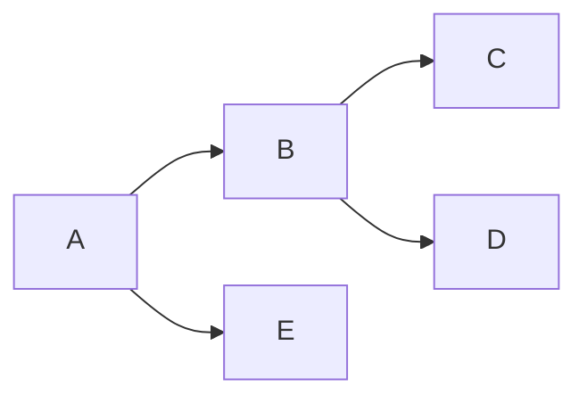
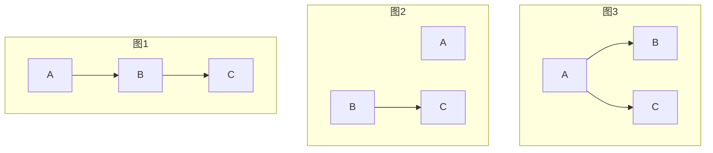
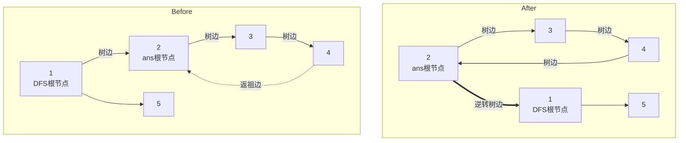
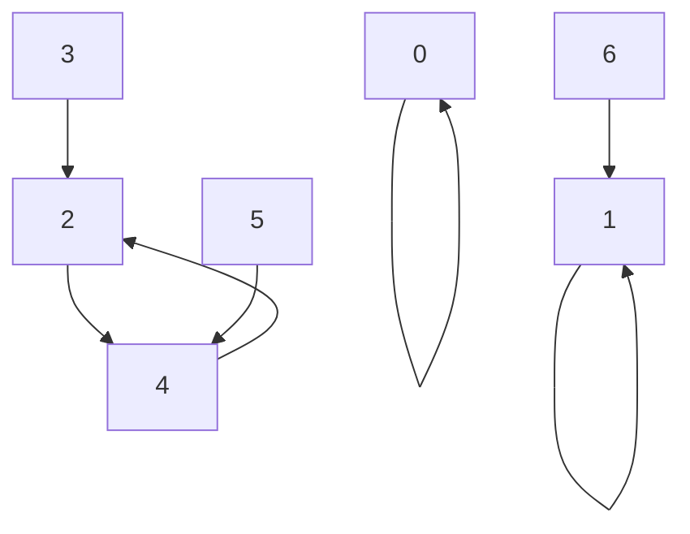
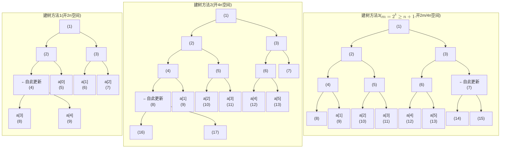
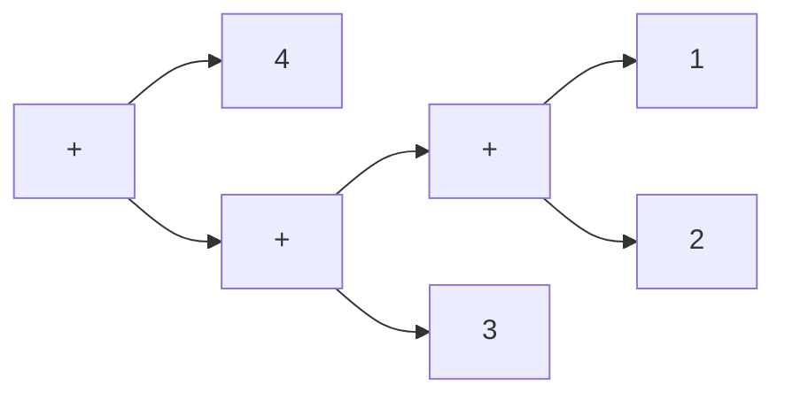

# §6 图

在图$\mathcal{G}=\{\mathcal{V}, \mathcal{E}\}$中，我们有以下约定符号：

- 入邻域$N^{-}(v):= \{u|\langle u,v\rangle\in\mathcal{E}\}$
- 出邻域$N^{+}(u):= \{v|\langle u,v\rangle\in\mathcal{E}\}$

## §6.1 图的存储

| 图的存储方式 | 实现原理   | 实现难度 | 删边难度                         |
| ------ | ------ | ---- | ---------------------------- |
| 链式前向星  | 链表版邻接表 | ⭐    | 有向边：⭐⭐（涉及链表节点的删除）<br>无向边：⭐⭐⭐ |

### §6.1.1 链式前向星

链式前向星本是上是用链表实现的邻接表，其中链表用数组模拟实现。一条无向边用两条单向边储存。

```c++
const int N_MAX = 1e5, M_MAX = 1e5;
int edge_first[N_MAX + 1], edge_to[M_MAX + 1], edge_next[M_MAX + 1], edge_count;
inline void add_edge(const int &root, const int &child) {
    ++edge_count;
    edge_next[edge_count] = edge_first[root];
    edge_first[root] = edge_count;
    edge_to[edge_count] = child;
}
for(int i = 1; i <= n; ++i){
	for(int j = edge_first[i]; j; j = edge_next[j]){
		// foo(i, edge_to[j]);
	}
}
```

在此基础上，我们还可以为第`i`条边指定起点`edge_from[i]`。

### §6.1.A 反向建图

反向建图可以将“多源到单点”问题转化为“单源到多点”的问题。

> [洛谷P3916](https://www.luogu.com.cn/problem/P3916)：给定含有`n<=1e5`个点与`m<=1e5`条有向边的图$\mathcal{G}$，令$f(i)$表示从`i`出发能到达的点的编号最大值，求$f(1), f(2), \cdots, f(n)$的值。

如果正向建边，则需要`n`次DFS，显然会超时。不妨考虑贪心性质——我们先选中第`n`个点$v_n$，判断有哪些点$v_i$可以到达$v_n$，然后标记答案`ans[i] = n`；然后选中第`n-1`个点、第`n-2`个点......，以此类推。如果DFS时已经发现`ans[i] <= 当前DFS的起点编号`，则说明已经被自己或编号更大的点占据了，直接剪枝即可。

容易发现此时我们是从$v_n$出发，主动去寻找$v_i$，因此可以反向建图。

```c++
const int N_MAX = 1e5, M_MAX = 1e5;
int n, m, u_tmp, v_tmp, ans[1 + N_MAX];

int edge_count, edge_first[1 + N_MAX], edge_next[1 + M_MAX], edge_to[1 + M_MAX];
std::set<std::pair<int, int>> edge_set;
inline void edge_add(const int &u, const int &v) {
    ++edge_count;
    edge_to[edge_count] = v;
    edge_next[edge_count] = edge_first[u];
    edge_first[u] = edge_count;
}

void dfs(int root, int u) {
    for(int i = edge_first[u]; i != 0; i = edge_next[i]) {
        const int &v = edge_to[i];
        if(root <= ans[v]) { continue; } ans[v] = root;
        dfs(root, v);
    }
}
int main() {
    std::cin >> n >> m;
    for(int i = 1; i <= m; ++i) { std::cin >> u_tmp >> v_tmp; edge_add(v_tmp, u_tmp); }

    std::iota(ans + 1, ans + 1 + n, 1);
    for(int i = n; i >= 1; --i) {
        dfs(i, i);
    }
    for(int i = 1; i <= n; ++i) { std::cout << ans[i] << ' '; }
}
```

> [洛谷P1629](https://www.luogu.com.cn/problem/P1629)：给定含有`n<=1e3`个点与`m<=1e5`条带权有向边的有向图$\mathcal{G}$，边权`w<=1e4`。令$f(i,j)$表示从点$v_i$到点$v_j$的最短路，求$\displaystyle\sum_{i=2}^{n}\left(f(1,i)+f(i,1)\right)$。

注意到原式可拆分成两个部分：$\displaystyle\sum_{i=2}^{n}f(1,i)$与$\displaystyle\sum_{i=2}^{n}f(i,1)$。前者是标准的“单源到多点”最短路问题，后者是“多点到单源”问题，因此只需正着与反着建两次边，分别跑一次Dijkstra算法即可。

```c++
const int N_MAX = 1e3, M_MAX = 1e5, W_MAX = 1e4, INF = 1e9 + 1;
int n, m, u_temp, v_temp, w_temp, dp[2][1 + N_MAX], vis[2][1 + N_MAX]; int64_t ans;
struct Point { int i, w; };
std::priority_queue<Point, std::vector<Point>, std::function<bool(const Point&, const Point&)>> q([](const Point &child, const Point &root){ return root.w < child.w; });

int edge_count[2], edge_first[2][1 + N_MAX], edge_to[2][1 + M_MAX], edge_next[2][1 + M_MAX], edge_weight[2][1 + M_MAX];
inline void edge_add(int k, const int &u, const int &v, const int &w) {
    edge_to[k][++edge_count[k]] = v;
    edge_next[k][edge_count[k]] = edge_first[k][u];
    edge_first[k][u] = edge_count[k];
    edge_weight[k][edge_count[k]] = w;
}

int main() {
    std::cin >> n >> m;
    for(int i = 1; i <= m; ++i) {
        std::cin >> u_temp >> v_temp >> w_temp;
        edge_add(0, u_temp, v_temp, w_temp);
        edge_add(1, v_temp, u_temp, w_temp);
    }

    std::fill(&(dp[0][0]), &(dp[1][N_MAX]) + 1, INF);
    for(int k = 0; k <= 1; ++k) {
        dp[k][1] = 0; q.emplace(1, dp[k][1]);
        while(!q.empty()) {
            Point point = q.top(); q.pop(); const int &u = point.i;
            if(vis[k][u] == true) { continue; } vis[k][u] = true;
            for(int i = edge_first[k][u]; i != 0; i = edge_next[k][i]) {
                const int &v = edge_to[k][i];
                if(dp[k][v] > dp[k][u] + edge_weight[k][i]) {
                    dp[k][v] = dp[k][u] + edge_weight[k][i];
                    q.emplace(v, dp[k][v]);
                }
            }
        }
    }

    for(int i = 2; i <= n; ++i) { ans += dp[0][i] + dp[1][i]; }
    std::cout << ans;
}
```

### §6.1.B 虚点连边

虚点连边可以“多点到多源”问题转化为“多点到单源”与“单源到多点”的问题。

> [洛谷P1983](https://www.luogu.com.cn/problem/P1983)：给定数组`r[1->n<=1e3]`及关于它的`m<=1e3`条规则限制。第`i`条规则表示为：给定`s_cnt[i]`个递增的正整数数组`s[i][1->s_cnt[i]]`，将闭区间`[s[i][1], s[i][s_cnt[i]]]`内所有位于`s[i][1->s_cnt[i]]`中的值构成集合$\mathcal{V}_1$，不在的值构成集合$\mathcal{V}_2$，保证$\forall u\in\mathcal{V}_1, v\in\mathcal{V}_2$，均满足`r[u] <= r[v]`。将`r[1->n]`扔到集合里去重，求集合元素数量最小值。数据保证答案一定存在。

不妨将`r[u] <= r[v]`视为一条有向边$\langle u, v\rangle$。由于答案一定存在，所以一定能形成一个DAG，容易想到答案就是最长路长度加`1`，表示最长路上经过了多少个节点。令`dp[v]`表示以`v`为终点的最长路长度，显然有状态转移方程`dp[v] = std::max(dp[v], dp[u] + 1)`。然而这样做会导致爆空间与时间，最坏情况下，每条规则均横跨区间`[1, n]`，且$|\mathcal{V}_1| = |\mathcal{V}_2| = \displaystyle\frac{n}{2}$，导致边的数量高达$O\left(m\times\displaystyle\frac{n^2}{4}\right)$，爆空间与时间。

考虑虚点连边优化。我们在$\mathcal{V}_1$与$\mathcal{V}_2$中间加一个虚点$v'$用于暂存$\mathrm{dp}[v'] = \displaystyle\max_{\forall u\in\mathcal{V}_1}\left(\mathrm{dp}[u]\right)$的计算结果，但是不加`1`，然后更新$\forall v\in \mathcal{V}_2, \mathrm{dp}[v] = dp[v'] \textcolor{red}{+ 1}$，这里是需要加`1`的。这样我们只需开$n+m$个点空间，$mn$个边空间即可。

```c++
const int N_MAX = 1e3, M_MAX = 1e3;
int n, n_total, m, s[1 + M_MAX][1 + N_MAX], s_cnt[1 + M_MAX]; 
std::set<int> u_tmp_set; std::queue<int> q; int dp[1 + N_MAX + M_MAX];

int edge_count, edge_first[1 + N_MAX + M_MAX], edge_next[1 + N_MAX * M_MAX], edge_to[1 + N_MAX * M_MAX], vertex_indeg[1 + N_MAX + M_MAX];
inline void edge_add(const int &u, const int &v) {
    ++edge_count;
    edge_to[edge_count] = v;
    edge_next[edge_count] = edge_first[u];
    edge_first[u] = edge_count;
    ++vertex_indeg[v];
}

int main() {
    std::cin >> n >> m; n_total = n;
    for(int i = 1; i <= m; ++i) { std::cin >> s_cnt[i]; for(int j = 1; j <= s_cnt[i]; ++j) { std::cin >> s[i][j]; } }
    
    for(int i = 1; i <= m; ++i) {
        u_tmp_set.clear(); for(int j = 1; j <= s_cnt[i]; ++j) { u_tmp_set.insert(s[i][j]); }
        ++n_total;
        for(int j = s[i][1]; j <= s[i][s_cnt[i]]; ++j) {
            if(u_tmp_set.count(j) == 1) {
                edge_add(j, n_total);
            } else {
                edge_add(n_total, j);
            }
        }
    }

    for(int i = 1; i <= n; ++i) { if(vertex_indeg[i] == 0) { q.push(i); } }
    while(!q.empty()) {
        int u = q.front(); q.pop();
        for(int i = edge_first[u]; i != 0; i = edge_next[i]) {
            int v = edge_to[i];
            dp[v] = std::max(dp[v], dp[u] + (v > n));
            if(--vertex_indeg[v] == 0) { q.push(v); }
        }
    }
    std::cout << *std::max_element(dp + 1, dp + n + 1) + 1;
}
```

> [洛谷P3393](https://www.luogu.com.cn/problem/P3393)：给定由`n<=1e5`个点、`m<=2e5`无向边构成的图。其中有`k<=1e5-2`个病源点，每个病源点会感染与其最短路径长度`<=s<=1e5`的点，变成感染点。感染点与病源点的点权为正整数`q<=1e5`，正常点的点权为正整数`p<=1e5`。求从第`1`个点出发，中途不碰到病源点，到达终点`n`的路径上的点权之和（不包括起点和终点）最小值。

本题第一步要用BFS标记感染点，第二步使用Dijkstra求最短路。问题在于第一步怎么办，我们可定不能跑`k`次BFS，这会导致超时。一种思路是引入一个虚拟节点，连接所有感染点，这样只需跑一次BFS即可。在代码实现中，我们可以不必引入这个虚拟节点，而是直接把所有病源点加入到BFS初始队列中即可。

```c++
const int N_MAX = 1e5, M_MAX = 2e5, K_MAX = N_MAX - 2, S_MAX = 1e5; const int64_t P_MAX = 1e5, Q_MAX = 1e5, INF = 1e18;
int n, m, k, s; int64_t p, q; int c_tmp, a_tmp, b_tmp; int64_t dp[1 + N_MAX];
std::queue<std::pair<int, int>> queue_bfs; bool vis_bfs[1 + N_MAX], vis_disable[1 + N_MAX];
using Point = std::pair<int, int64_t>; std::priority_queue<Point, std::vector<Point>, std::function<bool(const Point&, const Point&)>> queue_dijkstra([](const Point &child, const Point &root){ return root.second < child.second; }); bool vis_dijkstra[1 + N_MAX];

int edge_count, edge_first[1 + N_MAX], edge_to[1 + M_MAX * 2], edge_next[1 + M_MAX * 2];
inline void edge_add(const int &u, const int &v) {
    edge_to[++edge_count] = v;
    edge_next[edge_count] = edge_first[u];
    edge_first[u] = edge_count;
}

int main() {
    std::cin >> n >> m >> k >> s >> p >> q;
    for(int i = 1; i <= k; ++i) { std::cin >> c_tmp; queue_bfs.emplace(0, c_tmp); vis_bfs[c_tmp] = true; vis_disable[c_tmp] = true; }
    for(int i = 1; i <= m; ++i) { std::cin >> a_tmp >> b_tmp; edge_add(a_tmp, b_tmp); edge_add(b_tmp, a_tmp); }

    for(int t = 1; t <= s; ++t) {
        int queue_n = queue_bfs.size();
        while(queue_n--) {
            auto [root, u] = queue_bfs.front(); queue_bfs.pop();
            for(int i = edge_first[u]; i != 0; i = edge_next[i]) {
                int v = edge_to[i];
                if(v == root) { continue; }
                if(vis_bfs[v] == true) { continue; } vis_bfs[v] = true; queue_bfs.emplace(u, v);
            }
        }
    }

    std::fill(dp + 1, dp + n + 1, INF);
    dp[1] = (vis_bfs[1] ? q : p); queue_dijkstra.emplace(1, dp[1]);
    while(!queue_dijkstra.empty()) {
        auto [u, dp_u] = queue_dijkstra.top(); queue_dijkstra.pop();
        if(vis_dijkstra[u] == true) { continue; } vis_dijkstra[u] = true;
        for(int i = edge_first[u]; i != 0; i = edge_next[i]) {
            const int v = edge_to[i]; 
            if(vis_disable[v] == true) { continue; }
            if(dp[u] + (vis_bfs[v] ? q : p) < dp[v]) {
                dp[v] = dp[u] + (vis_bfs[v] ? q : p);
                queue_dijkstra.emplace(v, dp[v]);
            }
        }
    }
    std::cout << dp[n] - (vis_bfs[1] ? q : p) - (vis_bfs[n] ? q : p);
}
```

## §6.2 Tarjan算法

### §6.2.1 强连通分量

Tarjan算法使用一遍DFS和单调栈，来求解有向图的强连通分量。各变量定义如下，其中`N_MAX`表示顶点最大数量：

| 变量名                           | 含义                                                             | 初始值                                     |
| ----------------------------- | -------------------------------------------------------------- | --------------------------------------- |
| `int tarjan_time`             | 当前经过了几次DFS，遍历了多少节点                                             | `0`，每次DFS加`1`                           |
| `int tarjan_dfn[N_MAX + 1]`   | 当前节点是在第几次DFS被遍历到的                                              | `0`，表示从未访问过。如果访问过则应该`>=1`               |
| `int tarjan_low[N_MAX + 1]`   | $\displaystyle\min_{<i,j>\in\mathcal{V}}\text{tarjan\_low}[j]$ | 从未被访问过时为`0`，刚被访问而仍未遍历子节点时为`tarjan_time` |
| `int tarjan_stack[N_MAX + 1]` | 栈。栈底指针恒为`0`取不到，栈顶指针能取到                                         | 栈为全空                                    |
| `int tarjan_stack_size`       | 栈顶指针                                                           | `0`，元素入栈时先加`1`再写入，始终不使用栈内的`0`号空间        |
| `bool tarjan_in_stack[N_MAX]` | 节点`i`是否在栈中                                                     | 全为`false`，表示初始时全都不在栈中                   |

Tarjan算法步骤如下：

1. 每个顶点`i`的`tarjan_dfn[i]`和`tarjan_low[i]`**初始均为`0`，表示尚未访问**，从而节省开辟`visited[]`所需的额外空间。
   
2. 从任意节点`i`出发，作为根节点进行DFS。
   
3. 在单次DFS中，给定节点`i`为根节点。
	1. 记录当前DFS的时间戳，代码为`tarjan_dfn[i] = ++tarjan_time`。**这一步也标记了当前节点已被访问过**。
	2. 初始化`tarjan_low[i]`。目前没有遍历任何相邻的顶点，所以初始值同样为当前DFS的时间戳，代码为`tarjan_low[i] = tarjan_dfn[i]`。**这一步也标记了当前节点已被访问过**。
	3. 让当前节点入栈`tarjan_stack[]`。为了快速查找元素是否在栈中，我们还需额外维护`tarjan_in_stack[i]`。这里有个卡常的细节：为了避免获取栈顶元素`tarjan_stack[tarjan_stack_size - 1]`时引入一次额外的“减一运算”，我们转而放弃使用栈的`0`号空间，并且让`tarjan_stack_size`表示**闭区间**的端点。**也就是说，栈的范围从`[0, tarjan_stack_size)`变为`[1, tarjan_stack_size]`**。代码为`tarjan_stack[++tarjan_stack_size] = i`，并且`tarjan_in_stack[i] = true`。
	4. 遍历所有以`i`为起点的有向边`<i,j>`，本步骤的目的是依据`j`来更新`tarjan_low[i]`。（1）如果`j`未被访问过（`tarjan_dfn[j] == 0`），则先对其`dfs(j)`，然后更新`tarjan_low[i] = std::min(tarjan_low[i], tarjan_low[j])`。（2）如果`j`在栈内（`tarjan_in_stack[i] == true`），则它一定被访问过，直接更新`tarjan_low[i] = std::min(tarjan_low[i], tarjan_low[j])`。
	5. 我们知道，`i`一定属于某个强连通分量。更新完毕后，如果`tarjan_dfn[i] == tarjan_low[i]`，则说明`i`所在的强连通分量中，找不到比`tarjan_low[i]`还小的`tarjan_low[j]`，**所以`i`是所属强连通分量中第一个被DFS访问的节点**。于是不停地出栈顶点元素，直到连`i`也出栈为止，这些出栈的元素就构成了一个强连通分量，**用并查集表示它们属于同一个强连通分量即可**。

4. 遍历图中的每个节点。如果该节点`i`尚未被访问，则`dfs(i)`。否则就略过。

综上所述，Tarjan算法的时间复杂度为$O(n+m)$。伪代码如下所示：

```c++
const int N_MAX = 点的数量, M_MAX = 有向边的数量;
int tarjan_time, tarjan_dfn[N_MAX + 1], tarjan_low[N_MAX + 1], tarjan_stack[N_MAX + 1], tarjan_stack_size, tarjan_count;
bool tarjan_in_stack[N_MAX + 1]
void tarjan_dfs(int u) {
    tarjan_dfn[u] = tarjan_low[u] = ++tarjan_time;
    tarjan_stack[++tarjan_stack_size] = u;
    tarjan_in_stack[u] = true;
    for(int i = edge_first[u]; i; i = edge_next[i]) {
        int v = edge_to[i];
        if(tarjan_dfn[v] == 0) {
            tarjan_dfs(v);
            tarjan_low[u] = std::min(tarjan_low[u], tarjan_low[v]);
        } else if(tarjan_in_stack[v]) {
            tarjan_low[u] = std::min(tarjan_low[u], tarjan_low[v]);
            // 有些文献使用的不是tarjan_low[v]，而是``tarjan_dfn[v]，这是因为当v在栈内时，v的DFS仍然在遍历子节点这一步，没有进行tarjan_low[v]的更新，所以此时tarjan_low[v] == tarjan_dfn[v]，两者可以互换。从原理上来说，tarjan_low[v]才是绝对正确的，而tarjan_dfn[n]纯属巧合
        }
    }
    if(tarjan_dfn[u] == tarjan_low[u]) {
        ++tarjan_count;
        int v;
        do {
            v = tarjan_stack[tarjan_stack_size--];
            tarjan_in_stack[v] = false;
			/* 此处可对出栈的v进行记录等操作 */
        } while(v != u); // 如果当前的子节点v就是u本身，那么v(即u)已经出栈，退出循环，不再继续出栈
    }
}
int main() {
    std::cin >> n >> m;
    for(int i = 1; i <= m; ++i) {
        std::cin >> u_temp >> v_temp;
        add_edge(u_temp, v_temp);
    }
    for(int i = 1; i <= n; ++i) {
        if(tarjan_dfn[i] == 0) {
            tarjan_dfs(i);
        }
    }
}
```

> [洛谷B3609](https://www.luogu.com.cn/problem/B3609)：强连通分量模版题。给定`n`个点（编号从`1`到`n`）和`m`条边构成的有向图，求`1`号节点、`2`号节点、...、`n`号节点所属的强连通分量中的节点编号集合，节点编号按升序输出。如果某个节点`j`在之前的节点`i`（`i<j`）中已被输出，则不必输出节点`j`的强连通分量。

在Tarjan模版的基础上，我们引入了`dsu_parent[i]`表示第`i`个节点所属强连通分量的节点最小编号，`dsu_queue[dsu_find(i)]`记录第`i`个节点所属强连通分量的编号集合。这里我们推迟到输出时，才对该集合进行排序。输出的元素标记为`output_visited[j] = true`。

```c++
const int N_MAX = 1e4, M_MAX = 1e5;
int n, m, u_temp, v_temp;

int edge_count, edge_first[N_MAX + 1], edge_next[M_MAX + 1], edge_to[M_MAX + 1];
inline void add_edge(int u, int v) {
    ++edge_count;
    edge_next[edge_count] = edge_first[u];
    edge_first[u] = edge_count;
    edge_to[edge_count] = v;
}

int tarjan_time, tarjan_dfn[N_MAX + 1], tarjan_low[N_MAX + 1], tarjan_stack[N_MAX + 1], tarjan_stack_size, tarjan_count;
bool tarjan_in_stack[N_MAX + 1], output_visited[N_MAX + 1];
std::vector<int> dsu_queue[N_MAX + 1];
int dsu_parent[N_MAX + 1];
int dsu_find(int u) { return u == dsu_parent[u] ? u : dsu_parent[u] = dsu_find(dsu_parent[u]); }
void tarjan_dfs(int u) {
    tarjan_dfn[u] = tarjan_low[u] = ++tarjan_time;
    tarjan_stack[++tarjan_stack_size] = u;
    tarjan_in_stack[u] = true;
    for(int i = edge_first[u]; i; i = edge_next[i]) {
        int v = edge_to[i];
        if(tarjan_dfn[v] == 0) { 
            tarjan_dfs(v);
            tarjan_low[u] = std::min(tarjan_low[u], tarjan_low[v]);
        } else if(tarjan_in_stack[v]) {
            tarjan_low[u] = std::min(tarjan_low[u], tarjan_low[v]);
        }
    }
    if(tarjan_dfn[u] == tarjan_low[u]) {
        ++tarjan_count;
        int v;
        do {
            v = tarjan_stack[tarjan_stack_size--];
            tarjan_in_stack[v] = false;
            dsu_parent[v] = u; // dsu_unite(u, v)
            dsu_queue[u].push_back(v); // 记录出栈的元素v
        } while(v != u); // 如果当前的子节点v就是u本身，那么v(即u)已经出栈，退出循环，不再继续出栈
    }
}

int main() {
    std::cin >> n >> m;
    for(int i = 1; i <= m; ++i) {
        std::cin >> u_temp >> v_temp;
        add_edge(u_temp, v_temp);
    }
    for(int i = 1; i <= n; ++i) {
        if(tarjan_dfn[i] == 0) {
            tarjan_dfs(i);
        }
    }
    std::cout << tarjan_count << '\n';
    for(int i = 1; i <= n; ++i) {
        int i_ancestor = dsu_find(i);
        if(output_visited[i] == false) {
            output_visited[i] = true;
            std::sort(dsu_queue[i_ancestor].begin(), dsu_queue[i_ancestor].end());
            for(const int &v: dsu_queue[i_ancestor]) {
                output_visited[v] = true;
                std::cout << v << ' ';
            }
            std::cout << '\n';
        }
    }
}
```

### §6.2.2 割点

Tarjan算法使用一遍DFS（**不需要单调栈**），来求解无向图的割点。给定一个弱连通图（或无向图），如果删除图中的某个节点`i`以及与其相邻的所有有向边，能让原图不再是弱连通图，则称这个点为割点。

在实际编程中，我们认为给定的有向图都要转化成无向图，所以有向边要正反添加两次。各变量定义如下，其中`N_MAX`表示顶点最大数量：

| 变量名                            | 含义                                                                                                                   | 初始值                                     |
| ------------------------------ | -------------------------------------------------------------------------------------------------------------------- | --------------------------------------- |
| `int tarjan_time`              | 当前经过了几次DFS，遍历了多少节点                                                                                                   | `0`，每次DFS加`1`                           |
| `int tarjan_dfn[N_MAX + 1]`    | 当前节点是在第几次DFS被遍历到的                                                                                                    | `0`，表示从未访问过。如果访问过则应该`>=1`               |
| `int tarjan_low[N_MAX + 1]`    | $\displaystyle\min_{\begin{align}&i\le j\text{符合DFS搜索序},i先j后\\&<j,k>\in\mathcal{V}\end{align}}\text{tarjan\_dfn}[k]$ | 从未被访问过时为`0`，刚被访问而仍未遍历子节点时为`tarjan_time` |
| `int tarjan_dfs_root`          | 当前DFS生成树的根节点                                                                                                         | 由`main()`调用`tarjan_dfs()`时指定            |
| `int cutvertex_count`          | 目前检测到的割点数量                                                                                                           | `0`                                     |
| `bool is_cutvertex[N_MAX + 1]` | 当前节点是否为割点                                                                                                            | 全为`false`                               |

需要注意的是：**`tarjan_low[]`的含义发生了改变**。在强连通分量中，`tarjan_low[i]`表示`i`所在强连通分量中被DFS搜索树第一个搜索到的节点`j`的`tarjan_dfn[j]`；**而在割点中，`tarjan_low[i]`表示在DFS搜索树遍历到节点`i`时，给定节点`i`本身及其DFS搜索树的所有子树节点`j`，它们的所有反祖边指向的已访问过的节点中，最早被访问的节点`k`的`tarjan_dfn[k]`，也就是`k`何时被访问**。

在求强连通分量时，我们介绍过在下面的代码中`tarjan_low[v]`（旧）和`tarjan_dfn[v]`可以互换，但是在求割点时，由于`tarjan_low[]`的含义发生了改变，只能使用`tarjan_dfn[v]`。否则这就相当于在更新`tarjan_low[u]`（新）时，让其指向`tarjan_low[u]`（旧），也就是`tarjan_low[tarjan_low[...tarjan_low[u]]]`（新），导致`tarjan_low[u]`指向的最早被访问的节点，不属于`i`的反祖边，违反定义。用[张一帆](https://yfzhang114.github.io/)在[CSDN博客](https://blog.csdn.net/csyifanZhang/article/details/105370924)中的话来说，这导致`tarjan_low[u]`回翻过头，翻到了其它的环中。

```c++
/* 强连通分量 */
void tarjan_dfs(int u){
	for(遍历v: u -> v){
		if(v未访问过){
			tarjan_dfs(v);
			tarjan_low[u] = std::min(tarjan_low[u], tarjan_low[v]);
		} else if (v在栈中) {
			/* 下面两种方法均可 */
			tarjan_low[u] = std::min(tarjan_low[u], tarjan_low[v]);
			tarjan_low[u] = std::min(tarjan_low[u], tarjan_dfn[v]);
		}
	}
}
/* 割点 */
void tarjan_dfs(int u){
	for(遍历v: u -> v){
		if(v未访问过){
			tarjan_dfs(v);
			tarjan_low[u] = std::min(tarjan_low[u], tarjan_low[v]);
		} else { // 这一步不用判断是否在栈中!
		// 也可以替换成else if(v != father)，不影响正确性，其中father为DFS生成树中u的父节点
			/* 只能用tarjan_dfn[v]，不能用tarjan_low[v]，即下面这行是错误的
			tarjan_low[u] = std::min(tarjan_low[u], tarjan_low[v]);
			*/
			tarjan_low[u] = std::min(tarjan_low[u], tarjan_dfn[v]);
		}
	}
}
```

上面的代码还有一个细节：**取消了`else if()`分支的判断条件**。首先证明`else if(v在栈内)`替换为`else`的正确性。分两种情况分类讨论：

1. `v`已被访问过，且`v`在栈内
   此时当前边是反向边，即在DFS生成树中，`v`先访问，`u`后访问。则根据`tarjan_dfs()`中的定义，`v`一定会把`u`的`tarjan_low[u]`抢过来，进行`tarjan_low[v] = std::min(tarjan_low[v], tarjan_low[u])`的尝试，这一步符合`tarjan_low[]`的定义，因此成立。
2. `v`已被访问过，且`v`早已出栈
   **这种情况不可能存在**。如果这种情况存在，那么`u`和`v`之间存在一条无向边。已知`v`被访问过，`v`与`u`相连，那么在`tarjan_dfs(v)`时也会连`u`一并访问，从而退化到一种情况。

关于如何判定节点是否为当前DFS生成树的根节点，我们有以下实现方案：

1. `tarjan_dfs_root`全局变量
   ```c++
   int tarjan_dfs_root;
   void tarjan_dfs(int u){
	   if(u == tarjan_dfs_root){
		   u是当前DFS生成树的节点
	   }
   }
   int main(){
	   // ...
	   for(int i = 1; i <= n; ++i){
		   if(tarjan_dfn[i] == 0){
			   tarjan_dfs_root = i;
			   tarjan_dfs(i);
		   }
	   }
   }
   ```
2. 并查集`dsu_father[]`
   ```c++
   int dsu_father[N_MAX + 1];
   void tarjan_dfs(int u){
	   for(int i = edge_first[i]; i; i = edge_next[i]){
		   v = edge_to[i];
		   if(tarjan_dfn[v] == 0){
			   dsu_father[v] = u;
		   }
	   }
	   if(dsu_father[u] == 0){
		   u是当前DFS生成树的节点
	   }
   }
   ```

然后考虑割点的判定条件。我们不加证明地给出以下判定依据，二者满足其一即可。直观的证明过程参考[Bilibili @邋遢大哥233](https://www.bilibili.com/video/BV1Q7411e7bM/)的视频讲解：

- 节点`u`是DFS搜索树根节点，且其子树数量大于等于`2`
- 节点`u`不是DFS搜索树根节点，且存在一条有向边`<u, v>`满足`tarjan_low[v] >= tarjan_dfn[u]`

在Tarjan算法中，一个点可能会被多次判定为割点。以下面的输入为例：



在DFS生成树中，遍历到`A->B->C/D`回溯时，容易发现`v=C`和`v=D`两个节点对于`u=A`而言，都满足`tarjan_low[v] >= tarjan_dfn[u]`。于是就会进入两次“标记`u`为割点”的分支。因此我们必须防止Tarjan算法因为重复标记割点，而导致`curvertex_count`重复自增。为了在分支中设计恰当的`cutvertex_count++`机制，编程中常用以下实现方法：

1. 为`cutvertex_count++`分支引入额外判定，防止重复标记割点
   ```c++
   if(tarjan_low[v] >= tarjan_dfn[u] && u != tarjan_dfs_root) {
	    if(is_cutvertex[u] == false) { // 额外的判定，使得该分支只能进入一次
	        ++cutvertex_count; is_cutvertex[u] = true;
	    }
   }
   if(u == tarjan_dfs_root && child_count >= 2) {
        if(is_cutvertex[u] == false) { // 额外的判定，使得该分支只能进入一次
            ++cutvertex_count; is_cutvertex[u] = true;
		}
   }
   ```
2. 控制`cutvertex_count`的自增值
   ```c++
    if(tarjan_low[v] >= tarjan_dfn[u] && u != tarjan_dfs_root) {
	    cutvertex_count += !is_curvertex[u]; 
	    is_cutvertex[u] = true;
   }
   if(u == tarjan_dfs_root && child_count >= 2) {
        cutvertex_count += !is_curvertex[u]; 
        is_cutvertex[u] = true;
   }
   ```

综上所述，时间复杂为$O(n+m)$。

> [洛谷P3388](https://www.luogu.com.cn/problem/P3388)：有向图割点的模板题。要求先输出割点个数，然后升序输出割点编号。

```c++
const int N_MAX = 2e4, M_MAX = 1e5 * 2;
int n, m, u_temp, v_temp;

int edge_count, edge_first[N_MAX + 1], edge_next[M_MAX + 1], edge_to[M_MAX + 1];
inline void add_edge(int u, int v) {
    ++edge_count;
    edge_next[edge_count] = edge_first[u];
    edge_first[u] = edge_count;
    edge_to[edge_count] = v;
}

int tarjan_time, tarjan_dfn[N_MAX + 1], tarjan_low[N_MAX + 1];
int tarjan_dfs_root, cutvertex_count; // 求解割点所额外定义的变量
bool is_cutvertex[N_MAX + 1];
void tarjan_dfs(int u) {
    tarjan_dfn[u] = tarjan_low[u] = ++tarjan_time;
    int child_count = 0;
    for(int i = edge_first[u]; i; i = edge_next[i]) {
        int v = edge_to[i];
        if(tarjan_dfn[v] == 0) {
            ++child_count;
            tarjan_dfs(v);
            tarjan_low[u] = std::min(tarjan_low[u], tarjan_low[v]);
            if(tarjan_low[v] >= tarjan_dfn[u] && u != tarjan_dfs_root) {
                if(is_cutvertex[u] == false) {
                    ++cutvertex_count; is_cutvertex[u] = true;
                }
            }
        } else {
            tarjan_low[u] = std::min(tarjan_low[u], tarjan_dfn[v]);
        }
    }
    if(u == tarjan_dfs_root && child_count >= 2) {
        if(is_cutvertex[u] == false) { // 这一层if防止cutvertex_count在回溯时，同一顶点重复累加
            ++cutvertex_count; is_cutvertex[u] = true;
        }
    }
}

int main() {
    std::cin >> n >> m;
    for(int i = 1; i <= m; ++i) {
        std::cin >> u_temp >> v_temp;
        add_edge(u_temp, v_temp);
        add_edge(v_temp, u_temp);
    }
    for(int i = 1; i <= n; ++i) {
        if(tarjan_dfn[i] == 0) {
            tarjan_dfs_root = i;
            tarjan_dfs(i);
        }
    }
    std::cout << cutvertex_count << '\n';
    for(int i = 1; i <= n; ++i) {
        if(is_cutvertex[i]) {
            std::cout << i << ' ';
        }
    }
}
```

### §6.2.3 割边

Tarjan算法使用一遍DFS（**不需要单调栈，需要DFS生成树支持查询某个节点的父节点**），来求解无向图的割边。给定一个弱连通图（或无向图），如果删除图中的某个无向边，能让原图不再是弱连通图，则称这个点为割边。

在实际编程中，我们认为给定的有向图都要转化成无向图，所以有向边要正反添加两次。各变量定义如下，其中`N_MAX`表示顶点最大数量：

| 必选  | 变量名                                      | 含义                                                                                                                                              | 初始值                                     |
| --- | ---------------------------------------- | ----------------------------------------------------------------------------------------------------------------------------------------------- | --------------------------------------- |
| ✅   | `int tarjan_time`                        | 同割点                                                                                                                                             | 同割点                                     |
| ✅   | `int tarjan_dfn[N_MAX + 1]`              | 同割点                                                                                                                                             | 同割点                                     |
| ✅   | `int tarjan_low[N_MAX + 1]`              | $\displaystyle\min_{\begin{align}&i\le j\text{符合DFS搜索序},i先j后\\&<j,k>\in\mathcal{V}-\textcolor{red}{\{<j,i>\}}\end{align}}\text{tarjan\_dfn}[k]$ | 从未被访问过时为`0`，刚被访问而仍未遍历子节点时为`tarjan_time` |
| ❌   | `int tarjan_father`                      | 在DFS搜索树中，某个节点的父节点编号                                                                                                                             | 全为`0`                                   |
| ❓   | `int cutedge_count`                      | 目前检测到的割边数量                                                                                                                                      | `0`                                     |
| ❓   | `bool is_cutedge[M_MAX + 1]`             | 当前边是否为割边（无需定义`cutedge_count`，但不能参与排序）                                                                                                           | 全为`false`                               |
| ❓   | `std::pair<int, int> cutedge[M_MAX + 1]` | 检测到的第`i`条割边的首尾节点（可以排序，但需要配合`cutedge_count`使用）                                                                                                   | 全为`0`                                   |

需要注意的是：**`tarjan_low[]`的含义发生了改变**。在割点中，`tarjan_low[i]`表示在DFS搜索树遍历到节点`i`时，**给定节点`i`本身及其DFS搜索树的所有子树节点`j`**，它们的所有反祖边指向的已访问过的节点中，最早被访问的节点`k`的`tarjan_dfn[k]`。而在割边中，`tarjan_low[i]`表示**只有DFS搜索树的所有子树节点`j`**，它们的所有反祖边指向的最早访问节点`k`的`tarjan_dfn[k]`。

因为`tarjan_low[]`的含义发生了改变，所以我们要更改`tarjan_dfs()`的逻辑：

```c++
/* 割点 */
void tarjan_dfs(int u){
	for(遍历v: u -> v){
		if(v未访问过){
			tarjan_dfs(v);
			tarjan_low[u] = std::min(tarjan_low[u], tarjan_low[v]);
		} else { 
		// 也可以替换成else if(v != father[u])，不影响正确性
		// 其中father[u]为DFS生成树中u的父节点
			tarjan_low[u] = std::min(tarjan_low[u], tarjan_dfn[v]);
		}
	}
}
/* 割边 */
void tarjan_dfs(int u){
	for(遍历v: u -> v){
		if(v未访问过){
			tarjan_dfs(v);
			tarjan_low[u] = std::min(tarjan_low[u], tarjan_low[v]);
		else if(v != father) { // 只能这么写
			tarjan_low[u] = std::min(tarjan_low[u], tarjan_dfn[v]);
		}
	}
}
```

在割点中，我们之所以使用`} else {`而不出错，是因为求割点只关心`tarjan_dfn[u] >= tarjan_low[v]`，即使从DFS搜索树上的子节点回到了父节点，也只是会让两者相等，依然符合判定条件，所以我们为了节省常数空间和时间而“将错就错”。而割点使用的`tarjan_dfn[u] > tarjan_low[v]`则不同，取等之后会不满足判定条件，所以需要严格区分。

为了获取这个`father[u]`，编程实践中有两种实现方式：

1. 使用`tarjan_dfs_father[]`记录每个节点的父节点
   这种方法使用了额外的$O(n)$空间，在`tarjan_dfs()`中实时维护。
   ```c++
   int tarjan_dfs_father[N_MAX + 1];
   void tarjan_dfs(int u){
	   for(遍历v: u -> v){
		   if(v未被访问){
			   tarjan_dfs_father[v] = u;
			   tarjan_dfs(v);
			   // ,,,
		   }else if(v != tarjan_dfs_father[u]){
			   // ,,,
		   }
	   }
   }
   ```
2. 在`tarjan_dfs()`中携带父节点信息
   ```c++
   void tarjan_dfs(int u, int father){ // father是u的父节点
	   for(遍历v: u -> v){
		   if(v未被访问){
			   tarjan_dfs(v, u);
			   // ,,,
		   }else if(v != father){
			   // ,,,
		   }
	   }
   }
   int main(){
		// ...
		tarjan_dfs(i, 0);
		// ...
   }
   ```

然后考虑割点的判定条件。我们不加证明地给出以下判定依据。直观的证明过程参考[Bilibili @邋遢大哥233](https://www.bilibili.com/video/BV1Q7411e7bM/)的视频讲解：

- 节点`u`存在一条有向边`<u, v>`满足`tarjan_dfn[u] < tarjan_low[v]`。

然后考虑割边的存储方式、编程实践中有以下两种方法：

1. 使用`bool is_cutedge[]`标记边是否为割边（不能参与排序）
   ```c++
   bool is_cutedge[M_MAX + 1];
   for(int i = edge_first[u]; i; i = edge_next[i]){
	   // ...
	   if(tarjan_dfn[u] < tarjan_low[v]){
		   is_cutedge[i] = true;
	   }
	   // ...
   }
   ```
2. 复制一份割边信息为`std::pair<int,int>`，用数组或`std::vector`存储（可以排序）
   ```c++
   std::pair<int, int> cutedge[M_MAX + 1];
   int cutedge_count;
   for(int i = edge_first[u]; i; i = edge_next[i]){
	   // ...
	   if(tarjan_dfn[u] < tarjan_low[v]){
		   ++cutedge_count;
		   cutedge[cutedge_count].first = u;
		   cutedge[cutedge_count].second = v;
		   /* 如果对顺序有要求，也可以：
		   cutedge[cutedge_count].first = std::min(u, v);
		   cutedge[cutedge_count].second = std::max(u, v);
		   */
	   }
	   // ...
   }
   ```

> [洛谷P1656](https://www.luogu.com.cn/problem/P1656)：割边模版题。给定一个有向图，请输出它的所有割边。每条割边内的两个节点按升序输出，多条割边整体按照起点和终点做字典序升序输出。

代码如下：

```c++
const int N_MAX = 150, M_MAX = 5000;
int n, m, u_temp, v_temp;

int edge_count, edge_first[N_MAX + 1], edge_next[M_MAX + 1], edge_to[M_MAX + 1];
inline void edge_add(int u, int v) {
    ++edge_count;
    edge_next[edge_count] = edge_first[u];
    edge_first[u] = edge_count;
    edge_to[edge_count] = v;
}

int tarjan_time, tarjan_dfn[N_MAX + 1], tarjan_low[N_MAX + 1], tarjan_dfs_root;
std::pair<int, int> cutedge[M_MAX + 1]; int cutedge_count;
inline void tarjan_dfs(int u, int father) {
    tarjan_dfn[u] = tarjan_low[u] = ++tarjan_time;
    for(int i = edge_first[u]; i; i = edge_next[i]) {
        int v = edge_to[i];
        if(tarjan_dfn[v] == 0) {
            tarjan_dfs(v, u);
            tarjan_low[u] = std::min(tarjan_low[u], tarjan_low[v]);          
            if(tarjan_dfn[u] < tarjan_low[v]) {
                ++cutedge_count;
                cutedge[cutedge_count].first = std::min(u, v);
                cutedge[cutedge_count].second = std::max(u, v);
            }
        } else if(v != father) {
            tarjan_low[u] = std::min(tarjan_low[u], tarjan_dfn[v]);
        }
    }
}

int main() {
    std::cin >> n >> m;
    for(int i = 1; i <= m; ++i) {
        std::cin >> u_temp >> v_temp;
        edge_add(u_temp, v_temp);
        edge_add(v_temp, u_temp);
    }
    for(int u = 1; u <= n; ++u) {
        if(tarjan_dfn[u] == 0) {
            tarjan_dfs_root = u;
            tarjan_dfs(u, 0);
        }
    }
    std::sort(cutedge + 1, cutedge + cutedge_count + 1, [](const auto &lhs, const auto &rhs) -> bool {
        if(lhs.first != rhs.first) {
            return lhs.first < rhs.first;
        } else {
            return lhs.second < rhs.second;
        }
    });
    for(int i = 1; i <= cutedge_count; ++i) {
        std::cout << cutedge[i].first << ' ' << cutedge[i].second << '\n';
    }
}
```

### §6.2.4 缩点

给定一个有向图，将其中所有的强连通分量做离散化，分别使用一个总结点代替。这一过程称为缩点。

缩点构成的图一定是有向无环图（DAG），因为缩点表示的强连通分量本身就是最大的极大强连通子图，如果存在环，则检测到的强连通子图并不是极大，从而矛盾，证毕。

由于缩点图一定是DAG，于是我们可以在上面进行拓扑排序。

- BFS的做法是先让各个入度为`0`的缩点入队，同时初始化其`dp[]`，然后就是正常的拓扑排序，**这里的`dp[i]`通常是将`i`作为终点**。
- DFS的做法是**让`dp[i]`表示以`i`为起点，同时`dp[i]`的初始值也充当`visited[]`的作用**。在`main()`函数遍历所有`dp[i] == 初始值(0)`的缩点，然后沿有向图依次更新。

在强连通分量的基础上，Tarjan算法进行缩点所需的变量有：

| 必选  | 变量名                             | 含义                     | 初始值                                          |
| --- | ------------------------------- | ---------------------- | -------------------------------------------- |
| ✅   | `int scc_map[N_MAX + 1]`        | 原始有向图中的节点对应着第几个缩点      | `0`                                          |
| ✅   | `int scc_count`                 | 目前为止发现了几个强连通分量，创建了几个缩点 | `0`，每次出栈导出一个强连通分量就加`1`                       |
| ❌   | `int scc_indegree[N_MAX + 1]`   | 统计第`i`个强连通分量作为一个缩点的总入度 | `0`                                          |
| ❌   | `int scc_outdegree[N_MAX + 1]`  | 统计第`i`个强连通分量作为一个缩点的总出度 | `0`                                          |
| ❌   | `int scc_source_count`          | 统计入度为`0`的缩点数           | `0`，遍历所有缩点`i`，如果`scc_indegree[i] == 0`则加`1`  |
| ❌   | `int scc_sink_count`            | 统计出度为`0`的缩点数           | `0`，遍历所有缩点`i`，如果`scc_outdegree[i] == 0`则加`1` |
| ❌   | `int scc_edge_count`            | 在缩点后的图中有多少条缩点之间的边      | `0`                                          |
| ❌   | `int scc_edge_first[N_MAX + 1]` | 链式前向星存储缩点图             | `0`                                          |
| ❌   | `int scc_edge_next[M_MAX + 1]`  | 链式前向星存储缩点图             | `0`                                          |
| ❌   | `int scc_edge_to[M_MAX + 1]`    | 链式前向星存储缩点图             | `0`                                          |

模板如下所示，按需选择并使用上表中的变量：

```c++
int scc_map[N_MAX + 1], scc_count, scc_indegree[N_MAX + 1], scc_outdegree[N_MAX + 1], scc_sink_count, scc_source_count;
int scc_edge_count, scc_edge_first[N_MAX + 1], scc_edge_next[M_MAX + 1], scc_edge_to[M_MAX + 1];
inline void scc_add_edge(int u, int v) {
	++scc_edge_count;
	scc_edge_next[scc_edge_count] = scc_edge_first[u];
	scc_edge_first[u] = scc_edge_count;
	scc_edge_to[scc_edge_count] = v;
}

// ...tarjan变量定义
void tarjan_dfs(int u) {
    // ...
    for(int i = edge_first[u]; i; i = edge_next[i]) {
		// ...
    }
    if(tarjan_dfn[u] == tarjan_low[u]) {
        int v; ++scc_count;
        do {
	        // ...
            scc_map[v] = scc_count;
        } while(u != v);
    }
}

int main() {
    std::cin >> n;
    for(int u = 1; u <= n; ++u) {
		// ...输入并添加有向边
    }
    for(int u = 1; u <= n; ++u) {
        if(tarjan_dfn[u] == 0) { tarjan_dfs(u); }
    }
    for(int u = 1; u <= n; ++u) { // 维护scc_indegree和scc_outdegree
        for(int i = edge_first[u]; i; i = edge_next[i]) {
            int v = edge_to[i];
            if(scc_map[u] != scc_map[v]) {
                scc_indegree[scc_map[v]]++;
                scc_outdegree[scc_map[u]]++;
            }
        }
    }
    for(int i = 1; i <= scc_count; ++i) { // 维护scc_sink_count和scc_source_count
        if(scc_indegree[i] == 0) { ++scc_sink_count; }
        if(scc_outdegree[i] == 0) { ++scc_source_count; }
    }
}
```

> [洛谷P2746](https://www.luogu.com.cn/problem/P2746)/[洛谷P2812](https://www.luogu.com.cn/problem/P2812)（数据加强）：给定一个有向图$\mathcal{G}$，求（1）至少要选中多少点作为起点，才能保证图中的任意节点均可达；（2）至少还要添加多少条有向边，才能使$\mathcal{G}$变成强连通图。

考虑$\mathcal{G}$在缩点之后形成的缩点有向无环图。显然我们可以引入一条边，加在入度为`0`的缩点上，就能消灭一个不弱连通的、入度为`0`的子图，于是（1）的答案即为`scc_source_count`。更进一步，这条边可以顺带消灭一个不强连通的、出度为`0`的子图，于是（2）的答案即为`std::max(scc_source_count, scc_sink_count)`。

**特判极端情况：$\mathcal{G}$本身就是一个强连通图，只有一个缩点**。（1）的答案应为`1`，恰好`acc_source_count`也是`1`，所以成立。**（2）的答案应为`0`，然而`std::max(...) = std::max(1, 1) = 1`，不成立，因此要做特判输出`0`**。

```c++
const int N_MAX = 1e4, M_MAX = 5e4;
int n, v_temp;

int edge_count, edge_first[N_MAX + 1], edge_next[M_MAX + 1], edge_to[M_MAX + 1];
inline void add_edge(int u, int v) {
    ++edge_count;
    edge_next[edge_count] = edge_first[u];
    edge_first[u] = edge_count;
    edge_to[edge_count] = v;
}

int scc_map[N_MAX + 1], scc_count, scc_indegree[N_MAX + 1], scc_outdegree[N_MAX + 1], scc_sink_count, scc_source_count; // 强连通分量相关的变量

int tarjan_time, tarjan_dfn[N_MAX + 1], tarjan_low[N_MAX + 1], tarjan_stack[N_MAX + 1], tarjan_stack_size;
bool tarjan_in_stack[N_MAX + 1];
void tarjan_dfs(int u) {
    tarjan_dfn[u] = tarjan_low[u] = ++tarjan_time;
    tarjan_stack[++tarjan_stack_size] = u;
    tarjan_in_stack[u] = true;
    for(int i = edge_first[u]; i; i = edge_next[i]) {
        int v = edge_to[i];
        if(tarjan_dfn[v] == 0) {
            tarjan_dfs(v);
            tarjan_low[u] = std::min(tarjan_low[u], tarjan_low[v]);
        } else if(tarjan_in_stack[v]) {
            tarjan_low[u] = std::min(tarjan_low[u], tarjan_dfn[v]);
        }
    }
    if(tarjan_dfn[u] == tarjan_low[u]) {
        int v; ++scc_count;
        do {
            v = tarjan_stack[tarjan_stack_size--];
            tarjan_in_stack[v] = false;
            scc_map[v] = scc_count;
        } while(u != v);
    }
}

int main() {
    std::cin >> n;
    for(int u = 1; u <= n; ++u) {
        while(std::cin >> v_temp, v_temp != 0) { add_edge(u, v_temp); }
    }
    for(int u = 1; u <= n; ++u) {
        if(tarjan_dfn[u] == 0) { tarjan_dfs(u); }
    }
    for(int u = 1; u <= n; ++u) {
        for(int i = edge_first[u]; i; i = edge_next[i]) {
            int v = edge_to[i];
            if(scc_map[u] != scc_map[v]) {
                scc_indegree[scc_map[v]]++;
                scc_outdegree[scc_map[u]]++;
            }
        }
    }
    for(int i = 1; i <= scc_count; ++i) {
        if(scc_indegree[i] == 0) { ++scc_sink_count; }
        if(scc_outdegree[i] == 0) { ++scc_source_count; }
    }
    std::cout << scc_sink_count << '\n';
    std::cout << (scc_count == 1 ? 0 : std::max(scc_sink_count, scc_source_count));
}
```

> [洛谷P2341](https://www.luogu.com.cn/problem/P2341)：给定一个有向图$\mathcal{G}$，求有多少个顶点`i`满足任意节点均能到达`i`？

本题的答案是“**唯一**入度为`0`的缩点中的节点总数”。顶点`i`所在的缩点的入度为`0`，保证了所在的弱连通分量中的有些节点可以到达`i`。入度为`0`的缩点数只有一个，保证了$\mathcal{G}$是连通图（排除图2可能性），也保证了只有一个终点，从终点出发一定可以到达终点（排除图3可能性）。



```c++
const int N_MAX = 1e4, M_MAX = 5e4;
int n, m, u_temp, v_temp;

int edge_count, edge_first[N_MAX + 1], edge_next[M_MAX + 1], edge_to[M_MAX + 1];
inline void add_edge(int u, int v) {
    ++edge_count;
    edge_next[edge_count] = edge_first[u];
    edge_first[u] = edge_count;
    edge_to[edge_count] = v;
}

int scc_map[N_MAX + 1], scc_count, scc_size[N_MAX + 1];
int scc_indegree[N_MAX + 1], scc_outdegree[N_MAX + 1], scc_sink_count, scc_source_count;

int tarjan_time, tarjan_dfn[N_MAX + 1], tarjan_low[N_MAX + 1], tarjan_stack[N_MAX + 1], tarjan_stack_size;
bool tarjan_in_stack[N_MAX + 1];
void tarjan_dfs(int u) {
    tarjan_dfn[u] = tarjan_low[u] = ++tarjan_time;
    tarjan_stack[++tarjan_stack_size] = u;
    tarjan_in_stack[u] = true;
    for(int i = edge_first[u]; i; i = edge_next[i]) {
        int v = edge_to[i];
        if(tarjan_dfn[v] == 0) {
            tarjan_dfs(v);
            tarjan_low[u] = std::min(tarjan_low[u], tarjan_low[v]);
        } else if(tarjan_in_stack[v]) {
            tarjan_low[u] = std::min(tarjan_low[u], tarjan_dfn[v]);
        }
    }
    if(tarjan_dfn[u] == tarjan_low[u]) {
        int v; ++scc_count;
        do {
            v = tarjan_stack[tarjan_stack_size--];
            tarjan_in_stack[v] = false;
            scc_map[v] = scc_count;
            ++scc_size[scc_count];
        } while(u != v);
    }
}

int main() {
    std::cin >> n >> m;
    for(int i = 1; i <= m; ++i) {
        std::cin >> u_temp >> v_temp;
        add_edge(u_temp, v_temp);
    }
    for(int u = 1; u <= n; ++u) {
        if(tarjan_dfn[u] == 0) { tarjan_dfs(u); }
    }
    for(int u = 1; u <= n; ++u) {
        for(int i = edge_first[u]; i; i = edge_next[i]) {
            int v = edge_to[i];
            if(scc_map[u] != scc_map[v]) {
                scc_indegree[scc_map[v]]++;
                scc_outdegree[scc_map[u]]++;
            }
        }
    }
    for(int i = 1; i <= scc_count; ++i) {
        if(scc_indegree[i] == 0) { ++scc_source_count; }
        if(scc_outdegree[i] == 0) { ++scc_sink_count; }
    }
    int result = 0;
    for(int i = 1; i <= scc_count; ++i) {
        if(scc_outdegree[i] == 0) {
            result += scc_size[i];
        }
    }
    std::cout << (scc_sink_count == 1 ? result : 0);
}
```

> [洛谷P3387](https://www.luogu.com.cn/problem/P3387)：给定一个有向点权图，每个点的价值为`value[i]`。初始时从任意节点出发，可以重复地经过同一节点，最终停下形成一条路径。求路径上各点的价值之和最大值。

本题显然是求缩点图后，转化为不能重复经过统一节点的情况。对缩点图使用DFS或BFS求最值即可，这里我们从根节点开始使用BFS，其中`dp_value[i]`表示以第`i`个缩点为终点能达到的最大价值。

```c++
const int N_MAX = 1e4, M_MAX = 1e5;
int n, m, u_temp, v_temp, value[N_MAX + 1];

int edge_count, edge_first[N_MAX + 1], edge_next[M_MAX + 1], edge_to[M_MAX + 1];
inline void edge_add(int u, int v) {
    ++edge_count;
    edge_next[edge_count] = edge_first[u];
    edge_first[u] = edge_count;
    edge_to[edge_count] = v;
}

int tarjan_time, tarjan_dfn[N_MAX + 1], tarjan_low[N_MAX + 1], tarjan_stack[N_MAX + 1], tarjan_stack_size;
bool tarjan_in_stack[N_MAX + 1];
int scc_map[N_MAX + 1], scc_count, scc_value[N_MAX + 1];
void tarjan_dfs(int u) {
    tarjan_dfn[u] = tarjan_low[u] = ++tarjan_time;
    tarjan_stack[++tarjan_stack_size] = u;
    tarjan_in_stack[u] = true;
    for(int i = edge_first[u]; i; i = edge_next[i]) {
        int v = edge_to[i];
        if(tarjan_dfn[v] == 0) {
            tarjan_dfs(v);
            tarjan_low[u] = std::min(tarjan_low[u], tarjan_low[v]);
        } else if(tarjan_in_stack[v]) {
            tarjan_low[u] = std::min(tarjan_low[u], tarjan_dfn[v]);
        }
    }
    if(tarjan_dfn[u] == tarjan_low[u]) {
        int v; ++scc_count;
        do {
            v = tarjan_stack[tarjan_stack_size--];
            tarjan_in_stack[v] = false;
            scc_map[v] = scc_count;
            scc_value[scc_count] += value[v];
        } while(u != v);
    }
}

int scc_indegree[N_MAX + 1];
int scc_edge_count, scc_edge_first[N_MAX + 1], scc_edge_next[M_MAX + 1], scc_edge_to[M_MAX + 1];
int dp_value[N_MAX + 1];
inline void scc_edge_add(int u, int v) {
    ++scc_edge_count;
    scc_edge_next[scc_edge_count] = scc_edge_first[u];
    scc_edge_first[u] = scc_edge_count;
    scc_edge_to[scc_edge_count] = v;
}

int main() {
    std::cin >> n >> m;
    for(int u = 1; u <= n; ++u) { std::cin >> value[u]; }
    for(int i = 1; i <= m; ++i) {
        std::cin >> u_temp >> v_temp;
        edge_add(u_temp, v_temp);
    }
    for(int u = 1; u <= n; ++u){
        if(tarjan_dfn[u] == 0) { tarjan_dfs(u); }
    }
    for(int u = 1; u <= n; ++u) {
        for(int i = edge_first[u]; i; i = edge_next[i]) {
            int v = edge_to[i];
            if(scc_map[u] != scc_map[v]) {
                scc_edge_add(scc_map[u], scc_map[v]);
                ++scc_indegree[scc_map[v]];
            }
        }
    }
    std::queue<int> queue; // 拓扑排序
    for(int u = 1; u <= scc_count; ++u) {
        if(scc_indegree[u] == 0) {
            queue.push(u);
            dp_value[u] = scc_value[u];
        }
    }
    while(!queue.empty()) {
        int u = queue.front(); queue.pop();
        for(int i = scc_edge_first[u]; i; i = scc_edge_next[i]) {
            int v = scc_edge_to[i];
            --scc_indegree[v];
            if(scc_indegree[v] == 0) { queue.push(v); }
            dp_value[v] = std::max(dp_value[v], dp_value[u] + scc_value[v]);
        }
    }
    std::cout << *std::max_element(dp_value + 1, dp_value + scc_count + 1);
}
```

> [洛谷P3627](https://www.luogu.com.cn/problem/P3627)：给定一个含有`n<=5e5`个点、`m<=5e5`条边的正点权有向图。初始时从第`start`个点出发，允许重复地经过各个点，最终到达`end[1->end_count]`中的任意一个终点，求路径上各点权之和的最大值。

缩点成DAG，注意到给定一条边`u->v`，我们有`dp[v] = std::max(dp[v], dp[u] + w[v])`，于是从`scc_map[u]`作为起点开始DP即可。注意**使用队列维护DP转移顺序时，只有当`dp[v]`被刷新到新的最大值时，才能把`v`加入到DP队列，从而避免不必要的转移，浪费时间和空间以至于TLE和MLE**。

```c++
const int N_MAX = 5e5, M_MAX = 5e5;
int n, m, u_temp, v_temp;
int value[N_MAX + 1], start, end[N_MAX + 1], end_count;

int edge_count, edge_first[M_MAX + 1], edge_to[M_MAX + 1], edge_next[M_MAX + 1];
inline void edge_add(const int &u, const int &v) {
	++edge_count;
	edge_next[edge_count] = edge_first[u];
	edge_first[u] = edge_count;
	edge_to[edge_count] = v;
}

int tarjan_time, tarjan_dfn[N_MAX + 1], tarjan_low[N_MAX + 1], tarjan_stack[N_MAX + 1], tarjan_stack_size;
bool tarjan_in_stack[N_MAX + 1];
int scc_map[N_MAX + 1], scc_count, scc_value[N_MAX + 1];
void tarjan_dfs(int u) {
	tarjan_dfn[u] = tarjan_low[u] = ++tarjan_time;
	tarjan_stack[++tarjan_stack_size] = u;
	tarjan_in_stack[u] = true;
	for(int i = edge_first[u]; i != 0; i = edge_next[i]) {
		int v = edge_to[i];
		if(tarjan_dfn[v] == 0) {
			tarjan_dfs(v);
			tarjan_low[u] = std::min(tarjan_low[u], tarjan_low[v]);
		} else if(tarjan_in_stack[v]) {
			tarjan_low[u] = std::min(tarjan_low[u], tarjan_dfn[v]);
		}
	}
	if(tarjan_dfn[u] == tarjan_low[u]) {
		int v; ++scc_count;
		do {
			v = tarjan_stack[tarjan_stack_size--];
			tarjan_in_stack[v] = false;
			scc_map[v] = scc_count;
			scc_value[scc_count] += value[v];
		} while(u != v);
	}
}

int scc_edge_count, scc_edge_first[N_MAX + 1], scc_edge_next[M_MAX + 1], scc_edge_to[M_MAX + 1];
inline void scc_edge_add(int u, int v) {
	++scc_edge_count;
	scc_edge_next[scc_edge_count] = scc_edge_first[u];
	scc_edge_first[u] = scc_edge_count;
	scc_edge_to[scc_edge_count] = v;
}

int64_t dp[N_MAX + 1], ans;
std::queue<int> queue; 

int main() {
	std::ios::sync_with_stdio(false); std::cin.tie(nullptr); std::cout.tie(nullptr);
	std::cin >> n >> m;
	for(int i = 1; i <= m; ++i) { std::cin >> u_temp >> v_temp; edge_add(u_temp, v_temp); }
	for(int i = 1; i <= n; ++i) { std::cin >> value[i]; }
	std::cin >> start >> end_count;
	for(int i = 1; i <= end_count; ++i) { std::cin >> end[i]; }
	
	for(int u = 1; u <= n; ++u) {
		if(tarjan_dfn[u] == 0) { tarjan_dfs(u); } 
	}
	for(int u = 1; u <= n; ++u) {
		for(int i = edge_first[u]; i != 0; i = edge_next[i]) {
			int v = edge_to[i];
			if(scc_map[u] != scc_map[v]) {
				scc_edge_add(scc_map[u], scc_map[v]);
			}
		}
	}
	
	start = scc_map[start];
	for(int i = 1; i <= end_count; ++i) { end[i] = scc_map[end[i]]; }
	
	dp[start] = scc_value[start];
	queue.push(start);
	while(queue.empty() == false) {
		int u = queue.front(); queue.pop();
		for(int i = scc_edge_first[u]; i != 0; i = scc_edge_next[i]) {
			int v = scc_edge_to[i];
			if(dp[v] >= dp[u] + scc_value[v]) { continue; }
			dp[v] = std::max(dp[v], dp[u] + scc_value[v]);
			queue.emplace(v); // 只有当dp[v]被刷新时才入队,否则会MLE
		}
	}
	for(int i = 1; i <= end_count; ++i) {
		ans = std::max(ans, dp[end[i]]);
	}
	std::cout << ans;
	
	return 0;
}
```

## §6.3 最小生成树

最小生成树（MST, Minimum Spanning Tree）是无向图中的概念，指的是边权之和最小的生成树。

**在稠密图中，Prim算法更优；在稀疏图中，Kruskal算法更优**。

### §6.3.1 Kruskal算法

Kruskal算法使用贪心思想，**每次添加权值最小的边**，使用并查集判定是否成环。在不成环的前提下，先尝试将边权较小的边添加到生成树中，直到形成一颗生成树，此时再引入任何边都会导致成环。我们还可以维护`kruskal_count`表示当前已加入的边，Kruskal算法的时间复杂度由排序和并查集构成，总共为$O(m\log m + m\alpha(n, m))$。

```c++
/* 伪代码 */
int kruskal_count = 0;
std::sort(edge + 1, edge + 1 + m, [](const Edge &lhs, const Edge &rhs){
	return lhs.w < rhs.w;
});
for(int i = 1; i <= m; ++i){
	if(dsu_find(edge[i].u) != dsu_find(edge[i].v){
		dsu_unite(edge[i].u, edge[i].v);
		++kruskal_count;
	}
	// 这行代码可选，在稠密图中能节省时间
	// if(kruskal_count == n - 1) { break; }
}
```

> [洛谷P3366](https://www.luogu.com.cn/problem/P3366)：最小生成树的模板题。求最小生成树的边权之和最小值。

```c++
const int N_MAX = 5000, M_MAX = 2e5;

int n, m, dsu_parent[N_MAX + 1], kruskal_count, kruskal_sum;
struct Edge { int u, v, w; } edge[M_MAX + 1];
int dsu_find(int x) { return dsu_parent[x] == x ? x : dsu_parent[x] = dsu_find(dsu_parent[x]); }
inline void dsu_unite(int child, int root) {
    child = dsu_find(child); root = dsu_find(root);
    if(child != root) { dsu_parent[child] = root; }
}
int main() {
    std::cin >> n >> m;
    std::iota(dsu_parent + 1, dsu_parent + n + 1, 1);
    for(int i = 1; i <= m; ++i) { std::cin >> edge[i].u >> edge[i].v >> edge[i].w; }
    std::sort(edge + 1, edge + m + 1, [](const Edge &a, const Edge &b) { return a.w < b.w; });
    for(int i = 1; i <= m; ++i) {
        if(dsu_find(edge[i].u) != dsu_find(edge[i].v)) {
            dsu_unite(edge[i].u, edge[i].v);            
            kruskal_count++;
            kruskal_sum += edge[i].w;
        }
        if(kruskal_count == n - 1) { break; }
    }
    if(kruskal_count == n - 1) {
        std::cout << kruskal_sum;
    } else {
        std::cout << "orz";
    }
    return 0;
}
```

> [洛谷P1991](https://www.luogu.com.cn/problem/P1991)：给定一个由`n`个节点构成的、带边权`cost[i][j]`的无向完全图。现允许在此基础上任意选择`s`个点，在其中的每两个节点之间添加一条边权为`0`的无向边。求其生成树的最大边权的最小值。

本题的关键是如何利用这`s`个点。**这里我们需要先生成`s`棵最小生成子树，然后在每棵子树中分别取一个节点，添加边权为`0`的无向边即可**。

由于我们求的是最大边权的最小值，所以我们在生成子树时更偏向于选择边权较小的边。Kruskal算法在选择边时恰好遵循这个原则，所以我们可以放心地用Kruskal算法生成`s`棵最小生成子树。判定条件不再是`kruskal_count == n - 1`，而是`kruskal_count == n - s`。看到`n - s`很容易注意到需要特判。

```c++
const int N_MAX = 500, M_MAX = N_MAX * N_MAX - N_MAX;
int s, n, m, x[N_MAX + 1], y[N_MAX + 1];

int edge_count;
struct Edge { int u, v; float distance; } edge[M_MAX + 1];

int dsu_parent[N_MAX + 1];
int dsu_find(int x) { return dsu_parent[x] == x ? x : dsu_parent[x] = dsu_find(dsu_parent[x]); }
inline void dsu_unite(int child, int root) {
    child = dsu_find(child); root = dsu_find(root);
    dsu_parent[child] = root;
}

int kruskal_count;
float kruskal_distance;

int main() {
    std::cin >> s >> n;
    if(s >= n) {
        std::cout << "0.00\n";
        return 0;
    }
    std::iota(dsu_parent, dsu_parent + 1 + n, 0);
    for(int i = 1; i <= n; ++i) { std::cin >> x[i] >> y[i]; }
    for(int i = 1; i <= n; ++i) {
        for(int j = i + 1; j <= n; ++j) {
            float d = std::sqrt((x[i] - x[j]) * (x[i] - x[j]) + (y[i] - y[j]) * (y[i] - y[j]));
            edge[++edge_count] = {i, j, d};
            edge[++edge_count] = {j, i, d};
        }
    }
    m = edge_count;
    std::sort(edge + 1, edge + m + 1, [](const Edge &a, const Edge &b) { return a.distance < b.distance; });
    for(int i = 1; i <= m; ++i) {
        if(dsu_find(edge[i].u) != dsu_find(edge[i].v)) {
            dsu_unite(edge[i].u, edge[i].v);
            ++kruskal_count;
            kruskal_distance = edge[i].distance;
            if(kruskal_count == n - s) { break; }
        }
    }
    std::cout << std::fixed << std::setprecision(2) << kruskal_distance << "\n";
}
```

> [洛谷P1340](https://www.luogu.com.cn/problem/P1340)：已知`n`个点和`m`条带权边构成的无向图。每次询问给定一个`1<=i<=m`，表示如果只给定第`1~i`条边，求其最小生成树的边权；如果无法形成生成树，则输出`-1`。

本题显然是要多次求最小生成树。如果对`i`按`1->m`进行升序遍历，则每次判断新增的第`i`条边是否在新的最小生成树内，都必须重跑一次最小生成树，时间开销过大。

不妨对`i`按`m->1`进行降序遍历，如果第`i+1`条边原先在最小生成树中，且在当前回合中被删除，才需要重跑一次最小生成树。

> [洛谷P2266](https://www.luogu.com.cn/problem/P2266)：给定`n×m`的棋盘，每个方格具有高度`int a[1->n<=600][1->m<=600]`。给定一个起点`(x, y)`，从其出发向上下左右四个方向进行游走（不能走出棋盘外），直到至少经过了`t<=n×m`个方格为止，并定义游走过程中跨越的高度差绝对值的最大值为该起点的代价。现通过`bool b[1->n][1->m]`给定若干个起点，求这些起点代价之和的最小值。

使用Kruskal算法。为每个格子的上下左右方向创建一条带权无向边，其中权值定义为边的两个顶点的高度差绝对值，贪心地从边权较小的边开始对顶点使用并查集做合并，并查集的每个联通块维护当前块内的元素数量`dsu_size`与起点数量`dsu_source_count`。

容易发现，随着贪心加边，如果两个联通块合并的时候，发现存在一个联通块，在合并之前的`dsu_size < t`，在合并之后的`dsu_size > t`，则我们就找到了该联通块内共计`dsu_source_count`个起点共同的高度差最大值，记为它们的代价，累加到答案即可。

```c++
const int N_MAX = 600, M_MAX = 600;
int n, m, t, a[1 + N_MAX][1 + M_MAX]; bool b[1 + N_MAX][1 + M_MAX]; int64_t ans;
struct Edge { int u, v; int64_t w; }; std::priority_queue<Edge, std::vector<Edge>, std::function<bool(const Edge&, const Edge&)>> edge_queue([](const Edge &child, const Edge &root){ return child.w > root.w; });

int dsu_father[1 + N_MAX * M_MAX], dsu_size[1 + N_MAX * M_MAX], dsu_source_count[1 + N_MAX * M_MAX];
inline void dsu_init(int n) { std::iota(dsu_father, dsu_father + 1 + n, 0); std::fill(dsu_size, dsu_size + 1 + n, 1); }
inline int dsu_find(int x) { return dsu_father[x] == x ? x : dsu_father[x] = dsu_find(dsu_father[x]); }
inline void dsu_unite(int child, int root) { child = dsu_find(child); root = dsu_find(root); if(child != root) { dsu_father[child] = root; dsu_size[root] += dsu_size[child]; dsu_source_count[root] += dsu_source_count[child]; } }

int main() {
    std::cin >> n >> m >> t;
    for(int i = 1; i <= n; ++i) { for(int j = 1; j <= m; ++j) { std::cin >> a[i][j]; } }
    for(int i = 1; i <= n; ++i) { for(int j = 1; j <= m; ++j) { std::cin >> b[i][j]; } }

    std::function<int(int, int)> get_index = [](int i, int j){ return (i - 1) * m + j; };
    dsu_init(n * m); for(int i = 1; i <= n; ++i) { for(int j = 1; j <= m; ++j) { dsu_source_count[get_index(i, j)] = b[i][j]; } }
    for(int i = 1; i <= n; ++i) {
        for(int j = 1; j <= m; ++j) {
            if(j < m) { edge_queue.emplace(get_index(i, j), get_index(i, j + 1), std::abs(a[i][j + 1] - a[i][j])); }
            if(i < n) { edge_queue.emplace(get_index(i, j), get_index(i + 1, j), std::abs(a[i + 1][j] - a[i][j])); }
        }
    }

    while(!edge_queue.empty()) {
        auto [u, v, w] = edge_queue.top(); edge_queue.pop();
        if(dsu_find(u) != dsu_find(v)) {
            if(dsu_size[dsu_find(u)] + dsu_size[dsu_find(v)] >= t) {
                if(dsu_size[dsu_find(u)] < t) { ans += w * dsu_source_count[dsu_find(u)]; }
                if(dsu_size[dsu_find(v)] < t) { ans += w * dsu_source_count[dsu_find(v)]; }
            }
            dsu_unite(u, v);
        }
    }
    std::cout << ans;
}
```

> [洛谷P2266](https://www.luogu.com.cn/problem/P2266)：给定`n×m`的棋盘，每个方格具有高度`int a[1->n<=600][1->m<=600]`。给定一个起点`(x, y)`，从其出发向上下左右四个方向进行游走（不能走出棋盘外），直到至少经过了`t<=n×m`个方格为止，并定义游走过程中跨越的高度差绝对值的最大值为该起点的代价。现通过`bool b[1->n][1->m]`给定若干个起点，求这些起点代价之和的最小值。

使用Kruskal算法。为每个格子的上下左右方向创建一条带权无向边，其中权值定义为边的两个顶点的高度差绝对值，贪心地从边权较小的边开始对顶点使用并查集做合并，并查集的每个联通块维护当前块内的元素数量`dsu_size`与起点数量`dsu_source_count`。

容易发现，随着贪心加边，如果两个联通块合并的时候，发现存在一个联通块，在合并之前的`dsu_size < t`，在合并之后的`dsu_size > t`，则我们就找到了该联通块内共计`dsu_source_count`个起点共同的高度差最大值，记为它们的代价，累加到答案即可。

```c++
const int N_MAX = 600, M_MAX = 600;
int n, m, t, a[1 + N_MAX][1 + M_MAX]; bool b[1 + N_MAX][1 + M_MAX]; int64_t ans;
struct Edge { int u, v; int64_t w; }; std::priority_queue<Edge, std::vector<Edge>, std::function<bool(const Edge&, const Edge&)>> edge_queue([](const Edge &child, const Edge &root){ return child.w > root.w; });

int dsu_father[1 + N_MAX * M_MAX], dsu_size[1 + N_MAX * M_MAX], dsu_source_count[1 + N_MAX * M_MAX];
inline void dsu_init(int n) { std::iota(dsu_father, dsu_father + 1 + n, 0); std::fill(dsu_size, dsu_size + 1 + n, 1); }
inline int dsu_find(int x) { return dsu_father[x] == x ? x : dsu_father[x] = dsu_find(dsu_father[x]); }
inline void dsu_unite(int child, int root) { child = dsu_find(child); root = dsu_find(root); if(child != root) { dsu_father[child] = root; dsu_size[root] += dsu_size[child]; dsu_source_count[root] += dsu_source_count[child]; } }

int main() {
    std::cin >> n >> m >> t;
    for(int i = 1; i <= n; ++i) { for(int j = 1; j <= m; ++j) { std::cin >> a[i][j]; } }
    for(int i = 1; i <= n; ++i) { for(int j = 1; j <= m; ++j) { std::cin >> b[i][j]; } }

    std::function<int(int, int)> get_index = [](int i, int j){ return (i - 1) * m + j; };
    dsu_init(n * m); for(int i = 1; i <= n; ++i) { for(int j = 1; j <= m; ++j) { dsu_source_count[get_index(i, j)] = b[i][j]; } }
    for(int i = 1; i <= n; ++i) {
        for(int j = 1; j <= m; ++j) {
            if(j < m) { edge_queue.emplace(get_index(i, j), get_index(i, j + 1), std::abs(a[i][j + 1] - a[i][j])); }
            if(i < n) { edge_queue.emplace(get_index(i, j), get_index(i + 1, j), std::abs(a[i + 1][j] - a[i][j])); }
        }
    }

    while(!edge_queue.empty()) {
        auto [u, v, w] = edge_queue.top(); edge_queue.pop();
        if(dsu_find(u) != dsu_find(v)) {
            if(dsu_size[dsu_find(u)] + dsu_size[dsu_find(v)] >= t) {
                if(dsu_size[dsu_find(u)] < t) { ans += w * dsu_source_count[dsu_find(u)]; }
                if(dsu_size[dsu_find(v)] < t) { ans += w * dsu_source_count[dsu_find(v)]; }
            }
            dsu_unite(u, v);
        }
    }
    std::cout << ans;
}
```

### §6.3.2 Prim算法

Prim算法使用贪心思想，**每次添加邻边权值最小的相邻顶点**，使用`visited[]`防止成环。

对于稀疏图，使用二叉堆（$O(n\log_2{n}+m\log_2{n})$）或斐波那契堆（$O(n\log_2{n}+m)$）：

```c++
/* 伪代码 */
struct PrimEdge {
	int u, cost;
	PrimEdge(const int &u, const int &cost) : u(u), cost(cost) {}
	friend bool operator>(const PrimEdge &child, const PrimEdge &root) {
		return child.cost > root.cost;
	}
}
bool prim_visited[N_MAX + 1];
int prim_distance[N_MAX + 1], prim_count, cost_sum;
std::priority<PrimEdge, std::vector<PrimEdge>, std::greater<PrimEdge>> prim_heap;

std::fill(prim_distance + 1, prim_distance + n + 1, INT32_MAX);
prim_prim_heap.emplace(1, 0); // 从1号节点开始待添加，虚构一条代价为0的边
while(!prim_heap.empty()){
	if(生成树已完毕，即prim_count >= n){
		break;
	}
	auto [u, cost] = prim_heap.top(); prim_heap.pop();
	if(u已被访问过，即prim_visited[u]){
		continue;
	}
	prim_visited[u] = true; // 标记访问
	添加这条边，更新总代价(result += cost)和点的个数(++prim_count);
	foreach(有向边i及其终点v: u->v){
		if(存在一条通向v的、代价更小的边){
			prim_distance[v] = edge_cost[i];
			把PrimEdge(v, edge_cost[i])添加到待选边列表prim_heap中;
		}
	}
}
if(prim_count == n){ 所有的点都添加到了连通的生成树中; }
else{ 无法得到连通的生成树; }
```

对于稠密图，例如完全图（$m=n^2$）而言，直接暴力遍历搜索（$O(2n^2)$）会更快。

```c++
const int N_MAX = 5000;
int n;
double prim_distance[N_MAX + 1], prim_visited[N_MAX + 1], ans;
struct Point { double x, y; } point[N_MAX + 1];

int main() {
    std::cin >> n;
    for(int i = 1; i <= n; ++i) { std::cin >> point[i].x >> point[i].y; }
    std::fill(prim_distance + 1, prim_distance + 1 + n, 1e18);
    prim_distance[1] = 0; // 保证下面的循环会先把第1个点(起点)加入到Prim点集中
    for(int i = 1; i <= n; ++i) {
        double min_distance = 1e18; int min_point = 1;
        for(int j = 1; j <= n; ++j) {
            if(prim_visited[j] == false && prim_distance[j] < min_distance) {
                min_point = j;
                min_distance = prim_distance[j];
            }
        }
        prim_visited[min_point] = true;
        ans += min_distance;
        for(int j = 1; j <= n; ++j) {
            prim_distance[j] = std::min(prim_distance[j], std::hypot(point[j].x - point[min_point].x, point[j].y - point[min_point].y)); // 此处现算边代价
		}
    }
    std::cout << std::fixed << std::setprecision(2) << ans;
}
```

> [洛谷P3366](https://www.luogu.com.cn/problem/P3366)：最小生成树的模板题。求最小生成树的边权之和最小值。

```c++
const int N_MAX = 5e3, M_MAX = 2e5 * 2;
int n, m, u_temp, v_temp, cost_temp;
int edge_count, edge_first[N_MAX + 1], edge_next[M_MAX + 1], edge_to[M_MAX + 1], edge_cost[M_MAX + 1], edge_from[M_MAX + 1];
void edge_add(const int &u, const int &v, const int &cost) {
    ++edge_count;
    edge_from[edge_count] = u;
    edge_to[edge_count] = v;
    edge_cost[edge_count] = cost;
    edge_next[edge_count] = edge_first[u];
    edge_first[u] = edge_count;
}
struct PrimEdge {
    int u, cost;
    PrimEdge(const int &u, const int &cost) : u(u), cost(cost) {}
    friend bool operator>(const PrimEdge &child, const PrimEdge &root) { return child.cost > root.cost; }
}; // 添加节点u所需的代价

std::priority_queue<PrimEdge, std::vector<PrimEdge>, std::greater<PrimEdge>> prim_heap;
bool prim_visited[N_MAX + 1];
int prim_distance[N_MAX + 1], prim_count, result;
int main() {
    std::cin >> n >> m;
    for(int i = 1; i <= m; ++i) {
        std::cin >> u_temp >> v_temp >> cost_temp;
        edge_add(u_temp, v_temp, cost_temp);
        edge_add(v_temp, u_temp, cost_temp);
    }
    std::fill(prim_distance + 1, prim_distance + n + 1, INT32_MAX);
    prim_distance[1] = 0; prim_heap.emplace(1, 0);
    while(!prim_heap.empty()) {
        if(prim_count >= n) { break; }
        const int u = prim_heap.top().u, cost = prim_heap.top().cost; prim_heap.pop();
        if(prim_visited[u]) { continue; } prim_visited[u] = true;
        ++prim_count; result += cost;
        for(int i = edge_first[u]; i; i = edge_next[i]) {
            const int v = edge_to[i];
            if(prim_distance[v] > edge_cost[i]) {
                prim_distance[v] = edge_cost[i]; prim_heap.emplace(v, edge_cost[i]);
            }
        }
    }
    if(prim_count == n) {
        std::cout << result;
    } else {
        std::cout << "orz";
    }
}
```

> [洛谷P1991](https://www.luogu.com.cn/problem/P1991)：给定一个由`n`个节点构成的、带边权`cost[i][j]`的无向完全图。现允许在此基础上任意选择`s`个点，在其中的每两个节点之间添加一条边权为`0`的无向边。求其生成树的最大边权的最小值。

Prim算法的做法需要敏锐的注意力。在Kruskal算法一节中，我们提到了预先生成`s`棵最小生成子树的做法。然而这一思路在Prim算法行不通。考虑下面的输入样例：

```
n = 3, s = 2
cost[1][2] = cost[2][1] = 5
cost[1][3] = cost[3][1] = 5
cost[2][3] = cost[3][2] = 1
最优解：连接2和3，分配s个节点和1和2
```

从第`1`个节点出发，使用Prim算法，必定会在两条较大的边中选择一个，导致无法获得最优解。因此Prim算法无法生成最小生成森林，只能生成一个大的子树与若干个孤立的节点。

从另一种角度来想，引入的零权重边与原先的边互相重复，且必将取代原来的边。一条无向边的归宿只有两种：**要么参与`std::max(...cost...)`的最大值竞争，要么被引入的零权重边替代，因此本题求的是原始无向图中的第`std::max(1, p)`大的边权**。因为`p`可能等于`0`，所以要特判。

由于题目给定的完全图是稠密图，所以我们直接使用暴力遍历查找，时间复杂度为$O(2n^2)$。

```c++
const int N_MAX = 500, M_MAX = N_MAX * N_MAX - N_MAX;
int s, n, m, x[N_MAX + 1], y[N_MAX + 1];
float distance[N_MAX + 1][N_MAX + 1], prim_distance[N_MAX + 1], result[N_MAX + 1];
int result_count;
bool prim_visited[N_MAX + 1];
int main() {
    std::cin >> s >> n;
    if(s >= n) {
        std::cout << "0.00\n";
        return 0;
    }
    for(int i = 1; i <= n; ++i) { std::cin >> x[i] >> y[i]; }
    for(int i = 1; i <= n; ++i) {
        for(int j = i + 1; j <= n; ++j) {
            distance[i][j] = distance[j][i] = std::sqrt((x[i] - x[j]) * (x[i] - x[j]) + (y[i] - y[j]) * (y[i] - y[j]));
        }
    }
    std::fill(prim_distance + 1, prim_distance + n + 1, INT32_MAX);
    prim_distance[1] = 0;
    for(int i = 1; i <= n; ++i) {
        float min_distance = INT32_MAX;
        int j_min;
        for(int j = 1; j <= n; ++j) {
            if(!prim_visited[j] && min_distance > prim_distance[j]) { // !prim_visited[j]保证j_min的引入不会成环
                min_distance = prim_distance[j];
                j_min = j;
            }
        }
        prim_visited[j_min] = true; // 上面的代码保证至少prim_visited[j]==false, 完全图保证prim_distance[j]一定变得更小，因此j_min一定会被赋值
        result[++result_count] = min_distance;
        for(int j = 1; j <= n; ++j) { // 给未访问节点更新prim_distance[]
            if(!prim_visited[j] && distance[j_min][j] < prim_distance[j]) {
                prim_distance[j] = distance[j_min][j];
            }
        }
    }
    std::nth_element(result + 1, result + (s - 1) + 1, result + result_count + 1, std::greater<int>());
    std::cout << std::fixed << std::setprecision(2) << result[(s - 1) + 1] << std::endl;
    // 或者使用下面的O(nlogn)排序
    // std::sort(result + 1, result + result_count + 1, std::greater<float>());
    // std::cout << std::fixed << std::setprecision(2) << result[s];
}
```

### §6.3.3 Sollin算法

https://www.luogu.com.cn/article/h041rvt9

## §6.4 DFS生成树

> [洛谷P3465](https://www.luogu.com.cn/problem/P3465)：给定一个无向图$\mathcal{G}$，询问是否存在一个**无向生成子图$\mathcal{G'}$**，使得将$\mathcal{G'}$中的无向边一一替换为有向边（任选方向），得到的有向图$\mathcal{G''}$中的所有顶点入度均为`1`？如果存在，则输出各个顶点入度边的起点编号。

本题的关键是判定条件是什么。我们先考虑$\mathcal{G}$为连通图的简单情形。随意选择一个顶点$v_i$并考虑其DFS生成树，容易发现：**树上的所有非根节点入度均为`1`，所以只需要存在一条指向根节点的反祖边即可。进一步考虑，任意节点都可以作为DFS生成树的根节点，因此只需要存在一条反祖边即可，它指向哪个节点$v_j$，哪个节点$v_j$就能成为新的生成树根节点**。然后将靠近根节点的有向边全部翻转即可。



在代码实现中，我们用`vertex_dfs_father[]`记录以$v_i$为根节点的DFS生成树中，是哪个节点指向了当前节点；用`vertex_ans_father[]`记录以$v_j$为根节点的DFS生成树中，对`vertex_dfs_father[]`中的有向边进行反转修正后的最终答案。

```c++
const int N_MAX = 1e5, M_MAX = 2e5 * 2;
int n, m, u_temp, v_temp, vertex_visited[N_MAX + 1], vertex_dfs_father[N_MAX + 1], vertex_ans_father[N_MAX + 1];

int edge_count, edge_first[N_MAX + 1], edge_next[M_MAX + 1], edge_to[M_MAX + 1];
void edge_add(const int &u, const int &v) {
    ++edge_count;
    edge_next[edge_count] = edge_first[u];
    edge_first[u] = edge_count;
    edge_to[edge_count] = v;
}

bool is_dfs_valid; // 本次DFS生成树是否遇到了反祖边
void dfs(const int &root) {
    vertex_visited[root] = true;
    for(int i = edge_first[root]; i != 0; i = edge_next[i]) {
        int child = edge_to[i];
        if(child == vertex_dfs_father[root]) { continue; }
        if(vertex_visited[child] == false) { // 树边
            vertex_dfs_father[child] = root;
            vertex_ans_father[child] = root;
            dfs(child);
        } else if(vertex_visited[child] == true && is_dfs_valid == false) {
            is_dfs_valid = true;
            vertex_ans_father[child] = root; // 修正返祖边终点child的入度边
            while(child != 0) { // 逆转沿DFS向上的有向边
                vertex_ans_father[vertex_dfs_father[child]] = child;
                child = vertex_dfs_father[child];
            }
        }
    }
}
int main() {
    std::cin >> n >> m;
    for(int i = 1; i <= m; ++i) {
        std::cin >> u_temp >> v_temp;
        edge_add(u_temp, v_temp);
        edge_add(v_temp, u_temp);
    }
    for(int i = 1; i <= n; ++i) {
        if(vertex_visited[i] == true) { continue; }
        is_dfs_valid = false;
        dfs(i);
        if(is_dfs_valid == false) {
            std::cout << "NIE";
            return 0;
        }
    }
    std::cout << "TAK\n";
    for(int i = 1; i <= n; ++i) { std::cout << vertex_ans_father[i] << '\n'; }
}
```

## §6.5 最短路/最长路

| 最短路算法名称      | 最短路类型  | 适用图  | 检测负环 | 时间复杂度            |
| :----------- | :----- | :--- | :--- | ---------------- |
| Dijkstra     | 单源最短路  | 非负权图 | ❌    | $O(n\log n + m)$ |
| Floyd        | 任意源最短路 | 所有图  | ✅    | $O(n^3)$         |
| Johnson      | 任意源最短路 | 所有图  | ✅    | $O(nm\log m)$    |
| Bellman–Ford | 单源最短路  | 所有图  | ✅    | $O(nm)$          |
| SPFA         | 单源最短路  | 所有图  | ✅    | $O(nm)$          |

### §6.5.1 Dijkstra算法

Dijkstra算法用于求解单源最短路，也可以转化成单源最长路问题。形式化地，给定一个有向图$\mathcal{G}=(\mathcal{V}, \mathcal{E})$，时间复杂度为$O(m\log n)$，算法如下：

1. 初始化：令尚未确定最短路的点集$\mathcal{V}_T=\mathcal{V}$，已经确定最短路的点集$\mathcal{V}_S=\varnothing$，从起点到点`i`的最短路长度`dp[i:1->n]`均为正无穷，`dp[起点]=0`除外。
2. 将$\mathcal{V}_T$中的`dp[]`最小值点`u`取出，放到$\mathcal{V}_S$，并更新`u`构成的所有`e: u -> v`：`dp[v] = std::min(dp[v], dp[u] + edge_weight[e])`。这个最小值可以用堆维护。
3. 重复第2步，直到$\mathcal{V}_T$为空。

> [洛谷P4779](https://www.luogu.com.cn/problem/P4779)：给定一个含有`n<=1e5`个点、`m<=2e5`条边的有向边权图，求从起点`start`到其它点的最短路径长度。

```c++
const int N_MAX = 1e5, M_MAX = 2e5;
int n, m, u_temp, v_temp, start; int64_t w_temp;
int64_t dp[N_MAX + 1]; bool vis[N_MAX + 1];
using Point = std::pair<int, int64_t>;
std::priority_queue<Point, std::vector<Point>, std::function<bool(const Point&, const Point&)>> queue([](const Point &child, const Point &root){ return root.second < child.second; });

int edge_count, edge_first[M_MAX + 1], edge_to[M_MAX + 1], edge_next[M_MAX + 1], edge_weight[M_MAX + 1];
inline void edge_add(const int &u, const int &v, const int64_t &w) {
	++edge_count;
	edge_next[edge_count] = edge_first[u];
	edge_first[u] = edge_count;
	edge_to[edge_count] = v;
	edge_weight[edge_count] = w;
}

int main() {
	std::ios::sync_with_stdio(false); std::cin.tie(nullptr); std::cout.tie(nullptr);
	std::cin >> n >> m >> start;
	for(int i = 1; i <= m; ++i) { std::cin >> u_temp >> v_temp >> w_temp; edge_add(u_temp, v_temp, w_temp); }

	std::fill(dp + 1, dp + 1 + n, 1e18); dp[start] = 0;
	queue.push({start, dp[start]});
	while(queue.empty() == false) {
		Point point = queue.top(); queue.pop(); int u = point.first;
		if(vis[u] == true) { continue; } vis[u] = true;
		for(int i = edge_first[u]; i != 0; i = edge_next[i]) {
			int v = edge_to[i];
			if (dp[u] + edge_weight[i] < dp[v]) {
			    dp[v] = dp[u] + edge_weight[i];
			    queue.push({v, dp[v]}); 
			}
		}
	}
	
	for(int i = 1; i <= n; ++i) { std::cout << dp[i] << ' '; }
	return 0;
}
```

> [洛谷P1807](https://www.luogu.com.cn/problem/P1807)：给定一个含有`n<=1.5e3`个点、`m<=5e4`条边的有向无环边权图，边权可正可负，求从起点`1`到终点`n`的最长路径长度，若不存在这样的路径则输出`-1`。

本题有两种解法——第一种是拓扑排序+DP，第二种是Dijkstra算法。令`dp[i]`表示从起点`1`到终点`i`的最长距离，初始值为负无穷大。

第一种解法是拓扑排序+DP。由于从起点`1`开始不一定能到其它所有点，因此不能到达的那些点构成的边不能参与`dp[]`的更新，**这意味着我们在`dp[]`更新时要排除不能到达点的影响**。例如给定图`2->1->3, 4->3`，显然从`1`出发不能到达`2`和`4`，这提醒我们递归地删除不能到达点构成的边造成的入度。初始时，对于一切入度为`0`且不为起点`1`的点，需要递归地删除不能到达点构成的边造成的入度。随后正常拓扑排序+DP即可。

```c++
const int N_MAX = 1.5e3, M_MAX = 5e4;
int n, m, u_temp, v_temp; int64_t w_temp;

int vertex_indeg[N_MAX + 1];
int edge_count, edge_first[M_MAX + 1], edge_to[M_MAX + 1], edge_next[M_MAX + 1]; int64_t edge_weight[M_MAX + 1];
inline void edge_add(const int &u, const int &v, const int64_t &w) {
    ++edge_count;
    edge_next[edge_count] = edge_first[u];
    edge_first[u] = edge_count;
    edge_to[edge_count] = v;
    edge_weight[edge_count] = w;
    ++vertex_indeg[v];
}

int64_t dp[N_MAX + 1];
std::queue<int> queue;
int main() {
    std::cin >> n >> m;
    for(int i = 1; i <= m; ++i) {
        std::cin >> u_temp >> v_temp >> w_temp;
        edge_add(u_temp, v_temp, w_temp);
    }

    for(int i = 1; i <= n; ++i) { if(vertex_indeg[i] == 0 && i != 1) { queue.push(i); } }
    while(queue.empty() == false) {
        int u = queue.front(); queue.pop();
        for(int i = edge_first[u]; i != 0; i = edge_next[i]) {
            int v = edge_to[i];
            if(--vertex_indeg[v] == 0 && v != 1) { queue.push(v); }
        }
    }

    std::fill(dp + 1, dp + 1 + n, -1e18); dp[1] = 0;
    queue.push(1);
    while(queue.empty() == false) {
        int u = queue.front(); queue.pop();
        for(int i = edge_first[u]; i != 0; i = edge_next[i]) {
            int v = edge_to[i];
            dp[v] = std::max(dp[v], dp[u] + edge_weight[i]);
            if(--vertex_indeg[v] == 0) { queue.push(v); }
        }
    }

    std::cout << (dp[n] == -1e18 ? -1 : dp[n]);
}
```

第二种是Dijkstra算法，它原本是求最短路的。为了求最长路，我们在建图的时候给边权取相反数，使用Dijkstra算法输出`dp[n]`的相反数即可。

```c++
int64_t dp[N_MAX + 1];
struct Point { int u; int64_t w; };
std::priority_queue<Point, std::vector<Point>, std::function<bool(const Point&, const Point&)>> queue([](const Point &child, const Point &root){ return child.w < root.w; });
int main() {
    std::cin >> n >> m;
    for(int i = 1; i <= m; ++i) {
        std::cin >> u_temp >> v_temp >> w_temp;
        edge_add(u_temp, v_temp, -w_temp);
    }

    std::fill(dp + 1, dp + 1 + n, 1e18); dp[1] = 0;
    queue.push({1, 0});
    while(queue.empty() == false) {
        Point point = queue.top(); queue.pop();
        int u = point.u;
        for(int i = edge_first[u]; i != 0; i = edge_next[i]) {
            int v = edge_to[i];
            if(dp[v] > dp[u] + edge_weight[i]) {
                dp[v] = dp[u] + edge_weight[i];
                queue.push({v, dp[v]});
            }
        }
    }

    std::cout << (dp[n] == 1e18 ? -1 : -dp[n]);
}
```


> [洛谷P1144](https://www.luogu.com.cn/problem/P1144)：给定一个含有`n<=1e6`个点、`m<=2e6`条边的无向图，求从起点`1`到其它点的最短路径长度对应的路径有多少条。

简单的DP。`dp_d[i]`表示起点`1`到点`i`的最短路径长度，`dp_ans[i]`表示最短路径长度对应的路径有多少条。如果`u->v`刷新了`dp_d[i]`，则重置`dp_ans[v] = dp_ans[u]`；如果`u->v`恰好等于`dp_d[v]`，则`dp_ans[v] += dp_ans[u]`。注意给`dp_ans[]`取模即可。

```c++
const int N_MAX = 1e6, M_MAX = 2e6 * 2, MOD = 100003;
int n, m, u_temp, v_temp, start;
int dp_d[N_MAX + 1], dp_ans[N_MAX + 1];
bool vis[N_MAX + 1];
using Point = std::pair<int, int64_t>;
std::priority_queue<Point, std::vector<Point>, std::function<bool(const Point &, const Point &)>> queue([](const Point &child, const Point &root) { return root.second < child.second; });

int edge_count, edge_first[M_MAX + 1], edge_to[M_MAX + 1], edge_next[M_MAX + 1], edge_weight[M_MAX + 1];
inline void edge_add(const int &u, const int &v) {
    ++edge_count;
    edge_next[edge_count] = edge_first[u];
    edge_first[u] = edge_count;
    edge_to[edge_count] = v;
    edge_weight[edge_count] = 1;
}

int main() {
    std::ios::sync_with_stdio(false); std::cin.tie(nullptr); std::cout.tie(nullptr);
    std::cin >> n >> m;
    for(int i = 1; i <= m; ++i) { std::cin >> u_temp >> v_temp; edge_add(u_temp, v_temp); edge_add(v_temp, u_temp); }

    std::fill(dp_d + 1, dp_d + 1 + n, 1e18); dp_d[1] = 0; dp_ans[1] = 1;
    queue.push({1, dp_d[1]});
    while(queue.empty() == false) {
        Point point = queue.top(); queue.pop();
        int u = point.first;
        if(vis[u] == true) { continue; } vis[u] = true;
        for(int i = edge_first[u]; i != 0; i = edge_next[i]) {
            int v = edge_to[i];
            if(dp_d[v] > dp_d[u] + edge_weight[i]) { 
                dp_d[v] = dp_d[u] + edge_weight[i]; dp_ans[v] = dp_ans[u]; 
            } else if(dp_d[v] == dp_d[u] + edge_weight[i]) {
                dp_ans[v] = (dp_ans[v] + dp_ans[u]) % MOD;
            }
            if(vis[v] == false) { queue.emplace(v, dp_d[v]); }
        }
    }

    for(int i = 1; i <= n; ++i) { std::cout << dp_ans[i] << '\n'; }
    return 0;
}
```

> [洛谷P1462](https://www.luogu.com.cn/problem/P1462)：给定一个由`n<=1e4`个点、`m<=5e4`条边构成的无向点权边权图。令起点为`1`，终点为`n`，在路径中的所有边权之和小于等于`k`的前提下，求路径上各点的点权最大值的最小值。

核心思路：Dijkstra算法与二分。二分的`mid`表示图中点权超过`mid`的点都不能用，判定条件为在这种情况下由Dijkstra算法得到的路径边权之和最小值是否小于等于`k`。

```c++
const int N_MAX = 1e4, M_MAX = 5e4 * 2;
int n, m, u_temp, v_temp; int64_t w_temp, dp[M_MAX + 1], edge_weight_sum_max; bool vis[N_MAX + 1];

int edge_count, edge_first[M_MAX + 1], edge_to[M_MAX + 1], edge_next[M_MAX + 1], edge_weight[M_MAX + 1];
inline void edge_add(const int &u, const int &v, const int64_t &w) {
    ++edge_count;
    edge_next[edge_count] = edge_first[u];
    edge_first[u] = edge_count;
    edge_to[edge_count] = v;
    edge_weight[edge_count] = w;
}

int64_t vertex_weight[N_MAX + 1];
struct Point { int u; int64_t w; };
std::priority_queue<Point, std::vector<Point>, std::function<bool(const Point &, const Point &)>> queue([](const Point &child, const Point &root) { return root.w < child.w; });
void dijkstra(int64_t vertex_weight_max) {
    std::fill(vis + 1, vis + 1 + n, false);
    std::fill(dp + 1, dp + 1 + n, 1e18); dp[1] = 0;
    queue.push({1, 0});
    if(vertex_weight[1] > vertex_weight_max) { return; } // 起点的点权不能超过上限
    while(queue.empty() == false) {
        Point point = queue.top(); queue.pop();
        int u = point.u;
        if(vis[u] == true) { continue; } vis[u] = true;
        for(int i = edge_first[u]; i != 0; i = edge_next[i]) {
            int v = edge_to[i];
            if(vertex_weight[v] > vertex_weight_max) { continue; } // v的点权不能超过上限，如果超过则不能参与dp更新
            dp[v] = std::min(dp[v], dp[u] + edge_weight[i]);
            if(vis[v] == false) { queue.push({v, dp[v]}); }
        }
    }
}

int main() {
    std::ios::sync_with_stdio(false); std::cin.tie(nullptr); std::cout.tie(nullptr);

    std::cin >> n >> m >> edge_weight_sum_max;
    for(int i = 1; i <= n; ++i) { std::cin >> vertex_weight[i]; }
    for(int i = 1; i <= m; ++i) {
        std::cin >> u_temp >> v_temp >> w_temp;
        edge_add(u_temp, v_temp, w_temp);
        edge_add(v_temp, u_temp, w_temp);
    }

    int64_t left = 0, right = *std::max_element(vertex_weight + 1, vertex_weight + 1 + n), right_border = right + 1, left_ptr = left - 1, right_ptr = right + 1;
    while(left <= right) {
        int mid = (left + right) / 2;
        dijkstra(mid);
        if(dp[n] > edge_weight_sum_max) {
            left_ptr = mid;
            left = mid + 1;
        } else {
            right_ptr = mid;
            right = mid - 1;
        }
    }
    if(right_ptr == right_border) {
        std::cout << "AFK";
    } else {
        std::cout << right_ptr;
    }
}
```

> [洛谷P1875](https://www.luogu.com.cn/problem/P1875)：给定`n<=1e3`种物品及其售价`dp_cost[]`。现在给定`m<=1e5`条合成关系，每条合成关系表示一个第`u1`种物品加一个第`u2`种物品可以合成一个第`v`种物品。现在要得到第`1`种物品，求得到第`1`种物品的最低成本，以及对应的合成方式数量。

令第`dp_cost[i]`表示得到第`i`种物品的最低成本、`dp_cnt[i]`表示得到第`i`种物品的最低成本对应的合成方式数量、`dp_vis[i]`表示`dp_cost[i]`是否更新完毕。很容易写出DP状态转移方程：对于一个合成关系`(u1+u2 -> v)`，存在`dp_cost[v] = std::min(dp_cost[v], dp_cost[u1] + dp_cost[u2])`。然而，这要求`dp_vis[u1] == dp_vis[u2] == true`，如何保证这个要求呢？

我们的对策是：使用一个小根堆优先队列`queue`，初始时存储所有的`{i, dp_cost[i]}`。我们先取出其中的两个值，它们一定是最便宜的获取方式，因为其它的合成方式都需要用到更贵的物品。在代码实现上，我们将合成关系`(u1+u2 -> v)`拆分成两条有向边`(u1 -> v): u2`、`(u2 -> v): u1`。如果`point.w > dp_cost[u1]`，则说明存在比`point = {u1, w}`对应的方案更便宜的方案`dp_cost[u1]`。

为了统计`dp_cost[]`，我们不认为自己与自己之间存在两条有向边，而是只计入一条有向边。

```c++
const int N_MAX = 1e3, M_MAX = 1e5 * 2; const int64_t INF = 1e18;
int n, m, u1, u2, v; int64_t dp_cost[N_MAX + 1], dp_cnt[N_MAX + 1]; bool dp_vis[N_MAX + 1];
struct Point { int u; int64_t w; };
std::priority_queue<Point, std::vector<Point>, std::function<bool(const Point&, const Point&)>> queue([](const Point &child, const Point &root){ return child.w > root.w; });

int edge_count, edge_first[M_MAX + 1], edge_to[M_MAX + 1], edge_next[M_MAX + 1]; int64_t edge_craft[M_MAX + 1];
inline void edge_add(const int &u1, const int &u2, const int &v) {
    ++edge_count;
    edge_next[edge_count] = edge_first[u1];
    edge_first[u1] = edge_count;
    edge_to[edge_count] = u2;
    edge_craft[edge_count] = v;
}

int main() {
    std::cin >> n;
    for(int i = 1; i <= n; ++i) { std::cin >> dp_cost[i]; }
    while(std::cin >> u1 >> u2 >> v) { ++u1; ++u2; ++v; edge_add(u1, u2, v); if(u1 != u2) { edge_add(u2, u1, v); } }

    for(int i = 1; i <= n; ++i) { queue.push({i, dp_cost[i]}); dp_cnt[i] = 1; }
    while(!queue.empty()) {
        Point point = queue.top(); queue.pop();
        u1 = point.u;
        if(point.w > dp_cost[u1]) { continue; } // 之所以不在==的时候也continue，是因为要统计dp_cnt[]
        dp_vis[u1] = true;
        for(int i = edge_first[u1]; i != 0; i = edge_next[i]) {
            u2 = edge_to[i]; v = edge_craft[i];
            if(dp_vis[u2] == false) { continue; }
            if(dp_cost[v] > dp_cost[u1] + dp_cost[u2]) { 
                dp_cost[v] = dp_cost[u1] + dp_cost[u2];
                dp_cnt[v] = dp_cnt[u1] * dp_cnt[u2];
                queue.push({v, dp_cost[v]});
            } else if(dp_cost[v] == dp_cost[u1] + dp_cost[u2]) {
                dp_cnt[v] += dp_cnt[u1] * dp_cnt[u2];
            }
        }
    }
    std::cout << dp_cost[1] << ' ' << dp_cnt[1];
}
```

#### §6.5.1.1 分层图最短路

> [洛谷P4568](https://www.luogu.com.cn/problem/P4568)：给定一个由`n<=1e4`个点、`m<=5e4`条边的无向正边权**重边**图。现允许至多选中`l<=10`条边，将它们的边权重置为`0`。求起点`start`到终点`end`的最短路径长度。

分层图板子题。令`dp[u + i*n]`表示从点`start`出发，选中了`i`条边重置边权为`0`，到达终点`u`的最短路径长度。由`i∈[0, l]`可以划分成`l+1`层图，每一层的点数量均为`n`，边关系如下所示：

1. 层内双向边。`(u + i*n) -> (v + i*n)`与`(v + i*n) -> (u + i*n)`，边权为`w`。
2. 层间单向边。`(u + (i-1)*n) -> (v + i*n)`与`(v + (i-1)*n) -> (u + i*n)`，边权为`0`。

注意：我们不一定需要使用完全部的`l`次边权重置机会，就能找到最短路径。这时最短路径为`i∈[1, l], dp[end + i*n]`的最小值。另一种解决方案是额外建立`(end + (i-1)*n) -> (end + i*n)`的单向边，然后直接输出`dp[end + l*n]`，这种方法需要额外提供`l`条边的存储空间。

```c++
constexpr int N_INIT_MAX = 1e4, M_INIT_MAX = 5e4, L_MAX = 10;
constexpr int N_MAX = N_INIT_MAX * (L_MAX + 1), M_MAX = (M_INIT_MAX * (L_MAX + 1) + M_INIT_MAX * L_MAX) * 2;
int n, m, l, start, end, u_temp, v_temp; int64_t w_temp, dp[M_MAX + 1], ans; bool vis[N_MAX + 1];

int edge_count, edge_first[M_MAX + 1], edge_to[M_MAX + 1], edge_next[M_MAX + 1], edge_weight[M_MAX + 1];
inline void edge_add(const int &u, const int &v, const int64_t &w) {
    ++edge_count;
    edge_next[edge_count] = edge_first[u];
    edge_first[u] = edge_count;
    edge_to[edge_count] = v;
    edge_weight[edge_count] = w;
}

struct Point { int u; int64_t w; };
std::priority_queue<Point, std::vector<Point>, std::function<bool(const Point &, const Point &)>> queue([](const Point &child, const Point &root) { return root.w < child.w; });
int main() {
    std::ios::sync_with_stdio(false); std::cin.tie(nullptr); std::cout.tie(nullptr);

    std::cin >> n >> m >> l >> start >> end; ++start; ++end;
    for(int i = 1; i <= m; ++i) {
        std::cin >> u_temp >> v_temp >> w_temp; ++u_temp; ++v_temp;
        for(int j = 0; j <= l; ++j) { edge_add(u_temp + j * n, v_temp + j * n, w_temp); edge_add(v_temp + j * n, u_temp + j * n, w_temp); }
        for(int j = 1; j <= l; ++j) { edge_add(u_temp + (j - 1) * n, v_temp + j * n, 0); edge_add(v_temp + (j - 1) * n, u_temp + j * n, 0); }
    }

    std::fill(dp + 1, dp + 1 + N_MAX, 1e18); dp[start] = 0;
    queue.push({start, 0});
    while(queue.empty() == false) {
        Point point = queue.top(); queue.pop();
        int u = point.u;
        if(vis[u] == true) { continue; } vis[u] = true;
        for(int i = edge_first[u]; i != 0; i = edge_next[i]) {
            int v = edge_to[i];
            dp[v] = std::min(dp[v], dp[u] + edge_weight[i]);
            if(vis[v] == false) { queue.push({v, dp[v]}); }
        }
    }

    ans = 1e18;
    for(int i = 0; i <= l; ++i) { ans = std::min(ans, dp[end + i * n]); }
    std::cout << ans;
}
```

> [洛谷P1073](https://www.luogu.com.cn/problem/P1073)：给定一个由`n<=1e5`个点、`2m<=1e6`条边构成的有向点权图。从起点`1`出发到终点`n`。`vertex_weight[i]`（即$w[i]$）表示商品在点`i`个价格，允许各进行一次买卖赚取差价，求差价最大值。形式化地，令$P$表示从起点`1`到终点`n`的路径集合，求$\displaystyle\max_{\forall i<j, i,j\in p, \forall p\in P}(w[j]-w[i])$。

我们为分层图定义三个状态：`dp[0][]`表示尚未购买，`dp[1][]`表示已经购买，`dp[2][]`表示已经售出。于是分层图之间的边关系为：

- 层内边：收入没有任何变动，因此`(u + i*n) -> (v + i*n)`的边权为`0`。
- 层外边：收入有变动，`dp[0][u] -> dp[1][u]`点权为`-w[i]`，表示在此处购买。`dp[1][u] -> dp[2][u]`点权为`w[i]`，表示在此处售出。

本题要求这个分层图的最长路。使用Dijkstra算法求最长路即可。

```c++
constexpr int N_INIT_MAX = 1e5, M_INIT_MAX = 5e5, L_MAX = 3, N_MAX = N_INIT_MAX * L_MAX, M_MAX = (M_INIT_MAX * L_MAX + N_INIT_MAX * (L_MAX - 1)) * 2;
int n, m, u_temp, v_temp, w_temp, l = 3, vertex_weight[N_MAX + 1], dp[N_MAX + 1];

int edge_count, edge_first[M_MAX + 1], edge_to[M_MAX + 1], edge_next[M_MAX + 1], edge_weight[M_MAX + 1];
inline void edge_add(const int &u, const int &v, const int &w) {
    ++edge_count;
    edge_next[edge_count] = edge_first[u];
    edge_first[u] = edge_count;
    edge_to[edge_count] = v;
    edge_weight[edge_count] = w;
}

struct Point { int u; int64_t w; };
std::priority_queue<Point, std::vector<Point>, std::function<bool(const Point &, const Point &)>> queue([](const Point &child, const Point &root) { return child.w > root.w; });
int main() {
    std::cin >> n >> m;
    for(int i = 1; i <= n; ++i) { std::cin >> vertex_weight[i]; }
    for(int i = 1; i <= m; ++i) { 
        std::cin >> u_temp >> v_temp >> w_temp;
        if(w_temp == 1) { for(int i = 0; i < l; ++i) { edge_add(u_temp + i * n, v_temp + i * n, 0); } }
        if(w_temp == 2) { for(int i = 0; i < l; ++i) { edge_add(u_temp + i * n, v_temp + i * n, 0); edge_add(v_temp + i * n, u_temp + i * n, 0); } }
    }
    for(int i = 1; i <= n; ++i) {
        edge_add(i, i + n, +vertex_weight[i]);
        edge_add(i + n, i + 2 * n, -vertex_weight[i]);
    }

    std::fill(dp + 1, dp + 1 + N_MAX, 1e9); dp[1] = 0;
    queue.push({1, 0});
    while(queue.empty() == false) {
        Point point = queue.top(); queue.pop();
        int u = point.u;
        for(int i = edge_first[u]; i != 0; i = edge_next[i]) {
            int v = edge_to[i];
            if(dp[v] > dp[u] + edge_weight[i]) {
                dp[v] = dp[u] + edge_weight[i];
                queue.push({v, dp[v]});
            }
        }
    }

    std::cout << std::max(0, -dp[n + (l - 1) * n]);
}
```

#### §6.5.1.2 同余最短路

> [洛谷P3403](https://www.luogu.com.cn/problem/P3403)：给定正系数`a[1->k=3]={x,y,z}<=1e5`以及关于$x_1,x_2,x_3$的`k=3`元一次线性方程$\displaystyle\sum_{i=1}^{k}a_i x_i = b$。求有多少个$b\in[0, t]\subseteq \mathbb{N}$，使得该方程存在自然数解。

注意到：如果`b = i`时有解，那么`b = i+kx`、`b = i+ky`，`b = i+kz`（`k`为自然数）时均有解。将所有自然数`b`按模`x`意义分成`x`组，上面的^r结论可改写成存在对应的带权有向边：`(i -> (i+x)%x): x`、`(i -> (i+y)%x): y`、`(i -> (i+z)%x): z`。令`dp[i]`表示模`x`为`i`的、最小的、能让解存在的`b`值，显然$\{x_i\}_{i=1}^{N}=0$对应着初始值`dp[0] = 0`，其余`dp[1->x-1]`初始时均为正无穷。求解最短路后，对于$\forall i\in[0, x-1]$，如果`dp[i] <= t`，则存在$\displaystyle\lceil\frac{t - \mathrm{dp}[i] + 1}{x}\rceil$个满足$b\equiv i\mod x$的`b`值。**这是因为在`[0, t]`区间中，`b=0`一定有解，而`b=t`不一定有解，因此让区间`[0, t]`的右端点自增`x`一定会导致新产生一个符合条件的`b`值，自减`x`也一定会导致减少一个符合条件的`b`值，因此我们只需用区间中的数字数量，除以`x`后向上取整，就是所求的答案**。

对`i`进行遍历，求出$\displaystyle\sum_{i\in[0, x-1]\wedge t \ge \mathrm{dp}[i]}\lceil\frac{t - \mathrm{dp}[i] + 1}{x}\rceil$即可。

```c++
const int X_MAX = 1e5, N_MAX = X_MAX, M_MAX = 3 * N_MAX;
int x, y, z; int64_t h, dp[N_MAX + 1], ans;
int edge_count, edge_first[M_MAX + 1], edge_to[M_MAX + 1], edge_next[M_MAX + 1], edge_weight[M_MAX + 1];
inline void edge_add(const int &u, const int &v, const int &w) {
    ++edge_count;
    edge_next[edge_count] = edge_first[u];
    edge_first[u] = edge_count;
    edge_to[edge_count] = v;
    edge_weight[edge_count] = w;
}

struct Point { int u; int64_t w; };
std::priority_queue<Point, std::vector<Point>, std::function<bool(const Point &, const Point &)>> queue([](const Point &child, const Point &root) { return child.w > root.w; });
int main() {
    std::cin >> h >> x >> y >> z; --h;
    for(int i = 0; i < x; ++i) {
        edge_add(i, (i + x) % x, x);
        edge_add(i, (i + y) % x, y);
        edge_add(i, (i + z) % x, z);
    }
    
    std::fill(dp, dp + x, 1e18); dp[0] = 0;
    queue.push({0, dp[0]});
    while(queue.empty() == false) {
        Point point = queue.top(); queue.pop();
        int u = point.u;
        for(int i = edge_first[u]; i != 0; i = edge_next[i]) {
            int v = edge_to[i];
            if(dp[v] > dp[u] + edge_weight[i]) {
                dp[v] = dp[u] + edge_weight[i];
                queue.push({v, dp[v]});
            }
        }
    }

    for(int i = 0; i < x; ++i) { ans += (h >= dp[i] ? (h - dp[i]) / x + 1 : 0); }
    std::cout << ans;
}
```

> [洛谷P2371](https://www.luogu.com.cn/problem/P2371)：给定正系数`a[1->k<=12]<=5e5`以及关于$x_1,x_2,\cdots,x_k$的`k`元一次线性方程$\displaystyle\sum_{i=1}^{k}a_i x_i = b$。求有多少个$b\in[l, r]\subseteq \mathbb{N}$，使得该方程存在自然数解。

本题与[洛谷P3403](https://www.luogu.com.cn/problem/P3403)相似。最后只需求$\displaystyle\sum_{i\in[0, r]\wedge r \ge \mathrm{dp}[i]}\lceil\frac{r - \mathrm{dp}[i] + 1}{x}\rceil - \displaystyle\sum_{i\in[0, l-1]\wedge (l-1) \ge \mathrm{dp}[i]}\lceil\frac{(l - 1) - \mathrm{dp}[i] + 1}{x}\rceil$即可。
**注意：这里我们不能写成$\displaystyle\sum_{i\in[0, x-1]\wedge r \ge \max(\mathrm{dp}[i], l)}\lceil\frac{r - \max(\mathrm{dp}[i], l) + 1}{x}\rceil$，这是因为`b=0`一定有解，但是`b=l`和`b=r`不一定有解，所以无法保证区间`[l, r]`的右端点自增`a[1]`一定会导致新产生一个符合条件的`b`值，也无法保证自减`a[1]`也一定会导致减少一个符合条件的`b`值，于是无法通过区间包含的数字数量来直接计算**。

```c++
const int K_MAX = 12, A_MAX = 5e5, N_MAX = A_MAX, M_MAX = K_MAX * N_MAX;
int k, a[K_MAX + 1]; int64_t l, r, dp[N_MAX + 1], ans;

int edge_count, edge_first[M_MAX + 1], edge_to[M_MAX + 1], edge_next[M_MAX + 1], edge_weight[M_MAX + 1];
inline void edge_add(const int &u, const int &v, const int &w) {
    ++edge_count;
    edge_next[edge_count] = edge_first[u];
    edge_first[u] = edge_count;
    edge_to[edge_count] = v;
    edge_weight[edge_count] = w;
}

struct Point { int u; int64_t w; };
std::priority_queue<Point, std::vector<Point>, std::function<bool(const Point &, const Point &)>> queue([](const Point &child, const Point &root) { return child.w > root.w; });
int main() {
    std::cin >> k >> l >> r;
    for(int i = 1; i <= k; ++i) { std::cin >> a[i]; }
    for(int i = 0; i < a[1]; ++i) { for(int j = 1; j <= k; ++j) { edge_add(i, (i + a[j]) % a[1], a[j]); }  }
    
    std::fill(dp, dp + A_MAX, 1e18); dp[0] = 0;
    queue.push({0, dp[0]});
    while(queue.empty() == false) {
        Point point = queue.top(); queue.pop();
        int u = point.u;
        for(int i = edge_first[u]; i != 0; i = edge_next[i]) {
            int v = edge_to[i];
            if(dp[v] > dp[u] + edge_weight[i]) {
                dp[v] = dp[u] + edge_weight[i];
                queue.push({v, dp[v]});
            }
        }
    }

    for(int i = 0; i < a[1]; ++i) { ans += (r >= dp[i] ? (r - dp[i]) / a[1] + 1 : 0); }
    for(int i = 0; i < a[1]; ++i) { ans -= ((l-1) >= dp[i] ? ((l-1) - dp[i]) / a[1] + 1 : 0); }
    std::cout << ans;
}
```

#### §6.5.1.3 次短路/`k`短路

> [洛谷P2865](https://www.luogu.com.cn/problem/P2865)：给定一个由`n<=5e3`个点、`m<=1e5`条无向边构成的无向正边权图。求从起点`1`到终点`n`的**严格**次短路的长度。**路径允许重复地经过同一个点**。

仍然使用Dijkstra算法，但是小根堆优先队列`std::queue<struct Point {int u; int64_t w;}>`存储的值表示一条从`1->point.i`的新路径，它可能是最短或严格次短路径。也就是说，我们的DP状态转移方程不再为`dp[v][0] = std::min(dp[v][0], dp[u][0] + edge_weight[i]`，而是`dp[v][0] = std::min(dp[v][0], point.w + edge_weight[i]`。

具体来说，我们要看这条从`1`到达`v`新路径（`1 -> u -> v`）`point.w + egde_weight[i]`在`(-∞, dp[v][0])`、`(dp[v][0], dp[v][1])`、`[dp[v][1], +∞)`中的哪个区间。用这条新路径的长度来更新`1 -> v`的最短路`dp[v][0]`或严格次短路`dp[v][1]`。如果最短路或严格次短路被更新，那么就把对应的新路径长度添加到优先队列中。

```c++
const int N_MAX = 5e3, M_MAX = 1e5 * 2; const int64_t INF = 1e18;
int n, m, u, v; int64_t w, dp[N_MAX + 1][2];
struct Point { int u; int64_t w; };
std::priority_queue<Point, std::vector<Point>, std::function<bool(const Point&, const Point&)>> queue([](const Point &child, const Point &root){ return child.w > root.w; });

int edge_count, edge_first[M_MAX + 1], edge_to[M_MAX + 1], edge_next[M_MAX + 1]; int64_t edge_weight[M_MAX + 1];
inline void edge_add(const int &u, const int &v, const int64_t &w) {
    ++edge_count;
    edge_next[edge_count] = edge_first[u];
    edge_first[u] = edge_count;
    edge_to[edge_count] = v;
    edge_weight[edge_count] = w;
}

int main() {
    std::cin >> n >> m;
    for(int i = 1; i <= m; ++i) { std::cin >> u >> v >> w; edge_add(u, v, w); edge_add(v, u, w); }

    std::fill(&(dp[0][0]), &(dp[N_MAX][2]) + 1, INF); dp[1][0] = 0;
    queue.push({1, dp[1][0]});
    while(!queue.empty()) {
        Point point = queue.top(); queue.pop();
        u = point.u;
        for(int i = edge_first[u]; i != 0; i = edge_next[i]) {
            v = edge_to[i];
            if(dp[v][0] > point.w + edge_weight[i]) {
                dp[v][1] = dp[v][0];
                dp[v][0] = point.w + edge_weight[i];
                queue.push({v, dp[v][0]});
            } else if(dp[v][1] > point.w + edge_weight[i] && point.w + edge_weight[i] > dp[v][0]) {
                dp[v][1] = point.w + edge_weight[i];
                queue.push({v, dp[v][1]});
            }
        }
    }
    
    std::cout << dp[n][1];
}
```

> [洛谷P2865](https://www.luogu.com.cn/problem/P1491)：给定一个由`n<=2e3`个点、`m<=1e4`条无向边构成的无向正边权图。求从起点`1`到终点`n`的**非严格**次短路的长度。**路径不允许重复地经过同一个点**。

我们先跑一遍Dijkstra最短路，并标记最短路径涉及的边，最坏情况有$O(n)$条。由于非严格次短路必定存在一条不在最短路中的边，因此我们每次均只删除一条最短路上的边，再跑一次Dijkstra算法，取最小值即可。综合时间复杂度为$O(n(n\log{n} + m))$。

```c++
const int N_MAX = 2e2, M_MAX = 1e4 * 2; const int64_t INF = 1e18;
int n, m, u, v, x[N_MAX + 1], y[N_MAX + 1]; double w, dp_dis[N_MAX + 1], dp_ans = INF; int dp_prev[N_MAX +1];
struct Point { int u; double w; };
std::priority_queue<Point, std::vector<Point>, std::function<bool(const Point&, const Point&)>> queue([](const Point &child, const Point &root){ return child.w > root.w; });

int edge_count, edge_first[M_MAX + 1], edge_to[M_MAX + 1], edge_next[M_MAX + 1]; double edge_weight[M_MAX + 1];
inline void edge_add(const int &u, const int &v, const double &w) {
    ++edge_count;
    edge_next[edge_count] = edge_first[u];
    edge_first[u] = edge_count;
    edge_to[edge_count] = v;
    edge_weight[edge_count] = w;
}

int main() {
    std::cin >> n >> m;
    for(int i = 1; i <= n; ++i) { std::cin >> x[i] >> y[i]; }
    for(int i = 1; i <= m; ++i) {
        std::cin >> u >> v;
        w = std::sqrt((x[v] - x[u]) * (x[v] - x[u]) + (y[v] - y[u]) * (y[v] - y[u]));
        edge_add(u, v, w); edge_add(v, u, w);
    }

    std::fill(dp_dis + 1, dp_dis + 1 + n, INF); dp_dis[1] = 0;
    queue.push({1, dp_dis[1]});
    while(!queue.empty()) {
        Point point = queue.top(); queue.pop();
        u = point.u;
        for(int i = edge_first[u]; i != 0; i = edge_next[i]) {
            v = edge_to[i];
            if(dp_dis[v] > dp_dis[u] + edge_weight[i]) {
                dp_dis[v] = dp_dis[u] + edge_weight[i];
                dp_prev[v] = u;
                queue.push({v, dp_dis[v]});
            }
        }
    }

    for(int y = n; y != 1; y = dp_prev[y]) {
        int x = dp_prev[y];
        std::fill(dp_dis + 1, dp_dis + 1 + n, INF); dp_dis[1] = 0;
        queue.push({1, dp_dis[1]});
        while(!queue.empty()) {
            Point point = queue.top(); queue.pop();
            u = point.u;
            for(int i = edge_first[u]; i != 0; i = edge_next[i]) {
                v = edge_to[i];
                if(u == x && v == y) { continue; } // 删边(x -> y)
                if(dp_dis[v] > dp_dis[u] + edge_weight[i]) {
                    dp_dis[v] = dp_dis[u] + edge_weight[i];
                    queue.push({v, dp_dis[v]});
                }
            }
        }
        dp_ans = std::min(dp_ans, dp_dis[n]);
    }

    std::cout << std::fixed << std::setprecision(2) << dp_ans;
}
```

#### §6.5.1.4 缩点最短路

> [洛谷P2169](https://www.luogu.com.cn/problem/P2169)：给定一个由`n<=2e5`个点、`m<=1e4`条有向边构成的有向有环正边权图。我们规定，如果点`i`能到点`j`，点`j`也能到点`i`，那么接着在`i`和`j`之间建立一条边权为`0`的双向边。求点`1`到点`n`的最短路。

本题需要我们敏锐地发现：在`i`和`j`之间建立一条边权为`0`的双向边，等价于点`i`和点`j`属于同一个强联通分量。经过Tarjan缩点得到DAG后，强联通分量内的点天生符合`dp[i][j] == 0`的要求。于是只需在DAG上跑单源最短路即可。

```c++
const int N_MAX = 2e5, M_MAX = 1e6; const int64_t INF = 1e18;
int n, m, u, v; int64_t w;

int edge_count, edge_first[M_MAX + 1], edge_to[M_MAX + 1], edge_next[M_MAX + 1]; int64_t edge_weight[M_MAX + 1];
inline void edge_add(const int &u, const int &v, const int64_t &w) {
    ++edge_count;
    edge_next[edge_count] = edge_first[u];
    edge_first[u] = edge_count;
    edge_to[edge_count] = v;
    edge_weight[edge_count] = w;
}

int scc_map[N_MAX + 1], scc_count, scc_edge_count, scc_edge_first[N_MAX + 1], scc_edge_next[M_MAX + 1], scc_edge_to[M_MAX + 1], scc_edge_weight[M_MAX + 1];
inline void scc_edge_add(const int &u, const int &v, const int64_t &w) {
    ++scc_edge_count;
    scc_edge_next[scc_edge_count] = scc_edge_first[u];
    scc_edge_first[u] = scc_edge_count;
    scc_edge_to[scc_edge_count] = v;
    scc_edge_weight[scc_edge_count] = w;
}

int tarjan_time, tarjan_dfn[N_MAX + 1], tarjan_low[N_MAX + 1], tarjan_stack[N_MAX + 1], tarjan_stack_size; bool tarjan_in_stack[N_MAX + 1];
void tarjan_dfs(int u) {
    tarjan_dfn[u] = tarjan_low[u] = ++tarjan_time;
    tarjan_stack[++tarjan_stack_size] = u;
    tarjan_in_stack[u] = true;
    for(int i = edge_first[u]; i != 0; i = edge_next[i]) {
        int v = edge_to[i];
        if(tarjan_dfn[v] == 0) {
            tarjan_dfs(v);
            tarjan_low[u] = std::min(tarjan_low[u], tarjan_low[v]);
        } else if(tarjan_in_stack[v]) {
            tarjan_low[u] = std::min(tarjan_low[u], tarjan_dfn[v]);
        }
    }
    if(tarjan_dfn[u] == tarjan_low[u]) {
        int v; ++scc_count;
        do {
            v = tarjan_stack[tarjan_stack_size--];
            tarjan_in_stack[v] = false;
            scc_map[v] = scc_count;
        } while(u != v);
    }
}

int64_t scc_dp[N_MAX + 1];
struct Point { int u; int64_t w; };
std::priority_queue<Point, std::vector<Point>, std::function<bool(const Point &, const Point &)>> queue([](const Point &child, const Point &root) { return child.w > root.w; });

int main() {
    std::cin >> n >> m;
    for(int i = 1; i <= m; ++i) { std::cin >> u >> v >> w; edge_add(u, v, w); }

    // Tarjan缩点
    for(int u = 1; u <= n; ++u) { if(tarjan_dfn[u] == 0) { tarjan_dfs(u); } }

    // 建SCC图
    for(int u = 1; u <= n; ++u) {
        for(int i = edge_first[u]; i != 0; i = edge_next[i]) {
            v = edge_to[i];
            if(scc_map[u] == scc_map[v]) { continue; }
            scc_edge_add(scc_map[u], scc_map[v], edge_weight[i]);
        }
    }

    // Dijkstra跑SCC的(scc_map[1] -> scc_map[n])最短路
    std::fill(scc_dp + 1, scc_dp + 1 + scc_count, INF);
    scc_dp[scc_map[1]] = 0; queue.push({scc_map[1], 0});
    while(!queue.empty()) {
        Point point = queue.top(); queue.pop();
        u = point.u;
        for(int i = scc_edge_first[u]; i != 0; i = scc_edge_next[i]) {
            v = scc_edge_to[i];
            if(scc_dp[v] > scc_dp[u] + scc_edge_weight[i]) {
                scc_dp[v] = scc_dp[u] + scc_edge_weight[i];
                queue.push({v, scc_dp[v]});
            }
        }
    }
    std::cout << scc_dp[scc_map[n]];
}
```

### §6.5.2 Floyd算法

> [洛谷B3611](https://www.luogu.com.cn/problem/B3611)：给定一个由`n<=100`个点构成的有向图$\mathcal{G}$的布尔有向边邻接矩阵$\mathbf{A}$，求$\mathcal{G}$的传递闭包（即可达性矩阵）。特殊地：不认为一个节点天生对自己可达。

令`dp[k][][]`表示允许使用`1->k`范围内的点作为中转站进行额外跳转形成的可达性矩阵，显然$\mathrm{dp}[0] = \mathbf{A}$。其状态转移方程为：$\mathrm{dp}[k][i][j] = \mathrm{dp}[k-1][i][j]\cup(\mathrm{dp}[k-1][i][k] \cap \mathrm{dp}[k-1][k][j])$，表示能否通过新加入的点`k`实现`i->j`的连通。然后考虑状态压缩，当我们砍掉`dp[][][]`的第一维时，需要保证`dp[k-1][i][k] == dp[k][i][k]`与`dp[k-1][k][j] == dp[k][k][j]`，带入状态转移方程发现`dp[k-1][k][k] == true`恒成立，于是两个保证条件成立，因此可以放心地砍去第一维。

```c++
const int N_MAX = 100;
int n; bool dp[N_MAX + 1][N_MAX + 1];
int main() {
    std::ios::sync_with_stdio(false); std::cin.tie(nullptr); std::cout.tie(nullptr);
    std::cin >> n;
    for(int i = 1; i <= n; ++i) { for(int j = 1; j <= n; ++j) { std::cin >> dp[i][j]; } }
    for(int k = 1; k <= n; ++k) {
        for(int i = 1; i <= n; ++i) {
            for(int j = 1; j <= n; ++j) {
                dp[i][j] |= dp[i][k] && dp[k][j];
            }
        }
    }
    for(int i = 1; i <= n; ++i) { for(int j = 1; j <= n; ++j) { std::cout << (dp[i][j] ? '1' : '0') << ' '; } std::cout << '\n'; }
}
```

更进一步地，我们可以将`bool A[][]`视为`std::bitset<N_MAX+1> dp[]`。如果`dp[i][k] == true`，则`k`能到达任何位置，`i`也能到达，即`dp[i] |= dp[k]`。这样可以节省常数。

```c++
const int N_MAX = 100;
int n; bool a_temp; std::bitset<N_MAX + 1> dp[N_MAX + 1];
int main() {
    std::ios::sync_with_stdio(false); std::cin.tie(nullptr); std::cout.tie(nullptr);
    std::cin >> n;
    for(int i = 1; i <= n; ++i) { for(int j = 1; j <= n; ++j) { std::cin >> a_temp; dp[i][j] = a_temp; } }
    for(int k = 1; k <= n; ++k) {
        for(int i = 1; i <= n; ++i) {
            for(int j = 1; j <= n; ++j) {
                if(dp[i][k] == true) { dp[i] |= dp[k]; }
            }
        }
    }
    for(int i = 1; i <= n; ++i) { for(int j = 1; j <= n; ++j) { std::cout << (dp[i][j] ? '1' : '0') << ' '; } std::cout << '\n'; }
}
```

> [洛谷P1119]()：给定一个包含`n<=200`个点和`m<=n(n+1)/2`条边的无向正边权图。现在每个点都有限时`t[1->n]`，只有当前时刻`t'>=t[i]`时第`i`个点才能走。给定`q<=50000`个查询`(u, v, t)`，表示第`t`时刻`u, v`两点之间的最短路径长度，若不存在路径则输出`-1`。

本题的棘手点在于点的时间可见性，我们将其拆分成两个条件：`u, v`两点此时刻均可见、`u, v`两点此时刻存在一条路径。

- 讨论后者：注意到这些点是随时间一个个出现的，因此可以视为Floyd算法的外层`for(k:1->n)`循环，问题转化为离线查询。
- **讨论前者：注意到`dp[][]`初始时就已经储存了边，但是边的两侧端点此时不一定可见，因此需要加上这个判定条件**。

```c++
const int N_MAX = 200, M_MAX = N_MAX * (N_MAX + 1) / 2, Q_MAX = 50000;
int n, m, q, t, k, k_ordered_cur = 1, k_ordered_next = 1, u_temp, v_temp; int64_t w_temp;
struct Location { int i, t; } x[N_MAX + 1];
struct Query { int i, t, x, y; int64_t ans; } query[Q_MAX + 1];
int64_t dp[N_MAX + 1][N_MAX + 1];

int main() {
    std::ios::sync_with_stdio(false); std::cin.tie(nullptr); std::cout.tie(nullptr);
    std::cin >> n >> m;
    
    for(int i = 1; i <= n; ++i) { x[i].i = i; std::cin >> x[i].t; } 
    std::sort(x + 1, x + 1 + n, [](const Location &lhs, const Location &rhs){ return lhs.t < rhs.t; });
    
    std::fill(&(dp[0][0]), &(dp[N_MAX][N_MAX]) + 1, 1e18);
    for(int i = 1; i <= n; ++i) { dp[i][i] = 0; }
    for(int i = 1; i <= m; ++i) { std::cin >> u_temp >> v_temp >> w_temp; dp[u_temp + 1][v_temp + 1] = dp[v_temp + 1][u_temp + 1] = std::min(dp[u_temp + 1][v_temp + 1], w_temp); }

    std::cin >> q;
    for(int i = 1; i <= q; ++i) { query[i].i = i; std::cin >> query[i].x >> query[i].y >> query[i].t; ++query[i].x; ++query[i].y; }
    std::sort(query + 1, query + 1 + q, [](const Query &lhs, const Query &rhs){ return lhs.t < rhs.t; });

    for(int q_cur = 1; q_cur <= q; ++q_cur) {
        while(k_ordered_next <= n && x[k_ordered_next].t <= query[q_cur].t) { ++k_ordered_next; } // 通过query[q_ind].t找出对应的k，即argmax_{k} x[k].t <= query[q_ind].t
        for(; k_ordered_cur < k_ordered_next; ++k_ordered_cur) { // 处理[k_cur, k_next)内的地点
            k = x[k_ordered_cur].i;
            for(int i = 1; i <= n; ++i) {
                for(int j = 1; j <= n; ++j) {
                    dp[j][i] = dp[i][j] = std::min(dp[i][j], dp[i][k] + dp[k][j]);
                }
            }
        }
        query[q_cur].ans = dp[query[q_cur].x][query[q_cur].y];
    }

    std::sort(x + 1, x + 1 + n, [](const Location &lhs, const Location &rhs) { return lhs.i < rhs.i; });
    std::sort(query + 1, query + 1 + q, [](const Query &lhs, const Query &rhs) { return lhs.i < rhs.i; });
    for(int i = 1; i <= q; ++i) { std::cout << (x[query[i].x].t > query[i].t || x[query[i].y].t > query[i].t || query[i].ans == 1e18 ? -1 : query[i].ans) << '\n'; }
    return 0;
}
```

> [洛谷P6464](https://www.luogu.com.cn/problem/P6464)：给定一个由`n<=1e2`个点、`m<=n*(n-1)/2`条边构成的无向正边权图。现在允许再添加一条边权为`0`的边`(x -> y)`，令`dp_new[i][j]`表示再添加一条边权为`0`的边后，点`i`到点`j`的最短路径长度。求$\displaystyle\frac{1}{2}\min_{x, y\in\mathcal{V}}\sum_{(i, j)\in\mathcal{V}^2}\mathrm{dp\_new}[i][j]$。

我们对原始图跑一遍完整的Floyd算法。随后暴力枚举新加的边的两侧点`(x,y)`，令`dp[x][y] = dp[y][x] = 0`，再运行一轮Floyd算法，令`dp[i][j] = std::min({dp[i][j], dp[i][x] + dp[y][j], dp[i][y] + dp[x][j]})`来使用这条新加的边。为了保证`dp[][]`下一次还能用，所以我们将上述操作均改为`dp_new[][]`，每轮Floyd之前，都从原始`dp[][]`获得拷贝副本。

```c++
const int N_MAX = 100, M_MAX = N_MAX * (N_MAX - 1);
int n, m, u_temp, v_temp, w_temp, dp[N_MAX + 1][N_MAX + 1], dp_new[N_MAX + 1][N_MAX + 1], ans = INT32_MAX, ans_temp;

int main() {
    std::cin >> n >> m;
    std::fill(&(dp[0][0]), &(dp[N_MAX][N_MAX]) + 1, 1e9);
    for(int i = 1; i <= n; ++i) { dp[i][i] = 0; }
    for(int i = 1; i <= m ; ++i) {
        std::cin >> u_temp >> v_temp >> w_temp;
        dp[u_temp][v_temp] = dp[v_temp][u_temp] = std::min(dp[u_temp][v_temp], w_temp);
    }

    for(int k = 1; k <= n; ++k) {
        for(int i = 1; i <= n; ++i) {
            for(int j = 1; j <= n; ++j) {
                dp[i][j] = std::min(dp[i][j], dp[i][k] + dp[k][j]);
            }
        }
    }
    for(int x = 1; x <= n; ++x) {
        for(int y = 1; y < x; ++y) {
            std::copy(&(dp[0][0]), &(dp[N_MAX][N_MAX]) + 1, &(dp_new[0][0]));
            dp_new[x][y] = dp_new[y][x] = 0;
            for(int i = 1; i <= n; ++i) {
                for(int j = 1; j <= n; ++j) { 
                    dp_new[i][j] = std::min({dp_new[i][j], dp_new[i][x] + dp_new[y][j], dp_new[i][y] + dp_new[x][j]}); 
                }
            }
            ans_temp = 0; for(int i = 1; i <= n; ++i) { for(int j = 1; j < i; ++j) { ans_temp += dp_new[i][j]; } }
            ans = std::min(ans, ans_temp);
        }
    }
    std::cout << ans;
}
```

> [洛谷P2419](https://www.luogu.com.cn/problem/P2419)：给定`n`个点及其`m`条严格偏序关系，请问能确定多少个点在这`n`个点中的具体排名位次？

这道题需要我们敏锐地注意到：确定点`i`在这`n`个点中的具体排名位次，**等价于知道有多少个点小于或大于当且点`i`**。令`u -> v`表示`u < v`，于是使用Floyd算法求出连通性矩阵`bool dp[][]`，若`dp[i][1->n]`均为`true`，则表示知道其余`n-1`个点与当前点`i`的大小关系。

```c++
const int N_MAX = 1e2, M_MAX = 4.5e3;
int n, m, u, v, ans; bool dp[N_MAX + 1][N_MAX + 1], ans_temp;
int main() {
    std::cin >> n >> m;
    for(int i = 1; i <= n; ++i) { dp[i][i] = 1; }
    for(int i = 1; i <= m; ++i) { std::cin >> u >> v; dp[u][v] = 1; }
    for(int k = 1; k <= n; ++k) {
        for(int i = 1; i <= n; ++i) {
            for(int j = 1; j <= n; ++j) {
                dp[i][j] |= dp[i][k] && dp[k][j];
            }
        }
    }
    for(int i = 1; i <= n; ++i) {
        ans_temp = true;
        for(int j = 1; j <= n; ++j) { ans_temp &= (dp[i][j] || dp[j][i]); }
        if(ans_temp) { ans += 1; }
    }
    std::cout << ans;
}
```

> [洛谷P2047](https://www.luogu.com.cn/problem/P2047)：给定一个由`n<=1e2`个点、`m<=4.5e3`条无向边构成的无向正边权**无环**图。令$C_{i, j}$表示从点`i`到点`j`的最短路径有多少条，$C_{i,j}(k)$表示从点`i`到点`j`的最短路径中有多少条经过点`k`。对于所有`k: 1->n`，求$f(k)=\displaystyle\sum_{\forall i, j \neq k}\frac{C_{i,j}(k)}{C_{i,j}}$的值，结果保留三位小数。

先求$C_{i,j}$，我们用`dp_cnt[i][j]`表示。这个值可以在Floyd算法中维护：

- 如果`dp_dis[i][j] > dp_dis[i][k] + dp_dis[k][j]`，则`dp_cnt[i][j]`被重置为`dp_cnt[i][k] * dp_cnt[k][j]`。
- 如果`dp_dis[i][j] == dp_dis[i][k] + dp_dis[k][j]`，则`dp_cnt[i][j]`自增`dp_cnt[i][k] * dp_cnt[k][j]`。
- `dp_dis[i][j] < dp_dis[i][k] + dp_dis[k][j]`，无需更新。

然后求$\sum C_{i,j}(k)$。**如果`dp_dis[i][j] == dp_dis[i][k] + dp_dis[k][j]`，则`k`一定在`i`到`j`的最短路径上**，利用这个结论即可计算$C_{i,j}(k) = \mathrm{dp\_cnt}[i][k] \times \mathrm{dp\_cnt}[k][j]$。

```c++
const int N_MAX = 1e2, M_MAX = 4.5e3; const int64_t INF = 1e18;
int n, m, u, v; int64_t w;
int64_t dp_dis[N_MAX + 1][N_MAX + 1], dp_cnt[N_MAX + 1][N_MAX + 1]; double dp_ans[N_MAX + 1];
int main() {
    std::cin >> n >> m;
    std::fill(&(dp_dis[0][0]), &(dp_dis[N_MAX][N_MAX]), INF);
    for(int i = 1; i <= n; ++i) { dp_dis[i][i] = 0; } // 需要默认保证dp_cnt[i][i] = 0;
    for(int i = 1; i <= m; ++i) { std::cin >> u >> v >> w; dp_dis[u][v] = dp_dis[v][u] = w; dp_cnt[u][v] = dp_cnt[v][u] = 1; }
    
    for(int k = 1; k <= n; ++k) {
        for(int i = 1; i <= n; ++i) {
            for(int j = 1; j <= n; ++j) {
                if(i == k || j == k) { continue; } // 只统计i->j路径中的真正中间节点
                if(dp_dis[i][j] > dp_dis[i][k] + dp_dis[k][j]) {
                    dp_dis[i][j] = dp_dis[i][k] + dp_dis[k][j];
                    dp_cnt[i][j] = dp_cnt[i][k] * dp_cnt[k][j];
                } else if(dp_dis[i][j] == dp_dis[i][k] + dp_dis[k][j]) {
                    dp_cnt[i][j] += dp_cnt[i][k] * dp_cnt[k][j];
                }
            }
        }
    }
    for(int i = 1; i <= n; ++i) {
        for(int j = 1; j <= n; ++j) {
            for(int k = 1; k <= n; ++k) {
                if(i == k || j == k) { continue; } // 只统计i->j路径中的真正中间节点
                if(dp_dis[i][j] == dp_dis[i][k] + dp_dis[k][j]) {
                    dp_ans[k] += (double)(dp_cnt[i][k] * dp_cnt[k][j]) / dp_cnt[i][j];
                }
            }
        }
    }
    for(int i = 1; i <= n; ++i) { std::cout << std::fixed << std::setprecision(3) << dp_ans[i] << '\n'; }
}
```

#### §6.5.2.1 定长路

> [洛谷P2886](https://www.luogu.com.cn/problem/P2886)：给定一个含有`n`个点、`m<=1e2`条边权为`1<=w<=1e3`的无向边`u <-> v: w`（`u, v <= 1e3`）构成的无向边权连通无环图。求从起点`a`到终点`b`的、恰好经过`t`条边的路径的最小边权和。

**首先判断`n`的取值范围**。注意到这是一个连通图，边的数量满足`m<=1e2`，因此最多有`n<=1e2+1`个点。而`u, v <= 1e3`，这说明我们要先做离散化。

令$\mathbf{A}$表示图中各点的连通性矩阵，即$\mathbf{A}[i][j]$表示点`i`和点`j`之间存在一条边权为$\mathbf{A}[i][j]$的有向边。特殊地，$\forall i\in[1, n], \mathbf{A}[i][i]=0$。再令`C[t][i][j]`表示从点`i`出发，经过`t`条边后到达点`j`的最短路，显然$\mathbf{C}[i]=\mathbf{A}$。于是有状态转移方程：

$$
\mathbf{C}[t][i][j] = \min_{k\in[1,k]} \left(\mathbf{C}[t-1][i][k] + \mathbf{A}[k][j]\right)
$$

这有点类似于矩阵乘法，但是与传统的矩阵乘法不太一样。借用抽象代数的概念，我们发现本题的矩阵乘法依然满足结合律，因此可以使用矩阵快速幂解决。

```c++
for(int i = 1; i <= a; ++i) {
	for(int j = 1; j <= b; ++i) {
		for(int k = 1; k <= c; ++k) {
			C[i][j] = func(C[i][j], A[i][k], B[k][j]);
		}
	}
}

/* 传统矩阵乘法 */
std::function<T(const T, const T, const T)> func = 
	[](const T raw_ij, const T lhs_ik, const T rhs_kj){
		return raw_ij + lhs_ik * rhs_kj;
	};
	
/* 本题的矩阵乘法 */
std::function<T(const T, const T, const T)> func = 
	[](const T raw_ij, const T lhs_ik, const T rhs_kj){
		return std::min(raw_ij, lhs_ik + rhs_kj); // raw_ij初始为正无穷大
	};
```

```c++
template<typename T> class Matrix {
public:
	const static int N_MAX = 101, M_MAX = 101;
	int n, m;
	T data[N_MAX + 1][M_MAX + 1];
    using Lambda = struct { T v_init; std::function<T(const T&, const T&, const T&)> func; Matrix ans_init; };
    Matrix(int n, int m, T v) {
        assert(n <= N_MAX && n >= 1 && m <= M_MAX && m >= 1);
        this->n = n; this->m = m;
        for(int i = 1; i <= n; ++i) { for(int j = 1; j <= m; ++j) { data[i][j] = v; } }
    }
    Matrix() : Matrix(N_MAX, M_MAX, 0) { }
    Matrix(int n, int m) : Matrix(n, m, 0) { }
	static Matrix eye(const int n) {
		assert(n <= N_MAX && n <= M_MAX && n >= 1); Matrix ans(n, n, 0);
		for(int i = 1; i <= n; ++i) { ans[i][i] = 1; }
		return ans;
	}
    static Matrix diag(const int n, T diag_v, T non_diag_v) {
		assert(n <= N_MAX && n <= M_MAX && n >= 1); Matrix ans(n, n, non_diag_v);
		for(int i = 1; i <= n; ++i) { ans[i][i] = diag_v; }
		return ans;
    }
	T (&operator[](int i))[M_MAX + 1] { return data[i]; }
	const T (&operator[](int i) const)[M_MAX + 1] { return data[i]; }
	friend Matrix operator+(const Matrix &lhs, const Matrix &rhs) {
		assert(lhs.n == rhs.n && lhs.m == rhs.m); Matrix ans(lhs.n, lhs.m);
		for(int i = 1; i <= lhs.n; ++i) { for(int j = 1; j <= lhs.m; ++j) { ans[i][j] = lhs[i][j] + rhs[i][j]; }}
		return ans;
	}
	Matrix& operator+=(const Matrix &rhs) {
		assert(this->n == rhs.n && this->m == rhs.m);
		for(int i = 1; i <= this->n; ++i) { for(int j = 1; j <= this->m; ++j) { this->data[i][j] += rhs[i][j]; }}
		return *this;
	}
	friend Matrix operator-(const Matrix &lhs, const Matrix &rhs) {
		assert(lhs.n == rhs.n && lhs.m == rhs.m); Matrix ans(lhs.n, lhs.m);
		for(int i = 1; i <= lhs.n; ++i) { for(int j = 1; j <= lhs.m; ++j) { ans[i][j] = lhs[i][j] - rhs[i][j]; }}
		return ans;
	}
	Matrix& operator-=(const Matrix &rhs) {
		assert(this->n == rhs.n && this->m == rhs.m);
		for(int i = 1; i <= this->n; ++i) { for(int j = 1; j <= this->m; ++j) { this->data[i][j] -= rhs[i][j]; }}
		return *this;
	}
	Matrix multiply(const Matrix &rhs, const T &mod) {
		assert(this->m == rhs.n); Matrix ans(this->n, rhs.m, 0);
		for(int i = 1; i <= this->n; ++i) { for(int j = 1; j <= rhs.m; ++j) { for(int k = 1; k <= this->m; ++k) { ans[i][j] = (ans[i][j] + this->data[i][k] * rhs[k][j]) % mod; }}}
		return ans;		
	}
    T _safe_multiply(T x, T y, const T &p) {
        T ans = 0;
        for(ans = 0; y > 0; x = (x * 2) % p, y /= 2) {
            if(y & 1) { ans = (ans + x) % p; }
        }
        return ans;
    }
	Matrix safe_multiply(const Matrix &rhs, const T &mod) {
		assert(this->m == rhs.n); Matrix ans(this->n, rhs.m, 0);
		for(int i = 1; i <= this->n; ++i) { for(int j = 1; j <= rhs.m; ++j) { for(int k = 1; k <= this->m; ++k) { ans[i][j] = (ans[i][j] + _safe_multiply(this->data[i][k], rhs[k][j], mod)) % mod; }}}
		return ans;		
	}
	Matrix multiply(const Matrix &rhs, const Lambda &lambda) {
		assert(this->m == rhs.n); Matrix ans(this->n, rhs.m, lambda.v_init);
		for(int i = 1; i <= this->n; ++i) { for(int j = 1; j <= rhs.m; ++j) { for(int k = 1; k <= this->m; ++k) { ans[i][j] = lambda.func(ans[i][j], this->data[i][k], rhs[k][j]); }}}
		return ans;		
	}
	friend Matrix operator*(const Matrix &lhs, const Matrix &rhs) {
		assert(lhs.m == rhs.n); Matrix ans(lhs.n, rhs.m, 0);
		for(int i = 1; i <= lhs.n; ++i) { for(int j = 1; j <= rhs.m; ++j) { for(int k = 1; k <= lhs.m; ++k) { ans[i][j] += lhs[i][k] * rhs[k][j]; }}}
		return ans;
	}
	Matrix& operator*=(const Matrix &rhs) {
		*this = (*this) * rhs;
		return *this;
	}
	friend Matrix operator%(const Matrix &lhs, const T &mod) {
		Matrix ans(lhs.n, lhs.m);
		for(int i = 1; i <= lhs.n; ++i) { for(int j = 1; j <= lhs.m; ++j) { ans[i][j] = lhs[i][j] % mod; }}
		return ans;
	}
	Matrix& operator%=(const T &mod) {
		for(int i = 1; i <= this->n; ++i) { for(int j = 1; j <= this->m; ++j) { this->data[i][j] = this->data[i][j] % mod; }}
		return *this;
	}
	inline Matrix fast_pow(int64_t power) {
		assert(this->n == this->m && power >= 0); Matrix base(*this), ans = Matrix::eye(this->n);
		while(power > 0) {
			if(power % 2) { ans *= base; }
			base *= base;
			power /= 2;
		}
		return ans;
	}
	inline Matrix fast_pow(int64_t power, const T &mod) {
		assert(this->n == this->m && power >= 0); Matrix base(*this), ans = Matrix::eye(this->n); base %= mod;
		while(power > 0) {
			if(power % 2) { ans = ans.multiply(base, mod); }
			base = base.multiply(base, mod);
			power /= 2;
		}
		return ans;
	}
    inline Matrix safe_fast_pow(int64_t power, const T &mod) {
		assert(this->n == this->m && power >= 0); Matrix base(*this), ans = Matrix::eye(this->n); base %= mod;
		while(power > 0) {
			if(power % 2) { ans = ans.safe_multiply(base, mod) % mod; }
			base = base.safe_multiply(base, mod);
			power /= 2;
		}
		return ans;
    }
	inline Matrix fast_pow(int64_t power, const Lambda &lambda) {
		assert(this->n == this->m && power >= 0); Matrix base(*this), ans = lambda.ans_init;
		while(power > 0) {
			if(power % 2) { ans = ans.multiply(base, lambda); }
			base = base.multiply(base, lambda);
			power /= 2;
		}
		return ans;
	}
    inline void debug_print() {
        for(int i = 1; i <= this->n; ++i) {
            for(int j = 1; j <= this->m; ++j) {
                std::cerr << this->data[i][j] << ' ';
            }
            std::cerr << '\n';
        }
    }
};

const int N_MAX = 1e2 + 1, M_MAX = 1e2 * 2, T_MAX = 1e6;
int n, m, t, a, b, u_temp, v_temp; int64_t w_temp;
std::map<int, int> vertex_map;
Matrix<int64_t> A(N_MAX, N_MAX, 1e18);
Matrix<int64_t>::Lambda lambda = { 
    (int64_t)1e18, 
    [](const int64_t &raw_ij, const int64_t &lhs_ik, const int64_t &rhs_kj){ return std::min(raw_ij, lhs_ik + rhs_kj); },
    Matrix<int64_t>::diag(N_MAX, 0, 1e18) 
};

int main() {
    std::cin >> t >> m >> a >> b;
    for(int i = 1; i <= m; ++i) {
        std::cin >> w_temp >> u_temp >> v_temp;
        if(vertex_map.count(u_temp) == 0) { vertex_map[u_temp] = ++n; }
        if(vertex_map.count(v_temp) == 0) { vertex_map[v_temp] = ++n; }
        u_temp = vertex_map[u_temp]; v_temp = vertex_map[v_temp];
        A[u_temp][v_temp] = A[v_temp][u_temp] = std::min(A[u_temp][v_temp], w_temp); // 防重边
    }
    a = vertex_map[a]; b = vertex_map[b];
    A.n = A.m = n; lambda.ans_init.n = lambda.ans_init.m = n;

    Matrix<int64_t> B = A.fast_pow(t, lambda);
    std::cout << B[a][b];
}
```

> [洛谷P3758](https://www.luogu.com.cn/problem/P3758)/[洛谷P5789(数据加强)](https://www.luogu.com.cn/problem/P5789)：给定一个含有`n<=30`/`n<=100`个点、`m<=1e2`条无向边/无向**非自环**边的图。`t=0`时从起点`1`出发，每个单位时间内都会从以下三种操作中选择其一：随机走到相邻节点、本回合保持不动、彻底自杀并且以后再也不移动。求时刻`t`时的移动方案总数，答案模`2017`输出。

显然分层图，将每个节点`i`拆分为`3`种状态`1<=j<=3`，用`(i - 1) * 3 + j`表示在分层图中的新节点编号。对于一条无向边`i <-> j`，在分层图显然对应着以下有向边：

```c++
inline int map_to_array(int i, int j) { return (i - 1) * 3 + j; } // j ∈ [1, 3], j==1为正常节点, j==2为暂停节点, j==3为死亡节点
// 移动: (i,1)->(j,1), (i,2)->(j,1), 如果非自环则再(j,1)->(1,1), (j,2)->(1,1)
// 暂停: (i,1)->(i,2), (i,2)->(i,2)
// 死亡: (i,2)->(i,3), (i,1)->(i,3), (i,3)->(i,3)
```

据此得到分层图连通矩阵$\mathbf{A}$与初始状态$\mathbf{dp}_0 = \left[\begin{matrix}1 \\ 0 \\ 0 \\ \vdots \\ 0\end{matrix}\right]$，其中$\mathbf{dp}_t[\mathrm{map\_to\_array}(i,j)]$表示在`t`时刻时，状态为`j`的节点`1`对应的方案总数。用矩阵快速幂计算$\mathbf{dp}_t = A^t \times \mathbf{dp}_0$的$3n$个新节点之和即可。

```c++
template<typename T> class Matrix {
public:
	const static int N_MAX = 90, M_MAX = 90;
	int n, m;
	T data[N_MAX + 1][M_MAX + 1];
    using Lambda = struct { T v_init; std::function<T(const T&, const T&, const T&)> func; Matrix ans_init; };
    Matrix(int n, int m, T v) {
        assert(n <= N_MAX && n >= 1 && m <= M_MAX && m >= 1);
        this->n = n; this->m = m;
        for(int i = 1; i <= n; ++i) { for(int j = 1; j <= m; ++j) { data[i][j] = v; } }
    }
    Matrix() : Matrix(N_MAX, M_MAX, 0) { }
    Matrix(int n, int m) : Matrix(n, m, 0) { }
	static Matrix eye(const int n) {
		assert(n <= N_MAX && n <= M_MAX && n >= 1); Matrix ans(n, n, 0);
		for(int i = 1; i <= n; ++i) { ans[i][i] = 1; }
		return ans;
	}
    static Matrix diag(const int n, T diag_v, T non_diag_v) {
		assert(n <= N_MAX && n <= M_MAX && n >= 1); Matrix ans(n, n, non_diag_v);
		for(int i = 1; i <= n; ++i) { ans[i][i] = diag_v; }
		return ans;
    }
	T (&operator[](int i))[M_MAX + 1] { return data[i]; }
	const T (&operator[](int i) const)[M_MAX + 1] { return data[i]; }
	friend Matrix operator+(const Matrix &lhs, const Matrix &rhs) {
		assert(lhs.n == rhs.n && lhs.m == rhs.m); Matrix ans(lhs.n, lhs.m);
		for(int i = 1; i <= lhs.n; ++i) { for(int j = 1; j <= lhs.m; ++j) { ans[i][j] = lhs[i][j] + rhs[i][j]; }}
		return ans;
	}
	Matrix& operator+=(const Matrix &rhs) {
		assert(this->n == rhs.n && this->m == rhs.m);
		for(int i = 1; i <= this->n; ++i) { for(int j = 1; j <= this->m; ++j) { this->data[i][j] += rhs[i][j]; }}
		return *this;
	}
	friend Matrix operator-(const Matrix &lhs, const Matrix &rhs) {
		assert(lhs.n == rhs.n && lhs.m == rhs.m); Matrix ans(lhs.n, lhs.m);
		for(int i = 1; i <= lhs.n; ++i) { for(int j = 1; j <= lhs.m; ++j) { ans[i][j] = lhs[i][j] - rhs[i][j]; }}
		return ans;
	}
	Matrix& operator-=(const Matrix &rhs) {
		assert(this->n == rhs.n && this->m == rhs.m);
		for(int i = 1; i <= this->n; ++i) { for(int j = 1; j <= this->m; ++j) { this->data[i][j] -= rhs[i][j]; }}
		return *this;
	}
	Matrix multiply(const Matrix &rhs, const T &mod) {
		assert(this->m == rhs.n); Matrix ans(this->n, rhs.m, 0);
		for(int i = 1; i <= this->n; ++i) { for(int j = 1; j <= rhs.m; ++j) { for(int k = 1; k <= this->m; ++k) { ans[i][j] = (ans[i][j] + this->data[i][k] * rhs[k][j]) % mod; }}}
		return ans;		
	}
    T _safe_multiply(T x, T y, const T &p) {
        T ans = 0;
        for(ans = 0; y > 0; x = (x * 2) % p, y /= 2) {
            if(y & 1) { ans = (ans + x) % p; }
        }
        return ans;
    }
	Matrix safe_multiply(const Matrix &rhs, const T &mod) {
		assert(this->m == rhs.n); Matrix ans(this->n, rhs.m, 0);
		for(int i = 1; i <= this->n; ++i) { for(int j = 1; j <= rhs.m; ++j) { for(int k = 1; k <= this->m; ++k) { ans[i][j] = (ans[i][j] + _safe_multiply(this->data[i][k], rhs[k][j], mod)) % mod; }}}
		return ans;		
	}
	Matrix multiply(const Matrix &rhs, const Lambda &lambda) {
		assert(this->m == rhs.n); Matrix ans(this->n, rhs.m, lambda.v_init);
		for(int i = 1; i <= this->n; ++i) { for(int j = 1; j <= rhs.m; ++j) { for(int k = 1; k <= this->m; ++k) { ans[i][j] = lambda.func(ans[i][j], this->data[i][k], rhs[k][j]); }}}
		return ans;		
	}
	friend Matrix operator*(const Matrix &lhs, const Matrix &rhs) {
		assert(lhs.m == rhs.n); Matrix ans(lhs.n, rhs.m, 0);
		for(int i = 1; i <= lhs.n; ++i) { for(int j = 1; j <= rhs.m; ++j) { for(int k = 1; k <= lhs.m; ++k) { ans[i][j] += lhs[i][k] * rhs[k][j]; }}}
		return ans;
	}
	Matrix& operator*=(const Matrix &rhs) {
		*this = (*this) * rhs;
		return *this;
	}
	friend Matrix operator%(const Matrix &lhs, const T &mod) {
		Matrix ans(lhs.n, lhs.m);
		for(int i = 1; i <= lhs.n; ++i) { for(int j = 1; j <= lhs.m; ++j) { ans[i][j] = lhs[i][j] % mod; }}
		return ans;
	}
	Matrix& operator%=(const T &mod) {
		for(int i = 1; i <= this->n; ++i) { for(int j = 1; j <= this->m; ++j) { this->data[i][j] = this->data[i][j] % mod; }}
		return *this;
	}
	inline Matrix fast_pow(int64_t power) {
		assert(this->n == this->m && power >= 0); Matrix base(*this), ans = Matrix::eye(this->n);
		while(power > 0) {
			if(power % 2) { ans *= base; }
			base *= base;
			power /= 2;
		}
		return ans;
	}
	inline Matrix fast_pow(int64_t power, const T &mod) {
		assert(this->n == this->m && power >= 0); Matrix base(*this), ans = Matrix::eye(this->n); base %= mod;
		while(power > 0) {
			if(power % 2) { ans = ans.multiply(base, mod); }
			base = base.multiply(base, mod);
			power /= 2;
		}
		return ans;
	}
    inline Matrix safe_fast_pow(int64_t power, const T &mod) {
		assert(this->n == this->m && power >= 0); Matrix base(*this), ans = Matrix::eye(this->n); base %= mod;
		while(power > 0) {
			if(power % 2) { ans = ans.safe_multiply(base, mod) % mod; }
			base = base.safe_multiply(base, mod);
			power /= 2;
		}
		return ans;
    }
	inline Matrix fast_pow(int64_t power, const Lambda &lambda) {
		assert(this->n == this->m && power >= 0); Matrix base(*this), ans = lambda.ans_init;
		while(power > 0) {
			if(power % 2) { ans = ans.multiply(base, lambda); }
			base = base.multiply(base, lambda);
			power /= 2;
		}
		return ans;
	}
    inline Matrix transpose() {
		Matrix ans(this->m, this->n);
		for(int i = 1; i <= this->n; ++i) { for(int j = 1; j <= this->m; ++j) { ans[j][i] = this->data[i][j]; }}
		return ans;
    }
    inline void debug_print() {
        for(int i = 1; i <= this->n; ++i) {
            for(int j = 1; j <= this->m; ++j) {
                std::cerr << this->data[i][j] << ' ';
            }
            std::cerr << '\n';
        }
    }
};

const int N_MAX = 30, M_MAX = 100, T_MAX = 1e6; const int64_t MOD = 2017;
int n, m, t, u_temp, v_temp; int64_t ans;
Matrix<int64_t> A(N_MAX * 3, N_MAX * 3), dp(N_MAX * 3, 1);
inline int map_to_array(int i, int j) { return (i - 1) * 3 + j; }
int main() {
    std::cin >> n >> m; A.n = A.m = dp.n = n * 3;
    for(int i = 1; i <= m; ++i) {
        std::cin >> u_temp >> v_temp;
        ++A[map_to_array(v_temp, 1)][map_to_array(u_temp, 1)];
        ++A[map_to_array(v_temp, 1)][map_to_array(u_temp, 2)];
        if(u_temp != v_temp) {
            ++A[map_to_array(u_temp, 1)][map_to_array(v_temp, 1)];
            ++A[map_to_array(u_temp, 1)][map_to_array(v_temp, 2)]; 
        }
    }
    std::cin >> t;
    for(int i = 1; i <= n; ++i) {
        ++A[map_to_array(i, 2)][map_to_array(i, 1)];
        ++A[map_to_array(i, 2)][map_to_array(i, 2)];
        ++A[map_to_array(i, 3)][map_to_array(i, 2)];
        ++A[map_to_array(i, 3)][map_to_array(i, 1)];
        ++A[map_to_array(i, 3)][map_to_array(i, 3)];
    }
    dp[map_to_array(1, 1)][1] = 1; // dp_0

    dp = A.fast_pow(t, MOD) * dp;
    for(int i = 1; i <= n; ++i) {
        for(int j = 1; j <= 3; ++j) {
            ans += dp[map_to_array(i, j)][1]; ans %= MOD;
        }
    }
    std::cout << ans;
}
```

然而在数据加强版中，我们无法承受$\mathbf{A}_{3n\times 3n} = \mathbf{A}_{300\times 300}$量级的矩阵相乘。这使得我们必须缩小矩阵的尺寸。

1. 注意到在数据加强版中，可以保证不存在自环，因此再也无需区分“通过自环回到原点”与“本轮不动仍在原点”的两种情况，可以删除`j==2`状态。
2. 注意到一旦自杀不再移动，则可以认为每个节点都会转移到一个全局统一的自杀节点`n+1`，可以删除`j==3`状态。

经过以上两步优化，我们把$\mathbf{A}_{3n\times 3n}$量级降到了$A_{(n+1)\times (n+1)} = \mathbf{A}_{101\times 101}$，可以接受。对于一条无向边`i <-> j`，在分层图显然对应着以下有向边：

```c++
// 移动: (i)->(j), (j)->(i)
// 暂停: (i)->(i)
// 死亡: (i)->(n+1)
```

```c++
template<typename T> class Matrix {
public:
	const static int N_MAX = 101, M_MAX = 101;
	int n, m;
	T data[N_MAX + 1][M_MAX + 1];
    using Lambda = struct { T v_init; std::function<T(const T&, const T&, const T&)> func; Matrix ans_init; };
    Matrix(int n, int m, T v) {
        assert(n <= N_MAX && n >= 1 && m <= M_MAX && m >= 1);
        this->n = n; this->m = m;
        for(int i = 1; i <= n; ++i) { for(int j = 1; j <= m; ++j) { data[i][j] = v; } }
    }
    Matrix() : Matrix(N_MAX, M_MAX, 0) { }
    Matrix(int n, int m) : Matrix(n, m, 0) { }
	static Matrix eye(const int n) {
		assert(n <= N_MAX && n <= M_MAX && n >= 1); Matrix ans(n, n, 0);
		for(int i = 1; i <= n; ++i) { ans[i][i] = 1; }
		return ans;
	}
    static Matrix diag(const int n, T diag_v, T non_diag_v) {
		assert(n <= N_MAX && n <= M_MAX && n >= 1); Matrix ans(n, n, non_diag_v);
		for(int i = 1; i <= n; ++i) { ans[i][i] = diag_v; }
		return ans;
    }
	T (&operator[](int i))[M_MAX + 1] { return data[i]; }
	const T (&operator[](int i) const)[M_MAX + 1] { return data[i]; }
	friend Matrix operator+(const Matrix &lhs, const Matrix &rhs) {
		assert(lhs.n == rhs.n && lhs.m == rhs.m); Matrix ans(lhs.n, lhs.m);
		for(int i = 1; i <= lhs.n; ++i) { for(int j = 1; j <= lhs.m; ++j) { ans[i][j] = lhs[i][j] + rhs[i][j]; }}
		return ans;
	}
	Matrix& operator+=(const Matrix &rhs) {
		assert(this->n == rhs.n && this->m == rhs.m);
		for(int i = 1; i <= this->n; ++i) { for(int j = 1; j <= this->m; ++j) { this->data[i][j] += rhs[i][j]; }}
		return *this;
	}
	friend Matrix operator-(const Matrix &lhs, const Matrix &rhs) {
		assert(lhs.n == rhs.n && lhs.m == rhs.m); Matrix ans(lhs.n, lhs.m);
		for(int i = 1; i <= lhs.n; ++i) { for(int j = 1; j <= lhs.m; ++j) { ans[i][j] = lhs[i][j] - rhs[i][j]; }}
		return ans;
	}
	Matrix& operator-=(const Matrix &rhs) {
		assert(this->n == rhs.n && this->m == rhs.m);
		for(int i = 1; i <= this->n; ++i) { for(int j = 1; j <= this->m; ++j) { this->data[i][j] -= rhs[i][j]; }}
		return *this;
	}
	Matrix multiply(const Matrix &rhs, const T &mod) {
		assert(this->m == rhs.n); Matrix ans(this->n, rhs.m, 0);
		for(int i = 1; i <= this->n; ++i) { for(int j = 1; j <= rhs.m; ++j) { for(int k = 1; k <= this->m; ++k) { ans[i][j] = (ans[i][j] + this->data[i][k] * rhs[k][j]) % mod; }}}
		return ans;		
	}
    T _safe_multiply(T x, T y, const T &p) {
        T ans = 0;
        for(ans = 0; y > 0; x = (x * 2) % p, y /= 2) {
            if(y & 1) { ans = (ans + x) % p; }
        }
        return ans;
    }
	Matrix safe_multiply(const Matrix &rhs, const T &mod) {
		assert(this->m == rhs.n); Matrix ans(this->n, rhs.m, 0);
		for(int i = 1; i <= this->n; ++i) { for(int j = 1; j <= rhs.m; ++j) { for(int k = 1; k <= this->m; ++k) { ans[i][j] = (ans[i][j] + _safe_multiply(this->data[i][k], rhs[k][j], mod)) % mod; }}}
		return ans;		
	}
	Matrix multiply(const Matrix &rhs, const Lambda &lambda) {
		assert(this->m == rhs.n); Matrix ans(this->n, rhs.m, lambda.v_init);
		for(int i = 1; i <= this->n; ++i) { for(int j = 1; j <= rhs.m; ++j) { for(int k = 1; k <= this->m; ++k) { ans[i][j] = lambda.func(ans[i][j], this->data[i][k], rhs[k][j]); }}}
		return ans;		
	}
	friend Matrix operator*(const Matrix &lhs, const Matrix &rhs) {
		assert(lhs.m == rhs.n); Matrix ans(lhs.n, rhs.m, 0);
		for(int i = 1; i <= lhs.n; ++i) { for(int j = 1; j <= rhs.m; ++j) { for(int k = 1; k <= lhs.m; ++k) { ans[i][j] += lhs[i][k] * rhs[k][j]; }}}
		return ans;
	}
	Matrix& operator*=(const Matrix &rhs) {
		*this = (*this) * rhs;
		return *this;
	}
	friend Matrix operator%(const Matrix &lhs, const T &mod) {
		Matrix ans(lhs.n, lhs.m);
		for(int i = 1; i <= lhs.n; ++i) { for(int j = 1; j <= lhs.m; ++j) { ans[i][j] = lhs[i][j] % mod; }}
		return ans;
	}
	Matrix& operator%=(const T &mod) {
		for(int i = 1; i <= this->n; ++i) { for(int j = 1; j <= this->m; ++j) { this->data[i][j] = this->data[i][j] % mod; }}
		return *this;
	}
	inline Matrix fast_pow(int64_t power) {
		assert(this->n == this->m && power >= 0); Matrix base(*this), ans = Matrix::eye(this->n);
		while(power > 0) {
			if(power % 2) { ans *= base; }
			base *= base;
			power /= 2;
		}
		return ans;
	}
	inline Matrix fast_pow(int64_t power, const T &mod) {
		assert(this->n == this->m && power >= 0); Matrix base(*this), ans = Matrix::eye(this->n); base %= mod;
		while(power > 0) {
			if(power % 2) { ans = ans.multiply(base, mod); }
			base = base.multiply(base, mod);
			power /= 2;
		}
		return ans;
	}
    inline Matrix safe_fast_pow(int64_t power, const T &mod) {
		assert(this->n == this->m && power >= 0); Matrix base(*this), ans = Matrix::eye(this->n); base %= mod;
		while(power > 0) {
			if(power % 2) { ans = ans.safe_multiply(base, mod) % mod; }
			base = base.safe_multiply(base, mod);
			power /= 2;
		}
		return ans;
    }
	inline Matrix fast_pow(int64_t power, const Lambda &lambda) {
		assert(this->n == this->m && power >= 0); Matrix base(*this), ans = lambda.ans_init;
		while(power > 0) {
			if(power % 2) { ans = ans.multiply(base, lambda); }
			base = base.multiply(base, lambda);
			power /= 2;
		}
		return ans;
	}
    inline Matrix transpose() {
		Matrix ans(this->m, this->n);
		for(int i = 1; i <= this->n; ++i) { for(int j = 1; j <= this->m; ++j) { ans[j][i] = this->data[i][j]; }}
		return ans;
    }
    inline void debug_print() {
        for(int i = 1; i <= this->n; ++i) {
            for(int j = 1; j <= this->m; ++j) {
                std::cerr << this->data[i][j] << ' ';
            }
            std::cerr << '\n';
        }
    }
};

const int N_MAX = 100, M_MAX = 100, T_MAX = 1e6; const int64_t MOD = 2017;
int n, m, t, u_temp, v_temp; int64_t ans;
Matrix<int64_t> A(N_MAX + 1, N_MAX + 1), dp(N_MAX + 1, 1);
int main() {
    std::cin >> n >> m; A.n = A.m = dp.n = n + 1;
    for(int i = 1; i <= m; ++i) {
        std::cin >> u_temp >> v_temp;
        ++A[v_temp][u_temp]; ++A[u_temp][v_temp];
    }
    std::cin >> t;
    for(int i = 1; i <= n + 1; ++i) { ++A[i][i]; }
    for(int i = 1; i <= n; ++i) { ++A[n + 1][i]; }
    dp[1][1] = 1; // dp_0

    dp = A.fast_pow(t, MOD) * dp;
    for(int i = 1; i <= n + 1; ++i) {
        ans += dp[i][1]; ans %= MOD;
    }
    std::cout << ans;
}
```

> [洛谷P4159](https://www.luogu.com.cn/problem/P4159)：给定一个含有`n<=10`个点、`m`条无向边的无向边权图，其中每条边的边权的取值范围是`1<=edge_weight[]<=9`。求从起点`1`到终点`n`的、路径可以存在重复点/边的、边权可重复叠加的、边权之和恰好为`t<=1e9`的路径有多少条，答案模`2009`输出。

这道题如果边权均为`1`，就是Floyd算法的板子题。只需令`dp_0[1] = 1`，计算$\mathbf{dp}_t = \mathbf{A}^t \cdot \mathbf{dp}_0$即可统计。

现在这道题的边权是可变的，但是值域范围很小，因此我们可以**把一条边权为`w`的边拆成`w`条边权为`1`的边，并将它们串联起来**，这就是**分层图**的思想。具体来说，我们将每一个点`i`拆成`9`个点`i[1->9]`，它们之间天然存在着`i[k+1] -> i[k]`的边权为`1`的有向边。如果原图中存在一条有向边`i -> j: w`，则在分层图中对应着`i[1] -> j[w]: 1`。在分层图上跑Floyd算法即可。

```c++
template<typename T> class Matrix {
public:
	const static int N_MAX = 90, M_MAX = 90;
	int n, m;
	T data[N_MAX + 1][M_MAX + 1];
    Matrix() {
        n = N_MAX; m = M_MAX;
        for(int i = 1; i <= n; ++i) { for(int j = 1; j <= m; ++j) { data[i][j] = 0; } }
    }
    Matrix(int n, int m) {
        assert(n <= N_MAX && n >= 1 && m <= M_MAX && m >= 1);
        this->n = n; this->m = m;
        for(int i = 1; i <= n; ++i) { for(int j = 1; j <= m; ++j) { data[i][j] = 0; } }
    }
	static Matrix eye(int n) {
		assert(n <= N_MAX && n <= M_MAX && n >= 1); Matrix ans(n, n);
		for(int i = 1; i <= n; ++i) { for(int j = 1; j <= n; ++j) { ans[i][j] = 0; }}
		for(int i = 1; i <= n; ++i) { ans[i][i] = 1; }
		return ans;
	}
	T (&operator[](int i))[M_MAX + 1] { return data[i]; }
	const T (&operator[](int i) const)[M_MAX + 1] { return data[i]; }
	friend Matrix operator+(const Matrix &lhs, const Matrix &rhs) {
		assert(lhs.n == rhs.n && lhs.m == rhs.m); Matrix ans(lhs.n, lhs.m);
		for(int i = 1; i <= lhs.n; ++i) { for(int j = 1; j <= lhs.m; ++j) { ans[i][j] = lhs[i][j] + rhs[i][j]; }}
		return ans;
	}
	Matrix& operator+=(const Matrix &rhs) {
		assert(this->n == rhs.n && this->m == rhs.m);
		for(int i = 1; i <= this->n; ++i) { for(int j = 1; j <= this->m; ++j) { this->data[i][j] += rhs[i][j]; }}
		return *this;
	}
	friend Matrix operator-(const Matrix &lhs, const Matrix &rhs) {
		assert(lhs.n == rhs.n && lhs.m == rhs.m); Matrix ans(lhs.n, lhs.m);
		for(int i = 1; i <= lhs.n; ++i) { for(int j = 1; j <= lhs.m; ++j) { ans[i][j] = lhs[i][j] - rhs[i][j]; }}
		return ans;
	}
	Matrix& operator-=(const Matrix &rhs) {
		assert(this->n == rhs.n && this->m == rhs.m);
		for(int i = 1; i <= this->n; ++i) { for(int j = 1; j <= this->m; ++j) { this->data[i][j] -= rhs[i][j]; }}
		return *this;
	}
	Matrix multiply(const Matrix &rhs, const T &mod) {
		assert(this->m == rhs.n); Matrix ans(this->n, rhs.m);
		for(int i = 1; i <= this->n; ++i) { for(int j = 1; j <= rhs.m; ++j) { ans[i][j] = 0; for(int k = 1; k <= this->m; ++k) { ans[i][j] = (ans[i][j] + this->data[i][k] * rhs[k][j]) % mod; }}}
		return ans;		
	}
	friend Matrix operator*(const Matrix &lhs, const Matrix &rhs) {
		assert(lhs.m == rhs.n); Matrix ans(lhs.n, rhs.m);
		for(int i = 1; i <= lhs.n; ++i) { for(int j = 1; j <= rhs.m; ++j) { ans[i][j] = 0; for(int k = 1; k <= lhs.m; ++k) { ans[i][j] += lhs[i][k] * rhs[k][j]; }}}
		return ans;
	}
	Matrix& operator*=(const Matrix &rhs) {
		*this = (*this) * rhs;
		return *this;
	}
	friend Matrix operator%(const Matrix &lhs, const T &mod) {
		Matrix ans(lhs.n, lhs.m);
		for(int i = 1; i <= lhs.n; ++i) { for(int j = 1; j <= lhs.m; ++j) { ans[i][j] = lhs[i][j] % mod; }}
		return ans;
	}
	Matrix& operator%=(const T &mod) {
		for(int i = 1; i <= this->n; ++i) { for(int j = 1; j <= this->m; ++j) { this->data[i][j] = this->data[i][j] % mod; }}
		return *this;
	}
	inline Matrix fast_pow(int64_t power) {
		assert(this->n == this->m && power >= 0); Matrix base(*this), ans = Matrix::eye(this->n);
		while(power > 0) {
			if(power % 2) { ans *= base; }
			base *= base;
			power /= 2;
		}
		return ans;
	}
	inline Matrix fast_pow(int64_t power, const T &mod) {
		assert(this->n == this->m && power >= 0); Matrix base(*this), ans = Matrix::eye(this->n); base %= mod;
		while(power > 0) {
			if(power % 2) { ans = ans.multiply(base, mod); }
			base = base.multiply(base, mod);
			power /= 2;
		}
		return ans;
	}
};

const int N_MAX = 10; const int64_t MOD = 2009;
int n; int64_t t; char w;
Matrix<int64_t> A(9 * N_MAX, 9 * N_MAX), dp(9 * N_MAX, 1);
inline int map_to_array(int i, int j) { return 9 * (i - 1) + j; }
int main() {
    std::cin >> n >> t;
    for(int i = 1; i <= n; ++i) {
        for(int j = 1; j <= n; ++j) {
            std::cin >> w; w -= '0'; // w ∈ [1, 9]
            if(w == 0) { continue; }
            A[map_to_array(j, w)][map_to_array(i, 1)] = 1;
        }
        std::cin.ignore();
    }
    for(int i = 1; i <= n; ++i) {
        for(int j = 1; j < 9; ++j) {
            A[map_to_array(i, j)][map_to_array(i, j + 1)] = 1;
        }
    }
    dp[map_to_array(1, 1)][1] = 1;
    dp = A.fast_pow(t, MOD) * dp; dp %= MOD;
    std::cout << dp[map_to_array(n, 1)][1];
}
```

> [洛谷P2151](https://www.luogu.com.cn/problem/P2151)：给定一个含有`n<=50`个点、`m<=60`条无向边的无向图，边权均为`1`。求从起点`a`到终点`b`的、路径可以存在重复点/边的、**路径中相邻两条边不能重复的**、边权之和恰好为`t<=2<<30`的路径有多少条，答案模`45989`输出。

一种容易想到的方法是令`dp[t][i]`表示路径长度恰好为`t`、从点`a`出发后到达点`i`的方案总数。但是这样无法表示**路径中相邻两条边不能重复**，因为对于无向边`i <-> j: 1`而言，`dp[t-1][i]`中可能存在不符合条件的方法总数，我们不知道具体有哪些方法总数能从`dp[t-1][i]`转移到`dp[t][j]`。

这提示我们要以边来统计。先把无向边拆成有向边（特判自环只能拆成`1`个有向边），我们重新令`dp[t][i]`表示路径长度恰好为`t`，路径中最后一条边为`i = (u -> v): 1`的情况总数。于是有状态转移方程：

$$
\mathrm{dp}[t][i] = \sum_{\forall j=(w, u)\in\mathcal{E}\wedge \mathrm{edge\_anti}[j]\neq i} 
\mathrm{dp}[t-1][j]
$$

初始时`dp[1][a] = 1`，其余`dp[1][*] = 0`。使用连通性矩阵转移即可。

```c++
template<typename T> class Matrix {
public:
	const static int N_MAX = 120, M_MAX = 120;
	int n, m;
	T data[N_MAX + 1][M_MAX + 1];
    Matrix() {
        n = N_MAX; m = M_MAX;
        for(int i = 1; i <= n; ++i) { for(int j = 1; j <= m; ++j) { data[i][j] = 0; } }
    }
    Matrix(int n, int m) {
        assert(n <= N_MAX && n >= 1 && m <= M_MAX && m >= 1);
        this->n = n; this->m = m;
        for(int i = 1; i <= n; ++i) { for(int j = 1; j <= m; ++j) { data[i][j] = 0; } }
    }
	static Matrix eye(int n) {
		assert(n <= N_MAX && n <= M_MAX && n >= 1); Matrix ans(n, n);
		for(int i = 1; i <= n; ++i) { for(int j = 1; j <= n; ++j) { ans[i][j] = 0; }}
		for(int i = 1; i <= n; ++i) { ans[i][i] = 1; }
		return ans;
	}
	T (&operator[](int i))[M_MAX + 1] { return data[i]; }
	const T (&operator[](int i) const)[M_MAX + 1] { return data[i]; }
	friend Matrix operator+(const Matrix &lhs, const Matrix &rhs) {
		assert(lhs.n == rhs.n && lhs.m == rhs.m); Matrix ans(lhs.n, lhs.m);
		for(int i = 1; i <= lhs.n; ++i) { for(int j = 1; j <= lhs.m; ++j) { ans[i][j] = lhs[i][j] + rhs[i][j]; }}
		return ans;
	}
	Matrix& operator+=(const Matrix &rhs) {
		assert(this->n == rhs.n && this->m == rhs.m);
		for(int i = 1; i <= this->n; ++i) { for(int j = 1; j <= this->m; ++j) { this->data[i][j] += rhs[i][j]; }}
		return *this;
	}
	friend Matrix operator-(const Matrix &lhs, const Matrix &rhs) {
		assert(lhs.n == rhs.n && lhs.m == rhs.m); Matrix ans(lhs.n, lhs.m);
		for(int i = 1; i <= lhs.n; ++i) { for(int j = 1; j <= lhs.m; ++j) { ans[i][j] = lhs[i][j] - rhs[i][j]; }}
		return ans;
	}
	Matrix& operator-=(const Matrix &rhs) {
		assert(this->n == rhs.n && this->m == rhs.m);
		for(int i = 1; i <= this->n; ++i) { for(int j = 1; j <= this->m; ++j) { this->data[i][j] -= rhs[i][j]; }}
		return *this;
	}
	Matrix multiply(const Matrix &rhs, const T &mod) {
		assert(this->m == rhs.n); Matrix ans(this->n, rhs.m);
		for(int i = 1; i <= this->n; ++i) { for(int j = 1; j <= rhs.m; ++j) { ans[i][j] = 0; for(int k = 1; k <= this->m; ++k) { ans[i][j] = (ans[i][j] + this->data[i][k] * rhs[k][j]) % mod; }}}
		return ans;		
	}
	friend Matrix operator*(const Matrix &lhs, const Matrix &rhs) {
		assert(lhs.m == rhs.n); Matrix ans(lhs.n, rhs.m);
		for(int i = 1; i <= lhs.n; ++i) { for(int j = 1; j <= rhs.m; ++j) { ans[i][j] = 0; for(int k = 1; k <= lhs.m; ++k) { ans[i][j] += lhs[i][k] * rhs[k][j]; }}}
		return ans;
	}
	Matrix& operator*=(const Matrix &rhs) {
		*this = (*this) * rhs;
		return *this;
	}
	friend Matrix operator%(const Matrix &lhs, const T &mod) {
		Matrix ans(lhs.n, lhs.m);
		for(int i = 1; i <= lhs.n; ++i) { for(int j = 1; j <= lhs.m; ++j) { ans[i][j] = lhs[i][j] % mod; }}
		return ans;
	}
	Matrix& operator%=(const T &mod) {
		for(int i = 1; i <= this->n; ++i) { for(int j = 1; j <= this->m; ++j) { this->data[i][j] = this->data[i][j] % mod; }}
		return *this;
	}
	inline Matrix fast_pow(int64_t power) {
		assert(this->n == this->m && power >= 0); Matrix base(*this), ans = Matrix::eye(this->n);
		while(power > 0) {
			if(power % 2) { ans *= base; }
			base *= base;
			power /= 2;
		}
		return ans;
	}
	inline Matrix fast_pow(int64_t power, const T &mod) {
		assert(this->n == this->m && power >= 0); Matrix base(*this), ans = Matrix::eye(this->n); base %= mod;
		while(power > 0) {
			if(power % 2) { ans = ans.multiply(base, mod); }
			base = base.multiply(base, mod);
			power /= 2;
		}
		return ans;
	}
};

const int N_MAX = 50, M_MAX = 60, T_MAX = 2 << 30; const int64_t MOD = 45989;
int edge_count, edge_first[N_MAX + 1], edge_from[M_MAX * 2 + 1], edge_to[M_MAX * 2 + 1], edge_next[M_MAX * 2 + 1], edge_anti[M_MAX * 2 + 1];
inline int edge_add(const int &u, const int &v) {
    ++edge_count;
    edge_from[edge_count] = u;
    edge_to[edge_count] = v;
    edge_next[edge_count] = edge_first[u];
    edge_first[u] = edge_count;
    return edge_count;
}

int n, m, t, a, b, u_temp, v_temp, w_temp; int64_t ans;
Matrix<int64_t> A(M_MAX * 2, M_MAX * 2), dp(M_MAX * 2, 1);
int main() {
    std::cin >> n >> m >> t >> a >> b; ++a; ++b;
    for(int i = 1; i <= m; ++i) {
        std::cin >> u_temp >> v_temp; ++u_temp; ++v_temp;
        int edge_anti_1_temp = edge_add(u_temp, v_temp);
        if(u_temp != v_temp) { // 特判自环，无向边自环只能拆成一条有向边
            int edge_anti_2_temp = edge_add(v_temp, u_temp);
            edge_anti[edge_anti_1_temp] = edge_anti_2_temp; // 维护反边
            edge_anti[edge_anti_2_temp] = edge_anti_1_temp; // 维护反边
        } else {
            edge_anti[edge_anti_1_temp] = edge_anti_1_temp; // 自环不存在反边
        }
    }
    
    if(edge_count == 0) { std::cout << 0; return 0; }
    A.n = A.m = edge_count; dp.n = edge_count;
    for(int i = 1; i <= edge_count; ++i) {
        u_temp = edge_from[i]; v_temp = edge_to[i]; // i = u -> v
        for(int j = edge_first[v_temp]; j != 0; j = edge_next[j]) {
            w_temp = edge_to[j]; // j = v -> w
            if(i != edge_anti[j]) { A[j][i] += 1; }
        }
    }
    for(int i = edge_first[a]; i != 0; i = edge_next[i]) { ++dp[i][1]; }
    
    dp = A.fast_pow(t - 1, MOD) * dp; dp %= MOD;
    
    for(int i = 1; i <= edge_count; ++i) {
        if(edge_to[i] == b) {
            ans += dp[i][1]; ans %= MOD;
        }
    }
    std::cout << ans;
}
```

> [洛谷P2579](https://www.luogu.com.cn/problem/P2579)：给定一个包含`n<=50`个点、`m`条无向边构成的无向**无自环**图。图上有`l`个杀手，它们第`i`个杀手起始时在`l_path[i][0]`处，之后按照`l_path[i:1->l][j:1->1<=l_t[i]<=4]`规定的路线按周期移动，如果某一时刻与任何杀手相遇则判定位死亡。求从点`a`出发、恰好经过`t`条边，到达终点`b`，全程未死亡的方案总数，模`10000`输出。数据保证起始时在起点`a`不会死亡。

注意到杀手的运动周期`l_t[i]∈[1, 4]`，因此公共总周期为`std::gcd(1,2,3,4)=12`。一种幼稚的想法是开一个`12`层的分层图，每层之间进行状态转移。但是这样会导致转移矩阵$\mathbf{A}_{12n\times 12n}=\mathbf{A}_{600\times 600}$太大。于是我们为这周期为`12`的循环开`12`个转移矩阵`A[0->11]`，显然有状态转移方程：

$$
\begin{align}
\mathbf{dp}_t = \left[\begin{matrix}
	\mathrm{dp_t[1]} \\ \mathrm{dp_t[2]} \\ \mathrm{dp_t[3]} \\ \vdots \\ \mathrm{dp_t[n-1]} \\ \mathrm{dp_t[n]} \\
\end{matrix}\right] & = (\mathbf{A}_0 \mathbf{A}_1 \mathbf{A}_2 \cdots \mathbf{A}_{11})^{\lfloor\frac{t}{12}\rfloor} \times(\mathbf{A}_0 \mathbf{A}_1 \mathbf{A}_2 \cdots \mathbf{A}_{(t\% 12) - 1}) \times \mathbf{dp}_0 \\
	& = \left(\prod_{i\in[0,12)}\mathbf{A}_i\right)^{\lfloor\frac{t}{12}\rfloor} \times \left(\prod_{i\in[0,t\% 12)}\mathbf{A}_i\right) \times \mathbf{dp}_0
\end{align}
$$

```c++
template<typename T> class Matrix {
public:
	const static int N_MAX = 50, M_MAX = 50;
	int n, m;
	T data[N_MAX + 1][M_MAX + 1];
    using Lambda = struct { T v_init; std::function<T(const T&, const T&, const T&)> func; Matrix ans_init; };
    Matrix(int n, int m, T v) {
        assert(n <= N_MAX && n >= 1 && m <= M_MAX && m >= 1);
        this->n = n; this->m = m;
        for(int i = 1; i <= n; ++i) { for(int j = 1; j <= m; ++j) { data[i][j] = v; } }
    }
    Matrix() : Matrix(N_MAX, M_MAX, 0) { }
    Matrix(int n, int m) : Matrix(n, m, 0) { }
	static Matrix eye(const int n) {
		assert(n <= N_MAX && n <= M_MAX && n >= 1); Matrix ans(n, n, 0);
		for(int i = 1; i <= n; ++i) { ans[i][i] = 1; }
		return ans;
	}
    static Matrix diag(const int n, T diag_v, T non_diag_v) {
		assert(n <= N_MAX && n <= M_MAX && n >= 1); Matrix ans(n, n, non_diag_v);
		for(int i = 1; i <= n; ++i) { ans[i][i] = diag_v; }
		return ans;
    }
	T (&operator[](int i))[M_MAX + 1] { return data[i]; }
	const T (&operator[](int i) const)[M_MAX + 1] { return data[i]; }
	friend Matrix operator+(const Matrix &lhs, const Matrix &rhs) {
		assert(lhs.n == rhs.n && lhs.m == rhs.m); Matrix ans(lhs.n, lhs.m);
		for(int i = 1; i <= lhs.n; ++i) { for(int j = 1; j <= lhs.m; ++j) { ans[i][j] = lhs[i][j] + rhs[i][j]; }}
		return ans;
	}
	Matrix& operator+=(const Matrix &rhs) {
		assert(this->n == rhs.n && this->m == rhs.m);
		for(int i = 1; i <= this->n; ++i) { for(int j = 1; j <= this->m; ++j) { this->data[i][j] += rhs[i][j]; }}
		return *this;
	}
	friend Matrix operator-(const Matrix &lhs, const Matrix &rhs) {
		assert(lhs.n == rhs.n && lhs.m == rhs.m); Matrix ans(lhs.n, lhs.m);
		for(int i = 1; i <= lhs.n; ++i) { for(int j = 1; j <= lhs.m; ++j) { ans[i][j] = lhs[i][j] - rhs[i][j]; }}
		return ans;
	}
	Matrix& operator-=(const Matrix &rhs) {
		assert(this->n == rhs.n && this->m == rhs.m);
		for(int i = 1; i <= this->n; ++i) { for(int j = 1; j <= this->m; ++j) { this->data[i][j] -= rhs[i][j]; }}
		return *this;
	}
	Matrix multiply(const Matrix &rhs, const T &mod) {
		assert(this->m == rhs.n); Matrix ans(this->n, rhs.m, 0);
		for(int i = 1; i <= this->n; ++i) { for(int j = 1; j <= rhs.m; ++j) { for(int k = 1; k <= this->m; ++k) { ans[i][j] = (ans[i][j] + this->data[i][k] * rhs[k][j]) % mod; }}}
		return ans;		
	}
    T _safe_multiply(T x, T y, const T &p) {
        T ans = 0;
        for(ans = 0; y > 0; x = (x * 2) % p, y /= 2) {
            if(y & 1) { ans = (ans + x) % p; }
        }
        return ans;
    }
	Matrix safe_multiply(const Matrix &rhs, const T &mod) {
		assert(this->m == rhs.n); Matrix ans(this->n, rhs.m, 0);
		for(int i = 1; i <= this->n; ++i) { for(int j = 1; j <= rhs.m; ++j) { for(int k = 1; k <= this->m; ++k) { ans[i][j] = (ans[i][j] + _safe_multiply(this->data[i][k], rhs[k][j], mod)) % mod; }}}
		return ans;		
	}
	Matrix multiply(const Matrix &rhs, const Lambda &lambda) {
		assert(this->m == rhs.n); Matrix ans(this->n, rhs.m, lambda.v_init);
		for(int i = 1; i <= this->n; ++i) { for(int j = 1; j <= rhs.m; ++j) { for(int k = 1; k <= this->m; ++k) { ans[i][j] = lambda.func(ans[i][j], this->data[i][k], rhs[k][j]); }}}
		return ans;		
	}
	friend Matrix operator*(const Matrix &lhs, const Matrix &rhs) {
		assert(lhs.m == rhs.n); Matrix ans(lhs.n, rhs.m, 0);
		for(int i = 1; i <= lhs.n; ++i) { for(int j = 1; j <= rhs.m; ++j) { for(int k = 1; k <= lhs.m; ++k) { ans[i][j] += lhs[i][k] * rhs[k][j]; }}}
		return ans;
	}
	Matrix& operator*=(const Matrix &rhs) {
		*this = (*this) * rhs;
		return *this;
	}
	friend Matrix operator%(const Matrix &lhs, const T &mod) {
		Matrix ans(lhs.n, lhs.m);
		for(int i = 1; i <= lhs.n; ++i) { for(int j = 1; j <= lhs.m; ++j) { ans[i][j] = lhs[i][j] % mod; }}
		return ans;
	}
	Matrix& operator%=(const T &mod) {
		for(int i = 1; i <= this->n; ++i) { for(int j = 1; j <= this->m; ++j) { this->data[i][j] = this->data[i][j] % mod; }}
		return *this;
	}
	inline Matrix fast_pow(int64_t power) {
		assert(this->n == this->m && power >= 0); Matrix base(*this), ans = Matrix::eye(this->n);
		while(power > 0) {
			if(power % 2) { ans *= base; }
			base *= base;
			power /= 2;
		}
		return ans;
	}
	inline Matrix fast_pow(int64_t power, const T &mod) {
		assert(this->n == this->m && power >= 0); Matrix base(*this), ans = Matrix::eye(this->n); base %= mod;
		while(power > 0) {
			if(power % 2) { ans = ans.multiply(base, mod); }
			base = base.multiply(base, mod);
			power /= 2;
		}
		return ans;
	}
    inline Matrix safe_fast_pow(int64_t power, const T &mod) {
		assert(this->n == this->m && power >= 0); Matrix base(*this), ans = Matrix::eye(this->n); base %= mod;
		while(power > 0) {
			if(power % 2) { ans = ans.safe_multiply(base, mod) % mod; }
			base = base.safe_multiply(base, mod);
			power /= 2;
		}
		return ans;
    }
	inline Matrix fast_pow(int64_t power, const Lambda &lambda) {
		assert(this->n == this->m && power >= 0); Matrix base(*this), ans = lambda.ans_init;
		while(power > 0) {
			if(power % 2) { ans = ans.multiply(base, lambda); }
			base = base.multiply(base, lambda);
			power /= 2;
		}
		return ans;
	}
    inline Matrix transpose() {
		Matrix ans(this->m, this->n);
		for(int i = 1; i <= this->n; ++i) { for(int j = 1; j <= this->m; ++j) { ans[j][i] = this->data[i][j]; }}
		return ans;
    }
    inline void debug_print(std::string s) {
        std::cerr << s << ": \n";
        for(int i = 1; i <= this->n; ++i) {
            for(int j = 1; j <= this->m; ++j) {
                std::cerr << this->data[i][j] << ' ';
            }
            std::cerr << '\n';
        }
    }
};

const int N_MAX = 50, L_MAX = 20, L_PATH_MAX = 4; const int64_t MOD = 10000;
int n, m, a, b, t, l, l_t[L_MAX + 1], u_temp, v_temp, l_path[L_MAX + 1][L_PATH_MAX];
int main() {
    std::cin >> n >> m >> a >> b >> t; ++a; ++b;
    Matrix<int64_t> A[12], A_MUL = Matrix<int64_t>::eye(n), dp(n, 1); for(int i = 0; i < 12; ++i) { A[i].n = A[i].m = n; }
    for(int i = 1; i <= m; ++i) { std::cin >> u_temp >> v_temp; ++u_temp; ++v_temp; for(int j = 0; j < 12; ++j) { ++A[j][v_temp][u_temp]; ++A[j][u_temp][v_temp]; } } // 无自环,无需特判
    std::cin >> l;
    for(int i = 1; i <= l; ++i) {
        std::cin >> l_t[i]; for(int j = 0; j < l_t[i]; ++j) { std::cin >> l_path[i][j]; ++l_path[i][j]; }
        for(int j = 0; j < 12 / l_t[i]; ++j) {
            for(int k = 0; k < l_t[i]; ++k) {
                for(int kk = 1; kk <= n; ++kk) {
                    A[l_t[i] * j + k][l_path[i][(k + 1) % l_t[i]]][kk] = 0;
                }
            }
        }
    }
    
    for(int i = 0; i < 12; ++i) { A_MUL = A[i].multiply(A_MUL, MOD); }
    dp[a][1] = 1; // dp_0
    dp = A_MUL.fast_pow(t / 12, MOD).multiply(dp, MOD);
    for(int i = 0; i < t % 12; ++i) { dp = A[i].multiply(dp, MOD);}

    std::cout << dp[b][1];
}
```

### §6.5.3 Bellman-Ford算法与SPFA算法

对于一条边`(u -> v): w`，我们可以用这条边来更新`dp[v] = std::min(dp[v], dp[u] + w)`，称为一次松弛（Relaxation）操作。对所有的`m`边都进行一次松弛操作，称为一轮松弛操作，**如果`dp[v]`被更新，则意味着从起点到`v`的最短路的边数量又增加了一个**。显然任意两点之间如果存在最短路，则最短路的路径包含的边数一定小于等于`n-1`。基于这个结论，我们只需进行`n-1`轮松弛操作即可。边遍历的顺序无任何要求。于是，我们要遍历$O(n-1)$轮，每轮要松弛$O(m)$条点，因此时间复杂度为$O(nm)$。

```c++
std::fill(dp + 1, dp + 1 + n, 1e18); dp[1] = 0;
for(int i = 1; i <= n; ++i) {
	is_relaxed = false;
	for(int u = 1; u <= n; ++u) { for(int j = edge_first[u]; j != 0; j = edge_next[j]) { // 遍历所有边
		v = edge_to[j];
		if(dp[u] == 1e18) { continue; } // 防止负边权w造成+∞ > +∞ + w
		if(dp[v] > dp[u] + edge_weight[j]) {
			is_relaxed |= true;
			dp[v] = dp[u] + edge_weight[j];
		}
	} }
}
```

这样的时间复杂度实在太大，下面介绍一种常数优化的SPFA算法。注意到只有`dp[v] = std::min(dp[v], dp[u] + w)`被更新为新的最小值时，`v ->`的出边才有遍历的意义，因此我们可以维护一个队列，当`dp[v]`被更新时就把`v`放到队列中，同时维护`visited[v]`表示`v`当前是否在队列中，防止`v`被重复加入队列。同时维护`path_edge_count[v] = path_edge_count[u] + 1`，表示从起点到点`v`的最短路上的边的数量。当`path_edge_count[u] >= n`时出现负环，直接剪枝即可。**最坏情况下，SPFA的时间复杂度仍然为$O(nm)$**。

```c++
dp[1] = 0; queue.push(1); visited[1] = true;
while(!queue.empty()) {
	u = queue.front(); queue.pop(); visited[u] = false;
	for(int j = edge_first[u]; j != 0; j = edge_next[j]) {   
		v = edge_to[j];
		if(dp[u] == 1e18) { continue; } // 防止负边权w造成+∞ > +∞ + w
		if(dp[v] > dp[u] + edge_weight[j]) {
			dp[v] = dp[u] + edge_weight[j];
			// 这里不能使用path_edge_count[v] = path_edge_count[u] + 1，这是因为SPFA的边遍历不稳定，可能会出现path_ege_count[u]缩小后，导致path_egde_count[v]不同步更新的情况
			if(++vertex_relax_count[v] >= n) { is_negring_exists = true; break; }
			if(!visited[v]) { queue.push(v); visited[v] = true;  }
		}
	}
	if(is_negring_exists) { break; }
}
```

#### §6.5.3.1 负环

负环指的是环上各边权相加为负数的环。

> [洛谷P3385](https://www.luogu.com.cn/problem/P3385)：完成`q<=10`组任务。给定一个由`n<=2e3`个点、和`2m<=6e3`条边的边权有向图，边权可正可负。请问从点`1`出发能否遇到负环？

显然任意两点之间如果存在最短路，则最短路的路径包含的边数一定小于等于`n-1`。基于这个结论，如果在第`n`轮松弛操作中仍有最短路`dp[]`被更新，则一定存在负环。

```c++
const int Q_MAX = 10, N_MAX = 2e3, M_MAX = 3e3 * 2;
int q, n, m, u, v; int64_t w, dp[N_MAX + 1]; bool is_relaxed;

int edge_count, edge_first[M_MAX + 1], edge_to[M_MAX + 1], edge_next[M_MAX + 1]; int64_t edge_weight[M_MAX + 1];
inline void edge_add(const int &u, const int &v, const int64_t &w) {
    ++edge_count;
    edge_next[edge_count] = edge_first[u];
    edge_first[u] = edge_count;
    edge_to[edge_count] = v;
    edge_weight[edge_count] = w;
}

int main() {
    std::cin >> q;
    while(q--) {
        std::cin >> n >> m;
        edge_count = 0; std::fill(edge_first + 1, edge_first + 1 + n, 0);
        for(int i = 1; i <= m; ++i) {
            std::cin >> u >> v >> w;
            edge_add(u, v, w);
            if(w >= 0) { edge_add(v, u, w); }
        }

        std::fill(dp + 1, dp + 1 + n, 1e18); dp[1] = 0;
        for(int i = 1; i <= n; ++i) {
            is_relaxed = false;
            for(int u = 1; u <= n; ++u) { for(int j = edge_first[u]; j != 0; j = edge_next[j]) { // 遍历所有边
                v = edge_to[j];
                if(dp[u] == 1e18) { continue; } // 防止负边权w造成+∞ > +∞ + w
                if(dp[v] > dp[u] + edge_weight[j]) {
                    is_relaxed |= true;
                    dp[v] = dp[u] + edge_weight[j];
                }
            } }
        }
        std::cout << (is_relaxed ? "YES" : "NO") << '\n';
    }
}
```

> 给定一个由`n`个点、和`m`条边的边权有向图，边权可正可负。请问**整个图**是否存在负环？

我们假设一个超级源点`0`，它指向`1->n`的所有节点，额外产生`n`条边权为`0`的有向边。**问题转化为从点`0`出发能否遇到负环**。代码略。

#### §6.5.3.2 差分约束

> [洛谷P5960](https://www.luogu.com.cn/problem/P5960)：给定`m<=5e3`组$(u, v)\in[1, n]^2\subset (\mathbb{N}^+)^2$，构成关于$x_1, x_2, \cdots, x_n$的`n<=5e3`元一次不等式组$\{x_{v_i}-x_{u_i}\le w_i\}_{i=1}^{m}$，其中$|w_i|\le 5000$。求该不等式组的任意一组整数解$(x_1, x_2, \cdots, x_n)$，若不存在则输出`NO`。

$x_{v_i}-x_{u_i}\le w_i$可以转换成$x_{v_i}\le x_{u_i} + w_i$，这正是最短路最终状态`dp[]`满足的不等式`dp[v] <= dp[u] + w[u->v]`，于是这个问题转化为`(u_i -> v_i): w_i`的有向图求解最短路，最后的最短路长度数组`dp[1->n]`即为$(x_1, x_2, \cdots, x_n)$。

由于边权可正可负，所以我们需要使用Bellman-Ford算法或SPFA算法。**我们还要判断这个不等式组是否有解，对应原图是否存在负环**。于是我们设置一个超级源点`0`，它形成了`(0 -> i∈[1,n]): 0`的`n`条有向边，问题转化为从点`0`开始出发能否遇到负环。由于超级源点的存在，图中总共有`n+1`个点，因此负环的判定条件也要改成`++vertex_relax_count[v] >= n + 1`。

```c++
const int N_MAX = 5e3, M_MAX = 5e3 + N_MAX;
int n, m, u, v; int64_t w, dp[N_MAX + 1]; bool visited[N_MAX + 1]; int vertex_relax_count[N_MAX + 1];
std::queue<int> queue; bool is_negring_exist = false;

int edge_count, edge_first[M_MAX + 1], edge_to[M_MAX + 1], edge_next[M_MAX + 1]; int64_t edge_weight[M_MAX + 1];
inline void edge_add(const int &u, const int &v, const int64_t &w) {
    ++edge_count;
    edge_next[edge_count] = edge_first[u];
    edge_first[u] = edge_count;
    edge_to[edge_count] = v;
    edge_weight[edge_count] = w;
}

int main() {
    std::cin >> n >> m;
    for(int i = 1; i <= m; ++i) { std::cin >> v >> u >> w; edge_add(u, v, w); }
    for(int i = 1; i <= n; ++i) { edge_add(0, i, 0); }

    std::fill(dp, dp + 1 + n, 1e18); dp[0] = 0;
    queue.push(0); visited[0] = true;
    while(!queue.empty()) {
        u = queue.front(); queue.pop(); visited[u] = false;
        for(int i = edge_first[u]; i != 0; i = edge_next[i]) {
            v = edge_to[i];
            if(dp[v] > dp[u] + edge_weight[i]) {
                if(++vertex_relax_count[v] >= n + 1) { is_negring_exist = true; break; }
                dp[v] = dp[u] + edge_weight[i];
                if(!visited[v]) { queue.push(v); visited[v] = true; }
            }
        }
        if(is_negring_exist) { break; }
    }

    if(is_negring_exist) {
        std::cout << "NO";
    } else {
        for(int i = 1; i <= n; ++i) { std::cout << dp[i] << ' '; }
    }
}
```

> [洛谷P1993](https://www.luogu.com.cn/problem/P1993)：给定`m<=5e3`组$(u, v)\in[1, n]^2\subset (\mathbb{N}^+)^2$，构成关于$x_1, x_2, \cdots, x_n$的`n<=5e3`元一次不等式组$由\mathrm{edge\_type\_temp决定不等式类型}\begin{cases} x_{v_i}-x_{u_i}\le w_i\\ x_{v_i}-x_{u_i}\ge w_i \\ x_{v_i}-x_{u_i} = w_i\end{cases}$，其中$|w_i|\le 5000$。求该不等式组的任意一组整数解$(x_1, x_2, \cdots, x_n)$，若不存在则输出`NO`。

与[洛谷P5960](https://www.luogu.com.cn/problem/P5960)做法相似。

- $x_{u_i}-x_{v_i}\le m_i$可以转换成$x_{u_i}\le x_{v_i} + w_i$，这正是最短路最终状态`dp[]`满足的不等式`dp[u] <= dp[v] + w[v->u]`，对应着最短路问题中的边`(v_i -> u_i): w_i`。
- $x_{u_i}-x_{v_i}\ge m_i$可以转换成$x_{v_i}\le x_{u_i} - w_i$，这正是最短路最终状态`dp[]`满足的不等式`dp[v] <= dp[u] - w[u->v]`，对应着最短路问题中的边`(u_i -> v_i): -w_i`。
- $x_{u_i}-x_{v_i} = m_i$可以视为`(u_i -> v_i): 0`和`(v_i -> u_i): 0`。

剩余步骤与[洛谷P5960](https://www.luogu.com.cn/problem/P5960)完全一致。

```c++
const int N_MAX = 5e3, M_MAX = 5e3 * 2 + N_MAX;
int n, m, u, v, edge_type_temp; int64_t w, dp[N_MAX + 1]; bool visited[N_MAX + 1]; int vertex_relax_count[N_MAX + 1];
std::queue<int> queue; bool is_negring_exist = false;

int edge_count, edge_first[M_MAX + 1], edge_to[M_MAX + 1], edge_next[M_MAX + 1]; int64_t edge_weight[M_MAX + 1];
inline void edge_add(const int &u, const int &v, const int64_t &w) {
    ++edge_count;
    edge_next[edge_count] = edge_first[u];
    edge_first[u] = edge_count;
    edge_to[edge_count] = v;
    edge_weight[edge_count] = w;
}

int main() {
    std::cin >> n >> m;
    for(int i = 1; i <= m; ++i) { 
        std::cin >> edge_type_temp >> u >> v;
        if(edge_type_temp == 1) {
            std::cin >> w; edge_add(u, v, -w);
        } else if(edge_type_temp == 2) {
            std::cin >> w; edge_add(v, u, w);
        } else if(edge_type_temp == 3) {
            edge_add(u, v, 0); edge_add(v, u, 0);
        }
    }
    for(int i = 1; i <= n; ++i) { edge_add(0, i, 0); }

    std::fill(dp, dp + 1 + n, 1e18); dp[0] = 0;
    queue.push(0); visited[0] = true;
    while(!queue.empty()) {
        u = queue.front(); queue.pop(); visited[u] = false;
        for(int i = edge_first[u]; i != 0; i = edge_next[i]) {
            v = edge_to[i];
            if(dp[v] > dp[u] + edge_weight[i]) {
                if(++vertex_relax_count[v] >= n + 1) { is_negring_exist = true; break; }
                dp[v] = dp[u] + edge_weight[i];
                if(!visited[v]) { queue.push(v); visited[v] = true; }
            }
        }
        if(is_negring_exist) { break; }
    }

    std::cout << (is_negring_exist ? "No" : "Yes");
}
```

> [洛谷P3275](https://www.luogu.com.cn/problem/P3275)：给定`m<=1e5`组$(u, v)\in[1, n]^2\subset (\mathbb{N}^+)^2$，构成关于$x_1, x_2, \cdots, x_n$的`n<=1e5`元一次不等式组$由\mathrm{edge\_type\_temp决定不等式类型}\begin{cases} x_{v_i}-x_{u_i} = 0 \\ x_{v_i}-x_{u_i} < 0 \\ x_{v_i}-x_{u_i} \ge 0 \\ x_{v_i}-x_{u_i} > 0 \\ x_{v_i}-x_{u_i} \le 0 \end{cases}$。求该不等式组的正整数解$(x_1, x_2, \cdots, x_n)$的$\displaystyle\min\sum_{i=1}^{n} x_i$，若不存在则输出`-1`。

如法炮制，我们解读这五种规则：

- `dp[v] - dp[u] = 0`，意味着`dp[v] <= dp[u] + 0`且`dp[u] <= dp[v] + 0`，对应两条有向边`(u -> v): 0`和`(v -> u): 0`。
- `dp[v] - dp[u] < 0`，**意味着`dp[v] - dp[u] <= -1`**，即`dp[v] <= dp[u] - 1`，对应一条有向边`(u -> v): -1`。
- `dp[v] - dp[u] >= 0`，意味着`dp[u] <= dp[v] + 0`，对应一条有向边`(v -> u): 0`。
- `dp[v] - dp[u] > 0`，**意味着`dp[v] - dp[u] >= 1`**，即`dp[u] <= dp[v] - 1`，对应一条有向边`(v -> u): -1`。
- `dp[v] - dp[u] <= 0`，意味着`dp[v] <= dp[u] + 0`，对应一条有向边`(u -> v): 0`。

本题`n<=1e5`，`m<=1e5`，显然SPFA会超时。但是本题有一个特殊的性质：**边权只有两种，即`0`和`1`**。能不能用这个特性优化呢？答案是可以的。

- 我们先只考虑第1、3、5种约束条件，即`==`、`>=`、`<=`。此时它们对应的有向边定义了一种非严格偏序关系。**如果此时形成了环，则说明位于这一个强联通分量的所有点的点权都必须相等**。这提示我们先使用Tarjan算法缩点得到DAG图。时间复杂度为$O(n+m)$
- 然后删除DAG的所有边，再在DAG上添加第2、4种约束条件，即`<`、`>`。此时它们对应的有向边定义了一种严格偏序关系。**如果此时形成了环，则说明答案不存在，因为一个点自己的点权不能小于自己（即自环），也不能小于一个大于等于自己的数字（即一般环）**。为了判断环的存在，我们对DAG图进行拓扑排序即可，如果不能拓扑排序则说明有环。令`dp[i]`表示解存在时、且$\displaystyle\sum_{i=1}^{n} x_i$取到最小值时$x_i$的值，则拓扑序上存在DP转移方程`(u->v): dp[v] = std::max(dp[v], dp[u] + w[u->v])`，在DAG上入度为`0`的节点最小只需分配初始值为`1`。时间复杂度为$O(n+m)$。

写出DP方程后，我们突然注意到，本题要在DAG上求**最长路**。因此这五种规则的解读都要反过来：

- `dp[v] - dp[u] = 0`，意味着`dp[v] + 0 <= dp[u]`且`dp[u] + 0 <= dp[v]`，对应两条有向边`(v -> u): 0`和`(u -> v): 0`。
- `dp[v] - dp[u] < 0`，**意味着`dp[v] - dp[u] <= -1`**，即`dp[v] + 1 <= dp[u]`，对应一条有向边`(v -> u): 1`。
- `dp[v] - dp[u] >= 0`，意味着`dp[u] + 0 <= dp[v]`，对应一条有向边`(u -> v): 0`。
- `dp[v] - dp[u] > 0`，**意味着`dp[v] - dp[u] >= 1`**，即`dp[u] + 1 <= dp[v]`，对应一条有向边`(u -> v): 1`。
- `dp[v] - dp[u] <= 0`，意味着`dp[v] + 0 <= dp[u]`，对应一条有向边`(v -> u): 0`。

```c++
const int N_MAX = 1e5, M_MAX = 1e5 * 2; const int64_t INF = 1e18;
int n, m, u, v, edge_type_temp;

int edge_count, edge_first[M_MAX + 1], edge_to[M_MAX + 1], edge_next[M_MAX + 1]; int64_t edge_weight[M_MAX + 1];
inline void edge_add(const int &u, const int &v, const int64_t &w) {
    ++edge_count;
    edge_next[edge_count] = edge_first[u];
    edge_first[u] = edge_count;
    edge_to[edge_count] = v;
    edge_weight[edge_count] = w;
}

int scc_map[N_MAX + 1], scc_count, scc_edge_count, scc_edge_first[N_MAX + 1], scc_edge_next[M_MAX + 1], scc_edge_to[M_MAX + 1], scc_edge_weight[M_MAX + 1], scc_size[N_MAX + 1], scc_indegree[N_MAX + 1], scc_visited_count;
inline void scc_edge_add(const int &u, const int &v, const int64_t &w) {
    ++scc_edge_count;
    scc_edge_next[scc_edge_count] = scc_edge_first[u];
    scc_edge_first[u] = scc_edge_count;
    scc_edge_to[scc_edge_count] = v;
    scc_edge_weight[scc_edge_count] = w;
}

int tarjan_time, tarjan_dfn[N_MAX + 1], tarjan_low[N_MAX + 1], tarjan_stack[N_MAX + 1], tarjan_stack_size; bool tarjan_in_stack[N_MAX + 1];
void tarjan_dfs(int u) {
    tarjan_dfn[u] = tarjan_low[u] = ++tarjan_time;
    tarjan_stack[++tarjan_stack_size] = u;
    tarjan_in_stack[u] = true;
    for(int i = edge_first[u]; i != 0; i = edge_next[i]) {
        int v = edge_to[i];
        if(tarjan_dfn[v] == 0) {
            tarjan_dfs(v);
            tarjan_low[u] = std::min(tarjan_low[u], tarjan_low[v]);
        } else if(tarjan_in_stack[v]) {
            tarjan_low[u] = std::min(tarjan_low[u], tarjan_dfn[v]);
        }
    }
    if(tarjan_dfn[u] == tarjan_low[u]) {
        int v; ++scc_count;
        do {
            v = tarjan_stack[tarjan_stack_size--];
            tarjan_in_stack[v] = false;
            scc_map[v] = scc_count;
            ++scc_size[scc_count];
        } while(u != v);
    }
}

int64_t scc_dp[N_MAX + 1], ans;
std::queue<int> queue;
struct Edge { int edge_type, v, u; } edge_input[M_MAX + 1];

int main() {
    std::ios::sync_with_stdio(false); std::cin.tie(nullptr); std::cout.tie(nullptr);
    std::cin >> n >> m;
    for(int i = 1; i <= m; ++i) { 
        std::cin >> edge_type_temp >> v >> u; edge_input[i] = {edge_type_temp, v, u};
        if(edge_type_temp == 1) { edge_add(u, v, 0); edge_add(v, u, 0); } 
        if(edge_type_temp == 3) { edge_add(u, v, 0); } 
        if(edge_type_temp == 5) { edge_add(v, u, 0); }
    }

    // Tarjan缩点
    for(int u = 1; u <= n; ++u) { if(tarjan_dfn[u] == 0) { tarjan_dfs(u); } }

    // 建SCC图
    for(int u = 1; u <= n; ++u) { // 添加>=、<=、==对应的边
        for(int i = edge_first[u]; i != 0; i = edge_next[i]) {
            int v = edge_to[i];
            if(scc_map[u] == scc_map[v]) { continue; } // 排除>=、<=、==在SCC产生的自环
            scc_edge_add(scc_map[u], scc_map[v], edge_weight[i]);
        }
    }
    for(int i = 1; i <= m; ++i) { // 添加>、<对应的边
        edge_type_temp = edge_input[i].edge_type; v = edge_input[i].v; u = edge_input[i].u;
        if(edge_type_temp == 2) { scc_edge_add(scc_map[v], scc_map[u], 1); }
        if(edge_type_temp == 4) { scc_edge_add(scc_map[u], scc_map[v], 1); }
    }

    // 维护SCC入度
    for(int u = 1; u <= scc_count; ++u) {
        for(int i = scc_edge_first[u]; i; i = scc_edge_next[i]) {
            int v = scc_edge_to[i];
            ++scc_indegree[v];
        }
    }

    // 拓扑排序+DP
    for(int u = 1; u <= scc_count; ++u) { if(scc_indegree[u] == 0) { scc_dp[u] = 1; queue.push(u); } }
    while(!queue.empty()) {
        u = queue.front(); queue.pop(); ++scc_visited_count;
        for(int i = scc_edge_first[u]; i != 0; i = scc_edge_next[i]) {
            v = scc_edge_to[i];
            scc_dp[v] = std::max(scc_dp[v], scc_dp[u] + scc_edge_weight[i]);
            if(--scc_indegree[v] == 0) { queue.push(v); }
        }
    }

    if(scc_visited_count != scc_count) { std::cout << -1; return 0; }
    for(int u = 1; u <= scc_count; ++u) { ans += scc_dp[u] * scc_size[u]; }
    std::cout << ans;
}
```

# §7 数据结构

## §7.1 并查集

模版代码：

```c++
/* 结构体封装 */
struct DSU {
    int n;
    std::vector<int> parent, size;
    explicit DSU(int n): n(n), parent(n), size(n, 1) { std::iota(parent.begin(), parent.end(), 0); }
    int find(int x) { return parent[x] == x ? x : parent[x] = find(parent[x]); }
    inline void unite(int child, int root) { // 警告:默认x和y未合并
        parent[find(child)] = find(root);
        size[find(root)] += size[find(child)];
    }
    inline void heuristic_unite(int x, int y) {
        x = find(x); y = find(y);
        if(x == y) { return; }
        if(size[x] < size[y]) { std::swap(x, y); }
        parent[y] = x;
        size[x] += size[y];
    }
};

/* 裸封装 */
const int N_MAX = 1e3, M_MAX = 1e5;
int n, m;
int dsu_parent[N_MAX + 1], dsu_size[N_MAX + 1];
int dsu_find(int x) {
    return dsu_parent[x] == x ? x : dsu_parent[x] = dsu_find(dsu_parent[x]);
}
inline void dsu_unite(int x, int y) { // 警告:默认x和y未合并
    x = dsu_find(x); y = dsu_find(y);
    dsu_parent[x] = y;
    dsu_size[y] += dsu_size[x];
}
/* 另一种安全版本
inline void dsu_unite(int child, int root) {
    child = dsu_find(child);
    root = dsu_find(root);
    if(child != root) { dsu_parent[child] = root; }
}
*/
int main() {
    std::cin >> n >> m;
    std::iota(dsu_parent, dsu_parent + n + 1, 0);
    std::fill_n(dsu_size, n + 1, 1);

	int x, y; std::cin >> x >> y;
	if(dsu_find(x) != dsu_find(y)){ // dsu_unite()未检测是否已经合并，需要手动检查，防止dsu_size[]错误
		dsu_unite(x, y);
	}
}
```

> [洛谷P1197](https://www.luogu.com.cn/problem/P1197)：初始时给定一个无向图。接下来依次删除`deleted_index[]`中的点，及其相邻的所有边，求每次删除后的连通分量数量。

从并查集中删除顶点并不容易。这里我们使用逆向思维，时间上正向的删除等价于时间上反向的添加。于是我们先对不用删除的点进行合并，然后依次添加要删除的点即可。

```c++
const int N_MAX = 1e6, M_MAX = 2e5 * 2;
int n, m, k, u_temp, v_temp, connected_count;
int deleted_index[N_MAX + 1], result[N_MAX + 1];
bool is_deleted[N_MAX + 1];

int dsu_parent[N_MAX + 1];
int dsu_find(int root) { return dsu_parent[root] == root ? root : dsu_parent[root] = dsu_find(dsu_parent[root]); }
inline void dsu_unite(int child, int root) {
    child = dsu_find(child);
    root = dsu_find(root);
    if(child != root) { dsu_parent[child] = root; --connected_count; }
}

int edge_count, edge_first[N_MAX + 1], edge_next[M_MAX + 1], edge_to[M_MAX + 1];
inline void add_edge(int u, int v) {
    ++edge_count;
    edge_next[edge_count] = edge_first[u];
    edge_first[u] = edge_count;
    edge_to[edge_count] = v;
}

int main() {
    std::ios::sync_with_stdio(false);
    std::cin.tie(nullptr);
    std::cout.tie(nullptr);
    std::cin >> n >> m;
    std::iota(dsu_parent, dsu_parent + 1 + n, 0);
    for(int i = 1; i <= m; ++i) {
        std::cin >> u_temp >> v_temp; ++u_temp; ++v_temp;
        add_edge(u_temp, v_temp);
        add_edge(v_temp, u_temp);
    }
    std::cin >> k;
    for(int i = 1; i <= k; ++i) {
        std::cin >> deleted_index[i]; ++deleted_index[i];
        is_deleted[deleted_index[i]] = true;
    }
    connected_count = 0;
    for(int i = 1; i <= n; ++i) {
        if(is_deleted[i]) { continue; }
        ++connected_count;
        for(int j = edge_first[i]; j; j = edge_next[j]) {
            if(is_deleted[edge_to[j]]) { continue; }
            dsu_unite(i, edge_to[j]);
        }
    }
    result[k + 1] = connected_count;
    for(int i = k; i >= 1; --i) {
        is_deleted[deleted_index[i]] = false;
        ++connected_count;
        for(int j = edge_first[deleted_index[i]]; j; j = edge_next[j]) {
            if(is_deleted[edge_to[j]]) { continue; }
            dsu_unite(deleted_index[i], edge_to[j]);
        }
        result[i] = connected_count;
    }
    for(int i = 1; i <= k + 1; ++i) { std::cout << result[i] << '\n'; }
}
```

> [洛谷P6121](https://www.luogu.com.cn/problem/P6121)：给定一个包含`n`个点与`m`条无向边构成的图。现在给定这`n`个点的删除顺序`d[1->n]`（保证每个点只会被删除一次），每删除一个点还会连带删除它涉及的边。求删除前`i:0->n-1`个点后，剩余的图是否仍然是弱连通图。

不妨考虑逆向思维，问题转化为不断加点加边，判断是否为弱连通图。于是只需使用并查集维护当前图中的联通块个数`dsu_count`是否为`1`即可。每次加一个点先认为它是孤立的，联通块数量加`1`，然后遍历该点涉及的边，尝试合并边的两侧节点到同一个联通块，并让联通块数量减`1`。

```c++
const int N_MAX = 2e5, M_MAX = 2e5;
int n, m, u_tmp, v_tmp, d[1 + N_MAX]; bool ans[1 + N_MAX];

int edge_first[1 + N_MAX], edge_to[1 + M_MAX * 2], edge_next[1 + M_MAX * 2], edge_count; bool vertex_enable[1 + N_MAX];
inline void edge_add(const int &u, const int &v) {
    edge_next[++edge_count] = edge_first[u];
    edge_first[u] = edge_count;
    edge_to[edge_count] = v;
}

int dsu_father[1 + N_MAX], dsu_count = 0;
inline void dsu_init(int n) { std::iota(dsu_father, dsu_father + 1 + n, 0); }
inline int dsu_find(int x) { return dsu_father[x] == x ? x : dsu_father[x] = dsu_find(dsu_father[x]); }
inline void dsu_unite(int child, int root) { child = dsu_find(child); root = dsu_find(root); if(child != root) { dsu_father[child] = root; } }

int main() {
    std::cin >> n >> m;
    for(int i = 1; i <= m; ++i) { std::cin >> u_tmp >> v_tmp; edge_add(u_tmp, v_tmp); edge_add(v_tmp, u_tmp); }
    for(int i = 1; i <= n; ++i) { std::cin >> d[i]; }

    dsu_init(n);
    for(int i = n; i >= 1; --i) {
        const int &u = d[i]; vertex_enable[u] = true; ++dsu_count;
        for(int j = edge_first[u]; j != 0; j = edge_next[j]) {
            const int &v = edge_to[j];
            if(vertex_enable[v] == true) {
                if(dsu_find(u) != dsu_find(v)) {
                    dsu_unite(u, v);
                    --dsu_count;
                }
            }
        }
        ans[i] = (dsu_count == 1);
    }

    for(int i = 1; i <= n; ++i) { std::cout << (ans[i] ? "YES" : "NO") << '\n'; }
}
```

> [洛谷P3420](https://www.luogu.com.cn/problem/P3420)：给定一个有`n`个顶点、**`n`条有向边**的有向图。**每个顶点的入度和出度均为`1`**。求至少要选择多少顶点作为起点，才能保证任意顶点可达？

本题其实是[洛谷P2746](https://www.luogu.com.cn/problem/P2746)/[洛谷P2812](https://www.luogu.com.cn/problem/P2812)的弱化版，直接对强连通分量缩点，输出入度为`0`的强连通分量个数即可，时间复杂度为$O(n+m)=O(2n)$。但是本题给定了众多优良的性质，我们可以用并查集解决，时间复杂度为$O(n)$。

令第`i`个节点对应的并查集集合为：从第`i`个节点出发，能到达的所有节点。如果存在有向边`i->j`，则`dsu_parent[j] = i`；如果还存在有向边`j->k`，则`dsu_parent[k] = i`。基于此，确定好`dsu_unite()`中的`child`和`root`，统计生成的集合个数（满足`dsu_find(x) == x`的个数），输出即可。

```c++
const int N_MAX = 1e6;
int n, u_temp, dsu_parent[N_MAX + 1];
int dsu_find(int x) { return dsu_parent[x] == x ? x : dsu_parent[x] = dsu_find(dsu_parent[x]); }
inline void dsu_unite(int child, int root) {
    child = dsu_find(child); root = dsu_find(root);
    if(child != root) { dsu_parent[child] = root; }
}
int main() {
    std::cin >> n;
    std::iota(dsu_parent, dsu_parent + 1 + n, 0);
    for(int v = 1; v <= n; ++v) {
        std::cin >> u_temp;
        dsu_unite(u_temp, v);
    }
    int result = 0;
    for(int u = 1; u <= n; ++u) {
        if(dsu_find(u) == u) { ++result; }
    }
    std::cout << result << std::endl;
}
```

### §7.1.1 路径压缩记忆化

并查集思想的精妙之处在于：它使用“路径压缩”将各个元素的搜索结果进行记忆化，从而缩短了元素复用时的查询时间。

> [洛谷P8686](https://www.luogu.com.cn/problem/P8686)：给定一个长度为`n`的数组`a[]`，从头到尾依次执行下列操作：如果`a[i]`与`a[1->i-1]`中的数字有所重复，则自增`a[i]`，直到不重复为止。求操作后的数组。

本题乍一看可以使用`std::set`判定是否重复，但是会在自增上浪费大量的时间。例如Hack数据：`1 2 3 ... 99999 1 1 1 ... 1 1`，在判定后面几个连续的`1`时会造成大量的自增。

基于此，我们使用并查集来维护当前`a[i]`自增到什么数字时才符合条件。如果当前`a[i]`符合条件，那么`dsu_parent[a[i]]`最终指向`dsu_find(a[i])`，表示查找到了符合条件的终点，同时让`dsu_parent[dsu_find(a[i])]++`。当后续遇到`j>i,a[j]==a[i]`的元素`a[j]`时，`dsu_parent[a[j]]`就会指向`a[i]+1`，实现“查找下一个自增数字”的效果。

于是，我们使用了并查集，来实现本题中数字增长的“路径压缩”，使数字增长“一步到位”，即记忆化搜索。

```c++
const int N_MAX = 1e6 + 1e5;
int n, a_temp, a_trans;
int dsu_parent[N_MAX + 1];
int dsu_find(int x) {
    return dsu_parent[x] == x ? x : dsu_parent[x] = dsu_find(dsu_parent[x]);
}
inline void dsu_unite(int x, int y) {
    x = dsu_find(x); y = dsu_find(y);
    dsu_parent[x] = y;
}
int main() {
    std::cin >> n;
    std::iota(dsu_parent, dsu_parent + N_MAX + 1, 0);
    for(int i = 1; i <= n; ++i) {
        std::cin >> a_temp;
        a_trans = dsu_find(a_temp); // 对于当前a_temp，满足条件的第一个递增数字
        std::cout << a_trans << ' ';
        ++dsu_parent[a_trans];
    }
}
```

> [洛谷P1840](https://www.luogu.com.cn/problem/P1840)：给定在数轴上的、下标从`1`开始递增的`n`个自然数点。每次操作都将闭区间上`[l[i], r[i]]`部分的点打上标记。求`m`次操作结束后，未被打标记的点的个数。

本题乍一看可以使用线段树，时间复杂度是$O(m\log n )$。然而这并不是时间最优的做法。使用并查集，我们可以将时间复杂度压缩至最佳的$O(n+m)$。

在前文中，我们提到线段树的精髓是使用路径压缩实现记忆化搜索。在本题中，我们**令`dsu_father[i]`表示第`i`个点向右遍历区间，第一个未打标记的点的下标**。对于任意给定的操作闭区间`[l, r]`，只要`dsu_father[l] <= r`，就说明`l`和`r`之间一定存在不连续的标记区间。我们只需要让`l`和`l+1`所在的区间进行合并，然后令`l = dsu_father[l] + 1`，重复上述操作即可。

最后的每个未标记节点都是自成一派的，初始时一共有`n`个派别，每次合并都会导致一个派别消失。于是可以统计合并了多少次，最后用`n`相减即可得到最终剩余多少个派别，即有多少个未标记节点。

```c++
const int N_MAX = 2e5;
int dsu_father[N_MAX + 2]; // 必须额外为N——MAX+1号虚拟元素额外开辟空间，因为dsu_father[]可能会指向这一空间
int n, m, l_temp, r_temp;
int dsu_find(int x) { return dsu_father[x] == x ? x : dsu_father[x] = dsu_find(dsu_father[x]); }
inline void dsu_unite(int child, int root) {
    child = dsu_find(child);
    root = dsu_find(root);
    if(child != root) { dsu_father[child] = root; }
}
int main() {
    std::cin >> n >> m;
    std::iota(dsu_father + 1, dsu_father + 2 + n, 1); // 同理，这里也要多开辟空间
    for(int i = 1; i <= m; ++i) {
        std::cin >> l_temp >> r_temp;
        l_temp = dsu_find(l_temp);
        while(l_temp <= r_temp) {
            dsu_unite(l_temp, l_temp + 1);
            l_temp = dsu_find(l_temp);
            --n; // 因为进行了一次合并，剩余派别数减1
        }
        std::cout << n << '\n';
    }
}
```

> [洛谷P2391](https://www.luogu.com.cn/problem/P2391)：给定长度为`n<=1e6`的序列`a[1->n]`，初始时格子上没有任何颜色，记为`0`。现进行`q<=1e7`次区间操作，第`i`次操作会用第`i`种颜色覆盖`[l_i, r_i]`上原有的颜色。求最终序列的颜色总数（不包括无色）。

如果说上题还能用线段树卡过，这道题的`q<=1e7`则彻底封死了$O(q\log_2{n})$的线段树。本题的正解依然是并查集。

在线维护具有相同颜色的格子集合，需要涉及大量的拆分，因为格子的颜色会被多次覆盖。然而并查集易于合并，但是难以拆分。**不妨逆序涂色，此时颜色不能被覆盖，于是每个格子只会被涂一次颜色**。利用`dsu_next[i]`表示第`i`个格子右边的第一个未被涂色的格子编号，该数组由`dsu_find()`维护。起初，每个格子都未被染色，所以`dsu_next[i]`就是`i`自己。第`i`个格子被染色后，我们需要更新`dsu_next[i]`为`dsu_find(i+1)`。**这样做会导致存在`dsu_next[?]`的值为`n+1`，从而使得`dsu_find()`访问`dsu_next[n+1]`发生数组越界，所以要多开一个空间。**

```c++
const int N_MAX = 1e6, q_MAX = 1e7;
int n, q, k_1, k_2, x_temp, y_temp, current_temp;

int dsu_next[N_MAX + 2], dsu_color[N_MAX + 2];
int dsu_find(const int &x) {
    return dsu_next[x] == x ? x : dsu_next[x] = dsu_find(dsu_next[x]);
}

int main() {
    std::cin >> n >> q >> k_1 >> k_2;
    std::iota(dsu_next + 1, dsu_next + 1 + n + 1, 1);
    for(int i = q; i >= 1; --i) {
        x_temp = ((i * k_1) + k_2) % n + 1;
        y_temp = ((i * k_2) + k_1) % n + 1;
        if(x_temp > y_temp) { std::swap(x_temp, y_temp); }
        while(true) {
            x_temp = dsu_find(x_temp);
            if(x_temp > y_temp) { break; }
            dsu_color[x_temp] = i;
            dsu_next[x_temp] = dsu_find(x_temp + 1);
        }
    }
    for(int i = 1; i <= n; ++i) {
        std::cout << dsu_color[i] << '\n';
    }
}
```

### §7.1.2 带权并查集

在并查集中，如果属于同一种类的元素具有公共的属性，则称为带权并查集。例如统计种类的元素个数`dsu_size[]`就是一种权重。

> [洛谷P2024](https://www.luogu.com.cn/problem/P2024)：给定三种类别（`A`、`B`、`C`）的动物，并且`A`吃`B`，`B`吃`C`，`C`吃`A`。我们给定或真或假的`k`条知识，揭示两个动物之间的关系（吃、被吃、平级）。若某条知识与前面的真知识相悖，则标记该条为假知识。求假知识的个数。

本题的难点在于如何确定带权并查集的属性。一种方法是给所属类别编号为`0`、`1`、`2`，将其作为权重`dsu_relation[]`。然而这样做需要在初始时确定类别，编码上稍微麻烦一些。对于题目中给定的三种关系，我们令`0`表示与根节点是平级的关系，`1`表示该元素吃掉根节点，`2`表示根节点吃掉该元素。于是在模`3`意义上的加法群中，`dsu_relation[i] - dsu_relation[j]`就可以表示`i`和`j`之间的捕食关系。

考虑集合之间的合并，以下运算均在模`3`意义上的加法群：

1. 如果`i->j`，且`j->k`，则根据定义知`k->i`。
2. 如果`i<-j`，且`j<-k`，则根据定义知`i->k`。
3. 如果`i==j`，且`j->k`，则根据定义知`i->k`

综上所述，给定同一类别的`i`、`j`和另一类别的`k`，及其`dsu_relation[]`，则将这两者合并时，`dsu_relation[i,k] = (dsu_relation[i,j] + dsu_relation[j,k]) % 3`。

```c++
const int N_MAX = 5e4;
int dsu_parent[N_MAX + 1], dsu_relation[N_MAX + 1];
int n, m, type_temp, u_temp, v_temp, count;
int dsu_find(int root) {
    if(root != dsu_parent[root]) {
        int fake_parent = dsu_parent[root];
        dsu_parent[root] = dsu_find(fake_parent);
        dsu_relation[root] = (dsu_relation[root] + dsu_relation[fake_parent]) % 3;
    }
    return dsu_parent[root];
}
inline void dsu_unite(int u, int v, int relation) {
    int u_parent = dsu_find(u), v_parent = dsu_find(v);
    if(u_parent == v_parent) {
        if((dsu_relation[u] - dsu_relation[v] + 3) % 3 != relation) { count++; return; }
    } else {
        dsu_parent[u_parent] = v_parent;
        dsu_relation[u_parent] = (dsu_relation[v] - dsu_relation[u] + relation + 3) % 3;
    }
}
int main() {
    std::cin >> n >> m;
    for(int i = 1; i <= n; i++) dsu_parent[i] = i, dsu_relation[i] = 0;
    for(int i = 1; i <= m; i++) {
        std::cin >> type_temp >> u_temp >> v_temp;
        if((u_temp > n || v_temp > n) || (type_temp == 2 && u_temp == v_temp)) {
            count++;
            continue;
        }
        dsu_unite(u_temp, v_temp, type_temp - 1);
    }
    std::cout << count;
    return 0;
}
```

> [洛谷P1525](https://www.luogu.com.cn/problem/P1525)：将无向边权图$\mathcal{G}=(\mathcal{V},\mathcal{E})$按点集划分成两个子图$\mathcal{G}_1=(\mathcal{V}_1,\{\forall v_i,v_j\in\mathcal{V}_1,(v_i,v_j)\in\mathcal{E}\})$，$\mathcal{G}_2=(\mathcal{V}_2,\{\forall v_i,v_j\in\mathcal{V}_1,(v_i,v_j)\in\mathcal{E}\})$，这样做会丢失一些边。这两个子图中的所有边一定会有边权最大值，求其最小值。

注意到所有边的边权最大值一定属于边权集合，所以我们的目标是划分子图时，尽可能抛弃掉边权较大的边，抛不掉的边一定会出现在边权集合中。于是使用贪心思想，对每条边按照边权从大到小排序，检测第一个抛不掉的边即可。我们使用`dsu_enemy[i]`记录与`i`相邻的权值最大的边的另一个点编号。由于我们按照边权递减的顺序遍历，因此`dsu_enemy[i]`第一次填入时就能确保永远是最大值。

然后考虑如何判定一条边能否抛掉。我们不希望这条边的两个断点在同一个子图中。首先用并查集判断是否在同一个子图中：

- 如果不在，说明$(v_i,v_j)$这条边可以抛弃，两个顶点属于不同的集合。如果`enemy[i]`和`enemy[j]`存在，那么接下来考虑`enemy[i]`或`enemy[j]`。加入到两个集合中的哪一个。可以确定的是，`emeny[i]`肯定不能与`i`同属一个集合，因为与`i`相邻的所有边中，$(v_{i},v_{\text{enemy}[i]})$是权值最大的边，在前面的遍历中，我们好不容易让$v_{i}$和$v_{\text{enemy}[i]}$不碰面，要是同属一个集合就前功尽弃了。于是我们只能让$v_{\text{enemy}[i]}$和$v_j$一组，毕竟也没有别的组可以选择了。同理，只能让$v_{\text{enemy}[j]}$和$v_i$一组，然后转而判断下一条边。
- 如果在，那么无法抛掉这条边，这条边的权值就是权值最大值的最小值，输出即可。

```c++
const int N_MAX = 2e4, M_MAX = 1e5;
struct Edge { int from, to, weight; } edge[M_MAX + 1];
int n, m, dsu_parent[N_MAX + 1], dsu_enemy[N_MAX + 1];
int dsu_find(int x) { return dsu_parent[x] == x ? x : dsu_parent[x] = dsu_find(dsu_parent[x]); }
inline void dsu_unite(int child, int root) {
    child = dsu_find(child); root = dsu_find(root);
    if(child != root) { dsu_parent[child] = root; }
}
int main() {
    std::cin >> n >> m;
    std::iota(dsu_parent + 1, dsu_parent + 1 + n, 1);
    for(int i = 1; i <= m; ++i) { std::cin >> edge[i].from >> edge[i].to >> edge[i].weight; }
    std::sort(edge + 1, edge + 1 + m, [](const auto &lhs, const auto &rhs) { return lhs.weight > rhs.weight; });
    for(int i = 1; i <= m; ++i) {
        if(dsu_find(edge[i].from) == dsu_find(edge[i].to)) {
            std::cout << edge[i].weight;
            return 0;
        }
        if(dsu_enemy[edge[i].from] == 0) {
            dsu_enemy[edge[i].from] = edge[i].to;
        } else {
            dsu_unite(dsu_enemy[edge[i].from], edge[i].to);
        }
        if(dsu_enemy[edge[i].to] == 0) {
            dsu_enemy[edge[i].to] = edge[i].from;
        } else {
            dsu_unite(dsu_enemy[edge[i].to], edge[i].from);
        }
    }
    std::cout << 0;
}
```

> [洛谷P6111(降序)](https://www.luogu.com.cn/problem/P6111)/[洛谷P4185(降序+数据加强)](https://www.luogu.com.cn/problem/P4185)/[洛谷CF1213G(升序)](https://www.luogu.com.cn/problem/CF1213G)：给定一棵由`n`个点构成的无根无向边权树。记树上任意两点$v_i,v_j$之间的路径为边集合$\mathcal{E}_{i,j}=\{e_1,e_2,...\}$，则定义这两点之间的相似度为$w[i,j]:=\displaystyle\min_{\forall e\in\mathcal{E}_{i,j}}\left(w[e]\right)$。给定`q`个询问，每个询问给定相似度下界([洛谷P6111(降序)](https://www.luogu.com.cn/problem/P6111)/[洛谷P4185(降序+数据加强)](https://www.luogu.com.cn/problem/P4185))/上界（[洛谷CF1213G(升序)](https://www.luogu.com.cn/problem/CF1213G))`query[i].w`（可以取到），输出其余点与第`query[i].u`个点的相似度满足该下界/上界限制的个数。

由于相似度一旦更新就难以撤回，于是我们考虑将其转化为离线问题。每个询问给定了相似度的下限，而相似度一定就是已有边之一的边权，所以我们不不希望将小边权的边率先加入到树中。因此得出思路：先考虑下界较高的询问，以及边权较大的边。

首先将边按照边权从大到小排序，将询问按下界从大到小排序。然后以下界为标准，依次将边添加到树中。**已经添加到树中的边，都具有较大的边权，因此肯定符合当前询问对下界的要求，这使得本次要入树的节点与已经入树的节点构成了一个集合，可以使用并查集统计点的个数**。注意最后统计时，自己和自己不能组合，因此要对并查集的尺寸结果减1。

```c++
const int N_MAX = 1e5, Q_MAX = 1e5;
int n, q, dsu_parent[N_MAX + 1], dsu_size[N_MAX + 1];
struct Query { int no, w, u, result; } query[Q_MAX + 1];
struct Edge { int u, v, w; } edge[N_MAX - 1 + 1];
int dsu_find(int x) { return dsu_parent[x] == x ? x : dsu_parent[x] = dsu_find(dsu_parent[x]); }
inline void dsu_unite(int child, int root) {
    child = dsu_find(child); root = dsu_find(root);
    if(child != root) {
        dsu_parent[child] = root;
        dsu_size[root] += dsu_size[child];
    }
}
int main() {
    std::cin >> n >> q;
    std::iota(dsu_parent + 1, dsu_parent + 1 + n, 1);
    std::fill_n(dsu_size + 1, n, 1);
    for(int i = 1; i <= n - 1; ++i) { std::cin >> edge[i].u >> edge[i].v >> edge[i].w; }
    for(int i = 1; i <= q; ++i) { std::cin >> query[i].w >> query[i].u; query[i].no = i; }
    std::sort(query + 1, query + q + 1, [](const Query &a, const Query &b) { return a.w > b.w; });
    std::sort(edge + 1, edge + n - 1 + 1, [](const Edge &a, const Edge &b) { return a.w > b.w; });
    int current_edge = 1;
    for(int i = 1; i <= q; ++i) {
        while(current_edge <= n && query[i].w <= edge[current_edge].w) {
            dsu_unite(edge[current_edge].u, edge[current_edge].v);
            ++current_edge;
        }
        query[i].result = dsu_size[dsu_find(query[i].u)] - 1;
    }
    std::sort(query + 1, query + q + 1, [](const Query &a, const Query &b) { return a.no < b.no; });
    for(int i = 1; i <= q; ++i) { std::cout << query[i].result << '\n'; }
}
```

> [洛谷P1196](https://www.luogu.com.cn/problem/P1196)：给定编号从`1`到`n`的`n`张纸牌，初始时分别在数轴上的`1`到`n`的位置。接下来给定`t`条指令：对于`M child root`指令，将`child`纸牌所在的牌堆按照“空当接龙”的方式，接在`root`纸牌所在牌堆的最后；对于`C x y`指令，输出`x`与`y`在队列中相隔多少张牌，如果不在同一队列则输出`-1`。

本题容易想到：除了原始的并查集`dsu_parent[]`，还要维护纸牌在所处队列中的位置`dsu_position[]`，要维护`dsu_position[]`还需要引入`dsu_size[]`作为更新的依据。

我们以这组输入为例，手动模拟一遍步骤：

```
4
M 2 3
C 1 2
M 2 4
C 4 2
```

| 指令      | `dsu_parent[]` | `dsu_size[]` | `dsu_position[]` | 输出  |
| :------ | :------------: | :----------: | :--------------: | --- |
| 初始      |    1 2 3 4     |   1 1 1 1    |     0 0 0 0      |     |
| `M 2 3` |    1 3 3 4     |   1 - 2 1    |     0 1 0 0      |     |
| `C 1 2` |                |              |                  | -1  |
| `M 2 4` |    1 4 4 4     |   1 - - 3    |     0 2 1 0      |     |
| `C 4 2` |                |              |                  | 1   |

本题的难点在于如何使用`dsu_size[]`更新`dsu_position[]`。我们令`child_ancestor = dsu_find(child)`，`root_ancestor = dsu_find(root)`，则执行指令`M child root`需要更新的内容有：

1. 合并之后，`child`的前面凭空多出了`dsu_size[root_ancestor]`张牌，因此`child`在牌堆中的序号增加了`dsu_size[root_ancestor]`，即`dsu_position[child] += dsu_size[root_ancestor]`。**至于为什么不是增加`dsu_size[root]`，下文会有分析**。
   
2. 由于合并时指定了`child`，所以我们将`child`所在集合的牌分成两类：第一类是`child_ancestor := dsu_find(child)`，第二类是牌堆中的其它牌`child_sible`（也包含`child`本身）。对于第一类牌而言，与第二类牌相比，它们的`dsu_position[child_sible]`没有得到更新，它们能变的只有`dsu_parent[child_sible]`从`child_ancestor`变为`root`。我们只能利用这个变化机制来更新`dsu_position[child_sible]`。
   
   能检测到这一变化的只有`dsu_find()`函数，它能发现合并之后`dsu_parent[child_ancestor] != dsu_find(child_sible)`。于是我们让`dsu_parent[child_sible]`更新完毕它自己的`dsu_position[]`后，再让`dsu_position[child_sible] += dsu_positon[dsu_parent[child_sible]]`。这样的话，连续多次合并对`dsu_position`产生的增加影响就能一代代累积下来。
   
   在设计`dsu_find()`时，要注意递归细节：先递归完毕，再更新`dsu_size[]`。

3. 在上面的分析中，我们知道`root_sible`也不能及时更新自己的`dsu_size[]`，**所以如果加`dsu_size[root]`的话，`root`会认为自己所处的集合没有和`child`发生合并，导致提供的`dsu_size`偏小**。

```c++
const int N_MAX = 30000;
int n = N_MAX, t, u_temp, v_temp;
char type_temp;
int dsu_parent[N_MAX + 1], dsu_position[N_MAX + 1], dsu_size[N_MAX + 1];
int dsu_find(int x) {
    if(dsu_parent[x] != x) {
        int x_ancestor = dsu_find(dsu_parent[x]);
        dsu_position[x] += dsu_position[dsu_parent[x]];
        return dsu_parent[x] = x_ancestor;
    }
    return dsu_parent[x];
}
void inline dsu_unite(int child, int root) {
    int child_ancestor = dsu_find(child), root_ancestor = dsu_find(root);
    if(child_ancestor != root_ancestor) {
        dsu_position[child_ancestor] += dsu_size[root_ancestor];
        dsu_parent[child_ancestor] = root_ancestor;
        dsu_size[root_ancestor] += dsu_size[child_ancestor];
        // 可选: dsu_size[child_ancestor] = 0;
    }
}
int main() {
    std::cin >> t;
    std::iota(dsu_parent + 1, dsu_parent + 1 + n, 1);
    std::fill_n(dsu_size + 1, n, 1);
    while(t--) {
        std::cin >> type_temp >> u_temp >> v_temp;
        if(type_temp == 'M') {
            dsu_unite(u_temp, v_temp);
        } else if(type_temp == 'C') {
            if(dsu_find(u_temp) != dsu_find(v_temp)) { // 这里无形之中手动调用了路径更新！
                std::cout << "-1\n";
            } else {
                std::cout << std::abs(dsu_position[u_temp] - dsu_position[v_temp]) - 1 << '\n';
            }
        }
    }
    return 0;
}
```

需要警惕的是：当`type_temp == 'c'`时，`dsu_position[u_temp]`可能没有通过`dsu_find()`更新，所以要手动调用一次更新。在[洛谷P5092](https://www.luogu.com.cn/problem/P5092)中，题目求的是某张牌之上有多少牌。如果不假思索地直接输出`dsu_position[u_temp]`，就会踩这个坑，必须手动调用一次`dsu_find(u_temp)`。

```c++
if(type_temp == 'M') {
	// ,,,
} else if(type_temp == 'C') {
    dsu_find(u_temp); // u_temp此时可能还没有路径压缩，dsu_position[]未更新，要手动更新一次
    std::cout << dsu_position[u_temp] << '\n'; // 输出u_temp之上有多少牌
}
```

### §7.1.3 种类并查集

种类并查集同时牺牲常数倍的时间和空间，换取了容易想到的编码，不必像带权并查集那样苦苦设计权值与转移规则。

> [洛谷P1525](https://www.luogu.com.cn/problem/P1525)：将无向边权图$\mathcal{G}=(\mathcal{V},\mathcal{E})$按点集划分成两个子图$\mathcal{G}_1=(\mathcal{V}_1,\{\forall v_i,v_j\in\mathcal{V}_1,(v_i,v_j)\in\mathcal{E}\})$，$\mathcal{G}_2=(\mathcal{V}_2,\{\forall v_i,v_j\in\mathcal{V}_1,(v_i,v_j)\in\mathcal{E}\})$，这样做会丢失一些边。这两个子图中的所有边一定会有边权最大值，求其最小值。

在前文中，我们已经使用了带权并查集来解决这道题，而种类并查集是使用空间换取较少的码量。由于一个点`i`所属的子图有两种可能性，我们在并查集数组中，为第`i`个点分配`i`和`i+n`这两个空间，分别表示第`i`个点在两个集合的可能性。这需要我们给`dsu_parent[]`开辟双倍的空间。

对边按照边权从大到小排序并遍历，考虑这条边`(i, j)`能否抛弃：

- 如果能抛弃，即`i`和`j`、`i+n`和`j+n`都不在同一个集合，则根据前文的带权并查集思路：如果`i`在$\mathcal{G}_1$（编号为`i`），则`j`必须在$\mathcal{G}_2$（编号为`j+n`），将两者合并；同理，如果`i`在$\mathcal{G}_2$（编号为`i+n`），则`j`必须在$\mathcal{G}_1$（编号为`j`），将两者合并。
- 如果不能抛弃，直接输出当前权值。

```c++
const int N_MAX = 2e4, M_MAX = 1e5;
struct Edge { int from, to, weight; } edge[M_MAX + 1];
int n, m, dsu_parent[N_MAX * 2 + 1], dsu_enemy[N_MAX * 2 + 1];
int dsu_find(int x) { return dsu_parent[x] == x ? x : dsu_parent[x] = dsu_find(dsu_parent[x]); }
inline void dsu_unite(int child, int root) {
    child = dsu_find(child); root = dsu_find(root);
    if(child != root) { dsu_parent[child] = root; }
}
int main() {
    std::cin >> n >> m;
    std::iota(dsu_parent + 1, dsu_parent + 1 + 2 * n, 1);
    for(int i = 1; i <= m; ++i) { std::cin >> edge[i].from >> edge[i].to >> edge[i].weight; }
    std::sort(edge + 1, edge + 1 + m, [](const auto &lhs, const auto &rhs) { return lhs.weight > rhs.weight; });
    for(int i = 1; i <= m; ++i) {
        if(dsu_find(edge[i].from) == dsu_find(edge[i].to) || dsu_find(edge[i].from + n) == dsu_find(edge[i].to + n)) {
            std::cout << edge[i].weight;
            return 0;
        }
        dsu_unite(edge[i].from + n, edge[i].to);
        dsu_unite(edge[i].from, edge[i].to + n);
    }
    std::cout << 0;
}
```

> [洛谷P2024](https://www.luogu.com.cn/problem/P2024)：给定三种类别（`A`、`B`、`C`）的动物，并且`A`吃`B`，`B`吃`C`，`C`吃`A`。我们给定或真或假的`k`条知识，揭示两个动物之间的关系（吃、被吃、平级）。若某条知识与前面的真知识相悖，则标记该条为假知识。求假知识的个数。

在前文中，我们已经使用了带权并查集来解决这道题。本题涉及三种类别，我们为`dsu_parent[]`开辟三倍空间。

对于新的捕食关系，我们进行以下操作加入到种类并查集中：

1. `i`吃`j`：由于`i`和`j`所属的类别可能有三种可能性，所以要经过三次合并，分别是`dsu_unite(i+n, j)`、`dsu_unite(i+n*2, j+n)`、`dsu_unite(i, j+n*2)`。
2. `i`与`j`平级：同样由于三种可能性，也要经过三次合并，分别是`dsu_unite(i, j)`、`dsu_unite(i+n, j+n)`、`dsu_unite(i+n*2, j+n*2)`。

根据种类并查集的定义，捕食关系的判定条件如下：

1. `i`吃`j`：`dsu_find(i+n)==dsu_find(j)`。在之前的加入操作中，我们已经确保了`dsu(i+n)==dsu_find(j)`、`dsu_find(i+n*2)==dsu_find(j+n)`、`dsu_find(i)==dsu_find(j+n*2)`是同时成立的。如果其中一个条件成立，那么三个条件全部成立，因此只需判定其中的一个条件即可。
2. `i`与`j`平级：`dsu_find(i)==dsu_find(j)`。同理，只需判定一个条件即可。
3. `i`被`j`吃：`dsu_find(i)==dsu_find(j+n)`。同理，只需判定一个条件即可。

```c++
const int N_MAX = 5e4;
int n, k, type_temp, u_temp, v_temp, count;
int dsu_parent[N_MAX * 3 + 1];
int dsu_find(int x) { return dsu_parent[x] == x ? x : dsu_parent[x] = dsu_find(dsu_parent[x]); }
inline void dsu_unite(int child, int root) {
    child = dsu_find(child); root = dsu_find(root);
    if(child != root) { dsu_parent[child] = root; }
}
int main() {
    std::cin >> n >> k;
    std::iota(dsu_parent + 1, dsu_parent + 1 + 3 * n, 1);
    for(int i = 1; i <= k; ++i) {
        std::cin >> type_temp >> u_temp >> v_temp;
        if(u_temp > n || v_temp > n) { ++count; continue; }
        if(type_temp == 1) {
            if(dsu_find(u_temp + n) == dsu_find(v_temp) || dsu_find(u_temp) == dsu_find(v_temp + n)) { ++count; continue; }
            dsu_unite(u_temp, v_temp);
            dsu_unite(u_temp + n, v_temp + n);
            dsu_unite(u_temp + n * 2, v_temp + n * 2);
        } else if(type_temp == 2) {
            if(dsu_find(u_temp) == dsu_find(v_temp) || dsu_find(u_temp) == dsu_find(v_temp + n)) { ++count; continue; }
            dsu_unite(u_temp + n, v_temp);
            dsu_unite(u_temp + n * 2, v_temp + n);
            dsu_unite(u_temp, v_temp + n * 2);
        }
    }
    std::cout << count;
}
```

> [洛谷P1955](https://www.luogu.com.cn/problem/P1955)：给定`q`条对`u`和`v`使用`std::unordered_map<int, int>`离散化后的指令，`u v 1`表示$x_u$和$x_v$两个变量相等，`u v 0`表示不相等。请判断这`q`条指令是否冲突。题目给定`t`组这样的询问。

你可能会不假思索的对每条规则使用如下所示的在线种类并查集：

```c++
std::cin >> u_temp >> v_temp >> type_temp;
u_temp = map_find(u_temp); v_temp = map_find(v_temp);
if(type_temp == 1) {
    if(dsu_find(u_temp) == dsu_find(v_temp + n)) { is_valid = false; break; }
    dsu_unite(u_temp, v_temp);
    dsu_unite(u_temp + n, v_temp + n);
} else if(type_temp == 0) {
    if(dsu_find(u_temp) == dsu_find(v_temp)) { is_valid = false; break; }
    dsu_unite(u_temp, v_temp + n);
    dsu_unite(u_temp + n, v_temp);
}
```

本题的陷阱在于：$x_i\neq x_j$和$x_j\neq x_k$不能推导出$x_i=x_k$。于是考虑下面这组输入样例：

```
1 2 0
2 3 0
1 3 0
```

执行到第三条指令时，程序或错误的判断为发生冲突。虽然不等关系没有传递率，但是相等关系有。因此我们可以离线地先处理所有的相等关系，再逐个检查不等关系是否发生冲突。

```c++
const int Q_MAX = 1e6, N_MAX = Q_MAX * 2; // 每条规则可以有两个数
int t, q, n;

int dsu_parent[N_MAX * 2 + 1];
int dsu_find(int x) { return dsu_parent[x] == x ? x : dsu_parent[x] = dsu_find(dsu_parent[x]); }
inline void dsu_unite(int child, int root) {
    child = dsu_find(child); root = dsu_find(root);
    if(child != root) { dsu_parent[child] = root; }
}

struct Rule { int u, v, type; } rule[Q_MAX + 1];
std::unordered_map<int, int> map;
int map_count = 0;
inline int map_find(int key) { return map.find(key) == map.end() ? map[key] = ++map_count : map[key]; }

int main() {
    std::cin >> t;
    while(t--) {
        std::cin >> q; n = q * 2;
        map_count = 0; map.clear();
        std::iota(dsu_parent, dsu_parent + n * 2 + 1, 0);
        for(int i = 1; i <= q; ++i) {
            std::cin >> rule[i].u >> rule[i].v >> rule[i].type;
            rule[i].u = map_find(rule[i].u);
            rule[i].v = map_find(rule[i].v);
        }
        for(int i = 1; i <= q; ++i) {
            if(rule[i].type == 1) {
                dsu_unite(rule[i].u, rule[i].v);
                dsu_unite(rule[i].u + n, rule[i].v + n); // 从未使用过，可以删除
            }
        }
        bool is_valid = true;
        for(int i = 1; i <= q; ++i) {
            if(rule[i].type == 0) {
                if(dsu_find(rule[i].u) == dsu_find(rule[i].v)) {
                    is_valid = false;
                    break;
                }
            }
        }
        std::cout << (is_valid ? "YES\n" : "NO\n");
    }
}
```

观察上述代码，我们根本没用到`dsu_parent[i + n]`的部分，因此这道题可以特殊地视为一倍种类的种类并查集，从而退化成不带权的并查集。

```c++
// ...
int dsu_parent[N_MAX + 1]; // 不必开辟两倍空间
// ...
int main() {
    // ...
    while(t--) {
		// ...
        for(int i = 1; i <= q; ++i) {
            if(rule[i].type == 1) {
                dsu_unite(rule[i].u, rule[i].v); // 只留这一句
            }
        }
		// ...
        std::cout << (is_valid ? "YES\n" : "NO\n");
    }
}
```

> [洛谷P1892](https://www.luogu.com.cn/problem/P1892)：给定`n`个人，两个人之间要么是朋友的关系，要么是敌人的关系。朋友的朋友是朋友，敌人的敌人是朋友。现给定`m`条知识，每条知识指明两个人之间的关系。求这`n`个人最多能形成多少个朋友堆。

注意到朋友关系具有传递性，所以朋友关系的并查集代码为`dsu_unite(u, v)`。这里千万不能同时执行`dsu_unite(u + n, v + n)`，这是因为多个“朋友”可以成为一个类别，但是多个“敌人”不一定能凑成一个朋友堆，这些敌人可能互为敌人或朋友。

对于敌对关系而言，对于`dsu_unite(child, root)`函数而言，并查集代码为`dsu_unite(u_temp + n, v_temp)`和`dsu_unite(v_temp + n, u_temp)`。这里要额外注意`child`和`root`形参的位置，在后面的统计环节中，我们只对`dsu_parent[i: 1->n]`的部分进行遍历，遍历的判定依据为`dsu_parent[i] == i`。所以我们希望`i: 1->n`的部分作为根节点。

```c++
const int N_MAX = 1000;
int n, m, u_temp, v_temp, dsu_parent[N_MAX * 2 + 1];
char type_temp;
int dsu_find(int x) { return dsu_parent[x] == x ? x : dsu_parent[x] = dsu_find(dsu_parent[x]); }
inline void dsu_unite(int child, int root) {
    child = dsu_find(child); root = dsu_find(root);
    if(child != root) { dsu_parent[child] = root; }
}
int main() {
    std::cin >> n >> m;
    std::iota(dsu_parent, dsu_parent + 1 + 2 * n, 0);
    for(int i = 1; i <= m; ++i) {
        std::cin >> type_temp >> u_temp >> v_temp;
        if(type_temp == 'F') {
            dsu_unite(u_temp, v_temp);
        } else if(type_temp == 'E') {
            dsu_unite(v_temp + n, u_temp);
            dsu_unite(u_temp + n, v_temp);
        }
    }
    int result = 0;
    for(int i = 1; i <= n; ++i) {
        dsu_find(i);
        if(dsu_parent[i] == i) { ++result; }
    }
    std::cout << result;
}
```

### §7.1.A 转化为并查集问题

> [洛谷P2127](https://www.luogu.com.cn/problem/P2127)：给定元素不重复的序列`int a[1->n]`，每次可以交换序列中的任意两个数，交换的代价为这两个数之和。求排成升序所需的代价最小值。

首先给`a[]`离散化到值域`[1, n]`中作为序号，问题转化为`1~n`号元素在`1~n`空间内的排序问题。令$f(i)=a[i]$，$f^{(l_i)}(i)=i$一定能形成环，其中环的长度为$l_i$。于是想到并查集，将同在一个环内的元素放到一个集合中。

TODO：？？？

> [洛谷P1621](https://www.luogu.com.cn/problem/P1621)：给定正整数集合`S = [1<=a, b<=1e5]`，若其中两个数含有`>=p`的公共质因数，则认为两者属于同一个类别。请输出`S`中有多少个类别。

本题可等价地表述为：给定一个`>=p`的质数`q`，则$\{kq|k\in \mathbb{Z} \wedge kq\in[a,b]\}$属于同一个类别。于是使用素数筛得到$q\in[p, b]$之内的所有整数，依次使用并查集合并即可。初始时每个数字都是一个单独的类别，类别数为`b - a + 1`，每次并查集合并时只需让类别数减`1`即可。

```c++
int64_t frac_ceil(int64_t a, int64_t b) { if(b < 0) { return frac_ceil(-a, -b); } return a >= 0 ? (a + b - 1) / b : a / b; }

const int N_MAX = 1e5;
int a, b, p; bool is_prime[1 + N_MAX]; std::vector<int> prime;

int dsu_father[1 + N_MAX], ans;
inline void dsu_init(int n) { std::iota(dsu_father, dsu_father + 1 + n, 0); }
inline int dsu_find(int x) { return dsu_father[x] == x ? x : dsu_father[x] = dsu_find(dsu_father[x]); }
inline void dsu_unite(int child, int root) { child = dsu_find(child); root = dsu_find(root); if(child != root) { dsu_father[child] = root; } }

int main() {
    std::cin >> a >> b >> p;
    
    std::fill(is_prime, is_prime + 1 + b, true);
    is_prime[1] = false;
    for(int i = 2; i <= b; ++i) {
        if(is_prime[i] == true) {
            prime.push_back(i); 
        }
        for(int j : prime) {
            if(i * j > b) { break; } is_prime[i * j] = false;
            if(i % j == 0) { break; }
        }
    }

    dsu_init(b); ans = b - a + 1;
    for(auto it = std::ranges::lower_bound(prime, p); it != prime.end(); ++it) {
        int &i = *it;
        for(int j = frac_ceil(a, i) * i, k = j + i; k <= b; k += i) { 
            if(dsu_find(j) != dsu_find(k)) {
                dsu_unite(j, k); --ans; 
            }
        }
    }
    std::cout << ans;
}
```

> [洛谷P2307](https://www.luogu.com.cn/problem/P2307)：给定`q`组查询，每个查询提供一个无向图，无向图由若干$(u, v)\in\mathbb{Z}^+$唯一指定，请问它是否是一颗树。

由于`u, v`范围很大，所以需要预先对点的编号做离散化。判断图为树的充要条件是：点的数量`n`与边的数量`m`满足`m == n - 1`，且整个图只有一个联通块。容易想到使用并查集来维护联通块数量。

```c++
const int N_MAX = 1e6, M_MAX = 1e6;
int n, m, u_tmp, v_tmp, edge[1 + M_MAX][2]; 
std::set<int> n_set; std::unordered_map<int, int> n_map;

int dsu_father[1 + N_MAX], dsu_count;
inline void dsu_init(int n) { std::iota(dsu_father, dsu_father + 1 + n, 0); }
inline int dsu_find(int x) { return dsu_father[x] == x ? x : dsu_father[x] = dsu_find(dsu_father[x]); }
inline void dsu_unite(int child, int root) { child = dsu_find(child); root = dsu_find(root); if(child != root) { dsu_father[child] = root; } }

int main() {
    while(true) {
        n = m = 0; n_set.clear(); n_map.clear();

        while(true) {
            std::cin >> u_tmp >> v_tmp; if(u_tmp == 0 && v_tmp == 0) { break; } if(u_tmp == -1 && v_tmp == -1) { return 0; }
            ++m; edge[m][0] = u_tmp; edge[m][1] = v_tmp; 
        }
        
        for(int i = 1; i <= m; ++i) { n_set.insert(edge[i][0]); n_set.insert(edge[i][1]); }
        for(int u_tmp : n_set) { n_map[u_tmp] = ++n; }
        for(int i = 1; i <= m; ++i) { edge[i][0] = n_map[edge[i][0]]; edge[i][1] = n_map[edge[i][1]]; }

        dsu_init(n); dsu_count = n;
        for(int i = 1; i <= m; ++i) {
            int &u = edge[i][0], &v = edge[i][1];
            if(dsu_find(u) != dsu_find(v)) {
                dsu_unite(u, v); --dsu_count;
            }
        }

        std::cout << (m == n - 1 && dsu_count == 1 ? 1 : 0) << '\n';
    }
}
```

## §7.2 队列/单调队列

```c++
/**
 * 连续数组空间上的循环双端队列
 */
template<typename T, std::size_t MAX_SIZE> class Deque {
  public:
    static const std::size_t capacity = MAX_SIZE + 1;
    T data[capacity]; // 为保证首尾指针偏序关系,总有一个空间不能用，因此MAX_SIZE+1
    int top, rear;
    inline bool is_empty() const { return top == rear; }
    inline bool is_full() { return (this->rear + 1) % capacity == this->top; }
    inline void unsafe_push_front(T &x) {
        this->top = (this->top - 1 + capacity) % capacity;
        this->data[this->top] = x;
    }
    inline void safe_push_front(T &x) {
        if(is_full()) { throw std::out_of_range("Out of Range"); }
        unsafe_push_front(x);
    }
    inline void safe_push_back(T &x) {
        this->data[this->rear] = x;
        this->rear = (this->rear + 1) % capacity;
    }
    inline void unsafe_pop_front() { this->top = (this->top + 1) % capacity; }
    inline void safe_pop_front() {
        if(is_empty()) { throw std::out_of_range("Out of Range"); }
        unsafe_pop_front();
    }
    inline void unsafe_pop_back() { this->rear = (this->rear - 1 + capacity) % capacity; }
    inline void safe_pop_back() {
        if(is_empty()) { throw std::out_of_range("Out of Range"); }
        unsafe_pop_back();
    }
    inline std::size_t size() const { return (this->rear - this->top + capacity) % capacity; }
    inline T front() { return this->data[this->top]; }
    inline T back() { return this->data[(this->rear - 1 + capacity) % capacity]; }
    inline void clear() { this->top = this->rear = 0; }
};

/**
 * 双向链表上的双端队列，时空常数都较大，不推荐使用
*/
template<typename T> class LinkedDeque {
  private:
    struct LinkedNode {
        T data;
        LinkedNode *prev, *next;
    };
    inline LinkedNode *malloc_node(const T &data) {
        LinkedNode *new_node = (LinkedNode *) malloc(sizeof(LinkedNode));
        new_node->data = data;
        new_node->prev = new_node->next = nullptr;
        return new_node;
    }

  public:
    std::size_t len = 0;
    LinkedNode *head, *rear;
    LinkedDeque() { this->head = this->rear = nullptr; }
    inline bool is_empty() { return this->head == nullptr || this->rear == nullptr; }
    void push_front(const T &x) {
        LinkedNode *new_node = this->malloc_node(x);
        if(is_empty()) {
            this->head = new_node;
            this->rear = new_node;
        } else {
            new_node->next = this->head;
            this->head->prev = new_node;
            this->head = new_node;
        }
        ++len;
    }
    void push_back(const T &x) {
        LinkedNode *new_node = this->malloc_node(x);
        if(is_empty()) {
            this->head = new_node;
            this->rear = new_node;
        } else {
            new_node->prev = this->rear;
            this->rear->next = new_node;
            this->rear = new_node;
        }
        ++len;
    }
    void unsafe_pop_front() {
        if(this->head == this->rear) {
            free(this->head);
            this->head = this->rear = nullptr;
        } else {
            LinkedNode *temp = this->head;
            this->head = this->head->next;
            free(temp);
            this->head->prev = nullptr;
        }
        --len;
    }
    void safe_pop_front() {
        if(is_empty()) { throw std::out_of_range("Out of Range"); }
        unsafe_pop_front();
    }
    void unsafe_pop_back() {
        if(this->head == this->rear) {
            free(this->head);
            this->head = this->rear = nullptr;
        } else {
            LinkedNode *temp = this->rear;
            this->rear = this->rear->prev;
            free(temp);
            this->rear->next = nullptr;
        }
        --len;
    }
    void safe_pop_back() {
        if(is_empty()) { throw std::out_of_range("Out of Range"); }
        unsafe_pop_back();
    }
    inline T unsafe_front() {
        return this->head->data;
    }
    inline T safe_front() {
        if(is_empty()) {
            throw std::out_of_range("Out of Range");
            return 0;
        }
        return unsafe_front();
    }
    inline T unsafe_back() {
        return this->rear->data;
    }
    inline T safe_back() {
        if(is_empty()) {
            throw std::out_of_range("Out of Range");
            return 0;
        }
        return unsafe_back();
    }
    inline std::size_t size() const { return this->len; }
    inline void unsafe_clear() { this->head = this->rear = nullptr; }
    void safe_clear() {
        LinkedNode *current = this->head;
        unsafe_clear();
        while(current != nullptr) {
            LinkedNode *next = current->next;
            free(current);
            current = next;
        }
    }
};
```

> [洛谷P3594](https://www.luogu.com.cn/problem/P3594)：给定自然数序列`a[1->n]`，然后选择其中任意一段长度小于等于`d`的区间，将其中的元素全部置为`0`，形成序列`a'[1->n]`。对于`a'[1->n]`中所有区间，在其中的元素之和小于等于`p`的前提下，求该区间的长度最大值。

首先`a[1->n]`中的元素均大于等于`0`，因此容易想到贪心——尽可能地扩大重置区间。基于此容易想到贪心的双指针解法：设当前区间为`[i, j]`，每回合后`++j`，每回合中不停地`++i`，直到$\displaystyle\sum_{k\in[i,j]}a[k]-\max_{i\le i'\le j'\le j, j'-i'+1\le d}\sum_{k\in[i',j']}a[k]\le p$为止。每经过一回合，就能求出以`j`为右端点的、符合条件的最长区间`[i, j]`。使用`ans`动态维护区间长度`r - l + 1`的最大值即可。

接下来考虑如何计算$\displaystyle\max_{i\le i'\le j'\le j, j'-i'+1\le d}\sum_{k\in[i',j']}a[k]$。注意到`i`和`j`都是递增的，因此可以使用单调队列维护这一最大值。我们用`deque_j[]`/`deque_d_sum[]`维护单调队列中元素`[i', j']`对应的右指针/最大的长度为`d`的区间和。队头`deque_head`的出队条件是不满足`i <= deque_i[deque_head]`，其中`deque_j[deque_head] - deque_i[deque_head] + 1 == d`，整理化简得出队条件为满足`i > deque_j[deque_head] - d + 1`；出队条件为不满足单调递减队列的性质，即满足`deque_d_sum[deque_tail] <= 待入队元素`；每次的待入队元素为以`j`为右端点的、长度为`d`的区间`[i', j']`内的元素之和，用前缀和可求。

$$
\begin{array}{cc|c|c|c|c|c|c|c|cc}
	\hline & \cdots & a_{\cdots} & a_{\cdots} & a_{\cdots} & a_{\cdots} & a_{\cdots} & a_{\cdots} & a_{\cdots} & \cdots & \\
	\hline & & \underset{i}{\uparrow} & & \underset{\text{deque\_i}[\text{deque\_head}]}{\uparrow,临时i'} & & \underset{\text{deque\_j}[\text{deque\_head}]}{\uparrow,临时j'} & & \underset{j}{\uparrow} \\
	\hline
\end{array}
$$

时间复杂度为$O(n)$。

```c++
const int N_MAX = 2e6;
int n, d; long long int p, a[N_MAX + 1];
int deque_j[N_MAX + 1], deque_head = 1, deque_tail = 0; long long int deque_d_sum[N_MAX + 1]; // [ , ]

int main(){
    std::cin >> n >> p >> d;
    for(int i = 1; i <= n; ++i) { std::cin >> a[i]; a[i] += a[i - 1]; }
    int ans = 0;
    for(int i = 1, j = d; j <= n; ++j) {
        while(deque_tail >= deque_head && deque_d_sum[deque_tail] <= a[j] - a[j - d]) { --deque_tail; } // 队尾出队
        ++deque_tail; deque_j[deque_tail] = j; deque_d_sum[deque_tail] = a[j] - a[j - d]; // 队尾入队
        while(a[j] - a[i - 1] - deque_d_sum[deque_head] > p) { // 右移左指针(++i)
            ++i;
            while(deque_tail >= deque_head && i > deque_j[deque_head] - d + 1) { ++deque_head; } // 队头出队,及时更新队头表示的max,作为下一次判断是否需要++i的依据
        }
        ans = std::max(ans, j - i + 1);
    }
    std::cout << ans;
}
```

> [洛谷P1419](https://www.luogu.com.cn/problem/P1419)：给定数组`a[1->n]`，请选出一个包含元素数量在`[p, q]`范围内的非空闭区间`[l, r]`，使得`a[l->r]`这`r-l+1∈[p,q]`个元素的平均值取得最大值，并输出这个最大值，保留三位小数。

记题目所求值为`x`。首先注意到题目所给条件$\displaystyle\frac{\displaystyle\sum_{i=l}^{r}a[i]}{r-l+1}\le x$可以等价地表示为$\displaystyle\sum_{i=l}^{r}(a[i] - x)\le 0$。不妨令`b[i] = a[i] - x`，于是题目等价地转化为：求出值`x`，使得数列`b[i] = a[i] - x`在任意闭区间上的子段和恰好均小于等于`0`。显然`x`具有二分性质，对于单个`x`，我们可以用单调队列来快速判别。

具体来说，我们预处理一个`b[]`的前缀和`b_presum[]`，于是二分判定条件可以改写为：如果不存在`[l, r]`，使得$\mathrm{b\_presum}[r] - \mathrm{b\_presum}[l-1] > 0$，则我们认为`x`合法。当我们固定`r`时，根据闭区间长度约束条件$p \le r - l + 1 \le q$，可解得$l\in[r+1-q, r+1-p]$。这意味着我们只需判别`b_presum[r-q->r-p]`的最小值是否总是大于等于`b_presum[r]`即可，而这种滑动窗口最小值正是单调队列所擅长求解的。

```c++
const int N_MAX = 1e5, A_MAX = 1e4, A_MIN = -1e4;
int n, a[1 + N_MAX], p, q; double b_presum[1 + N_MAX]; double x, x_l, x_r; 
double queue_b[1 + N_MAX]; int queue_i[1 + N_MAX], queue_head, queue_tail; // [head, tail)
bool check(double x) {
    for(int i = 1; i <= n; ++i) { b_presum[i] = b_presum[i - 1] + a[i] - x; }

    queue_head = queue_tail = 0;
    for(int r = 1; r <= n; ++r) {
        while(queue_head < queue_tail && r - p >= 0 && queue_b[queue_tail - 1] > b_presum[r - p]) { --queue_tail; }
        if(r - p >= 0 && r - p <= n) { queue_b[queue_tail] = b_presum[r - p]; queue_i[queue_tail] = r - p; ++queue_tail; }
        while(queue_head < queue_tail && queue_i[queue_head] < r - q) { ++queue_head; }
        if(queue_head < queue_tail && b_presum[r] - queue_b[queue_head] > 0) { return false; }
    }
    return true;
}
int main() {
    std::cin >> n >> p >> q;
    for(int i = 1; i <= n; ++i) { std::cin >> a[i]; }

    x_r = A_MAX, x_l = A_MIN;
    while(x_r - x_l >= 1e-6) {
        x = (x_l + x_r) / 2;
        if(check(x)) {  // 判别max(avg)<=x，x太小导致false，x太大导致true
            x_r = x;
        } else {
            x_l = x;
        }
    }
    std::cout << std::fixed << std::setprecision(3) << x;
}
```

## §7.3 树状数组

**树状数组是一种维护前缀和的数据结构**。其支持的运算$f(\cdot)$需要满足结合律$f(f(x,y),z)=f(x,f(y,z))$、支持差分$y=f^{-1}(f(x,y),x)$，例如加法、乘法、异或等。然而$\max(\cdot)$、$\gcd(\cdot)$等函数不支持差分，因此无法直接用于树状数组。

树状数组的空间复杂度为$O(n)$。单点修改、区间查询的时间复杂度均为$O(\log_{2}n)$。

### §7.3.1 普通树状数组

我们先定义`lowbit(x)`函数：给定`x`的二进制形式，从从低位开始向高位找到第一个出现的`1`，并忽略掉高位其余的所有`1`，得到的新二进制数字。在编程实现上，常用`lowbit(x)==(x&(~x+1))==(x&(-x))`。

```c++
inline int lowbit(int x) {
	return x & -x;
}
```

`lowbit(x)`函数有以下重要的性质：

- 如果`x<=y`，则区间$A$`[x-lowbit(x)+1, x]`与区间$B$`[y-lowbit(y)+1, y]`要么$A\subset B$，要么$A\cap B=\varnothing$。
- $\forall x\in[1,n]$，区间$A$`[x-lowbit(x)+1, x]`与区间$B$`[(x+lowbit(x)) - lowbit(x+lowbit(x)) + 1, x+lowbit(x)]`必定满足$A\subset B$。
- $\forall y\in(x, x+\text{lowbit}(x))$，区间$A$`[x-lowbit(x)+1, x]`与区间$B$`[y-lowbit(y)+1, y]`必定满足$A\cap B=\varnothing$。

对于原始序列`a[1->n]`，定义其树状数组`t[1->n]`为$\displaystyle \text{bit}[x]=\sum_{i=x-\text{lowbit}(x)+1}^{x}a[i]$。也就是说，`bit[x]`反映了以`x`为求和右边界，向左移动左边界，直到求和区间包含`lowbit(x)`个元素为止时的求和结果。

#### §7.3.1.1 单点修改与区间查询

现在考虑求前缀和操作。对于$\displaystyle\sum_{i=1}^{x}a[i]$而言，我们可以将`x`按二进制拆分成若干个`lowbit()`的值分别相加。例如$\displaystyle\sum_{i=1}^{5} a[i]$中的`x=5`，就可以拆成$5=(101)_2=(100)_2+(1)_2$两部分，于是原式变为$\displaystyle\sum_{i=1}^{4}a[i]+\sum_{i=5}^{5}a[i]=\text{bit}[4]+\text{bit}[5]$。在编程实现中，我们可以对`x`求完`lowbit(x)`后，为其减去这一部分`x -= lowbit(x)`，直到把`x`中的所有二进制`1`全减完为止。

```c++
int bit_prefixsum(int x) { // 查询[1, x]内的元素之和
	int ans = 0;
	while(x >= 1) { // 或x > 0
		ans += bit[x];
		x -= lowbit(x);
	}
	return ans;
}
int bit_query_range_sum(const int &l, const int &r) { // 查询[l, r]内的元素之和
	return bit_prefixsum(r) - bit_prefixsum(l - 1);
}
```

对于单点自增操作，我们注意到更改`a[x]`会导致所有包含`a[x]`的`bit[?]`全部受影响。具体来说，是下标恰好为`lowbit()`形式的，且大于等于`n`的`bit[?]`全部受影响。

```c++
int bit_incre(int x, const int &incre) {
	while(x <= n) {
		bit[x] += incre;
		x += lowbit(x);
	}
}
```

> [洛谷P3374](https://www.luogu.com.cn/problem/P3374)：为原始序列`a[1->n]`维护一个树状数组，支持以下操作：（1）单点自增`y_temp`；（2）查询区间内的元素之和。

```c++
const int N_MAX = 5e5, Q_MAX = 5e5;
int n, q, op_temp, x_temp, y_temp;

int bit[N_MAX + 1];
inline int lowbit(int x) { return x & -x; }
inline void bit_incre(int x, const int &incre) {
    while(x <= n) {
        bit[x] += incre;
        x += lowbit(x);
    }
}
inline int bit_query_prefixsum(int x) {
    int ans = 0;
    while(x >= 1) {
        ans += bit[x];
        x -= lowbit(x);
    }
    return ans;
}

int main() {
    std::cin >> n >> q;
    for(int i = 1; i <= n; ++i) {
        std::cin >> x_temp;
        bit_incre(i, x_temp);
    }
    for(int i = 1; i <= q; ++i) {
        std::cin >> op_temp >> x_temp >> y_temp;
        if(op_temp == 1) {
            bit_incre(x_temp, y_temp);
        } else if(op_temp == 2) {
            std::cout << bit_query_prefixsum(y_temp) - bit_query_prefixsum(x_temp - 1) << '\n';
        }
    }
}
```

#### §7.3.1.2 区间修改与单点查询

树状数组本身并不支持区间修改。我们知道树状数组只能维护前缀和，然而使用差分数组，我们可以将区间修改转化为单点修改。令树状数组`bit[1->n]`维护`a[1->n]`的差分数组`a_delta[1->n]`，于是有：

```c++
void bit_range_incre(const int &l, const int &r) {
	bit_incre(l, incre);
	bit_incre(r + 1, -incre); // 为防止r+1>n越界，要么做特判不执行，要么多开一个空间
}
int bit_query(int x) {
	return bit_range_query_sum(1, x);
}
```

> [洛谷P3368](https://www.luogu.com.cn/problem/P3368)：为`int64_t a[1->n]`维护一个树状数组，支持以下操作：（1）区间自增`z_temp`；（2）单点查询。

```c++
const int N_MAX = 5e5, Q_MAX = 5e5;
int n, q, op_temp, x_temp, y_temp; long long int z_temp, a[N_MAX + 1];

int bit[N_MAX + 1];
inline int lowbit(const int x) { return x & -x; }
inline void bit_incre(int x, const long long int &incre) {
    while(x <= n) {
        bit[x] += incre;
        x += lowbit(x);
    }
}
inline long long int bit_query_prefixsum(int x) {
    long long int ans = 0;
    while(x >= 1) {
        ans += bit[x];
        x -= lowbit(x);
    }
    return ans;
}

int main() {
    std::cin >> n >> q;
    for(int i = 1; i <= n; ++i) {
        std::cin >> a[i];
        bit_incre(i, a[i] - a[i -1 ]);
    }
    for(int i = 1; i <= q; ++i) {
        std::cin >> op_temp;
        if(op_temp == 1) {
            std::cin >> x_temp >> y_temp >> z_temp;
            bit_incre(x_temp, z_temp);
            if(y_temp < n) { bit_incre(y_temp + 1, -z_temp); }
        } else if(op_temp == 2) {
            std::cin >> x_temp;
            std::cout << bit_query_prefixsum(x_temp) << '\n';
        }
    }
}
```

#### §7.3.1.3 区间修改与区间查询

令树状数组`bit[1->n]`维护`a[1->n]`的差分数组`a_delta[1->n]`。考虑如下的区间查询：

$$
\begin{aligned}
	\sum_{i=1}^{x}a[i] & = \sum_{i=1}^{x}\sum_{j=1}^{i}\text{a\_delta}[j] \\
	& 每个\text{a\_delta}[i]被加了x-i+1次 \\
	& = \sum_{i=1}^{x}(x-i+1)\cdot \text{a\_delta}[i] \\
	& = (x+1)\left(\sum_{i=1}^{x}\text{a\_delta}[i]\right) - \left(\sum_{i=1}^{x}i\cdot\text{a\_delta}[i]\right)
\end{aligned}
$$

这启示我们需要同时为`a_delta[i]`和`i*a_delta[i]`维护两个支持区间查询的差分数组。

```c++
int bit_a_delta[N + 1], bit_ia_delta[i][N + 1];
void bit_incre(int x, const int &incre) {
	while(x <= n) {
		bit_a_delta[i] += incre;
		bit_ia_delta[i] += x * incre; // 这里可以暂存x*incre的结果，留以复用，减少时间常数
	}
}
int bit_query_prefixsum(int bit[], int x) {
	int ans = 0;
	while(x > 0) {
		ans += bit[x];
		x -= lowbit(x);
	}
	return ans;
}
void bit_range_incre(const int &l, const int &r, const int &incre) {
	bit_incre(l, incre);
	bit_incre(r + 1, -incre);
}
int bit_query_prefixsum(int x) {
	return (x + 1) * bit_query_prefixsum(bit_a_delta, x) - x * bit_query_prefixsum(bit_ia_delta, x);
}
int bit_query_range_sum(const int &l, const int &r) {
	return bit_query_prefixsum(r) - bit_query_prefixsum(l - 1);
}
```

#### §7.3.1.4 建树

一种显然的建树方法是：遍历`a[1->n]`中的各个元素，依次调用`bit_incre(i, a[i])`，时间复杂度为$O(n\log_{2}{n})$。

```c++
void bit_init(const int &n) {
	for (int i = 1; i <= n; ++i) {
		bit_incre(i, a[i]);
	}
}
```

一种优化方法是：注意到每一个节点的值`bit[x]`，既是由区间`[x-lowbit(x)+1, x]`内的`lowbit(x)`个值相加而来的，又可以是由众多`bit[lowbit()]`凑出来的。这意味着我们可以不必像$O(n\log_2{n})$那样，为`bit[x]`自增`lowbit(x)`次，最多只需自增$\log_2{x}$次即可。考虑树状数组的树状结构，我们只关心每个`bit[x]`的各个直系子节点，于是可以逆序更新。该方法的时间复杂度降为$O(2n-1)$：

```c++
void bit_init(const int &n) {
	for (int i = 1; i <= n; ++i) {
		t[i] += a[i];
		int j = i + lowbit(i);
		if (j <= n) { t[j] += t[i]; }
	}
}
```

另一种优化方法是：注意到`bit[x]`定义为$\displaystyle\sum_{i=x-\text{lowbit}[x]+1}^{x}a[i]$，于是可以使用前缀和预处理。前缀和与原序列可以共用同一个空间，时间复杂度为$O(2n)$。

```c++
void bit_init(const int &n) {
	for(int i = 1; i <= n; ++i) { a[i] += a[i - 1]; }
	for(int i = 1; i <= n; ++i) { bit[i] = a[i] - a[i - lowbit(i)]; }
}
```

### §7.3.2 二维树状数组

### §7.3.3 K叉树状数组

### §7.3.4 可持久化树状数组

TODO：？？？详见[博客](https://www.luogu.com.cn/article/790vjft4)。

### §7.3.5 逆序对计数

给定一个序列`a[1->n]`，若一个二元有序组$(i,j)$满足$i<j, a[i]>a[j]$，则称其为逆序对。

> [洛谷P1908](https://www.luogu.com.cn/problem/P1908)：给定序列`a[1->n<=5e5]`，每个元素`a[i]<=1e9`。求序列`a[1->n]`的逆序对总数。

从条件$i<j$出发，先考虑暴力解法：对`j:1->n`遍历，查找`i:[1, j)`中有多少个`i`满足`a[i]>a[j]`。容易发现，每轮操作都想查询`a[1->j-1]`构成的权值桶中，下标`k`大于`a[j]`的所有计数桶`bit[k]`之和，这就是**权值树状数组+区间求和**。

**注意：`std::sort()`是不稳定排序，必须给`Comp comp(lhs, rhs)`指定明确的排序规则！**

```c++
const int N_MAX = 5e5;
int n, rank[N_MAX + 1]; // 第i次操作涉及的元素值->元素值经过离散化后的升序排名，表示离散化后的新元素值
struct Data { int i, v; } data[N_MAX + 1];

int bit[N_MAX + 1];
inline int lowbit(int x) { return x & -x; }
inline void bit_incre(int x, const int &incre) {
    while(x <= n) {
        bit[x] += incre;
        x += lowbit(x);
    }
}
inline int bit_query_prefixsum(int x) {
    int ans = 0;
    while(x >= 1) {
        ans += bit[x];
        x -= lowbit(x);
    }
    return ans;
}

int main() {
    std::cin >> n;
    for(int i = 1; i <= n; ++i) { data[i].i = i; std::cin >> data[i].v; }
    std::sort(data + 1, data + 1 + n, [](const Data &lhs, const Data &rhs) {
        if(lhs.v == rhs.v) { return lhs.i < rhs.i; }
        return lhs.v < rhs.v;
    });
    for(int i = 1; i <= n; ++i) { rank[data[i].i] = i; }
    long long int ans = 0;
    for(int i = 1; i <= n; ++i) {
        bit_incre(rank[i], 1); // rank[i]为第i次操作的原元素值对应的离散化元素值
        ans += i - bit_query_prefixsum(rank[i]);
    }
    std::cout << ans;
}
```

#### §7.3.5.1 离散化逆序对计数

> [洛谷P2448](https://www.luogu.com.cn/problem/P2448)：给定序列`a[1->n<=2e9]`，其中第`i`个元素初始时为`a[i]=i`。若一个二元有序组$(i,j)$满足$i<j, a[i]>a[j]$，则称其为逆序对。现给定`k<=1e5`次交换`a[x[i]], a[y[i]]`操作，执行完毕后，求序列`a[1->n]`的逆序对总数。

本题中的`n<=2e9`，因此不能简单地开一个长度为`n`的树状数组`bit[1->n]`。这启示我们对查询中出现的`2q<=2e5`个数进行离散化，然后拆分成若干小区间。每个查询值自成一个区间，其它连续区间保持不变。然后让树状数组维护这些小区间。套用逆序对模版即可。

初始时没有逆序对，只有交换时才会产生。令参与交换的最大下标为`k`，**容易发现下标大于`k`的`a[k+]`不可能参与逆序对的形成，因此在上述离散化过程中，我们可以放心地忽略大于`k`的下标**。

例如对于输入`q=1`，交换`a[2]`和`a[5]`：

$$
\begin{aligned}
	& \text{原始序列}: & \begin{array}{|c|c|c|c|c|c|c|}
		\hline a[1] & a[\textcolor{red}{2}] & a[3] & a[4] & a[\textcolor{red}{5}] & a[6] & a[...] \\ \hline
	\end{array} \\
	\Rightarrow & \text{忽略}a[>5]: & \begin{array}{|c|c|c|c|c|}
		\hline a[1] & a[\textcolor{red}{2}] & a[3] & a[4] & a[\textcolor{red}{5}] \\ \hline
	\end{array} \\
	\Rightarrow & \text{按查询值切分区间}: 
		& \begin{array}{|c|}
			\hline a[1] \\ \hline
		\end{array} \  \begin{array}{|c|}
			\hline a[\textcolor{red}{2}] \\ \hline
		\end{array} \  \begin{array}{|c|c|}
			\hline a[3] & a[4] \\ \hline
		\end{array} \  \begin{array}{|c|}
			\hline a[\textcolor{red}{5}] \\ \hline
		\end{array} 
	\\
	\Rightarrow & \text{切分区间离散化}: & \begin{array}{|c|c|c|c|}
		\hline s_1:a[1\rightarrow1] & s_\textcolor{red}{2}:a[2\rightarrow 2] & s_3:a[3\rightarrow 4] & s_\textcolor{red}{4}:a[5\rightarrow 5] \\ \hline
	\end{array} \\
	\Rightarrow & \text{交换}: & \begin{array}{|c|c|c|c|}
		\hline s_1:a[1\rightarrow1] & s_\textcolor{red}{4}:a[5\rightarrow 5] & s_3:a[3\rightarrow 4] & s_\textcolor{red}{2}:a[2\rightarrow 2] \\ \hline
	\end{array} \\
	\Rightarrow & \text{统计逆序对数量}: & \begin{array}{|c|c|c|c|c|}
		\hline s\text{插入树状数组的顺序} & s_1 & s_\textcolor{red}{4} & s_3 & s_\textcolor{red}{2} \\ 
		\hline \text{新产生逆序对}(s_i,s_j)\text{数量} & 0 & 0 & 1\times 2 & 1\times(2+1) \\
		\hline
	\end{array} = 5
\end{aligned}
$$

`2q`个值最多会产生`4q`个区间，因此要为区间开辟`4*Q_MAX`个空间。

```c++
const int Q_MAX = 1e5, N_MAX = 2 * Q_MAX;
int q, a[N_MAX + 1], a_len;
std::pair<int, int> query[Q_MAX + 1];
int s_count; struct Seg { int i, l, len; } s[N_MAX * 2 + 1];

long long int bit[N_MAX * 2 + 1];
inline int lowbit(int x) { return x & -x; }
inline void bit_incre(int x, const int &incre) {
    while(x <= s_count) {
        bit[x] += incre;
        x += lowbit(x);
    }
}
inline long long int bit_query_prefixsum(int x) {
    long long int ans = 0;
    while(x >= 1) {
        ans += bit[x];
        x -= lowbit(x);
    }
    return ans;
}

int main() {
    std::cin >> q;
    for(int i = 1; i <= q; ++i) {
        std::cin >> query[i].first >> query[i].second;
        a[++a_len] = query[i].first;
        a[++a_len] = query[i].second;
    }
    std::sort(a + 1, a + 1 + a_len);
    a_len = std::unique(a + 1, a + 1 + a_len) - (a + 1);

    a[0] = 0; // 检测a[1->a_min-1]是否自成一个区间
    for(int i = 1; i <= a_len; ++i) {
        if(a[i] - a[i - 1] > 1) { ++s_count; s[s_count] = {.i = s_count, .l = a[i - 1] + 1, .len = a[i] - a[i - 1] - 1}; }
        ++s_count; s[s_count] = {.i = s_count, .l = a[i], .len = 1};
    }
    for(int i = 1; i <= q; ++i) {
        query[i].first = std::lower_bound(s + 1, s + 1 + s_count, query[i].first, [](const Seg &lhs, const int &rhs) { return lhs.l < rhs; }) - s;
        query[i].second = std::lower_bound(s + 1, s + 1 + s_count, query[i].second, [](const Seg &lhs, const int &rhs) { return lhs.l < rhs; }) - s;
    }
    for(int i = 1; i <= q; ++i) {
        std::swap(s[query[i].first], s[query[i].second]);
    }
    long long int ans = 0, len_sum = 0;
    for(int i = 1; i <= s_count; ++i) {
        bit_incre(s[i].i, s[i].len);
        len_sum += s[i].len;
        ans += s[i].len * (len_sum - bit_query_prefixsum(s[i].i));
    }
    std::cout << ans;
}
```

> [洛谷P3531](https://www.luogu.com.cn/problem/P3531)：给定两个长度均为`n`的、仅由大写字母构成的字符串`s_a[]`、`s_b[]`。定义一次字符串`s`的相邻交换操作为：交换`s`中相邻位置的两个字符。数据保证`s_a`可以经过若干次相邻交换操作变成`s_b`，求最少相邻交换次数。

注意到`a`和`b`中的各个大写字母总数相同。**显然在次数最小的方案中，各个字符的相对排名不变**。形式化的表述为：令`c[m][k]`表示字符串`s`中字符`char m`在`s`中第`k`次出现的下标，`count[m]`表示字符`char m`在第`s_a`或`s_b`中的出现次数，则**交换次数最小的方案就是：$\forall m\in\{\text{A},\text{B},\cdots,\text{Z}\},\forall k\in [1, \text{count}[m]]$，把字符`s_a[c_sa[m][k]]`移动到`s_b[c_sb[m][k]]`**。

$$
\begin{aligned}
	& c_s[m][k]: 字符m在字符串s中第k次出现的位置 \\ 
	& \text{count}[m]: 字符m在字符串中的出现次数 \\
	& \begin{array}{c|c|c|c|c|c|c|c|}
		\hline 字符串s_a序号 & \cdots & c_{s_a}[A][1] & \cdots & c_{s_a}[A][2] & \cdots & c_{s_a}[A][\text{count}[A]] & \cdots \\
		\hline 字符串s_a内容 & \cdots & \text{A} & \cdots & \text{A} & \cdots & \text{A} & \cdots \\
		\hline
	\end{array} \\
	& \begin{array}{c|c|c|c|c|c|c|c|}
		\hline 字符串s_b序号 & \cdots & c_{s_b}[A][1] & \cdots & c_{s_b}[A][2] & \cdots & c_{s_b}[A][\text{count}[A]] & \cdots \\
		\hline 字符串s_b内容 & \cdots & \text{A} & \cdots & \text{A} & \cdots & \text{A} & \cdots \\
		\hline
	\end{array}
\end{aligned}
$$

对`s_a`的各个字符标上从`1`递增的序号，我们的目标是将这些字符映射到`s_b`的各个字符，让`s_b`中各个字符的序号与`s_a`的含义一致。以`ABCCB`和`CBACB`为例：

$$
\begin{array}{c|c|c|c|c|c|}
	\hline s_a序号 & 1 & 2 & 3 & 4 & 5 \\
	\hline s_a内容 & \text{A}_1 & \text{B}_1 & \text{C}_1 & \text{C}_2 & \text{B}_2 \\
	\hline s_b内容 & \text{C}_1 & \text{B}_1 & \text{A}_1 & \text{C}_2 & \text{B}_2 \\
	\hline s_b序号 & 3 & 2 & 1 & 4 & 5 \\
	\hline
\end{array}
$$

在最优情况下，每次相邻交换操作都会消灭一个逆序对，于是问题转化为求`s_b`序号的逆序对个数即可。

```c++
const int N_MAX = 1e6, CHARSET_SIZE = 26;
int n, c[CHARSET_SIZE][N_MAX + 1], count_a[CHARSET_SIZE], count_b[CHARSET_SIZE], s_b_id[N_MAX + 1]; // 如果要节省c[][]空间，可以使用std::vector
char s_a[N_MAX + 2], s_b[N_MAX + 2];

int bit[N_MAX + 1];
inline int lowbit(const int &x) { return x & -x; }
void bit_incre(const int &x, const int &incre) {
    for(int i = x; i <= n; i += lowbit(i)) { bit[i] += incre; }
}
int bit_query_prefixsum(const int &x) {
    int ans = 0;
    for(int i = x; i >= 1; i -= lowbit(i)) { ans += bit[i]; }
    return ans;
}

int main() {
    std::cin >> n >> (s_a + 1) >> (s_b + 1);
    for(int i = 1; i <= n; ++i) { s_a[i] -= 'A'; s_b[i] -= 'A'; }
    
    for(int i = 1; i <= n; ++i) { c[s_a[i]][++count_a[s_a[i]]] = i; }
    for(int i = 1; i <= n; ++i) { s_b_id[i] = c[s_b[i]][++count_b[s_b[i]]]; }
    
    long long int ans = 0;
    for(int i = 1; i <= n; ++i) {
        bit_incre(s_b_id[i], 1);
        ans += i - bit_query_prefixsum(s_b_id[i]);
    }
    std::cout << ans;
}
```

> [洛谷P1966](https://www.luogu.com.cn/problem/P1966)：给定两个长度均为`n<=1e5`，值域为`int`上恒正的序列`a[]`和`b[]`。定义一次序列`s`的相邻交换操作为：交换`s`中相邻位置的两个元素。对`a[]`和`b[]`进行若干次相邻交换操作，使得$\mathcal{L}(\mathbf{a},\mathbf{b})=\displaystyle\sum_{i=1}^{n}(a[i]-b[i])^2$取得最小值时，求操作次数的最小值，答案模`MOD`输出。

注意到该最优化问题等价于：

$$
\begin{aligned}
	\underset{\mathbf{a},\mathbf{b}}{\text{argmin}} \mathcal{L}(\mathbf{a},\mathbf{b}) & = \underset{\mathbf{a},\mathbf{b}}{\text{argmax}} \sum_{i=1}^{n}(a[i]-b[i])^2 \\
	& = \underset{\mathbf{a},\mathbf{b}}{\text{argmin}} \sum_{i=1}^{n}(a[i]^2 - 2a[i]\cdot b[i] + b[i]^2) \\
	& = \underset{\mathbf{a},\mathbf{b}}{\text{argmax}} \sum_{i=1}^{n}(a[i]\cdot b[i]) \\
	& 引理: \begin{cases} a[2] \ge a[1] \ge 0 \\ b[2] \ge b[1] \ge 0 \end{cases} \overset{两侧分别乘}{\Longrightarrow} a[1] \cdot b[1] + a[2] \cdot b[2] \ge a[1] \cdot b[2] + a[2] \cdot b[1] \\ 
	& 可以推广至n个数,即顺序和大于乱序和,这里的顺序为从小到大 \\
	& = \underset{\mathbf{a},\mathbf{b}}{\text{argmax}} \sum_{i=1}^{n}(a_{\text{sorted}}[i] \cdot b_{\text{sorted}}[i]) = (\mathbf{a}_{\text{sorted}}, \mathbf{b}_{\text{sorted}})
\end{aligned}
$$

在本题中，我们分别对`a[]`和`b[]`进行离散化（从小到大标号），然后分别进行从小到大的排序。

$$
\begin{array}{c|c|c|c|c|c|}
	\hline a[\cdot]序号 & 1 & 2 & 3 & 4 & 5 \\
	\hline a[\cdot]值 & (10^4)_1 & (10^2)_2 & (10^5)_3 & (10^3)_4 & (10^1)_5 \\ 
	\hline 离散化a[\cdot]值 & (4)_1 & (2)_2 & (5)_3 & (3)_4 & (1)_5 \\
	\hline 离散化a[\cdot]序号 & 4 & 2 & 5 & 3 & 1 \\
	\hline 离散化a[\cdot]重编号 & 1 & 2 & 3 & 4 & 5 \\
	\hline
\end{array} \quad
\begin{array}{c|c|c|c|c|c|}
	\hline b[\cdot]序号 & 1 & 2 & 3 & 4 & 5 \\
	\hline b[\cdot]值 & (10^2)_1 & (10^1)_2 & (10^3)_3 & (10^5)_4 & (10^4)_5 \\ 
	\hline 离散化b[\cdot]值 & (2)_1 & (1)_2 & (3)_3 & (5)_4 & (4)_5 \\
	\hline 离散化b[\cdot]序号 & 2 & 1 & 3 & 5 & 4 \\
	\hline 离散化b[\cdot]重编号 & 2 & 5 & 4 & 3 & 1 \\
	\hline
\end{array},
$$

于是问题转化成：**从"离散化$a[\cdot]$序号"转化为"离散化$b[\cdot]$序号"需要几次操作**，也就是**离散化$b[\cdot]$重编号的逆序对个数**。

```c++
const int N_MAX = 1e5, MOD = 1e8 - 3;
int n;
struct Data { int i, v; } a[N_MAX + 1], b[N_MAX + 1];
int id_a_map[N_MAX + 1], id_b_map[N_MAX + 1], id_b[N_MAX + 1];

int bit[N_MAX + 1];
inline int lowbit(const int &x) { return x & -x; }
inline void bit_incre(const int &x, const int &incre) {
    for(int i = x; i <= n; i += lowbit(i)) { bit[i] += incre; }
}
inline int bit_query_prefixsum(const int &x) {
    int ans = 0;
    for(int i = x; i >= 1; i -= lowbit(i)) { ans += bit[i]; }
    return ans;
}

int main() {
    std::cin >> n;
    for(int i = 1; i <= n; ++i) { a[i].i = i; std::cin >> a[i].v; }
    for(int i = 1; i <= n; ++i) { b[i].i = i; std::cin >> b[i].v; }
    std::sort(a + 1, a + 1 + n, [](const Data &lhs, const Data &rhs) {
        if(lhs.v == rhs.v) { return lhs.i < rhs.i; }
        return lhs.v < rhs.v;
    });
    std::sort(b + 1, b + 1 + n, [](const Data &lhs, const Data &rhs) {
        if(lhs.v == rhs.v) { return lhs.i < rhs.i; }
        return lhs.v < rhs.v;
    });
    // a[].i和b[].i已排成离散化序号
    for(int i = 1; i <= n; ++i) { id_a_map[a[i].i] = id_b_map[b[i].i] = i; }
    for(int i = 1; i <= n; ++i) { id_b[b[id_a_map[i]].i] = i; }

    long long int ans = 0;
    for(int i = 1; i <= n; ++i) {
        bit_incre(id_b[i], 1);
        ans = (ans + i - bit_query_prefixsum(id_b[i])) % MOD;
    }
    std::cout << ans;
}
```

> [洛谷P1787](https://www.luogu.com.cn/problem/P1787)：给定小写字母字符串`s[1->n<=1e5]`，求它有多少非空子串`s[l->r]`，满足其中出现次数最多的字符的出现次数小于等于$\displaystyle\left\lfloor \frac{r-l+1}{2}\right\rfloor$。

不妨枚举字符集中所有的`26`个小写英文字母`char i`，令前缀和`c[i][j]`表示`s[1->j]`中字符`i`出现的次数，于是但凡有一个字符`i`不满足题意：$c[i][r] - c[i][l-1] > \left\lfloor\displaystyle\frac{r-l+1}{2}\right\rfloor$，则可以判定为不符合题意。**最终答案为非空子串总数量减去不符合题意的数量**。

由于不等式$\lfloor x \rfloor + 1 > x \ge \lfloor x \rfloor$恒成立，因此原式可以改写成$c[i][r] - c[i][l-1] > \displaystyle\frac{r-l+1}{2}$，整理得到$2c[i][r] - r > 2c[i][l-1] - (l-1)$。不妨令`a[i][j] = 2 * c[i][j] - j`，于是原式转化为$a[i][r] > a[i][l-1]$，是一个顺序对计数问题。

```c++
const int N_MAX = 1e5, CHARSET_SIZE = 26;
int n; char s[1 + N_MAX + 1]; int c[CHARSET_SIZE][1 + N_MAX]; int64_t ans;

int64_t bit[CHARSET_SIZE][2 + N_MAX * 2]; int offset;
inline int lowbit(const int &x) { return x & -x; }
inline void bit_incre(const int &i, const int &x, const int64_t &incre) {
    for(int j = x + offset; j <= n + offset; j += lowbit(j)) { bit[i][j] += incre; }
}
inline int64_t bit_query_presum(const int &i, const int &x) {
    int64_t ans = 0;
    for(int j = x + offset; j >= 1; j -= lowbit(j)) { ans += bit[i][j]; }
    return ans;
}

int main() {
    std::cin >> *reinterpret_cast<char(*)[N_MAX + 1]>(s + 1); n = std::strlen(s + 1); offset = n + 1;
    for(int i = 0; i < CHARSET_SIZE; ++i) { for(int j = 1; j <= n; ++j) { c[i][j] += c[i][j - 1] + (s[j] == 'a' + i); } }

    /* r=0的情况 */ for(int i = 0; i < CHARSET_SIZE; ++i) { bit_incre(i, 0, 1); }
    for(int r = 1; r <= n; ++r) {
        int64_t ans_tmp = 0;
        for(int i = 0; i < CHARSET_SIZE; ++i) {
            ans_tmp += bit_query_presum(i, 2 * c[i][r] - r - 1);
            bit_incre(i, 2 * c[i][r] - r, 1);
        }
        ans += r - ans_tmp;
    }
    std::cout << ans;
}
```

#### §7.3.5.2 逆序对计数最优化

> [洛谷P4280](https://www.luogu.com.cn/problem/P4280)：给定长度为`n`的序列`a[]`（`1<=a[i]<=k`或`a[i]==-1`）。当`a[i]==-1`时，说明这个元素是未知的，可以为`[1, k<=100]`中的任意一个正整数。求逆序对数量的最小值。

本题中的逆序对由三部分构成：**第一部分**是已知元素之间构成的逆序对，**第二部分**是已知元素与未知元素构成的逆序对，**第三部分**是未知元素直接构成的逆序对。

我们选取`a[1->n]`中的两个"相邻"的未知元素`a[i]`/`a[j]`（`i<j`），它们之间不包含未知元素，只包含`l_2`个已知元素。**令左侧未知元素的左边`l_1`个元素全部固定下来，右侧未知元素的右边`l_3`个元素全部固定下来**。这里的`l_1`、`l_2`、`l_3`均可以为`0`，取决于具体的输入。

$$
\begin{array}{c|c|c|c|c|c|c|}
	\hline 下标序号 & \cdots & a_i & \cdots & a_j & \cdots \\
	\hline a[]元素 & \cdots & -1 & \cdots & -1 & \cdots \\
	\hline & \underset{l_1个元素}{\underbrace{已知/未知}} & \underset{1个元素}{\underbrace{未知}} & \underset{l_2个元素}{\underbrace{已知}} & \underset{1个元素}{\underbrace{未知}} & \underset{l_3个元素}{\underbrace{已知/未知}}
\end{array}
$$

现在给定两个大小不一的数字$x>y$，一一分配给`a[i]`和`a[j]`，考虑两种不同的分配次序（`a[i]>a[j]`和`a[i]<=a[j]`）来回切换时对逆序对总数的影响：

1. 第一部分逆序对显然不受影响，记为`C_1`。
2. 第二部分逆序对会受到影响。具体来说，`l_1`/`l_3`对应的区间和`a[i]`/`a[j]`形成的逆序对个数不变，记为`C_2`，真正变化的是`l_2`对应的区间与`a[i]`/`a[j]`形成的逆序对个数。假设`l_2`对应的区间`a[i+1->j-1]`中，大于`z`的元素总数为`c_2(z)`，则显然有`c_2(x)<=c_2(y)`。
3. 第三部分逆序对会受到影响。令`a[i]<=a[j]`时的数量记为`C_3`，则`a[i]>a[j]`时的数量为`C_3+1`，这个多出来的`1`个逆序对正是`(a[i], a[j])`自己。

综上所述，`a[i]<=a[j]`和`a[j]>a[i]`的两种情况，对应的逆序对总数分别为$C_1+C_2+c_2(x)+C_3$和$C_1+C_2+c_2(y)+C_3+1$。显然等式左边严格小于右边，仅在$x=y$时取等（此时`C_3`不用`+1`）。

除了`a[i]`和`a[j]`外，上面的证明过程不需要其它任何未知元素的参与。未知元素总有确定下来的一刻，只要确定下来，就能得出上面的结论，因此我们根本不在乎未知元素到底是什么值，结论总是成立。为原`a[]`中的所有未知元素都套用一次`a[i]`和`a[j]`，都能得出`a[i]<=a[j]`结论。**于是得证：给未知元素填入的所有值，必须是（非严格）单调自增的。若满足该条件，则逆序对的第三部分严格为`0`**。

我们早已知道逆序对第一部分的数量是定值。要使得三个部分相加值最小，我们最后只需要研究第二部分如何取到最小值即可。我们随意选择一个未知元素`a[i]`，由于我们现在只研究逆序对第二部分，所以只需关注其它已知元素即可。

$$
\begin{array}{c|c|c|c|}
	\hline 下标序号 & \cdots & a[i] & \cdots \\
	\hline a[]元素 & \cdots & -1 & \cdots \\
	\hline & \underset{l_1-(\#未知)_1个元素}{\underbrace{已知}} & \underset{1个元素}{\underbrace{未知}} & \underset{l_2-(\#未知)_2个元素}{\underbrace{已知}} \\
\end{array}
$$

令`dp[i][j]`表示：当`a[1->i]`中的最后一个未知元素`a[k]`确定为`j`时，前面的未知元素已经取到最优解时，忽略`a[i+1->n]`中的所有未知元素时，逆序对第二部分的总数。

- 若`a[i]`是已知元素，则相比于`dp[i-1][*]`的情况，`a[1->i]`中的最后一个未知元素`a[k]`并未改变，因此`dp[i][*]`就是`dp[i-1][*]`自己。
- 若`a[i]`是未知元素，`a[1->i]`中的最后一个未知元素`a[k]`变成了`a[i]`本身。不妨设`a[i]`的最优解为`j`。由于未知元素是非严格单调递增的，所以`dp[i-1][*]`的第二维被`a[i]==j`限制，只有`dp[i][1->j]`是合法的状态。在`a[i]`被忽略以前，逆序对第二部分的总数最小值为$\displaystyle\min_{k\in[1,j]}\text{dp}[i][k]$；在`a[i]==j`出现以后，逆序对第二部分的数量要加上包含`a[i]`的第二部分逆序对。`a[i]`与`a[1->i-1]`和`a[i+1->n]`都有可能产生第二部分逆序对，数量分别为$\displaystyle\sum_{k\in[1,i),a[k]\neq -1}\mathbb{1}_{a[k]>a[i]}$和$\displaystyle\sum_{k\in(i,n],a[k]\neq -1}\mathbb{1}_{a[i]>a[k]}$。

相应的状态转移方程如下所示：

$$
\text{dp}[i][j] = \begin{cases}
	\text{dp}[i-1][j] & , a[i]\neq -1, 是已知元素 \\
	\left(\displaystyle\min_{k\in[1,j]}\text{dp}[i-1][k]\right) + \left(\displaystyle\sum_{k\in[1,i),a[k]\neq -1}\mathbb{1}_{a[k]>\textcolor{red}{a[i]}}\right) + \left(\displaystyle\sum_{k\in(i,n],a[k]\neq -1}\mathbb{1}_{\textcolor{red}{a[i]}>a[k]}\right) & , a[i]=-1 \textcolor{red}{\rightarrow j}, 是未知元素	
\end{cases}
$$

综上所述：逆序对第一部分由普通的区间查询求得；逆序对第二部分由$\displaystyle\min_{i\in[1,k]}\text{dp}[n][i]$求得；逆序对第三部分严格为`0`。三者相加即为答案。

令未知元素的个数为`n'`。关于区间查询，由于值域`k<=100`较小，所以在区间查询时有两种方法：

- 预处理区间的所有查询结果，存储在两个`bit_ans[i][j]`数组，分别表示从前/后开始延伸`i`个元素形成的区间中，大于/小于值`j`的元素个数。时间复杂度为$O(2nk+n'k)$，空间复杂度为$O(3nk)$。
- 使用两个树状数组查询区间和，`bit_1[]`表示`a[1->i]`区间，`bit_2[]`表示`a[1->n]`的结果，两者相减就是`a[i+1->n]`的结果。时间复杂度为$O(2n'k\log_{2}k+2(n-n')k)$，空间复杂度为$O(nk)$，压缩后可为$O(2k)$。

以下是使用两个树状数组查询区间和的C++代码实现：

```c++
const int N_MAX = 1e4, K_MAX = 1e2;
int n, k, a[N_MAX + 1]; long long int dp[N_MAX + 1][K_MAX + 1], c_1, c_2, c_3;

int bit_1[K_MAX + 1], bit_2[K_MAX + 1];
inline int lowbit(const int &x) { return x & -x; }
void bit_incre(int bit[K_MAX + 1], const int &x, const int &incre) {
    for(int i = x; i <= k; i += lowbit(i)) { bit[i] += incre; }
}
long long int bit_query_prefixsum(const int bit[K_MAX + 1], const int &x) {
    long long int ans = 0;
    for(int i = x; i >= 1; i -= lowbit(i)) { ans += bit[i]; }
    return ans;
}

int main() {
    std::cin >> n >> k;
    for(int i = 1; i <= n; ++i) { std::cin >> a[i]; }
    for(int i = 1; i <= n; ++i) { if(a[i] != -1) { bit_incre(bit_2, a[i], 1); } }
    for(int i = 1; i <= n; ++i) {
        if(a[i] == -1) {
            long long int min_dp = INT64_MAX;
            for(int j = 1; j <= k; ++j) {
                min_dp = std::min(min_dp, dp[i - 1][j]);
                dp[i][j] = min_dp + 
                    (bit_query_prefixsum(bit_1, k) - bit_query_prefixsum(bit_1, j)) +
                    (bit_query_prefixsum(bit_2, j - 1) - bit_query_prefixsum(bit_1, j - 1));
            }
        } else {
            std::copy(dp[i - 1] + 1, dp[i - 1] + 1 + k, dp[i] + 1);
            bit_incre(bit_1, a[i], 1);
            c_1 += bit_query_prefixsum(bit_1, k) - bit_query_prefixsum(bit_1, a[i]);
        }
    }
    c_2 = INT32_MAX;
    for(int i = 1; i <= k; ++i) { c_2 = std::min(c_2, dp[n][i]); }

    std::cout << c_1 + c_2 + c_3 << '\n';
}
```

注意到`dp[i][*]`数组只用到了`dp[i-1][*]`的值，因此可以考虑使用滚动数组压缩成两行。此时`dp[i][j]`的`i`不再表示`a[1->i]`，而是表示遇到的第`i`个未知元素。

```c++
const int N_MAX = 1e4, K_MAX = 1e2;
int n, k, a[N_MAX + 1], unknown_count; long long int dp[2][K_MAX + 1], c_1, c_2, c_3;

int bit_1[K_MAX + 1], bit_2[K_MAX + 1];
inline int lowbit(const int &x) { return x & -x; }
void bit_incre(int bit[K_MAX + 1], const int &x, const int &incre) {
    for(int i = x; i <= k; i += lowbit(i)) { bit[i] += incre; }
}
long long int bit_query_prefixsum(const int bit[K_MAX + 1], const int &x) {
    long long int ans = 0;
    for(int i = x; i >= 1; i -= lowbit(i)) { ans += bit[i]; }
    return ans;
}

int main() {
    std::cin >> n >> k;
    for(int i = 1; i <= n; ++i) { std::cin >> a[i]; }
    for(int i = 1; i <= n; ++i) { if(a[i] != -1) { bit_incre(bit_2, a[i], 1); } }
    for(int i = 1; i <= n; ++i) {
        if(a[i] == -1) {
            ++unknown_count;
            std::copy(dp[(unknown_count - 1) % 2] + 1, dp[(unknown_count - 1) % 2] + 1 + k, dp[unknown_count % 2] + 1);
            long long int min_dp = INT64_MAX;
            for(int j = 1; j <= k; ++j) {
                min_dp = std::min(min_dp, dp[(unknown_count - 1) % 2][j]);
                dp[unknown_count % 2][j] = min_dp + 
                    (bit_query_prefixsum(bit_1, k) - bit_query_prefixsum(bit_1, j)) +
                    (bit_query_prefixsum(bit_2, j - 1) - bit_query_prefixsum(bit_1, j - 1));
            }
        } else {
            bit_incre(bit_1, a[i], 1);
            c_1 += bit_query_prefixsum(bit_1, k) - bit_query_prefixsum(bit_1, a[i]);
        }
    }

    c_2 = INT32_MAX;
    for(int i = 1; i <= k; ++i) { c_2 = std::min(c_2, dp[unknown_count % 2][i]); }

    std::cout << c_1 + c_2 + c_3 << '\n';
}
```

> 京东(2025秋招)：给定一个自然数数组`a[1->n<=1e5]<=n`，现在允许指定一个下标闭区间`[1<=L, R<=n]`（允许为空集），使得其中每个元素`a[i]`均加`+1`。求操作之后的数组`a'[]`的逆序对数量最小值。

首先注意到，针对`[L, R]`区间操作之后，`[1, L)`会消灭逆序对，而`(R, n]`会产生逆序对，两者之间完全独立。因此，我们可以贪心地让`R = n`。设操作区间为$[L, n]$，操作之后的序列为$a_L[i]=\begin{cases} a[i] &, 1 \le i < L \\ a[i] + 1 &, L \le i \le n\end{cases}$。令$\text{left}'_{L}[v]$表示$a_L[1\le i \textcolor{red}{<} L]$内有多少个元素值等于$v$，$\text{right}'_{L}[v]$表示$a_L[L \textcolor{red}{\le} i \le n]$内有多少个元素值等于$v$，$\text{left}_{L}[v]$表示$a[1\le i \textcolor{red}{<} L]$内有多少个元素值等于$v$，$\text{right}_{L}[v]$表示$a[L \textcolor{red}{\le} i \le n]$内有多少个元素值等于$v$，$\text{inv}(L)$表示$a_L[]$的逆序对数量。我们设了很多未知变量，现在用已知变量来表示：
$$
\begin{align}
	& \text{left}'_{L}[v] = \displaystyle\sum_{i\in[1,L)}\mathbb{1}_{\textcolor{red}{a_{L}[i]}=v} = \displaystyle\sum_{i\in[1,L)}\mathbb{1}_{\textcolor{red}{a[i]}=v} = \text{left}_{L}[v]\\
	& \text{right}'_{L}[v] = \displaystyle\sum_{i\in[L,n]}\mathbb{1}_{\textcolor{red}{a_{L}[i]}=v} = \displaystyle\sum_{i\in[L,n]}\mathbb{1}_{\textcolor{red}{a[i]+1}=v} = \text{right}_{L}[v-1]
\end{align}
$$

现在考虑$L\rightarrow L+1$的递推。此时$a[L]$不再被加`1`，因此$a_{L+1}[L] = a_{L}[L] - 1$。这时的逆序对数量会产生变化$\text{inv}(L+1)-\text{inv}(L)$，它有两个来源：

1. `a[L]`与`a[1->L-1]`产生的逆序对。例如原先是`v, v`，现在是`v, v-1`，这就会产生逆序对。即$\text{left}'_{\textcolor{red}{L}}[a_{L+1}[L]+1]$。
2. `a[L]`与`a[L+1->n]`消灭的逆序对。例如原先是`v, v-1`，现在是`v-1, v-1`，这就是消灭逆序对。即$\text{right}'_{\textcolor{red}{L+1}}[a_{L+1}[L]]$。

整理后得到下式。注意到`a[]`全局加`1`也不会影响逆序对的数量，因此$\text{inv}(0)=\text{inv}(n+1)$，即为`a[]`的逆序对数量，这是树状数组的板子题。我们只需按`L:1->n`依次计算，相加求和即可得到任意$\text{inv}(\cdot)$的值：

$$
\begin{align}
	\text{inv}(L+1)-\text{inv}(L) &= \text{left}'_{L}[a_{L+1}[L]+1] - \text{right}'_{L+1}[a_{L+1}[L]] \\
		&= \text{left}'_{L}[a_{L}[L]] - \text{right}'_{L+1}[a_{L}[L] - 1] \\
		&= \text{left}'_{L}[a[L] + 1] - \text{right}'_{L+1}[a[L]] \\
		&= \text{left}_{L}[a[L] + 1] - \text{right}_{L+1}[a[L] - 1] \\
\end{align}
$$

$\text{left}_{1}[v]$和$\text{right}_{1}[v]$可以由$O(n)$预处理得到，也容易维护$\text{left}_{L}[v]$和$\text{right}_{L}[v]$的递推关系：

```c++
// 初始化
left[] = 全为0; // left_1
right[] = 频数预处理; // right_1

// 递推
right[a[L]] -= 1; // right_{L+1}[a[L]] = right_{L}[a[l]] - 1;，其余均相等
left[a[L]] += 1;  // left_{L+1}[a[L]] = left_{L}[a[l]] + 1;，其余均相等
```

综上所述，求`inv(0)`的时间复杂度是$O(n\log n)$，递推的时间复杂度是$O(n)$。

```c++
const int Q_MAX = 5, N_MAX = 1e5;
int n, a[N_MAX + 1], inv_cur, inv_min, bit[N_MAX + 1];
std::map<int, int> left, right;
inline int lowbit(int x) { return x & -x; }
inline int bit_sum(int r) { int ans = 0; while(r >= 1) { ans += bit[r]; r -= lowbit(r); } return ans; }
inline int bit_sum(int l, int r) { return bit_sum(r) - bit_sum(l - 1); }
inline void bit_incre(int x, const int &incre) { while(x <= n) { bit[x] += incre; x += lowbit(x); } }

int main() {
    std::cin >> n;
    for (int i = 1; i <= n; ++i) { std::cin >> a[i]; }

    for (int i = n ; i >= 1; --i) {
        inv_cur += bit_sum(a[i] - 1);
        bit_incre(a[i], 1);
    }
    inv_min = inv_cur;

    for (int i = 1; i <= n; ++i) { ++right[a[i]]; }
    for (int i = 1; i <= n; ++i) {
        --right[a[i]];
        inv_cur = inv_cur + left[a[i] + 1] - right[a[i] - 1];
        ++left[a[i]];
        inv_min = std::min(inv_cur, inv_min);
    }
    std::cout << inv_min;
}
```

#### §7.3.5.3 在线/离线逆序对

> [洛谷P3157](https://www.luogu.com.cn/problem/P3157)：给定一个`1~n<=1e5`的一个全排列序列`a[1->n]`，然后按顺序依次删除元素`b[1->m<=5e4]`。每删除一个元素之前，输出当前序列的逆序对个数。

在传统的树状数组题目中，我们可以单个树状数组来查询`a[1->n]`这一单个区间内，大于/小于某个值的元素个数，**我们称这个树状数组维护的是值域**。本题的关键是**为多个子区间都维护这样的内部树状数组，每个区间都能方便地查询这一子区间内，大于/小于某个值的元素个数**，至于这些子区间如何安排呢？当然是按照外层树状数组进行划分，**我们称这个外部树状数组维护的是位置**。

例如给定序列`a[1->5] = {1, 5, 3, 4, 2}`。要读入`a[3]=3`时，注意到`a[3]`的位置从属于`[3, 3]`和`[1, 4]`这两个树状数组区间，于是需要分别更新这两个区间的值域统计信息。

本题的数据范围非常严苛。如果使用树状数组套树状数组，每个树状数组需要$O(n)$空间，则总空间复杂度飙升至为$O(n^2)$。注意到内部树状数组的数据非常稀疏。例如对于外部树状数组的`bit_index[7]`对应的区间`[7, 7]`而言，它只维护了一个元素`a[7]`，但是占用了$O(n)$的空间，造成了极大的浪费。**所以内部数据结构不能使用树状数组，而是使用同样支持区间查询的线段树来解决，而且必须是动态开点线段树**。对于上面的情况，维护`bit_index[7]`对应的区间`[7, 7]`只需要$O(\log_2{n})$空间。由于动态开点线段树进行`q`次操作只需要$O(\min(q\log_2{n},2n))$个空间，长度为`n/(2^i)`（进行`q`次建树元操作）的树状区间数量约为$O(2^i)$个，因此总空间复杂度为$O(\displaystyle\sum_{i=0}^{\lfloor\log_{2}{n}\rfloor}2^i\cdot\frac{n}{2^i}\log_{2}{n})=O(n\log_2^2n)$。

除此以外，线段树节点内不存储左右闭区间端点`.l`/`.r`也能节省常数空间。

```c++
const int N_MAX = 1e5, N_LOG2_MAX = 22, M_MAX = 5e4;
int n, m, a[N_MAX + 1], a_map[N_MAX + 1], b[M_MAX + 1];

struct SegTree {
    int lchild, rchild;
    int v_sum;
} segtree[N_MAX * N_LOG2_MAX * N_LOG2_MAX + 1];
int segtree_count;
void segtree_incre(int &root, const int &seg_l, const int &seg_r, const int &target, const int &incre) {
    if(root == 0) { root = ++segtree_count; }
    segtree[root].v_sum += incre; // incre只能为±1，因此v_sum可以这么写
    if(seg_l == seg_r) { return; }
    int seg_m = (seg_l + seg_r) / 2;
    if(target <= seg_m) { segtree_incre(segtree[root].lchild, seg_l, seg_m, target, incre); }
    if(target > seg_m) { segtree_incre(segtree[root].rchild, seg_m + 1, seg_r, target, incre); }
}
int segtree_query_range_sum(const int &root, const int &seg_l, const int &seg_r, const int &l, const int &r) {
    if(root == 0) { ++segtree_count; }
    if(l <= seg_l && r >= seg_r) { return segtree[root].v_sum; }
    int seg_m = (seg_l + seg_r) / 2;
    int query = 0;
    if(l <= seg_m) { query += segtree_query_range_sum(segtree[root].lchild, seg_l, seg_m, l, r); }
    if(r > seg_m) { query += segtree_query_range_sum(segtree[root].rchild, seg_m + 1, seg_r, l, r); }
    return query;
}

int bit_segtree_root[N_MAX + 1]; // 存储a[i-lowbit(i)+1->i]区间对应的线段树根节点
inline int lowbit(const int &x) { return x & -x; }
void bit_incre(const int &x, const int &target, const int &incre) { // 给定x=i与target=a[i]，x决定更新哪些线段树，target决定更新线段树哪个节点的值
    for(int i = x; i <= n; i += lowbit(i)) { segtree_incre(bit_segtree_root[i], 1, n, target, incre); }
}
int bit_query_range_sum(const int &seg_l, const int &seg_r, const int &l, const int &r) { // 查询a[seg_l->seg_r]中值位于`[l, r]`范围内的元素个数
    if(l > r) { return 0; }
    int query = 0;
    for(int i = seg_r; i > 0; i -= lowbit(i)) { query += segtree_query_range_sum(bit_segtree_root[i], 1, n, l, r); }
    for(int i = seg_l - 1; i > 0; i -= lowbit(i)) { query -= segtree_query_range_sum(bit_segtree_root[i], 1, n, l, r); }
    return query;
}

int main() {
    std::cin >> n >> m;
    for(int i = 1; i <= n; ++i) { std::cin >> a[i]; a_map[a[i]] = i; }
    for(int i = 1; i <= m; ++i) { std::cin >> b[i]; }
    
    long long int ans = 0;
    for(int i = 1; i <= n; ++i) {
        bit_incre(i, a[i], 1);
        ans += bit_query_range_sum(1, i, a[i] + 1, n); // 增加a[1->i]中能与a[i]构成逆序对的数量
    }

    for(int i = 1; i <= m; ++i) {
        std::cout << ans << '\n';
        ans -= bit_query_range_sum(1, a_map[b[i]], b[i] + 1, n); // 删除a[1->a_map[b[i]]]中能与a[i]构成逆序对的数量
        ans -= bit_query_range_sum(a_map[b[i]], n, 1, b[i] - 1); // 删除a[a_map[b[i]]->n]中能与a[i]构成逆序对的数量
        bit_incre(a_map[b[i]], b[i], -1);
    }
}
```

本题也有CDQ分治的离线做法，这里略。

> [洛谷P6278](https://www.luogu.com.cn/problem/P6278)：给定序列`a[1->n<=1e5]<=A_MAX=1e5`，进行`q`次独立的查询操作：每次给定一个`0<=j<=A_MAX`，令新序列`a'[1->n]`由`a[i] = std::max(a[i], j)`定义，求`a'[1->n]`的逆序对数量。

在线维护这种区间操作耗时极高，注意到`q`次查询的`j`最多只有`A_MAX+1 == 1e5+1`种情况，故可以考虑离线预处理所有查询结果。

不妨令`j`从`0`开始递增到`A_MAX`。考虑从`j-1`变成`j`时，新产生了哪些逆序对。这里的新逆序对`(x, y)`（`x<y`）指的是：

1. 之前`(x,y)`不是逆序对。从`j-1`变成`j`时，`(x,y)`变成了逆序对。
2. 由于`x`和`y`的相对大小不变，所以两者的值大小`a'[x]`、`a'[y]`的大小关系发生了突变。
3. `j`是递增的。于是只能是`a'[y]`从这一刻起不再"生长"，`a'[x]`照常"生长"，才能造成`a'[x]`、`a'[y]`的大小关系发生突变。因为`a'[y]`从这一刻起不再增长，永远等于`a[y]`本身，所以`a[y] == j`。
4. **在这一刻，能与`a'[y]`形成新逆序对的`a'[x]`，必定满足`a[x] > a[y]`**。问题转化为权值树状数组统计元素数量。

令`bit[x]`表示：序列`a[1->n]`中，其元素值在闭区间`[x-lowbit(x), x]`内的元素数量。我们将`a[1->n]`依次插入到树状数组中，以确保逆序对生成条件中的下标大小关系。当插入第`i`个元素`a[i]`时，我们统计**已插入元素中，元素值大于`a[i]`的元素个数**（即`(i-1) - bit_query_prefixsum(a[i])`），这些元素记为$\{a[j] | j\in S\}$。**这说明$a[i]$和$\{a[j]|j\in S\}$之间一定会形成新逆序对，而且会在`j`增长到`a[i]+1`时形成**。令`count_delta[k]`表示当`j`增长到`k`时，新产生的逆序对数量。于是`a[i]`的贡献`(i-1) - bit_query_prefixsum(a[i])`就要叠加到`count_delta[a[i]+1]`上。

本题中的`a[]`可以取到`0`，导致无法用树状数组维护权值。为避免这一现象，我们统一将其加`1`。

```c++
const int N_MAX = 1e5, A_MAX = N_MAX + 1;
int n, a[N_MAX + 1]; long long int count_delta[A_MAX + 1];

int bit[A_MAX + 1];
inline int lowbit(const int &x) { return x & -x; }
inline void bit_incre(const int &x, const int &incre) {
    for(int i = x; i <= n + 1; i += lowbit(i)) { bit[i] += incre; }
}
inline int bit_query_prefixsum(const int &x) {
    int query = 0;
	for(int i = x; i >= 1; i -= lowbit(i)) { query += bit[i]; }
	return query;
}

int main() {
    std::cin >> n;
    for(int i = 1; i <= n; ++i) { std::cin >> a[i]; ++a[i]; }
    for(int i = 1; i <= n; ++i) {
        count_delta[a[i]] += (i - 1) - bit_query_prefixsum(a[i]); // 当前树状数组中有i-1个元素
        bit_incre(a[i], 1);
    }
    long long int ans = 0;
    for(int i = 0; i < n; ++i) {
        ans += count_delta[i];
    	std::cout << ans << '\n';
	}
}
```

#### §7.3.5.4 逆序对排列方案

> [洛谷P1521](https://www.luogu.com.cn/problem/P1521)/[洛谷P2513](https://www.luogu.com.cn/problem/P2513)：在`1~n`这`n<=1e2`/`n<=1e3`个数字的所有$A_n^n$种全排列中，逆序对数量恰好为`k`的排列方法有多少种？输入数据保证答案存在，且答案模`MOD`输出。

令`dp[i][j]`表示在`1~i`这`i`个数字的所有$A_i^i$种全排列中，逆序对数量恰好为`j`的排列方法数。若已知`dp[i-1][*]`的各类值，我们不禁思考：新增加的`i`在哪个位置？如果在末尾`a[i]`，则`a[i]=i>a[1->i-1]`，不会新构成任何逆序对；如果放在`a[i-1]`处，则`a[i-1]=i>a[i]`，必定会形成`1`个新的逆序对......依次类推，我们可以把`i`放在`a[1],a[2],...,a[i-1]`两侧的任意位置，一共有`i`个位置可供选择，易得状态转移方程：

$$
\text{dp}[i][j] = \sum_{k=0}^{i-1}\text{dp}[i-1][j-k]
$$

对`i`要遍历$O(n)$次，每个`i`要处理$O(\frac{n(n-1)^2}{2})=O(\frac{1}{2}n^2)$个`j`，每组`(i, j)`需要求和`i-1`次，因此总时间复杂度为$O(n^4)$，对于`n<=1e3`的情况显然会超时，实测勉强能过。

```c++
const int N_MAX = 1e3, K_MAX = 1e3, MOD = 10000;
int n, k, dp[N_MAX + 1][K_MAX + 1], prefixsum[K_MAX + 1];

int main() {
    std::cin >> n >> k;
    for(int i = 0; i <= n; ++i) { dp[i][0] = 1; }
    for(int i = 1; i <= n; ++i) {
        for(int j = 1; j <= k; ++j) {
            for(int k = 0; k <= i - 1 && k <= j; ++k) {
                dp[i][j] = (dp[i][j] + dp[i - 1][j - k]) % MOD;
            }
        }
    }
    std::cout << dp[n][k];
}
```

于是使用前缀和优化求和的时间复杂度，将总时间复杂度降为$O(n^3)$。

```c++
const int N_MAX = 1e3, K_MAX = 1e3, MOD = 10000;
int n, k, dp[N_MAX + 1][K_MAX + 1], prefixsum[K_MAX + 1];

int main() {
    std::cin >> n >> k;
    for(int i = 0; i <= n; ++i) { dp[i][0] = 1; }
    for(int i = 1; i <= n; ++i) {
        prefixsum[0] = dp[i - 1][0];
        for(int j = 1; j <= k; ++j) { prefixsum[j] = (prefixsum[j - 1] + dp[i - 1][j]) % MOD; }
        for(int j = 1; j <= k; ++j) {
            if(j - i + 1 - 1 < 0) {
                dp[i][j] = prefixsum[j];
            } else {
                dp[i][j] = ((prefixsum[j] - prefixsum[j - i + 1 - 1]) % MOD + MOD) % MOD;
            }                
        }
    }
    std::cout << dp[n][k];
}
```

本题有[使用生成函数](https://www.luogu.com.cn/discuss/834810)的$O(n^2 \log_2{n})$的做法，这里略。

> [洛谷P10497](https://www.luogu.com.cn/problem/P10497)：给定一个未知的`1~n`的排列`a[1->n]`，令$b[j]=\displaystyle\sum_{i\in[1,j)}\mathbb{1}_{a[j]<a[i]}$。请根据给定的`b[1->n]`还原出原始的`a[1->n]`。

尝试手动模拟，容易发现从前往后复原会产生众多分支，从后往前则不会。于是考虑从后往前。以`b[1->5] = {0, 1, 2, 1, 0}`为例：

1. 考虑`b[5]`。由于在`a[1->5]`中，不存在比`a[5]`更小的数，所以`a[5] == 1`就是最小的数。现在只剩`2, 3, 4`需要填。
2. 考虑`b[4]`。由于在`a[1->4]`中，比`a[4]`还小的数只有一个，所以在剩余可填的数中，`3`符合要求，比它更大的数只有两个，符号要求，故`a[4] == 3`。
3. ......依次类推，考虑`b[i]`。由于在`a[1->i]`中，比`a[i]`更小的数只有`b[i]`个，所以在剩余可填的数中，选择第`b[i]+1`小的数即可作为`a[i]`的值。

使用树状数组维护"剩余可填数"集合，每次对前缀和使用二分查找即可找到第`k`小的数。

```c++
const int N_MAX = 8000;
int n, a[N_MAX + 1], b[N_MAX + 1];

int bit[N_MAX + 1];
inline int lowbit(const int &x) { return x & -x; }
inline void bit_init() {
    for(int i = 1; i <= n; ++i) {
        bit[i] += 1;
        int j = i + lowbit(i);
        if(j <= n) { bit[j] += bit[i]; }
    }
}
inline void bit_incre(const int &x, const int &incre) {
    for(int i = x; i <= n; i += lowbit(i)) { bit[i] += incre; }
}
inline int bit_query_prefixsum(const int &x) {
    int query = 0;
    for(int i = x; i >= 1; i -= lowbit(i)) { query += bit[i]; }
    return query;
}
inline int bit_search_prefixsum(const int &target) {
    int left = 1, right = n, left_pointer = left - 1, right_pointer = right + 1;
    while(left <= right) {
        int mid = (left + right) / 2;
        if(bit_query_prefixsum(mid) < target) {
            left_pointer = mid;
            left = mid + 1;
        } else {
            right_pointer = mid;
            right = mid - 1;
        }
    }
    return right_pointer;
}

int main() {
    std::cin >> n;
    for(int i = 2; i <= n; ++i) { std::cin >> b[i]; }
    bit_init();
    for(int i = n; i >= 1; --i) {
        a[i] = bit_search_prefixsum(b[i] + 1);
        bit_incre(a[i], -1);
    }
    for(int i = 1; i <= n; ++i) {
        std::cout << a[i] << '\n';
    }
}
```

> [洛谷P6035](https://www.luogu.com.cn/problem/P6035)：给定一个未知的`1~n`的排列`a[1->n]`，令$b[i]=\displaystyle\sum_{j\in(i,n]}\mathbb{1}_{a[i]>a[j]}$，**给定的`b[i]`并不完整，若`b[i]==-1`则说明该位置的`b[i]`未知**。请根据给定的残缺的`b[1->n]`还原出原始的`a[1->n]`的字典序最小版本，并输出总共可能的`a[1->n]`版本数（模`1e9+7`后输出）。若不存在满足条件的`a[1->n]`，则输出`0`。

手动模拟输入样例`0 3 -1 0 0`：

- `a[1]`后面不存在比它还小的数，因此`a[1]`本身就是最小的数，即`a[1]=1`。还剩下`2 3 4 5`四个数字可供选择。
- `a[2]`后面存在`3`个比它还小的数，因此`a[2]`本身就是第`3+1=4`大的数，即`a[2]=5`。还剩下`2 3 4`三个数字可供选择。
- `a[3]`信息未知，**这会导致最终的可能性增加，而且无论`a[3]`选择为什么数，总存在一种方案，使得`a[4->n]`的规则自洽**。因此`a[3]`有三种可能性。**题目要求输出字典序最小的，因此我们令`a[3]`为最小的数，即`a[3]==2`**。还剩下`3 4`两个数字可供选择。
- 依次类推。

综上所述，容易总结出规律：**如果`b[i]`已知，则`a[i]`的值为当前可选择数字中第`b[i]+1`小的数字；如果`b[i]`未知，则字典序最小的方案就是可选数字中最小的数字**。总方案数即为各未知`b[i]`产生的新情况数量之积。

```c++
const int N_MAX = 1e6, MOD = 1e9 + 7;
int n, a[N_MAX + 1], b[N_MAX + 1]; long long int kind = 1;

int bit[N_MAX + 1];
inline int lowbit(const int &x) { return x & -x; }
void bit_init(const int &n) {
    for(int i = 1; i <= n; ++i) {
        bit[i] += 1;
        int j = i + lowbit(i);
        if(j <= n) { bit[j] += bit[i]; }
    }
}
void bit_incre(const int &x, const int &incre) {
    for(int i = x; i <= n; i += lowbit(i)) { bit[i] += incre; }
}
int bit_query_prefixsum(const int &x) {
    int query = 0;
    for(int i = x; i >= 1; i -= lowbit(i)) { query += bit[i]; }
    return query;
}
int bit_search_prefixsum(const int &target) {
    int left = 1, right = n, left_pointer = left - 1, right_pointer = right + 1;
    while(left <= right) {
        int mid = (left + right) / 2;
        if(bit_query_prefixsum(mid) < target) {
            left_pointer = mid;
            left = mid + 1;
        } else {
            right_pointer = mid;
            right = mid - 1;
        }
    }
    return right_pointer;
}

int main() {
    std::cin >> n;
    for(int i = 1; i <= n; ++i) { std::cin >> b[i]; }
    bit_init(n);
    for(int i = 1; i <= n; ++i) {
        int k = (b[i] != -1 ? b[i] + 1 : 1); // 查找剩余数字中第k小的数字
        if(k > n - (i - 1)) { std::cout << "0\n"; return 0; }
        a[i] = bit_search_prefixsum(k);
        if(b[i] == -1) { kind = kind * (n - (i - 1)) % MOD; }
        bit_incre(a[i], -1);
    }
    std::cout << kind << '\n';
    for(int i = 1; i <= n; ++i) { std::cout << a[i] << ' '; }
}
```

### §7.3.A 无需树状数组的区间问题

#### §7.3.A.1 `±1`差分序列

> [洛谷B4153](https://www.luogu.com.cn/problem/B4153)：给定`0/1`序列`char s[1->n<=1e7]`，求有多少个非空子串满足`1`出现次数大于`0`出现次数。

显然我们需要前缀和来快速查询`s[i->j]`中的`1`与`0`的出现次数，记为`presum_0[0->n]`与`presum_1[0->n]`。于是问题转换为：

$$
\begin{align}
	& \sum_{j=1}^{n} \sum_{i=1}^{j} \mathbb{1}_{\mathrm{presum}_1[j] - \mathrm{presum}_1[i-1] > \mathrm{presum}_0[j] - \mathrm{presum}_0[i-1]} \\
	= & \sum_{j=1}^{n} \sum_{i=1}^{j} \mathbb{1}_{\mathrm{presum}_1[j] - \mathrm{presum}_0[j] > \mathrm{presum}_1[i-1] - \mathrm{presum}_0[i-1]} & (将i,j移动到不等式同一侧) \\
	= & \sum_{j=1}^{n} \sum_{i=1}^{j} \mathbb{1}_{\mathrm{presum}[j] > \mathrm{presum}[i-1]} & (令\mathrm{presum}[i]:=\mathrm{presum}_1[i] - \mathrm{presum}_0[i]) \\
\end{align}
$$

我们注意到`presum[i]`也可以用以下方式构建：遇到`s[i] == 1`就加`1`，遇到`s[i] == 0`就`-1`，即`presum[i] = presum[i - 1] + (s[i] == '1' ? 1 : -1)`。我们令`j: 1->n`为外层循环，于是问题转化为：对于每个`j`，求有多少个`i: 1->j`满足`presum[j] > presum[i-1]`。一种显然的想法是每次遍历到一个新的`j: 1->n`，就将`presum[i-1]`加入到集合中，然后查询集合中小于`presum[i]`的元素个数，自增到答案`ans`中。

容易立即想到用树状数组维护。传统树状数组满足`bit[0->N_MAX]`，而当前树状数组需要统计负数，值域为`[-n - 1, n]`（这里`-n`需要减`1`是为了模拟传统树状数组的`bit[0]`），因此需要添加偏移量`bit_offset = n + 1`。

```c++
const int N_MAX = 1e7, BIT_OFFSET_MAX = N_MAX + 1, BIT_N_MAX = N_MAX * 2 + 1;
int n; std::string s; int presum[N_MAX + 1];
int bit_n, bit_offset; int64_t bit[N_MAX * 2 + 1], ans;

inline int lowbit(int x) { return x & -x; }
inline void bit_incre(int64_t bit[], int x, const int64_t &incre) { while(x <= bit_n) { bit[x] += incre; x += lowbit(x); } }
inline int64_t bit_query_sum(int64_t bit[], int x) { int64_t ans = 0; while(x >= 1) { ans += bit[x]; x -= lowbit(x); } return ans; }
inline int64_t bit_range_query_sum(int64_t bit[], int l, int r) { assert(l >= 1 && r >= l); return bit_query_sum(bit, r) - bit_query_sum(bit, l - 1); }

int main() {
    std::ios::sync_with_stdio(false); std::cin.tie(nullptr); std::cout.tie(nullptr);
    std::cin >> n >> s; s.insert(0, " ");
    bit_n = n * 2 + 1; bit_offset = n + 1;

    for(int i = 1; i <= n; ++i) { presum[i] = presum[i - 1] + (s[i] == '1' ? 1 : -1); }
    for(int i = 1; i <= n; ++i) {
        bit_incre(bit, presum[i - 1] + bit_offset, 1);
        ans += bit_range_query_sum(bit, -n + bit_offset, presum[i] - 1 + bit_offset);
        std::cerr << bit_range_query_sum(bit, -n + bit_offset, presum[i] - 1 + bit_offset) << '\n';
    }
    std::cout << ans;
}

```

然而这种做法的时间复杂度为$O(n \cdot 2\log_2{2n}) \le 4.85\times 10^8$，显然会炸时间。这强迫我们不能承受树状数组带来的$O(\log_2 \cdot)$，只能使用$O(n)$的算法。令当前外层循环状态为`j`，我们容易维护`presum_count[v]`表示`presum[1->j-1]`内元素`v`出现的次数。**注意到：`presum[]`的差分数组中的元素值，要么为`1`，要么为`-1`，因此可以从`j-1`状态已经求出的`LHS = bit_range_query(-n, presum[i-1]-1)`转移到这一轮所需的`RHS = bit_range_query(-n, presum[i]-1)`**：

- 当`s[i] == '1'`时，`presum[i] = presum[i-1] + 1`，因此`RHS = bit_range_query(-n, presum[i-1]) = LHS + presum_count[presum[i-1]]`。
- 当`s[i] == '0'`时，`presum[i] = presum[i-1] - 1`，因此`RHS = bit_range_query(-n, presum[i-1] - 2) = LHS - presum_count[presum[i-1]-1]`。

可以发现，我们全程根本无需计算`bit_range_query()`，只需维护`LHS`到`RHS`的递推式和`presum_count[v]`数组即可。这样时间复杂度就不再涉及树状数组，而是只剩下$O(1)$的转移了。时间复杂度为$O(n)$。

```c++
const int N_MAX = 1e7, BIT_OFFSET_MAX = N_MAX + 1, BIT_N_MAX = N_MAX * 2 + 1;
int n; std::string s;
int presum[N_MAX + 1], presum_count[BIT_N_MAX];
int bit_n, bit_offset, bit_range_query_sum; int64_t ans;

int main() {
    std::ios::sync_with_stdio(false); std::cin.tie(nullptr); std::cout.tie(nullptr);
    std::cin >> n >> s; s.insert(0, " ");
    bit_n = n * 2 + 1; bit_offset = n + 1;

    for(int i = 1; i <= n; ++i) { presum[i] = presum[i - 1] + (s[i] == '1' ? 1 : -1); }
    
    bit_range_query_sum = 0;
    for(int i = 1; i <= n; ++i) {
        ++presum_count[presum[i - 1] + bit_offset];
        if(s[i] == '1') {
            bit_range_query_sum += presum_count[presum[i - 1] + bit_offset];
        } else if(s[i] == '0') {
            bit_range_query_sum -= presum_count[presum[i - 1] - 1 + bit_offset];
        }
        ans += bit_range_query_sum;
    }
    std::cout << ans;
}
```

## §7.4 线段树

给定一段连续区间`a[1->n]`，线段树可以用$O(\log_{2}{n})$的时间维护任意连续子区间的目标函数值，包括单点修改、区间修改、区间查询。**线段树比树状数组更加万能。树状数组能解决的问题，线段树都能解决，然而代价是四倍空间复杂度，和更大的时间复杂度常数**。

### §7.4.1 基础线段树

在实践中，我们开辟一段连续的结构体数组`SegTree[]`来模拟线段树的树上节点，每个`SegTree`结构体对应的节点存储着当前节点维护的子区间`[l, r]`边界与目标函数值`v`。目标函数是一种变长参数的函数，且必须满足可拆分性：即对于任意子区间`s`（包括原区间）的任意连续划分`s1, s2, ...`，`目标函数(s) == 目标函数(目标函数(s1), 目标函数(s2), ...)`恒成立。例如$f(s)=\displaystyle\sum_{\forall i\in s}{a[i]}$、$f(s)=\underset{\forall i \in s}{\text{min/max}}{(a[i])}$都是满足可拆分性的目标函数。

线段树的核心是：要维护节点`root`对应的`[segtree[root].l. segtree[root].r]`的目标函数值，我们使用二分的方式将其拆分为两个子区间，分别使用左节点`root*2`和右节点`root*2+1`储存并维护这两个子区间，依次类推即可。**容易发现线段树一定是完全二叉树**。证明如下：对于任意区间`[l, r]`，无论其长度`r - l + 1`是奇数还是偶数，对应的二分左区间长度一定大于等于二分右区间长度。而区间长度与对应的子树深度形成了非严格单调递增的关系，因此左子树的深度一定大于等于右子树的深度，证毕。

假设要维护的连续区间为`a[1->n]`，则叶子节点的数量一定为$n$。根据完全二叉树的特性，最后一层全满的二叉树层的节点数$n'$必定满足$n'\le n$。显然总结点数的上界，就对应着最后一层全填满的情况，因此总结点数$M$满足$M\le 2^{\lceil\log_{2}{n}\rceil+1}\le 2^{\log_2{n}+1+1}\le 4n$。因此**线段树要开四倍的空间**。经数学严格证明，$M$的严格上界为$4n-5$，当且仅当$n=2^{x}+1, \forall x\in\mathbb{N}^{+}$时取到。为简便起见，编程实践中还是使用$4n$即可。

```c++
template <typename T> struct SegTree { int l, r; T v; } segtree[N_MAX * 4 + 1];
template <typename T> T 目标函数(const T &x, const T &y){ ...... }
template <typename T> T 单点修改函数(T &v, const T &v_delta){ ...... }
```

为了让线段树依据给定的连续区间`a[l->r]`进行初始化，我们使用DFS的方式建树：

```c++
/* 对a[l->r]区间建立线段树 */
void segtree_init(const int root, const int &l, const int &r) {
	// assert(l <= r);
    segtree[root].l = l; segtree[root].r = r;
    if(l == r) {
        segtree[root].sum = a[l];
        return;
    } else {
        int m = (l + r) / 2;
        segtree_init(root * 2, l, m); // 对a[l->m]区间建立线段树
        segtree_init(root * 2 + 1, m + 1, r); // 对a[m+1->r]区间建立线段树
        segtree[root].v = 目标函数(segtree[root * 2].v, segtree[root * 2 + 1].v);
    }
}
```

线段树的区间查询采用DP的思想，将问题拆分成子问题，即`[l, r]`区间查询可以拆分成`[l, mid]`和`[mid + 1, r]`这两段区间查询。

```c++
/* 查询root节点对应的区间[seg.l, seg.r]与[l, r]区间的交集的目标函数值 */
/* 特殊地，当root=1时，root节点对应的区间为全集，该函数退化为[l, r]上的区间查询 */
template <typename T>
T segtree_query(const int root, const int &l, const int &r) { 
    // 如果[l, r]包含了segtree[root]存储的区间范围，则直接返回该节点的值
    if(l <= segtree[root].l && segtree[root].r <= r) { return segtree[root].v; }
    
	// 否则要对segtree[root]的涵盖区间进行进一步拆分，拆成[s.l, s.m]和[s.m + 1, r]左右两个子区间
    int m = (segtree[root].l + segtree[root].r) / 2;

    // 如果r<=s.m，说明左区间[s.l, s.m]就能涵盖查询范围[l, r]，对其进行进一步拆分，留到下一轮dfs
    if(r <= m) { return segtree_query(root * 2, l, r); }

    // 如果l>s.m，说明右区间[s.m + 1, r]就能涵盖查询范围[l, r]，对其进行进一步拆分，留到下一轮dfs
    if(l > m) { return segtree_query(root * 2 + 1, l, r); }

    // 否则两个半区间合并起来才能涵盖查询范围[l, r]，结合上述两个if
    return 目标函数(segtree_query(root * 2, l, m), segtree_query(root * 2 + 1, m + 1, r));
}
```

对于单点修改而言，我们使用DFS先遍历到目标叶子节点，然后在回溯的过程中确保子节点维护完毕之后，才维护本节点。

```c++
// 对a[x]进行单点修改，修改函数使用的参数为v
template <typename T>
void segtree_single_add(const int root, const int &x, const T &v) {
    // 如果是叶子节点，则一定定位到了要修改的x节点
    if(segtree[root].l == segtree[root].r) {
        修改函数(segtree[root].v, v);
        return;
    }
    
    // 如果不是叶子节点，需要接着深入查找
    int mid = (segtree[root].l + segtree[root].r) / 2;
    if(x <= mid) { // 判断x落在左半区间还是右半区间
        segtree_single_add(root * 2, x, v);
    } else {
        segtree_single_add(root * 2 + 1, x, v);
    }

    // 实时更新segtree[root]的值
    segtree[root].v = 目标函数(segtree[root * 2].v, segtree[root * 2 + 1].v);
}
```

> [洛谷P4392](https://www.luogu.com.cn/problem/P4392)：给定一个长度为`n`的数组`a[]`，在所有长度为`m`的滑动窗口中，找出所有满足“区间最大值减区间最小值小于等于`c`”的滑动窗口，升序输出这些滑动窗口的左闭端点。

线段树板子题，需要为每个节点（区间）维护两个值：最大值和最小值。

```c++
const int N_MAX = 1e6;
int n, m, c, a[N_MAX * 4 + 1];

struct SegTree { int l, r, v_min, v_max; } segtree[N_MAX * 4 + 1];
void segtree_init(const int root, const int &l, const int &r) {
    segtree[root].l = l; segtree[root].r = r;
    if(l == r) {
        segtree[root].v_min = segtree[root].v_max = a[l];
    } else {
        int m = (l + r) / 2;
        segtree_init(root * 2, l, m);
        segtree_init(root * 2 + 1, m + 1, r);
        segtree[root].v_min = std::min(segtree[root * 2].v_min, segtree[root * 2 + 1].v_min);
        segtree[root].v_max = std::max(segtree[root * 2].v_max, segtree[root * 2 + 1].v_max);
    }
}
std::pair<int, int> segtree_range_query(const int root, const int &l, const int &r) {
    if(l <= segtree[root].l && r >= segtree[root].r) { return {segtree[root].v_min, segtree[root].v_max}; }
    int m = (segtree[root].l + segtree[root].r) / 2;
    std::pair<int, int> query{1e9, -1e9};
    if(l <= m) {
        std::pair<int, int> query_left = segtree_range_query(root * 2, l, r);
        query.first = std::min(query.first, query_left.first);
        query.second = std::max(query.second, query_left.second);
    }
    if(r > m) {
        std::pair<int, int> query_right = segtree_range_query(root * 2 + 1, l, r);
        query.first = std::min(query.first, query_right.first);
        query.second = std::max(query.second, query_right.second);
    }
    return query;
}

int main() {
    std::cin >> n >> m >> c;
    for(int i = 1; i <= n; ++i) { std::cin >> a[i]; }
    segtree_init(1, 1, n);
    bool is_printed = false;
    for(int l = 1, r = m; r <= n; ++l, ++r) {
        std::pair<int, int> query = segtree_range_query(1, l, r);
        if(query.second - query.first <= c) {
            is_printed = true;
            std::cout << l << '\n';
        }
    }
    if(is_printed == false) {
        std::cout << "NONE";
    }
}
```

注意：本题的线段树做法时间复杂度为$O(n\log_2{n})$，最佳做法是使用单调队列$O(n)$，做法略。

> [洛谷P4588](https://www.luogu.com.cn/problem/P4588)：给定一个初值为`1`的变量`x`，接下来支持两种操作，每次操作执行完成后输出`x`对`mod`的余数。（1）将`x`自乘`m_temp`；（2）保证第`pos_temp`次操作一定是第一种操作，**每种`pos_temp`至多使用一次**，记第`pos_temp`次操作自乘的值为`m_temp`，现在将`x`自除`m_temp`。

本题的难点是**如何使用线段树维护信息**。记录每次操作自乘的数字记为`a[i]`（记第二种操作自乘的数为`1`）。于是第二种操作等价于将`a[pos_temp]`重置为`1`，我们只须维护`a[]`在区间`[1, q]`上模`mod`意义的乘积即可，使用线段树维护。

```c++
const int Q_MAX = 1e5, N_MAX = Q_MAX;
int t, n, q, op_temp, k_temp, pos_temp;
long long int a[N_MAX + 1], mod;

/* 普通线段树，无懒标记，只支持区间查询与单点修改 */
struct SegTree { int l, r; long long int v; } segtree[N_MAX * 4 + 1];
inline void segtree_pushup(const int &root) {
    segtree[root].v = ((segtree[root * 2].v % mod) * (segtree[root * 2 + 1].v % mod)) % mod;
}
void segtree_init(const int root, const int l, const int r){
    segtree[root].l = l; segtree[root].r = r;
    if(l == r) {
        segtree[root].v = 1;
        return;
    }
    int m = (l + r) / 2;
    segtree_init(root * 2, l, m);
    segtree_init(root * 2 + 1, m + 1, r);
    segtree_pushup(root);
}
void segtree_reset(const int root, const int &target, const int &reset) {
    if(segtree[root].l == segtree[root].r) {
        segtree[root].v = reset;
        return;
    }
    int m = (segtree[root].l + segtree[root].r) / 2;
    if(target <= m) { segtree_reset(root * 2, target, reset); }
    if(target > m) { segtree_reset(root * 2 + 1, target, reset); }
    segtree_pushup(root);
}
long long int segtree_range_query_mul(const int root, const int &l, const int &r){
    if(l <= segtree[root].l && r >= segtree[root].r) { return segtree[root].v; }
    int m = (segtree[root].l + segtree[root].r) / 2;
    long long int query = 1;
    if(l <= m) { query = (query * segtree_range_query_mul(root * 2, l, r)) % mod; }
    if(r > m) { query = (query * segtree_range_query_mul(root * 2 + 1, l, r)) % mod; }
    return query;
}

int main() {
    std::cin >> t;
    while(t--) {
        std::cin >> q >> mod; n = q;
        std::fill(a + 1, a + n + 1, 1);
        segtree_init(1, 1, n);
        for(int i = 1; i <= q; ++i) {
            std::cin >> op_temp;
            if(op_temp == 1) {
                std::cin >> k_temp;
                segtree_reset(1, i, k_temp % mod);
                std::cout << segtree_range_query_mul(1, 1, i) << '\n';
            } else if(op_temp == 2) {
                std::cin >> pos_temp;
                segtree_reset(1, pos_temp, 1);
                std::cout << segtree_range_query_mul(1, 1, i) << '\n';
            }
        }
    }
}
```

#### §7.4.1.1 小清新线段树/势能线段树

如果线段树上对区间修改的恒等函数$f(\cdot)$在$k$次迭代的过程中，总存在一个迭代次数上界$k^*$，使得对于任意取值范围$\mathcal{V}$内的$v\in\mathcal{V}$，$f^{(k^*)}(v)$总为定值$v^*$，则这样的线段树称为“小清新线段树”。针对小清新线段树，我们可以实时记录区间内各个元素的最小迭代次数$k'$，如果$k'\ge k^*$，则不必再更新这段区间；也可以维护区间内的元素是否均为$v^*$，如果是，则不必再更新这段区间。因此**小清新线段树的本质是带有剪枝的线段树**。

之所以叫“小清新”线段树，是因为这是相对于zkw线段树来说的。这里的zkw在民间常被戏称为“重口味”。

> [洛谷P4145](https://www.luogu.com.cn/problem/P4145)：为`long long int a[1->n<=1e5]<=1e12`维护一个`long long int`线段树，实现两种操作。（1）对区间内所有元素开平方根后，向下取整；（2）查询区间内各元素之和。

显然$f(v)=\lfloor\sqrt{v}\rfloor$不满足可拆分性。然而注意到$\forall v\in[0, 10^{12}]$，必定存在迭代次数上界$k^*=6$，使得$f^{(k^*)}(v)=1$。于是我们的思路是同时维护区间内的元素之和与元素最大值，进行**单点修改**和区间查询。这样可以保证时间复杂度上限为常数$O(N_{\mathrm{max}}\cdot k^*)=O(6\times {10}^5)$，可以通过本题。

```c++
const int N_MAX = 1e5, Q_MAX = 1e5;
int n, q, op_temp, x_temp, y_temp;
long long int a[N_MAX + 1];

struct SegTree { int l, r; long long int v_sum, v_max; } segtree[N_MAX * 4 + 1];
inline void segtree_pushup(const int &root) {
    segtree[root].v_sum = segtree[root * 2].v_sum + segtree[root * 2 + 1].v_sum;
    segtree[root].v_max = std::max(segtree[root * 2].v_max, segtree[root * 2 + 1].v_max);
}
void segtree_init(const int root, const int l, const int r) {
    segtree[root].l = l; segtree[root].r = r;
    if(l == r) {
        segtree[root].v_sum = a[l];
        segtree[root].v_max = a[l];
        return;
    }
    int m = (l + r) / 2;
    segtree_init(root * 2, l, m);
    segtree_init(root * 2 + 1, m + 1, r);
    segtree_pushup(root);
}
void segtree_range_sqrt(const int root, const int &l, const int &r) {
    if(segtree[root].v_max <= 1) { return; } // 剪枝
    if(segtree[root].l == segtree[root].r) { // 单点修改
        segtree[root].v_sum = std::sqrt(segtree[root].v_sum);
        segtree[root].v_max = segtree[root].v_sum;
        return;
    }
    int m = (segtree[root].l + segtree[root].r) / 2;
    if(l <= m) { segtree_range_sqrt(root * 2, l, r); }
    if(r > m) { segtree_range_sqrt(root * 2 + 1, l, r); }
    segtree_pushup(root);
}
long long int segtree_range_query(const int root, const int &l, const int &r) {
    if(l <= segtree[root].l && r >= segtree[root].r) { return segtree[root].v_sum; }
    int m = (segtree[root].l + segtree[root].r) / 2;
    long long int query = 0;
    if(l <= m) { query += segtree_range_query(root * 2, l, r); }
    if(r > m) { query += segtree_range_query(root * 2 + 1, l, r); }
    return query;
}

int main() {
    std::cin >> n;
    for(int i = 1; i <= n; ++i) { std::cin >> a[i]; }
    segtree_init(1, 1, n);
    std::cin >> q;
    for(int i = 1; i <= q; ++i) {
        std::cin >> op_temp >> x_temp >> y_temp;
        if(x_temp > y_temp) { std::swap(x_temp, y_temp); }
        if(op_temp == 0) {
            segtree_range_sqrt(1, x_temp, y_temp);
        } else if(op_temp == 1) {
            std::cout << segtree_range_query(1, x_temp, y_temp) << '\n'; 
        }
    }
}
```

> [洛谷P10516](https://www.luogu.com.cn/problem/P10516)：给定序列`int64_t a[1->n<=1e5]<=m=1e5, b[1->n<=1e5]<=m=1e5`，实现三种操作并执行`q<=1e5`次：（1）给定区间`[l, r]`，让每个满足`a[i] * b[i] <= k_temp`的二元对`(a[i], b[i])`均`a[i] += v_temp; b[i] += v_temp`；（2）单点更改`a[l_temp] = x_temp`、`b[l_temp] = y_temp`；（3）查询`[l, r]`内的`∑(a[i] + b[i])`。**保证`a[]`、`b[]`、`k_temp`均为自然数**。

容易发现，执行若干次操作（1）后，总存在一个时刻，使得每个`a[i] * b[i]`均大于`k_temp`，这个操作次数上限为$\displaystyle O\left(\frac{\sqrt{m}}{k}\right)\le O(\sqrt{m})$。这里要注意：**我们之所以能进行这步放缩，是因为我们默认了`k`为正数。但是实际上`k`可能取到`0`，因此需要在`k == 0`时剪枝，否则该操作没有上限，时间复杂度会爆炸**。受此启发，我们可以维护`v_ab_min`表示区间内的`a[i] * b[i]`最小值，如果`v_ab_min > k_temp`，则直接剪枝。

操作（1）涉及到了区间有条件地自增，一种幼稚的想法是为其设置懒标记`v_incre`用于记录历史累加值。但是实际编写代码时，我们会发现在`segtree_pushup()`中维护`v_ab_min`是一件很困难的事情。因为如果`(a[i] + v_temp) * (b[i] + v_temp) > k_temp`后，有可能是那些早已满足`a[j] * b[j] > k_temp`的位置变成了`v_ab_min`。更棘手的是，`k_temp`是一个变量，所以根本无法针对`a[j] * b[j] > k_temp`的元素打表。于是，我们只能将该操作退化为单点操作。

现在分析时间复杂度。与吉司机线段树的分析过程类似，我们给每个`v_ab_min <= k_temp`的线段树节点打上标签。显然操作（2）会打上标签，操作（1）会回收标签。详细分析过程略，平均时间复杂度为$\displaystyle O\left((q+n)\frac{\sqrt{m}}{k}\log_2{n}\right)$。本题的$k$分布较为均匀，因此会$\displaystyle O\left(\frac{\sqrt{m}}{k}\right)$常数较小，可以通过本题。

```c++
const int N_MAX = 5e5, Q_MAX = 5e5;
int n, q, op_temp, l_temp, r_temp; int64_t a[N_MAX + 1], b[N_MAX + 1], k_temp, x_temp, y_temp;

struct SegTree { int l, r; int64_t v_ab_min, v_a_sum, v_b_sum; } segtree[4 * N_MAX + 1];
inline void segtree_pushup(const int &root) {
    segtree[root].v_a_sum = segtree[root * 2].v_a_sum + segtree[root * 2 + 1].v_a_sum;
    segtree[root].v_b_sum = segtree[root * 2].v_b_sum + segtree[root * 2 + 1].v_b_sum;
    segtree[root].v_ab_min = std::min(segtree[root * 2].v_ab_min, segtree[root * 2 + 1].v_ab_min);
}
inline void segtree_pushdown(const int &root) { }
void segtree_init(const int root, const int l, const int r) {
    segtree[root].l = l; segtree[root].r = r;;
    if(l == r) { 
        segtree[root].v_a_sum = a[l];
        segtree[root].v_b_sum = b[l];
        segtree[root].v_ab_min = a[l] * b[l];
        return;
    }
    int m = (l + r) / 2;
    segtree_init(root * 2, l, m);
    segtree_init(root * 2 + 1, m + 1, r);
    segtree_pushup(root);
}
void segtree_range_filter_incre(const int &root, const int &l, const int &r, const int64_t &k, const int64_t &incre) {
    if(segtree[root].v_ab_min > k) { return; }
    if(segtree[root].l == segtree[root].r) {
        segtree[root].v_a_sum += incre;
        segtree[root].v_b_sum += incre;
        segtree[root].v_ab_min = segtree[root].v_a_sum * segtree[root].v_b_sum;
        return;
    }
    segtree_pushdown(root);
    int m = (segtree[root].l + segtree[root].r) / 2;
    if(l <= m) { segtree_range_filter_incre(root * 2, l, r, k, incre); }
    if(r > m) { segtree_range_filter_incre(root * 2 + 1, l, r, k, incre); }
    segtree_pushup(root);
}
void segtree_reset(const int &root, const int &target, const int64_t &a_reset, const int64_t &b_reset) {
    if(segtree[root].l == segtree[root].r) {
        segtree[root].v_a_sum = a_reset;
        segtree[root].v_b_sum = b_reset;
        segtree[root].v_ab_min = a_reset * b_reset;
        return;
    }
    segtree_pushdown(root);
    int m = (segtree[root].l + segtree[root].r) / 2;
    if(target <= m) { segtree_reset(root * 2, target, a_reset, b_reset); }
    if(target > m) { segtree_reset(root * 2 + 1, target, a_reset, b_reset); }
    segtree_pushup(root);
}
int64_t segtree_range_query_ab_sum(const int &root, const int &l, const int &r) {
    if(l <= segtree[root].l && r >= segtree[root].r) { return segtree[root].v_a_sum + segtree[root].v_b_sum; }
    segtree_pushdown(root);
    int m = (segtree[root].l + segtree[root].r) / 2;
    if(r <= m) { return segtree_range_query_ab_sum(root * 2, l, r); }
    if(l > m) { return segtree_range_query_ab_sum(root * 2 + 1, l, r); }
    int64_t query_l = segtree_range_query_ab_sum(root * 2, l, r), query_r = segtree_range_query_ab_sum(root * 2 + 1, l, r);
    return query_l + query_r;
}
int main() {
    std::ios::sync_with_stdio(false); std::cin.tie(nullptr); std::cout.tie(nullptr);
    std::cin >> n >> q;
    for(int i = 1; i <= n; ++i) { std::cin >> a[i]; }
    for(int i = 1; i <= n; ++i) { std::cin >> b[i]; }
    segtree_init(1, 1, n);
    for(int i = 1; i <= q; ++i) {
        std::cin >> op_temp;
        if(op_temp == 1) {
            std::cin >> l_temp >> r_temp >> k_temp >> x_temp;
            if(x_temp == 0) { continue; }
            segtree_range_filter_incre(1, l_temp, r_temp, k_temp, x_temp);
        } else if(op_temp == 2) {
            std::cin >> l_temp >> x_temp >> y_temp;
            segtree_reset(1, l_temp, x_temp, y_temp);
        } else if(op_temp == 3) {
            std::cin >> l_temp >> r_temp;
            std::cout << segtree_range_query_ab_sum(1, l_temp, r_temp) << '\n';
        }
    }
}
```

> [洛谷P4681](https://www.luogu.com.cn/problem/P4681)：为已给定初值的序列`int64_t a[1->n]`维护一个线段树，**其中的每个元素均满足`0<=a[i]<mod`**（`mod<=1e4`），支持如下操作：（1）对区间内的所有元素取其平方后对`mod`取模；（2）查询区间内的各元素之和。数据保证`mod`产生的循环节长度最大公倍数小于等于`LOOP_MAX=60`。

容易想到在`[0, mod)`的伽罗瓦域上，平方运算一定会出现循环节。一种朴素的想法是：处理涉及的循环节，查询时直接查表。然而要实现这个步骤有众多细节，编码较为繁琐。

我们先考察循环节。以`mod==7`为例，伽罗瓦域`[0, 7)`上的七个元素构成了如下的有向图：



直观来看，只有形成自环的强连通分量，才有资格称为循环节。例如数字`6`虽然也是图论中的强连通分量，但是谈不上是循环。形式化地，**只有出度为`0`的强连通分量才是循环节**。

一种朴素的想法是：循环节必然涉及取模。于是我们关心每个循环节的长度。以`mod==7`为例，每个元素的循环节长度为`loop[0->mod-1] = {1, 1, 2, NaN, 2. NaN, NaN}`。下面提供两种方法求解。

暴力解法：注意到`mod<=1e4`，于是可以接受$O(\text{mod}^2)$的暴力解法。以[洛谷 @disposrestfully](https://www.luogu.com.cn/article/z6zw7jd3)的解法为例：遍历`[0, mod)`中的所有元素`i`，对于每个`i`从其自身开始，作为第`1`个被访问的元素，然后不断地平方取模，直到遇到之前遇到过的元素为止，表示发现了循环节。**令`j`表示当前已经探索了多少个元素，`loop_visited[k]`表示数字`k`是第几个被访问的元素**，于是就得到了这个被重复访问元素的所在循环节长度。如果一个元素在循环节中，则这个元素本身作为起点时一定能被更新；如果不在，则一定不会被更新（即循环节长度为`0`）。于是正确性证毕。最坏情况下，每次循环都转一大圈（经过所有的`mod`个元素）才回到自己，故**时间复杂度为$O(\text{mod}^2)$**。**`NaN`用`0`表示**。

```c++
int loop[MOD_MAX], loop_visited[MOD_MAX]; // 每次执行loop_init()时，loop_visited[]必须全为0，表示未曾访问过任何元素
inline void loop_init(const int &x) {
	for(int i = x, j = 1; true; i = i * i % mod, ++j) {
		if(loop_visited[i] == 0) {
			loop_visited[i] = j;
		} else {
			loop[i] = j - loop_visited[i];
			break;
		}
	}
	for(int i = x; loop_visited[i] != 0; i = i * i % mod) { loop_visited[i] = 0; } // 清空涉及到的loop_visited[]，保证loop_visited[]全为0，留给下一次运算。该行代码效果等价于直接全填充0。
}
```

记忆化解法：注意到暴力解法中，如果探测到循环节，则可以一次性更新所有循环节中所有元素的`loop[]`。于是有下列朴素想法：（1）若发现可以形成新循环节，则更新循环节内的元素的`loop[]`为循环节长度，循环节外的元素的`loop[]`为`NaN`；（2）若发现已经探明循环节长度的元素，则说明之前经历的所有元素都不可能属于任何一个循环节，不然早被规则（1）更新了；（3）如果起点元素已探明循环节长度，则跳过。这样保证每个状态转移过程只被执行一次，故**时间复杂度为$O(\text{mod})$**。这里的`loop[]==0`表示循环节长度未探明，**`NaN`用`-1`表示**。

```c++
int loop[MOD_MAX], loop_visited[MOD_MAX]; // 每次执行loop_init()时，loop_visited[]必须全为0，表示未曾访问过任何元素
inline void loop_init(const int &x) {
    // 这层循环用于更新循环节内的元素为循环节长度
    for(int i = x, j = 1; true; i = i * i % mod, ++j) {
        if(loop[i] != 0) { break; } // 遇到了已探明循环节长度的元素，说明x肯定不在任何循环节内
        if(loop_visited[i] != 0) {  // 探测到了新循环节，更新循环节内的元素loop[]为循环节长度
            loop[i] = j - loop_visited[i];
            for(int k = i * i % mod; k != i; k = k * k % mod) { loop[k] = loop[i]; }
            break;
        }
        loop_visited[i] = j; // 不满足以上终止条件，需要继续向下探索
    }
    // 这层循环用于更新循环节外的元素为NaN(-1)
    for(int i = x; loop[i] == 0; i = i * i % mod) { loop[i] = -1; }
}
```

现在来到本题的重点：设计线段树的节点值与更新状态。先设想`[0, mod)`中的所有元素，一开始都落在循环节内。于是对这些叶子节点，我们可以预处理出循环节内的所有可能值，用`.v_sum[]`数组储存起来，其中$\text{v\_sum}[i]=\begin{cases}a[x] & ,i=0 \\ \text{v\_sum}[i-1]^2\%\text{mod} & ,i\ge1 \end{cases}$。

考虑线段树的上推操作。假设两个互为兄弟的叶子节点`segtree[x]`、`segtree[y]`**起初都在循环节中**，循环节长度分别为`loop[a]`和`loop[b]`，则对其父节点进行任意次平方取模处理后，区间求和结果理论上只有$\text{lcm}(\text{loop}[a], \text{loop}[b])$种情况。这意味着我们需要在节点内部维护一个指针`.loop_pos`，用于向上层节点告知：本节点维护区间中的各元素之和，到底是`.v_sum[]`中的哪个值。**然而在`[0, mod)`中，并不是所有元素一开始都能落在循环节内**。若线段树的某个节点维护的区间混进了一个不在循环节内的元素，那么整个区间都会失去平方取模运算的循环性，`.v_sum[]`/`.loop_pos`将失去存在的意义，此时只能退化为单点修改。元素`i`是否在循环节内，判断依据是`loop[i]`是否大于等于`1`。

```c++
inline void segtree_pushup(const int &root) {
    segtree[root].is_looped = segtree[root * 2].is_looped && segtree[root * 2 + 1].is_looped;
    更新父节点循环节长度（可选）;
    segtree[root].loop_pos = 0;
    segtree[root].v_sum[0] = segtree[root * 2].v_sum[segtree[root * 2].loop_pos] + segtree[root * 2 + 1].v_sum[segtree[root * 2 + 1].loop_pos];
    if(segtree[root].is_looped) {
        const int &lchild_loop_pos = segtree[root * 2].loop_pos, &rchild_loop_pos = segtree[root * 2 + 1].loop_pos;
        for(int i = 1; i < 父节点循环节长度; ++i) {
            segtree[root].v_sum[i] = segtree[root * 2].v_sum[(lchild_loop_pos + i) % 左子节点循环节长度] + segtree[root * 2 + 1].v_sum[(rchild_loop_pos + i) % 右子节点循环节长度];
        }
    }
}
```

考虑线段树的下推操作。**更新懒标记`.lazy_squaremod`时，我们必须保证当前节点已经在循环节内**。更新左右子节点的`.lazy_squaremod`和`.loop_pos`即可。

```c++
inline void segtree_pushdown(const int &root) {
    if(segtree[root].lazy_squaremod > 0) {
        segtree[root * 2].lazy_squaremod = (segtree[root * 2].lazy_squaremod + segtree[root].lazy_squaremod) % 左节点循环节长度;
        segtree[root * 2].loop_pos = (segtree[root * 2].loop_pos + segtree[root].lazy_squaremod) % 左节点循环节长度;
        segtree[root * 2 + 1].lazy_squaremod = (segtree[root * 2 + 1].lazy_squaremod + segtree[root].lazy_squaremod) % 右节点循环节长度;
        segtree[root * 2 + 1].loop_pos = (segtree[root * 2 + 1].loop_pos + segtree[root].lazy_squaremod) % 右节点循环节长度;
        segtree[root].lazy_squaremod = 0;
    }
}
```

考虑线段树的区间编辑操作。只有当前节点`segtree[root]`在循环节内，区间懒标记才是有意义的，不然只能退化到单点编辑。于是伪代码实现为：如果线段树节点区间是否被包含，且在循环节内，则打上区间懒标记，否则向下递归，对不在循环节内的节点，退化到单点编辑为止。容易发现，如果一个节点已经有懒标记，则必定满足进入"打上懒标记"分支的前提条件，必在循环节内。否则当前节点懒标记为`0`，下推操作实际上不会编辑子节点。这一机制保证了**更新懒标记`.lazy_squaremod`时，当前节点已经在循环节内**。

对于`.v_sum[]`/`.loop_pos`的实现，这里提供两种方法：

```c++
void segtree_squaremod_range(const int &root, const int &l, const int &r) {
    if(l <= segtree[root].l && r >= segtree[root].r && segtree[root].is_looped) {
        segtree[root].lazy_squaremod = (segtree[root].lazy_squaremod + 1) % loop_lcm;
        segtree[root].loop_pos = (segtree[root].loop_pos + 1) % loop_lcm;
        return;
    }
    if(segtree[root].l == segtree[root].r) { // 对不在循环节内的节点，退化到单点编辑
        segtree[root].v_sum[0] = segtree[root].v_sum[0] * segtree[root].v_sum[0] % mod;
        segtree[root].is_looped = (loop[segtree[root].v_sum[0]] > 0);
        if(segtree[root].is_looped) {
            for(int i = 1; i < loop_lcm; ++i) { segtree[root].v_sum[i] = segtree[root].v_sum[i - 1] * segtree[root].v_sum[i - 1] % mod; }
        }
        segtree[root].loop_pos = 0;
        // segtree[root]不在循环节内，因此懒标记segtree[root].lazysquaremod必为0，更改后也为0，故不用手动更新
        return;
    }
    segtree_pushdown(root);
    int m = (segtree[root].l + segtree[root].r) / 2;
    if(l <= m) { segtree_squaremod_range(root * 2, l, r); }
    if(r > m) { segtree_squaremod_range(root * 2 + 1, l, r); }
    segtree_pushup(root);
}
```

第一种方法是为`.v_sum[]`的长度取所有循环节最小公倍数。以[洛谷 @disposrestfully](https://www.luogu.com.cn/article/z6zw7jd3)的解法为例，前文提到，若两个兄弟节点的循环节长度分别为`loop[a]`和`loop[b]`，则父节点的循环节长度可取$\text{lcm}(\text{loop}[a], \text{loop}[b])$的任意正整数倍。一种无脑的方案是：让所有位于循环节内的节点，其循环节长度均取$\text{lcm}(\text{loop}[a],\text{loop}[b],\text{loop}[c],\cdots)$，不必为所有节点计算其自己独特的循环节长度`.loop`。这种一刀切的思路实现起来代码量少，线段树上的节点只有两种状态：要么不在循环节内，`.is_looped==false`，只用到`.v_sum[0]`；要么在循环节内，`.is_looped==true`，`.v_sum[]`统一用到循环节最小公倍数的位置，即`.v_sum[0 -> loop_lcm - 1]`。

```c++
const int N_MAX = 1e5, M_MAX = 1e5, MOD_MAX = 1e5, LOOP_MAX = 60;
int n, q, mod, a[N_MAX + 1], op_temp, x_temp, y_temp;

int loop_lcm = 1, loop[MOD_MAX + 1], loop_visited[MOD_MAX + 1];
inline void loop_init(const int &x) {
    for(int i = x, j = 1; true; i = i * i % mod, ++j) {
        if(loop[i] != 0) { break; }
        if(loop_visited[i] != 0) {
            loop[i] = j - loop_visited[i];
            for(int k = i * i % mod; k != i; k = k * k % mod) { loop[k] = loop[i]; }
            break;
        }
        loop_visited[i] = j;
    }
    for(int i = x; loop[i] == 0; i = i * i % mod) { loop[i] = -1; }
}

struct SegTree { int l, r; int loop_pos, lazy_squaremod; long long int v_sum[LOOP_MAX]; bool is_looped; } segtree[N_MAX * 4 + 1];
inline void segtree_pushup(const int &root) {
    segtree[root].is_looped = segtree[root * 2].is_looped && segtree[root * 2 + 1].is_looped;
    segtree[root].loop_pos = 0;
    segtree[root].v_sum[0] = segtree[root * 2].v_sum[segtree[root * 2].loop_pos] + segtree[root * 2 + 1].v_sum[segtree[root * 2 + 1].loop_pos];
    if(segtree[root].is_looped) {
        const int &lchild_loop_pos = segtree[root * 2].loop_pos, &rchild_loop_pos = segtree[root * 2 + 1].loop_pos;
        for(int i = 1; i < loop_lcm; ++i) {
            segtree[root].v_sum[i] = segtree[root * 2].v_sum[(lchild_loop_pos + i) % loop_lcm] + segtree[root * 2 + 1].v_sum[(rchild_loop_pos + i) % loop_lcm];
        }
    }
}
inline void segtree_pushdown(const int &root) {
    if(segtree[root].lazy_squaremod > 0) {
        segtree[root * 2].lazy_squaremod = (segtree[root * 2].lazy_squaremod + segtree[root].lazy_squaremod) % loop_lcm;
        segtree[root * 2].loop_pos = (segtree[root * 2].loop_pos + segtree[root].lazy_squaremod) % loop_lcm;
        segtree[root * 2 + 1].lazy_squaremod = (segtree[root * 2 + 1].lazy_squaremod + segtree[root].lazy_squaremod) % loop_lcm;
        segtree[root * 2 + 1].loop_pos = (segtree[root * 2 + 1].loop_pos + segtree[root].lazy_squaremod) % loop_lcm;
        segtree[root].lazy_squaremod = 0;
    }
}
void segtree_init(const int &root, const int &l, const int &r) {
    segtree[root].l = l; segtree[root].r = r;
    if(l == r) {
        segtree[root].v_sum[0] = a[l];
        segtree[root].is_looped = (loop[segtree[root].v_sum[0]] > 0);
        if(segtree[root].is_looped) {
            for(int i = 1; i < loop_lcm; ++i) { segtree[root].v_sum[i] = segtree[root].v_sum[i - 1] * segtree[root].v_sum[i - 1] % mod; }
        }
        return;
    }
    int m = (l + r) / 2;
    segtree_init(root * 2, l, m);
    segtree_init(root * 2 + 1, m + 1, r);
    segtree_pushup(root);
}
void segtree_squaremod_range(const int &root, const int &l, const int &r) {
    if(l <= segtree[root].l && r >= segtree[root].r && segtree[root].is_looped) {
        segtree[root].lazy_squaremod = (segtree[root].lazy_squaremod + 1) % loop_lcm;
        segtree[root].loop_pos = (segtree[root].loop_pos + 1) % loop_lcm;
        return;
    }
    if(segtree[root].l == segtree[root].r) {
        segtree[root].v_sum[0] = segtree[root].v_sum[0] * segtree[root].v_sum[0] % mod;
        segtree[root].is_looped = (loop[segtree[root].v_sum[0]] > 0);
        if(segtree[root].is_looped) {
            for(int i = 1; i < loop_lcm; ++i) { segtree[root].v_sum[i] = segtree[root].v_sum[i - 1] * segtree[root].v_sum[i - 1] % mod; }
        }
        segtree[root].loop_pos = 0;
        return;
    }
    segtree_pushdown(root);
    int m = (segtree[root].l + segtree[root].r) / 2;
    if(l <= m) { segtree_squaremod_range(root * 2, l, r); }
    if(r > m) { segtree_squaremod_range(root * 2 + 1, l, r); }
    segtree_pushup(root);
}
long long int segtree_query_range_sum(const int &root, const int &l, const int &r) {
    if(l <= segtree[root].l && r >= segtree[root].r) { return segtree[root].v_sum[segtree[root].loop_pos]; }
    segtree_pushdown(root);
    long long int query = 0;
    int m = (segtree[root].l + segtree[root].r) / 2;
    if(l <= m) { query += segtree_query_range_sum(root * 2, l, r); }
    if(r > m) { query += segtree_query_range_sum(root * 2 + 1, l, r); }
    return query;
}

int gcd(int a, int b) { return b == 0 ? a : gcd(b, a % b); }
int lcm(int a, int b) { return (a * b) / gcd(a, b); }

int main() {
    std::ios::sync_with_stdio(false);
    std::cin.tie(nullptr);
    std::cout.tie(nullptr);
    std::cin >> n >> q >> mod;
    for(int i = 1; i <= n; ++i) { std::cin >> a[i]; }

    for(int i = 0; i < mod; ++i) { loop_init(i); }
    for(int i = 0; i < mod; ++i) {
        if(loop[i] > 0) { loop_lcm = lcm(loop_lcm, loop[i]); }
    }

    segtree_init(1, 1, n);
    while(q--) {
        std::cin >> op_temp >> x_temp >> y_temp;
        if(op_temp == 1) {
            segtree_squaremod_range(1, x_temp, y_temp);
        } else if(op_temp == 2) {
            std::cout << segtree_query_range_sum(1, x_temp, y_temp) << '\n';
        }
    }
}
```

第二种方法是为所有节点计算其自己独特的循环节长度`.loop`，即`.v_sum[0 -> .loop - 1]`。如果叶子节点已在循环节内，则直接置为`.loop=loop[叶子节点的值]`，若不在循环节，则置为`1`。父节点的`.loop`取两个子节点`.loop`的最小公倍数。这样可以减少更新的`.v_sum[]`次数，节省时间常数，关闭流同步即可干到全站第二，使用`getchar()`快读即可干到全站第一。

```c++
const int N_MAX = 1e5, M_MAX = 1e5, MOD_MAX = 1e5, LOOP_MAX = 60;
int n, q, mod, a[N_MAX + 1], op_temp, x_temp, y_temp;

int loop[MOD_MAX + 1], loop_visited[MOD_MAX + 1];
inline void loop_init(const int &x) {
    for(int i = x, j = 1; true; i = i * i % mod, ++j) {
        if(loop[i] != 0) { break; }
        if(loop_visited[i] != 0) {
            loop[i] = j - loop_visited[i];
            for(int k = i * i % mod; k != i; k = k * k % mod) { loop[k] = loop[i]; }
            break;
        }
        loop_visited[i] = j;
    }
    for(int i = x; loop[i] == 0; i = i * i % mod) { loop[i] = -1; }
}

struct SegTree { int l, r; int loop, loop_pos, lazy_squaremod; long long int v_sum[LOOP_MAX]; bool is_looped; } segtree[N_MAX * 4 + 1];
inline void segtree_pushup(const int &root) {
    segtree[root].is_looped = segtree[root * 2].is_looped && segtree[root * 2 + 1].is_looped;
    segtree[root].loop = lcm(segtree[root * 2].loop, segtree[root * 2 + 1].loop);
    segtree[root].loop_pos = 0;
    segtree[root].v_sum[0] = segtree[root * 2].v_sum[segtree[root * 2].loop_pos] + segtree[root * 2 + 1].v_sum[segtree[root * 2 + 1].loop_pos];
    if(segtree[root].is_looped) {
        const int &lchild_loop_pos = segtree[root * 2].loop_pos, &rchild_loop_pos = segtree[root * 2 + 1].loop_pos;
        for(int i = 1; i < segtree[root].loop; ++i) {
            segtree[root].v_sum[i] = segtree[root * 2].v_sum[(lchild_loop_pos + i) % segtree[root * 2].loop] + segtree[root * 2 + 1].v_sum[(rchild_loop_pos + i) % segtree[root * 2 + 1].loop];
        }
    }
}
inline void segtree_pushdown(const int &root) {
    if(segtree[root].lazy_squaremod > 0) {
        segtree[root * 2].lazy_squaremod = (segtree[root * 2].lazy_squaremod + segtree[root].lazy_squaremod) % segtree[root * 2].loop;
        segtree[root * 2].loop_pos = (segtree[root * 2].loop_pos + segtree[root].lazy_squaremod) % segtree[root * 2].loop;
        segtree[root * 2 + 1].lazy_squaremod = (segtree[root * 2 + 1].lazy_squaremod + segtree[root].lazy_squaremod) % segtree[root * 2 + 1].loop;
        segtree[root * 2 + 1].loop_pos = (segtree[root * 2 + 1].loop_pos + segtree[root].lazy_squaremod) % segtree[root * 2 + 1].loop;
        segtree[root].lazy_squaremod = 0;
    }
}
void segtree_init(const int &root, const int &l, const int &r) {
    segtree[root].l = l; segtree[root].r = r;
    if(l == r) {
        segtree[root].v_sum[0] = a[l];
        segtree[root].is_looped = (loop[segtree[root].v_sum[0]] > 0);
        segtree[root].loop = (segtree[root].is_looped ? loop[segtree[root].v_sum[0]] : 1);
        if(segtree[root].is_looped) {
            for(int i = 1; i < segtree[root].loop; ++i) { segtree[root].v_sum[i] = segtree[root].v_sum[i - 1] * segtree[root].v_sum[i - 1] % mod; }
        }
        return;
    }
    int m = (l + r) / 2;
    segtree_init(root * 2, l, m);
    segtree_init(root * 2 + 1, m + 1, r);
    segtree_pushup(root);
}
void segtree_squaremod_range(const int &root, const int &l, const int &r) {
    if(l <= segtree[root].l && r >= segtree[root].r && segtree[root].is_looped) {
        segtree[root].lazy_squaremod = (segtree[root].lazy_squaremod + 1) % segtree[root].loop;
        segtree[root].loop_pos = (segtree[root].loop_pos + 1) % segtree[root].loop;
        return;
    }
    if(segtree[root].l == segtree[root].r) {
        segtree[root].v_sum[0] = segtree[root].v_sum[0] * segtree[root].v_sum[0] % mod;
        segtree[root].is_looped = (loop[segtree[root].v_sum[0]] > 0);
        if(segtree[root].is_looped) {
            for(int i = 1; i < segtree[root].loop; ++i) { segtree[root].v_sum[i] = segtree[root].v_sum[i - 1] * segtree[root].v_sum[i - 1] % mod; }
        }
        segtree[root].loop_pos = 0;
        return;
    }
    segtree_pushdown(root);
    int m = (segtree[root].l + segtree[root].r) / 2;
    if(l <= m) { segtree_squaremod_range(root * 2, l, r); }
    if(r > m) { segtree_squaremod_range(root * 2 + 1, l, r); }
    segtree_pushup(root);
}
long long int segtree_query_range_sum(const int &root, const int &l, const int &r) {
    if(l <= segtree[root].l && r >= segtree[root].r) { return segtree[root].v_sum[segtree[root].loop_pos]; }
    segtree_pushdown(root);
    long long int query = 0;
    int m = (segtree[root].l + segtree[root].r) / 2;
    if(l <= m) { query += segtree_query_range_sum(root * 2, l, r); }
    if(r > m) { query += segtree_query_range_sum(root * 2 + 1, l, r); }
    return query;
}

int gcd(int a, int b) { return b == 0 ? a : gcd(b, a % b); }
int lcm(int a, int b) { return (a * b) / gcd(a, b); }

int main() {
    std::ios::sync_with_stdio(false);
    std::cin.tie(nullptr);
    std::cout.tie(nullptr);
    std::cin >> n >> q >> mod;
    for(int i = 1; i <= n; ++i) { std::cin >> a[i]; }

    for(int i = 0; i < mod; ++i) { loop_init(i); }

    segtree_init(1, 1, n);
    while(q--) {
        std::cin >> op_temp >> x_temp >> y_temp;
        if(op_temp == 1) {
            segtree_squaremod_range(1, x_temp, y_temp);
        } else if(op_temp == 2) {
            std::cout << segtree_query_range_sum(1, x_temp, y_temp) << '\n';
        }
    }
}
```

#### §7.4.1.2 离散化线段树

我们知道对于长度为`n`的序列`a[1->n]`，传统线段树需要`4*n`个空间。如果$n$超过了$10^6$的数量级，那么空间和时间一定会炸。基于此，我们转而关注`q`次修改和查询中涉及的左右区间，于是只需对至多`Q_MAX * 2`个端点位置进行离散化即可。

对`2*q`个端点位置排序需要$O(2q\log_{2}2q)$时间，去重需要$O(2q)$时间；对于每个区间给定的端点值`x`，都可以用二分查找的方式找到离散化后的编号，时间复杂度为$O(\log_2 2q)$；一共要查询`2*q`次端点的离散化编号；每次区间编辑或查询需要耗费$O(2q\log_2{2q})$的时间。**综上所述，离散化线段树的时间复杂度为$O(6q\log_{2}{q} + 8q)$**。**当`n>=1e7`，而`q<=1e6`时，不妨使用离散化线段树**。

> [洛谷P3740](https://www.luogu.com.cn/problem/P3740)：为初始值均**无颜色**的序列`int a[1->n<=1e7]`维护线段树，支持`q<=1e3`区间重置操作：第`i`条指令将闭区间`[l, r]`中的元素颜色重置为`i`。最后查询`[1, n]`中的不同的颜色数量（不计初始值的无颜色）。

注意到本题只有最后一次操作才是查询，因此可以考虑离线做法。**注意到涂颜色操作执行的时间越晚，涂的颜色的优先级越高，优先级低的颜色无法覆盖优先级高的颜色**。于是按时间逆序刷颜色：先刷时间上最后一个、优先级最高的颜色，再刷时间上倒数第二个、优先级次高的颜色，以此类推。当刷第`i`个颜色时，使用线段树递归查找`[l, r]`内有无未曾刷过颜色的元素，**如果有，则说明颜色`i`可以占据这些元素，并且永远不可能被后续的颜色刷掉。因此颜色`i`能出现在最终的区间内，给统计的颜色总数加`1`**。最后输出颜色总数即可。

在编程实现上，我们令`.has_empty`表示区间内是否有未曾粉刷过的节点。显然`segtree_pushup()`的逻辑是：只要`root`节点的`.has_empty`是两个子节点`.has_empty`的逻辑或。

本题的`n<=1e7`，因此考虑使用离散化线段树。因此`N_MAX`的值变得不再重要。本题的坑点在于**离散化的编号必须要反映出原始的两个相邻区间之间是否还有元素**。例如下面的输入样例：

$$

\begin{aligned} 
	& \text{原始编号}: \\
	& \begin{array}{c|c|c|c|c|c|}
		\text{元素编号} & \textcolor{red}{1} & \textcolor{red}{2} & 3 & \textcolor{red}{4} & \textcolor{red}{5} \\
		\hline \text{初始颜色} & 0 & 0 & 0 & 0 & 0 \\
		\hline \text{第1次刷颜色} & \textcolor{red}{1} & 1 & 1 & 1 & \textcolor{red}{1} \\
		\hline \text{第2次刷颜色} & \textcolor{red}{2} & \textcolor{red}{2} & & & \\
		\hline \text{第3次刷颜色} & & & & \textcolor{red}{3} & \textcolor{red}{3} \\
		\hline \text{最终颜色} & 2 & 2 & 1 & 3 & 3 \\
	\end{array}
\end{aligned} 
\quad
\begin{aligned} 
	& \text{直接离散化的编号}: \\
	& \begin{array}{c|c|c|c|c|}
		\text{元素离散化编号} & \textcolor{red}{1'} & \textcolor{red}{2'} & \textcolor{red}{3'} & \textcolor{red}{4'} \\
		\hline \text{初始颜色} & 0 & 0 & 0 & 0 \\
		\hline \text{第1次刷颜色} & \textcolor{red}{1} & 1 & 1 & \textcolor{red}{1} \\
		\hline \text{第2次刷颜色} & \textcolor{red}{2} & \textcolor{red}{2} & & \\
		\hline \text{第3次刷颜色} & & & \textcolor{red}{3} & \textcolor{red}{3} \\
		\hline \text{最终颜色} & 2 & 2 & 3 & 3 \\
	\end{array} \\
\end{aligned} 
\quad
\begin{aligned} 
	& \text{正确离散化的编号}: \\
	& \begin{array}{c|c|c|c|c|c|}
		\text{元素离散化编号} & \textcolor{red}{1'} & \textcolor{red}{2'} & 3' & \textcolor{red}{4'} & \textcolor{red}{5'} \\
		\hline \text{初始颜色} & 0 & 0 & 0 & 0 & 0 \\
		\hline \text{第1次刷颜色} & \textcolor{red}{1} & 1 & 1 & 1 & \textcolor{red}{1} \\
		\hline \text{第2次刷颜色} & \textcolor{red}{2} & \textcolor{red}{2} & & & \\
		\hline \text{第3次刷颜色} & & & & \textcolor{red}{3} & \textcolor{red}{3} \\
		\hline \text{最终颜色} & 2 & 2 & 1 & 3 & 3 \\
	\end{array}
\end{aligned} 
$$

左图为原始编号，中图为直接离散化编号，右图为我们想要的离散化编号。可以看到，如果直接离散化编号，则无法保留"相邻区间内是否还隔有元素"的信息。为了保留这一信息，在离散化时，**如果在去重后的原始编号列表中，对于当前遍历到的原始编号`i`，不存在恰好大`1`的元素编号`i+1`，则离散化编号要额外加`1`**。

基于此，$q$次区间编辑会产生$2q$个端点值，去重后最多会得到$2q$个待离散化的值。由于要保留"相邻区间内是否还隔有元素"的信息，离散化后的值至多会形成一个首项为`1`、公差为`2`、项数为$2q$的等差数列，最大项至多为$4q-1$，放缩其上界到$4q$。于是线段树要维护一个$[1, 4q]$的区间，**至少要开辟$16q$个线段树节点空间**。

```c++
const int Q_MAX = 1e3, N_MAX = 2 * Q_MAX;
int n, q, l_temp, r_temp, ans;
int q_seg[Q_MAX + 1][2], q_point[Q_MAX * 2 + 1], q_point_count, n_id_count, n_id_max;
std::unordered_map<int, int> q_id_map;

struct SegTree { int l, r; bool has_empty; } segtree[Q_MAX * 16 + 1];
inline void segtree_pushup(const int &root) {
    segtree[root].has_empty = segtree[root * 2].has_empty | segtree[root * 2 + 1].has_empty;
}
void segtree_init(const int root, const int l, const int r) {
    segtree[root].l = l; segtree[root].r = r;
    if(l == r) {
        segtree[root].has_empty = true;
        return;
    }
    int m = (l + r) / 2;
    segtree_init(root * 2, l, m);
    segtree_init(root * 2 + 1, m + 1, r);
    segtree_pushup(root);
}
bool segtree_range_fill_empty(const int root, const int &l, const int &r) {
    if(segtree[root].has_empty == false) { return false; }
    if(l <= segtree[root].l && r >= segtree[root].r) {
        bool has_empty = segtree[root].has_empty;
        segtree[root].has_empty = false;
        return has_empty;
    }
    int m = (segtree[root].l + segtree[root].r) / 2;
    bool query = false;
    if(l <= m) { query |= segtree_range_fill_empty(root * 2, l, r); }
    if(r > m) { query |= segtree_range_fill_empty(root * 2 + 1, l, r); }
    segtree_pushup(root);
    return query;
}

int main() {
    std::cin >> n >> q;
    for(int i = 1; i <= q; ++i) {
        std::cin >> q_seg[i][0] >> q_seg[i][1];
        q_point[++q_point_count] = q_seg[i][0];
        q_point[++q_point_count] = q_seg[i][1];
    }
    std::sort(q_point + 1, q_point + 1 + q_point_count);
    n_id_count = std::unique(q_point + 1, q_point + 1 + q * 2) - (q_point + 1);
    q_point[0] = q_point[1] - 1; // 本来需要储存上一个q_point的值q_point_last，现在令q_point[0]就是上一个q_point的值，使得q_point[1]对应的离散化编号为1
    for(int i = 1; i <= n_id_count; ++i) {
        if(q_point[i - 1] + 1 < q_point[i]) { ++n_id_max; }
        q_id_map[q_point[i]] = ++n_id_max;
    }
    segtree_init(1, 1, n_id_max);
    for(int i = q; i >= 1; --i) {
        l_temp = q_id_map[q_seg[i][0]];
        r_temp = q_id_map[q_seg[i][1]];
        ans += segtree_range_fill_empty(1, l_temp, r_temp);
    }
    std::cout << ans;
}
```

### §7.4.2 懒标记线段树

接下来讨论区间修改。如果将区间`[l, r]`包含的叶子节点全修改一遍，则单次区间修改的时间复杂度为$O(n)$，这是我们无法接受的。这里我们为每个节点引入懒标记`bool lazy`，推迟更改子节点的信息，除非必须访问子节点，从而减小单次区间修改的时间开销。这里的`v_delta`指的是将要更改子节点时使用的值，该节点本身早已被更改。有时`v_delta`本身就可以反映出是否存在懒标记。

以下为伪代码模版：

```c++
const int N_MAX = ...; // 总元素数量

struct SegTree { int l, r; T v, v_delta; bool lazy_delta; } segtree[N_MAX * 4 + 1];
inline void segtree_pushup(const int &root){
	segtree[root].v = ...; // 修改维护的值v
}
inline void segtree_pushdown(const int &root){
	if(segtree[root].lazy_delta == false) { return; }
	更新segtree[root * 2]的v、v_delta，设置懒标记;
	更新segtree[root * 2 + 1]的v、v_delta、设置懒标记;
	清空segtree[root]的懒标记;
}
void segtree_init(const int root, const int l, const int r){
	segtree[root].l = l; segtree[root].r = r;
	if(l == r){ // 找到了线段树上的叶子节点
		要么提前储存a[]，现在赋值segtree[root].v = a[l];
		要么现在读入a[l]，std::cin >> segtree[root].v;
		return;
	}
	int m = (l + r) / 2;
	segtree_init(root * 2, l, m);
	segtree_init(root * 2 + 1, m + 1, r);
	segtree_pushup(root);
}
void segtree_range_change(const int root, const int &l, const int &r, const int &delta){
	if(l <= segtree[root].l && r >= segtree[root].r){
		更新segtree[root].v;
		为segtree[root]打上懒标记lazy_delta、v_delta;
		return;
	}
	segtree_pushdown(root);
	int m = (segtree[root].l + segtree[root].r) / 2;
	if(l <= m) { segtree_range_change(root * 2, l, r, delta); }
	if(r > m) { segtree_range_change(root * 2 + 1, l, r, delta); }
	segtree_pushup(root);
}
T segtree_range_query(const int root, const int &l, const int &r){
	if(l <= segtree[root].l && r >= segtree[root].r){
		return segtre[root].v;
	}
	segtree_pushdown(root);
	int m = (segtree[root].l + segtree[root].r) / 2;
	T query = ...;
	if(l <= m) { query = 更新函数(query, segtree_range_query(root * 2, l, r)); }
	if(r > m) { query = 更新函数(query, segtree_range_query(root * 2 + 1, l, r)); }
	return query;
}
```

> [洛谷P3372](https://www.luogu.com.cn/problem/P3372)：维护一个`int64_t`的线段树，支持两种操作。（1）区间内所有元素都加`z_temp`；（2）查询区间内的元素之和。

```c++
const int N_MAX = 1e5;
int n, q, op_temp, x_temp, y_temp;
long long int a[N_MAX + 1], z_temp;

struct SegTree { int l, r; long long int v_sum, v_delta; } segtree[N_MAX * 4 + 1];
void segtree_init(int root, int l, int r) {
    segtree[root].l = l; segtree[root].r = r;
    if(l == r) {
        segtree[root].v_sum = a[l];
        return;
    }
    int m = (l + r) / 2;
    segtree_init(root * 2, l, m);
    segtree_init(root * 2 + 1, m + 1, r);
    segtree[root].v_sum = segtree[root * 2].v_sum + segtree[root * 2 + 1].v_sum;
}
inline void segtree_push_down(int root, int l, int r) {
    if(segtree[root].v_delta == 0) { return; }
    int m = (l + r) / 2;
    segtree[root * 2].v_sum += segtree[root].v_delta * (m - l + 1);
    segtree[root * 2].v_delta += segtree[root].v_delta; // 使用+=合并懒标记
    segtree[root * 2 + 1].v_sum += segtree[root].v_delta * (r - m);
    segtree[root * 2 + 1].v_delta += segtree[root].v_delta; // 使用+=合并懒标记
    segtree[root].v_delta = 0;
}
void segtree_range_change(int root, int l, int r, long long int delta) {
    if(l <= segtree[root].l && r >= segtree[root].r) {
        segtree[root].v_sum += delta * (segtree[root].r - segtree[root].l + 1);
        segtree[root].v_delta += delta;
        return;
    }
    segtree_push_down(root, segtree[root].l, segtree[root].r);
    int m = (segtree[root].l + segtree[root].r) / 2;
    if(l <= m) { segtree_range_change(root * 2, l, r, delta); }
    if(m < r) { segtree_range_change(root * 2 + 1, l, r, delta); }
    segtree[root].v_sum = segtree[root * 2].v_sum + segtree[root * 2 + 1].v_sum;
}
long long int segtree_range_query(int root, int l, int r) {
    if(l <= segtree[root].l && r >= segtree[root].r) return segtree[root].v_sum;
    long long int query = 0;
    segtree_push_down(root, segtree[root].l, segtree[root].r);
    int m = (segtree[root].l + segtree[root].r) / 2;
    if(l <= m) { query += segtree_range_query(root * 2, l, r); }
    if(m < r) { query += segtree_range_query(root * 2 + 1, l, r); }
    return query;
}

int main() {
    std::cin >> n >> q;
    for(int i = 1; i <= n; ++i) std::cin >> a[i];
    segtree_init(1, 1, n);
    for(int i = 1; i <= q; ++i) {
        std::cin >> op_temp;
        if(op_temp == 1) {
            std::cin >> x_temp >> y_temp >> z_temp;
            segtree_range_change(1, x_temp, y_temp, z_temp);
        } else if(op_temp == 2) {
            std::cin >> x_temp >> y_temp;
            std::cout << segtree_range_query(1, x_temp, y_temp) << '\n';
        }
    }
    return 0;
}
```

#### §7.4.2.1 多重懒标记线段树

给定线段树区间修改内的$k$种操作$f_1(l,r,\Delta v_1),f_2(l,r,\Delta v_2),\cdots, f_k(l,r,\Delta v_k)$（若$l=r$则简记为$f_i(\Delta v_i)$），则需要设置$k$个懒标记，并规定对应的运算优先级。不妨将这些操作按优先级排列，序号越大说明优先级越高，应该先执行。则优先级必须满足：**假设某节点同时有$k$种懒标记，在基础上额外再任意进行一次$f_p(l,r,\textcolor{red}{\Delta v_p})$（$1\le p\le k$）操作，则对于任意$k+1$元组$(\textcolor{red}{\Delta v_p}, \Delta v_1, \Delta v_2, \cdots, \Delta v_k)$，总存在对应的$k$元组**$(\Delta v'_1, \Delta v'_2, \cdots, \Delta v'_k)$，使得：

$$
\textcolor{red}{f_p(\Delta v_p, }
	f_1(\Delta v_1,f_2(\Delta v_2,\cdots f_n(\Delta v_n)))
\textcolor{red}{)} = 
f_1(\Delta v'_1,f_2(\Delta v'_2,\cdots f_n(\Delta v'_n)))
$$

> [洛谷P3373](https://www.luogu.com.cn/problem/P3373)：维护一个`int64_t`的线段树，支持三种操作。（1）区间内所有的元素自乘`z_temp`；（2）区间内所有的元素自增`z_temp`；（3）查询区间内元素在模`mod`意义下的总和。

本题涉及到两种懒标记。对于元素自乘而言，我们可以用`v_mul`同时表示懒标记（`v_mul==1`）与变化值；对于元素自增而言，我们可以用`v_inc`同时表示懒标记（`v_inc==0`）与变化值。

对于题目中的两种区间编辑操作，我们有"先加后乘"和"先乘后加"两种选择。

在"先加后乘"中，$f_1(\Delta v_1, f_2(\Delta v_2)) = (a \cdot \Delta v_2) + \Delta v_1$。现在我们遍历额外的编辑操作$f_p\in\{f_1, f_2\}$。容易发现元组的映射关系。但是映射步骤中出现了除法，不能保证整除，会有精度问题：

$$
f_p(\Delta v_p, f_1(\Delta v_1, f_2(\Delta v_2))) = \begin{cases}
	\begin{aligned} p = 1, 
		& = (a + \Delta v_2) \cdot \Delta v_1 \cdot \Delta v_p \\
		& = (a + \textcolor{red}{\Delta v_2}) \cdot \textcolor{red}{\Delta v_1 \cdot \Delta v_p}
		= f_1(\textcolor{red}{\Delta v'_1}, f_2(\textcolor{red}{\Delta v'_2}))
	\end{aligned} \\
	\begin{aligned} p = 2, 
		& = (a + \Delta v_2) \cdot \Delta v_1 + \Delta v_p \\
		& = (a + \textcolor{red}{\Delta v_2 + \frac{\Delta v_p}{\Delta v_1}}) \cdot \textcolor{red}{\Delta v_1} = f_1(\textcolor{red}{\Delta v'_1}, f_2(\textcolor{red}{\Delta v'_2}))
	\end{aligned}
\end{cases}
$$

在"先乘后加"中，$f_1(\Delta v_1, f_2(\Delta v_2)) = (a \cdot \Delta v_1) + \Delta v_2$。现在我们遍历额外的编辑操作$f_p\in\{f_1, f_2\}$。容易发现元组的映射关系：

$$
f_p(\Delta v_p, f_1(\Delta v_1, f_2(\Delta v_2))) = \begin{cases}
	\begin{aligned} p = 1, 
		& = (a \cdot \Delta v_2) + \Delta v_1 + \Delta v_p \\
		& = (a \cdot \textcolor{red}{\Delta v_2}) + \textcolor{red}{\Delta v_1 + \Delta v_p} = f_1(\textcolor{red}{\Delta v_1}, f_2(\textcolor{red}{\Delta v_2}))
	\end{aligned} \\
	\begin{aligned} p = 2, & = ((a \cdot \Delta v_1) + \Delta v_2) \cdot \Delta v_p \\
		& = (a \cdot \textcolor{red}{\Delta v_1 \Delta v_p}) + \textcolor{red}{\Delta v_2 \Delta v_p} = f_1(\textcolor{red}{\Delta v_1}, f_2(\textcolor{red}{\Delta v_2}))
	\end{aligned}
\end{cases}
$$

于是不妨使用"先乘后加"策略。**本题的难点在于标记下推函数`segtree_pushdown()`函数的逻辑**，对于先乘后加而言，如果节点中同时存在自增懒标记和自乘懒标记，则自乘会作用到自加（即`v_mul*=(+=v_inc)`）。

- 在`segtree_range_mul()`中，对于已经存在自增懒标记的节点，也需要对其自乘`v_mul`；
- 在`segtree_range_inc()`中，对于已经存在自乘懒标记的节点，无需更新自乘懒标记；
- 在`segtree_pushdown()`中，先计算乘法懒标记（子节点`v_sum`自乘当前节点`v_mul`），再计算加法懒标记（子节点`v_sum`自增当前节点`v_inc`乘以子节点的区间长度）。`v_mul`和`v_inc`同理。

```c++
const int N_MAX = 1e5, Q_MAX = 1e4;
int n, q, mod, op_temp, x_temp, y_temp, z_temp, a[N_MAX + 1];

struct SegTree { int l, r; long long int v_sum, v_mul, v_inc; } segtree[N_MAX * 4 + 1];
void segtree_init(const int root, const int l, const int r) {
    segtree[root].l = l; segtree[root].r = r;
    if(l == r) {
        segtree[root].v_sum = (a[l] % mod + mod) % mod;
        segtree[root].v_mul = 1;
        return;
    }
    int m = (l + r) / 2;
    segtree_init(root * 2, l, m);
    segtree_init(root * 2 + 1, m + 1, r);
    segtree[root].v_sum = (segtree[root * 2].v_sum + segtree[root * 2 + 1].v_sum) % mod;
    segtree[root].v_mul = 1;
}
void segtree_pushdown(const int &root) {
    segtree[root * 2].v_sum = (
        segtree[root * 2].v_sum * segtree[root].v_mul +
        segtree[root].v_inc * (segtree[root * 2].r - segtree[root * 2].l + 1)
    ) % mod;
    segtree[root * 2].v_mul = segtree[root * 2].v_mul * segtree[root].v_mul % mod;
    segtree[root * 2].v_inc = (segtree[root * 2].v_inc * segtree[root].v_mul + segtree[root].v_inc) % mod;

    segtree[root * 2 + 1].v_sum = (
        segtree[root * 2 + 1].v_sum * segtree[root].v_mul +
        segtree[root].v_inc * (segtree[root * 2 + 1].r - segtree[root * 2 + 1].l + 1)
    ) % mod;
    segtree[root * 2 + 1].v_mul = segtree[root * 2 + 1].v_mul * segtree[root].v_mul % mod;
    segtree[root * 2 + 1].v_inc = (segtree[root * 2 + 1].v_inc * segtree[root].v_mul + segtree[root].v_inc) % mod;

    segtree[root].v_mul = 1;
    segtree[root].v_inc = 0;
}
void segtree_range_inc(const int root, const int &l, const int &r, const long long int &inc) {
    if(l <= segtree[root].l && r >= segtree[root].r) {
        segtree[root].v_sum = (segtree[root].v_sum + inc * (segtree[root].r - segtree[root].l + 1)) % mod;
        segtree[root].v_inc = (segtree[root].v_inc + inc) % mod;
        return;
    }
    segtree_pushdown(root);
    int m = (segtree[root].l + segtree[root].r) / 2;
    if(l <= m) { segtree_range_inc(root * 2, l, r, inc); }
    if(r > m) { segtree_range_inc(root * 2 + 1, l, r, inc); }
    segtree[root].v_sum = (segtree[root * 2].v_sum + segtree[root * 2 + 1].v_sum) % mod;
}
void segtree_range_mul(const int root, const int &l, const int &r, const long long int &mul) {
    if(l <= segtree[root].l && r >= segtree[root].r) {
        segtree[root].v_sum = (segtree[root].v_sum * mul) % mod;
        segtree[root].v_mul = (segtree[root].v_mul * mul) % mod;
        segtree[root].v_inc = (segtree[root].v_inc * mul) % mod;
        return;
    }
    segtree_pushdown(root);
    int m = (segtree[root].l + segtree[root].r) / 2;
    if(l <= m) { segtree_range_mul(root * 2, l, r, mul); }
    if(r > m) { segtree_range_mul(root * 2 + 1, l, r, mul); }
    segtree[root].v_sum = (segtree[root * 2].v_sum + segtree[root * 2 + 1].v_sum) % mod;
}
long long int segtree_range_query(const int root, const int &l, const int &r) {
    if(l <= segtree[root].l && r >= segtree[root].r) { return segtree[root].v_sum; }
    segtree_pushdown(root);
    int m = (segtree[root].l + segtree[root].r) / 2;
    long long int query = 0;
    if(l <= m) { query = (query + segtree_range_query(root * 2, l, r)) % mod; }
    if(r > m) { query = (query + segtree_range_query(root * 2 + 1, l, r)) % mod; }
    return query;
}

int main() {
    std::cin >> n >> q >> mod;
    for(int i = 1; i <= n; ++i) { std::cin >> a[i]; }
    segtree_init(1, 1, n);
    for(int i = 1; i <= q; ++i) {
        std::cin >> op_temp >> x_temp >> y_temp;
        if(op_temp == 1) {
            std::cin >> z_temp;
            segtree_range_mul(1, x_temp, y_temp, z_temp);
        } else if(op_temp == 2) {
            std::cin >> z_temp;
            segtree_range_inc(1, x_temp, y_temp, z_temp);
        } else {
            std::cout << segtree_range_query(1, x_temp, y_temp) << '\n';
        }
    }
}
```

> [洛谷P1253](https://www.luogu.com.cn/problem/P1253)：维护一个`int64_t`的线段树，支持三种操作。（1）区间内所有元素都重置为`z_temp`；（2）区间内所有元素都加`z_temp`；（3）查询区间内的元素最大值。

本题涉及到两种懒标记。对于元素自增而言，我们可以用`v_incre`同时表示懒标记（`v_incre==0`）与变化值；对于元素重置而言，由于`0`也算一种重置值，所以我们需要同时使用`lazy_reset`和`v_reset`分别表示懒标记与重置值。

**本题的难点在于标记下推函数`segtree_pushdown()`函数的逻辑**。首先，重置的优先级肯定大于自增。然而考虑以下两种情况：

1. 一个节点先打上了自增懒标记，然后打上了重置懒标记，最后一并下推
2. 一个节点先打上了重置懒标记，然后打上了自增懒标记，最后一并下推

如果不做特殊处理，那么在这两种情况中，节点的重置/自增懒标记完全一致，但是应该采取不同的策略，导致无法分辨。因此我们需要确保：**当节点打上重置懒标记时，必须清空自增懒标记**。所以，**如果一个节点同时存在自增懒标记和重置懒标记，则一定是重置懒标记在先，自增懒标记在后**。于是在`segtree_pushdown()`函数的重置分支中，我们要让值`v`先重置为`=v_reset`，然后使用自增懒标记`+=v_incre`。

```c++
const int N_MAX = 1e6, Q_MAX = 1e5;
int n, q, op_temp, x_temp, y_temp, z_temp; long long int a[N_MAX + 1];

struct SegTree { int l, r; long long int v, v_reset, v_incre; bool lazy_reset; } segtree[N_MAX * 4 + 1];
void segtree_init(const int root, const int l, const int r) {
    segtree[root].l = l; segtree[root].r = r;
    if(l == r) {
        segtree[root].v = a[l];
        return;
    }
    int m = (l + r) / 2;
    segtree_init(root * 2, l, m);
    segtree_init(root * 2 + 1, m + 1, r);
    segtree[root].v = std::max(segtree[root * 2].v, segtree[root * 2 + 1].v);
}
inline void segtree_pushdown(const int root) {
    if(segtree[root].lazy_reset == true) {
        segtree[root * 2].v = segtree[root].v_reset + segtree[root].v_incre;
        segtree[root * 2].v_reset = segtree[root].v_reset;
        segtree[root * 2].lazy_reset = true;
        segtree[root * 2].v_incre = segtree[root].v_incre;
        segtree[root * 2 + 1].v = segtree[root].v_reset + segtree[root].v_incre;
        segtree[root * 2 + 1].v_reset = segtree[root].v_reset;
        segtree[root * 2 + 1].lazy_reset = true;
        segtree[root * 2 + 1].v_incre = segtree[root].v_incre;
        segtree[root].v_incre = 0;
        segtree[root].v_reset = 0;
        segtree[root].lazy_reset = false;
        return;
    }
    if(segtree[root].v_incre != 0) {
        segtree[root * 2].v += segtree[root].v_incre;
        segtree[root * 2 + 1].v += segtree[root].v_incre;
        segtree[root * 2].v_incre += segtree[root].v_incre;
        segtree[root * 2 + 1].v_incre += segtree[root].v_incre;
        segtree[root].v_incre = 0;
        return;
    }
}
void segtree_range_incre(const int root, const int l, const int r, const long long int &incre) {
    if(l <= segtree[root].l && r >= segtree[root].r) {
        segtree[root].v += incre;
        segtree[root].v_incre += incre;
        return;
    }
    segtree_pushdown(root);
    int m = (segtree[root].l + segtree[root].r) / 2;
    if(l <= m) { segtree_range_incre(root * 2, l, r, incre); }
    if(r > m) { segtree_range_incre(root * 2 + 1, l, r, incre); }
    segtree[root].v = std::max(segtree[root * 2].v, segtree[root * 2 + 1].v);
}
void segtree_range_reset(const int root, const int l, const int r, const long long int &reset) {
    if(l <= segtree[root].l && r >= segtree[root].r) {
        segtree[root].v = reset;
        segtree[root].v_incre = 0; // reset执行后，清空自增懒标记
        segtree[root].v_reset = reset;
        segtree[root].lazy_reset = true;
        return;
    }
    segtree_pushdown(root);
    int m = (segtree[root].l + segtree[root].r) / 2;
    if(l <= m) { segtree_range_reset(root * 2, l, r, reset); }
    if(r > m) { segtree_range_reset(root * 2 + 1, l, r, reset); }
    // segtree[root].v = reset;
    segtree[root].v = std::max(segtree[root * 2].v, segtree[root * 2 + 1].v);
}
long long int segtree_range_query(const int root, const int l, const int r) {
    if(l <= segtree[root].l && r >= segtree[root].r) { return segtree[root].v; }
    segtree_pushdown(root);
    long long int query = INT64_MIN;
    int m = (segtree[root].l + segtree[root].r) / 2;
    if(l <= m) { query = std::max(query, segtree_range_query(root * 2, l, r)); }
    if(r > m) { query = std::max(query, segtree_range_query(root * 2 + 1, l, r)); }
    return query;
}

int main() {
    std::ios::sync_with_stdio(false);
    std::cin.tie(nullptr);
    std::cout.tie(nullptr);
    std::cin >> n >> q;
    for(int i = 1; i <= n; ++i) { std::cin >> a[i]; }
    segtree_init(1, 1, n);
    for(int i = 1; i <= q; ++i) {
        std::cin >> op_temp >> x_temp >> y_temp;
        if(op_temp == 1) {
            std::cin >> z_temp;
            segtree_range_reset(1, x_temp, y_temp, z_temp);
        } else if(op_temp == 2) {
            std::cin >> z_temp;
            segtree_range_incre(1, x_temp, y_temp, z_temp);
        } else {
            std::cout << segtree_range_query(1, x_temp, y_temp) << '\n';
        }
    }
}
```

> [洛谷P2572](https://www.luogu.com.cn/problem/P2572)：为`bool a[1->n]`维护一个`bool`线段树，要求支持五种操作。（1）区间置为`false`；（2）区间置为`true`；（3）区间取反；（4）查询区间内`true`的数量；（5）查询区间内最长连续`true`的长度。

本题需要维护八个变量与两个懒标记：

- `v_sum0`/`v_sum1`：统计区间内`false`/`true`的个数
- `v_lcont0`/`v_lcont1`：统计从区间左侧开始的最长连续`false`/`true`的长度
- `v_rcont0`/`v_rcont1`：统计从区间右侧开始的最长连续`false`/`true`的长度
- `v_cont0`/`v_cont1`：统计区间内最长连续`false`/`true`的长度
- `v_reset`、`lazy_reset`：重置懒标记
- `lazy_reverse`：反转懒标记

本题的重点是多个懒标记的优先级。不妨认为重置的优先级更高，因为一旦执行重置，反转操作就会失效。于是函数设计如下：

- `segtree_range_reset()`：一旦执行重置，则为当前节点添加重置懒标记，**取消反转懒标记**。
- `segtree_range_reverse()`：执行到这一步时，当前节点已经完成了重置操作。一旦执行反转，则在此基础上直接反转，并**为当前节点打上反转懒标记**。
- `segtree_range_pushdown()`：如果反转懒标记和重置懒标记同时存在，**一定要先重置，再反转**。执行重置后，**取消当前节点的重置懒标记**。执行反转懒标记后，**取消当前节点的反转懒标记**。

```c++
const int N_MAX = 1e5, Q_MAX = 1e5;
int n, q, a[N_MAX + 1], op_temp, x_temp, y_temp;

struct SegTree {
    int l, r;
    int v_sum0, v_sum1, v_lcont0, v_lcont1, v_rcont0, v_rcont1, v_cont0, v_cont1;
    int v_reset;
    bool lazy_reset, lazy_reverse;
} segtree[N_MAX * 4 + 1];
inline void segtree_pushup(const int &root) {
    segtree[root].v_sum0 = segtree[root * 2].v_sum0 + segtree[root * 2 + 1].v_sum0;
    segtree[root].v_sum1 = segtree[root * 2].v_sum1 + segtree[root * 2 + 1].v_sum1;
    segtree[root].v_lcont0 = (segtree[root * 2].v_lcont0 == segtree[root * 2].r - segtree[root * 2].l + 1) ? (segtree[root * 2].v_lcont0 + segtree[root * 2 + 1].v_lcont0) : (segtree[root * 2].v_lcont0);
    segtree[root].v_lcont1 = (segtree[root * 2].v_lcont1 == segtree[root * 2].r - segtree[root * 2].l + 1) ? (segtree[root * 2].v_lcont1 + segtree[root * 2 + 1].v_lcont1) : (segtree[root * 2].v_lcont1);
    segtree[root].v_rcont0 = (segtree[root * 2 + 1].v_rcont0 == segtree[root * 2 + 1].r - segtree[root * 2 + 1].l + 1) ? (segtree[root * 2 + 1].v_rcont0 + segtree[root * 2].v_rcont0) : (segtree[root * 2 + 1].v_rcont0);
    segtree[root].v_rcont1 = (segtree[root * 2 + 1].v_rcont1 == segtree[root * 2 + 1].r - segtree[root * 2 + 1].l + 1) ? (segtree[root * 2 + 1].v_rcont1 + segtree[root * 2].v_rcont1) : (segtree[root * 2 + 1].v_rcont1);
    segtree[root].v_cont0 = std::max({segtree[root * 2].v_cont0, segtree[root * 2 + 1].v_cont0, segtree[root * 2].v_rcont0 + segtree[root * 2 + 1].v_lcont0});
    segtree[root].v_cont1 = std::max({segtree[root * 2].v_cont1, segtree[root * 2 +1].v_cont1, segtree[root * 2].v_rcont1 + segtree[root * 2 + 1].v_lcont1});
}
inline void segtree_pushdown(const int &root) {
    if(segtree[root].lazy_reset == false && segtree[root].lazy_reverse == false) { return; }
    if(segtree[root].lazy_reset == true) {
        if(segtree[root].v_reset == 1) {
            segtree[root * 2].v_sum0 = segtree[root * 2].v_lcont0 = segtree[root * 2].v_rcont0 = segtree[root * 2].v_cont0 = 0;
            segtree[root * 2].v_sum1 = segtree[root * 2].v_lcont1 = segtree[root * 2].v_rcont1 = segtree[root * 2].v_cont1 = segtree[root * 2].r - segtree[root * 2].l + 1;
            segtree[root * 2 + 1].v_sum0 = segtree[root * 2 + 1].v_lcont0 = segtree[root * 2 + 1].v_rcont0 = segtree[root * 2 + 1].v_cont0 = 0;
            segtree[root * 2 + 1].v_sum1 = segtree[root * 2 + 1].v_lcont1 = segtree[root * 2 + 1].v_rcont1 = segtree[root * 2 + 1].v_cont1 = segtree[root * 2 + 1].r - segtree[root * 2 + 1].l + 1;
        } else if(segtree[root].v_reset == 0) {
            segtree[root * 2].v_sum0 = segtree[root * 2].v_lcont0 = segtree[root * 2].v_rcont0 = segtree[root * 2].v_cont0 = segtree[root * 2].r - segtree[root * 2].l + 1;
            segtree[root * 2].v_sum1 = segtree[root * 2].v_lcont1 = segtree[root * 2].v_rcont1 = segtree[root * 2].v_cont1 = 0;
            segtree[root * 2 + 1].v_sum0 = segtree[root * 2 + 1].v_lcont0 = segtree[root * 2 + 1].v_rcont0 = segtree[root * 2 + 1].v_cont0 = segtree[root * 2 + 1].r - segtree[root * 2 + 1].l + 1;
            segtree[root * 2 + 1].v_sum1 = segtree[root * 2 + 1].v_lcont1 = segtree[root * 2 + 1].v_rcont1 = segtree[root * 2 + 1].v_cont1 = 0;
        }
        segtree[root * 2].v_reset = segtree[root].v_reset;
        segtree[root * 2].lazy_reset = true;
        segtree[root * 2].lazy_reverse = false;
        segtree[root * 2 + 1].lazy_reset = true;
        segtree[root * 2 + 1].lazy_reverse = false;
        segtree[root * 2 + 1].v_reset = segtree[root].v_reset;
        segtree[root].lazy_reset = false;
    }
    if(segtree[root].lazy_reverse == true) {
        std::swap(segtree[root * 2].v_sum0, segtree[root * 2].v_sum1);
        std::swap(segtree[root * 2].v_lcont0, segtree[root * 2].v_lcont1);
        std::swap(segtree[root * 2].v_rcont0, segtree[root * 2].v_rcont1);
        std::swap(segtree[root * 2].v_cont0, segtree[root * 2].v_cont1);
        segtree[root * 2].lazy_reverse ^= segtree[root].lazy_reverse;
        std::swap(segtree[root * 2 + 1].v_sum0, segtree[root * 2 + 1].v_sum1);
        std::swap(segtree[root * 2 + 1].v_lcont0, segtree[root * 2 + 1].v_lcont1);
        std::swap(segtree[root * 2 + 1].v_rcont0, segtree[root * 2 + 1].v_rcont1);
        std::swap(segtree[root * 2 + 1].v_cont0, segtree[root * 2 + 1].v_cont1);
        segtree[root * 2 + 1].lazy_reverse ^= segtree[root].lazy_reverse;
        segtree[root].lazy_reverse = false;
    }
}
void segtree_init(const int root, const int l, const int r) {
    segtree[root].l = l; segtree[root].r = r;
    if(l == r) {
        segtree[root].v_sum0 = segtree[root].v_lcont0 = segtree[root].v_rcont0 = segtree[root].v_cont0 = (a[l] == 0);
        segtree[root].v_sum1 = segtree[root].v_lcont1 = segtree[root].v_rcont1 = segtree[root].v_cont1 = 1 - segtree[root].v_sum0;
        return;
    }
    int m = (l + r) / 2;
    segtree_init(root * 2, l, m);
    segtree_init(root * 2 + 1, m + 1, r);
    segtree_pushup(root);
}
void segtree_range_reset(const int root, const int &l, const int &r, const int &reset) {
    if(l <= segtree[root].l && r >= segtree[root].r) {
        if(reset == 1) {
            segtree[root].v_sum0 = segtree[root].v_lcont0 = segtree[root].v_rcont0 = segtree[root].v_cont0 = 0;
            segtree[root].v_sum1 = segtree[root].v_lcont1 = segtree[root].v_rcont1 = segtree[root].v_cont1 = segtree[root].r - segtree[root].l + 1;
        } else if(reset == 0) {
            segtree[root].v_sum0 = segtree[root].v_lcont0 = segtree[root].v_rcont0 = segtree[root].v_cont0 = segtree[root].r - segtree[root].l + 1;
            segtree[root].v_sum1 = segtree[root].v_lcont1 = segtree[root].v_rcont1 = segtree[root].v_cont1 = 0;
        }
        segtree[root].v_reset = reset;
        segtree[root].lazy_reset = true; // reset强于reverse，懒标记同时出现时先reset再reverse
        segtree[root].lazy_reverse = false;
        return;
    }
    segtree_pushdown(root);
    int m = (segtree[root].l + segtree[root].r) / 2;
    if(l <= m) { segtree_range_reset(root * 2, l, r, reset); }
    if(r > m) { segtree_range_reset(root * 2 + 1, l, r, reset); }
    segtree_pushup(root);
}
void segtree_range_reverse(const int root, const int &l, const int &r) {
    if(l <= segtree[root].l && r >= segtree[root].r) {
        std::swap(segtree[root].v_sum0, segtree[root].v_sum1);
        std::swap(segtree[root].v_lcont0, segtree[root].v_lcont1);
        std::swap(segtree[root].v_rcont0, segtree[root].v_rcont1);
        std::swap(segtree[root].v_cont0, segtree[root].v_cont1);
        segtree[root].lazy_reverse = !segtree[root].lazy_reverse;
        return;
    }
    segtree_pushdown(root);
    int m = (segtree[root].l + segtree[root].r) / 2;
    if(l <= m) { segtree_range_reverse(root * 2, l, r); }
    if(r > m) { segtree_range_reverse(root * 2 + 1, l, r); }
    segtree_pushup(root);
}
SegTree segtree_range_query(const int root, const int &l, const int &r) {
    if(l <= segtree[root].l && r >= segtree[root].r) { return segtree[root]; }
    segtree_pushdown(root);
    int m = (segtree[root].l + segtree[root].r) / 2;
    if(r <= m) { return segtree_range_query(root * 2, l, r); }
    if(l > m) { return segtree_range_query(root * 2 + 1, l, r); }
    const SegTree query_l = segtree_range_query(root * 2, l, r);
    const SegTree query_r = segtree_range_query(root * 2 + 1, l, r);
    SegTree query;
    query.v_sum0 = query_l.v_sum0 + query_r.v_sum0;
    query.v_sum1 = query_l.v_sum1 + query_r.v_sum1;
    query.v_lcont0 = (query_l.v_lcont0 == query_l.r - query_l.l + 1) ? (query_l.v_lcont0 + query_r.v_lcont0) : (query_l.v_lcont0);
    query.v_lcont1 = (query_l.v_lcont1 == query_l.r - query_l.l + 1) ? (query_l.v_lcont1 + query_r.v_lcont1) : (query_l.v_lcont1);
    query.v_rcont0 = (query_r.v_rcont0 == query_r.r - query_r.l + 1) ? (query_r.v_rcont0 + query_l.v_rcont0) : (query_r.v_rcont0);
    query.v_rcont1 = (query_r.v_rcont1 == query_r.r - query_r.l + 1) ? (query_r.v_rcont1 + query_l.v_rcont1) : (query_r.v_rcont1);
    query.v_cont0 = std::max({query_l.v_cont0, query_r.v_cont0, query_l.v_rcont0 + query_r.v_lcont0});
    query.v_cont1 = std::max({query_l.v_cont1, query_r.v_cont1, query_l.v_rcont1 + query_r.v_lcont1});
    return query;
}

int main() {
    std::cin >> n >> q;
    for(int i = 1; i <= n; ++i) { std::cin >> a[i]; }
    segtree_init(1, 1, n);
    for(int i = 1; i <= q; ++i) {
        std::cin >> op_temp >> x_temp >> y_temp;
        ++x_temp; ++y_temp;
        if(op_temp == 0) {
            segtree_range_reset(1, x_temp, y_temp, 0);
        } else if(op_temp == 1) {
            segtree_range_reset(1, x_temp, y_temp, 1);
        } else if(op_temp == 2) {
            segtree_range_reverse(1, x_temp, y_temp);
        } else if(op_temp == 3) {
            std::cout << segtree_range_query(1, x_temp, y_temp).v_sum1 << '\n';
        } else if(op_temp == 4) {
            std::cout << segtree_range_query(1, x_temp, y_temp).v_cont1 << '\n';
        }
    }
}
```

### §7.4.3 其它改良线段树

#### §7.4.3.1 动态开点线段树

#### §7.4.3.2 zkw线段树/非递归线段树

相比于传统线段树而言，zkw线段树是一种基于差分思想的、码量较小、空间常数减半（从`N_MAX*4`减为`N_MAX*2`）、时间常数小（从递归改成循环）的改良版线段树，最先由清华姚班的张昆纬提出，故取首字母缩写为zkw线段树。

回想传统线段树的单点修改，我们需要先用$O(\log_2{n})$的时间查找到目标叶子节点，然后用$O(\log_2{n})$时间执行`segtree_pushup()`后向上回溯至根节点。然而在某种情况下，我们可以直接定位到所求的叶子节点，这种情况就是完全二叉树。

在网上鱼目混珠的各类编程实现中，zkw线段树有以下建树方案：



1. 令维护的序列范围为`a[0->n-1]`，长度为`n`。于是开辟一个长度为$2n$的线段树节点数组`segtree[]`。令`segtree[0]`不使用，`segtree[1->n-1]`这`n-1`个节点用于储存区间合并后的节点信息，`segtree[n->2n-1]`这`n`个节点存储原始序列`a[0->n-1]`。**这种建树方案的各个原始序列对应的节点不一定在同一层，但能保证每个非叶子节点都有两个子节点**。[@Blibili 古城算法](https://www.bilibili.com/video/BV1gy4y1D7dx/?t=725)等人使用这种建树方案。**推荐使用**。
2. 令维护的序列范围为`a[1->n]`，长度为`n`，开辟一个长度为$4n$的线段树节点数组。设$m=2^{\lceil\log_{2}n\rceil}$,令`segtree[0]`不使用，`segtree[1->m]`这`m`个节点用于储存区间合并后的节点信息，`segtree[m+1->m+n]`这`n`个节点用于存储原始序列`a[0->n-1]`。**网上的大部分实现都是这一版，但是只开了$2n+K$个空间。`segtree[m]`在`segtree_pushup()`时调用左右节点必然内存越界，必须至少开$1+2^{\lceil\log_{2}{n}\rceil}+n\le 4n$个空间才行**。所以网上大部分实现都额外预留了很多的常数空间$K$，**而且访问的越界节点还要注意初始化，不保证默认值就是正确的初始值，因此不推荐使用**。这里点名批评[@洛谷 Jμdge(uid:38576)](https://www.cnblogs.com/Judge/p/9514862.html)写的博客误人子弟，前文说要开$4n$个空间，后面代码却改开$2n$空间，但是靠着给`N_MAX`多加常数才侥幸避免数组越界。
3. 令维护的序列范围为`a[1->n]`，长度为`n`，开辟一个长度为$4n+4$的线段树节点数组，不使用`segtree[0]`和`segtree[m]`，将最后`segtree[1->m-1]`这`m-1`个节点储存合并后的节点信息，`segtree[m+1->m+n]`这`n`个节点用于存储原始序列`a[1->n]`。[@洛谷 a41881147](https://www.luogu.com.cn/user/18141)等人使用这种做法。

下面是第一种建表方法，维护原始序列`a[0->n-1]`（查询区间和、单点修改、单点自增）：

```c++
int n, a[N_MAX]; // 对应左闭右开区间[0, n)和原始序列a[0->n-1]

struct SegTree { T v_sum; } segtree[N_MAX * 2];
inline void segtree_pushup(const int &root) {
	segtree[root].v_sum = segtree[root * 2].v_sum + segtree[root * 2 + 1].v_sum;
}
void segtree_init(const int &n){
	for(int i = n; i < n * 2; ++i) { segtree[i].v_sum = a[i - n]; } // 输入原始序列
	for(int i = n - 1; i > 0; --i) { segtree_pushup(i); } // 自底向上更新
}
void segtree_incre(int i, T &incre) {
	for(i += n; i > 0; i /= 2) { segtree[i].v_sum += incre; }
}
void segtree_reset(int i, T &reset) {
	int incre = reset - segtree[i + n].v_sum;
	for(i += n; i > 0; i /= 2) { segtree[i].v_sum += incre; }
}
T segtree_range_query_sum(int l, int r) { // [l, r]必须在[0, n)的范围内
	T res = 0;
	for (l += n, r += n; l <= r; l /= 2, r /= 2) {
		if(l % 2 == 1) { res += segtree[l++].v_sum; } // 如果l是右子节点，则直接计入这个孤立的节点，然后l++缩小待统计的左边界
		if(r % 2 == 0) { res += segtree[r--].v_sum; } // 如果r是左子节点，则直接计入这个孤立的节点，然后r--缩小待统计的右边界
	}
	return res;
}
```

> [洛谷P3372](https://www.luogu.com.cn/problem/P3372)：为序列`a[1->n]`维护一个线段树，支持区间自增与查询区间总和。

这里使用第3种建树方案。

```c++
const int N_MAX = 1e5, Q_MAX = 1e5;
int n, q, n_offset, op_temp, x_temp, y_temp; long long int z_temp;

struct SegTree { int len; long long v_sum, v_incre; } segtree[N_MAX * 4 + 4];
void segtree_init() {
    n_offset = 1; while(n_offset <= n) { n_offset *= 2; }
    for(int i = 1; i <= n; ++i) {
        std::cin >> segtree[i + n_offset].v_sum;
        segtree[i + n_offset].len = 1;
    }
    for(int i = n_offset - 1; i >= 1; --i) {
        segtree[i].v_sum = segtree[i * 2].v_sum + segtree[i * 2 + 1].v_sum;
        segtree[i].len = segtree[i * 2].len + segtree[i * 2 + 1].len;
    }
}
void segtree_range_incre(int l, int r, const long long int &incre) { // 编辑开区间(l, r)
    int len_l = 0; // 当l为目前值l_now时，与原始值l_raw形成的(l_raw, l_now.r]区间一共有多少元素。即l的每次变动造成待查询区间缩小，总共排除了多少个已查询元素
    int len_r = 0; // 当r为目前值r_now时，与原始值r_raw形成的[r_now.l, r_raw)区间一共有多少元素。即r的每次变动造成待查询区间缩小，总共排除了多少个已查询元素
    for(l += n_offset, r += n_offset; l ^ r ^ 1; l >>= 1, r >>= 1) { // l和r是兄弟节点时，(l, r)已不含元素，停止遍历
        segtree[l].v_sum += incre * len_l; // 必须先更新自己
        if(l % 2 == 0) { // 如果l是左节点，下一次l/=2后，(l_new, r_new)将不再包含l+1，因此要即使传递懒标记
            segtree[l + 1].v_incre += incre;
            len_l += segtree[l + 1].len;
            segtree[l + 1].v_sum += segtree[l + 1].len * incre;
        } 
        segtree[r].v_sum += incre * len_r;
        if(r % 2 == 1) { // 如果r是右节点，下一次r/=2后，(l_new, r_new)将不再包含r-1，因此要即使传递懒标记
            segtree[r - 1].v_incre += incre;
            len_r += segtree[r - 1].len;
            segtree[r - 1].v_sum += segtree[r - 1].len * incre;
        }
    }
    for(; l >= 1 && r >= 1; l >>= 1, r >>= 1) // 注意这里,标记在上面打完了,但是修改sum要到顶...(显然呢...)
        segtree[l].v_sum += incre * len_l, segtree[r].v_sum += incre * len_r;
}
long long int segtree_range_query_sum(int l, int r) { // 查询开区间(l, r)
    long long ans = 0;
    int len_l = 0; // 当l为目前值l_now时，与原始值l_raw形成的(l_raw, l_now.r]区间一共有多少元素。即l的每次变动造成待查询区间缩小，总共排除了多少个已查询元素
    int len_r = 0; // 当r为目前值r_now时，与原始值r_raw形成的[r_now.l, r_raw)区间一共有多少元素。即r的每次变动造成待查询区间缩小，总共排除了多少个已查询元素
    for(l += n_offset, r += n_offset; l ^ r ^ 1; l >>= 1, r >>= 1) { // l和r是兄弟节点时，(l, r)已不含元素，只需再加完此处懒标记即可
        ans += segtree[l].v_incre * len_l + segtree[r].v_incre * len_r;
        if(l % 2 == 0) { // 如果l是左节点，由于要查询(l, r)不包含l，因此ans直接加segtree[l+1]的值即可
            ans += segtree[l + 1].v_sum;
            len_l += segtree[l + 1].len;
        }
        if(r % 2 == 1) { // 如果r是左节点，由于要查询(l, r)不包含r，因此ans直接加segtree[r-1]的值即可
            ans += segtree[r - 1].v_sum;
            len_r += segtree[r - 1].len;
        }
    }
    for(; l >= 1 && r >= 1; l >>= 1, r >>= 1) { // 当(l, r)不含待查询元素时，只需再加完此处与上层的懒标记即可，不必进行后续的l%2==0和r%2==1缩小带查询区间
        ans += segtree[l].v_incre * len_l + segtree[r].v_incre * len_r;
    }
    return ans;
}
int main() {
    std::cin >> n >> q;
    segtree_init();
    for(int i = 1; i <= q; i++) {
        std::cin >> op_temp >> x_temp >> y_temp;
        if(op_temp == 2) {
            std::cout << segtree_range_query_sum(x_temp - 1, y_temp + 1) << '\n';
        } else {
            std::cin >> z_temp;
            segtree_range_incre(x_temp - 1, y_temp + 1, z_temp);
        }
    }
}
```

#### §7.4.3.3 可持久化线段树/主席树

对于`q`次操作，我们用`segtree_count[0->q]`存储`q+1`个历史版本的线段树头结点。其中`segtree_count[0]`表示刚初始化完毕、刚执行完`segtree_init()`的状态。

在涉及更改的操作中（例如`segtree_init()`、`segtree_reset()`等等），我们都要在函数顶部先开辟一份新空间，拷贝自原有的节点，然后在下一栈层次的函数调用中更改其`l_node`/`r_node`。

> [洛谷P3919](https://www.luogu.com.cn/problem/P3919)：维护一个长度为`n<=1e6`的数组`int64_t a[1->n]`，支持两个操作：（1）修改历史版本`q_temp`的`a[x_temp]`值为`v_temp`；（2）查询历史版本`q_temp`的`a[x_temp]`值。每次操作均对应着一个历史版本，第`i`个历史版本表示第`i`次操作结束后的`a[]`状态。

```c++
constexpr int N_MAX = 1e6, Q_MAX = 1e6, N_LOG2_MAX = 20;
int n, q, a[N_MAX + 1], q_temp, op_temp, x_temp; int64_t v_temp;

int segtree_count = 1, segtree_root[Q_MAX + 1];
struct SegTree { int l, r, l_node, r_node; int64_t v; } segtree[N_MAX * 4 + 2 * N_LOG2_MAX * Q_MAX + 1];

void segtree_init(int &root, const int &l, const int &r) {
    root = ++segtree_count; segtree[root].l = l; segtree[root].r = r;
    if(l == r) { segtree[root].v = a[l]; return; }
    int m = (l + r) / 2;
    segtree_init(segtree[root].l_node, l, m);
    segtree_init(segtree[root].r_node, m + 1, r);
}
void segtree_reset(int &root, const int &source, const int &l, const int &r, const int &x, const int64_t &v) {
    segtree[root = ++segtree_count] = segtree[source];
    if(l == r) { segtree[root].v = v; return; }
    int m = (l + r) / 2;
    if(x <= m) { segtree_reset(segtree[root].l_node, segtree[root].l_node, l, m, x, v); }
    if(x > m) { segtree_reset(segtree[root].r_node, segtree[root].r_node, m + 1, r, x, v); }
}
int64_t segtree_query(const int &root, const int &l, const int &r, const int &x) {
    if(l == r) { return segtree[root].v; }
    int m = (l + r) / 2;
    if(x <= m) { return segtree_query(segtree[root].l_node, l, m, x); }
    if(x > m) { return segtree_query(segtree[root].r_node, m + 1, r, x); }
}

int main() {
    std::ios::sync_with_stdio(false); std::cin.tie(nullptr); std::cout.tie(nullptr);
    std::cin >> n >> q;
    for(int i = 1; i <= n; ++i) { std::cin >> a[i]; }
    segtree_init(segtree_root[0], 1, n);

    for(int i = 1; i <= q; ++i) {
        std::cin >> q_temp >> op_temp >> x_temp;
        if(op_temp == 1) {
            std::cin >> v_temp;
            segtree_reset(segtree_root[i], segtree_root[q_temp], 1, n, x_temp, v_temp);
        } else if(op_temp == 2) {
            std::cout << segtree_query(segtree_root[q_temp], 1, n, x_temp) << '\n';
            segtree_root[i] = segtree_root[q_temp];
        }
    }
}
```

> [洛谷P3834](https://www.luogu.com.cn/problem/P3834)：给定数组`int a[1->n<=2e5]`，执行`q<=2e5`次查询，每次查询询问`a[l->r]`第`k`小的元素。

本题需要用离散化维护权值线段树、维护每个节点的子树持有的值个数`v_sum`。我们已经知道对于单棵线段树（即`[1, r]`）如何查询第`k`小的值，现在只需给`[1, l-1]`与`[1, r]`之间同一位置的节点的`v_sum`做差即可。具体来说，依次按顺序向权值插入`a[1->n]`的所有元素，构成`n+1`个历史版本，然后按如下伪代码查找即可：

```
单颗线段树: 
	if(k <= 左子结点.v_sum) { 
		向左查找;
	} else {
		向右查找;
	}
本题主席树: 
	if(k <= (r版本)左子节点.v_sum - (l-1版本)左子结点.v_sum) {
		向左查找;
	} else {
		向右查找;
	}
```

```c++
const int N_MAX = 2e5, N_UNIQUE_MAX = N_MAX, N_LOG2_MAX = 18, Q_MAX = 2e5;
int n, n_unique, q, a[N_MAX + 1], a_unique[N_UNIQUE_MAX + 1], l_temp, r_temp, k_temp, ans_segtree_i;

int segtree_root[N_MAX + 1], segtree_count;
struct SegTree { int l, r, l_node, r_node; int v_sum; } segtree[4 * N_MAX + 2 * N_LOG2_MAX * Q_MAX];
inline void segtree_pushup(const int root) {
    segtree[root].v_sum = segtree[segtree[root].l_node].v_sum + segtree[segtree[root].r_node].v_sum;
}
void segtree_init(int &root, const int l, const int r) {
    root = ++segtree_count; segtree[root].l = l; segtree[root].r = r;
    if(l == r) { return; }
    int m = (l + r) / 2;
    segtree_init(segtree[root].l_node, l, m);
    segtree_init(segtree[root].r_node, m + 1, r);
    segtree_pushup(root);
}
void segtree_incre(int &root, const int source, const int l, const int r, const int x, const int v) {
    segtree[root = ++segtree_count] = segtree[source];
    if(l == r) { segtree[root].v_sum += v; return; }
    int m = (l + r) / 2;
    if(x <= m) { segtree_incre(segtree[root].l_node, segtree[source].l_node, l, m, x, v); }
    if(x > m) { segtree_incre(segtree[root].r_node, segtree[source].r_node, m + 1, r, x, v); }
    segtree_pushup(root);
}
int segtree_query_rank(const int root, const int source, const int l, const int r, const int k) {
    if(l == r) { return l; }
    int m = (l + r) / 2;
    int m_v_sum = segtree[segtree[root].l_node].v_sum - segtree[segtree[source].l_node].v_sum;
    if(k <= m_v_sum) { return segtree_query_rank(segtree[root].l_node, segtree[source].l_node, l, m, k); }
    if(k > m_v_sum) { return segtree_query_rank(segtree[root].r_node, segtree[source].r_node, m + 1, r, k - m_v_sum); }
}

std::unordered_map<int, int> a_map; // 原始值->离散化编号
int main() {
    std::cin >> n >> q;
    for(int i = 1; i <= n; ++i) { std::cin >> a[i]; }
    
    std::copy(a + 1, a + 1 + n, a_unique + 1);
    std::sort(a_unique + 1, a_unique + 1 + n);
    n_unique = std::unique(a_unique + 1, a_unique + 1 + n) - a_unique - 1;
    for(int i = 1; i <= n_unique; ++i) { a_map[a_unique[i]] = i; }
    // a[1->n]原始值, a_unique[1->n_unique]原始去重值

    segtree_init(segtree_root[0], 1, n_unique);
    for(int i = 1; i <= n; ++i) { segtree_incre(segtree_root[i], segtree_root[i - 1], 1, n_unique, a_map[a[i]], 1); }
    for(int i = 1; i <= q; ++i) {
        std::cin >> l_temp >> r_temp >> k_temp;
        ans_segtree_i = segtree_query_rank(segtree_root[r_temp], segtree_root[l_temp - 1], 1, n_unique, k_temp);
        std::cout << a_unique[ans_segtree_i] << '\n';
    }
}
```

### §7.4.4 权值线段树

相比与传统线段树**按下标位置**维护`a[1->n]`，权值线段树**按值域**维护`a[1->n]`形成的计数桶。

> [洛谷P3369](https://www.luogu.com.cn/problem/P3369)：维护一个权值线段树$S$，支持以下操作：（1）插入一个元素`x`；（2）删除**一个**元素`x`；（3）查询元素`x`从小到大的排名（从`1`开始数）；（4）查询$S$中排名为`k`的元素；（5）给定`x`（`x`不一定在$S$中），查询$\displaystyle\max_{\forall y\in S, y<x}y$；（6）给定`x`（`x`不一定在$S$中），查询$\displaystyle\min_{\forall y\in S, y>x}y$。

本题先进行离散化。遍历所有可能用到的元素`x`（第4种操作除外，其值表示排名而非元素值），对其离散化。

于是区间和`segtree_range_query_sum(1, 1, x-1)`表示元素`x`之前一共有多少个元素，则`x`的排名就是该值再加`1`。

为了查询操作5，`y`这个值肯定符合`y<=x-1`，于是我们查询`segtree_range_query_sum(1, 1, x-1)`得到了最后一个元素的排名`query_index`，再反向查找这个排名对应的是哪个元素即可。

为了查询操作6，`y`的排名肯定大于`x`的任何排名。因此我们查询`x`排名的可达上限`segtree_range_query_sum(1, 1, x)`，然后将其加`1`，得到新的排名，再反向查找这个排名对应的是哪个元素即可。**之所以操作6不能套用操作5的步骤，是因为操作6不能保证$x+1\in S$**。

```c++
const int Q_MAX = 1e5;
int q, a[Q_MAX + 1], a_count;
struct Query { int op, x; } query[Q_MAX + 1];

struct SegTree { int l, r; int v_sum; } segtree[Q_MAX * 4 + 1];
inline void segtree_pushup(const int &root) {
    segtree[root].v_sum = segtree[root * 2].v_sum + segtree[root * 2 + 1].v_sum;
}
void segtree_init(const int root, const int l, const int r) {
    segtree[root].l = l; segtree[root].r = r;
    if(l == r) { return; }
    int m = (l + r) / 2;
    segtree_init(root * 2, l, m);
    segtree_init(root * 2 + 1, m + 1, r);
}
void segtree_incre(const int root, const int &target, const int &incre) {
    if(segtree[root].l == segtree[root].r) {
        segtree[root].v_sum += incre;
        return;
    }
    int m = (segtree[root].l + segtree[root].r) / 2;
    if(target <= m) { segtree_incre(root * 2, target, incre); }
    if(target > m) { segtree_incre(root * 2 + 1, target, incre); }
    segtree_pushup(root);
}
int segtree_range_query_sum(const int root, const int &l, const int &r) {
    if(l <= segtree[root].l && r >= segtree[root].r) { return segtree[root].v_sum; }
    int m = (segtree[root].l + segtree[root].r) / 2;
    int query = 0;
    if(l <= m) { query += segtree_range_query_sum(root * 2, l, r); }
    if(r > m) { query += segtree_range_query_sum(root * 2 + 1, l, r); }
    return query;
}
int segtree_query_sum_index(const int root, const int l, const int r, const int &sum) { // 依据sum，在v_prefixsum[l->r]上对[l, r]二分查找
    if(segtree[root].l == segtree[root].r) { return l; }
    int m = (segtree[root].l + segtree[root].r) / 2;
    if(segtree[root * 2].v_sum >= sum) {
        return segtree_query_sum_index(root * 2, l, m, sum);
    } else {
        return segtree_query_sum_index(root * 2 + 1, m + 1, r, sum - segtree[root * 2].v_sum);
    }
}

int main() {
    std::cin >> q;
    for(int i = 1; i <= q; ++i) {
        std::cin >> query[i].op >> query[i].x;
        if(query[i].op != 4) { a[++a_count] = query[i].x; }
    }
    std::sort(a + 1, a + 1 + a_count, std::less<int>());
    a_count = std::unique(a + 1, a + 1 + a_count) - (a + 1);
    for(int i = 1; i <= q; ++i) {
        if(query[i].op == 4) { continue; }
        query[i].x = std::lower_bound(a + 1, a + 1 + a_count, query[i].x) - a;
    }
    segtree_init(1, 1, a_count);
    for(int i = 1; i <= q; ++i) {
        if(query[i].op == 1) {
            segtree_incre(1, query[i].x, 1);
        } else if(query[i].op == 2) {
            segtree_incre(1, query[i].x, -1);
        } else if(query[i].op == 3) {
            if(query[i].x == 1) {
                std::cout << "1\n";
                continue;
            }
            std::cout << segtree_range_query_sum(1, 1, query[i].x - 1) + 1 << '\n';
        } else if(query[i].op == 4) {
            std::cout << a[segtree_query_sum_index(1, 1, a_count, query[i].x)] << '\n';
        } else if(query[i].op == 5) {
            int query_index = segtree_range_query_sum(1, 1, query[i].x - 1);
            std::cout << a[segtree_query_sum_index(1, 1, a_count, query_index)] << '\n';
        } else if(query[i].op == 6) {
            int query_index = segtree_range_query_sum(1, 1, query[i].x) + 1;
            std::cout << a[segtree_query_sum_index(1, 1, a_count, query_index)] << '\n';
        }
    }
}
```

### §7.4.5 不可拆分性目标函数

如果线段树要查询的区间值使用一个不可拆分的目标函数$f(\cdot)$给出的，那么我们可以构造一个变量数恒定的函数$h(\cdot)$和一系列可拆分的函数$g_1(\cdot),g_2(\cdot),\cdots$，使得$f(\cdot)=h(g_1(\cdot),g_2(\cdot),\cdots)$。我们只须每次`segtree_pushdown()`时维护这些$g_i$变量，在`segtree_pushup()`时现场计算即可。

> [洛谷P1471](https://www.luogu.com.cn/problem/P1471)：维护一个`double`的线段树，实现三种操作。（1）区间内所有元素自增`z_temp`；（2）查询区间内所有元素的平均值；（3）查询区间内所有元素的方差。

本题要查询的方差函数并不满足可拆分性。但是注意到方差$s^2(l,r) := \displaystyle\frac{1}{r-l+1}\sum_{i\in[l,r]}{(x_i-\overline{x})^2} = \frac{1}{r-l+1}\left(\sum_{i\in[l,r]}{x_i^2}-n\overline{x}^2\right)$，可以线性地分成两个满足可拆分性的函数，问题转化为维护$\displaystyle\sum_{i\in[l,r]}x_i$和$\displaystyle\sum_{i\in[l,r]}x_i^2$。

```c++
const int N_MAX = 1e5, Q_MAX = 1e5;
int n, q, op_temp, x_temp, y_temp; double a[N_MAX + 1], z_temp;

struct SegTree { int l, r; double v_sum, v_sum2, v_inc; } segtree[N_MAX * 4 + 1];
void segtree_init(const int root, const int &l, const int &r) {
    segtree[root].l = l; segtree[root].r = r;
    if(l == r) {
        segtree[root].v_sum = a[l];
        segtree[root].v_sum2 = a[l] * a[l];
        return;
    }
    int m = (l + r) / 2;
    segtree_init(root * 2, l, m);
    segtree_init(root * 2 + 1, m + 1, r);
    segtree[root].v_sum = segtree[root * 2].v_sum + segtree[root * 2 + 1].v_sum;
    segtree[root].v_sum2 = segtree[root * 2].v_sum2 + segtree[root * 2 + 1].v_sum2;
}
void segtree_pushdown(const int &root) {
    if(segtree[root].v_inc == 0) { return; }
    segtree[root * 2].v_sum2 += 2 * segtree[root].v_inc * segtree[root * 2].v_sum + (segtree[root * 2].r - segtree[root * 2].l + 1) * segtree[root].v_inc * segtree[root].v_inc;
    segtree[root * 2].v_sum += (segtree[root * 2].r - segtree[root * 2].l + 1) * segtree[root].v_inc;
    segtree[root * 2].v_inc += segtree[root].v_inc;

    segtree[root * 2 + 1].v_sum2 += 2 * segtree[root].v_inc * segtree[root * 2 + 1].v_sum + (segtree[root * 2 + 1].r - segtree[root * 2 + 1].l + 1) * segtree[root].v_inc * segtree[root].v_inc;
    segtree[root * 2 + 1].v_sum += (segtree[root * 2 + 1].r - segtree[root * 2 + 1].l + 1) * segtree[root].v_inc;
    segtree[root * 2 + 1].v_inc += segtree[root].v_inc;

    segtree[root].v_inc = 0;
}
void segtree_range_inc(const int root, const int &l, const int &r, const double &inc) {
    if(l <= segtree[root].l && r >= segtree[root].r) {
        segtree[root].v_sum2 += 2 * inc * segtree[root].v_sum + (segtree[root].r - segtree[root].l + 1) * inc * inc;
        segtree[root].v_sum += (segtree[root].r - segtree[root].l + 1) * inc;
        segtree[root].v_inc += inc;
        return;
    }
    segtree_pushdown(root);
    int m = (segtree[root].l + segtree[root].r) / 2;
    if(l <= m) { segtree_range_inc(root * 2, l, r, inc); }
    if(r > m) { segtree_range_inc(root * 2 + 1, l, r, inc); }
    segtree[root].v_sum = segtree[root * 2].v_sum + segtree[root * 2 + 1].v_sum;
    segtree[root].v_sum2 = segtree[root * 2].v_sum2 + segtree[root * 2 + 1].v_sum2;
}
double segtree_range_query_sum(const int root, const int &l, const int &r) {
    if(l <= segtree[root].l && r >= segtree[root].r) { return segtree[root].v_sum; }
    segtree_pushdown(root);
    int m = (segtree[root].l + segtree[root].r) / 2;
    double query = 0;
    if(l <= m) { query += segtree_range_query_sum(root * 2, l, r); }
    if(r > m) { query += segtree_range_query_sum(root * 2 + 1, l, r); }
    return query;
}
double segtree_range_query_sum2(const int root, const int &l, const int &r) {
    if(l <= segtree[root].l && r >= segtree[root].r) { return segtree[root].v_sum2; }
    segtree_pushdown(root);
    int m = (segtree[root].l + segtree[root].r) / 2;
    double query = 0;
    if(l <= m) { query += segtree_range_query_sum2(root * 2, l, r); }
    if(r > m) { query += segtree_range_query_sum2(root * 2 + 1, l, r); }
    return query;
}

int main() {
    std::cin >> n >> q;
    for(int i = 1; i <= n; ++i) { std::cin >> a[i]; }
    segtree_init(1, 1, n);
    for(int i = 1; i <= q; ++i) {
        std::cin >> op_temp >> x_temp >> y_temp;
        if(op_temp == 1) {
            std::cin >> z_temp;
            segtree_range_inc(1, x_temp, y_temp, z_temp);
        } else if(op_temp == 2) {
            double v_sum = segtree_range_query_sum(1, x_temp, y_temp);
            std::cout << std::fixed << std::setprecision(4) << v_sum / (y_temp - x_temp + 1) << '\n';
        } else if(op_temp == 3) {
            double v_sum = segtree_range_query_sum(1, x_temp, y_temp);
            double v_sum2 = segtree_range_query_sum2(1, x_temp, y_temp);
            double v_variance = (v_sum2 - (v_sum * v_sum) / (y_temp - x_temp + 1)) / (y_temp - x_temp + 1);
            std::cout << std::fixed << std::setprecision(4) << v_variance << '\n';
        }
    }
}
```

> [洛谷P6327](https://www.luogu.com.cn/problem/P6327)：维护一个`int a[1->n]`上的`int`线段树，实现两种操作。（1）区间内所有元素自增`int z_temp`；（2）查询区间内所有元素的$\displaystyle\sum_{i\in[l, r]}\sin(x_i)$，四舍五入精确到小数点后1位。

显然$\displaystyle\sum_{i\in[l, r]}\sin(x_i)$不满足可拆分性。但是注意到$\displaystyle \sum_{i\in[l, r]}\sin(x_i+k)=\cos(k)\sum_{i\in[l, r]}(\sin(x_i))+\sin(k)\sum_{i\in[l, r]}(\cos(x_i))$，于是只需维护$\displaystyle\sum_{i\in[l, r]}\sin(x_i)$和$\displaystyle\sum_{i\in[l, r]}\cos(x_i)$即可。

在常数优化中，我们可以复用`sin(v_incre)`和`cos(v_incre)`，避免重复计算。本题略。

```c++
const int N_MAX = 2e5, Q_MAX = 2e5;
int n, q, op_temp, x_temp, y_temp;
long long int a[N_MAX + 1], z_temp;

struct SegTree { int l, r; double v_sumsin, v_sumcos; long long int v_incre; } segtree[N_MAX * 4 + 1];
inline void segtree_pushup(const int &root) {
    segtree[root].v_sumsin = segtree[root * 2].v_sumsin + segtree[root * 2 + 1].v_sumsin;
    segtree[root].v_sumcos = segtree[root * 2].v_sumcos + segtree[root * 2 + 1].v_sumcos;
}
inline void segtree_pushdown(const int &root) {
    if(segtree[root].v_incre == 0) { return; }
    double new_sumsin, new_sumcos;

    segtree[root * 2].v_incre += segtree[root].v_incre;
    new_sumsin = std::cos(segtree[root].v_incre) * segtree[root * 2].v_sumsin + std::sin(segtree[root].v_incre) * segtree[root * 2].v_sumcos;
    new_sumcos = std::cos(segtree[root].v_incre) * segtree[root * 2].v_sumcos - std::sin(segtree[root].v_incre) * segtree[root * 2].v_sumsin;
    segtree[root * 2].v_sumsin = new_sumsin;
    segtree[root * 2].v_sumcos = new_sumcos;

    segtree[root * 2 + 1].v_incre += segtree[root].v_incre;
    new_sumsin = std::cos(segtree[root].v_incre) * segtree[root * 2 + 1].v_sumsin + std::sin(segtree[root].v_incre) * segtree[root * 2 + 1].v_sumcos;
    new_sumcos = std::cos(segtree[root].v_incre) * segtree[root * 2 + 1].v_sumcos - std::sin(segtree[root].v_incre) * segtree[root * 2 + 1].v_sumsin;
    segtree[root * 2 + 1].v_sumsin = new_sumsin;
    segtree[root * 2 + 1].v_sumcos = new_sumcos;
    
    segtree[root].v_incre = 0;
}
void segtree_init(const int root, const int l, const int r) {
    segtree[root].l = l; segtree[root].r = r;
    if(l == r) {
        segtree[root].v_sumsin = std::sin(a[l]);
        segtree[root].v_sumcos = std::cos(a[l]);
        return;
    }
    int m = (l + r) / 2;
    segtree_init(root * 2, l, m);
    segtree_init(root * 2 + 1, m + 1, r);
    segtree_pushup(root);
}
void segtree_range_incre(const int root, const int &l, const int &r, const long long int &incre) {
    if(l <= segtree[root].l && r >= segtree[root].r) {
        segtree[root].v_incre += incre;
        double new_sumsin = std::cos(incre) * segtree[root].v_sumsin + std::sin(incre) * segtree[root].v_sumcos;
        double new_sumcos = std::cos(incre) * segtree[root].v_sumcos - std::sin(incre) * segtree[root].v_sumsin;
        segtree[root].v_sumsin = new_sumsin;
        segtree[root].v_sumcos = new_sumcos;
        return;
    }
    segtree_pushdown(root);
    int m = (segtree[root].l + segtree[root].r) / 2;
    if(l <= m) { segtree_range_incre(root * 2, l, r, incre); }
    if(r > m) { segtree_range_incre(root * 2 + 1, l, r, incre); }
    segtree_pushup(root);
}
std::pair<double, double> segtree_range_query(const int root, const int &l, const int &r) {
    if(l <= segtree[root].l && r >= segtree[root].r) { return {segtree[root].v_sumsin, segtree[root].v_sumcos}; }
    segtree_pushdown(root);
    int m = (segtree[root].l + segtree[root].r) / 2;
    std::pair<double, double> query = {0, 0};
    if(l <= m) {
        std::pair<double, double> sub_query = segtree_range_query(root * 2, l, r);
        query.first += sub_query.first;
        query.second += sub_query.second;
    }
    if(r > m) {
        std::pair<double, double> sub_query = segtree_range_query(root * 2 + 1, l, r);
        query.first += sub_query.first;
        query.second += sub_query.second;
    }
    return query;
}

int main() {
    std::cin >> n;
    for(int i = 1; i <= n; ++i) { std::cin >> a[i]; }
    segtree_init(1, 1, n);
    std::cin >> q;
    for(int i = 1; i <= q; ++i) {
        std::cin >> op_temp >> x_temp >> y_temp;
        if(op_temp == 1) {
            std::cin >> z_temp;
            segtree_range_incre(1, x_temp, y_temp, z_temp);
        } else {
            std::cout << std::fixed << std::setprecision(1) << segtree_range_query(1, x_temp, y_temp).first << '\n';
        }
    }
}
```

> [洛谷P10513](https://www.luogu.com.cn/problem/P10513)：给定一个只包含`(`和`)`的括号字符串序列`s[1->n<=5e5]`，执行`q<=5e5`次两种操作之一：（1）翻转`[l, r]`中的括号方向；（2）查询`[l, r]`中的最长合法括号子序列（不需要连续）长度，除`2`输出。

注意到对于同一个括号字符串，它与它的翻转版本的的最长合法括号子序列长度并不一致。比喻对于括号字符串`(())`，它的所求长度为`4`，但是它的翻转版本`))((`所求长度就是`0`。这提示我们需要同时维护原始版本和翻转版本的信息。

具体来说，对于线段树上每个节点对应的括号字符串区间，令`v`表示原始的最长合法括号子序列包含多少对括号，`v_l`表示多出了多少左括号字符`(`，`v_r`表示多出了多少右括号字符`)`。同理，还有它们的翻转版本`v_inv`、`v_inv_l`、`v_inv_r`。

对于`segtree_pushdown()`而言，要更新翻转懒标记`lazy_inv`，让子节点翻转时只需交换维护值的原始版本和翻转版本。

对于`segtree_pushup()`而言，首先我们意识到`左子节点.v_l`一定会与`右子节点.v_r`尽可能多的结合，形成了新的`std::min(segtree[root * 2].v_l, segtree[root * 2 + 1].v_r)`对括号，这正是`segtree[root].v`的增量`v_incre`。同理，这会导致未匹配的左括号数量`v_l`和右括号数量`v_r`也自减`v_incre`。翻转版本同理。

```c++
const int N_MAX = 5e5, Q_MAX = 5e5;
int n, q, op_temp, x_temp, y_temp; char s[1 + N_MAX + 1];

struct SegTree { int l, r, v, v_l, v_r, v_inv, v_inv_l, v_inv_r; bool lazy_inv; } segtree[4 * N_MAX + 1];
inline void segtree_pushup(const int &root) {
    int v_incre = std::min(segtree[root * 2].v_l, segtree[root * 2 + 1].v_r);
    segtree[root].v = segtree[root * 2].v + segtree[root * 2 + 1].v + v_incre;
    segtree[root].v_l = segtree[root * 2].v_l + segtree[root * 2 + 1].v_l - v_incre;
    segtree[root].v_r = segtree[root * 2].v_r + segtree[root * 2 + 1].v_r - v_incre;
    int v_inv_incre = std::min(segtree[root * 2].v_inv_l, segtree[root * 2 + 1].v_inv_r);
    segtree[root].v_inv = segtree[root * 2].v_inv + segtree[root * 2 + 1].v_inv + v_inv_incre;
    segtree[root].v_inv_l = segtree[root * 2].v_inv_l + segtree[root * 2 + 1].v_inv_l - v_inv_incre;
    segtree[root].v_inv_r = segtree[root * 2].v_inv_r + segtree[root * 2 + 1].v_inv_r - v_inv_incre;
}
inline void segtree_pushdown(const int &root) {
    if(segtree[root].lazy_inv == false) { return; }
    
    std::swap(segtree[root * 2].v, segtree[root * 2].v_inv);
    std::swap(segtree[root * 2].v_l, segtree[root * 2].v_inv_l);
    std::swap(segtree[root * 2].v_r, segtree[root * 2].v_inv_r);
    segtree[root * 2].lazy_inv = !segtree[root * 2].lazy_inv;
    std::swap(segtree[root * 2 + 1].v, segtree[root * 2 + 1].v_inv);
    std::swap(segtree[root * 2 + 1].v_l, segtree[root * 2 + 1].v_inv_l);
    std::swap(segtree[root * 2 + 1].v_r, segtree[root * 2 + 1].v_inv_r);
    segtree[root * 2 + 1].lazy_inv = !segtree[root * 2 + 1].lazy_inv;

    segtree[root].lazy_inv = false;
}
void segtree_init(const int root, const int l, const int r) {
    segtree[root].l = l; segtree[root].r = r;;
    if(l == r) { 
        segtree[root].v_l = s[l] == '(';
        segtree[root].v_r = s[l] == ')';
        segtree[root].v_inv_l = s[l] != '(';
        segtree[root].v_inv_r = s[l] != ')';
        return;
    }
    int m = (l + r) / 2;
    segtree_init(root * 2, l, m);
    segtree_init(root * 2 + 1, m + 1, r);
    segtree_pushup(root);
}
void segtree_range_inv(const int &root, const int &l, const int &r) {
    if(l <= segtree[root].l && r >= segtree[root].r) {
        std::swap(segtree[root].v, segtree[root].v_inv);
        std::swap(segtree[root].v_l, segtree[root].v_inv_l);
        std::swap(segtree[root].v_r, segtree[root].v_inv_r);
        segtree[root].lazy_inv = !segtree[root].lazy_inv;
        return;
    }
    segtree_pushdown(root);
    int m = (segtree[root].l + segtree[root].r) / 2;
    if(l <= m) { segtree_range_inv(root * 2, l, r); }
    if(r > m) { segtree_range_inv(root * 2 + 1, l, r); }
    segtree_pushup(root);
}
SegTree segtree_range_query(const int &root, const int &l, const int &r) {
    if(l <= segtree[root].l && r >= segtree[root].r) { return segtree[root]; }
    segtree_pushdown(root);
    int m = (segtree[root].l + segtree[root].r) / 2;
    if(r <= m) { return segtree_range_query(root * 2, l, r); }
    if(l > m) { return segtree_range_query(root * 2 + 1, l, r); }
    SegTree query_l = segtree_range_query(root * 2, l, r), query_r = segtree_range_query(root * 2 + 1, l, r), query;
    query.l = std::max(l, query_l.l);
    query.r = std::min(r, query_r.r);
    int v_incre = std::min(query_l.v_l, query_r.v_r);
    query.v = query_l.v + query_r.v + v_incre;
    query.v_l = query_l.v_l + query_r.v_l - v_incre;
    query.v_r = query_l.v_r + query_r.v_r - v_incre;
    query.v_inv = query.v;
    query.v_inv_l = query.v_r;
    query.v_inv_r = query.v_l;
    return query;
}

int main() {
    std::ios::sync_with_stdio(false);
    std::cin.tie(nullptr);
    std::cin >> n >> (s + 1) >> q;
    segtree_init(1, 1, n);
    for(int i = 1; i <= q; ++i) {
        std::cin >> op_temp >> x_temp >> y_temp;
        if(op_temp == 1) {
            segtree_range_inv(1, x_temp, y_temp);
        } else if(op_temp == 2) {
            SegTree query = segtree_range_query(1, x_temp, y_temp);
            std::cout << query.v << '\n';
        }
    }
}
```

> [洛谷P5094](https://www.luogu.com.cn/problem/P5094)：给定`a[1->n]`和`x[1->n]`两个序列（值域均为`[1, 5e4]`），定义区间查询函数$f(l, r) = \displaystyle\sum_{\forall i,j, l\le i< j\le r}\left({\max(a_i, a_j)\cdot |x_i-x_j|}\right)$。输出$f(1,n)$的值。

本题只涉及到一次区间查询，所以可以考虑离线做法——将这`n`个元素逐个加入到线段树中，第`j`个添加的元素会与之前的`j-1`个已添加元素共同作用，将新增的贡献叠加到$f(l, r)$中。

绝对值的$|x_i-x_j|$的正负号容易分类讨论，只要统计前`j-1`个已添加的元素中，哪些元素的`x`大于/小于第`j`个元素的`x`即可。真正棘手的是$\max(a_i,a_j)$，我们可以调整元素添加的顺序——对原始序列按`a[]`进行升序排序，这样就能保证`j>=i`时，`a[j]>=a[i]`，于是$\max(a_i,a_j)$退化为$a_j$。

在代码实现上，先将`a[]`和`x[]`作为结构体，按`a[]`升序排序。考虑第`j`个元素加入时，设`sum_x_less`表示前`j-1`个元素中满足`i<j`且`x[i]<x[j]`的所有元素的`x`之和，即$\text{sum\_x\_less}_j = \displaystyle\sum_{\forall i \in [1, j), x[i]<x[j]} x[i]$。同理，设$\text{count\_less}_j = \displaystyle\sum_{\forall i\in[1, j)} \mathbb{1}_{x[i]<x[j]}$，$\text{sum\_x\_more}_j = \displaystyle\sum_{\forall i \in [1, j), x[i]>x[j]}x[i]$，$\text{count\_less}_j = \displaystyle\sum_{\forall i \in [1, j)}\mathbb{1}_{x[i]>x[j]}$。这些变量均涉及值域上的区间求和，用树状数组或线段树均可解决。本题值域较小，故不必离散化。

```c++
const int N_MAX = 5e4, X_MAX = 5e4, A_MAX = 5e4;
int n, x_max; struct Point { int a, x; } point[N_MAX + 1];

struct SegTree { int l, r; int v_count; long long int v_sum_x; } segtree[A_MAX * 4 + 1];
inline void segtree_pushup(const int &root) {
    segtree[root].v_count = segtree[root * 2].v_count + segtree[root * 2 + 1].v_count;
    segtree[root].v_sum_x = segtree[root * 2].v_sum_x + segtree[root * 2 + 1].v_sum_x;
}
void segtree_init(const int root, const int l, const int r) {
    segtree[root].l = l; segtree[root].r = r;
    if(l == r) { return; }
    int m = (l + r) / 2;
    segtree_init(root * 2, l, m);
    segtree_init(root * 2 + 1, m + 1, r);
}
void segtree_incre(const int root, const int &target, const int &count_incre, const int &sum_x_incre) {
    if(segtree[root].l == segtree[root].r) {
        segtree[root].v_count += count_incre;
        segtree[root].v_sum_x += sum_x_incre;
        return;
    }
    int m = (segtree[root].l + segtree[root].r) / 2;
    if(target <= m) { segtree_incre(root * 2, target, count_incre, sum_x_incre); }
    if(target > m) { segtree_incre(root * 2 + 1, target, count_incre, sum_x_incre); }
    segtree_pushup(root);
}
SegTree segtree_range_query(const int root, const int &l, const int &r) {
    if(l <= segtree[root].l && r >= segtree[root].r) { return segtree[root]; }
    int m = (segtree[root].l + segtree[root].r) / 2;
    if(r <= m) { return segtree_range_query(root * 2, l, r); }
    if(l > m) { return segtree_range_query(root * 2 + 1, l, r); }
    const SegTree query_l = segtree_range_query(root * 2, l, r), query_r = segtree_range_query(root * 2 + 1, l, r);
    return SegTree{.l = std::max(l, segtree[root].l), .r = std::min(r, segtree[root].r), .v_count = query_l.v_count + query_r.v_count, .v_sum_x = query_l.v_sum_x + query_r.v_sum_x};
};

int main() {
    std::cin >> n;
    for(int i = 1; i <= n; ++i) { std::cin >> point[i].a >> point[i].x; x_max = std::max(x_max, point[i].x); }
    std::sort(point + 1, point + 1 + n, [](const Point &lhs, const Point &rhs) { return lhs.a < rhs.a; });
    segtree_init(1, 1, x_max);

    long long int ans = 0;
    for(int i = 1; i <= n; ++i) {
        segtree_incre(1, point[i].x, 1, point[i].x);
        if(point[i].x - 1 >= 1) {
            const SegTree query_less = segtree_range_query(1, 1, point[i].x - 1);
            ans += point[i].a * (static_cast<long long int>(query_less.v_count) * point[i].x - query_less.v_sum_x);
        }
        if(point[i].x + 1 <= x_max) {
            const SegTree query_more = segtree_range_query(1, point[i].x + 1, x_max);
            ans += point[i].a * (query_more.v_sum_x - static_cast<long long int>(query_more.v_count) * point[i].x);
        }
    }
    std::cout << ans;
}
```

#### §7.4.5.1 区间连续段拼接函数

> [洛谷P2894](https://www.luogu.com.cn/problem/P2894)：给定`n`个排成一行、初始为空的房间，支持以下操作。（1）从左开始查找第一个“连续`y_temp`个房间均为空”的区间，占用这些房间，并输出其左闭端点；（2）重置区间内的所有房间为空。

本题的关键在于设计可以拆分的目标函数。如果只令`v_len`为区间内的最长连续空房间长度，则左右节点的两个`v_len`无法推导出当前节点的`v_len`。**我们还需要维护`v_llen`和`v_rlen`，分别表示在当前区间中，从区间的最左/右侧起，向中间延伸的最长连续空房间长度**。

在下推函数`segtree_pushdown()`中，我们需要处理重置懒标记。首先要给两个子节点打上懒标记`.lazy_reset=true`，传递重置值`.v_reset=reset`。然后更新`.v_len`、`.v_llen`、`.v_rlen`，如果要占用房间（`reset=1`），则全部置为`0`，反之则置为区间长度。

在上推函数`segtree_pushup()`中，我们需要根据两个子节点更新当前节点。当前节点`root`的最长连续空房间有三种情况：全在左子结点对应的区间中、**横跨左右两个子节点**、全在右子节点对应的区间中。所以要考虑这三种情况的最大值，才是`segtree[root].v_len`的最终值。其余的`.v_llen`和`v_rlen`同理，**要警惕横跨左右两个子节点时，当左/右子节点区间全空时，`左节点.v_llen`/`右节点.v_rlen`可能会与另一侧区间续上，因此不能无脑`root.v_llen = 左节点.v_llen`/`root.v_rlen = 右节点.v_rlen`**。

```c++
// 错误代码
inline void segtree_pushup(const int &root) {
    segtree[root].v_len = std::max({三种情况});
    segtree[root].v_llen = segtree[root * 2].v_llen; // 没有考虑与右子区间续上的可能性
    segtree[root].v_rlen = segtree[root * 2 + 1].v_rlen; // 没有考虑与左子区间续上的可能性
}

// 正确代码
inline void segtree_pushup(const int &root) {
    segtree[root].v_len = std::max({三种情况});
    if(segtree[root * 2].v_len == segtree[root * 2].r - segtree[root * 2].l + 1) {
        segtree[root].v_llen = segtree[root * 2].r - segtree[root * 2].l + 1 + segtree[root * 2 + 1].v_llen;
    } else {
        segtree[root].v_llen = segtree[root * 2].v_llen;
    }
    if(segtree[root * 2 + 1].v_len == segtree[root * 2 + 1].r - segtree[root * 2 + 1].l + 1){
        segtree[root].v_rlen = segtree[root * 2 + 1].r - segtree[root * 2 + 1].l + 1 + segtree[root * 2].v_rlen;
    } else {
        segtree[root].v_rlen = segtree[root * 2 + 1].v_rlen;
    }
}
```

在查找函数`segtree_ask()`中，我们在保证答案存在的情况下，按顺序搜索目标区间的三种可能性：全在左子结点对应的区间中、**横跨左右两个子节点**、全在右子节点对应的区间中。按DFS向下搜索，直到目标区间的可以被“**横跨左右两个子节点/与子节点分界线接壤**”捕获到为止。

代码如下所示。

```c++
const int N_MAX = 1e5, Q_MAX = 1e5;
int n, q, op_temp, x_temp, y_temp, x_find;

struct SegTree {
    int l, r;
    int v_len, v_llen, v_rlen;
    bool lazy_reset;
    int v_reset;
} segtree[N_MAX * 4 + 1];
void segtree_init(const int root, const int l, const int r) {
    segtree[root].l = l;
    segtree[root].r = r;
    segtree[root].v_len = segtree[root].v_llen = segtree[root].v_rlen = r - l + 1;
    if(l == r) { return; }
    int m = (l + r) / 2;
    segtree_init(root * 2, l, m);
    segtree_init(root * 2 + 1, m + 1, r);
}
inline void segtree_pushup(const int &root) {
    segtree[root].v_len = std::max({segtree[root * 2].v_len, segtree[root * 2 + 1].v_len, segtree[root * 2].v_rlen + segtree[root * 2 + 1].v_llen});
    if(segtree[root * 2].v_len == segtree[root * 2].r - segtree[root * 2].l + 1) {
        segtree[root].v_llen = segtree[root * 2].r - segtree[root * 2].l + 1 + segtree[root * 2 + 1].v_llen;
    } else {
        segtree[root].v_llen = segtree[root * 2].v_llen;
    }
    if(segtree[root * 2 + 1].v_len == segtree[root * 2 + 1].r - segtree[root * 2 + 1].l + 1){
        segtree[root].v_rlen = segtree[root * 2 + 1].r - segtree[root * 2 + 1].l + 1 + segtree[root * 2].v_rlen;
    } else {
        segtree[root].v_rlen = segtree[root * 2 + 1].v_rlen;
    }
}
inline void segtree_pushdown(const int &root) {
    if(segtree[root].lazy_reset == false) { return; }

    segtree[root * 2].lazy_reset = true;
    segtree[root * 2 + 1].lazy_reset = true;
    segtree[root * 2].v_reset = segtree[root].v_reset;
    segtree[root * 2 + 1].v_reset = segtree[root].v_reset;
    if(segtree[root].v_reset == 0) {
        segtree[root * 2].v_len = segtree[root * 2].v_llen = segtree[root * 2].v_rlen = segtree[root * 2].r - segtree[root * 2].l + 1;
        segtree[root * 2 + 1].v_len = segtree[root * 2 + 1].v_llen = segtree[root * 2 + 1].v_rlen = segtree[root * 2 + 1].r - segtree[root * 2 + 1].l + 1;
    } else if(segtree[root].v_reset == 1) {
        segtree[root * 2].v_len = segtree[root * 2].v_llen = segtree[root * 2].v_rlen = 0;
        segtree[root * 2 + 1].v_len = segtree[root * 2 + 1].v_llen = segtree[root * 2 + 1].v_rlen = 0;
    }
    segtree[root].lazy_reset = false;
}
void segtree_range_reset(const int root, const int &l, const int &r, const int &reset) {
    if(l <= segtree[root].l && r >= segtree[root].r) {
        segtree[root].lazy_reset = true;
        segtree[root].v_reset = reset;
        if(reset == 0) {
            segtree[root].v_len = segtree[root].v_llen = segtree[root].v_rlen = segtree[root].r - segtree[root].l + 1;
        } else if(reset == 1) {
            segtree[root].v_len = segtree[root].v_llen = segtree[root].v_rlen = 0;
        }
        return;
    }
    segtree_pushdown(root);
    int m = (segtree[root].l + segtree[root].r) / 2;
    if(l <= m) { segtree_range_reset(root * 2, l, r, reset); }
    if(r > m) { segtree_range_reset(root * 2 + 1, l, r, reset); }
    segtree_pushup(root);
}
int segtree_range_find_available(const int root, const int &len_min) {
    if(segtree[root].v_len < len_min) { return 0; }
    segtree_pushdown(root);
    // 搜索左子节点
    if(segtree[root * 2].v_len >= len_min) { return segtree_range_find_available(root * 2, len_min); }
    // 搜索横跨左右子节点/与左右子节点分界线接壤
    if(segtree[root * 2].v_rlen + segtree[root * 2 + 1].v_llen >= len_min) { return segtree[root * 2].r - segtree[root * 2].v_rlen + 1; }
    // 搜索右子节点
    return segtree_range_find_available(root * 2 + 1, len_min);
}

int main() {
    std::cin >> n >> q;
    segtree_init(1, 1, n);
    for(int i = 1; i <= q; ++i) {
        std::cin >> op_temp;
        if(op_temp == 1) {
            std::cin >> x_temp;
            x_find = segtree_range_find_available(1, x_temp);
            std::cout << x_find << '\n';
            if(x_find >= 1) { segtree_range_reset(1, x_find, x_find + x_temp - 1, 1); }
        } else if(op_temp == 2) {
            std::cin >> x_temp >> y_temp;
            segtree_range_reset(1, x_temp, x_temp + y_temp - 1, 0);
        }
    }
}
```

> [洛谷P4513](https://www.luogu.com.cn/problem/P4513)：为`int a[1->n]`维护一个`int`线段树，支持两种操作。（1）查询给定的区间`[x_temp, y_temp]`中，任意连续子区间内元素之和的最大值；（2）单点修改`a[x_temp]`的值为`y_temp`。

为了维护任意连续子区间内元素之和的最大值`v_summax`，我们需要额外维护三个变量：

- `v_lsummax`：从区间的最左侧开始，至少选择一个元素，向右扩展而成的连续子区间中，各元素之和的最大值。
- `v_rsummax`：从区间的最右侧开始，至少选择一个元素，向左扩展而成的连续子区间中，各元素之和的最大值。
- `v_sum`：该区间内所有元素之和。

在`segtree_pushup()`中，当`root`的节点的左右子节点合并时，这四个变量的更新规则为：

- `v_sum`：直接相加即可。
- `v_lsummax`：欲求的区间有两种可能，要么只在左半区间，要么横跨两个区间，取最大值即可。
- `v_rsummax`：欲求的区间有两种可能，要么只在右半区间，要么横跨两个区间，取最大值即可。
- `v_summax`：欲求的区间有三种可能，要么只在左半区间，要么只在右半区间，要么横跨两个区间，取最大值即可。

需要注意的是，**`segtree_range_query()`对某个子区间的查询结果必须包括上述四个变量**，才能与其它子区间的结果一起向上推导。

```c++
const int N_MAX = 5e5, Q_MAX = 1e5;
int n, q, a[N_MAX + 1], op_temp, x_temp, y_temp;

struct SegTree {
    int l, r;
    int v_sum, v_lsummax, v_rsummax, v_summax;
    bool lazy_reset;
    int v_reset;
} segtree[N_MAX * 4 + 1];
inline void segtree_pushup(const int &root) {
    segtree[root].v_sum = segtree[root * 2].v_sum + segtree[root * 2 + 1].v_sum;
    segtree[root].v_lsummax = std::max(segtree[root * 2].v_lsummax, segtree[root * 2].v_sum + segtree[root * 2 + 1].v_lsummax);
    segtree[root].v_rsummax = std::max(segtree[root * 2 + 1].v_rsummax, segtree[root * 2 + 1].v_sum + segtree[root * 2].v_rsummax);
    segtree[root].v_summax = std::max({
        segtree[root * 2].v_summax,
        segtree[root * 2 + 1].v_summax, 
        segtree[root * 2].v_rsummax + segtree[root * 2 + 1].v_lsummax
    });
}
inline void segtree_pushdown(const int &root) {
    if(segtree[root].lazy_reset == false) { return; }

    segtree[root * 2].v_sum = segtree[root].v_reset * (segtree[root * 2].r - segtree[root * 2].l + 1);
    segtree[root * 2].v_lsummax = std::max(segtree[root * 2].v_sum, segtree[root].v_reset);
    segtree[root * 2].v_rsummax = segtree[root * 2].v_lsummax;
    segtree[root * 2].v_summax = segtree[root * 2].v_lsummax;
    segtree[root * 2].lazy_reset = segtree[root].lazy_reset;
    segtree[root * 2].v_reset = segtree[root].v_reset;

    segtree[root * 2 + 1].v_sum = segtree[root].v_reset * (segtree[root * 2 + 1].r - segtree[root * 2 + 1].l + 1);
    segtree[root * 2 + 1].v_lsummax = std::max(segtree[root * 2 + 1].v_sum, segtree[root].v_reset);
    segtree[root * 2 + 1].v_rsummax = segtree[root * 2 + 1].v_lsummax;
    segtree[root * 2 + 1].v_summax = segtree[root * 2 + 1].v_lsummax;
    segtree[root * 2 + 1].lazy_reset = segtree[root].lazy_reset;
    segtree[root * 2 + 1].v_reset = segtree[root].v_reset;

    segtree[root].lazy_reset = false;
}
void segtree_init(const int root, const int l, const int r) {
    segtree[root].l = l;
    segtree[root].r = r;
    if(l == r) {
        segtree[root].v_sum = a[l];
        segtree[root].v_lsummax = a[l];
        segtree[root].v_rsummax = a[l];
        segtree[root].v_summax = a[l];
        return;
    }
    int m = (l + r) / 2;
    segtree_init(root * 2, l, m);
    segtree_init(root * 2 + 1, m + 1, r);
    segtree_pushup(root);
}
void segtree_range_reset(const int root, const int &l, const int &r, const int &reset) {
    if(l <= segtree[root].l && r >= segtree[root].r) {
        segtree[root].v_sum = reset * (segtree[root].r - segtree[root].l + 1);
        segtree[root].v_lsummax = std::max(segtree[root].v_sum, reset);
        segtree[root].v_rsummax = segtree[root].v_lsummax;
        segtree[root].v_summax = segtree[root].v_lsummax;
        segtree[root].lazy_reset = true;
        segtree[root].v_reset = reset;
        return;
    }
    segtree_pushdown(root);
    int m = (segtree[root].l + segtree[root].r) / 2;
    if(l <= m) { segtree_range_reset(root * 2, l, r, reset); }
    if(r > m) { segtree_range_reset(root * 2 + 1, l, r, reset); }
    segtree_pushup(root);
}
SegTree segtree_range_query(const int root, const int &l, const int &r) {
    if(l <= segtree[root].l && r >= segtree[root].r) { return segtree[root]; }
    segtree_pushdown(root);
    int m = (segtree[root].l + segtree[root].r) / 2;
    if(r <= m) { return segtree_range_query(root * 2, l, r); }
    if(l > m) { return segtree_range_query(root * 2 + 1, l, r); }
    SegTree query_l = segtree_range_query(root * 2, l, r), query_r = segtree_range_query(root * 2 + 1, l, r);
    SegTree query;
    query.l = l; query.r = r;
    query.v_sum = query_l.v_sum + query_r.v_sum;
    query.v_lsummax = std::max(query_l.v_lsummax, query_l.v_sum + query_r.v_lsummax);
    query.v_rsummax = std::max(query_r.v_rsummax, query_r.v_sum + query_l.v_rsummax);
    query.v_summax = std::max({
        query_l.v_summax, 
        query_r.v_summax, 
        query_l.v_rsummax + query_r.v_lsummax
    });
    return query;
}

int main() {
    std::cin >> n >> q;
    for(int i = 1; i <= n; ++i) { std::cin >> a[i]; }
    segtree_init(1, 1, n);
    for(int i = 1; i <= q; ++i) {
        std::cin >> op_temp >> x_temp >> y_temp;
        if(op_temp == 1) {
            if(x_temp > y_temp) { std::swap(x_temp, y_temp); }
            std::cout << segtree_range_query(1, x_temp, y_temp).v_summax << '\n';
        } else if(op_temp == 2) {
            segtree_range_reset(1, x_temp, x_temp, y_temp);
        }
    }
}
```

> [洛谷P6373](https://www.luogu.com.cn/problem/P6373)：维护一个初始值已给定的`0/1`序列`a[1->n]`，支持以下操作：（1）单点修改为`0/1`；（2）查询区间内有多少个长度为`3`的子序列能凑出`101`。

**本题的难点在于设计状态**，只需统计节点中的`0`、`1`、`01`、`10`、`101`子序列的数量`v_0`、`v_1`、`v_01`、`v_10`、`v_101`分别是多少即可。然后讨论区间合并后形成的子序列，分三种情况分类讨论：全在左半区间、横跨左右区间、全在右半区间。

```c++
const int N_MAX = 5e5, Q_MAX = 5e5;
int n, q, op_temp, l_temp, r_temp; char a_temp, x_temp;

struct SegTree { int l, r; long long int v_0, v_1, v_10, v_01, v_101; } segtree[N_MAX * 4 + 1];
inline void segtree_pushup(const int &root) {
    segtree[root].v_0 = segtree[root * 2].v_0 + segtree[root * 2 + 1].v_0;
    segtree[root].v_1 = segtree[root * 2].v_1 + segtree[root * 2 + 1].v_1;
    segtree[root].v_01 = segtree[root * 2].v_01 + segtree[root * 2 + 1].v_01 + segtree[root * 2].v_0 * segtree[root * 2 + 1].v_1;
    segtree[root].v_10 = segtree[root * 2].v_10 + segtree[root * 2 + 1].v_10 + segtree[root * 2].v_1 * segtree[root * 2 + 1].v_0;
    segtree[root].v_101 = segtree[root * 2].v_101 + segtree[root * 2 + 1].v_101 + segtree[root * 2].v_1 * segtree[root * 2 + 1].v_01 + segtree[root * 2].v_10 * segtree[root * 2 + 1].v_1;
}
void segtree_init(const int root, const int &l, const int &r) {
    segtree[root].l = l; segtree[root].r = r;
    if(l == r) {
        std::cin >> a_temp;
        segtree[root].v_1 = (a_temp == 'I');
        segtree[root].v_0 = (a_temp == 'O');
        return;
    }
    int m = (l + r) / 2;
    segtree_init(root * 2, l, m);
    segtree_init(root * 2 + 1, m + 1, r);
    segtree_pushup(root);
}
void segtree_reset(const int root, const int &target, const int &reset) {
    if(segtree[root].l == segtree[root].r) {
        segtree[root].v_1 = (reset == 1);
        segtree[root].v_0 = (reset == 0);
        return;
    }
    int m = (segtree[root].l + segtree[root].r) / 2;
    if(target <= m) { segtree_reset(root * 2, target, reset); }
    if(target > m) { segtree_reset(root * 2 + 1, target, reset); }
    segtree_pushup(root);
}
SegTree segtree_range_query(const int root, const int &l, const int &r) {
    if(l <= segtree[root].l && r >= segtree[root].r) { return segtree[root]; }
    int m = (segtree[root].l + segtree[root].r) / 2;
    if(r <= m) { return segtree_range_query(root * 2, l, r); }
    if(l > m) { return segtree_range_query(root * 2 + 1, l, r); }
    const SegTree query_l = segtree_range_query(root * 2, l, r), query_r = segtree_range_query(root * 2 + 1, l, r);
    SegTree query;
    query.l = std::max(segtree[root].l, l);
    query.r = std::min(segtree[root].r, r);
    query.v_0 = query_l.v_0 + query_r.v_0;
    query.v_1 = query_l.v_1 + query_r.v_1;
    query.v_01 = query_l.v_01 + query_r.v_01 + query_l.v_0 * query_r.v_1;
    query.v_10 = query_l.v_10 + query_r.v_10 + query_l.v_1 * query_r.v_0;
    query.v_101 = query_l.v_101 + query_r.v_101 + query_l.v_1 * query_r.v_01 + query_l.v_10 * query_r.v_1;
    return query;
}

int main() {
    std::cin >> n >> q;
    segtree_init(1, 1, n);
    for(int i = 1; i <= q; ++i) {
        std::cin >> op_temp;
        if(op_temp == 1) {
            std::cin >> l_temp >> x_temp;
            segtree_reset(1, l_temp, x_temp == 'I' ? 1 : 0);
        } else if(op_temp == 2) {
            std::cin >> l_temp >> r_temp;
            std::cout << segtree_range_query(1, l_temp, r_temp).v_101 << '\n';
        }
    }
}
```

> [洛谷P3097](https://www.luogu.com.cn/problem/P3097)：维护一个`int64_t a[1->n]`上的线段树，支持两种操作。（1）单点修改；（2）在区间内选中任意个不相邻的元素，查询这些元素的求和最大值。

**本题的难点在于设计状态**。考虑左右两个子区间合并时，我们特别关心合并的交界处，要防止这个地方发生元素相邻的情况。按照是否选择交界处左右两侧的元素，可以分为四种情况，这就是线段树节点需要储存的四个状态：`v_00`、`v_01`、`v_10`、`v_11`分别表示区间左右端点都不选、只选右端点、只选左端点、左右端点都选时，挑出的不相邻元素的求和最大值。我们要求的答案即为这四种状态的最大值。

```c++
int n, q, x_temp; long long int y_temp, ans;

struct SegTree { int l, r; long long int v_00, v_01, v_10, v_11; } segtree[N_MAX * 4 + 1];
inline void segtree_pushup(const int &root) {
    segtree[root].v_00 = std::max({segtree[root * 2].v_01 + segtree[root * 2 + 1].v_00, segtree[root * 2].v_00 + segtree[root * 2 + 1].v_00, segtree[root * 2].v_00 + segtree[root * 2 + 1].v_10});
    segtree[root].v_10 = std::max({segtree[root * 2].v_10 + segtree[root * 2 + 1].v_00, segtree[root * 2].v_10 + segtree[root * 2 + 1].v_10, segtree[root * 2].v_11 + segtree[root * 2 + 1].v_00});
    segtree[root].v_01 = std::max({segtree[root * 2].v_00 + segtree[root * 2 + 1].v_01, segtree[root * 2].v_01 + segtree[root * 2 + 1].v_01, segtree[root * 2].v_00 + segtree[root * 2 + 1].v_11});
    segtree[root].v_11 = std::max({segtree[root * 2].v_10 + segtree[root * 2 + 1].v_01, segtree[root * 2].v_11 + segtree[root * 2 + 1].v_01, segtree[root * 2].v_10 + segtree[root * 2 + 1].v_11});
}
void segtree_init(const int root, const int l, const int r) {
    segtree[root].l = l; segtree[root].r = r;
    if(l == r) {
        std::cin >> segtree[root].v_11;
        return;
    }
    int m = (l + r) / 2;
    segtree_init(root * 2, l, m);
    segtree_init(root * 2 + 1, m + 1, r);
    segtree_pushup(root);
}
void segtree_reset(const int root, const int &target, const long long int &reset) {
    if(segtree[root].l == segtree[root].r) {
        segtree[root].v_11 = reset;
        return;
    }
    int m = (segtree[root].l + segtree[root].r) / 2;
    if(target <= m) { segtree_reset(root * 2, target, reset); }
    if(target > m) { segtree_reset(root * 2 + 1, target, reset); }
    segtree_pushup(root);
}
SegTree segtree_range_query(const int root, const int &l, const int &r) {
    if(l <= segtree[root].l && r >= segtree[root].r) { return segtree[root]; }
    int m = (segtree[root].l + segtree[root].r) / 2;
    if(r <= m) { return segtree_range_query(root * 2, l, r); }
    if(l > m) { return segtree_range_query(root * 2 + 1, l, r); }
    const SegTree query_l = segtree_range_query(root * 2, l, r), query_r = segtree_range_query(root * 2 + 1, l, r);
    SegTree query;
    query.l = std::max(segtree[root].l, l);
    query.r = std::min(segtree[root].r, r);
    query.v_00 = std::max({query_l.v_00 + query_r.v_00, query_l.v_00 + query_r.v_10, query_l.v_01 + query_r.v_00});
    query.v_01 = std::max({query_l.v_00 + query_r.v_01, query_l.v_00 + query_r.v_11, query_l.v_01 + query_r.v_01});
    query.v_10 = std::max({query_l.v_10 + query_r.v_00, query_l.v_10 + query_r.v_10, query_l.v_11 + query_r.v_10});
    query.v_11 = std::max({query_l.v_10 + query_r.v_01, query_l.v_10 + query_r.v_11, query_l.v_11 + query_r.v_01});
    return query;
}

int main() {
    std::cin >> n >> q;
    segtree_init(1, 1, n);
    for(int i = 1; i <= q; ++i) {
        std::cin >> x_temp >> y_temp;
        segtree_reset(1, x_temp, y_temp);
        const SegTree query = segtree_range_query(1, 1, n);
        ans += std::max({query.v_00, query.v_01, query.v_10, query.v_11});
    }
    std::cout << ans;
}
```

#### §7.4.5.2 子区间全排列函数

> [洛谷P6225](https://www.luogu.com.cn/problem/P6225)：维护`int a[1->n]`上的`int`线段树，实现以下操作。（1）单点修改；（2）查询区间内所有子区间内所有元素的异或和的异或和$\displaystyle\bigoplus_{\forall [i,j]\subseteq[l, r]}\left(\bigoplus_{\forall k\in[i,j]}a[k]\right)$。

注意到异或的性质$x\oplus x = 0$，显然要找规律，判断某个元素`a[i]`在目标函数中出现次数的奇偶性。我们直接打表找规律：

| `[l, r]` | 异或和目标函数          |
| -------- | ---------------- |
| `[1, 1]` | `a[1]`           |
| `[1, 2]` | `0`              |
| `[1, 3]` | `a[1]^a[3]`      |
| `[1, 4]` | `0`              |
| `[1, 5]` | `a[1]^a[3]^a[5]` |

容易得出结论：若查询区间长度为偶数，而结果为`0`；若查询区间长度为奇数，则隔一个数异或一次。于是容易想到：让线段树维护两种值，分别是位于查询区间内、相对序号（从`1`开始数）分别为奇数/偶数的元素异或和`v_lsum`/`v_rsum`。

本题的易错点在于`segtree_range_query()`中对左右子区间查询结果的合并。合并策略取决于左子区间的长度，而这个长度`query_l.r - query_l.l + 1`并不容易维护。对于总查询区间`[l, r]`而言，如果当前线段树节点表示的范围为`[segtree[root].l, segtree[root].r]`，则`query.l`/`query.r`必须满足以下条件：

- `query.l`/`query.r`必须在总查询区间`[l, r]`中，即`query.l >= l`/`query.r <= r`。
- `query.l`/`query.r`必须在当前线段树节点的表示范围`[segtree[root].l, ]`中，即`query.l >= segtree[root].l`/`query.r <= segtree[root].r`。

综上所述，`query.l`/`query.r`分别由`std::max()`/`std::min()`给出。**这样我们才能准确地得到左子查询区间的长度**。

```c++
SegTree segtree_range_query(const int root, const int &l, const int &r) {
    if(l <= segtree[root].l && r >= segtree[root].r) { return segtree[root]; }
    int m = (segtree[root].l + segtree[root].r) / 2;
    if(r <= m) { return segtree_range_query(root * 2, l, r); }
    if(l > m) { return segtree_range_query(root * 2 + 1, l, r); }
    const SegTree query_l = segtree_range_query(root * 2, l, r), query_r = segtree_range_query(root * 2 + 1, l, r);
    SegTree query;
	query.v_lsum = query_l.v_lsum; query.v_rsum = query_l.v_rsum;
    query.l = std::max(segtree[root].l, l); // 易错点
    query.r = std::min(segtree[root].r, r); // 易错点
    // 错误写法: if((m - segtree[root].l + 1) % 2 == 1) {
    // 错误写法: if((m - l + 1) % 2 == 1) {
    // 正确写法: if((m - std::max(segtree[root].l, l) + 1) % 2 == 1) {
    if((query_l.r - query_l.l + 1) % 2 == 1) { // 正确写法
        query.v_lsum ^= query_r.v_rsum;
        query.v_rsum ^= query_r.v_lsum;
    } else {
        query.v_lsum ^= query_r.v_lsum;
        query.v_rsum ^= query_r.v_rsum;
    }
    return query;
}
```

正确代码如下所示。

```c++
const int N_MAX = 2e5, Q_MAX = 2e5;
int n, q, op_temp, x_temp, y_temp;

struct SegTree { int l, r; int v_lsum, v_rsum; } segtree[N_MAX * 4 + 1];
inline void segtree_pushup(const int &root) {
    segtree[root].v_lsum = segtree[root * 2].v_lsum; segtree[root].v_rsum = segtree[root * 2].v_rsum;
    if((segtree[root * 2].r - segtree[root * 2].l + 1) % 2 == 1) {
        segtree[root].v_lsum ^= segtree[root * 2 + 1].v_rsum;
        segtree[root].v_rsum ^= segtree[root * 2 + 1].v_lsum;
    } else {
        segtree[root].v_lsum ^= segtree[root * 2 + 1].v_lsum;
        segtree[root].v_rsum ^= segtree[root * 2 + 1].v_rsum;
    }
}
void segtree_init(const int root, const int l, const int r) {
    segtree[root].l = l; segtree[root].r = r;
    if(l == r) {
        std::cin >> segtree[root].v_lsum;
        return;
    }
    int m = (l + r) / 2;
    segtree_init(root * 2, l, m);
    segtree_init(root * 2 + 1, m + 1, r);
    segtree_pushup(root);
}
void segtree_reset(const int root, const int &target, const int &reset) {
    if(segtree[root].l == segtree[root].r) {
        segtree[root].v_lsum = reset;
        segtree[root].v_rsum = 0;
        return;
    }
    int m = (segtree[root].l + segtree[root].r) / 2;
    if(target <= m) { segtree_reset(root * 2, target, reset); }
    if(target > m) { segtree_reset(root * 2 + 1, target, reset); }
    segtree_pushup(root);
}
SegTree segtree_range_query(const int root, const int &l, const int &r) {
    if(l <= segtree[root].l && r >= segtree[root].r) { return segtree[root]; }
    int m = (segtree[root].l + segtree[root].r) / 2;
    if(r <= m) { return segtree_range_query(root * 2, l, r); }
    if(l > m) { return segtree_range_query(root * 2 + 1, l, r); }
    const SegTree query_l = segtree_range_query(root * 2, l, r), query_r = segtree_range_query(root * 2 + 1, l, r);
    SegTree query;
    query.l = std::max(segtree[root].l, l);
    query.r = std::min(segtree[root].r, r);
    query.v_lsum = query_l.v_lsum; query.v_rsum = query_l.v_rsum;
    if((query_l.r - query_l.l + 1) % 2 == 1) {
        query.v_lsum ^= query_r.v_rsum;
        query.v_rsum ^= query_r.v_lsum;
    } else {
        query.v_lsum ^= query_r.v_lsum;
        query.v_rsum ^= query_r.v_rsum;
    }
    return query;
}

int main() {
    std::cin >> n >> q;
    segtree_init(1, 1, n);
    for(int i = 1; i <= q; ++i) {
        std::cin >> op_temp >> x_temp >> y_temp;
        if(op_temp == 1) {
            segtree_reset(1, x_temp, y_temp);
        } else if(op_temp == 2) {
            if((y_temp - x_temp + 1) % 2 == 1) {
                std::cout << segtree_range_query(1, x_temp, y_temp).v_lsum << '\n';
            }else{
                std::cout << "0\n";
            }
        }
    }
}
```

> [洛谷P4247](https://www.luogu.com.cn/problem/P4247)：为`int64_t a[1->n]`维护一个`int64_t`线段树，支持以下操作。（1）区间内所有元素加`int z_temp`；（2）区间内所有元素取相反数；（3）在区间内的`r - l + 1`个元素中取出`c<=20`个元素，一共有$C_{r-l+1}^{c}$种选择方法，将每种选择方法选出的`c`个数相乘，查询这$C_{r-l+1}^{c}$个乘积在模`MOD`意义下的和，即查询区间的$f(l, r, c)=\displaystyle\sum_{\forall\{p_1,p_2,\cdots, p_c\}\subseteq[l,r]}\left(\prod_{k=1}^{c}a_{p_k}\right)$。

考虑区间的查询操作。本题结合了组合数学的思想：从`[l, r]`中取出`c`个数，等价于分别从`[l, m]`、`[m+1, r]`中取出`k`、`c-k`个数。于是我们得到了递推式：$f(l,r,c)=\displaystyle\sum_{k=0}^{c}\left(f(l,m,k)\cdot f(m+1,r,c-k)\right)$。**这里我们规定，当$c>r-l+1$时，$f(l,r,c)=0$**，这样就能使得在$k=0$/$k=c$的极端取值时，求和符合可以自动忽略对应的项。

考虑区间的自增操作。假设区间内元素均自增$x$，令$f(l,r,c)$/$f'(l,r,c)$表示自增前/后的区间查询值。**特殊地，定义$f(l,r,0)=1$**，这与$\displaystyle\prod$的元素为空集时为$1$的意义一致。**$f(l,r,c)$必定为关于$a_l,\cdots,a_r$的多项式，其中每个单项式均表示一种选择方案**。**单项式**中的每个元素自增后，**单项式**变为：

$$
\begin{align}
	\prod_{i=1}^{k}(a_{p_i}+x) & = (a_{p_1}+x)(a_{p_2}+x)\cdots(a_{p_n}+x) \\
	& = f(l,r,c) + f(l,r,c-1)x + \cdots + f(l, r, 0)x^n = \sum_{k=0}^cf(l, r, c-k)\cdot x^k
\end{align}
$$

至此，要计算$f'(l,r,c)$，我们需要计算$C_{r-l+1}^{c}$个这样的**单项式**，每个单项式都需要$c$次乘法，这样的时间复杂度依然无法接受，需要进一步优化。注意到$f'(l,r,c)$中涉及的元素有$r-l+1$个形如$(a_i+x)$的括号，**每个括号只能挑出一个元素（$a_i$或$x$）参与形成$x^k$的系数**。为了凑出$x^k$，我们需要在$r-l+1$个括号中选择$c-k$个括号来提取出其中的$a_i$，记为A部分；然后在剩下的$(r-l+1)-(c-k)$个括号中任意选择$k$个括号来提取出其中的$x$，记为B部分。于是B部分就是$x^k$本身，A部分就是$x^k$的系数。当A部分选择的$c-k$个$a_i$固定下来时，它所表示的就是$f(l,r,c-k)$中的一个**单项式/选择方案**。将所有这样的方案对应的A部分加起来，就是$f(l,r,c-k)$本身。

$$
\begin{align}
	f'(l,r,c) & = \displaystyle\sum_{\forall\{p_1,p_2,\cdots, p_c\}\subseteq[l,r]} \left(
		\prod_{k=1}^{c}(a_{p_k}+x)
	\right) \\
	& = \sum_{k=0}^{c}\left(
		C_{(r-l+1)-(c-k)}^{k}\cdot f(l,r,c-k)\cdot x^k
	\right)
\end{align}
$$

至此，$f'(l,r,c)$的计算量降到了$O(c)\le O(20)$，可以接受。这里让$x$的指数为$k\in[0,c]$有两个用处：第一是将式子视为关于$x$的多项式，我们只须关注$x^k$的系数就能重组得到整个式子；第二是便于组织$C_{(r-l+1)-(c-k)}^{k}$的打表空间`C[?][?]`，第一维的取值范围为$[0,\text{N\_MAX}]$，**第二维的取值范围为$[0, \text{C\_MAX}]$，都是从`0`开始的，便于索引**。

考虑区间的取反操作。显然当单项式$a_1a_2\cdots a_n$有偶数个元素时，全部取反不会改变正负号；有奇数个元素时则会改变。令$f(l,r,c)$/$f'(l,r,c)$表示取反前/后的区间查询值，于是显然有：

$$
f'(l,r,c) = \begin{cases}
	+f(l,r,c) & , c为偶数 \\
	-f(l,r,c) & , c为奇数
\end{cases}
$$

当自增懒标记和取反懒标记同时存在时，不妨假设先取反再自增。为了验证是否可行，我们对其进行判定。令取反操作$f_2(\Delta v_2)=-a$的优先级大于自增操作$f_1(\Delta v_1)=(a + \Delta v_1)$，则对$f_p\in\{f_1,f_2\}$遍历可得：

$$
f_p(\Delta v_p, f_1(\Delta v_1, f_2(\Delta v_2))) = \begin{cases}
	\begin{aligned}
		p = 1, & = (a \cdot (-1)) + \Delta v_1 + \Delta v_p \\
		& = (a \cdot \textcolor{red}{(-1)}) + \textcolor{red}{\Delta v_1 + \Delta v_p} = f_1(\textcolor{red}{\Delta v'_1}, f_2(\textcolor{red}{\Delta v'_2}))
	\end{aligned} \\
	\begin{aligned}
		p = 2, & = ((a \cdot (-1)) + \Delta v_1) \cdot (-1) \\
		& = (a \cdot \textcolor{red}{(1)}) + (\textcolor{red}{-\Delta v_1}) = f_1(\textcolor{red}{\Delta v'_1}, f_2(\textcolor{red}{\Delta v'_2}))
	\end{aligned}
\end{cases}
$$

**由于本题的自增值、取反操作均涉及负数，因此为了保证模意义成立，必须时时刻刻都取正数模（`(a % p + p) % p`）**。具体体现在以下容易忽略取模的场景：

- 初始读入`a[1->n]`时就需要取模。
- 每次读入自增操作的`z_temp`后就要取模。
- `v_incre`、`v[]`取反后需要及时取模。
- `v_incre`叠加后需要及时取模。
- 给组合数打表时需要取模。
- 几乎每一次乘法操作后都要取整，尤其是$C_{(r-l+1)-(c-k)}^{k}\cdot f(l,r,c-k)\cdot x^k$。虽然组合数打表后预先取模，`f`已经是取模后的值，`x`每次自乘都取模，但是这三者相乘时还是要取模。这里用到了恒等式$\displaystyle\left(\prod_{i=1}^{n}{a_i}\right) \% \text{MOD}=\left(\prod_{i=1}^{n}\left(a_i \% \text{MOD}\right)\right)\%\text{MOD}$。

```c++
const int N_MAX = 5e4, Q_MAX = 5e4, C_MAX = 20, MOD = 19940417;
int C[N_MAX + 1][C_MAX + 1], n, q, x_temp, y_temp, z_temp;
char op_temp;

struct SegTree {
    int l, r;
    long long int v[C_MAX + 1], v_incre;
    bool lazy_reverse;
} segtree[N_MAX * 4 + 1];
inline void segtree_pushup(const int &root) {
    for(int c = 1; c <= std::min(segtree[root].r - segtree[root].l + 1, C_MAX); ++c) {
        segtree[root].v[c] = 0;
        for(int k = 0; k <= c; ++k) {
            segtree[root].v[c] += (segtree[root * 2].v[k] * segtree[root * 2 + 1].v[c - k]) % MOD;
            segtree[root].v[c] = (segtree[root].v[c] % MOD + MOD) % MOD;
        }
    }
}
inline void segtree_pushdown(const int &root) {
    if(segtree[root].lazy_reverse == true) {
        for(int c = 0; c <= std::min(segtree[root * 2].r - segtree[root * 2].l + 1, C_MAX); ++c) {
            if(c % 2 == 1) { segtree[root * 2].v[c] = (-segtree[root * 2].v[c] % MOD + MOD) % MOD; }
        }
        segtree[root * 2].v_incre = (-segtree[root * 2].v_incre % MOD + MOD) % MOD;
        segtree[root * 2].lazy_reverse = !segtree[root * 2].lazy_reverse;
        for(int c = 0; c <= std::min(segtree[root * 2 + 1].r - segtree[root * 2+ 1].l + 1, C_MAX); ++c){
            if(c % 2 == 1) { segtree[root * 2 + 1].v[c] = (-segtree[root * 2 + 1].v[c] % MOD + MOD) % MOD; }
        }
        segtree[root * 2 + 1].v_incre = (-segtree[root * 2 + 1].v_incre % MOD + MOD) % MOD;
        segtree[root * 2 + 1].lazy_reverse = !segtree[root * 2 + 1].lazy_reverse;

        segtree[root].lazy_reverse = false;
    }
    if(segtree[root].v_incre != 0) {
        for(int c = std::min(segtree[root * 2].r - segtree[root * 2].l + 1, C_MAX); c >= 1; --c) {
            long long int x_pow = segtree[root].v_incre;
            for(int k = 1; k <= c; ++k) {
                segtree[root * 2].v[c] += (C[segtree[root * 2].r - segtree[root * 2].l + 1 - (c - k)][k] * segtree[root * 2].v[c - k] % MOD) * x_pow % MOD;
                segtree[root * 2].v[c] = (segtree[root * 2].v[c] % MOD + MOD) % MOD;
                x_pow = (x_pow * segtree[root].v_incre) % MOD;
            }
        }
        segtree[root * 2].v_incre = (segtree[root * 2].v_incre + segtree[root].v_incre) % MOD;
        for(int c = std::min(segtree[root * 2 + 1].r - segtree[root * 2 + 1].l + 1, C_MAX); c >= 1; --c) {
            long long int x_pow = segtree[root].v_incre;
            for(int k = 1; k <= c; ++k) {
                segtree[root * 2 + 1].v[c] += (C[segtree[root * 2 + 1].r - segtree[root * 2 + 1].l + 1 - (c - k)][k] * segtree[root * 2 + 1].v[c - k] % MOD) * x_pow % MOD;
                segtree[root * 2 + 1].v[c] = (segtree[root * 2 + 1].v[c] % MOD + MOD) % MOD;
                x_pow = x_pow * segtree[root].v_incre % MOD;
            }
        }
        segtree[root * 2 + 1].v_incre = (segtree[root * 2 + 1].v_incre + segtree[root].v_incre) % MOD;
        segtree[root].v_incre = 0;
    }
}
void segtree_init(const int root, const int l, const int r) {
    segtree[root].l = l;
    segtree[root].r = r;
    segtree[root].v[0] = 1;
    if(l == r) {
        std::cin >> segtree[root].v[1];
        segtree[root].v[1] = (segtree[root].v[1] % MOD + MOD) % MOD;
        return;
    }
    int m = (l + r) / 2;
    segtree_init(root * 2, l, m);
    segtree_init(root * 2 + 1, m + 1, r);
    segtree_pushup(root);
}
void segtree_range_incre(const int root, const int &l, const int &r, const long long int &incre) {
    if(l <= segtree[root].l && r >= segtree[root].r) {
        for(int c = std::min(segtree[root].r - segtree[root].l + 1, C_MAX); c >= 1; --c) {
            long long int x_pow = incre;
            for(int k = 1; k <= c; ++k) {
                segtree[root].v[c] += (C[(segtree[root].r - segtree[root].l + 1) - (c - k)][k] * segtree[root].v[c - k] % MOD) * x_pow % MOD;
                segtree[root].v[c] = (segtree[root].v[c] % MOD + MOD) % MOD;
                x_pow = x_pow * incre % MOD;
            }
        }
        segtree[root].v_incre += incre; segtree[root].v_incre = (segtree[root].v_incre % MOD + MOD) % MOD;
        return;
    }
    segtree_pushdown(root);
    int m = (segtree[root].l + segtree[root].r) / 2;
    if(l <= m) { segtree_range_incre(root * 2, l, r, incre); }
    if(r > m) { segtree_range_incre(root * 2 + 1, l, r, incre); }
    segtree_pushup(root);
}
void segtree_range_reverse(const int root, const int &l, const int &r) {
    if(l <= segtree[root].l && r >= segtree[root].r) {
        for(int c = 0; c <= (segtree[root].r - segtree[root].l + 1, C_MAX); ++c) {
            if(c % 2 == 1) { segtree[root].v[c] = (-segtree[root].v[c] % MOD + MOD) % MOD; }
        }
        segtree[root].v_incre = (-segtree[root].v_incre % MOD + MOD) % MOD;
        segtree[root].lazy_reverse = !segtree[root].lazy_reverse;
        return;
    }
    segtree_pushdown(root);
    int m = (segtree[root].l + segtree[root].r) / 2;
    if(l <= m) { segtree_range_reverse(root * 2, l, r); }
    if(r > m) { segtree_range_reverse(root * 2 + 1, l, r); }
    segtree_pushup(root);
}
SegTree segtree_range_query(const int root, const int &l, const int &r) {
    if(l <= segtree[root].l && r >= segtree[root].r) { return segtree[root]; }
    segtree_pushdown(root);
    int m = (segtree[root].l + segtree[root].r) / 2;
    if(r <= m) { return segtree_range_query(root * 2, l, r); }
    if(l > m) { return segtree_range_query(root * 2 + 1, l, r); }
    const SegTree query_l = segtree_range_query(root * 2, l, r), query_r = segtree_range_query(root * 2 + 1, l, r);
    SegTree query;
    query.l = std::max(segtree[root].l, l);
    query.r = std::min(segtree[root].r, r);
    query.v[0] = 1; std::fill(query.v + 1, query.v + 1 + C_MAX, 0ll);
    for(int c = 1; c <= std::min(segtree[root].r - segtree[root].l + 1, C_MAX); ++c) {
        for(int k = 0; k <= c; ++k) {
            query.v[c] += query_l.v[k] * query_r.v[c - k] % MOD;
            query.v[c] = (query.v[c] % MOD + MOD) % MOD;
        }
    }
    query.lazy_reverse = false;
    query.v_incre = 0;
    return query;
}

int main() {
    std::cin >> n >> q;
    for(int i = 0; i <= n; ++i) {
        C[i][0] = 1;
        for(int j = 1; j <= C_MAX && j <= i; ++j) {
            C[i][j] = (C[i - 1][j] + C[i - 1][j - 1]) % MOD;
        }
    }
    segtree_init(1, 1, n);
    for(int i = 1; i <= q; ++i) {
        std::cin >> op_temp;
        if(op_temp == 'I') {
            std::cin >> x_temp >> y_temp >> z_temp;
            z_temp = (z_temp % MOD + MOD) % MOD;
            segtree_range_incre(1, x_temp, y_temp, z_temp);
        } else if(op_temp == 'R') {
            std::cin >> x_temp >> y_temp;
            segtree_range_reverse(1, x_temp, y_temp);
        } else if(op_temp == 'Q') {
            std::cin >> x_temp >> y_temp >> z_temp;
            std::cout << segtree_range_query(1, x_temp, y_temp).v[z_temp] << '\n';
        }
    }
}
```

### §7.4.6 区间染色数问题

#### §7.4.6.1 一次性颜色

一个格子只能有一个颜色，每次涂的颜色均不相同。

> [洛谷P3740](https://www.luogu.com.cn/problem/P3740)（`n<=1e6`弱化版）：为初始值均**无颜色**的序列`int a[1->n]`维护线段树，支持区间重置操作：第`i`条指令将闭区间`[l, r]`中的元素颜色重置为`i`。最后查询`[1, n]`中的不同的颜色数量（不计初始值的无颜色）。

具体解题步骤参见[§7.5.1.2 离散化线段树](####§7.5.1.2 离散化线段树)一节的原始例题。

#### §7.4.6.2 可重复颜色

一个格子只能有一个颜色，每次涂的颜色可以是之前已使用过的颜色。

> [洛谷P1558](https://www.luogu.com.cn/problem/P1558)：给定`T<=30`种编号从`1`开始递增的颜色，和`n`个排成一行的格子。格子初始颜色均为`1`号颜色，现需要支持两种操作。（1）将区间内的所有格子涂成`z_temp`号颜色；（2）查询区间内所有格子的不同颜色数量。

本题的目标函数要统计不同种类的个数，依然符合可拆分性。**注意到`T<=30`范围较小，因此可以用`uint32_t`做状态压缩，或者用`std::bitset`记录状态**。

```c++
const int N_MAX = 1e5, Q_MAX = 1e5;
int n, q, x_temp, y_temp, z_temp;
char op_temp;

struct SegTree { int l, r; std::bitset<32> v, v_reset; bool lazy_reset; } segtree[N_MAX * 4 + 1];
inline void segtree_pushup(const int &p) {
    segtree[p].v = segtree[p * 2].v | segtree[p * 2 + 1].v;
}
inline void segtree_pushdown(const int &p) {
    if(segtree[p].lazy_reset == false) { return; }

    segtree[p * 2].v = segtree[p].v_reset;
    segtree[p * 2].v_reset = segtree[p].v_reset;
    segtree[p * 2].lazy_reset = true;

    segtree[p * 2 + 1].v = segtree[p].v_reset;
    segtree[p * 2 + 1].v_reset = segtree[p].v_reset;
    segtree[p * 2 + 1].lazy_reset = true;

    segtree[p].lazy_reset = false;
}
void segtree_init(const int p, const int l, const int r) {
    segtree[p].l = l; segtree[p].r = r;
    if(l == r) {
        segtree[p].v = 1;
        return;
    }
    int m = (l + r) / 2;
    segtree_init(p * 2, l, m);
    segtree_init(p * 2 + 1, m + 1, r);
    segtree_pushup(p);
}
void segtree_range_reset(const int p, const int l, const int r, std::bitset<32> &reset) {
    if(l <= segtree[p].l && r >= segtree[p].r) {
        segtree[p].v = reset;
        segtree[p].lazy_reset = true;
        segtree[p].v_reset = reset;
        return;
    }
    segtree_pushdown(p);
    int m = (segtree[p].l + segtree[p].r) / 2;
    if(l <= m) { segtree_range_reset(p * 2, l, r, reset); }
    if(r > m) { segtree_range_reset(p * 2 + 1, l, r, reset); }
    segtree_pushup(p);
}
std::bitset<32> segtree_range_query(const int p, const int &l, const int &r) {
    if(l <= segtree[p].l && r >= segtree[p].r) { return segtree[p].v; }
    segtree_pushdown(p);
    int m = (segtree[p].l + segtree[p].r) / 2;
    std::bitset<32> query = 0;
    if(l <= m) { query |= segtree_range_query(p * 2, l, r); }
    if(r > m) { query |= segtree_range_query(p * 2 + 1, l, r); }
    return query;
}

int main() {
    int t_useless;
    std::cin >> n >> t_useless >> q;
    segtree_init(1, 1, n);
    for(int i = 1; i <= q; ++i) {
        std::cin >> op_temp;
        if(op_temp == 'C') {
            std::cin >> x_temp >> y_temp >> z_temp;
            std::bitset<32> reset = std::bitset<32>(1) << (z_temp - 1);
            segtree_range_reset(1, std::min(x_temp, y_temp), std::max(x_temp, y_temp), reset);
        } else if(op_temp == 'P') {
            std::cin >> x_temp >> y_temp;
            std::cout << segtree_range_query(1, std::min(x_temp, y_temp), std::max(x_temp, y_temp)).count() << '\n';
        }
    }
}
```

> [洛谷P1972](https://www.luogu.com.cn/problem/P1972)：给定`T<=1e6`种编号未经离散化的颜色，和`n`个排成一行的格子。格子初始颜色已知且固定。现需要支持查询任意区间内所有格子的不同颜色数量。

???????????????？？？？？？？？？？TODO

> [洛谷P4690](https://www.luogu.com.cn/problem/P4690)（[洛谷P1558](https://www.luogu.com.cn/problem/P1558)数据加强版）：给定`T<=1e9`种编号未经离散化的颜色，和`n`个排成一行的格子。格子初始颜色编号为`a[i]`，现需要支持两种操作。（1）将区间内的所有格子涂成`z_temp`号颜色；（2）查询区间内所有格子的不同颜色数量。

本题的颜色种类数进一步扩充到`1e9`，???????????????？？？？？？？？？？TODO

#### §7.4.6.3 可混合颜色

一个格子可以同时有多个颜色。每次涂色操作不会覆盖掉之前的颜色们。

> [洛谷P2184](https://www.luogu.com.cn/problem/P2184)：为初始时无颜色的序列`a[1->n]`维护一个线段树，支持以下操作。（1）第`i`个操作在区间`[l, r]`内涂上第`i`种颜色，每次涂色不会覆盖掉之前的颜色们，之前的颜色依然在元素上。（2）查询`[l, r]`内总共有多少种颜色。

**本题需要极强的洞察力**。如果颜色`i`存在于区间`[l, r]`上，则第`i`次涂色的区间`[l[i], r[i]]`一定属于下面四种情况：

1. 涂色范围覆盖了查询区间的左子部分，即`l[i] <= l <= r[i] <= r`。
2. 涂色范围覆盖了查询区间的右子部分，即`l <= l[i] <= r <= r[i]`。
3. 涂色范围就在查询区间内部，即`l <= l[i] <= r[i] <= r`。
4. 涂色范围横跨了整个查询区间，即`l[i] <= l <= r <= r[i]`。

现在我们关心哪些变量共同决定了最终的答案。

- 分析第2种和第4种情况，我们发现`l[i]`和`l`的大小关系并不影响最终答案
- 分析第1种和第4种情况，我们发现`r[l]`和`r`的大小关系也不影响最终答案

分析到这一步，容易发现：如果`r[i] < l`或`l[i] > r`，则涂色范围不可能与查询区间有任何交集。更进一步，对于一种颜色`i`来说，要让它出现在查询区间`[l, r]`中，满足`r[i] >= l`只是第一个条件，还要满足第二个条件`l[i] <= r`才行，接下来依次讨论这两个条件。**满足第二个条件颜色种类数，就是`[1, r]`内染色区间左端点的总数。在此基础上不满足第一个条件的颜色种类数，就是`[1, l)`内染色区间右端点的总数**。两者相减即为答案。

```c++
const int N_MAX = 1e5, Q_MAX = 1e5;
int n, q, op_temp, x_temp, y_temp;

struct SegTree { int l, r; int v_sum[2]; } segtree[N_MAX * 4 + 1];
inline void segtree_pushup(const int &root) {
    segtree[root].v_sum[0] = segtree[root * 2].v_sum[0] + segtree[root * 2 + 1].v_sum[0];
    segtree[root].v_sum[1] = segtree[root * 2].v_sum[1] + segtree[root * 2 + 1].v_sum[1];
}
void segtree_init(const int root, const int l, const int r) {
    segtree[root].l = l; segtree[root].r = r;
    if(l == r) { return; }
    int m = (l + r) / 2;
    segtree_init(root * 2, l, m);
    segtree_init(root * 2 + 1, m + 1, r);
    segtree_pushup(root);
}
void segtree_incre(const int root, const int &target, const int &type) {
    if(segtree[root].l == segtree[root].r) {
        ++segtree[root].v_sum[type];
        return;
    }
    int m = (segtree[root].l + segtree[root].r) / 2;
    if(target <= m) { segtree_incre(root * 2, target, type); }
    if(target > m) { segtree_incre(root * 2 + 1, target, type); }
    segtree_pushup(root);
}
int segtree_query(const int root, const int &l, const int &r, const int &type) {
    if(l <= segtree[root].l && r >= segtree[root].r) { return segtree[root].v_sum[type]; }
    int m = (segtree[root].l + segtree[root].r) / 2;
    int query = 0;
    if(l <= m) { query += segtree_query(root * 2, l, r, type); }
    if(r > m) { query += segtree_query(root * 2 + 1, l, r, type); }
    return query;
}

int main() {
    std::cin >> n >> q;
    segtree_init(1, 1, n);
    for(int i = 1; i <= q; ++i) {
        std::cin >> op_temp >> x_temp >> y_temp;
        if(op_temp == 1) {
            segtree_incre(1, x_temp, 0);
            segtree_incre(1, y_temp, 1);
        } else if(op_temp == 2) {
            int a = segtree_query(1, 1, y_temp, 0);
            int b = (x_temp == 1 ? 0 : segtree_query(1, 1, x_temp - 1, 1)); // 防止查询区间为[1,0]导致l>=r
            std::cout << a - b << '\n';
        }
    }
}
```

### §7.4.7 非恒等修改函数

在之前的例题中，我们在进行区间修改时，修改后的值$v'=f(v)$使用的修改函数是一致的。本节将介绍不一致的修改函数。这类题的核心是找到一对函数$g(\cdot),h(\cdot)$满足$v'=h(g(v))$，其中$g(v)$是恒等的修改函数，令线段树维护的值从$v$变为$g(v)$。

> [洛谷P1438](https://www.luogu.com.cn/problem/P1438)：给定数组`a[1->n]`，维护一个`long long int`线段树，支持两种操作。（1）给定一个首项为`k_temp`、公差为`d_temp`的等差数列，将其按顺序叠加到给定的`[l_temp, r_temp]`区间上；（2）单点查询某个元素的值。

本题中的区间编辑操作，对每个元素的修改均不一样。于是考虑让线段树不维护`a[1->n]`，而是维护它的差分数组`a_delta[1->n]`。这样就把原区间上的等差非恒等自增，转换成差分数组上的恒等自增。

在`a[l, r]`上自增首项为`k_temp`、公差为`d_temp`的等差数列，对应的差分数组`a_delta[1->n]`更改如下：

- `a_delta[l]`自增`k_temp`。
- `a_delta[l+1, r]`自增`d_temp`。这一步可能会遇到`l==r`的情况，直接忽略即可，不要漏掉特判。
- `a_delta[r+1]`自减`k_temp + (r-l)*d_temp`。这一步可能会遇到`r=n`的情况，导致`r+1`越界，所以需要初始化时`n++`多开一个空间。

```c++
const int N_MAX = 1e5, Q_MAX = 1e5;
int n, q, op_temp, x_temp, y_temp, a1_temp, d_temp, a[N_MAX + 1];

struct SegTree { int l, r; long long int v_sum, v_incre; } segtree[(N_MAX + 1) * 4 + 1];
inline void segtree_pushup(const int &root) { segtree[root].v_sum = segtree[root * 2].v_sum + segtree[root * 2 + 1].v_sum; }
inline void segtree_pushdown(const int &root) {
    if(segtree[root].v_incre != 0) {
        segtree[root * 2].v_sum += (segtree[root * 2].r - segtree[root * 2].l + 1) * segtree[root].v_incre;
        segtree[root * 2].v_incre += segtree[root].v_incre;
        segtree[root * 2 + 1].v_sum += (segtree[root * 2 + 1].r - segtree[root * 2 + 1].l + 1) * segtree[root].v_incre;
        segtree[root * 2 + 1].v_incre += segtree[root].v_incre;
        segtree[root].v_incre = 0;
    }
}
void segtree_init(const int root, const int l, const int r) {
    segtree[root].l = l; segtree[root].r = r;
    if(l == r) {
        segtree[root].v_sum = a[l];
        return;
    }
    int m = (l + r) / 2;
    segtree_init(root * 2, l, m);
    segtree_init(root * 2 + 1, m + 1, r);
    segtree_pushup(root);
}
void segtree_range_incre(const int root, const int &l, const int &r, const long long int &incre) {
    if(l <= segtree[root].l && r >= segtree[root].r) {
        segtree[root].v_sum += (segtree[root].r - segtree[root].l + 1) * incre;
        segtree[root].v_incre += incre;
        return;
    }
    segtree_pushdown(root);
    int m = (segtree[root].l + segtree[root].r) / 2;
    if(l <= m) { segtree_range_incre(root * 2, l, r, incre); }
    if(r > m) { segtree_range_incre(root * 2 + 1, l, r, incre); }
    segtree_pushup(root);
}
long long int segtree_range_query_sum(const int root, const int &l, const int &r) {
    if(l <= segtree[root].l && r >= segtree[root].r) { return segtree[root].v_sum; }
    segtree_pushdown(root);
    int m = (segtree[root].l + segtree[root].r) / 2;
    long long int query = 0;
    if(l <= m) { query += segtree_range_query_sum(root * 2, l, r); }
    if(r > m) { query += segtree_range_query_sum(root * 2 + 1, l, r); }
    return query;
}

int main() {
    std::cin >> n >> q;
    for(int i = 1; i <= n; ++i) { std::cin >> a[i]; }
    for(int i = n; i >= 1; --i) { a[i] -= a[i - 1]; }
    segtree_init(1, 1, n + 1); // 差分数组要维护[1, n + 1]
    for(int i = 1; i <= q; ++i) {
        std::cin >> op_temp;
        if(op_temp == 1) {
            std::cin >> x_temp >> y_temp >> a1_temp >> d_temp;
            segtree_range_incre(1, x_temp, x_temp, a1_temp);
            if(x_temp < y_temp) { segtree_range_incre(1, x_temp + 1, y_temp, d_temp); }
            segtree_range_incre(1, y_temp + 1, y_temp + 1, -((y_temp - x_temp) * d_temp + a1_temp));
        } else if(op_temp == 2) {
            std::cin >> x_temp;
            std::cout << segtree_range_query_sum(1, 1, x_temp) << '\n';
        }
    }
}
```

### §7.4.8 线段树搜索

> [洛谷P5584](https://www.luogu.com.cn/problem/P5584)：给定一个0/1序列`bool a[1->n]`，当其中的一个元素被删除时，后面的元素会向队头填补，下标也会减`1`。现在只允许删除当前下标为`2`的幂次（`1`、`2`、`4`、...）的元素，如果要删除所有`true`元素，至少要删除多少次？请输出每次删除的元素在`a[]`中的原始下标。

首先需要注意到贪心性质：**删除次数最少的解法，一定是$2^k$位置上有`true`元素，则优先删除这个元素；如果多个$2^k$都有`true`元素，则删除下标最大的那个`true`元素**。该结论等价于：最优解法中的每个`true`（设为`a[i]`）一定在离他左边最近的$2^k$（$k=2^{\lfloor\log_2{i}\rfloor}$）处被删除。使用数学归纳法证明：

- 当`a[1->n]`只有`1`个`true`元素时，结论显然成立，否则会浪费删除次数。
- 设`a[1->n]`只有`k-1`个`true`元素时结论成立，则当`a[1->n]`有`k`个`true`元素时，考虑其最优策略最终按顺序删除的`k`个`true`元素，可以将它们分为两个阶段：删除了第一个`true`元素、删除了其余`k-1`个`true`元素。由假设可知，第二阶段中结论成立。所以在第一阶段中，只删除了一个元素，要想不浪费删除次数，只能选择离他左边最近的$2^k$处删除，结论也成立。**综上所述，当`a[1->n]`有`k`个`true`元素时，删除流程的每个阶段都符合结论，故证毕**。

于是易得伪代码：

```c++
while(还有true元素未删除) {
	if(现在没有true元素在2^k位置上) {
		不断删除队首元素，直到2^k位置上存在true元素，每次删除都要记录原始位置;
	}
	int w_pending_delete_pointer = 存在true元素的最大2^k位置;
	删除w_pending_delete_pointer对应的一个true元素，每次删除都要记录原始位置;
}
```

要判断是否有`true`元素在$2^k$位置上，只需令`w_dis[]`表示所有`true`元素在离他左边最近的$2^k$（$k=2^{\lfloor\log_2{i}\rfloor}$）的距离，用线段树维护`w_dis[]`序列的区间最小值`.v_min`即可。如果`.v_min == 0`，则说明存在。每删除一个`true`元素，就需要让`w_dis[]`置为无穷大。

```c++
const int N_MAX = 3e6, W_COUNT_MAX = 1.5e6;
int n, w, a_temp; bool a[N_MAX + 1];
int w_pos[W_COUNT_MAX + 1], w_count, w_pointer, notw_pos[N_MAX + 1], notw_count, notw_pointer, w_dis[W_COUNT_MAX + 1];
int delete_pos[N_MAX + 1], delete_count;

struct SegTree { int l, r; int v_min; int lazy_incre; } segtree[W_COUNT_MAX * 4 + 1];
inline void segtree_pushup(const int &root) {
    segtree[root].v_min = std::min(segtree[root * 2].v_min, segtree[root * 2 + 1].v_min);
}
inline void segtree_pushdown(const int &root) {
    if(segtree[root].lazy_incre != 0) {
        segtree[root * 2].v_min += segtree[root].lazy_incre;
        segtree[root * 2].lazy_incre += segtree[root].lazy_incre;
        segtree[root * 2 + 1].v_min += segtree[root].lazy_incre;
        segtree[root * 2 + 1].lazy_incre += segtree[root].lazy_incre;
        segtree[root].lazy_incre = 0;
    }
}
void segtree_init(const int root, const int l, const int r) {
    segtree[root].l = l; segtree[root].r = r;
    if(l == r) {
        segtree[root].v_min = w_dis[l];
        return;
    }
    int m = (l + r) / 2;
    segtree_init(root * 2, l, m);
    segtree_init(root * 2 + 1, m + 1, r);
    segtree_pushup(root);
}
void segtree_range_incre(const int root, const int &l, const int &r, const int &incre) {
    if(l <= segtree[root].l && r >= segtree[root].r){
        segtree[root].v_min += incre;
        segtree[root].lazy_incre += incre;
        return;
    }
    segtree_pushdown(root);
    int m = (segtree[root].l + segtree[root].r) / 2;
    if(l <= m) { segtree_range_incre(root * 2, l, r, incre); }
    if(r > m) { segtree_range_incre(root * 2 + 1, l, r, incre); }
    segtree_pushup(root);
}
void segtree_reset(const int root, const int &target, const int &reset) {
    if(segtree[root].l == segtree[root].r) {
        segtree[root].v_min = reset;
        segtree[root].lazy_incre = 0;
        return;
    }
    segtree_pushdown(root);
    int m = (segtree[root].l + segtree[root].r) / 2;
    if(target <= m) { segtree_reset(root * 2, target, reset); }
    if(target > m) { segtree_reset(root * 2 + 1, target, reset); }
    segtree_pushup(root);
}
int segtree_search_min_0(const int root, const int &l, const int &r) {
    if(segtree[root].v_min > 0) { return -1; }
    if(segtree[root].l == segtree[root].r) { return segtree[root].l; }
    segtree_pushdown(root);
    if(segtree[root * 2 + 1].v_min == 0) {
        return segtree_search_min_0(root * 2 + 1, l, r);
    } else {
        return segtree_search_min_0(root * 2, l, r);
    }
}

int main(){
    std::cin >> n >> w;
    for(int i = 1, j = 1; i <= n; ++i) {
        std::cin >> a_temp;
        a[i] = (a_temp == w);
        if(a[i] == true) {
            w_pos[++w_count] = i;
            while(j * 2 <= i) { j *= 2; }
            w_dis[w_count] = i - j;
        } else {
            notw_pos[++notw_count] = i;
        }
    }
    segtree_init(1, 1, w_count);
    for(int i = w_count; i >= 1; --i) {
        if(segtree[1].v_min > 0) {
            for(int j = 1; j <= segtree[1].v_min; ++j) { delete_pos[++delete_count] = notw_pos[++notw_pointer]; }
            segtree_range_incre(1, 1, w_count, -segtree[1].v_min);
        }
        int w_pending_delete_pointer = segtree_search_min_0(1, 1, w_count);
        assert(w_pending_delete_pointer != -1);
        delete_pos[++delete_count] = w_pos[w_pending_delete_pointer];
        segtree_reset(1, w_pending_delete_pointer, INT32_MAX);
        if(w_pending_delete_pointer + 1 <= w_count) { segtree_range_incre(1, w_pending_delete_pointer + 1, w_count, -1); }
    }
    std::cout << delete_count << '\n';
    for(int i = 1; i <= delete_count; ++i) { std::cout << delete_pos[i] << ' '; }
}
```

> [洛谷P1503](https://www.luogu.com.cn/problem/P1503)：给定初始值均为`true`的`bool a[1->n<=5e4]`与`q<=5e4`次查询，支持两种操作：（1）单点修改`a[x_temp] = false`，将`x_temp`推入操作记录栈中；（2）从操作记录栈中取出`x_temp`，单点修改`a[x_temp] = true`；（3）查询以`a[i]`为起点，向左右延伸均为`true`的闭区间包含元素数量，特殊地，如果`a[i] = false`，则输出`0`。

使用线段树维护`a[l->r]`区间的`v_l`/`v_r`，表示以`a[l]`/`a[r]`为起点，向区间中心扩散，**同时不超出`[l, r]`的**连续`true`数量。

考虑如何设计`segtree_pushup()`的合并逻辑：
- `segtree[root].v_l`存在一种情况，就是如果左子树均为`true`，则`segtree[root].v_l`会接触到右子树。即`segtree[root].v_l = (segtree[root * 2].v_l == segtree[root * 2].r - segtree[root * 2].l + 1 ? segtree[root * 2].v_l + segtree[root * 2 + 1].v_l`
- `segtree[root].v_l`同样存在一种情况，就是如果就是如果右子树均为`true`，则`segtree[root].v_r`会接触到左子树。代码逻辑同理可得。

考虑如何设计`segtree_query()`的查询逻辑：
- 如果`x_temp`恰好在左右子树交界处形成的全`true`区间内，则直接返回`segtree[root * 2].v_r + segtree[root * 2 + 1].v_l`即可。
- 如果`x_temp`不属于左右子树交界处形成的全`true`区间，则只可能独属于左区间或右区间。按照`x_temp`所属的左子树/右子树，直接递归即可。

```c++
const int N_MAX = 5e4, Q_MAX = 5e4;
int n, q; char op_temp; int x_temp; std::stack<int> history;

struct SegTree { int l, r, v_l, v_r; } segtree[1 + N_MAX * 4];
inline void segtree_pushup(const int &root) {
    segtree[root].v_l = (segtree[root * 2].v_l == segtree[root * 2].r - segtree[root * 2].l + 1 ? segtree[root * 2].v_l + segtree[root * 2 + 1].v_l : segtree[root * 2].v_l);
    segtree[root].v_r = (segtree[root * 2 + 1].v_r == segtree[root * 2 + 1].r - segtree[root * 2 + 1].l + 1 ? segtree[root * 2 + 1].v_r + segtree[root * 2].v_r : segtree[root * 2 + 1].v_r);
}
void segtree_init(const int root, const int l, const int r) {
    segtree[root].l = l; segtree[root].r = r;
    if(l == r) { segtree[root].v_l = segtree[root].v_r = 1; return; }
    int m = (l + r) / 2;
    segtree_init(root * 2, l, m);
    segtree_init(root * 2 + 1, m + 1, r);
    segtree_pushup(root);
}
void segtree_reset(const int root, const int &x, const int &v) {
    if(segtree[root].l == segtree[root].r) { segtree[root].v_l = segtree[root].v_r = v; return; }
    int m = (segtree[root].l + segtree[root].r) / 2;
    if(x <= m) { segtree_reset(root * 2, x, v); }
    if(x > m) { segtree_reset(root * 2 + 1, x, v); }
    segtree_pushup(root);
}
int segtree_query(const int root, const int &x) {
    if(segtree[root].l == segtree[root].r) { return segtree[root].v_l; }
    int m = (segtree[root].l + segtree[root].r) / 2;
    if(segtree[root * 2].r - segtree[root * 2].v_r + 1 <= x && x <= segtree[root * 2 + 1].l + segtree[root * 2 + 1].v_l - 1) { return segtree[root * 2].v_r + segtree[root * 2 + 1].v_l; }
    if(x <= m) { return segtree_query(root * 2, x); }
    if(x > m) { return segtree_query(root * 2 + 1, x); }
    assert(false);
}

int main() {
    std::cin >> n >> q;
    segtree_init(1, 1, n);
    while(q--) {
        std::cin >> op_temp;
        if(op_temp == 'D') {
            std::cin >> x_temp; history.push(x_temp);
            segtree_reset(1, x_temp, 0);
        } else if(op_temp == 'R') {
            x_temp = history.top(); history.pop();
            segtree_reset(1, x_temp, 1);
        } else if(op_temp == 'Q') {
            std::cin >> x_temp;
            std::cout << segtree_query(1, x_temp) << '\n';
        }
    }
}
```

### §7.4.9 区间最值编辑/区间历史最值问题

本节将介绍吉如一针对区间最值编辑与区间历史最值问题的改良线段树，称为吉司机线段树（Segment Tree Beats）。区间最值编辑问题指的是$\forall i \in [l, r]$，$a[i]\leftarrow \min (a[i], v)$或$a[i]\leftarrow \max(a[i], v)$。区间历史最值问题指的是查询若干次区间编辑后某个元素$a[i]$的历史最大值或最小值。

吉司机线段树的核心思想是：**通过不断的区间最值操作，消灭序列`a[1->n]`中的元素值多样性，直至每次区间最值编辑操作均能剪枝为止**。

> [HDU5306](https://acm.hdu.edu.cn/showproblem.php?pid=5306)：给定序列`a[1->n]`，支持以下操作。（1）将`[l, r]`内的所有元素执行`a[i] = std::min(a[i], z_temp)`；（2）查询`[l, r]`内的元素最大值；（3）查询`[l, r]`内的元素之和。

本题的难点在于区间最值编辑操作无法用懒标记维护，单次区间最值编辑操作只能退化为若干个单点修改。为避免这一问题，吉如一线段树**令区间内的元素最大值为`.v_max1`、严格次大值为`.v_max2`（特殊地，如果没有严格次大值，则记为负无穷大）**，使用了以下两种剪枝策略：

1. 如果`v >= .v_max1`，则经过最小值编辑后，每个元素的值不变，不产生任何影响，因此**可以直接$O(1)$剪枝**。
2. 如果`.v_max1 > v > .v_max2`，则最小值编辑只会影响值恰好为`.v_max1`的元素，且执行编辑后不会破坏`.v_max2`的严格次大属性。**令在区间内的、值恰好为`.v_max1`的元素数量为`.v_max1_count`**，**区间内的元素之和为`.v_sum`**，则`.v_sum`可以更新为`.v_sum += .v_max1_count * (v - .v_max1)`。因此**依然可以$O(1)$剪枝**。
3. 如果`.v_max2 >= v`，则只能在线段树的当前节点向下递归。

如果只使用第一种剪枝，会存在一种`std::min(a[?], v)`中的`v`逐渐减小的最坏情况，每次区间最值编辑都会退化成单点编辑，从而超时。而第二种剪枝的引入则避免了这一问题——当某个区间在某次区间最值编辑操作后，出现了元素值均相等的情况，则该区间的`.v_max2`会被更新为`-∞`，因此后续的最值编辑操作会始终落入第一种或第二种剪枝的情形，避免了向下递归。

现在分析该算法的时间复杂度，这里我们需要用到标签回收模型与势能分析。特别感谢[Bilibili @左程云](https://www.bilibili.com/video/BV1HK421a75t/)的讲解。

- 如果线段树中的某个节点的`.v_max1`不等于它的父节点的`.v_max1`，则给这个节点打上"代价标签"。特殊地，我们认为根节点的父节点的`.v_max`为`+∞`，因此父节点永远有"代价标签"。
- **如果线段树上的某棵子树中的节点都没有"代价标签"，则区间最值编辑操作遍历到这棵子树的根节点时，一定会落入第一种或第二种剪枝中**。证明如下——假设前提成立，则这棵子树中所有节点的`.v_max1`均为根节点的`.v_max1`。而叶子节点的`.v_max2`恒为`-∞`，所以`pushup()`会使得所有节点的`.v_max2`均为`-∞`。于是这颗子树最坏情况下也只会落入到第二种剪枝，而不会沦落到向下递归。
- 考察二叉树中的任意一对兄弟节点，最多只有一个可以有"代价标签"。数学上可以证明，代价标签数量的上确界为$n$。如果线段树中的某个节点沦落到了向下递归的情况，那么按照定义，一定有`.v_max2 >= v`成立。这说明严格次大值`.v_max2`不是`-∞`，所以严格次大值存在，于是`.v_max1 > .v_max2`，**这说明原先两个兄弟节点至少有一个带有"代价标签"**。区间最小值编辑操作会导致该节点的两个兄弟节点的`.v_max1`均变为`.v`，经`pushup()`上推更新后，该节点的`.v_max`也变为`.v`。**因此之后两个兄弟节点都不会带有"代价标签"，也就是说，一次到底的向下递归保证能严格保证干掉一个"代价标签"**。
- 一次到底的向下递归的最坏时间复杂度为树的高度$O(\log_2{n})$，前文提到"代价标签"的数量为$O(n)$个，于是总时间复杂度为$O(n\log_2{n})$。

`segtree_pushup()`的逻辑容易设计：

```c++
inline void segtree_pushup(const int &root) {
    segtree[root].v_sum = segtree[root * 2].v_sum + segtree[root * 2 + 1].v_sum;
    segtree[root].v_max1 = std::max(segtree[root * 2].v_max1, segtree[root * 2 + 1].v_max1);
    if(segtree[root * 2].v_max1 > segtree[root * 2 + 1].v_max1) {
        segtree[root].v_max1_count = segtree[root * 2].v_max1_count;
        segtree[root].v_max2 = std::max(segtree[root * 2].v_max2, segtree[root * 2 + 1].v_max1);
    } else if(segtree[root * 2].v_max1 < segtree[root * 2 + 1].v_max1) {
        segtree[root].v_max1_count = segtree[root * 2 + 1].v_max1_count;
        segtree[root].v_max2 = std::max(segtree[root * 2].v_max1, segtree[root * 2 + 1].v_max2);
    } else {
        segtree[root].v_max1_count = segtree[root * 2].v_max1_count + segtree[root * 2 + 1].v_max1_count;
        segtree[root].v_max2 = std::max(segtree[root * 2].v_max2, segtree[root * 2 + 1].v_max2);
    }
}
```

重点在于如何设计`segtree_pushdown()`。**每当`segtree_update_range_min(max_temp)`执行下推操作时，我们必须确保本次操作只会影响区间内值为`.v_sum1`的元素，也就是说`max_temp > 子节点.v_sum2`，这样才能`子节点.v_sum += (父节点.v_sum1 - 子节点.v_sum) * 子节点.v_sum1_count`实现$O(1)$编辑**。如果不满足这个条件，就向下递归，直到满足为止。

```c++
const int N_MAX = 1e6, Q_MAX = 1e6; const long long int NAGETIVE_MAX = -1e18;
int n, q, a[N_MAX + 1], op_temp, x_temp, y_temp; long long int z_temp;

struct SegTree {
    int l, r, len;
    long long int v_sum, v_max1, v_max2, v_max1_count;
} segtree[N_MAX * 4 + 1];
inline void segtree_pushup(const int &root) {
    segtree[root].v_sum = segtree[root * 2].v_sum + segtree[root * 2 + 1].v_sum;
    segtree[root].v_max1 = std::max(segtree[root * 2].v_max1, segtree[root * 2 + 1].v_max1);
    if(segtree[root * 2].v_max1 > segtree[root * 2 + 1].v_max1) {
        segtree[root].v_max1_count = segtree[root * 2].v_max1_count;
        segtree[root].v_max2 = std::max(segtree[root * 2].v_max2, segtree[root * 2 + 1].v_max1);
    } else if(segtree[root * 2].v_max1 < segtree[root * 2 + 1].v_max1) {
        segtree[root].v_max1_count = segtree[root * 2 + 1].v_max1_count;
        segtree[root].v_max2 = std::max(segtree[root * 2].v_max1, segtree[root * 2 + 1].v_max2);
    } else {
        segtree[root].v_max1_count = segtree[root * 2].v_max1_count + segtree[root * 2 + 1].v_max1_count;
        segtree[root].v_max2 = std::max(segtree[root * 2].v_max2, segtree[root * 2 + 1].v_max2);
    }
}
inline void segtree_update_lazytag(const int &child, const long long int &lazy_max1) {
    if(lazy_max1 < segtree[child].v_max1) {
        segtree[child].v_sum += (lazy_max1 - segtree[child].v_max1) * segtree[child].v_max1_count;
        segtree[child].v_max1 = lazy_max1;
    }
}
inline void segtree_pushdown(const int &root) {
    segtree_update_lazytag(root * 2, segtree[root].v_max1);
    segtree_update_lazytag(root * 2 + 1, segtree[root].v_max1);
    // .v_max1既是值，也是懒标记，不用清空
}
void segtree_init(const int &root, const int l, const int r) {
    segtree[root].l = l; segtree[root].r = r; segtree[root].len = r - l + 1;
    if(l == r) {
        segtree[root].v_sum = a[l];
        segtree[root].v_max1 = a[l];
        segtree[root].v_max2 = NAGETIVE_MAX;
        segtree[root].v_max1_count = 1;
        return;
    }
    int mid = (l + r) / 2;
    segtree_init(root * 2, l, mid);
    segtree_init(root * 2 + 1, mid + 1, r);
    segtree_pushup(root);
}
void segtree_update_range_min(const int &root, const int &l, const int &r, const long long int &max_temp) {
    if(max_temp >= segtree[root].v_max1) { return; }
    if(l <= segtree[root].l && r >= segtree[root].r && max_temp > segtree[root].v_max2) {
        segtree_update_lazytag(root, max_temp);
        return;
    }
    segtree_pushdown(root);
    int mid = (segtree[root].l + segtree[root].r) / 2;
    if(l <= mid) { segtree_update_range_min(root * 2, l, r, max_temp); }
    if(r > mid) { segtree_update_range_min(root * 2 + 1, l, r, max_temp); }
    segtree_pushup(root);
}
long long int segtree_query_range_sum(const int &root, const int &l, const int &r) {
    if(l <= segtree[root].l && r >= segtree[root].r) { return segtree[root].v_sum; }
    segtree_pushdown(root);
    int mid = (segtree[root].l + segtree[root].r) / 2;
    long long int query = 0;
    if(l <= mid) { query += segtree_query_range_sum(root * 2, l, r); }
    if(r > mid) { query += segtree_query_range_sum(root * 2 + 1, l, r); }
    return query;
}
long long int segtree_query_range_max(const int &root, const int &l, const int &r) {
    if(l <= segtree[root].l && r >= segtree[root].r) { return segtree[root].v_max1; }
    segtree_pushdown(root);
    int mid = (segtree[root].l + segtree[root].r) / 2;
    long long int query = NAGETIVE_MAX;
    if(l <= mid) { query = std::max(query, segtree_query_range_max(root * 2, l, r)); }
    if(r > mid) { query = std::max(query, segtree_query_range_max(root * 2 + 1, l, r)); }
    return query;
}

int main() {
    std::cin >> n >> q;
    for(int i = 1; i <= n; ++i) { std::cin >> a[i]; }
    segtree_init(1, 1, n);
    for(int i = 1; i <= q; ++i) {
        std::cin >> op_temp >> x_temp >> y_temp;
        if(op_temp == 1) {
            std::cin >> z_temp;
            segtree_update_range_min(1, x_temp, y_temp, z_temp);
        } else if(op_temp == 2) {
            std::cout << segtree_query_range_max(1, x_temp, y_temp) << '\n';
        } else if(op_temp == 3) {
            std::cout << segtree_query_range_sum(1, x_temp, y_temp) << '\n';
        }
    }
}
```

> [洛谷P6242](https://www.luogu.com.cn/problem/P6242)：给定序列`a[1->n]`，支持以下操作。（1）区间内所有元素自增`z_temp`；（2）将`[l, r]`内的所有元素执行`a[i] = std::min(a[i], z_temp)`；（3）查询`[l, r]`内的元素之和；（4）查询`[l, r]`内的元素最大值；（5）查询`[l, r]`内的各个"元素历史最大值"的最大值。

先介绍本题中用到的各项变量：

| 变量定义域                      | 变量名                               | 作用                                                         |
| -------------------------- | --------------------------------- | ---------------------------------------------------------- |
| `SegTree::`                | `.v_max1`                         | 线段树节点对应区间内的元素最大值                                           |
| `SegTree::`                | `.v_max2`                         | 线段树节点对应区间内的元素严格次大值，缺省为`-∞`                                 |
| `SegTree::`                | `.v_sum`                          | 线段树节点对应区间内的元素总和                                            |
| `SegTree::`                | `.v_max1_count`                   | 线段树节点对应区间内的取得最大值的元素个数                                      |
| `SegTree::`                | `.v_max1_history`                 | 线段树节点对应区间内的元素历史最大值                                         |
| `SegTree::`                | `.lazy_max1_incre`                | 线段树节点懒标记，表示`.v_max1`的增量                                    |
| `SegTree::`                | `.lazy_max1_history_incre`        | 线段树节点懒标记，表示`.v_max1_history`的增量                            |
| `SegTree::`                | `.lazy_nonmax1_incre`             | 线段树节点懒标记，表示`.v_max2`在内的其它元素值的增量                            |
| `SegTree::`                | `.lazy_nonmax1_history_incre`     | 线段树节点懒标记，表示`.v_max2_history`的增量<br>（因为非最大值的元素的最大值，就是次大值本身） |
| `segtree_modify_lazytag()` | `root_lazy_max1_incre`            | 懒标记下推时，子节点`.lazy_max1_incre`的增量                            |
| `segtree_modify_lazytag()` | `root_lazy_max1_hisotry_incre`    | 懒标记下推时，子节点`.lazy_max1_history_incre`的增量                    |
| `segtree_modify_lazytag()` | `root_lazy_nonmax1_incre`         | 懒标记下推时，子节点`.lazy_nonmax1_incre`的增量                         |
| `segtree_modify_lazytag()` | `root_lazy_nonmax1_history_incre` | 懒标记下推时，子节点`.lazy_nonmax1_history_incre`的增量                 |

`segtree_pushup()`容易维护各项`.v_*`信息。重点是如何设计`segtree_pushdown()`。我们知道它肯定包含三部分：下推懒标记到左子节点、下推懒标记到右子节点、清空当前节点懒标记。懒标记一共有四个，因此`segtree_modify_lazytag()`也要传递四个懒标记。至于`segtree_modify_lazytag()`如何按照`.lazy_*`更新`.v_*`，我们先按下不表，我们先考虑应该传入什么样的懒标记。**由于子节点的`.v_max1`不一定是父节点的`.v_max1`，因此父节点的`.lazy_max1_incre`/`.lazy_max1_history_incre`不一定能直接作用到子节点上，因此需要额外判断**。由于父节点的`.v_max1`已经被更新，所以我们只能用未被更新过的子节点的`.v_max1`现推原始最大值`max_temp`，来表示父节点之前的`.v_max1`，并将其作为判断依据。

```c++
inline void segtree_pushdown(const int &root) {
    int64_t max_temp = std::max(segtree[root * 2].v_max1, segtree[root * 2 + 1].v_max1);
    // 下推懒标记到左子节点
    segtree_modify_lazytag(
        root * 2,
        segtree[root * 2].v_max1 == max_temp ? segtree[root].lazy_max1_incre : segtree[root].lazy_nonmax1_incre, 
        segtree[root * 2].v_max1 == max_temp ? segtree[root].lazy_max1_history_incre : segtree[root].lazy_nonmax1_history_incre, 
        segtree[root].lazy_nonmax1_incre,
        segtree[root].lazy_nonmax1_history_incre
    );
    // 下推懒标记到右子节点
    segtree_modify_lazytag(
        root * 2 + 1,
        segtree[root * 2 + 1].v_max1 == max_temp ? segtree[root].lazy_max1_incre : segtree[root].lazy_nonmax1_incre, 
        segtree[root * 2 + 1].v_max1 == max_temp ? segtree[root].lazy_max1_history_incre : segtree[root].lazy_nonmax1_history_incre, 
        segtree[root].lazy_nonmax1_incre,
        segtree[root].lazy_nonmax1_history_incre
    );
	// 清空懒标记，此处略
}
```

现在考虑`segtree_modify_lazytag()`的设计。对于`.v_max1_history`、`.lazy_max1_history_incre`、`.lazy_nonmax1_history_incre`的更新，谨记一句原则：`.?`的历史最大值，有可能被当前情况刷新，当前情况是"原始`.?`值"加上"父节点在当前`.?`原始值的基础上的增量`.lazy_?`"。**除此之外，还要警惕变量的更新顺序**。

```c++
inline void segtree_modify_lazytag(const int &child, const int64_t &root_max1_incre, const int64_t &root_max1_history_incre, const int64_t &root_nonmax1_incre, const int64_t &root_nonmax1_history_incre) {
    segtree[child].v_sum += segtree[child].v_max1_count * root_max1_incre + (segtree[child].len - segtree[child].v_max1_count) * root_nonmax1_incre;
    segtree[child].v_max1_history = std::max(segtree[child].v_max1_history, segtree[child].v_max1 + root_max1_history_incre); // 只有"最大值+最大值提升的历史最大幅度"才有能力冲击历史最佳值
    segtree[child].v_max1 += root_max1_incre;
    if(segtree[child].v_max2 != NAGETIVE_MAX) { segtree[child].v_max2 += root_nonmax1_incre; } // 保证-∞自增任何数还是-∞
    segtree[child].lazy_max1_history_incre = std::max(segtree[child].lazy_max1_history_incre, segtree[child].lazy_max1_incre + root_max1_history_incre); // 
    segtree[child].lazy_max1_incre += root_max1_incre ;
    segtree[child].lazy_nonmax1_history_incre = std::max(segtree[child].lazy_nonmax1_history_incre, segtree[child].lazy_nonmax1_incre + root_nonmax1_history_incre);
    segtree[child].lazy_nonmax1_incre += root_nonmax1_incre;
}
```

最后进行时间复杂度分析。在上一道题的基础上，我们注意到区间自增操作会增加线段树的势能。具体来说，`[l, r]`中间的部分都会因为被剪枝拦截，于是不产生"代价标签"，只有两侧的部分会因为递归而增加子区间内元素值的多样性。最坏情况下，左右两侧的两条递归路径上的节点都会带有"代价标签"，最坏情况下会产生$O(2\log_2{n})$个"代价标签"，每次消灭一个"代价标签"在最坏情况下的时间复杂度为树的高度$O(\log_2{n})$。因此要消灭单次区间自增编辑的势能，需要的时间复杂度为$O(2\log_2^2{n})$。本题中有$q$次这样的操作，因此总时间复杂度为$O(2q\log_2^2{n})$。

```c++
const int N_MAX = 5e5, Q_MAX = 5e5; const int64_t NAGETIVE_MAX = -1e18;
int n, q, a[N_MAX + 1], op_temp, x_temp, y_temp; int64_t z_temp;

struct SegTree {
    int l, r, len;
    int64_t v_max1, v_max2, v_sum, v_max1_count, v_max1_history;
    int64_t lazy_max1_incre, lazy_max1_history_incre, lazy_nonmax1_incre, lazy_nonmax1_history_incre;
} segtree[N_MAX * 4 + 1];
inline void segtree_pushup(const int &root) {
    segtree[root].v_max1 = std::max(segtree[root * 2].v_max1, segtree[root * 2 + 1].v_max1);
    segtree[root].v_sum = segtree[root * 2].v_sum + segtree[root * 2 + 1].v_sum;
    segtree[root].v_max1_history = std::max(segtree[root * 2].v_max1_history, segtree[root * 2 + 1].v_max1_history);
    if(segtree[root * 2].v_max1 == segtree[root * 2 + 1].v_max1) {
        segtree[root].v_max2 = std::max(segtree[root * 2].v_max2, segtree[root * 2 + 1].v_max2);
        segtree[root].v_max1_count = segtree[root * 2].v_max1_count + segtree[root * 2 + 1].v_max1_count;
    } else if(segtree[root * 2].v_max1 > segtree[root * 2 + 1].v_max1) {
        segtree[root].v_max2 = std::max(segtree[root * 2].v_max2, segtree[root * 2 + 1].v_max1);
        segtree[root].v_max1_count = segtree[root * 2].v_max1_count;
    } else if(segtree[root * 2].v_max1 < segtree[root * 2 + 1].v_max1) {
        segtree[root].v_max2 = std::max(segtree[root * 2].v_max1, segtree[root * 2 + 1].v_max2);
        segtree[root].v_max1_count = segtree[root * 2 + 1].v_max1_count;
    }
}
inline void segtree_modify_lazytag(const int &child, const int64_t &root_max1_incre, const int64_t &root_max1_history_incre, const int64_t &root_nonmax1_incre, const int64_t &root_nonmax1_history_incre) {
    segtree[child].v_sum += segtree[child].v_max1_count * root_max1_incre + (segtree[child].len - segtree[child].v_max1_count) * root_nonmax1_incre;
    segtree[child].v_max1_history = std::max(segtree[child].v_max1_history, segtree[child].v_max1 + root_max1_history_incre); // 只有"最大值+最大值提升的历史最大幅度"才有能力冲击历史最佳值
    segtree[child].v_max1 += root_max1_incre;
    if(segtree[child].v_max2 != NAGETIVE_MAX) { segtree[child].v_max2 += root_nonmax1_incre; } // 保证-∞自增任何数还是-∞
    segtree[child].lazy_max1_history_incre = std::max(segtree[child].lazy_max1_history_incre, segtree[child].lazy_max1_incre + root_max1_history_incre); // 
    segtree[child].lazy_max1_incre += root_max1_incre ;
    segtree[child].lazy_nonmax1_history_incre = std::max(segtree[child].lazy_nonmax1_history_incre, segtree[child].lazy_nonmax1_incre + root_nonmax1_history_incre);
    segtree[child].lazy_nonmax1_incre += root_nonmax1_incre;
}
inline void segtree_pushdown(const int &root) {
    int64_t max_temp = std::max(segtree[root * 2].v_max1, segtree[root * 2 + 1].v_max1);
    segtree_modify_lazytag(
        root * 2,
        segtree[root * 2].v_max1 == max_temp ? segtree[root].lazy_max1_incre : segtree[root].lazy_nonmax1_incre, 
        segtree[root * 2].v_max1 == max_temp ? segtree[root].lazy_max1_history_incre : segtree[root].lazy_nonmax1_history_incre, 
        segtree[root].lazy_nonmax1_incre,
        segtree[root].lazy_nonmax1_history_incre
    );
    segtree_modify_lazytag(
        root * 2 + 1,
        segtree[root * 2 + 1].v_max1 == max_temp ? segtree[root].lazy_max1_incre : segtree[root].lazy_nonmax1_incre, 
        segtree[root * 2 + 1].v_max1 == max_temp ? segtree[root].lazy_max1_history_incre : segtree[root].lazy_nonmax1_history_incre, 
        segtree[root].lazy_nonmax1_incre,
        segtree[root].lazy_nonmax1_history_incre
    );
    segtree[root].lazy_max1_incre = 0;
    segtree[root].lazy_max1_history_incre = 0;
    segtree[root].lazy_nonmax1_incre = 0;
    segtree[root].lazy_nonmax1_history_incre = 0;
}
void segtree_init(const int root, const int l, const int r) {
    segtree[root].l = l; segtree[root].r = r; segtree[root].len = r - l + 1;
    if(l == r) {
        segtree[root].v_max1 = a[l];
        segtree[root].v_max2 = NAGETIVE_MAX;
        segtree[root].v_sum = a[l];
        segtree[root].v_max1_count = 1;
        segtree[root].v_max1_history = a[l];
        return;
    }
    int mid = (l + r) / 2;
    segtree_init(root * 2, l, mid);
    segtree_init(root * 2 + 1, mid + 1, r);
    segtree_pushup(root);
}
void segtree_update_range_incre(const int root, const int &l, const int &r, const int64_t &incre) {
    if(l <= segtree[root].l && r >= segtree[root].r) {
        segtree_modify_lazytag(root, incre, incre, incre, incre);
        return;
    }
    segtree_pushdown(root);
    int mid = (segtree[root].l + segtree[root].r) / 2;
    if(l <= mid) { segtree_update_range_incre(root * 2, l, r, incre); }
    if(r > mid) { segtree_update_range_incre(root * 2 + 1, l, r, incre); }
    segtree_pushup(root);
}
void segtree_update_range_min(const int root, const int &l, const int &r, const int64_t &max_temp) {
    if(max_temp >= segtree[root].v_max1) { return; }
    if(l <= segtree[root].l && r >= segtree[root].r && max_temp > segtree[root].v_max2) {
        segtree_modify_lazytag(root, max_temp - segtree[root].v_max1, max_temp - segtree[root].v_max1, 0, 0);
        return;
    }
    segtree_pushdown(root);
    int mid = (segtree[root].l + segtree[root].r) / 2;
    if(l <= mid) { segtree_update_range_min(root * 2, l, r, max_temp); }
    if(r > mid) { segtree_update_range_min(root * 2 + 1, l, r, max_temp); }
    segtree_pushup(root);
}
int64_t segtree_query_range_max(const int root, const int &l, const int &r) {
    if(l <= segtree[root].l && r >= segtree[root].r) { return segtree[root].v_max1; }
    segtree_pushdown(root);
    int mid = (segtree[root].l + segtree[root].r) / 2;
    int64_t query = INT64_MIN;
    if(l <= mid) { query = std::max(query, segtree_query_range_max(root * 2, l, r)); }
    if(r > mid) { query = std::max(query, segtree_query_range_max(root * 2 + 1, l, r)); }
    return query;
}
int64_t segtree_query_range_sum(const int root, const int &l, const int &r) {
    if(l <= segtree[root].l && r >= segtree[root].r) { return segtree[root].v_sum; }
    segtree_pushdown(root);
    int mid = (segtree[root].l + segtree[root].r) / 2;
    int64_t query = 0;
    if(l <= mid) { query += segtree_query_range_sum(root * 2, l, r); }
    if(r > mid) { query += segtree_query_range_sum(root * 2 + 1, l, r); }
    return query;
}
int64_t segtree_query_range_history_max(const int root, const int &l, const int &r) {
    if(l <= segtree[root].l && r >= segtree[root].r) { return segtree[root].v_max1_history; }
    segtree_pushdown(root);
    int mid = (segtree[root].l + segtree[root].r) / 2;
    int64_t query = INT64_MIN;
    if(l <= mid) { query = std::max(query, segtree_query_range_history_max(root * 2, l, r)); }
    if(r > mid) { query = std::max(query, segtree_query_range_history_max(root * 2 + 1, l, r)); }
    return query;
}

int main() {
    std::ios::sync_with_stdio(false);
    std::cin.tie(nullptr);
    std::cout.tie(nullptr);
    std::cin >> n >> q;
    for(int i = 1; i <= n; ++i) { std::cin >> a[i]; }
    segtree_init(1, 1, n);
    while(q--) {
        std::cin >> op_temp >> x_temp >> y_temp;
        if(op_temp == 1) {
            std::cin >> z_temp;
            segtree_update_range_incre(1, x_temp, y_temp, z_temp);
        } else if(op_temp == 2) {
            std::cin >> z_temp;
            segtree_update_range_min(1, x_temp, y_temp, z_temp);
        } else if(op_temp == 3) {
            std::cout << segtree_query_range_sum(1, x_temp, y_temp) << '\n';
        } else if(op_temp == 4) {
            std::cout << segtree_query_range_max(1, x_temp, y_temp) << '\n';
        } else if(op_temp == 5) {
            std::cout << segtree_query_range_history_max(1, x_temp, y_temp) << '\n';
        }
    }
}
```

> [洛谷P10639](https://www.luogu.com.cn/problem/P10639)：给定序列`a[1->n]`，支持以下操作。（1）区间自增`z_temp`；（2）区间最小值推平为`z_temp`；（3）区间最大值推平为`z_temp`；（4）查询区间内的元素之和；（5）查询区间内的最小值；（6）查询区间内的最大值。

根据[洛谷P6242](https://www.luogu.com.cn/problem/P6242)的经验，我们为线段树节点定义`v_sum, v_max1, v_max2, v_min1, v_min2, v_max1_count, v_min1_count`变量。上推函数容易维护这些信息，这里略。

本题我们为三种区间操作定义三种懒标记：`lazy_incre, lazy_max, lazy_min`，现在需要确定它们的运算优先级。**不妨先计算自增，再计算最大值限制，最后计算最小值限制**。根据多重懒标记线段树的定义，需要形式化地证明：给定$f_1(\Delta v_1, a)=a+v_1$、$f_2(\Delta v_2, a)=\max(a,\Delta v_2)$、$f_3(\Delta v_3, a)=\min(a, \Delta v_3)$，求证对于任意$f_i\in\{f_1, f_2, f_3\}$，总存在关于$(\Delta v_i, \Delta v_1, \Delta v_2, \Delta v_3)$的三元组$(\Delta v'_1, \Delta v'_2, \Delta v'_3)$，使得$f_i(\Delta v_i, f_3(\Delta v_3, f_2(\Delta v_2, f_1(\Delta v_1, a))))=f_3(\Delta v'_3, f_2(\Delta v'_2, f_3(\Delta v'_3, a)))$成立。

证明如下：将上式展开得到$f_3(\Delta v_3, f_2(\Delta v_2, f_3(\Delta v_3, a))) = \min(\Delta v_3, \max(\Delta v_2, a + \Delta v_1))$，于是有：

$$
\begin{aligned}
	& \begin{aligned}
		当f_i=f_1时, \text{LHS} & = \Delta v_i + \min(\Delta v_3, \max(\Delta v_2, a + \Delta v_1)) \\
		& = \min(\textcolor{red}{\Delta v_i + \Delta v_3}, \max(\textcolor{red}{\Delta v_i + \Delta v_2}, a + \textcolor{red}{\Delta v_i + \Delta v_1})) \\
		& = f_3(\textcolor{red}{\Delta v'_3}, f_2(\textcolor{red}{\Delta v'_2}, f_3(\textcolor{red}{\Delta v'_1}, a))) = \text{RHS} \\
	\end{aligned} \\
	& \begin{aligned}
		当f_i=f_2时, \text{LHS} & = \max(\Delta v_i , \min(\Delta v_3, \max(\Delta v_2, a + \Delta v_1))) \\
		& = \min(\textcolor{red}{\Delta v_3}, \max(\textcolor{red}{\max(\Delta v_i, \Delta v_2)}, a + \textcolor{red}{\Delta v_1})) \\
		& = f_3(\textcolor{red}{\Delta v'_3}, f_2(\textcolor{red}{\Delta v'_2}, f_3(\textcolor{red}{\Delta v'_1}, a))) = \text{RHS} \\
	\end{aligned} \\
	& \begin{aligned}
		当f_i=f_3时, \text{LHS} & = \min(\Delta v_i , \min(\Delta v_3, \max(\Delta v_2, a + \Delta v_1))) \\
		& = \min(\textcolor{red}{\min(\Delta v_i, \Delta v_3)}, \max(\textcolor{red}{\Delta v_2}, a + \textcolor{red}{\Delta v_1})) \\
		& = f_3(\textcolor{red}{\Delta v'_3}, f_2(\textcolor{red}{\Delta v'_2}, f_3(\textcolor{red}{\Delta v'_1}, a))) = \text{RHS} \\
	\end{aligned}
\end{aligned}
$$

```c++
const int N_MAX = 5e5, Q_MAX = 5e5;
int n, q, a[N_MAX + 1], op_temp, x_temp, y_temp;
int64_t z_temp;

struct SegTree {
    int l, r, len;
    int64_t v_sum, v_max1, v_max2, v_min1, v_min2, v_max1_count, v_min1_count;
    int64_t lazy_incre, lazy_max, lazy_min;
} segtree[N_MAX * 4 + 1];
inline void segtree_pushup(const int &root) {
    segtree[root].v_sum = segtree[root * 2].v_sum + segtree[root * 2 + 1].v_sum;
    segtree[root].v_max1 = std::max(segtree[root * 2].v_max1, segtree[root * 2 + 1].v_max1);
    if(segtree[root * 2].v_max1 == segtree[root * 2 + 1].v_max1) {
        segtree[root].v_max2 = std::max(segtree[root * 2].v_max2, segtree[root * 2 + 1].v_max2);
        segtree[root].v_max1_count = segtree[root * 2].v_max1_count + segtree[root * 2 + 1].v_max1_count;
    } else if(segtree[root * 2].v_max1 > segtree[root * 2 + 1].v_max1) {
        segtree[root].v_max2 = std::max(segtree[root * 2].v_max2, segtree[root * 2 + 1].v_max1);
        segtree[root].v_max1_count = segtree[root * 2].v_max1_count;
    } else if(segtree[root * 2].v_max1 < segtree[root * 2 + 1].v_max1) {
        segtree[root].v_max2 = std::max(segtree[root * 2].v_max1, segtree[root * 2 + 1].v_max2);
        segtree[root].v_max1_count = segtree[root * 2 + 1].v_max1_count;
    }
    segtree[root].v_min1 = std::min(segtree[root * 2].v_min1, segtree[root * 2 + 1].v_min1);
    if(segtree[root * 2].v_min1 == segtree[root * 2 + 1].v_min1) {
        segtree[root].v_min2 = std::min(segtree[root * 2].v_min2, segtree[root * 2 + 1].v_min2);
        segtree[root].v_min1_count = segtree[root * 2].v_min1_count + segtree[root * 2 + 1].v_min1_count;
    } else if(segtree[root * 2].v_min1 < segtree[root * 2 + 1].v_min1) {
        segtree[root].v_min2 = std::min(segtree[root * 2].v_min2, segtree[root * 2 + 1].v_min1);
        segtree[root].v_min1_count = segtree[root * 2].v_min1_count;
    } else if(segtree[root * 2].v_min1 > segtree[root * 2 + 1].v_min1) {
        segtree[root].v_min2 = std::min(segtree[root * 2].v_min1, segtree[root * 2 + 1].v_min2);
        segtree[root].v_min1_count = segtree[root * 2 + 1].v_min1_count;
    }
}
inline void segtree_modify_lazytag(const int &child, const int64_t &root_lazy_incre, const int64_t &root_lazy_min, const int64_t &root_lazy_max) {
    if(root_lazy_incre != 0) {
        segtree[child].v_sum += segtree[child].len * root_lazy_incre;
        segtree[child].v_max1 += root_lazy_incre;
        if(segtree[child].v_max2 != INT64_MIN) { segtree[child].v_max2 += root_lazy_incre; }
        segtree[child].v_min1 += root_lazy_incre;
        if(segtree[child].v_min2 != INT64_MAX) { segtree[child].v_min2 += root_lazy_incre; }
        segtree[child].lazy_incre += root_lazy_incre;
        if(segtree[child].lazy_min != INT64_MIN) { segtree[child].lazy_min += root_lazy_incre; }
        if(segtree[child].lazy_max != INT64_MAX) { segtree[child].lazy_max += root_lazy_incre; }
    }
    if(root_lazy_min > segtree[child].v_min1) {
        segtree[child].v_sum += (root_lazy_min - segtree[child].v_min1) * segtree[child].v_min1_count;
        // 由于.v_min1 != .v_min2，所以以下两个分支只能触发一个
        if(segtree[child].v_min2 == segtree[child].v_max1) { segtree[child].v_max2 = root_lazy_min; } // 如果segtree[child]只有两种数
        if(segtree[child].v_min1 == segtree[child].v_max1) { segtree[child].v_max1 = root_lazy_min; } // 如果segtree[child]只有一种数
        segtree[child].v_min1 = root_lazy_min; // .v_min1必须最后更新，防止影响上两行的分支判断
        segtree[child].lazy_min = root_lazy_min;
        segtree[child].lazy_max = std::max(segtree[child].lazy_max, root_lazy_min);
    }
    if(root_lazy_max < segtree[child].v_max1) {
        segtree[child].v_sum += (root_lazy_max - segtree[child].v_max1) * segtree[child].v_max1_count;
        // 由于.v_min1 != .v_min2，所以以下两个分支只能触发一个
        if(segtree[child].v_min2 == segtree[child].v_max1) { segtree[child].v_min2 = root_lazy_max; } // 如果segtree[child]只有两种数
        if(segtree[child].v_min1 == segtree[child].v_max1) { segtree[child].v_min1 = root_lazy_max; } // 如果segtree[child]只有一种数
        segtree[child].v_max1 = root_lazy_max; // .v_max1必须最后更新，防止影响上两行的分支判断
        segtree[child].lazy_min = std::min(segtree[child].lazy_min, root_lazy_max);
        segtree[child].lazy_max = root_lazy_max;
    }
}
inline void segtree_pushdown(const int &root) {
    segtree_modify_lazytag(root * 2, segtree[root].lazy_incre, segtree[root].lazy_min, segtree[root].lazy_max);
    segtree_modify_lazytag(root * 2 + 1, segtree[root].lazy_incre, segtree[root].lazy_min, segtree[root].lazy_max);
    segtree[root].lazy_incre = 0;
    segtree[root].lazy_max = INT64_MAX;
    segtree[root].lazy_min = INT64_MIN;
}
void segtree_init(const int &root, const int &l, const int &r) {
    segtree[root].l = l;
    segtree[root].r = r;
    segtree[root].len = r - l + 1;
    segtree[root].lazy_max = INT64_MAX;
    segtree[root].lazy_min = INT64_MIN;
    if(l == r) {
        segtree[root].v_sum = a[l];
        segtree[root].v_max1 = a[l];
        segtree[root].v_max2 = INT64_MIN;
        segtree[root].v_min1 = a[l];
        segtree[root].v_min2 = INT64_MAX;
        segtree[root].v_max1_count = 1;
        segtree[root].v_min1_count = 1;
        return;
    }
    int mid = (l + r) / 2;
    segtree_init(root * 2, l, mid);
    segtree_init(root * 2 + 1, mid + 1, r);
    segtree_pushup(root);
}
void segtree_update_range_incre(const int &root, const int &l, const int &r, const int64_t &incre) {
    if(l <= segtree[root].l && segtree[root].r <= r) {
        segtree_modify_lazytag(root, incre, INT64_MIN, INT64_MAX);
        return;
    }
    segtree_pushdown(root);
    int mid = (segtree[root].l + segtree[root].r) / 2;
    if(l <= mid) { segtree_update_range_incre(root * 2, l, r, incre); }
    if(r > mid) { segtree_update_range_incre(root * 2 + 1, l, r, incre); }
    segtree_pushup(root);
}
void segtree_update_range_min(const int &root, const int &l, const int &r, const int64_t &min_temp) {
    if(segtree[root].v_min1 >= min_temp) return;
    if(l <= segtree[root].l && segtree[root].r <= r && segtree[root].v_min2 > min_temp) {
        segtree_modify_lazytag(root, 0, min_temp, INT64_MAX);
        return;
    }
    segtree_pushdown(root);
    int mid = (segtree[root].l + segtree[root].r) / 2;
    if(l <= mid) { segtree_update_range_min(root * 2, l, r, min_temp); }
    if(r > mid) { segtree_update_range_min(root * 2 + 1, l, r, min_temp); }
    segtree_pushup(root);
}
void segtree_update_range_max(const int &root, const int &l, const int &r, const int64_t &max_temp) {
    if(max_temp >= segtree[root].v_max1) { return; }
    if(l <= segtree[root].l && r >= segtree[root].r && max_temp > segtree[root].v_max2) {
        segtree_modify_lazytag(root, 0, INT64_MIN, max_temp);
        return;
    }
    segtree_pushdown(root);
    int mid = (segtree[root].l + segtree[root].r) / 2;
    if(l <= mid) { segtree_update_range_max(root * 2, l, r, max_temp); }
    if(r > mid) { segtree_update_range_max(root * 2 + 1, l, r, max_temp); }
    segtree_pushup(root);
}
int64_t segtree_query_range_sum(const int &root, const int &l, const int &r) {
    if(l <= segtree[root].l && r >= segtree[root].r) { return segtree[root].v_sum; }
    segtree_pushdown(root);
    int mid = (segtree[root].l + segtree[root].r) / 2;
    int64_t query = 0;
    if(l <= mid) { query += segtree_query_range_sum(root * 2, l, r); }
    if(r > mid) { query += segtree_query_range_sum(root * 2 + 1, l, r); }
    return query;
}
int64_t segtree_query_range_max(const int &root, const int &l, const int &r) {
    if(l <= segtree[root].l && r >= segtree[root].r) { return segtree[root].v_max1; }
    segtree_pushdown(root);
    int mid = (segtree[root].l + segtree[root].r) / 2;
    int64_t query = INT64_MIN;
    if(l <= mid) { query = std::max(query, segtree_query_range_max(root * 2, l, r)); }
    if(r > mid) { query = std::max(query, segtree_query_range_max(root * 2 + 1, l, r)); }
    return query;
}
int64_t segtree_query_range_min(const int &root, const int &l, const int &r) {
    if(l <= segtree[root].l && r >= segtree[root].r) { return segtree[root].v_min1; }
    segtree_pushdown(root);
    int mid = (segtree[root].l + segtree[root].r) / 2;
    int64_t query = INT64_MAX;
    if(l <= mid) { query = std::min(query, segtree_query_range_min(root * 2, l, r)); }
    if(r > mid) { query = std::min(query, segtree_query_range_min(root * 2 + 1, l, r)); }
    return query;
}

int main() {
    std::ios::sync_with_stdio(false);
    std::cin.tie(nullptr);
    std::cout.tie(nullptr);
    std::cin >> n;
    for(int i = 1; i <= n; ++i) { std::cin >> a[i]; }
    segtree_init(1, 1, n);
    std::cin >> q;
    for(int i = 1; i <= q; ++i) {
        std::cin >> op_temp >> x_temp >> y_temp;
        if(op_temp == 1) {
            std::cin >> z_temp;
            segtree_update_range_incre(1, x_temp, y_temp, z_temp);
        } else if(op_temp == 2) {
            std::cin >> z_temp;
            segtree_update_range_min(1, x_temp, y_temp, z_temp);
        } else if(op_temp == 3) {
            std::cin >> z_temp;
            segtree_update_range_max(1, x_temp, y_temp, z_temp);
        } else if(op_temp == 4) {
            std::cout << segtree_query_range_sum(1, x_temp, y_temp) << '\n';
        } else if(op_temp == 5) {
            std::cout << segtree_query_range_max(1, x_temp, y_temp) << '\n';
        } else if(op_temp == 6) {
            std::cout << segtree_query_range_min(1, x_temp, y_temp) << '\n';
        }
    }
}
```

> [洛谷P10638](https://www.luogu.com.cn/problem/P10638)：给定序列`a[1->n]>=0`，实现以下操作。（1）区间重置为`z_temp >= 0`；（2）区间取`a[i] = std::max(a[i] + z_temp, 0)`；（3）查询区间内值为`0`的元素数量。

本题中的第二种操作可以视为"先区间自增，再推平最小值"。

针对第三种查询，你可能想维护线段树节点的`.v_0_count`，但是有一个问题：`pushdown()`自增时如何维护`.v_0_count`？，毕竟值为`-incre`的元素可以成为新的`0`。**然而注意到本题中的所有数据和操作，都能保证`a[i]`大于等于`0`**，因此一旦自增直接置`.v_0_count = 0`即可。另一种方法是，区间内值为`0`的元素数量，可以视为`.v_min1 == 0`时的`.v_min1_count`。下面的代码使用第二种方法。

```c++
const int N_MAX = 3e5, Q_MAX = 3e5;
int n, q, op_temp, x_temp, y_temp; int64_t a[N_MAX + 1], z_temp;

struct SegTree {
    int l, r, len;
    int64_t v_min1, v_min2, v_min1_count;
    bool lazy_flag_reset; int64_t lazy_reset, lazy_incre, lazy_min;
} segtree[N_MAX * 4 + 1];
inline void segtree_pushup(const int &root) {
    segtree[root].v_min1 = std::min(segtree[root * 2].v_min1, segtree[root * 2 + 1].v_min1);
    if(segtree[root * 2].v_min1 == segtree[root * 2 + 1].v_min1) {
        segtree[root].v_min2 = std::min(segtree[root * 2].v_min2, segtree[root * 2 + 1].v_min2);
        segtree[root].v_min1_count = segtree[root * 2].v_min1_count + segtree[root * 2 + 1].v_min1_count;
    } else if(segtree[root * 2].v_min1 < segtree[root * 2 + 1].v_min1) {
        segtree[root].v_min2 = std::min(segtree[root * 2].v_min2, segtree[root * 2 + 1].v_min1);
        segtree[root].v_min1_count = segtree[root * 2].v_min1_count;
    } else if(segtree[root * 2].v_min1 > segtree[root * 2 + 1].v_min1) {
        segtree[root].v_min2 = std::min(segtree[root * 2].v_min1, segtree[root * 2 + 1].v_min2);
        segtree[root].v_min1_count = segtree[root * 2 + 1].v_min1_count;
    }
}
inline void segtree_modify_lazytag(const int &child, const bool root_lazy_flag_reset, const int64_t &root_lazy_reset, const int64_t &root_lazy_incre, const int64_t &root_lazy_min) {
    if(root_lazy_flag_reset == true) {
        segtree[child].v_min1 = root_lazy_reset;
        segtree[child].v_min2 = INT64_MAX;
        segtree[child].v_min1_count = segtree[child].len;
        segtree[child].lazy_flag_reset = true;
        segtree[child].lazy_reset = root_lazy_reset;
        segtree[child].lazy_incre = 0;
        segtree[child].lazy_min = INT64_MIN;
    }
    if(root_lazy_incre != 0) {
        segtree[child].v_min1 += root_lazy_incre;
        if(segtree[child].v_min2 != INT64_MAX) { segtree[child].v_min2 += root_lazy_incre; }
        if(segtree[child].lazy_min != INT64_MIN) { segtree[child].lazy_min += root_lazy_incre; }
        segtree[child].lazy_incre += root_lazy_incre;
    }
    if(root_lazy_min > segtree[child].v_min1) {
        segtree[child].v_min1 = root_lazy_min;
        segtree[child].lazy_min = root_lazy_min;
    }
}
inline void segtree_pushdown(const int &root) {
    segtree_modify_lazytag(root * 2, segtree[root].lazy_flag_reset, segtree[root].lazy_reset, segtree[root].lazy_incre, segtree[root].lazy_min);
    segtree_modify_lazytag(root * 2 + 1, segtree[root].lazy_flag_reset, segtree[root].lazy_reset, segtree[root].lazy_incre, segtree[root].lazy_min);
    segtree[root].lazy_flag_reset = false;
    segtree[root].lazy_incre = 0;
    segtree[root].lazy_min = INT64_MIN;
}
void segtree_init(const int &root, const int l, const int r) {
    segtree[root].l = l; segtree[root].r = r; segtree[root].len = r - l + 1;
    if(l == r) {
        segtree[root].v_min1 = a[l];
        segtree[root].v_min2 = INT64_MAX;
        segtree[root].v_min1_count = 1;
        return;
    }
    int mid = (l + r) / 2;
    segtree_init(root * 2, l, mid);
    segtree_init(root * 2 + 1, mid + 1, r);
    segtree_pushup(root);
}
void segtree_update_range_reset(const int &root, const int &l, const int &r, const int64_t &reset) {
    if(l <= segtree[root].l && r >= segtree[root].r) {
        segtree_modify_lazytag(root, true, reset, 0, INT64_MIN);
        return;
    }
    segtree_pushdown(root);
    int mid = (segtree[root].l + segtree[root].r) / 2;
    if(l <= mid) { segtree_update_range_reset(root * 2, l, r, reset); }
    if(r > mid) { segtree_update_range_reset(root * 2 + 1, l, r, reset); }
    segtree_pushup(root);
}
void segtree_update_range_incre(const int &root, const int &l, const int &r, const int64_t &incre) {
    if(l <= segtree[root].l && r >= segtree[root].r){
        segtree_modify_lazytag(root, false, 0, incre, INT64_MIN);
        return;
    }
    segtree_pushdown(root);
    int mid = (segtree[root].l + segtree[root].r) / 2;
    if(l <= mid) { segtree_update_range_incre(root * 2, l, r, incre); }
    if(r > mid) { segtree_update_range_incre(root * 2 + 1, l, r, incre); }
    segtree_pushup(root);
}
void segtree_update_range_min(const int &root, const int &l, const int &r, const int64_t &min_temp) {
    if(min_temp <= segtree[root].v_min1) { return; }
    if(l <= segtree[root].l && r >= segtree[root].r && min_temp < segtree[root].v_min2){
        segtree_modify_lazytag(root, false, 0, 0, min_temp);
        return;
    }
    segtree_pushdown(root);
    int mid = (segtree[root].l + segtree[root].r) / 2;
    if(l <= mid) { segtree_update_range_min(root * 2, l, r, min_temp); }
    if(r > mid) { segtree_update_range_min(root * 2 + 1, l, r, min_temp); }
    segtree_pushup(root);
}
int segtree_query_range_0_count(const int &root, const int &l, const int &r) {
    if(0 < segtree[root].v_min1) { return 0; } // 实际上这一行永远不可能被触发，因为a[i]>=0恒成立
    if(l <= segtree[root].l && r >= segtree[root].r && 0 == segtree[root].v_min1) {
        return segtree[root].v_min1_count;
    }
    segtree_pushdown(root);
    int mid = (segtree[root].l + segtree[root].r) / 2;
    int query = 0;
    if(l <= mid) { query += segtree_query_range_0_count(root * 2, l, r); }
    if(r > mid) { query += segtree_query_range_0_count(root * 2 + 1, l, r); }
    return query;
}

int main() {
    std::ios::sync_with_stdio(false);
    std::cin.tie(nullptr);
    std::cout.tie(nullptr);
    std::cin >> n >> q;
    for(int i = 1; i <= n; ++i) { std::cin >> a[i]; }
    segtree_init(1, 1, n);
    for(int i = 1; i <= q; ++i) {
        std::cin >> op_temp >> x_temp >> y_temp;
        if(op_temp == 1) {
            std::cin >> z_temp;
            segtree_update_range_reset(1, x_temp, y_temp, z_temp);
        } else if(op_temp == 2) {
            std::cin >> z_temp;
            segtree_update_range_incre(1, x_temp, y_temp, z_temp);
            segtree_update_range_min(1, x_temp, y_temp, 0);
        } else if(op_temp == 3) {
            std::cout << segtree_query_range_0_count(1, x_temp, y_temp) << '\n';
        }
    }
}
```

### §7.4.10 扫描线问题

扫描线用到了二维积分或祖暅原理的思路，将所求不规则图形的面积或周长，转化为某条扫描线产生截面的长度或面积，乘以这条扫描线经过的长度。于是问题转化为：如何维护某条扫描线产生截面的长度，也就是维护若干区间并集的总长度。这个信息可以用线段树维护。我们将`x`个不同刻度构成的`x-1`个区间，用线段树上的`x-1`个叶子节点来表示即可。

> [洛谷P5490](https://www.luogu.com.cn/problem/P5490)：在二维平面上，给定`n`个各边均平行于`X/Y`轴的矩形（以`(x1, y1, x2, y2)`四个坐标的形式给出），这些矩形的并集是一个不规则图形，求其面积。

想像一条平行于`Y`轴的扫描线从左到右划过这个不规则图形，于是`n`个矩形一共有`2n`条竖边，对应着`2n`个关于扫描线的事件`Event`。由于面积计算具有后滞性，即必须知道`event[i+1]`对应的`.x`，才能计算这一部分的面积`(event[i+1].x - event[i].x) * (执行event[i]后的长度)`，所以在设计程序时，需要先统计之前扫过的一部分面积（`(event[i].x - event[i-1].x) * (执行event[i-1]后的长度)`），再执行当前事件`event[i]`。

```c++
const int N_MAX = 1e5, N_DISCRETE_MAX = N_MAX * 2;
int n, tick_y_count; int64_t x_1_temp, y_1_temp, x_2_temp, y_2_temp, tick_y[N_DISCRETE_MAX + 1], x_pre, ans;
struct Event { int64_t x, y_min, y_max; int incre; } event[N_MAX * 2 + 1];

struct SegTree {
    int l, r; int64_t v_len, v_cover_len, v_cover_count;
} segtree[(N_DISCRETE_MAX - 1) * 4 + 1];
inline void segtree_pushup(const int &root) {
    segtree[root].v_len = segtree[root * 2].v_len + segtree[root * 2 + 1].v_len;
    segtree[root].v_cover_len = (segtree[root].v_cover_count > 0 ? segtree[root].v_len : segtree[root * 2].v_cover_len + segtree[root * 2 + 1].v_cover_len);
}
inline void segtree_pushdown(const int &root) {}
void segtree_init(const int root, const int l, const int r) {
    segtree[root].l = l; segtree[root].r = r;
    if(l == r) {
        segtree[root].v_len = tick_y[l + 1] - tick_y[l];
        return;
    }
    int mid = (l + r) / 2;
    segtree_init(root * 2, l, mid);
    segtree_init(root * 2 + 1, mid + 1, r);
    segtree_pushup(root);
}
void segtree_update_range_incre(const int root, const int &l, const int &r, const int &incre) {
    if(l <= segtree[root].l && r >= segtree[root].r) {
        segtree[root].v_cover_count += incre;
        if(segtree[root].v_cover_count > 0) {
            segtree[root].v_cover_len = segtree[root].v_len;
        } else if(segtree[root].l < segtree[root].r) {
            segtree[root].v_cover_len = segtree[root * 2].v_cover_len + segtree[root * 2 + 1].v_cover_len;
        } else {
            segtree[root].v_cover_len = 0;
        }
        return;
    }
    segtree_pushdown(root);
    int mid = (segtree[root].l + segtree[root].r) / 2;
    if(l <= mid) { segtree_update_range_incre(root * 2, l, r, incre); }
    if(r > mid) { segtree_update_range_incre(root * 2 + 1, l, r, incre); }
    segtree_pushup(root);
}
int64_t segtree_query_range_cover_len(const int root, const int &l, const int &r) {
    if(l <= segtree[root].l && r >= segtree[root].r) { return segtree[root].v_cover_len; }
    segtree_pushdown(root);
    int mid = (segtree[root].l + segtree[root].r) / 2;
    if(l <= mid) { return segtree_query_range_cover_len(root * 2, l, r); }
    if(r > mid) { return segtree_query_range_cover_len(root * 2 + 1, l, r); }
    return 0;
}

int main() {
    std::cin >> n;
    for(int i = 1; i <= n; ++i) {
        std::cin >> x_1_temp >> y_1_temp >> x_2_temp >> y_2_temp;
        if(x_1_temp > x_2_temp) { std::swap(x_1_temp, x_2_temp); }
        if(y_1_temp > y_2_temp) { std::swap(y_1_temp, y_2_temp); }
        event[i] = {x_1_temp, y_1_temp, y_2_temp, 1};
        event[i + n] = {x_2_temp, y_1_temp, y_2_temp, -1};
        tick_y[i] = y_1_temp;
        tick_y[i + n] = y_2_temp;
    }
    std::sort(event + 1, event + 1 + 2 * n, [](const Event &lhs, const Event &rhs) { return (lhs.x != rhs.x) ? (lhs.x < rhs.x) : (lhs.incre > rhs.incre); });
    std::sort(tick_y + 1, tick_y + 1 + 2 * n);
    tick_y_count = std::unique(tick_y + 1, tick_y + 1 + 2 * n) - (tick_y + 1);
    for(int i = 1; i <= 2 * n; ++i) {
        event[i].y_max = std::lower_bound(tick_y + 1, tick_y + 1 + tick_y_count, event[i].y_max) - tick_y;
        event[i].y_min = std::lower_bound(tick_y + 1, tick_y + 1 + tick_y_count, event[i].y_min) - tick_y;
    }
    segtree_init(1, 1, tick_y_count - 1);
    x_pre = event[1].x;
    for(int i = 1; i <= 2 * n; ++i) {
        ans += (event[i].x - x_pre) * segtree_query_range_cover_len(1, 1, tick_y_count - 1);
        x_pre = event[i].x;
        assert(event[i].y_max > event[i].y_min);
        segtree_update_range_incre(1, event[i].y_min, event[i].y_max - 1, event[i].incre);
    }
    std::cout << ans;
}
```

> [洛谷P1856](https://www.luogu.com.cn/problem/P1856)：在二维平面上，给定`n`个各边均平行于`X/Y`轴的矩形（以`(x1, y1, x2, y2)`四个坐标的形式给出），这些矩形的并集是一个不规则图形，求其周长。

由于周长计算没有后滞性，执行当前事件`event[i]`后，当场就能直到周长的增量，所以在设计程序时，需要先执行当前事件`event[i]`，再统计现在增加的周长（`std::abs(执行完event[i]后的长度 - 执行event[i]之前的长度)`）。

沿着`X`、`Y`轴用扫描线扫两次，分别统计竖边和横边的总长度即可。

```c++
const int N_MAX = 5e3;
int n; int64_t x_1_temp, y_1_temp, x_2_temp, y_2_temp, tick_x[N_MAX * 2 + 1], tick_y[N_MAX * 2 + 1], tick_x_cnt, tick_y_cnt;
int64_t pre_query, ans;
struct EventX { int64_t x, y_min, y_max; int incre; } event_x[N_MAX * 2 + 1];
struct EventY { int64_t y, x_min, x_max; int incre; } event_y[N_MAX * 2 + 1];

struct SegTree { int l, r; int64_t v_len, v_cover_len, v_cover_cnt; } segtree[(N_MAX * 2 - 1) * 4 + 1];
inline void segtree_pushup(const int &root) {
    segtree[root].v_len = segtree[root * 2].v_len + segtree[root * 2 + 1].v_len;
    if(segtree[root].v_cover_cnt > 0) {
        segtree[root].v_cover_len = segtree[root].v_len;
    } else if(segtree[root].l < segtree[root].r) {
        segtree[root].v_cover_len = segtree[root * 2].v_cover_len + segtree[root * 2 + 1].v_cover_len;
    } else {
        segtree[root].v_cover_len = 0;
    }
}
inline void segtree_pushdown(const int &root) {}
void segtree_init(const int root, const int l, const int r, const int64_t a[(N_MAX * 2 - 1) * 4 + 1]) {
    segtree[root].l = l; segtree[root].r = r;
    if(l == r) {
        segtree[root].v_len = a[l + 1] - a[l];
        segtree[root].v_cover_cnt = 0;
        segtree[root].v_cover_len = 0;
        return;
    }
    int mid = (l + r) / 2;
    segtree_init(root * 2, l, mid, a);
    segtree_init(root * 2 + 1, mid + 1, r, a);
    segtree_pushup(root);
}
void segtree_update_range_incre(const int root, const int &l, const int &r, const int &incre) {
    if(l <= segtree[root].l && r >= segtree[root].r) {
        segtree[root].v_cover_cnt += incre;
        if(segtree[root].v_cover_cnt > 0) {
            segtree[root].v_cover_len = segtree[root].v_len;
        } else if(segtree[root].l < segtree[root].r) {
            segtree[root].v_cover_len = segtree[root * 2].v_cover_len + segtree[root * 2 + 1].v_cover_len;
        } else {
            segtree[root].v_cover_len = 0;
        }
        return;
    }
    segtree_pushdown(root);
    int mid = (segtree[root].l + segtree[root].r) / 2;
    if(l <= mid) { segtree_update_range_incre(root * 2, l, r, incre); }
    if(r > mid) { segtree_update_range_incre(root * 2 + 1, l, r, incre); }
    segtree_pushup(root);
}
int64_t segtree_query_range_cover_len(const int root, const int &l, const int &r) {
    if(l <= segtree[root].l && r >= segtree[root].r) {
        return segtree[root].v_cover_len;
    }
    segtree_pushdown(root);
    int mid = (segtree[root].l + segtree[root].r) / 2;
    int64_t query = 0;
    if(l <= mid) { query += segtree_query_range_cover_len(root * 2, l, r); }
    if(r > mid) { query += segtree_query_range_cover_len(root * 2 + 1, l, r); }
    return query;
}

int main() {
    std::cin >> n;
    for(int i = 1; i <= n; ++i) {
        std::cin >> x_1_temp >> y_1_temp >> x_2_temp >> y_2_temp;
        event_x[i] = {x_1_temp, y_1_temp, y_2_temp, 1};
        event_x[i + n] = {x_2_temp, y_1_temp, y_2_temp, -1};
        event_y[i] = {y_1_temp, x_1_temp, x_2_temp, 1};
        event_y[i + n] = {y_2_temp, x_1_temp, x_2_temp, -1};
        tick_x[i] = x_1_temp; tick_x[i + n] = x_2_temp;
        tick_y[i] = y_1_temp; tick_y[i + n] = y_2_temp;
    }
    std::sort(event_x + 1, event_x + 2 * n + 1, [](const EventX &lhs, const EventX &rhs) { return lhs.x < rhs.x; });
    std::sort(event_y + 1, event_y + 2 * n + 1, [](const EventY &lhs, const EventY &rhs) { return lhs.y < rhs.y; });
    std::sort(tick_x + 1, tick_x + n * 2 + 1);
    std::sort(tick_y + 1, tick_y + n * 2 + 1);
    tick_x_cnt = std::unique(tick_x + 1, tick_x + n * 2 + 1) - (tick_x + 1);
    tick_y_cnt = std::unique(tick_y + 1, tick_y + n * 2 + 1) - (tick_y + 1);
    for(int i = 1; i <= 2 * n; ++i) {
        event_x[i].y_min = std::lower_bound(tick_y + 1, tick_y + 1 + tick_y_cnt, event_x[i].y_min) - tick_y;
        event_x[i].y_max = std::lower_bound(tick_y + 1, tick_y + 1 + tick_y_cnt, event_x[i].y_max) - tick_y;
        event_y[i].x_min = std::lower_bound(tick_x + 1, tick_x + 1 + tick_x_cnt, event_y[i].x_min) - tick_x;
        event_y[i].x_max = std::lower_bound(tick_x + 1, tick_x + 1 + tick_x_cnt, event_y[i].x_max) - tick_x;
    }

    // 计算竖边长度
    segtree_init(1, 1, tick_y_cnt - 1, tick_y);
    pre_query = 0;
    for(int i = 1; i <= n * 2; ++i) {
        assert(event_x[i].y_max > event_x[i].y_min);
        segtree_update_range_incre(1, event_x[i].y_min, event_x[i].y_max - 1, event_x[i].incre);
        ans += std::abs(segtree_query_range_cover_len(1, 1, tick_y_cnt - 1) - pre_query);
        pre_query = segtree_query_range_cover_len(1, 1, tick_y_cnt - 1);
    }

    // 计算横边长度
    segtree_init(1, 1, tick_x_cnt - 1, tick_x);
    pre_query = 0;
    for(int i = 1; i <= n * 2; ++i) {
        assert(event_y[i].x_max > event_y[i].x_min);
        segtree_update_range_incre(1, event_y[i].x_min, event_y[i].x_max - 1, event_y[i].incre);
        ans += std::abs(segtree_query_range_cover_len(1, 1, tick_x_cnt - 1) - pre_query);
        pre_query = segtree_query_range_cover_len(1, 1, tick_x_cnt - 1);
    }

    std::cout << ans;
}
```

### §7.4.11 转换为区间问题

线段树的大多数难题，难在看不出来这是个线段树问题。

> [洛谷P12347](https://www.luogu.com.cn/problem/P12347)：给定一个栈，执行`q<=1e5`次操作：（1）元素`x_temp<2^30`入栈；（2）元素出栈，若栈为空则忽略；（3）查询靠近栈顶的前`y_temp`个元素的乘积`query_temp`，若`query_temp >= (1<<32)`则输出`OVERFLOW`，若栈内没有`y_temp`个元素则输出`ERROR`。

一种显然的想法是动态维护序列后`y_temp`个元素的乘积，但是这样有两个问题：一是`y_temp`是动态变化的，二是`query_temp`可能会爆`INT64_MAX`。

注意到：**可以将栈视为序列**。于是操作（1）等价于单点`++stack_len`重置为`x_temp`；操作（2）等价于单点`stack_len--`重置为`1`；操作（3）等价于区间查询`[stack_len - y_temp + 1, y_temp]`内的乘积。于是**只需用线段树，维护每个节点对应闭区间内的元素乘积`v_mul`即可**。

为了防止爆`INT64_MAX`，我们在`v_mul >= (1<<32)`时令其为`-1`表示正无穷即可。

1. 若查询区间存在一个`v_mul == 0`，则最终结果为`0`。
2. 若查询区间不存在`v_mul == 0`，但是存在`v_mul == -1`，则最终结果为正无穷`-1`。
3. 若查询区间不存在`v_mul == 0`，不存在`v_mul == -1`，但是两个`v_mul`的乘积`>= (2<<32)`，则最终结果为正无穷`-1`。
4. 若查询区间不存在`v_mul == 0`，不存在`v_mul == -1`，两个`v_mul`的乘积`< (2<<32)`，则最终结果为两者相乘。

```c++
const int Q_MAX = 1e5;

struct SegTree { int l, r; int64_t v_mul; } segtree[Q_MAX * 4 + 1];
inline void segtree_pushup(const int &root) {
    if(segtree[root * 2].v_mul == 0 || segtree[root * 2 + 1].v_mul == 0) { segtree[root].v_mul = 0; return; }
    if(segtree[root * 2].v_mul == -1 || segtree[root * 2 + 1].v_mul == -1) { segtree[root].v_mul = -1; return; }
    segtree[root].v_mul = segtree[root * 2].v_mul * segtree[root * 2 + 1].v_mul;
    if(segtree[root].v_mul >= (1ll << 32)) { segtree[root].v_mul = -1; return; }
}
inline void segtree_pushdown(const int &root) { }
void segtree_init(const int root, const int l, const int r) {
    segtree[root].l = l; segtree[root].r = r;
    if(l == r) { segtree[root].v_mul = 1; return; }
    int m = (l + r) / 2;
    segtree_init(root * 2, l, m);
    segtree_init(root * 2 + 1, m + 1, r);
    segtree_pushup(root);
}
void segtree_reset(const int root, const int &x, const int64_t &v) {
    if(segtree[root].l == segtree[root].r) {
        segtree[root].v_mul = v;
        return;
    }
    segtree_pushdown(root);
    int m = (segtree[root].l + segtree[root].r) / 2;
    if(x <= m) { segtree_reset(root * 2, x, v); }
    if(x > m) { segtree_reset(root * 2 + 1, x, v); }
    segtree_pushup(root);
}
int64_t segtree_range_query_mul(const int root, const int &l, const int &r) {
    if(l <= segtree[root].l && r >= segtree[root].r) { return segtree[root].v_mul; }
    segtree_pushdown(root);
    int m = (segtree[root].l + segtree[root].r) / 2;
    int64_t query_l = 1, query_r = 1;
    if(l <= m) { query_l = segtree_range_query_mul(root * 2, l, r); }
    if(r > m) { query_r = segtree_range_query_mul(root * 2 + 1, l, r); }
    if(query_l == 0 || query_r == 0) { return 0; }
    if(query_l == -1 || query_r == -1) { return -1; }
    return query_l * query_r < (1ll << 32) ? query_l * query_r : -1;
}

int q, op_temp, y_temp, stack_len; int64_t x_temp, query_temp;
int main() {
    std::ios::sync_with_stdio(false); std::cin.tie(nullptr); std::cout.tie(nullptr);
    std::cin >> q;
    segtree_init(1, 1, q);
    while(q--) {
        std::cin >> op_temp;
        if(op_temp == 1) {
            std::cin >> x_temp; segtree_reset(1, ++stack_len, x_temp);
        } else if(op_temp == 2) {
            if(stack_len == 0) { continue; }
            segtree_reset(1, stack_len--, 1);
        } else if(op_temp == 3) {
            std::cin >> y_temp;
            if(y_temp > stack_len) { std::cout << "ERROR\n"; continue; }
            query_temp = segtree_range_query_mul(1, stack_len - y_temp + 1, stack_len);
            if(query_temp == -1) { std::cout << "OVERFLOW\n"; continue; }
            std::cout << query_temp << '\n'; 
        }
    }
}
```

### §7.4.A 无需线段树的区间操作

> [洛谷P2733](https://www.luogu.com.cn/problem/P2733)：维护一种数据结构。进行如下操作：输入若干个`i`（`i<=n`），对区间`[1, i]`内的元素批量加一。最后给定若干关于`i:2->n`的询问，询问`[i, n]`内的各元素之和。

本题的条件十分优良，以至于我们可以不使用线段树。首先创建一个空数组`int count[]`，在批量加一时，只给`count[i]`加一。最后询问的时候，使用类似于前缀和的方式从`count[n]`开始向后累加（即`count[i-1]+=count[i]`），最终就得到了储存答案的数组。对于每个询问`i`，只需输出`count[i]`即可。

```c++
for(int i = n; i >= 1; --i) { count[i - 1] += count[i]; }
for(int i = 2; i <= n; ++i) {
    if(count[i] > 0) {
        std::cout << i << ' ' << count[i] << '\n';
    }
}
```

## §7.5 分块

### §7.5.1 根号分块

根号分块本质上是分治后的暴力算法，支持单点和区间上的查询和修改，时间复杂度为$O(q\sqrt{n})$，劣于树状数组和线段树，但是**适用范围更广**。它将所有数据分成若干块，然后对每个连续的完整块使用预处理结果，对每次残缺块块使用暴力。具体来说，将`n`个元素拆成$\lfloor\sqrt{n}\rfloor$个块，每个块有$\displaystyle\left\lceil\frac{n}{\lfloor\sqrt{n}\rfloor}\right\rceil$个元素（最后一个块除外，因为可能填不满）。

> [洛谷P3374](https://www.luogu.com.cn/problem/P3374)：为原始序列`a[1->n]`维护一个树状数组，支持以下操作：（1）单点自增`y_temp`；（2）查询区间内的元素之和。

维护每个块内所有元素之和`.v_sum`，维护各个块之间关于`.v_sum`的前缀和`.prefixsum`。令`block_map[i]`表示元素`a[i]`被分配到了哪个块内。

单点自增`+=incre`时，除了`a[i]`本身要自增`+=incre`以外，块内的`.v_sum`也要`+=incre`，该块以及之后所有块的`.prefixsum`也要`+=incre`。最坏情况为$O(\lfloor\sqrt{n}\rfloor)=O(\sqrt{n})$。

区间查询时，如果`[l, r]`在同一个块内，直接暴力相加区间内的元素即可，时间复杂度最坏为$O\left(\displaystyle\left\lceil\frac{n}{\lfloor\sqrt{n}\rfloor}\right\rceil\right)=O(\sqrt{n})$；如果不在同一个块内，则暴力相加两侧的残缺块，并用前缀和求中间的完整块之和，时间复杂度最坏为$O\left(\displaystyle2\left\lceil\frac{n}{\lfloor\sqrt{n}\rfloor}\right\rceil+1\right)=O(2\sqrt{n})=O(\sqrt{n})$。综上所述，无论查询区间是什么，单次区间查询的时间复杂度都为$O(\sqrt{n})$。

```c++
const int N_MAX = 5e5, Q_MAX = 5e5, N_SQRT_MAX = 708;
int n, q, a[N_MAX + 1], op_temp, x_temp, y_temp; long long int k_temp;

int block_count, block_length, block_map[N_MAX + 1];
struct SqrtDecompose { int l, r; long long int v_sum, prefixsum; } block[N_SQRT_MAX + 1];
inline void sqrt_decompose_init() {
    block_length = std::sqrt(n);
    block_count = (n - 1) / block_length + 1;
    for(int i = 1; i <= block_count; ++i) {
        block[i].l = block[i - 1].r + 1;
        block[i].r = block[i].l + block_length - 1;
    }
    block[block_count].r = std::min(block[block_count].r, n); // 或者直接block[block_count] = n;
    for(int i = 1; i <= block_count; ++i) {
        for(int j = block[i].l; j <= block[i].r; ++j) {
            block[i].v_sum += a[j];
            block_map[j] = i;
        }
        block[i].prefixsum = block[i - 1].prefixsum + block[i].v_sum;
    }
}
inline void sqrt_decompose_incre(const int &target, const long long int &incre) {
    a[target] += incre;
    block[block_map[target]].v_sum += incre;
    for(int i = block_map[target]; i <= block_count; ++i) {
        block[i].prefixsum += incre;
    }
}
inline long long int sqrt_decompose_query_range_sum(const int &l, const int &r) {
    if(block_map[l] == block_map[r]) {
        return std::accumulate(a + l, a + r + 1, 0ll);
    } else {
        long long int query = block[block_map[r] - 1].prefixsum - block[block_map[l]].prefixsum;
        query += std::accumulate(a + l, a + block[block_map[l]].r + 1, 0ll);
        query += std::accumulate(a + block[block_map[r]].l, a + r + 1, 0ll);
        return query;
    }
}

int main() {
    std::cin >> n >> q;
    for(int i = 1; i <= n; ++i) { std::cin >> a[i]; }
    sqrt_decompose_init();
    for(int i = 1; i <= q; ++i) {
        std::cin >> op_temp;
        if(op_temp == 1) {
            std::cin >> x_temp >> k_temp;
            sqrt_decompose_incre(x_temp, k_temp);
        } else if(op_temp == 2) {
            std::cin >> x_temp >> y_temp;
            std::cout << sqrt_decompose_query_range_sum(x_temp, y_temp) << '\n';
        }
    }
}
```

与线段树相似：对于区间修改和区间查询，我们也有懒标记分块：

> [洛谷P3372](https://www.luogu.com.cn/problem/P3372)：维护一个`int64_t`的线段树，支持两种操作。（1）区间内所有元素都加`z_temp`；（2）查询区间内的元素之和。

考虑区间编辑的懒区间。如果`a[i]`在区间编辑的完整块内，则懒标记块上的`.lazy_incre`；如果在区间编辑的残缺块内，则退化为单点修改，需要编辑`a[i]+=incre`。经过以上操作后，要及时更新块内的`.v_sum`和`.prefixsum`。

```c++
const int N_MAX = 5e5, Q_MAX = 5e5, N_SQRT_MAX = 708;
int n, q, a[N_MAX + 1], op_temp, x_temp, y_temp;
long long int k_temp;

int block_count, block_length, block_map[N_MAX + 1];
struct SqrtDecompose { int l, r; long long int v_sum, prefixsum, lazy_incre; } block[N_SQRT_MAX + 1];
inline void sqrt_decompose_init() {
    block_length = std::sqrt(n);
    block_count = (n - 1) / block_length + 1;
    for(int i = 1; i <= block_count; ++i) {
        block[i].l = block[i - 1].r + 1;
        block[i].r = block[i].l + block_length - 1;
    }
    block[block_count].r = std::min(block[block_count].r, n);
    for(int i = 1; i <= block_count; ++i) {
        for(int j = block[i].l; j <= block[i].r; ++j) {
            block[i].v_sum += a[j];
            block_map[j] = i;
        }
        block[i].prefixsum = block[i - 1].prefixsum + block[i].v_sum;
    }
}
inline void sqrt_decompose_range_incre(const int &l, const int &r, const long long int &incre) {
    if(block_map[l] == block_map[r]) {
        for(int i = l; i <= r; ++i) { a[i] += incre; }
        block[block_map[l]].v_sum += incre * (r - l + 1);
        for(int i = block_map[l]; i <= block_count; ++i) { block[i].prefixsum = block[i - 1].prefixsum + block[i].v_sum; }
    } else {
        for(int i = l; i <= block[block_map[l]].r; ++i) { a[i] += incre; }
        block[block_map[l]].v_sum += incre * (block[block_map[l]].r - l + 1);
        for(int i = block_map[l] + 1; i <= block_map[r] - 1; ++i) {
            block[i].v_sum += block_length * incre;
            block[i].lazy_incre += incre;
        }
        for(int i = block[block_map[r]].l; i <= r; ++i) { a[i] += incre; }
        block[block_map[r]].v_sum += incre * (r - block[block_map[r]].l + 1);
        for(int i = block_map[l]; i <= block_count; ++i) { block[i].prefixsum = block[i - 1].prefixsum + block[i].v_sum; }
    }
}
inline long long int sqrt_decompose_query_range_sum(const int &l, const int &r) {
    if(block_map[l] == block_map[r]) {
        return std::accumulate(a + l, a + r + 1, 0ll) + block[block_map[l]].lazy_incre * (r - l + 1);
    } else {
        long long int query = block[block_map[r] - 1].prefixsum - block[block_map[l]].prefixsum;
        query += std::accumulate(a + l, a + block[block_map[l]].r + 1, 0ll) + (block[block_map[l]].r - l + 1) * block[block_map[l]].lazy_incre;
        query += std::accumulate(a + block[block_map[r]].l, a + r + 1, 0ll) + (r - block[block_map[r]].l + 1) * block[block_map[r]].lazy_incre;
        return query;
    }
}

int main() {
    std::cin >> n >> q;
    for(int i = 1; i <= n; ++i) { std::cin >> a[i]; }
    sqrt_decompose_init();
    for(int i = 1; i <= q; ++i) {
        std::cin >> op_temp;
        if(op_temp == 1) {
            std::cin >> x_temp >> y_temp >> k_temp;
            sqrt_decompose_range_incre(x_temp, y_temp, k_temp);
        } else if(op_temp == 2) {
            std::cin >> x_temp >> y_temp;
            std::cout << sqrt_decompose_query_range_sum(x_temp, y_temp) << '\n';
        }
    }
}
```

#### §7.5.1.1 时间复杂度折中思想

分块的精髓是折中思想：如果对于给定的数据范围，两种方法均只能通过其中的一部分，则可以取两者交集，根据当前的一组输入判断选择哪种方法。于是最坏情况下的时间复杂度就是两种方法最坏情况下时间复杂度的最小值，可以降低时间复杂度。

> [洛谷P8572](https://www.luogu.com.cn/problem/P8572)：给定二维数组`int64_t a[1->m<=5e5][1->n<=5e5]`，进行`q<=5e5`次区间询问。每次询问给定目标查询区间`[l, r]`，输出$\displaystyle\max_{i\in[1,m]}\left(\sum_{j\in[l,r]}a[i][j]\right)$。**本题数据范围为`n*k=t<=5e5`**。

对于连续区间内的求和操作，我们很容易想到前缀和优化，预处理的时间复杂度为$O(nm)=O(t)\le O(5\cdot 10^5)$，可以接受。

注意到本题的`n`和`k`大小关系不定。本题的关键在于：是否也要花费$O(n^2m)=O(tn)\le O(5\cdot 10^5 n)$的时间预处理所有区间结果？

- 如果预处理区间查询的所有结果，则`q`次区间查询只需要查$O(q)$次表即可。于是总时间复杂度为$O(nm+n^2m+q)=O(t+tn+q)\le O(t^2)$。
- 如果不预处理，则每次区间查询都需要查$O(k)$次表，`q`次区间查询总共需要查$O(qm)$次表。于是总时间复杂度为$O(nm+qm)=O(t+qm)\le O(t^2)$。

容易发现，无论哪种做法都不能单独通过全部的测试点。**基于此，一种见招拆招的思想应运而生：针对这单独一组输入数据，哪个方法的时间复杂度小，就选哪种方法，即时间复杂度取两者最小值$O(\min(t+tn+q, t+qm))$**。

- **当$n\le\sqrt{t},m\ge \sqrt{t}$时，预处理区间查询的所有结果**。此时时间复杂度为$O(t+tn+q)\le O(t+t\sqrt{t}+q)\approx O(t\sqrt{t})$。
- **当$n\ge\sqrt{t},m\le\sqrt{t}$时，不预处理**。此时时间复杂度为$O(t+qm)\le O(t+q\sqrt{t})\approx O(q\sqrt{t})$。

于是时间复杂度为$O(\min(t+tn+q, t+qm))\approx O(\max(q,t)\cdot\sqrt{t})$，可以通过本题。

本题无法用`a[M_MAX][N_MAX]`存下所有数，所以要用一维数组模拟二维数组。这种情况下要在前缀和做差时，对左边界进行特判，从而防止越界。

```c++
const int N_MAX = 5e5, Q_MAX = 5e5, M_MAX = 5e5, N_M_MAX = 5e5, N_M_SQRT_MAX = 708;
int n, m, q, x_temp, y_temp; long long int ans_temp, a[N_M_MAX + 1], ans[N_M_SQRT_MAX + 1][N_M_SQRT_MAX + 1];

int main() {
    std::ios::sync_with_stdio(false);
    std::cin.tie(nullptr);
    std::cout.tie(nullptr);
    std::cin >> n >> m >> q;
    for(int i = 0; i < m; ++i) {
        for(int j = 0; j < n; ++j) { std::cin >> a[i * n + j]; }
        for(int j = 1; j < n; ++j){a[i * n + j] += a[i * n + j - 1];}
    }
    if(n <= N_M_SQRT_MAX) {
        for(int k = 0; k < m; ++k) {
            for(int j = 0; j < n; ++j) { ans[0][j] = std::max(ans[0][j], a[k * n + j]); }
            for(int i = 1; i < n; ++i) {
                for(int j = i; j < n; ++j) {
                    ans[i][j] = std::max(ans[i][j], a[k * n + j] - a[k * n + i - 1]);
                }
            }
        }
        for(int i = 1; i <= q; ++i) {
            std::cin >> x_temp >> y_temp;
            std::cout << ans[x_temp - 1][y_temp - 1] << '\n';
        }
    } else if(n > N_M_SQRT_MAX) {
        for(int i = 1; i <= q; ++i) {
            std::cin >> x_temp >> y_temp; --x_temp; --y_temp;
            ans_temp = 0;
            if(x_temp == 0) {
                for(int k = 0; k < m; ++k) { ans_temp = std::max(ans_temp, a[k * n + y_temp]); }
            } else if(x_temp >= 1) {
                for(int k = 0; k < m; ++k) { ans_temp = std::max(ans_temp, a[k * n + y_temp] - a[k * n + x_temp - 1]); }
            }
            std::cout << ans_temp << '\n';
        }
    }    
}
```

### §7.5.2 数列分块

> [洛谷P4109](https://www.luogu.com.cn/problem/P4109)：给定一个十进制自然数`x`，定义$f(x)$为：从末尾开始去除所有字符`0`，直到末尾字符不是`0`为止，得到数字`x'`，令`x'`的长度为`len_x'`，则$f(x)$为`2 * len_x' - (x' % 10 == 5)`。给定`t`次区间查询`[l, r]`，每次输出$\displaystyle\underset{x\in[l, r]}{\text{argmin}}f(x)$。如果有多个$x\in[l, r]$均能使$f(x)$取得最小值，则输出最小的$x$。

由于末尾的字符`0`会被忽略，所以`1`、`10`、`100`、...的$f(\cdot)$都是一样的。由于目标查询区间`[l, r]`已经固定，所以我们希望`x`尽可能凑整，末尾的`0`越多越好，最后位的非`0`数字为`5`则更好。于是区间分块的依据呼之欲出——以末尾`0`的个数为分界标准。

给定一个区间`[l, r]`，我们希望从起点`x=l`开始，在`x`向后遍历并增长的过程中，给`x`凑出尽可能多的末尾字符`0`。由于`x`只能增长，所以我们可以不断地向上调整最后一个非`0`数字，直到它发生进位，退位后重新变成`0`，从而构造出尽可能多的末尾`0`。以`l=979`为例：

```
x = -0- -9- -7- -9-  [979, 980)内的f(x)最小值均为f(979)，末尾均有0个0
x = -0- -9- -8- [0]  [980, 990)内的f(x)最小值均为f(980)，末尾均有1个0
x = -0- -9- -9- [0]  [990, 1000)内的f(x)最小值均为f(990)，末尾均有2个0
x = -1- [0] [0] [0]  [1000, 2000)内的f(x)最小值均为f(1000)，末尾均有3个0
x = -2- [0] [0] [0]  ......
```

依此类推，我们可以将任意区间`[l, r]`划分成若干个互不相交的区间块`[l', r')`，每个区间块内的$\displaystyle\underset{x\in[l', r')}{\text{argmin}}f(x)$均为$f(l')$。

```c++
int t, x_temp, y_temp;
constexpr int pow_init(int p) { return p == 0 ? 1 : 10 * pow_init(p - 1); }
constexpr int pow_10[10] = {pow_init(0), pow_init(1), pow_init(2), pow_init(3), pow_init(4), pow_init(5), pow_init(6), pow_init(7), pow_init(8), pow_init(9)};

int query(int l, int r) {
    int ans_x = l, ans_f = INT32_MAX;
    while(l <= r) {
        int l_temp = l, suffix_0_count = 0, suffix_non0, prefix_non0_len = 0;
        while(l_temp % 10 == 0) { ++suffix_0_count; l_temp /= 10; }
        suffix_non0 = l_temp % 10;
        while(l_temp > 0) { ++prefix_non0_len; l_temp /= 10; }
        if(prefix_non0_len * 2 - (suffix_non0 == 5) < ans_f) {
            ans_f = prefix_non0_len * 2 - (suffix_non0 == 5);
            ans_x = l;
        }
        l += pow_10[suffix_0_count];
    }
    return ans_x;
}
int main() {
    std::cin >> t;
    while(t--) {
        std::cin >> x_temp >> y_temp;
        std::cout << query(x_temp, y_temp) << '\n';
    }
}
```

## §7.6 堆

堆的本质是一棵树，每个子节点都表示一个值，每个子节点都大于/小于其父亲节的值，称为小根堆/大根堆。小根堆/大根堆能够快速地插入、查询、删除值，支持多个堆之间的合并。

### §7.6.1 数据结构实现

| 均摊时间复杂度 | 插入             | 删除             | 查询     | 修改             | 堆合并            | 可持久化 |
| ------- | -------------- | -------------- | ------ | -------------- | -------------- | ---- |
| 配对堆     | $O(1)$         | $O(\log_2{n})$ | $O(1)$ | $O(\log_2{n})$ | $O(1)$         | ❌    |
| 二叉堆     | $O(\log_2{n})$ | $O(\log_2{n})$ | $O(1)$ | $O(\log_2{n})$ | $O(n)$         | ✔    |
| 左偏树     | $O(\log_2{n})$ | $O(\log_2{n})$ | $O(1)$ | $O(\log_2{n})$ | $O(\log_2{n})$ | ✔    |
| 二项堆     | $O(\log_2{n})$ | $O(\log_2{n})$ | $O(1)$ | $O(\log_2{n})$ | $O(\log_2{n})$ | ✔    |
| 斐波那契堆   | $O(1)$         | $O(\log_2{n})$ | $O(1)$ | $O(1)$         | $O(1)$         | ❌    |

#### §7.6.1.1 二叉堆

二叉堆是最常用的堆，它的本质是一颗完全二叉树，可以使用数组`heap[N_MAX + 1]`模拟。

对于插入操作，我们将要插入的值直接放在深度最大、位置最靠右的叶子节点处（即数组的`head[++n]`），然后自下而上逐层更新，以维护堆的大小关系。时间复杂度为$O(\log_2{n})$。

```c++
int n = 0;
void heap_update_up(int x){ // 要向上更新的节点编号，把最大/小的数往上运
	// 大根堆是heap[x/2]<heap[x]，小根堆是heap[x/2]>heap[x]
	while(x > 1 && heap[x / 2] < heap[x]){
		std::swap(h[x / 2], h[x]);
		x /= 2;
	}
}
void heap_insert_value(const int &x){ // 要插入的值
	heap[++n] = x;
	heap_update_up(n);
}
```

对于删除操作，我们考虑插入的逆操作：将要删除的节点逐层向下交换，直到交换到最后一层，此时根节点在数组的最后一个位置，直接`--n`删除即可。以大根堆为例，向下交换时需要选定与哪个子节点交换，这里我们选择值最大/最小的子节点。

```c++
int n = 0;
void heap_update_down(int x){ // 要向下更新的节点编号，把最大/小的数往下运
	int x_next;
	while(x * 2 <= n){
		x_next = x * 2;
		// 在大根堆中，下面的条件为heap[x_next+1]>heap[x_next]，使得x_next指向值最大的子节点
		// 在小根堆中，下面的条件为heap[x_next+1]<heap[x_next]，使得x_next指向值最小的子节点
		x_next += (x_next + 1 <= n && heap[x_next + 1] > heap[x_next]); 
		// 大根堆是heap[x]>=heap[x_next]
		// 小根堆是heap[x]<=heap[x_next]
		if(heap[x] <= heap[x_next]) { return; }
		std::swap(heap[x], heap[x_next]);
		x = x_next;
	}
}
void heap_delete_index(const int &x){ // 要删除的节点编号
	heap[x] = heap[n--]; // 交换x与最后一个节点，然后删除最后一个节点
	heap_update_down(x);
}
```

对于建堆操作，也就是初始给定一个不满足堆条件的“随机”数组`heap[]`，我们有以下两种建堆方法，**只推荐只用第二种**：

1. 按`heap[i:1->n]`的顺序（即BFS序）向上更新
   ```c++
   for(int i = 1; i <= n; ++i){
	   heap_update_up(i);
   }
   ```
   考虑引入第`i`个元素时，堆中一共有`i`个元素，所以插入第`i`个元素的时间复杂度为$\log i$。于是该方法的时间复杂度为$O\left(\displaystyle\sum_{i=1}^{n}{\log_{2}{i}}\right)=O(\log_{2}{n!})$，由斯特林公式$n!\approx\sqrt{2\pi n}\left(\frac{n}{e}\right)^n$的等价无穷大估计，可进一步变形为$O(n\log_2{n}-n\log_2{e}+\frac{1}{2}\log_2{n}+\frac{1}{2}(\log_{2}{\pi}+1))$。令$\log_{2}{n}\approx \ln{n}(即\log{n})$，立即有$\textcolor{red}{O(n\log{n}-n+\frac{1}{2}\log_2{n})=O(n\log{n})}$，**只是常数略小而已**。
   
2. 按`heap[i:n->1]`的顺序向下更新
   ```c++
   for(int i = n; i >= 1; --i){
	   heap_update_down(i);
   }
   ```
   考虑引入第`i`个元素（即`heap[i]`）时，堆的深度近似于$\log_2{i}$，所以倒序插入第`i`个元素的时间复杂度为$O(\log{n}-\log i)$。于是该方法的时间复杂度为$O\left(\displaystyle\sum_{i=1}^{n}(\log_2{n}-\log_2{i})\right)=O\left(\displaystyle\log_2\frac{n^n}{n!}\right)$，同样由斯特林公式估计，然后将$\log_2(\cdot)$视为$\ln(\cdot)$可得：$\textcolor{red}{O(n-\frac{1}{2}\log{n}-\frac{1}{2}\log{2\pi})=O(n)}$，**运算量下降了将近一阶**。
   **注意到叶子节点单独自成一堆，因此不必对叶子节点向下更新，遍历范围可从`heap[1:n->1]`变为`heap[1:n/2->1]`**。于是优化后的时间复杂度为$\textcolor{red}{O(\frac{1}{2}n-\frac{1}{2}\log{n}-\frac{1}{2}\log{\pi})=O(\frac{1}{2}n)}$，**又缩小了一半常数**。

> [洛谷P3378](https://www.luogu.com.cn/problem/P3378)：堆模版题。实现一个小根堆，完成`q<=1e6`个操作（添加、查询最小值、删除最小值）。

```c++
const int N_MAX = 1e6;
int heap[N_MAX + 1], n, type_temp, u_temp, q;
inline void heap_update_up(int x) {
    while(x > 1 && heap[x / 2] > heap[x]) {
        std::swap(heap[x / 2], heap[x]);
        x /= 2;
    }
}
inline void heap_insert_value(const int &x) {
    heap[++n] = x;
    heap_update_up(n);
}
inline void heap_updated_down(int x) {
    int x_next;
    while(x * 2 <= n) {
        x_next = x * 2;
        x_next += (x_next + 1 <= n && heap[x_next + 1] < heap[x_next]);
        if(heap[x] <= heap[x_next]) { return; }
        std::swap(heap[x], heap[x_next]);
        x = x_next;
    }
}
inline void heap_delete_index(const int &x) {
    std::swap(heap[x], heap[n--]);
    heap_updated_down(x);
}

int main() {
    std::cin >> q;
    while(q--) {
        std::cin >> type_temp;
        if(type_temp == 1) {
            std::cin >> u_temp; heap_insert_value(u_temp);
            // 或std::cin >> heap[++n]; heap_update_up(n);
        } else if(type_temp == 2) {
            std::cout << heap[1] << '\n';
        } else if(type_temp == 3) {
            heap_delete_index(1);
            // 或std::swap(heap[1], heap[n--]); heap_updated_down(1);
        }
    }
}
```

或使用STL提供的堆函数，实测表明耗时可以与手写板子持平，推荐使用。

```c++
const int N_MAX = 1e6;
int heap[N_MAX], n, type_temp, u_temp, q;
int main() {
    std::cin >> q;
    while(q--) {
        std::cin >> type_temp;
        if(type_temp == 1) {
            std::cin >> heap[n++];
            std::push_heap(heap, heap + n, std::greater<int>());
        } else if(type_temp == 2) {
            std::cout << heap[0] << '\n';
        } else if(type_temp == 3) {
            std::pop_heap(heap, heap + (n--), std::greater<int>());
        }
    }
}
```

或使用STL提供的优先队列，实测表明耗时可以与手写板子持平，推荐使用。

```c++
int type_temp, u_temp, q;
std::priority_queue<int, std::vector<int>, std::greater<int>> heap;
int main() {
    std::cin >> q;
    while(q--) {
        std::cin >> type_temp;
        if(type_temp == 1) {
            std::cin >> u_temp;
            heap.push(u_temp);
        } else if(type_temp == 2) {
            std::cout << heap.top() << '\n';
        } else if(type_temp == 3) {
            heap.pop();
        }
    }
}
```

#### §7.6.1.2 左偏树

#### §7.6.1.3 二项堆

#### §7.6.1.4 配对堆

#### §7.6.1.5 斐波纳挈堆

### §7.6.2 对顶堆

> [洛谷P1801]()：给定数组`a[1->n]`，求前`1`、`3`、`5`、`...`等所有奇数个数字的中位数。

使用对顶堆即可。

```c++
std::priority_queue<int, std::vector<int>, std::greater<int>> min_heap;
std::priority_queue<int, std::vector<int>, std::less<int>> max_heap;
int n, a_temp;
int main(){
    std::cin >> n;
    while(true){
        if(n == 0) { break; } // 防止初始n为偶数，导致此处仍需输入
        --n; std::cin >> a_temp; // 对于第奇数个数字，优先放在小根堆中
        if(min_heap.size() == 0 ||a_temp > min_heap.top()) { min_heap.push(a_temp); } else { max_heap.push(a_temp); } // 维护min_heap.top() >= max_heap.top()的约束
        
        while(min_heap.size() - 1 > max_heap.size()){ // 让中位数优先放在小根堆中
            max_heap.push(min_heap.top());
            min_heap.pop();
        }
        while(max_heap.size() > min_heap.size()){
            min_heap.push(max_heap.top());
            max_heap.pop();
        }
        std::cout << min_heap.top() << '\n';
        
        if(n == 0) { break; } // 防止初始n为偶数，导致此处仍需输入
        --n; std::cin >> a_temp;
        if(min_heap.size() == 0 || a_temp > min_heap.top()) { min_heap.push(a_temp); } else { max_heap.push(a_temp); } // 维护min_heap.top() >= max_heap.top()的约束
    }
}
```

## §7.7 栈/单调栈

### §7.7.1 最大子矩形问题

> [洛谷P4147](https://www.luogu.com.cn/problem/P4147)：给定一个`n`行`m`列的布尔矩阵`a[i][j]`，要求从中框选一个仅包含`true`的子矩形，求子矩形的面积最大值。

我们令`f[i][j]`表示从`(i, j)`处开始（包含`(i, j)`本身），向上能有多少个连续的`true`。`f[*][*]`容易通过$O(nm)$预处理得到。然后考虑一维数组`f[i][*]`：

**如果`f[i][*]`宽松递增**，则在所有以第`i`行为底部的子矩形中，最大的符合条件的子矩形面积只有以下情况。以`f[i][1->6] = {1, 2, 2, 3, 3, 3}`为例，下图中未标数字的部分对应`false`，不同数字的本质都是`true`，仅用于标识，无实际意义。

```
      3 3 3      3 3 3      
  2 2 3 3 3  ->  3 3 3  or  2 2 3 3 3  or  
1 2 2 3 3 3      3 3 3      2 2 3 3 3      1 2 2 3 3 3

{1, 2, 2, 3, 3, 3}  
	->  {[1, 1], [2, 2], [3, 3]}  
	->  3×(3)  or  2×(3+2)  or  1×(3+2+1)
```

形式化地，我们将宽松递增数列`f[i][*]`中的相同元素`h`，合并成一体，并用`count`表示个数。于是就得到了若干个`std::pair<h, count>`，将其塞进`std::pair<h, count> stack[1->p]`数组。则在所有以第`i`行为底部的子矩形中，最大的符合条件的子矩形面积为$\displaystyle\max_{k\in[1, p]}\left(\left(\sum_{i\in[k, p]}\text{stack}[i].\text{count}\right)\times\text{stack}[k].\text{h}\right)$。

**如果不能保证`f[i][*]`宽松递增，则使用单调栈保证`std::pair<h, count> stack[1->p]`对`h`单调递增**。以`f[i][1->5] = {1, 3, 3, 3, 2}`为例，每次出栈时，都要在出栈前重复上面`f[i][*]`宽松递增时的步骤，**并且将出栈的元素"压平"到当前值，再压回栈中，与该元素合并**，直到栈重新变得为止。

```
  3 3 3              3 3 3
  3 3 3 (new 2)  ->  3 3 3
1 3 3 3 (new 2)      3 3 3 (没有1 3 3 3,因为已经形成单调栈)

{1, 3, 3, 3, 2, 2}  
	->  {[1, 1], [3, 3], new [2, 1]}  
	->  {[1, 1], [2, 4]} // [3, 3]被压平了,已经形成单调栈
	->  3×(3)
```

```c++
const int N_MAX = 1e3, M_MAX = 1e3;
int n, m;
bool a[N_MAX + 1][M_MAX + 1]; char a_temp; int f[N_MAX + 1][M_MAX + 1];
struct Node { int h, count; } stack[M_MAX + 1]; int stack_top, count_sum;

int main() {
    std::cin >> n >> m;
    for(int i = 1; i <= n; ++i) {
        for(int j = 1; j <= m; ++j) {
            std::cin >> a_temp;
            a[i][j] = (a_temp == 'F');
            f[i][j] = (a[i][j] ? f[i - 1][j] + 1 : 0);
        }
    }
    int ans = 0;
    for(int i = 1; i <= n; ++i) {
        stack_top = 0;
        for(int j = 1; j <= m; ++j) {
            count_sum = 0; // 统计出栈时会被"压平"的元素总数
            while(stack_top > 0 && stack[stack_top].h >= f[i][j]) {
                count_sum += stack[stack_top].count;
                ans = std::max(ans, count_sum * stack[stack_top].h);
                --stack_top;
            }
            stack[++stack_top] = {f[i][j], count_sum + 1};
        }
        count_sum = 0; // 清空栈时的元素总数后缀和
        while(stack_top > 0) {
            count_sum += stack[stack_top].count;
            ans = std::max(ans, count_sum * stack[stack_top].h);
            --stack_top;
        }
    }
    std::cout << ans * 3;
}
```

除了上面的单调栈做法，本题也有更容易理解的悬链线法。同样令`f[i][j]`表示从`(i, j)`处开始（包含`(i, j)`本身），向上能有多少个连续的`true`。**设想竖直方向的连续`true`元素构成一条悬链线，于是`f[i][j]`也可以等价地理解成以`(i, j)`为下端点的悬链线长度**。将这条线左右平移，保证线上的任何一点都不会碰到`false`或越界。令`l_line[i][j]`和`r_line[i][j]`表示左右平移的最大距离，于是`(i, j)`悬链线扫过的子矩形面积为$f[i][j]\cdot(\text{r\_line}[i][j]-\text{l\_line}[i][j]+1)$。枚举每个`(i, j)`点，求其子矩形面积最大值即可。

为了求出悬链线的左右移动范围，我们需要预处理每个点的移动范围`l_point[*][*]`和`r_point[*][*]`。注意到在同一条悬链线上的点，位置越靠下，`l_line[i][j]`会越大，`r_line[i][j]`会越小。根据这个单调性，我们可以使用`l_line[i][j] = std::max(l_line[i-1][j], l_point[i][j])`和`r_line[i][j] = std::min(r_line[i-1][j], r_point[i][j]`。**我们不必在意`false`位置的正确性，反正遍历时也不会参与计算**。为了节省空间，可以将两个数组压在一起。

```c++
const int N_MAX = 1e3, M_MAX = 1e3;
int n, m;
bool a[N_MAX + 1][M_MAX + 2]; char a_temp; int f[N_MAX + 1][M_MAX + 1], l[N_MAX + 1][M_MAX + 1], r[N_MAX + 1][M_MAX + 1];
struct Node { int h, count; } stack[M_MAX + 1]; int stack_top, count_sum;

int main() {
    std::cin >> n >> m;
    for(int i = 1; i <= n; ++i) {
        for(int j = 1; j <= m; ++j) {
            std::cin >> a_temp;
            a[i][j] = (a_temp == 'F');
            f[i][j] = (a[i][j] ? f[i - 1][j] + 1 : 0);
        }
    }
    for(int i = 1; i <= n; ++i) {
        // a[i][0]均初始化为false,因此越界等价于遇到false
        for(int j = 1; j <= m; ++j) { l[i][j] = (a[i][j - 1] == true ? l[i][j - 1] : j); }
        // a[i][m+1]均初始化为false,因此越界等价于遇到false
        for(int j = m; j >= 1; --j) { r[i][j] = (a[i][j + 1] == true ? r[i][j + 1] : j); }
    }
    int ans = 0;
    for(int i = 1; i <= n; ++i) {
        for(int j = 1; j <= m; ++j) {
            if(a[i][j] == true && a[i - 1][j] == true) { // 如果在同一条悬链线上
                l[i][j] = std::max(l[i][j], l[i - 1][j]);
                r[i][j] = std::min(r[i][j], r[i - 1][j]);
            }
            if(a[i][j] == true) {
                ans = std::max(ans, (r[i][j] - l[i][j] + 1) * f[i][j]);
            }
        }
    }
    std::cout << ans * 3;
}
```

> [洛谷P1169](https://www.luogu.com.cn/problem/P1169)：给定一个`n`行`m`列的`0/1`棋盘，求其中`0/1`间隔排布的最大子矩形、最大子正方形的面积。

无脑悬链线法。求正方形的面积，只需取长方形的最短边长再平方即可。

```c++
const int N_MAX = 2e3, M_MAX = 2e3;
int n, m, up[N_MAX + 2][M_MAX + 2], left[N_MAX + 2][M_MAX + 2], right[N_MAX + 2][M_MAX + 2]; bool map[N_MAX + 2][M_MAX + 2];

int main() {
    std::cin >> n >> m;
    for(int i = 1; i <= n; ++i) { for(int j = 1; j <= m; ++j) { std::cin >> map[i][j]; } }
    /*  *为map[1->n][1->m]，其余部分为边缘填充
         ---
        -***-
        -***-
        -***-
         ---
    */
    std::copy(map[1] + 1, map[1] + m + 1, map[0] + 1);
    for(int i = 1; i <= n; ++i) { map[i][0] = map[i][1]; map[i][m + 1] = map[i][m]; }
    std::copy(map[n] + 1, map[n] + m + 1, map[n + 1] + 1);
    for(int i = 1; i <= n; ++i) {
        for(int j = 1; j <= m; ++j) { up[i][j] = (map[i][j] != map[i - 1][j] ? up[i - 1][j] + 1 : 1); }
        for(int j = 1; j <= m; ++j) { left[i][j] = (map[i][j] != map[i][j - 1] ? left[i][j - 1] + 1 : 1); }
        for(int j = m; j >= 1; --j) { right[i][j] = (map[i][j] != map[i][j + 1] ? right[i][j + 1] + 1 : 1); }
    }
    for(int i = 1; i <= n; ++i) {
        for(int j = 1; j <= m; ++j) {
            if(map[i][j] != map[i - 1][j]) {
                left[i][j] = std::min(left[i][j], left[i - 1][j]);
                right[i][j] = std::min(right[i][j], right[i - 1][j]);
            }
        }
    }
    int ans_rectangle = 0, ans_square = 0;
    for(int i = 1; i <= n; ++i) {
        for(int j = 1; j <= m; ++j) {
            const int &width_temp = left[i][j] + right[i][j] - 1;
            const int &height_temp = up[i][j];
            const int &border_min_temp = std::min(width_temp, height_temp);
            ans_square = std::max(ans_square, border_min_temp * border_min_temp);
            ans_rectangle = std::max(ans_rectangle, width_temp * height_temp);
        }
    }
    std::cout << ans_square << '\n' << ans_rectangle;
}
```

## §7.8 哈希

哈希的本质是对状态的非连续离散化编号，常与前缀和配合使用。具体来说，我们定义序列`a[]`中`a[1->i]`部分的哈希值为`hash_presum[i] = hash_presum[i-1] * BASE + a[i]`，其中`BASE`可为任意大于`a[]`最大值的数，最好为素数。特殊地，空序列的哈希值`hash_presum[0] = 0`。基于该递推式，我们可以得出通项公式：

$$
\begin{align}
\mathrm{hash\_presum}[n] & = \sum_{i=1}^{n} a[i] \cdot \mathrm{BASE}^{n-i} \\
\mathrm{hash}(l\rightarrow r) & = \mathrm{hash\_presum}[r] - \mathrm{hash\_presum}[l-1] \cdot \mathrm{BASE}^{r-l+1}

\end{align}
$$


> [洛谷P2843](https://www.luogu.com.cn/problem/P2843)/[洛谷P1360](https://www.luogu.com.cn/problem/P1360)：给定`n`个物品排成的序列`a[1->n<=1e5]`，每个物品`a[i]`包含`k`种属性值`a[i][1->k<=30]`。请找到序列`a[]`中的一段连续闭区间`a[l->r]`，使得这`r-l+1`个物品的各个属性值相加均相同。形式化地，求解$\forall l, r\in[1, n], r-l+1=\text{len}, \text{ Solve: } \displaystyle\underset{\text{len}}{\text{argmax}}\left(\forall j\in[1, k], \sum_{\forall i\in[l,r]}{a[i][j]}均相同\right)$。

定义前缀和数组$\text{a\_prefixsum}[i][j] = \displaystyle\sum_{i'\in[1,i]}a[i'][j]$，表示`a[1->i]`中的所有物品第`j`个属性的属性值之和。如果真的存在符合要求的连续闭区间，那么`a_prefixsum[i]`的各项前缀和必然获得了相等的增量，**也就是说`a_prefixsum[i]`中的`k`项前缀和之差构成的`k-1`项差分值均相同**。对这个`k-1`维的差分值求其哈希值，用`std::map<hash, i>`记录其第一次出现的时候，记为`l+1`。当使用了第`r`个物品后再次出现相同的哈希值，则可以判定`[l + 1, r]`即为所求的闭区间。使用`ans`维护该闭区间的最大长度`r - (l + 1) + 1 == r - l`即可。

特殊地，当什么物品也不使用时（`i==0`），哈希值为`0`，也要将这种情况添加到`std::map`中。

```c++
const int N_MAX = 1e5, K_MAX = 30;
int n, k, a[N_MAX + 1], k_sum[M_MAX + 1]; std::map<int64_t, int> delta_hash_map;

int main() {
    std::cin >> n >> k;
    for(int i = 1; i <= n; ++i) { std::cin >> a[i]; }
    delta_hash_map.insert({0, 0});
    int ans = 0;
    for(int i = 1; i <= n; ++i) {
        for(int j = 1; a[i] != 0; ++j, a[i] >>= 1) { k_sum[j] += a[i] & 1; }
        int64_t delta_hash = 0;
        for(int j = 2; j <= k; ++j) {
            delta_hash = delta_hash * 131 + (k_sum[j] - k_sum[j - 1]);
        }
        if(delta_hash_map.count(delta_hash) == 0) {
            delta_hash_map[delta_hash] = i;
        } else {
            ans = std::max(ans, i - delta_hash_map[delta_hash]);
        }
    }
    std::cout << ans;
}
```

> [洛谷P8643](https://www.luogu.com.cn/problem/P8643)：给定若干个字符串`char s[n<=5][l<=1e5]`。如果从中任意选择`m<=n`个字符串，从各自的位置开始截取长度为`k<=l`的子串，则这些子串有可能相等。求满足这种要求的情况总数，模`1e9+7`输出。

注意到子串长度是固定的，因此我们可以使用哈希`using Hash = uint64_t;`及其前缀和`hash_presum[n][l]`，$O(n)$预处理得到每个字符串中所有长度恰好为`k`的子串的出现频率`std::map<Hash, int64_t> hash_count[n]`，将它们的键取并集后存入`std::set<Hash> hash_set`表示所有出现的长度恰好为`k`的子串哈希值。

对于`hashset`存储的任意子串`s'`，令$\mathrm{dp}_{s'}[i][j]$表示从前`i`个字符串`s[1->i]`中选出`j`个互异来源的子串`s'`的情况总数，于是显然有状态转移方程：

$$
\mathrm{dp}_{s'}[i][j] = 
	\underset{从前i-1个字符串选j个}{\underbrace{\mathrm{dp}_{s'}[i-1][j]}} + \underset{从前i-1个字符串选j-1个，从第i个字符串选1个}{\underbrace{\mathrm{dp}_{s'}[i-1][j-1] \cdot \mathrm{hash\_count}[i][s']}}
$$

用滚动数组压成一行即可。

```c++
const int N_MAX = 5, M_MAX = 5, L_MAX = 1e5, BASE = 131; const int64_t MOD = 1e9 + 7;
int n, m, k; char s[N_MAX + 1][L_MAX + 2]; int s_len[N_MAX + 1];
uint64_t hash_temp, hash_pow[L_MAX + 1], hash_presum[N_MAX + 1][L_MAX + 2]; std::map<uint64_t, int> hash_count[N_MAX + 1]; std::set<uint64_t> hash_set;
int64_t dp[M_MAX + 1], ans;
int main() {
    hash_pow[0] = 1; for(int i = 1; i <= L_MAX; ++i) { hash_pow[i] = hash_pow[i - 1] * BASE; }

    std::cin >> n >> m >> k;
    for(int i = 1; i <= n; ++i) { std::cin >> (s[i] + 1); s_len[i] = std::strlen(s[i] + 1); }
    for(int i = 1; i <= n; ++i) { for(int j = 1; j <= s_len[i]; ++j) { hash_presum[i][j] = hash_presum[i][j - 1] * 131 + s[i][j]; } }
    for(int i = 1; i <= n; ++i) {
        for(int l = 1, r = k; r <= s_len[i]; ++l, ++r) {
            hash_temp = hash_presum[i][r] - hash_presum[i][l - 1] * hash_pow[r - l + 1];
            ++hash_count[i][hash_temp];
            hash_set.insert(hash_temp);
        }
    }
    
    for(auto hash_iter = hash_set.begin(); hash_iter != hash_set.end(); ++hash_iter) {
        hash_temp = *hash_iter;
        std::fill(dp, dp + M_MAX + 1, 0); dp[0] = 1;
        for(int i = 1; i <= n; ++i) {
            for(int j = m; j > 0; --j) {
                dp[j] = dp[j] + dp[j - 1] * hash_count[i][hash_temp]; dp[j] %= MOD;
            }
        }
        ans += dp[m]; ans %= MOD;
    }
    std::cout << ans;
}

```

## §7.9 Set/Multiset

> [洛谷P1956]：给定正整数序列`a[1->n]`、模数`p`与阈值`k`，令子序列模意义下的总和集合$B=\left\{\displaystyle\left(\sum_{i\in[l, r]} a[i]\right) \% p | 1\le l\le r\le n  \right\}$，求$\displaystyle\min_{b\in B \land b \ge k} b$。

令`s[i]`为`a[1->i]`的前缀和。当闭区间`[l, r]`的右端点`r`确定时，我们本质上在求一个最大的`s[l-1]`，同时满足`s[l-1] <= s[r]-k`。使用有序Set保存`s[1->r-1]`信息，使用`std::prev(upper_bound())`即可得到要找的`s[l-1]`。由于是模意义下的运算，所以要时刻提防负数取模。**同时为了防止`a[1->r]`的数字都很小，导致未取模的`s[r]`无法大于等于`k`，我们要对`r`的遍历范围做出限制**。

```c++
const int N_MAX = 1e5;
int64_t n, a[N_MAX + 1], s[N_MAX + 1], s_unmod, k, p, ans = INT64_MAX, j_start;
int64_t inline mod(const int64_t &x, const int64_t p) { return (x % p + p) % p; }
std::set<int64_t> set;
int main() {
	std::cin >> n >> k >> p;
	for(int i = 1; i <= n; ++i) { std::cin >> a[i]; s_unmod += a[i]; s[i] = (s[i - 1] + a[i]) % p; if(s_unmod < k) { j_start = i + 1; } }
	
	for(int j = 1; j <= n; ++j) {
		set.insert(s[j - 1]);
		if(j < j_start) { continue; }
		std::set<int64_t>::iterator iter = set.upper_bound(mod(s[j] - k, p));
		ans = std::min(ans, mod(s[j] - *(std::prev(iter, 1)), p));
	}
	std::cout << ans;
}
```

Multiset允许存储多个`value`相同的元素。

> [洛谷P10429](https://www.luogu.com.cn/problem/P10429)：给定序列`a[1->n<=1e3]`，求其中的两个互不相交的非空连续子序列`a[l1->r1], a[l2->r2]`（`l1<=r1<l2<=r2`），使得这两个子序列各自的元素之和，做差的绝对值取得最小值。

对`i:1->n`进行枚举，枚举符合`l1<=i`的左区间`S1: [l1, i]`，在`[i+1, n]`中查找与`S1`元素之和最接近的子序列（包括恰好大于等于、恰好小于）。要完成这个查找操作，我们可以使用`std::multiset.lower_bound()`操作，单次耗时$O(\log_2{n^2})=O(2\log_2{n})$。于是总时间复杂度为$O(2n^2\log_2{n})$。

```c++
const int N_MAX = 1000;
int n, a[N_MAX + 1]; int64_t a_prefixsum[N_MAX + 1];
std::multiset<int64_t> set;

int main() {
    std::cin >> n;
    for(int i = 1; i <= n; ++i) { std::cin >> a[i]; a_prefixsum[i] = a_prefixsum[i - 1] + a[i]; }
    for(int i = 1; i <= n; ++i) {
        for(int j = i; j <= n; ++j) {
            set.insert(a_prefixsum[j] - a_prefixsum[i - 1]);
        }
    }
    int64_t ans = INT32_MAX;
    for(int i = 1; i <= n; ++i) {
        for(int r_2 = i; r_2 <= n; ++r_2) {
            set.erase(set.find(a_prefixsum[r_2] - a_prefixsum[i - 1]));
        }
        for(int l_1 = 1; l_1 <= i; ++l_1) {
            int64_t sum_temp = a_prefixsum[i] - a_prefixsum[l_1 - 1];
            std::multiset<int64_t>::iterator iter = set.lower_bound(sum_temp);
            if(iter != set.end()) { // 如果sum_temp不是最大值
                ans = std::min(ans, std::abs(*iter - sum_temp));
            }
            if(iter != set.begin()) { // 如果sum_temp不是最小值,则找到恰好比它小的值*(iter-1)
                ans = std::min(ans, std::abs(*(std::prev(iter)) - sum_temp));
            }
        }
    }
    std::cout << ans;
}
```

## §7.10 链表

> [洛谷B4324](https://www.luogu.com.cn/problem/B4324)：序列`a[1->n]`初始满足`a[i]=i`。现在执行`q<=5e5`次查询：（1）将`x`移动到`y`的左侧；（2）将`x`移动到`y`的右侧；（3）删除`x`元素。

第一种方案是STL，使用`std::list`与`std::map`模拟Java的`LinkHashMap`即可。这种方案时间常数较大，不推荐使用。本题耗时最长的测试点花费了`1.01s`。

```c++
const int N_MAX = 5e5, Q_MAX = 5e5;
int n, q, op_temp, x_temp, y_temp;
std::list<int> list;
std::map<int, std::list<int>::iterator> map;

int main() {
    std::ios::sync_with_stdio(false); std::cin.tie(nullptr); std::cout.tie(nullptr);
    std::cin >> n >> q;
    for(int i = 1; i <= n; ++i) { list.push_back(i); map.emplace(i, std::prev(list.end())); }

    while(q--) {
        std::cin >> op_temp;
        if(op_temp == 1) {
            std::cin >> x_temp >> y_temp;
            if(x_temp == y_temp) { continue; }
            auto iter_x = map.find(x_temp); if(iter_x != map.end()) { list.erase(iter_x->second); map.erase(iter_x); }
            auto iter_y = map.find(y_temp);
            if(iter_y == map.end()) { throw std::logic_error("Y not found!"); }
            map.emplace(x_temp, list.insert(iter_y->second, x_temp));
        } else if(op_temp == 2) {
            std::cin >> x_temp >> y_temp;
            if(x_temp == y_temp) { continue; }
            auto iter_x = map.find(x_temp); if(iter_x != map.end()) { list.erase(iter_x->second); map.erase(iter_x); }
            auto iter_y = map.find(y_temp); if(iter_y == map.end()) { throw std::logic_error("Y not found!"); }
            map.emplace(x_temp, list.insert(std::next(iter_y->second), x_temp));
        } else if(op_temp == 3) {
            std::cin >> x_temp;
            auto iter_x = map.find(x_temp); if(iter_x == map.end()) { continue; }
            list.erase(iter_x->second); map.erase(iter_x);
        }
    }
    if(list.empty()) {
        std::cout << "Empty!";
    } else {
        for(auto iter = list.begin(); iter != list.end(); ++iter) { std::cout << *iter << ' '; }
    }
}
```

## §7.11 字典树

> [洛谷P8306](https://www.luogu.com.cn/problem/P8306)：给定`t<=1e5`组查询，每组查询包含`n<=1e5`个字典串`s[1->n]`和`q<=1e5`个查询串，对于每个查询串，输出有多少个字典串的前缀可以是当前查询串。数据保证输入的字符串长度之和`<=3e6`。

字典树板子题。

```c++
const int T_MAX = 1e5, N_MAX = 1e5, CHARSET_SIZE = 128, S_MAX = 3e6;
int t, n, q; char s[1 + S_MAX + 1];

struct Trie { int next[CHARSET_SIZE]; int v; bool vis; } trie[S_MAX + 1];
int trie_count;
bool trie_insert(const char *s) {
    int root = 0;
    for(int i = 0; s[i] != '\0'; ++i) {
        if(trie[root].next[s[i]] == 0) {
            trie[root].next[s[i]] = ++trie_count;
            trie[trie_count] = {.next = {}, .v = 0, .vis = false};
        }
        trie[root].v += 1;
        root = trie[root].next[s[i]];
    }
    bool vis = trie[root].vis;
    trie[root].v += 1;
    trie[root].vis = true;
    return vis;
}
int trie_find(const char *s) {
    int root = 0;
    for(int i = 0; s[i] != '\0'; ++i) {
        if(trie[root].next[s[i]] == 0) { return -1; }
        root = trie[root].next[s[i]];
    }
    return root;
}
void trie_clear() {
    for(int i = 0; i <= trie_count; ++i) { trie[i] = {.next = {}, .v = 0, .vis = false};}
    trie_count = 0;
}

int main() {
    std::cin >> t;
    while(t--) {
        trie_clear();
        std::cin >> n >> q;
        for(int i = 1; i <= n; ++i) { 
            std::cin >> *(reinterpret_cast<char(*)[S_MAX + 1]>(s + 1)); 
            trie_insert(s + 1);
        }
        for(int i = 1; i <= q; ++i) {
            std::cin >> *(reinterpret_cast<char(*)[S_MAX + 1]>(s + 1));
            int res = trie_find(s + 1);
            std::cout << (res != -1 ? trie[res].v : 0) << '\n';
        }
    }
}
```

> [洛谷P4407](https://www.luogu.com.cn/problem/P4407)：给定`n<=1e4`个字典串，给定`m<=1e4`个查询串。如果一个字符串能通过一次删除/添加/更改一个字符，就能变成另一个字符串，则称两者的编辑距离为`1`。对于每个查询串，输出字典中中有多少个字典串，与查询串的编辑距离恰好为`1`。特殊地，如果存在查询距离为`0`的字典串，则直接输出`-1`。

Trie上DFS板子题。`int dfs(root, i, is_edited)`表示当前在字典树的`root`号节点上，这次要匹配查询串的第`i`个字符，而且当前已经/尚未经过了一次编辑，所能收集的字典串数量。由于一个查询串可能有多种方式，经过一次编辑变成字典串，因此我们要使用`visited`变量防止一个字典串被多条路径重复统计。

```c++
const int N_MAX = 1e4, M_MAX = 1e4, S_MAX = 20;
int n, m; char s[1 + S_MAX + 1]; std::stack<int> trie_stack;

const int CHARSET_SIZE = 26, S_SUM_MAX = N_MAX * S_MAX;
struct Trie { int next[CHARSET_SIZE]; int v_end; bool visited; } trie[S_SUM_MAX + 1];
int trie_count;
bool trie_insert(const char *s) {
    int root = 0;
    for(int i = 0; s[i] != '\0'; ++i) {
        if(trie[root].next[s[i] - 'a'] == 0) {
            trie[root].next[s[i] - 'a'] = ++trie_count;
            trie[trie_count] = {.next = {}, .v_end = 0};
        }
        root = trie[root].next[s[i] - 'a'];
    }
    bool vis = trie[root].v_end > 0;
    trie[root].v_end += 1;
    return vis;
}
int trie_find(const char *s) {
    int root = 0;
    for(int i = 0; s[i] != '\0'; ++i) {
        if(trie[root].next[s[i] - 'a'] == 0) { return -1; }
        root = trie[root].next[s[i] - 'a'];
    }
    return root;
}

int dfs(int root, int i, bool is_edited) {
    if(s[i] == '\0' && is_edited) {
        if(trie[root].v_end == 0) { return 0; }
        if(trie[root].visited) { return 0; }
        trie[root].visited = true; trie_stack.emplace(root);
        return trie[root].v_end;
    }
    int ans = 0;
    // 正常匹配
    ans += (s[i] != '\0' && trie[root].next[s[i] - 'a'] != 0 ? dfs(trie[root].next[s[i] - 'a'], i + 1, is_edited) : 0); 
    if(!is_edited) {
        // 插入
        for(char j = 'a'; j <= 'z'; ++j) { ans += (trie[root].next[j - 'a'] != 0 ? dfs(trie[root].next[j - 'a'], i, true) : 0); }

        // 删除
        ans += (s[i] != '\0' ? dfs(root, i + 1, true) : 0);

        // 替换
        if(s[i] != '\0') { for(char j = 'a'; j <= 'z'; ++j) { ans += (j != s[i] && trie[root].next[j - 'a'] != 0 ? dfs(trie[root].next[j - 'a'], i + 1, true) : 0); } }
    }
    return ans;
}
int main() {
    std::cin >> n >> m;
    for(int i = 1; i <= n; ++i) { 
        std::cin >> *(reinterpret_cast<char(*)[S_MAX + 1]>(s + 1)); 
        trie_insert(s + 1);
    }
    for(int i = 1; i <= m; ++i) {
        while(!trie_stack.empty()) {
            trie[trie_stack.top()].visited = false;
            trie_stack.pop();
        }
        std::cin >> *(reinterpret_cast<char(*)[S_MAX + 1]>(s + 1));
        int res = trie_find(s + 1);
        std::cout << (res == -1 ||trie[res].v_end == 0 ? dfs(0, 1, false) : -1) << '\n';
    }
}
```

> ]洛谷P1666](https://www.luogu.com.cn/problem/P1666)：如果一个字符串集合不存在两个互异的字符串，使得一个字符串是另一个字符串的前缀，则我们称其为安全集合。给定一个字符串集合`s[1->n<=50][1->l<=50]`，求其有多少个子集是安全集合。

字典树DP板子题。首先将这个字符串集合塞进字典树中，于是对于字典树上的任意一个节点，我们容易发现它的子节点们对应的字符串一定互不为前缀，因为字典树在分叉处就决定了字符串之间的前缀从属关系发生断裂。于是统计每个节点`u`的子节点`v = trie[root].next[*]`所在子树包含的字符串个数`trie[u].next[*].v_pass`，相乘即可。如果`u`本身就代表一个集合中的字符串，则选了`u`就无法选中子树中的字符串了，于是额外记为`1`。

$$
\forall u, \mathrm{dp}[u] = \mathbb{1}_{\mathrm{trie}[u].\mathrm{v\_end}} + \prod_{\forall v, u\rightarrow v} \mathrm{dp}[v]
$$

```c++
const int N_MAX = 50, S_MAX = 50;
const int CHARSET_SIZE = 26, S_SUM_MAX = N_MAX * S_MAX;
int n; char s[1 + S_MAX + 1]; int64_t dp[S_SUM_MAX + 1];
struct Trie { int next[CHARSET_SIZE]; int v_pass, v_end; } trie[S_SUM_MAX + 1];
int trie_count;
void trie_insert(const char *s) {
    int root = 0;
    for(int i = 0; s[i] != '\0'; ++i) {
        ++trie[root].v_pass;
        if(trie[root].next[s[i] - 'a'] == 0) {
            trie[root].next[s[i] - 'a'] = ++trie_count;
            trie[trie_count] = {.next = {}, .v_pass = 0};
        }
        root = trie[root].next[s[i] - 'a'];
    }
    ++trie[root].v_pass; ++trie[root].v_end;
}
int64_t dfs(int root) {
    dp[root] = 1;
    for(int i = 0; i < CHARSET_SIZE; ++i) {
        if(trie[root].next[i] == 0) { continue; }
        dp[root] *= dfs(trie[root].next[i]);
    }
    return dp[root] + trie[root].v_end;
}
int main() {
    std::cin >> n;
    for(int i = 1; i <= n; ++i) {
        std::cin >> *(reinterpret_cast<char(*)[S_MAX + 1]>(s + 1));
        trie_insert(s + 1);
    }
    dfs(0);
    std::cout << dp[0];
}
```

### §7.11.1 最大异或和

#### §7.11.1.1 树上路径最大异或和

> [洛谷P4551](https://www.luogu.com.cn/problem/P4551)：给定一棵含有`n<=1e5`个节点的边权树，边权`<2^31`。从树上任意选出两个节点，求两者构成的树上简单路径的所有边权的异或最大值。

默认以`1`号节点为根，构建有根树。令`vertex_presum[i]`表示根节点到第`i`个节点的简单路径的所有边权的异或值。令`f(i,j)`表示`i`号节点到`j`号节点的简单路径的所有边权的异或值，显然`f(1,i) = vertex_presum[i]`。**注意到有恒等式`f(i,j) = f(1,i) ^ f(1,j)`**，于是我们通过枚举的方式，外层循环$O(n)$枚举`f(1,i)`，使用字典树$O(32)$来贪心地寻找`~f(1,i)`为目标的`f(1,j)`。

```c++
const int N_MAX = 1e5, M_MAX = N_MAX - 1, A_LOG2_MAX = 32;
int n, u_temp, v_temp, w_temp; int ans;
int edge_first[N_MAX + 1], edge_next[M_MAX + 1], edge_to[M_MAX + 1], edge_weight[M_MAX + 1], edge_count, vertex_presum[N_MAX + 1]; std::queue<int> queue;
inline void edge_add(const int &u, const int &v, const int &w) {
    edge_to[++edge_count] = v;
    edge_next[edge_count] = edge_first[u];
    edge_first[u] = edge_count;
    edge_weight[edge_count] = w;
}
struct Trie { int next[2], v_pass, v_end; } trie[N_MAX * A_LOG2_MAX + 1]; int trie_count = 1;
void trie_insert(const int x) {
    int root = 1;
    for(int i = A_LOG2_MAX - 1; i >= 0; --i) {
        ++trie[root].v_pass;
        if(trie[root].next[(x >> i) & 1] == 0) {
            trie[root].next[(x >> i) & 1] = ++trie_count;
        }
        root = trie[root].next[(x >> i) & 1];
    }
    ++trie[root].v_pass; ++trie[root].v_end;
}
int trie_find_max(const int q) {
    int root = 1, ans = 0;
    for(int i = A_LOG2_MAX - 1; i >= 0; --i) {
        bool v = (q >> i) & 1;
        if(trie[root].next[v] != 0) { ans += (1 << i); root = trie[root].next[v]; continue; }
        if(trie[root].next[v] == 0 && trie[root].next[!v] != 0) { root = trie[root].next[!v]; continue; }
        if(trie[root].next[v] == 0 && trie[root].next[!v] == 0) { assert(false); break; } // Trie深度不足,说明建树有异常,不可能发生
    }
    return ans;
}
int main() {
    std::cin >> n;
    for(int i = 1; i <= n - 1; ++i) { std::cin >> u_temp >> v_temp >> w_temp; edge_add(u_temp, v_temp, w_temp); }
    
    queue.push(1); vertex_presum[1] = 0;
    while(!queue.empty()) {
        u_temp = queue.front(); queue.pop();
        for(int i = edge_first[u_temp]; i != 0; i = edge_next[i]) {
            v_temp = edge_to[i]; queue.push(v_temp);
            vertex_presum[v_temp] = vertex_presum[u_temp] ^ edge_weight[i];
        }
    }

    for(int i = 1; i <= n; ++i) { trie_insert(vertex_presum[i]); }
    for(int i = 1; i <= n; ++i) { ans = std::max(ans, trie_find_max(~vertex_presum[i])); }
    std::cout << ans;
}
```

#### §7.11.1.2 区间最大异或和

> [洛谷P4735](https://www.luogu.com.cn/problem/P4735)：给定初始序列`x[1->n<=3e5]<=1e7`，执行`q<=3e5`次操作——（1）给定`x_temp`，插入到序列`x[]`的末尾，使其长度`n += 1`；（2）给定`l`、`r`、`x`，输出$\displaystyle\max_{p\in[l, r]}\bigoplus_{i=p}^{n}a[i]$。

首先容易构建`x[]`的异或意义下的前缀和`x_presum[]`，于是$\displaystyle\bigoplus_{i=p}^{n}a[i] = \mathrm{x\_presum}[n] \oplus \mathrm{x\_presum}[p-1]$。这样我们就将问题等价地转化为求解$\displaystyle\max_{i\in[l-1, r-1]}\left(\mathrm{x\_presum}[n] \oplus y\right) \oplus \mathrm{x\_presum}[i]$。容易想到在字典树上进行二进制贪心，然而传统的字典树只能表示所有二进制字符串构成的集合$\{\mathrm{x\_presum}[i]\}_{i=0}^{n}$，无法满足我们对`i∈[l-1,r-1]`的动态子区间查询。这意味着我们需要构建多个字典树，这就是可持久化字典树。

具体来说，我们令`persist_trie[i]`表示`x_presum[0->i]`构成的二进制字符串集合$\{\mathrm{x\_presum}[i]\}_{i=0}^{n}$构建的字典树根节点。在插入字符串的过程中，如果需要进入子节点作为下一次`dfs()`的根节点，则应该为当前子节点额外分配一个空间；如果未进入，则只需复用子节点即可。我们已知`persist_trie_root[i]`表示$\{\mathrm{x\_presum}[i]\}_{i=0}^{i}$，则对`persist_trie_root[r]`与`persist_trie_root[l - 1]`所对应的两颗字典树上相同拓扑位置的节点`v_pass`值做差，即可现场计算$\{\mathrm{x\_presum}[i]\}_{i=l}^{r}$对应的字典树信息。

查询最大异或和，等价于在字典树上对$\mathrm{x\_presum}[n] \oplus y$的反码做贪心运算。如果能贪，就加上这个二进制位，再移动到下一个低位Bit做`dfs()`；如果贪不了，则直接`dfs()`到下一个低位Bit上继续贪。

注意：起始时就要为$\{\mathrm{x\_presum}[i]\}_{i=0}^{0} = \{0\}$构建一颗根为`persist_trie_root[0]`的字典树。这意味着我们的可持久化线段树最多有`1+n+q`个版本，每个版本中的字符串长度与最大值都是$\lfloor\log_2{\mathrm{X\_MAX}}\rfloor+1 = 24$。因此需要为其开辟`1 + (1+n+q)*24`个空间，千万不要开少了。

```c++
const int Q_MAX = 3e5, N_MAX = 3e5 + Q_MAX, X_MAX = 1e7, X_LOG2_FLOOR_MAX = 24;
int n, q, x[N_MAX + 1], x_presum[N_MAX + 1], l, r, y; char op_temp;
struct PersistTrie { int next[2], v_pass; } persist_trie[(N_MAX + 1) * X_LOG2_FLOOR_MAX + 1]; int persist_trie_root[N_MAX + 1], persist_trie_count = 0;
void persist_trie_insert(int root_a, int root_b, int s, int i) {
    if(i < 0) { return; } bool v = (s >> i) & 1;
    persist_trie[root_a].next[!v] = persist_trie[root_b].next[!v];
    persist_trie[root_a].next[v] = ++persist_trie_count;
    persist_trie[persist_trie[root_a].next[v]].v_pass = persist_trie[persist_trie[root_b].next[v]].v_pass + 1;
    persist_trie_insert(persist_trie[root_a].next[v], persist_trie[root_b].next[v], s, i - 1);
}

int solve(int root_a, int root_b, int s, int i) {
    if(i < 0) { return 0; } bool v = (s >> i) & 1;
    if(persist_trie[persist_trie[root_a].next[v]].v_pass > persist_trie[persist_trie[root_b].next[v]].v_pass) {
        return (1 << i) + solve(persist_trie[root_a].next[v], persist_trie[root_b].next[v], s, i - 1);
    } else {
        return solve(persist_trie[root_a].next[!v], persist_trie[root_b].next[!v], s, i - 1);
    }
}
int main() {
    std::cin >> n >> q;
    persist_trie_root[0] = ++persist_trie_count;
    persist_trie_insert(persist_trie_root[0], 0, 0, X_LOG2_FLOOR_MAX);
    for(int i = 1; i <= n; ++i) {
        std::cin >> x[i]; 
        x_presum[i] = x_presum[i - 1] ^ x[i];
        persist_trie_insert(persist_trie_root[i] = ++persist_trie_count, persist_trie_root[i - 1], x_presum[i], X_LOG2_FLOOR_MAX);
    }

    for(int i = 1; i <= q; ++i) {
        std::cin >> op_temp;
        if(op_temp == 'A') {
            std::cin >> x[++n]; x_presum[n] = x_presum[n - 1] ^ x[n];
            persist_trie_insert(persist_trie_root[n] = ++persist_trie_count, persist_trie_root[n - 1], x_presum[n], X_LOG2_FLOOR_MAX);
        } else if(op_temp == 'Q') {
            std::cin >> l >> r >> y;
            std::cout << solve(persist_trie_root[r - 1], persist_trie_root[l - 2], ~(x_presum[n] ^ y), X_LOG2_FLOOR_MAX) << '\n';
        }
    }
}
```

#### §7.11.1.3 子树最大异或和


# §8 数学

## §8.1 位运算

### §8.1.1 相邻的`1`

> [洛谷P2704](https://www.luogu.com.cn/problem/P2704)：给定一个数字`n`及其二进制字符串`s`，如果`s`中存在两个索引不同的字符`1`，其下标分别记为`s[i]`、`s[j]`，使得`i`和`j`之间的距离（即`std::abs(i-j)`）恰好`k`，则输出`true`；反之输出`false`。

如果对每一位`s[i]`进行遍历，则每一位均需要检查左右两侧下标为`i±k`的字符，时间复杂度为$O(2|s|)$。这里介绍一种$O(1)$的位运算方法：只需计算`n & (n << k)`。对于`n`而言，它的每一位都需要和后面`k`位的数字对比；对于`n << k`而言，它的每一位都需要和前面`k`位的数字对比。

### §8.1.2 `2`的幂

`2`的幂在二进制中只有一个`1`数码。利用这一特点，我们可以使用`(x & (x-1)) == 0`判断`x`是否为`2`的幂。

### §8.1.3 `lowbit_1`

要获取二进制数`x`最低位的`1`数码，可以使用`x & (-x)`/`x & (~x + 1)`得到最低位`1`数码的权重。

如果要将`x`最低位的`1`数码置为`0`，可以使用`x - lowbit_1(x)`。

### §8.1.4 `lowbit_0`

要获取二进制数`x`最低位的`0`数码，可以使用`x & (x + 1)`得到最低位`0`数码的权重。

如果要将`x`最低位的`0`数码置为`1`，可以使用`x | (x + 1)`。

### §8.1.5 `popcount`

`popcount(x)`用于统计二进制数字`x`有多少个`1`数码。

$O(\log_2{x})$的循环板子**易于记忆**，如下所示：

```c++
template<typename T> static inline T popcount(T x) {
    T ans = 0;
    while(x > 0) {
        ans += x & 1;
        x >>= 1;
    }
    return ans;
}
```

$O(\log_2{x})$常数优化的循环板子如下所示，能保证每次循环必干掉一个`1`数码：

```c++
template<typename T> static inline T popcount(T x) {
    T ans = 0;
    while(x > 0) {
        ++ans;
        x -= lowbit_1(x); // 即 x -= (x & -x)
    }
    return ans;
}
```

$O(1)$的位运算板子如下所示：

```c++
static inline uint32_t popcount(uint32_t x) {
    x = (x & 0x55555555u) + ((x >> 1) & 0x55555555u);
    x = (x & 0x33333333u) + ((x >> 2) & 0x33333333u);
    x = (x & 0x0F0F0F0Fu) + ((x >> 4) & 0x0F0F0F0Fu);
    x = (x & 0x00FF00FFu) + ((x >> 8) & 0x00FF00FFu);
    x = (x & 0x0000FFFFu) + ((x >> 16) & 0x0000FFFFu);
    return x;
}
static inline uint64_t popcount(uint64_t x) {
    constexpr uint64_t m1 = 0x5555555555555555ull;
    constexpr uint64_t m2 = 0x3333333333333333ull;
    constexpr uint64_t m4 = 0x0F0F0F0F0F0F0F0Full;
    constexpr uint64_t h01 = 0x0101010101010101ull;
    x -= (x >> 1) & m1;
    x = (x & m2) + ((x >> 2) & m2);
    x = (x + (x >> 4)) & m4;
    return (x * h01) >> 56;
}
```

### §8.1.A 位运算并行化

对于一系列`bool`变量，逐个计算的时间复杂度为$O(n)$。如果能将其转化为位运算，则可以降为$O(1)$。

> 洛谷P8644：给定正整数`h<=21`及其对应初始序列`bool a_h[1->h]`及其递推公式$a_{i}[j] = a_{i+1}[j] \oplus a_{i+1}[j+1]$，且第`i`层的序列的取值范围仅为`a_i[1->i]`。给定正整数`m`，如果$\displaystyle\sum_{i=1}^{h}\sum_{j=1}^{i}\mathbb{1}_{a_i[j]=1}=m$，求有多少种满足该条件的初始`a_h[1->h]`。

显然本题直接暴力模拟即可。我们穷举`a_h[1->h]`的$2^h$种初始状态，针对每一种初始状态判定是否满足条件，每次判定的时间复杂度为$O(h^2)$。综上所述，总时间复杂度为$O(2^hh^2)<O(2^{21}\cdot 21^2)\approx O(9.2\times 10^{8})$，显然会超时。

注意到这是一堆布尔变量做异或操作，不妨使用位运算来并行化。我们将`a_h[1->h]`视为一个二进制数字`layer_temp`，则`a_{h-1}[1->h-1]`就是`layer_temp ^ (layer_temp >> 1)`后取低`h-1`Bit位，用与运算即可完成截取操作。时间复杂度为$\displaystyle O(2^h\frac{h^2}{\omega})=\displaystyle O(2^h\cdot h)<O(2^{21}\cdot 21)\approx O(4.4\times 10^{7})$，可以通过。

```c++
template<typename T> inline T popcount(T x) {
    T ans = 0;
    while(x > 0) { ans += x & 1; x >>= 1; }
    return ans;
}

const int N_MAX = 231, M_MAX = 231;
int n, m, h, m_temp, layer_temp, ans;
int main() {
    std::cin >> n >> m;
    for(h = 1; h <= 21; ++h) { if(h * (h + 1) / 2 == n + m) { break; } }

    for(int64_t i = 0; i < (1 << h); ++i) {
        layer_temp = i; m_temp = popcount(layer_temp);
        for(int j = 2; j <= h; ++j) {
            layer_temp ^= layer_temp >> 1;
            layer_temp &= ((1 << (h - j + 1)) - 1);
            m_temp += popcount(layer_temp);
        }
        if(m_temp == m) { ++ans; }
    }
    std::cout << ans;
}
```

## §8.2 概率论
### §8.2.1 排列组合
#### §8.2.1.1 组合数

为了计算组合数$C_{n}^m$，我们常用恒等式$C_{n}^{m}=C_{n-1}^{m}+C_{n-1}^{m-1}$递推求得。具体证明详见组合计数章节。恒等式证明如下：

$$
\begin{align}
	C_{n-1}^{m}+C_{n-1}^{m-1} & = 
	\frac{(n-1)!}{(n-m-1)!m!} + \frac{(n-1)!}{(n-m)!(m-1)!} \\
	& = \frac{n-m}{n}\frac{n!}{(n-m)!m!} + \frac{m}{n}\frac{n!}{(n-m)!m!} \\
	& = (1)\cdot\frac{n!}{(n-m)!m!} = C_{n}^{m}
\end{align}
$$

纯DP打表做法：

```c++
for(int i = 0; i <= n; ++i) {
    C[i][0] = C[i][i] = 1;
    for(int j = 1; j <= n; ++j) { C[i][j] = C[i - 1][j] + C[i - 1][j - 1]; }
}
```

记忆化搜索方法：

```c++
int64_t comb[N_MAX + 1][N_MAX + 1];
int64_t get_comb(int n, int m) { // $ C_{n}^{m} $
    assert(n >= m && m >= 0);
    if(comb[n][m] > 0) { return comb[n][m]; }
    if(m == 0) { return comb[n][m] = 1; }
    if(n == m) { return comb[n][m] = 1; }
    return comb[n][m] = get_comb(n - 1, m) + get_comb(n - 1, m - 1);
}
```

**如果`n`与`m`范围高达`1e6`，则我们的通用做法是：计算`1~n`的所以阶乘及其关于模数`p`的逆元，现场套用组合数公式进行计算。**

#### §8.2.1.2 广义组合数

如果使用$C_{n}^{m}=C_{n-1}^{m}+C_{n-1}^{m-1}$来求解$n=m$时的$C_{n}^{n}$，那么就会遇到$C_{n-1}^{n}$的情况，不在组合数的定义域内。在上面的代码中，为了避免这一情况，我们特地直接给出了$C_{n}^{n}=1$，不必使用该递推式求解，从而绕过了定义域的限制。本节将介绍广义组合数的概念，将$C_n^m$从$n\ge m > 0$推广到$n < m$、甚至$n, m < 0$的情况。

下面我们从递推式出发，考虑以$n$为横轴，$m$为纵轴的二维平面定义域。为便于阐述，我们拓展四个象限的概念，用$45\degree$角将平面划分成八个"半"象限，序号命名顺序不变。根据递推式，如果知道$C_{n}^{m}$、$C_{n-1}^{m}$、$C_{n-1}^{m-1}$中的任意两个值，就可以解方程得到第三个值。基于此，令$n=m$，于是$C_{n}^{n}=C_{n-1}^{n-1}=1$，解得$C_{n-1}^{n}=0$。以此类推，易证$(n,m)$在第二"半"象限且不在分界线时，$C_{n}^{m}=0$。

```
 ╲3┃2╱
 4╲┃╱1
━━━╋━━━
 5╱┃╲8
 ╱6┃7╲
```

递推式能做的只有这些了。下面我们从更通用的伽马函数出发。组合数有两种公式：$\displaystyle C_n^m = \frac{n!}{(n-m)!m!}$和$\displaystyle C_n^m = \frac{A_n^m}{m!}=\frac{\displaystyle\prod_{i=n-m+1}^{n}i}{m!}$。于是有下列结论成立：

$$
C_{n}^{m} = \begin{cases}
	0 & m < 0 \\
	\displaystyle \frac{n!}{m!(n-m)!} & m \ge 0, n\ge m \\
	0 & m \ge 0, n \in [0, m) \\
	(-1)^m C_{m-n-1}^{m} & m \ge 0, n < 0
\end{cases}
$$

广义组合数的性质让我们不必绕过$C_n^n$，直接用递推公式也能过。在栈上初始化的组合数打表中，$m > n \ge 0$的情景自动初始化$C_n^m$为$0$。

```c++
const int N_MAX = 1e6, M_MAX = N_MAX;
int64_t fact[1 + N_MAX + M_MAX], fact_inv[1 + N_MAX + M_MAX];

inline int64_t C(const int64_t n, const int64_t m, const int64_t &p) {
    if(m < 0) { return 0; }
    // if(m >= 0 && n >= m) { return mul_mod({fact[n], fact_inv[m], fact_inv[n - m]}, p); }
    if(m >= 0 && n >= m) { return fact[n] * fact_inv[m] % p * fact_inv[n - m] % p; }
    if(m >= 0 && 0 <= n && n < m) { return 0; }
    if(m >= 0 && n < 0) { return (m % 2 == 0 ? 1 : -1) * C(m - n - 1, m, p); }
    assert(false && "impossible"); return -1;
}

int main() {
    fact[0] = 1; for(int i = 1; i <= N_MAX + M_MAX; ++i) { fact[i] = fact[i - 1] * i % MOD; }
    fact_inv[N_MAX + M_MAX] = inv_mod(fact[N_MAX + M_MAX], MOD); for(int i = N_MAX + M_MAX - 1; i >= 0; --i) { fact_inv[i] = (fact_inv[i + 1] * (i + 1)) % MOD; }
}
```

> [洛谷P8667](https://www.luogu.com.cn/problem/P8667)：给定三个长度均为`n`的数组`a[],b[],c[]`，求有多少个不同的三元对`(i,j,k)`，使得`a[i]<b[j]<c[k]`。

显然暴力解法的时间复杂度是$O(n^3)$，需要优化。

对`a[]`和`c[]`排序后，**这里需要我们敏锐地注意到`b[j]`是`a[i]`和`c[k]`的分界线**。于是自然考虑到遍历`j`，对`i`和`k`的范围使用二分查找。时间复杂度为$O(n\cdot 2\log n)$。

```c++
const int N_MAX = 1e5;
int n, a[N_MAX + 1], b[N_MAX + 1], c[N_MAX + 1];
long long int count;
int main() {
    std::cin >> n;
    for(int i = 1; i <= n; ++i) { std::cin >> a[i]; }
    for(int i = 1; i <= n; ++i) { std::cin >> b[i]; }
    for(int i = 1; i <= n; ++i) { std::cin >> c[i]; }
    std::sort(a + 1, a + n + 1);
    std::sort(c + 1, c + n + 1);
    for(int j = 1; j <= n; ++j) {
        long long int a_valid = std::lower_bound(a + 1, a + n + 1, b[j], std::less<int>()) - 1 - a;
        long long int c_valid = (c + n + 1) - std::upper_bound(c + 1, c + n + 1, b[j], std::less<int>());
        count += a_valid * c_valid;
    }
    std::cout << count;
}
```

#### §8.2.1.3 杨氏矩阵

设想现在有`k`张横向排列的一维格子纸条，它们的长度`l[i]`依次宽松递减。现在将第`i`张横向纸条排在第`i`上，各个纸条之间左对齐，形成格子阵列$Y:=\{(i, j)|j\le l[i]\}$。现在给每个格子赋值，如果形成的格子阵列同时满足：

1. $\forall i,j, (i,j)\in Y,(i+1, j)\in Y$，则必有$Y_{i, j} > Y_{i+1, j}$。
2. $\forall i, j, (i, j)\in Y, (i, j + 1)\in Y$，则必有$Y_{i,j} > Y_{i,j+1}$。

则称$Y$为杨氏矩阵。

```
第1张格子纸条长度为5  [9][8][7][6][5]
第2张格子纸条长度为4  [8][3][2][1]
第3张格子纸条长度为1  [4]
```

定义杨氏矩阵中的某个格子$x\in Y$的**勾长**$\text{hook}(x)$为：该格子右边和下边（包含自己）的格子总数。**勾长公式**指出：将$\displaystyle\sum_{i=1}^{k}l[i]$个互异数字填入杨氏矩阵中，总共的方案数为$\displaystyle\frac{n!}{\displaystyle\prod_{\forall x\in Y}\text{hook}(x)}$。

> [洛谷P2132](https://www.luogu.com.cn/problem/P2132)：给定总共包含`k<=5`行的、每行长度为`l[]`的杨氏矩阵$Y$。现要求将数字`1~n`（$n=\displaystyle\sum_{i=1}^{k}l[i]\le 30$）填入$Y$，求方案总数。

本题的通用解法为动态规划。注意到`k<=5`，所以令`dp[a1][a2][a3][a4][a5]`表示总共包含`5`行的、每行长度为$a_i$的杨氏矩阵，填入$n=\displaystyle\sum_{i=1}^{5}a_i$个互异数字的方案总数。设想已经知道某个杨氏矩阵$Y$的答案，现在考虑在不破坏行长宽松递减的前提下，为某一行添加一格，变成$Y'$，**容易发现$Y$的任意状态都能转移到$Y'$**。对每一行都这么操作，于是有**填表法**状态转移方程：

$$
\underset{0\le a_1\le a_2 \le a_3 \le a_4 \le a_5\le n}{\text{dp}[a_1][a_2][a_3][a_4][a_5]} = \sum \begin{cases}
	\text{dp}[a_1-1][a_2][a_3][a_4][a_5] &, \text{only if }a_1>a_2 \\
	\text{dp}[a_1][a_2-1][a_3][a_4][a_5] &, \text{only if }a_2>a_3 \\
	\text{dp}[a_1][a_2][a_3-1][a_4][a_5] &, \text{only if }a_3>a_4 \\
	\text{dp}[a_1][a_2][a_3][a_4-1][a_5] &, \text{only if }a_4>a_5 \\
	\text{dp}[a_1][a_2][a_3][a_4][a_5-1] &, \text{only if }a_5>0
\end{cases}
$$

或者**刷表法**状态转移方程：

$$
 \begin{cases}
	\text{dp}[a_1+1][a_2][a_3][a_4][a_5] &, \text{only if }l_1>a_1\\
	\text{dp}[a_1][a_2+1][a_3][a_4][a_5] &, \text{only if }l_2>a_2, a_1>a_2 \\
	\text{dp}[a_1][a_2][a_3+1][a_4][a_5] &, \text{only if }l_3>a_3, a_2>a_3\\
	\text{dp}[a_1][a_2][a_3][a_4+1][a_5] &, \text{only if }l_4>a_4, a_3>a_4\\
	\text{dp}[a_1][a_2][a_3][a_4][a_5+1] &, \text{only if }l_5>a_5, a_4>a_5
\end{cases} \text{ += } \underset{0\le a_1\le a_2 \le a_3 \le a_4 \le a_5\le n}{\text{dp}[a_1][a_2][a_3][a_4][a_5]}
$$


注意到`dp[][][][][] > 0`恒成立，所以可以令`0`表示状态未更新，进行DFS记忆化搜索。

```c++
const int K_MAX = 5, N_MAX = 30;
int k, n, l[K_MAX + 1]; int64_t dp[N_MAX + 1][N_MAX + 1][N_MAX + 1][N_MAX + 1][N_MAX + 1];
int64_t dp_dfs(const int &a1, const int &a2, const int &a3, const int &a4, const int &a5) {
    if(a1 < 0 || a2 < 0 || a3 < 0 || a4 < 0 || a5 < 0) { return 0; }
    if(dp[a1][a2][a3][a4][a5] == 0) {
        if(a1 > a2) { dp[a1][a2][a3][a4][a5] += dp_dfs(a1 - 1, a2, a3, a4, a5); }
        if(a2 > a3) { dp[a1][a2][a3][a4][a5] += dp_dfs(a1, a2 - 1, a3, a4, a5); }
        if(a3 > a4) { dp[a1][a2][a3][a4][a5] += dp_dfs(a1, a2, a3 - 1, a4, a5); }
        if(a4 > a5) { dp[a1][a2][a3][a4][a5] += dp_dfs(a1, a2, a3, a4 - 1, a5); }
        if(a5 > 0 ) { dp[a1][a2][a3][a4][a5] += dp_dfs(a1, a2, a3, a4, a5 - 1); }
    }
    return dp[a1][a2][a3][a4][a5];
}
int main() {
    std::cin >> k;
    for(int i = 1; i <= k; ++i) { std::cin >> l[i]; }
    n = std::accumulate(l + 1, l + 1 + k, 0);
    dp[0][0][0][0][0] = 1;
    std::cout << dp_dfs(l[1], l[2], l[3], l[4], l[5]);
}
```

本题也可以直接用勾长公式。由于公式中出现了分数，所以需要手动模拟分子和分母，每进行一次运算后就要除以两者的最大公因数，防止溢出。

```c++
const int K_MAX = 5, N_MAX = 30;
int k, n, l[K_MAX + 1], right[K_MAX + 1][N_MAX + 1], down[K_MAX + 1][N_MAX + 1];
int64_t ans_numerator = 1, ans_denominator = 1;

int main() {
    std::cin >> k;
    for(int i = 1; i <= k; ++i) { std::cin >> l[i]; }
    n = std::accumulate(l + 1, l + 1 + k, 0);
    for(int i = 1; i <= k; ++i) { for(int j = l[i]; j >= 1; --j) { right[i][j] = l[i] - j; } }
    for(int i = k - 1; i >= 1; --i) { for(int j = 1; j <= l[i]; ++j) { down[i][j] = (j > l[i + 1] ? 0 : down[i + 1][j] + 1); }     }
    int count = 0;
    for(int i = 5; i >= 1; --i) {
        for(int j = l[i]; j >= 1; --j) {
            ans_numerator *= ++count; ans_denominator *= down[i][j] + right[i][j] + 1;
            int64_t gcd_temp = gcd(ans_numerator, ans_denominator);
            ans_numerator /= gcd_temp; ans_denominator /= gcd_temp;
        }
    }
    std::cout << ans_numerator / ans_denominator;
}
```

#### §8.2.1.4 排列与组合

排列是组合的有序版本。

> [洛谷2182](https://www.luogu.com.cn/problem/P2182)：记一枚正面朝上为`1`，反面朝上为`0`。给定`n`个排成一行的硬币及其正反序列`bool s1[1->n]`，每回合允许从中任选`m`枚硬币（`m<=n`）进行翻转。请问经过`t`回合后，硬币序列恰好为目标序列`bool s2[1->n]`的翻转方法数有多少种？答案模`1e9+7`输出。

**这道题需要我们注意到，与其关注序列本身，不如关注序列中的`0`/`1`数量**。这里我们可以对题目进行等价改写——硬币初始全部为`0`，经过`t`回合后变成序列`s[] = s1[] ^ s2[]`，求翻转方法数。本题有三种解法，对应两种不同的`dp`状态设计与转移方式。

第一种方法是使用**组合**与**填表**的思想：令`dp[i][j]`表示经过了`i`个回合后形成的序列，有`j`枚硬币与**目标序列**相同，`n-j`枚硬币与目标序列不同的翻转方案数。**由于与目标序列完全相同的序列只有一种，所以答案`ans`就是`dp[t][n]`本身**。然后考虑状态转移：设未知数`x,y`，`dp[i-1][x]`为原先有`x`枚与目标相同的硬币、`y=n-x`枚与目标相反的硬币。现在在某一回合中翻转`k`枚与目标相同的硬币、`m-k`枚与目标序列相反的硬币，变成了`dp[i][j]`状态。解方程易得`x = j + 2*k - m`，`y = n + m - j - 2*k`。于是有状态转移方程。DP初始值`dp[0][s_same] = 1`，其余`dp[0][*] = 0`。

$$
\begin{align}
	\mathrm{dp}[i][j] & = \sum_{\begin{cases}0\le k\le j + 2k - m \\ 0\le m-k\le n+m-j-2k\end{cases}} \mathrm{dp}[i-1][j+2k-m] \times C_{j+2k-m}^{k} \times C_{n+m-j-2k}^{m-k} \\
	& = \sum_{k\in[\max(0,m-j),\min(m,n-j)]} \mathrm{dp}[i-1][j+2k-m] \times C_{j+2k-m}^{k} \times C_{n+m-j-2k}^{m-k} \\
\end{align}
$$

```c++
template<typename T> inline T fast_pow(T a, int64_t b) { T ans = 1; for(; b > 0; a = a * a, b /= 2) { if(b % 2) { ans = ans * a; } } return ans; }
template<typename T> inline T fast_pow(T a, int64_t b, const int64_t &p) { T ans = 1; for(a = a % p; b > 0; a = (a * a) % p, b /= 2) { if(b % 2) { ans = (ans * a) % p; } } return ans; }
int64_t frac_mod(int64_t a, int64_t b, int64_t p) { return ((a % p) * fast_pow(b, p - 2, p)) % p; }
int64_t gcd(int64_t a, int64_t b) { return b == 0 ? a : gcd(b, a % b); }
inline int64_t inv_mod(const int64_t a, const int64_t p) { return fast_pow(a, p - 2, p); }
constexpr inline int64_t mod(const int64_t &x, const int64_t &p) { return (x % p + p) % p; }
inline int64_t mul_mod(const int64_t &x, const int64_t &y, const int64_t &p) { return ((x % p) * (y % p)) % p; }

const int N_MAX = 1e2, T_MAX = 1e2, M_MAX = N_MAX; const int64_t MOD = 1e9 + 7;
int n, t, m; char s1[1 + N_MAX + 1], s2[1 + N_MAX + 1], s[1 + N_MAX + 1]; int s_same, s_diff;
int64_t C[1 + N_MAX][1 + N_MAX], dp[1 + T_MAX][1 + N_MAX];
int main() {
    std::cin >> n >> t >> m >> *(reinterpret_cast<char(*)[N_MAX + 1]>(s1 + 1)) >> *(reinterpret_cast<char(*)[N_MAX + 1]>(s2 + 1));
    for(int i = 1; i <= n; ++i) { s[i] = (s1[i] - '0') ^ (s2[i] - '0'); s_same += !s[i]; s_diff += s[i]; }
    for(int i = 0; i <= n; ++i) { C[i][0] = C[i][i] = 1; for(int j = 1; j < i; ++j) { C[i][j] = (C[i - 1][j] + C[i - 1][j - 1]) % MOD; } }

    dp[0][s_same] = 1;
    for(int i = 1; i <= t; ++i) {
        for(int j = 0; j <= n; ++j) {
            for(int k = std::max(0, m - j); k <= std::min(m, n - j); ++k) {
                dp[i][j] += mul_mod(
                    mul_mod( dp[i - 1][j + 2 * k - m],  C[j + 2 * k - m][k],  MOD),
                    C[n + m - j - 2 * k][m - k],
                    MOD
                ); dp[i][j] %= MOD;
            }
        }
    }
    std::cout << dp[t][n];
}
```

第二种方法是使用**排列**与**填表**的思想。令`dp[i][j]`表示经过`i`个回合后，有`j`枚硬币与**起始序列**不同，有`n-j`枚硬币与起始序列相同的翻转方案数。**由于与原始序列有`s_diff`枚硬币不同的序列有$C_{n}^{\mathrm{s\_diff}}$种，它们之间完全同构，所以答案`ans`需要在`dp[t][s_diff]`的基础上除以`C[n][s_diff]`，在本题的模意义下需要乘以逆元**。然后考虑状态转移，逻辑与第一种方案完全相同，状态转移方程也一样。DP初始值`dp[0][0] = 1`，其余`dp[0][*] = 0`。

$$
\begin{align}
	\mathrm{dp}[i][j] & = \sum_{\begin{cases}0\le k\le j + 2k - m \\ 0\le m-k\le n+m-j-2k\end{cases}} \mathrm{dp}[i-1][j+2k-m] \times C_{j+2k-m}^{k} \times C_{n+m-j-2k}^{m-k} \\
	& = \sum_{k\in[\max(0,m-j),\min(m,n-j)]} \mathrm{dp}[i-1][j+2k-m] \times C_{j+2k-m}^{k} \times C_{n+m-j-2k}^{m-k} \\
\end{align}
$$

```c++
template<typename T> inline T fast_pow(T a, int64_t b) { T ans = 1; for(; b > 0; a = a * a, b /= 2) { if(b % 2) { ans = ans * a; } } return ans; }
template<typename T> inline T fast_pow(T a, int64_t b, const int64_t &p) { T ans = 1; for(a = a % p; b > 0; a = (a * a) % p, b /= 2) { if(b % 2) { ans = (ans * a) % p; } } return ans; }
int64_t frac_mod(int64_t a, int64_t b, int64_t p) { return ((a % p) * fast_pow(b, p - 2, p)) % p; }
int64_t gcd(int64_t a, int64_t b) { return b == 0 ? a : gcd(b, a % b); }
inline int64_t inv_mod(const int64_t a, const int64_t p) { return fast_pow(a, p - 2, p); }
constexpr inline int64_t mod(const int64_t &x, const int64_t &p) { return (x % p + p) % p; }
inline int64_t mul_mod(const int64_t &x, const int64_t &y, const int64_t &p) { return ((x % p) * (y % p)) % p; }

const int N_MAX = 1e2, T_MAX = 1e2, M_MAX = N_MAX; const int64_t MOD = 1e9 + 7;
int n, t, m; char s1[1 + N_MAX + 1], s2[1 + N_MAX + 1], s[1 + N_MAX + 1]; int s_same, s_diff;
int64_t C[1 + N_MAX][1 + N_MAX], dp[1 + T_MAX][1 + N_MAX];
int main() {
    std::cin >> n >> t >> m >> *(reinterpret_cast<char(*)[N_MAX + 1]>(s1 + 1)) >> *(reinterpret_cast<char(*)[N_MAX + 1]>(s2 + 1));
    for(int i = 1; i <= n; ++i) { s[i] = (s1[i] - '0') ^ (s2[i] - '0'); s_same += !s[i]; s_diff += s[i]; }
    for(int i = 0; i <= n; ++i) { C[i][0] = C[i][i] = 1; for(int j = 1; j < i; ++j) { C[i][j] = (C[i - 1][j] + C[i - 1][j - 1]) % MOD; } }

    dp[0][0] = 1;
    for(int i = 1; i <= t; ++i) {
        for(int j = 0; j <= n; ++j) {
            for(int k = std::max(0, m - j); k <= std::min(m, n - j); ++k) {
                dp[i][j] += mul_mod(
                    mul_mod( dp[i - 1][j + 2 * k - m],  C[j + 2 * k - m][k],  MOD),
                    C[n + m - j - 2 * k][m - k],
                    MOD
                ); dp[i][j] %= MOD;
            }
        }
    }
    std::cout << mul_mod(dp[t][s_diff], inv_mod(C[n][s_diff], MOD), MOD);
}
```

第三种方法是使用**组合**与**刷表**的思想。令`dp[i][j]`表示经过`i`个回合后，有`j`枚硬币与**起始序列**不同，有`n-j`枚硬币与起始序列相同的**任意某个特定序列**的翻转方案数。我们知道，由于有`j`枚硬币与**起始序列**不同，有`n-j`枚硬币与起始序列相同的序列互相之间同构，所以**到达**它们的操作方法数都是一致的。这要求我们不再考虑旧序列会转移到**哪些**新序列，而是**某个**新序列从哪些旧序列转移而来，等价于从**某个**新序列出发，进行逆操作可以到达多少旧序列。也就是说，我们不再考虑旧状态的出度，而是考虑新状态的入度。初始时DP中的`dp[0][0] = 1`，其余`dp[0][*] = 0`。输出`dp[t][s_diff]`即可。

$$
\begin{align}
	\mathrm{dp}[i][j] & = \sum_{\begin{cases}0\le k\le j + 2k - m \\ 0\le m-k\le n+m-j-2k\end{cases}} \mathrm{dp}[i-1][j+2k-m] \times C_{n-j}^{k} \times C_{j}^{m-k} \\
	& = \sum_{k\in[\max(0,m-j),\min(m,n-j)]} \mathrm{dp}[i-1][j+2k-m] \times C_{n-j}^{k} \times C_{j}^{m-k} \\
\end{align}
$$

```c++
template<typename T> inline T fast_pow(T a, int64_t b) { T ans = 1; for(; b > 0; a = a * a, b /= 2) { if(b % 2) { ans = ans * a; } } return ans; }
template<typename T> inline T fast_pow(T a, int64_t b, const int64_t &p) { T ans = 1; for(a = a % p; b > 0; a = (a * a) % p, b /= 2) { if(b % 2) { ans = (ans * a) % p; } } return ans; }
int64_t frac_mod(int64_t a, int64_t b, int64_t p) { return ((a % p) * fast_pow(b, p - 2, p)) % p; }
int64_t gcd(int64_t a, int64_t b) { return b == 0 ? a : gcd(b, a % b); }
inline int64_t inv_mod(const int64_t a, const int64_t p) { return fast_pow(a, p - 2, p); }
constexpr inline int64_t mod(const int64_t &x, const int64_t &p) { return (x % p + p) % p; }
inline int64_t mul_mod(const int64_t &x, const int64_t &y, const int64_t &p) { return ((x % p) * (y % p)) % p; }

const int N_MAX = 1e2, T_MAX = 1e2, M_MAX = N_MAX; const int64_t MOD = 1e9 + 7;
int n, t, m; char s1[1 + N_MAX + 1], s2[1 + N_MAX + 1], s[1 + N_MAX + 1]; int s_same, s_diff;
int64_t C[1 + N_MAX][1 + N_MAX], dp[1 + T_MAX][1 + N_MAX];
int main() {
    std::cin >> n >> t >> m >> *(reinterpret_cast<char(*)[N_MAX + 1]>(s1 + 1)) >> *(reinterpret_cast<char(*)[N_MAX + 1]>(s2 + 1));
        for(int i = 1; i <= n; ++i) { s[i] = (s1[i] - '0') ^ (s2[i] - '0'); s_same += !s[i]; s_diff += s[i]; }
    for(int i = 0; i <= n; ++i) { C[i][0] = C[i][i] = 1; for(int j = 1; j < i; ++j) { C[i][j] = (C[i - 1][j] + C[i - 1][j - 1]) % MOD; } }

    dp[0][0] = 1;
    for(int i = 1; i <= t; ++i) {
        for(int j = 0; j <= n; ++j) {
            for(int k = std::max(0, m - j); k <= std::min(m, n - j); ++k) {
                // 修改这里的组合数: C(j, m-k) * C(n-j, k)
                dp[i][j] += mul_mod(mul_mod(dp[i - 1][j + 2 * k - m], C[j][m - k], MOD), C[n - j][k], MOD);
            }
        }
    }
    std::cout << dp[t][s_diff];
}
```

#### §8.2.1.5 卡特兰数

卡特兰数是组合数学里的一种经典数列。它的特点是：每个元素都要在A操作和B操作中只选择一种执行。如果要对某个元素进行B操作，那么必须存在一个已经进行A操作，且未被使用的元素，这个B操作会使用后者。卡特兰数表示上述操作的所有可能序列。

**如果在操作结束时，A操作数量等于B操作数量**，则使用生成函数，可以解得通项公式$f[n]=C_{2n}^{n}-C_{2n}^{n-1}$，证明过程详见[OI Wiki](https://oi-wiki.org/math/combinatorics/catalan/#%E5%B0%81%E9%97%AD%E5%BD%A2%E5%BC%8F)。这里我们直接给出通项公式即其常见等价变形：

- 生成函数直接解得：$f[n] = \displaystyle\frac{C_{2n}^{n}}{n+1}$。无法与模意义结合，除非使用高精度除法。
- $O(1)$递推公式：$f[n]=\displaystyle\frac{f[n-1](4n-2)}{n+1}$。但是在模意义下一旦`f[n]%MOD==0`，则后续的`f[n+k]`全部为0，因此对`MOD`的选取有较高的要求。如果题目限死了`MOD`，则该公式可能失效。
- **$O(1)$通项公式：$f[n]=C_{2n}^{n}-C_{2n}^{n-1}$。非常推荐。**


为了计算组合数$C_{n}^m$，我们常用恒等式$C_{n}^{m}=C_{n-1}^{m}+C_{n-1}^{m-1}$递推求得。具体证明详见组合计数章节。恒等式证明如下：

$$
\begin{align}
	C_{n-1}^{m}+C_{n-1}^{m-1} & = 
	\frac{(n-1)!}{(n-m-1)!m!} + \frac{(n-1)!}{(n-m)!(m-1)!} \\
	& = \frac{n-m}{n}\frac{n!}{(n-m)!m!} + \frac{m}{n}\frac{n!}{(n-m)!m!} \\
	& = (1)\cdot\frac{n!}{(n-m)!m!} = C_{n}^{m}
\end{align}
$$

**如果在操作结束时，A操作数量大于B操作数量（A操作数量记为`n`，B操作数量记为`m`）**，则我们直接给出结论：

- **$O(1)$通项公式**：$f[n, m] = C_{n+m}^{m} - C_{n+m}^{m-1}$。


> [洛谷P1044](https://www.luogu.com.cn/problem/P1044)：给定长度为`n`的数字序列`[1,2,3,...,n]`，将其按一定的顺序入栈并出栈，按照出栈的顺序排列可以得到新的一串数字序列。求出栈数字序列的种类总数。

令`f[i]`表示给定`i`个数的方案总数。初始化令`f[0]=1`，`f[1]=1`。设第一个入栈的元素在出栈序列的第`j`个位置，于是我们将出栈序列分成三份：

1. 出栈序列的闭区间`[1,j-1]`：这一部分表示在首个入栈元素出栈之前就已经出栈的元素，且这些元素必定是原数列中位于`[2,j+1]`内的元素，于是该部分共有`f[j-1]`种排列方式。
2. 出栈序列的`[j]`：已经固定，于是该部分共有`1`种排列方式。
3. 出站序列的闭区间`[j+1,n]`：这一部分表示在首个入栈元素出栈之后才出栈的元素，且这些元素必定是原数列中位于`[j+2,n]`内的元素，于是该部分共有`f[n-j]`种排列方式。

综上所述，当给定`j`时，排列方式有`f[j-1]×f[n-j]`种。于是对于所有可能的$j\in[1,n]$，排列方式总数一共为：

$$
f[n] = \sum_{j=1}^{n}f[j-1]f[n-j] = f[0]f[n-1] + f[1]f[n-2] + \cdots + f[n-1]f[0]
$$

或者令`dp[i][j]`表示当有`i`个尚未入栈的元素，栈里已经有`j`个元素，能产生的排列总数。显然答案就是`dp[n][0]`。对于每个给定的状态，进入到下一个状态时，要么出栈，要么入栈，于是有状态转移方程：

$$
\text{dp}[i][j] = \begin{cases}
	\text{dp}[i-1][j+1] + \text{dp}[i][j-1] & , j\ge 1\\
	\text{dp}[i-1][j+1] & , j = 0
\end{cases}
$$

使用生成函数，可以解得通项公式$f[n]=C_{2n}^{n}-C_{2n}^{n-1}$。

```c++
const int N_MAX = 20;
long long int n, c[N_MAX * 2][N_MAX];
int main(){
    std::cin >> n
    for(int i = 1; i <= 2 * n; ++i) {
    	c[i][0] = c[i][i] = 1;
    	for(int j = 1; j < i; ++j) {
    		c[i][j] = c[i - 1][j] + c[i - 1][j - 1];
		}
	}
	std::cout << c[2 * n][n] - c[2 * n][n - 1];
    return 0;
}
```

> [洛谷P1754](https://www.luogu.com.cn/problem/P1754)：售票窗口只出售50元的门票，且初始时没有任何零钱。给定`n`个携带100元纸币的人、`n`个携带50元纸币的人。对这`2n`个人进行排列，求使得售票窗口永远能找零成功的排列方案总数。

令`dp[i][j]`表示接待完前`i`个人后，售票厅恰好有`j`张50元纸币，则接待完这`i`个人的摆放方案总数。根据第`i`个人是否携带的是50元纸币，可以列出状态转移方程：

$$
\text{dp}[i][j] = \begin{cases}
	\text{dp}[i-1][j-1] + \text{dp}[i-1][j+1] & , j \ge 1 \\
	\text{dp}[i-1][j+1] & , j = 0
\end{cases}
$$

仔细分析本题，我们发现：对于任何携带100元纸币的人，都必须进行“50元纸币找零库存减一”的操作（B操作），该操作能执行的前提是已经存在一个携带50元纸币的人，执行了“50元纸币找零库存加一”的操作（A操作），且这个人没被使用过，于是就在此时使用它。这符合卡特兰数的定义，因此这是一个卡特兰数序列。直接使用通项公式即可。

```c++
const int N_MAX = 20;
int n;
long long int c[N_MAX * 2][N_MAX + 1];
int main() {
    std::cin >> n;
    for(int i = 1; i <= 2 * n; ++i) {
        c[i][0] = c[i][i] = 1;
        for(int j = 1; j < i; ++j) {
            c[i][j] = c[i - 1][j] + c[i - 1][j - 1];
        }
    }
    std::cout << c[2 * n][n] - c[2 * n][n - 1];
}
```

或者用滚动数组压成一行。

```c++
const int N_MAX = 20;
int n;
long long int c[N_MAX + 1];
int main() {
    std::cin >> n;
    for(int i = 1; i <= 2 * n; ++i) {
        c[i] = 1;
        for(int j = i - 1; j >= 1; --j) {
            c[j] = c[j] + c[j - 1];
        }
        c[0] = 1;
    }
    std::cout << c[n] - c[n - 1];
}
```


> [洛谷P1375](https://www.luogu.com.cn/problem/P1375)：圆环上均匀分布着`2n`个点，以这些点为端点，绘制`n`条线段，每个点只能用一次。若线段之间互不相交，求线段绘制方案总数。

TODO\：？？？？需要用到逆元！

#### §8.2.1.6 第二类斯特林数

> [洛谷P2028](https://www.luogu.com.cn/problem/P2028)：将`n`个等价物品放入`k`个不同箱子中，每个箱子至少含有一个物品，求摆放方案总数，答案对`MOD`取模后输出。

TODO\：？？？？

### §8.2.2 期望

> [洛谷P3802](https://www.luogu.com.cn/problem/P3802)：给定`n=7`种正整数`1, 2, ..., n`，其中数字`i`有`0<=a[i]<=1e9`个。将这`m=∑a[i]`个数字排成一个序列`b[]`。求`b[]`中有期望有多少个连续的、长度为`n`、恰好包含`[1, n]`内所有正整数的区间？答案四舍五入保留三位小数。

容易发现，长度为`m`的序列一共有`m-n+1`个长度为`n`的连续区间。每个区间确定具体值后，其它下标的值也可以随意选择。

$$
E = \begin{cases}
	\underset{区间总数}{\underbrace{(m-n+1)}} \cdot \underset{单个区间恰好包含所需正整数的概率}{\underbrace{(n!) \cdot \left(\frac{a_1}{m}\cdot\frac{a_2}{m-1}\cdot\cdots\cdot\frac{a_n}{m-n+1}\right)}} &, m\ge7 且 \forall i, a[i]\ne0 \\
	0 &, 其它情况
\end{cases}
$$

```c++
const int N_MAX = 7;
int n; int64_t a[N_MAX + 1], m; double ans = 1;
inline double factorial(int n) { return n == 1 ? 1 : n * factorial(n - 1); }
int main() {
    n = 7;
    for(int i = 1; i <= n; ++i) { std::cin >> a[i]; m += a[i]; }
    if(std::any_of(a + 1, a + n + 1, [](const int &x) { return x == 0; }) || m < 7) { std::cout << "0.000"; return 0; }

    ans *= (m - n + 1);
    ans *= factorial(n);
    for(int i = 1; i <= n; ++i) { ans = ans * a[i] / (m - i + 1); }

    std::cout << std::fixed << std::setprecision(3) << ans;
}
```

#### §8.2.2.1 连续期望

> [洛谷P5104](https://www.luogu.com.cn/problem/P5104)：给定`0<w<1e9+7`元的群红包，每个人只能均匀地抢到`[0, 剩余金额]`内的任意值。求第`n<=1e18`个抽奖的人抢到的平均金额。输出分数对`1e9+7`取模。

显然第`1`个人的抢钱金额$X_1$概率分布函数为$f_1(x)=\displaystyle\frac{1}{w}, x\in[0, w]$。于是第`1`个人抢到的金额期望为$\displaystyle\int_{0}^{w}xf_{1}(x)dx=\displaystyle\int_{0}^{w}\frac{x}{w}dx=\frac{x^2}{2w}\big{|}_{0}^{w}=\frac{w}{2}$。剩余步骤同理，容易猜出答案为$\displaystyle\frac{w}{2^n}$。对分数取模即可。

```c++
const int64_t W_MAX = 1e9 + 7, N_MAX = 1e18;
int64_t w, n, mod;
inline int64_t fast_pow(int64_t a, int64_t b, int64_t p) {
    int64_t result = 1;
    a %= p;
    while(b > 0) {
        if(b % 2) { result = (result * a) % p; }
        a = (a * a) % p;
        b /= 2;
    }
    return result;
}
int64_t frac_mod(int64_t a, int64_t b, int64_t p) { return ((a % p) * fast_pow(b, p - 2, p)) % p; }
int main() {
    std::cin >> w >> n >> n; mod = 1e9 + 7;
    std::cout << frac_mod(w, fast_pow(2, n, mod), mod);
}
```

#### §8.2.2.2 顺序统计量

> [洛谷P4562](https://www.luogu.com.cn/problem/P4562)：给定区间`1<=[l, r]<=1e7`内的`n=r-l+1`个正整数，及其交换群$S_n$构成的全排列。给定一个排列$p\in S_n$，按顺序依次读取值。当读到第$i$个值$p_i$时，会将$p_i$的倍数（包括它自己）均标记为已访问。显然存在某个瞬间，当按照前文步骤处理完第$f(p)$个元素时，`[l, r]`中的所有数字恰好均已被访问。求$\displaystyle\sum_{\forall p\in S_n}f(p)$，答案模`1e9+7`输出。

**需要敏锐地注意到**：我们将`[l, r]`中的元素分为两类——关键数和非关键数。如果不存在$x\in[l, r]$和正整数$k$，使得$y=kx$，则$y$就是关键数。关键数意味着它不会被`>=2`的倍数机制触发。关键数的数量$k$可以通过埃拉托斯特尼筛法以$O(n\log_2\log_2 n)$的时间复杂度求出。令这`k`个关键数在序列$p$中的下标位置随机变量分别为$X_1, X_2, \cdots, X_k$，其顺序统计量分别为$X_{(1)}, X_{(1)}, \cdots, X_{(k)}$。**于是，$f(p)$就是$X_{(n)}$。关键数全部被处理完毕的时刻，就是`[l, r]`内所有数字均访问完毕的时刻**。

问题转化为如何求$X_{(n)}$。**令$Y_{(n)}$表示序列末尾的连续非关键数长度，则注意到$E(X_{(n)})=E(n-Y_{(n)})=n-E(Y_{(n)})$**。问题转化为如何求$Y_{(n)}$：使用隔板法，将$k$个关键数视为$k$个隔板，产生$k+1$个间隔，$n-k$个非关键数等可能地选中其中一个间隔填入。于是$E(Y_{(n)})=\displaystyle\frac{n-k}{k+1}$，$E(X_{(n)})=n-\displaystyle\frac{n-k}{k+1}=\frac{k}{k+1}(n+1)$，$\displaystyle\sum_{\forall p\in S_n}f(p)=\mathrm{count}(S_n)\cdot E(X_{(n)})=A_n^n \cdot \frac{k}{k+1}(n+1)=\frac{k}{k+1}(n+1)!$。

```c++
const int L_MAX = 1e7, R_MAX = 1e7;
int l, r, n, k; int64_t ans = 1, mod;
std::bitset<R_MAX + 1> visited;
inline int64_t fast_pow(int64_t a, int64_t b, int64_t p) {
    int64_t result = 1;
    a %= p;
    while(b > 0) {
        if(b % 2) { result = (result * a) % p; }
        a = (a * a) % p;
        b /= 2;
    }
    return result;
}
int64_t frac_mod(int64_t a, int64_t b, int64_t p) { return ((a % p) * fast_pow(b, p - 2, p)) % p; }
int main() {
    std::cin >> l >> r; mod = 1e9 + 7;
    n = r - l + 1;
    for(int i = l; i <= r; ++i) {
        if(visited[i] == true) { continue; }
        visited[i] = true; ++k;
        for(int j = 2 * i; j <= r; j += i) { visited[j] = true; }
    }

    ans = frac_mod(k, k + 1, mod);
    for(int i = 2; i <= n + 1; ++i) { ans = (ans * i) % mod; } // (1e9+7)*(1e7)不会溢出INT64_MAX
    std::cout << ans;
}
```

#### §8.2.2.3 马尔科夫链

我们将离散随机变量的不同值视为DFA上的节点，根据转移状态联立方程即可解得期望值。

例如连续抛一枚硬币，正面概率为$p$，反面概率为$1-p$，求首次出现连续$2$次均为正面的期望抛掷次数$E(X_2)$。根据DFA思想，考虑现在已经经过$E(X_{n-1})$次抛掷，到达了首次出现连续$n-1$次均为正面的情况。此时要么一次成功，最终抛掷次数为$E(X_{n-1}+1)$；要么从头再来，最终抛掷次数为$E(X_{n-1}+1+X_{n})$。对应的方程为$E(X_n) = p \cdot E(X_{n-1} + 1) + (1 - p) \cdot E(X_{n-1} + 1 + X_n)$，整理得到递推公式$E(X_n) = \frac{1}{p}(1+E(X_{n-1}))$。显然初始项$E(X_1)=\displaystyle\frac{1}{2}$，所以$E(X_n) = \displaystyle\sum_{i=1}^{n}\frac{1}{p^i} = \frac{1-\frac{1}{p^n}}{p(1-\frac{1}{p})}$。

> [洛谷P7358](https://www.luogu.com.cn/problem/P7358)：给定`n<=1e6`与随机变量$X, Y$的**未归一化的**概率分布列`a[i:1->n]<=1e9`、`b[i:1->n]<=1e9`。每回合取一组$(X,Y)$，若$X>Y$则加`1`分，若$X=Y$则分数不变，若$X<Y$则减`1`分，如果分数等于`0`则不再扣分。求分数到达`m<=1e(1e3)`所需的回合数期望值。

先求单一回合内胜利、平局与失败的概率。我们先将`a[]`与`b[]`归一化，然后使用求和计算概率，注意到可以使用前缀和降低时间复杂度：

$$
\begin{cases}
	\displaystyle P_{\mathrm{win}} = P(X>Y) = \sum_{j=1}^n \sum_{i=j+1}^{n} a[i]b[j] = \sum_{j=1}^{n} (\mathrm{a\_presum}[n] - \mathrm{a\_presum}[j]) \cdot b[j] \\
	\displaystyle P_{\mathrm{tie}} = P(X=Y) = \sum_{j=1}^{n} a[j]b[j] \\
	\displaystyle P_{\mathrm{lose}} = P(X<Y) = \sum_{j=1}^n \sum_{i=1}^{j-1} a[i]b[j] = \sum_{j=1}^{n} (\mathrm{a\_presum}[j-1] - \mathrm{a\_presum}[0]) \cdot b[j] \\
\end{cases}
$$

且三个概率显然满足$P_{\mathrm{win}} + P_{\mathrm{tie}} + P_{\mathrm{lose}} = 1$，这会在后面的递推公式化简中用到。

再求回合数的期望值。令现在的分数为`i`时、到达分数`m`的回合数期望值为$E(X_i)$，则本题所求的值为$E(X_0)$。显然存在递推关系：

$$
E(X_i) = \begin{cases}
	P_{\mathrm{win}} \cdot (1 + E(X_{i+1})) + P_{\mathrm{tie}} \cdot (1 + E(X_{i})) + P_{\mathrm{lose}} \cdot (1 + E(X_{i-1})) &, i \ge 1 \\
	P_{\mathrm{win}} \cdot (1 + E(X_{i+1})) + P_{\mathrm{tie}} \cdot (1 + E(X_{i})) + P_{\mathrm{lose}} \cdot (1 + E(X_{i})) &, i = 0 \\
\end{cases}
$$

这个递推关系同时出现了$E(X_{i})$、$E(X_{i-1})$、$E(X_{i+1})$，因此不妨通过$E(X_{i-1})$和$E(X_{i})$推出$E(X_{i+1})$，**也就是通过$E(X_{i-2})$和$E(X_{i-1})$推出$E(X_{i})$**：

$$
\begin{cases}
	\displaystyle E(X_{i}) = 
		\frac{1 - P_{\mathrm{tie}}}{P_{\mathrm{win}}} E(X_{i-1}) + 
		\frac{-P_{\mathrm{lose}}}{P_{\mathrm{win}}} E(X_{i-2}) + 
		\frac{-1}{P_{\mathrm{win}}}
	\\
	\displaystyle E(X_1) = E(X_0) + \frac{-1}{P_{\mathrm{win}}} \\
	\displaystyle E(X_m) = 0
\end{cases}
$$

不妨将$E(X_0)$视为所求的未知数，于是$\{E(X_i)\}$构成了二阶非齐次递推数列，其中的每一项均可以视为关于$E(X_0)$的一元一次多项式，不妨记为$E(X_i) = a_i \cdot E(X_0) + b_i$，其中$a_i$与$b_i$不再表示上文的分布列，而是多项式的系数。于是$a_m$和$b_m$可以通过矩阵快速幂得到。本题无法保证$\mathbf{A}$与$\mathbf{B}$总是可以对角化，因此无法使用矩阵形式的扩展欧拉定理缩小幂数，因此只能使用支持高精度除法与取模的矩阵快速幂来计算，时间复杂度为$O(\log_2{m})\le O(\log_2{10^{10^3}}) \approx O(3322)$，可以接受。

$$
\begin{align}
	& \mathbf{dp\_a}_m = \left[\begin{matrix}
		a_m \\ a_{m-1}
	\end{matrix}\right] = \left[\begin{matrix}
		\displaystyle \frac{1 - P_{\mathrm{tie}}}{P_{\mathrm{win}}} & \displaystyle \frac{-P_{\mathrm{lose}}}{P_{\mathrm{win}}} \\
		1 & 0
	\end{matrix}\right] \times \left[\begin{matrix}
		a_{m-1} \\ a_{m-2}
	\end{matrix}\right] = \mathbf{A}^{1} \times \mathbf{dp\_a}_{m-1} 
		= \mathbf{A}^{m-1} \times \mathbf{dp\_a}_{1} = \mathbf{A}^{m-1} \times \left[\begin{matrix}
			1 \\ 0
		\end{matrix}\right]
	\\
	& \mathbf{dp\_b}_m = \left[\begin{matrix}
		b_m \\ b_{m-1} \\ 1
	\end{matrix}\right] = \left[\begin{matrix}
		\displaystyle \frac{1 - P_{\mathrm{tie}}}{P_{\mathrm{win}}} & \displaystyle \frac{-P_{\mathrm{lose}}}{P_{\mathrm{win}}} & \displaystyle \frac{-1}{P_{\mathrm{win}}} \\
		1 & 0 & 0 \\
		0 & 0 & 1 \\
	\end{matrix}\right] \times \left[\begin{matrix}
		b_{m-1} \\ b_{m-2} \\ 1
	\end{matrix}\right] = \mathbf{B}^1 \times \mathbf{dp\_b}_{m-1}
		= \mathbf{B}^{m-1} \times \mathbf{dp\_b}_1
		= \mathbf{B}^{m-1} \times \left[\begin{matrix}
			\displaystyle \frac{-1}{P_{\mathrm{win}}} \\ 0 \\ 1
		\end{matrix}\right]
\end{align}
$$

又因为$E(X_m) = 0$，所以$a_m \cdot E(X_0) + b_m = 0$，解得$E(X_0) = \displaystyle\frac{-b_m}{a_m}$。

```c++
/* 矩阵快速幂Matrix 与 高精度整数BigInteger 的代码板子略 */

const int N_MAX = 1e6; const int64_t p = 1e9 + 7;
int n; BigInteger m;
int64_t a[N_MAX + 1], a_presum[N_MAX + 1], b[N_MAX + 1], b_presum[N_MAX + 1], a_sum_inv, b_sum_inv;
int64_t p_win, p_tie, p_lose;
Matrix<int64_t> A(2, 2), B(3, 3), dp_A(2, 2), dp_B(3, 3);
int64_t a_m, b_m;
int main() {
    std::cin >> n >> m;

    for(int i = 1; i <= n; ++i) { std::cin >> a[i]; a[i] = mod(a[i], p); a_presum[i] = (a_presum[i - 1] + a[i]) % p; }
    for(int i = 1; i <= n; ++i) { std::cin >> b[i]; b[i] = mod(b[i], p); b_presum[i] = (b_presum[i - 1] + b[i]) % p; }
    a_sum_inv = inv_mod(a_presum[n], p); b_sum_inv = inv_mod(b_presum[n], p);
    for(int i = 1; i <= n; ++i) { a[i] = (a[i] * a_sum_inv) % p; b[i] = (b[i] * b_sum_inv) % p; }
    for(int i = 1; i <= n; ++i) { a_presum[i] = (a_presum[i] * a_sum_inv) % p; b_presum[i] = (b_presum[i] * b_sum_inv) % p; }

    for(int j = 1; j <= n; ++j) {
        p_win = mod(p_win + (a_presum[n] - a_presum[j]) * b[j], p); // i > j
        p_tie = mod(p_tie + a[j] * b[j], p);
        p_lose = mod(p_lose + (a_presum[j - 1] - a_presum[0]) * b[j], p);
    }

    A[1][1] = frac_mod(mod(1 - p_tie, p), p_win, p);
    A[1][2] = frac_mod(mod(-p_lose, p), p_win, p);
    A[2][1] = 1;
    dp_A[1][1] = dp_A[2][1] = 1; // dp_A_1

    B[1][1] = frac_mod(mod(1 - p_tie, p), p_win, p);
    B[1][2] = frac_mod(mod(-p_lose, p), p_win, p);
    B[1][3] = inv_mod(mod(-p_win, p), p);
    B[2][1] = B[3][3] = 1;
    dp_B[1][1] = frac_mod(mod(-1, p), p_win, p); dp_B[2][1] = 0; dp_B[3][1] = 1; // dp_B_1

    auto matrix_bigint_fast_pow = [](const Matrix<int64_t> &X, BigInteger power, const int64_t &p){
        assert(X.n == X.m); Matrix<int64_t> base(X), ans = Matrix<int64_t>::eye(X.n);
        for(base %= p; power > 0; base = base.multiply(base, p), power /= 2) {
            if(power % 2 == 1) { ans = ans.multiply(base, p); }
        }
        return ans;
    };
    a_m = matrix_bigint_fast_pow(A, m - 1, p).multiply(dp_A, p)[1][1];
    b_m = matrix_bigint_fast_pow(B, m - 1, p).multiply(dp_B, p)[1][1];

    std::cout << frac_mod(mod(-b_m, p), a_m, p);
}
```

> [洛谷P8229](https://www.luogu.com.cn/problem/P8229)：初始时筐里有`1`枚硬币，每个回合有概率`p<=1e9`让筐里的硬币数量变成`k<=1e9`倍，有`1-p`的概率收获筐里的所有硬币，并重置硬币数量为`1`。给定`n<=1e18`回合操作，求期望收获的硬币总数。给定`T<=1e5`次这样的查询，答案模`998244353`输出。

令`r[i]`表示第`i`回合后的筐内硬币数量期望值，`s[i]`表示第`i`回合后收获的硬币总数，于是显然有递推关系，矩阵快速幂即可。

$$
\begin{align}
	& \begin{cases}
		r_i = (p) \cdot kr_{i-1} + (1-p) \cdot 1 \\
		s_i = s_{i-1} + (1-p) \cdot r_{i-1}
	\end{cases}, \begin{cases}
		r_0 = 1 \\
		s_0 = 0
	\end{cases} \\
	\Rightarrow & \left[\begin{matrix}r_i\\s_i\end{matrix}\right] = \left[ \begin{matrix}
		kp & 0 \\ 1-p & 1
	\end{matrix} \right] \left[\begin{matrix}r_{i-1}\\s_{i-1}\end{matrix}\right] + \left[\begin{matrix}1-p \\ 0\end{matrix}\right] \\
	\Rightarrow & \left[\begin{matrix}r_i\\s_i\\1\end{matrix}\right] = \left[ \begin{matrix}
		kp & 0 & 1-p \\
		1-p & 1 & 0 \\
		0 & 0 & 1
	\end{matrix} \right] \left[\begin{matrix}r_{i-1}\\s_{i-1}\\1\end{matrix}\right] = \mathbf{A}^{i} \left[\begin{matrix}r_{0}\\s_{0}\\1\end{matrix}\right] = \mathbf{A}^{i}\left[\begin{matrix}1\\0\\1\end{matrix}\right]
\end{align}

$$

注意：**`1-p`可能是负值，因此需要预先对负数取模，才能使用取模意义下的快速幂！**

```c++
inline int64_t fast_pow(int64_t a, int64_t b, int64_t p) {
    int64_t result = 1;
    a %= p;
    while(b > 0) {
        if(b % 2) { result = (result * a) % p; }
        a = (a * a) % p;
        b /= 2;
    }
    return result;
}
int64_t frac_mod(int64_t a, int64_t b, int64_t p) { return ((a % p) * fast_pow(b, p - 2, p)) % p; }
int64_t gcd(int64_t a, int64_t b) { return b == 0 ? a : gcd(b, a % b); }
constexpr inline int64_t mod(const int64_t &x, const int64_t &p) { return (x % p + p) % p; }

template<typename T> class Matrix {
  public:
    const static int N_MAX = 3, M_MAX = 3;
    int n, m;
    T data[N_MAX + 1][M_MAX + 1];
    Matrix() {
        n = N_MAX;
        m = M_MAX;
        for(int i = 1; i <= n; ++i) { for(int j = 1; j <= m; ++j) { data[i][j] = 0; } }
    }
    Matrix(int n, int m) {
        assert(n <= N_MAX && n >= 1 && m <= M_MAX && m >= 1);
        this->n = n;
        this->m = m;
        for(int i = 1; i <= n; ++i) { for(int j = 1; j <= m; ++j) { data[i][j] = 0; } }
    }
    static Matrix eye(int n) {
        assert(n <= N_MAX && n <= M_MAX && n >= 1);
        Matrix ans(n, n);
        for(int i = 1; i <= n; ++i) {
            for(int j = 1; j <= n; ++j) { ans[i][j] = 0; }
        }
        for(int i = 1; i <= n; ++i) { ans[i][i] = 1; }
        return ans;
    }
    T (&operator[](int i)) [M_MAX + 1] { return data[i]; } const T (&operator[](int i) const)[M_MAX + 1] { return data[i]; }
    friend Matrix operator+(const Matrix &lhs, const Matrix &rhs) {
        assert(lhs.n == rhs.n && lhs.m == rhs.m);
        Matrix ans(lhs.n, lhs.m);
        for(int i = 1; i <= lhs.n; ++i) {
            for(int j = 1; j <= lhs.m; ++j) { ans[i][j] = lhs[i][j] + rhs[i][j]; }
        }
        return ans;
    }
    Matrix &operator+=(const Matrix &rhs) {
        assert(this->n == rhs.n && this->m == rhs.m);
        for(int i = 1; i <= this->n; ++i) {
            for(int j = 1; j <= this->m; ++j) { this->data[i][j] += rhs[i][j]; }
        }
        return *this;
    }
    friend Matrix operator-(const Matrix &lhs, const Matrix &rhs) {
        assert(lhs.n == rhs.n && lhs.m == rhs.m);
        Matrix ans(lhs.n, lhs.m);
        for(int i = 1; i <= lhs.n; ++i) {
            for(int j = 1; j <= lhs.m; ++j) { ans[i][j] = lhs[i][j] - rhs[i][j]; }
        }
        return ans;
    }
    Matrix &operator-=(const Matrix &rhs) {
        assert(this->n == rhs.n && this->m == rhs.m);
        for(int i = 1; i <= this->n; ++i) {
            for(int j = 1; j <= this->m; ++j) { this->data[i][j] -= rhs[i][j]; }
        }
        return *this;
    }
    Matrix multiply(const Matrix &rhs, const T &mod) {
        assert(this->m == rhs.n);
        Matrix ans(this->n, rhs.m);
        for(int i = 1; i <= this->n; ++i) {
            for(int j = 1; j <= rhs.m; ++j) {
                ans[i][j] = 0;
                for(int k = 1; k <= this->m; ++k) { ans[i][j] = (ans[i][j] + this->data[i][k] * rhs[k][j]) % mod; }
            }
        }
        return ans;
    }
    friend Matrix operator*(const Matrix &lhs, const Matrix &rhs) {
        assert(lhs.m == rhs.n);
        Matrix ans(lhs.n, rhs.m);
        for(int i = 1; i <= lhs.n; ++i) {
            for(int j = 1; j <= rhs.m; ++j) {
                ans[i][j] = 0;
                for(int k = 1; k <= lhs.m; ++k) { ans[i][j] += lhs[i][k] * rhs[k][j]; }
            }
        }
        return ans;
    }
    Matrix &operator*=(const Matrix &rhs) {
        *this = (*this) * rhs;
        return *this;
    }
    friend Matrix operator%(const Matrix &lhs, const T &mod) {
        Matrix ans(lhs.n, lhs.m);
        for(int i = 1; i <= lhs.n; ++i) {
            for(int j = 1; j <= lhs.m; ++j) { ans[i][j] = lhs[i][j] % mod; }
        }
        return ans;
    }
    Matrix &operator%=(const T &mod) {
        for(int i = 1; i <= this->n; ++i) {
            for(int j = 1; j <= this->m; ++j) { this->data[i][j] = this->data[i][j] % mod; }
        }
        return *this;
    }
    inline Matrix fast_pow(int64_t power) {
        assert(this->n == this->m);
        Matrix base(*this), ans = Matrix::eye(this->n);
        while(power > 0) {
            if(power % 2) { ans *= base; }
            base *= base;
            power /= 2;
        }
        return ans;
    }
    inline Matrix fast_pow(int64_t power, const T &mod) {
        assert(this->n == this->m);
        Matrix base(*this), ans = Matrix::eye(this->n);
        base %= mod;
        while(power > 0) {
            if(power % 2) { ans = ans.multiply(base, mod); }
            base = base.multiply(base, mod);
            power /= 2;
        }
        return ans;
    }
};

const int64_t N_MAX = 1e18, T_MAX = 1e5, MOD = 998244353;
int t; int64_t n, k, p;
int main() {
    std::cin >> t;
    while(t--) {
        std::cin >> n >> k >> p;
        
        Matrix<int64_t> A(3, 3);
        A[1][1] = mod(k * p, MOD); A[1][2] = 0; A[1][3] = mod(1 - p, MOD);
        A[2][1] = mod(1 - p, MOD); A[2][2] = 1; A[2][3] = 0;
        A[3][1] = 0; A[3][2] = 0; A[3][3] = 1;

        Matrix<int64_t> ans(3, 1);
        ans[1][1] = 1; ans[2][1] = 0; ans[3][1] = 1;

        ans = A.fast_pow(n, MOD).multiply(ans, MOD);
        
        std::cout << ans[2][1] << '\n';
    }
}
```

> [洛谷P3334](https://www.luogu.com.cn/problem/P3334)：给定一枚硬币，正面朝上（记为`H`）的概率为$p_1=\displaystyle\frac{a}{b}$，反面朝上（记为`T`）的概率为$p_0=\displaystyle 1-\frac{a}{b}$，其中`1<=a, b<=100`。给定一个序列`char s[1->S<=1e3]`，求首次抛出该序列所需的硬币抛掷次数的期望值。

令`dp[i]`表示首次抛出子序列`s[1->i]`所需的硬币抛掷次数的期望值，显然`dp[0] = 0`。考虑从`dp[i]`的转移来源：

- 如果`dp[i-1]`再抛一次，命中了`s[i]`（即未命中`s_inv[i]`），则直接转移，耗费的步骤为`dp[i-1] + 1`。
- 如果`dp[i-1]`再抛一次，未命中`s[i]`（即命中了`s_inv[i]`），则我们可以借鉴KMP算法的思想，不必从`s[1->]`开始匹配，而是找到以`s_inv[i]`为结尾的、存在于`s[1->i-1] + s_inv[i]`中的最长公共前后缀。借助KMP算法的思想，我们很容易求出本次抛掷状态与`s[i]`失配时跳转到的位置`back[i]`。我们简记`p[i] == (s[i] == 'H' ? p_1 : p_0)`为匹配成功的概率。于是在失配的情况下，不仅已经耗费了`dp[i-1] + 1`次投掷次数，还要从`s[back[i]]`走到`s[i]`，额外花费`dp[i] - dp[back[i]]`的投掷次数。

$$
\begin{align}
	& \mathrm{dp}_i = p_i \cdot (\mathrm{dp}_{i-1} + 1) + (1-p_i) \cdot (\mathrm{dp}_{i-1} + 1 + (\mathrm{dp}_i - \mathrm{dp}_{\mathrm{back}[i]})) \\
	\Rightarrow & \mathrm{dp}_i = \frac{1}{p_i}\cdot\mathrm{dp}_{i-1} - \frac{1-p_i}{p_i}\cdot\mathrm{dp}_{\mathrm{back}[i]} + \frac{1}{p_i}
\end{align}
$$

直接DP转移即可。注意本题要求输出高精度约分的分数。**由于本题的`1<=a, b<=100`，因此不必使用`gcd(a, b)`进行严格约分，只需试除`[2, 100]`内的所有整数即可，否则会被卡常**。

```c++
/* 省略分数Frac、高精度整数BigInteger的代码 */

const int64_t S_LEN_MAX = 1e3, A_MAX = 1e2;
int64_t a, b; std::string s, s_inv; int s_len;
int next[S_LEN_MAX + 1], back[S_LEN_MAX + 1];
Frac<BigInteger> dp[S_LEN_MAX + 1], p_1, p_0;

void kmp_next_init(const std::string &str, const int len, int next[]) {
    assert(str[0] == ' ');
    next[0] = -1; next[1] = 0;
    for(int i = 2, j = next[1]; i <= len; ++i) {
        while(j != -1 && str[i] != str[j + 1]) { j = next[j]; }
        next[i] = ++j;
    }
}

int main() {
    std::ios::sync_with_stdio(false); std::cin.tie(nullptr); std::cout.tie(nullptr);
    std::cin >> a >> b >> s; s_len = s.length(); s.insert(0, " ");
    std::transform(s.begin(), s.end(), std::back_inserter(s_inv), [](const char &c) { 
        switch (c) {
            case 'H': return 'T';
            case 'T': return 'H';
            default: return c;
        }
    });

    kmp_next_init(s.c_str(), s_len, next);
    back[0] = 0;
    for(int i = 1; i <= s_len; ++i) {
        int j = next[i - 1];
        while(j != -1 && s[j + 1] != s_inv[i]) { j = next[j]; }
        back[i] = (s[j + 1] == s_inv[i] ? j + 1 : 0);
    }

    p_1 = Frac<BigInteger>(a, b); p_0 = 1 - p_1;
    dp[0] = 0;
    for(int i = 1; i <= s_len; ++i) {
        const Frac<BigInteger> &p_match = (s[i] == 'H' ? p_1 : p_0);
        dp[i] = dp[i - 1] / p_match - (1 - p_match) / p_match * dp[back[i]] + 1 / p_match;
        dp[i] = dp[i].unsafe_simplify(A_MAX);
    }
    std::cout << dp[s_len].a << '/' << dp[s_len].b << '\n';
}
```

#### §8.2.2.4 期望函数

> [洛谷P1654](https://www.luogu.com.cn/problem/P1654)：给定`bool a[1->n<=1e5]`，其中第`i`个Bit为`1`的概率为`p[i]`。在一次采样中，将其拆分成若干个连续为`1`的极长子序列，长度分别记作为$l_i$，求$E\left(\displaystyle\sum l_i^3\right)$。例如对于`a[] = {1,1,0,1}`来说，它的`l[] = {2, 1}`，于是$\displaystyle\sum l_i^3 = 9$。

令$x_p[i]$表示给定子序列`a[1->i]`，以`a[i]`为结尾的、连续为`1`的子序列的长度期望记为$l_i$，则$x_p[i] = l_i^p$。

- 当$p=1$时，$x_1[i] = \underset{当a[i]=1时}{\underbrace{E(x_1[i-1] + 1) \times p[i]}} + \underset{当a[i]=0时}{\underbrace{E(0) \times (1 - p[i])}} = (x_1[i-1] + 1) \times p[i]$。
- 当$p=2$时，$x_2[i] = \underset{当a[i]=1时}{\underbrace{E((x_1[i-1] + 1)^2)} \times p_i} + \underset{当a[i]=0时}{\underbrace{E(0) \times (1-p[i])}} = (x_2[i-1] + 2x_1[i-1] + 1) \times p[i]$。
- 当$p=3$时，$x_3[i] = \underset{当a[i]=1时}{\underbrace{E((x_1[i-1] + 1)^3)} \times p[i]} + \underset{当a[i]=1时}{\underbrace{E(0) \times (1-p[i])}} = (x_3[i-1] + 3x_2[x-1] + 3x_1[x-1] + 1) \times p[i]$。
令$\mathrm{dp}[i]$表示给定子序列`a[1->i]`，求题目所求的$E\left(\displaystyle\sum l_i^3\right)$。于是我们有：

$$
\begin{align}
	\mathrm{dp}[i] & = \underset{当a[i]=1时}{\underbrace{E(\Delta x_1[i-1]^3 + 1) \times p[i]}} + \underset{当a[i]=0时}{\underbrace{\mathrm{dp}[i-1] \times (1-p[i])}} \\
	& = E((x_1[i-1]+1)^3 - x_1[i-1]^3) \times p[i] + \mathrm{dp}[i-1] \\
	& = (3x_2[i-1] + 3x_1[i-1] + 1) \times p[i] + \mathrm{dp}[i-1] \\
\end{align}
$$

$O(n)$转移即可算出`dp[n]`。

```c++
const int N_MAX = 1e5;
int n; double p[N_MAX + 1], x1, x2, dp;
int main() {
    std::cin >> n;
    for(int i = 1; i <= n; ++i) { std::cin >> p[i]; }

    for(int i = 1; i <= n; ++i) {
        dp = (3 * x2 + 3 * x1 + 1) * p[i] + dp;
        x2 = (x2 + 2 * x1 + 1) * p[i];
        x1 = (x1 + 1) * p[i];
    }
    std::cout << std::fixed << std::setprecision(1) << dp;
}
```

#### §8.2.2.5 图上期望

> [洛谷P4316]：给定一个由`n<=1e5`个点和`m<=2e5`条边构成的有向无环边权图。求从起点`1`到终点`n`的所有路径的边权之和的期望值，四舍五入保留两位小数输出。

令`dp_p[i]`表示路径包含第`i`个节点的概率，`dp_e[i]`为从起点`1`到终点`n`的所有路径的边权之和按概率加权的期望值，所以`E[n] = dp_e[n]/dp_p[n]`就是我们所求的结果，又因为`dp_p[n]=1`，所以只需输出`dp_e[n]`。于是我们有：

$$
\begin{cases}
	\mathrm{dp}_{p}[v] = 
		\displaystyle\frac{\displaystyle\sum_{\forall e = \langle u,v \rangle \in \mathcal{E}} \left( \mathrm{dp}_{p}[u] \right)}{\mathrm{outdeg}[u]} 
		= \displaystyle\sum_{\forall e = \langle u,v \rangle \in \mathcal{E}} \left( \frac{\mathrm{dp}_{p}[u]}{\mathrm{outdeg}[u]} \right) \\
	\mathrm{dp}_e[v] 
		= \displaystyle\sum_{\forall e = \langle u,v \rangle \in \mathcal{E}} \left( 
			\frac{\mathrm{dp}_e[u] + \mathrm{dp}_p[u] \cdot \mathrm{weight}[e]}{\mathrm{outdeg}[u]}
		\right) 
\end{cases}
$$

这里的`dp_e[v]`运用到了条件概率的思想，先从起点`1`到`u`，然后再考虑转移的可能。

```c++
const int N_MAX = 1e5, M_MAX = 2 * N_MAX;
int n, m; int u_temp, v_temp; double w_temp;
int edge_first[N_MAX + 1], edge_to[M_MAX + 1], edge_next[M_MAX + 1], edge_count; double edge_weight[M_MAX + 1];
int vertex_indeg[N_MAX + 1], vertex_outdeg[N_MAX + 1];
int root, child; std::queue<int> queue;
double dp_p[N_MAX + 1], dp_e[N_MAX + 1];
inline void add_edge(const int &root, const int &child, const double &edge_weight_temp) {
    ++edge_count;
    edge_next[edge_count] = edge_first[root];
    edge_first[root] = edge_count;
    edge_to[edge_count] = child;
    edge_weight[edge_count] = edge_weight_temp;
    ++vertex_outdeg[root]; ++vertex_indeg[child];
}
int main() {
    std::cin >> n >> m;
    for(int i = 1; i <= m; ++i) {
        std::cin >> u_temp >> v_temp >> w_temp;
        add_edge(u_temp, v_temp, w_temp);
    }
    queue.emplace(1); dp_p[1] = 1;
    while(queue.empty() == false) {
        root = queue.front(); queue.pop();
        for(int j = edge_first[root]; j != 0; j = edge_next[j]) {
            child = edge_to[j];
            dp_p[child] += dp_p[root] / vertex_outdeg[root];
            dp_e[child] += (dp_e[root] + dp_p[root] * edge_weight[j]) / vertex_outdeg[root];
            --vertex_indeg[child]; if(vertex_indeg[child] == 0) { queue.emplace(child); }
        }
    }
    std::cout << std::fixed << std::setprecision(2) << dp_e[n];
}
```

#### §8.2.2.6 生存函数积分

我们知道，期望的定义是$\displaystyle\sum_{x_i\in\Omega}x_i\cdot P(X=x_i)$。事实上，它还有一种等价的计算方式，称为生存函数积分。

$$
\begin{align}
	E(X) & = \sum_{x_i\in\Omega}x_i\cdot P(X=x_i) \\
	& = \sum\begin{cases}
		1\cdot P(X=1) \\ 
		2\cdot P(X=2) \\ 
		3\cdot P(X=3) \\ 
		\cdots
	\end{cases}
	= \sum\begin{cases}
		P(X=1) \\
		P(X=2) + P(X=2) \\
		P(X=3) + P(X=3) + P(X=3) \\
		\cdots
	\end{cases} \\
	& = \sum_{x_i\in\Omega} P(X \ge x_i)
\end{align}
$$

该公式的特殊之处在于：我们求期望时并不需要准确地求出$P(X=x_i)$，而是只需要求出$P(X\ge x_i)$即可。在某些情景下，这非常有利于降低计算难度。

> [洛谷P6046](https://www.luogu.com.cn/problem/P6046)：给定`n`个战斗力为`a[i:1->n<=50]`的选手排成一行。每个回合从当前队列中随机取出两个相邻选手，移除掉战斗力较低的选手。经过`n-1`个回合后决出冠军。求这`n`个选手期望存活的回合数，由于答案可能为分数，只需模`MOD`输出即可。

现在只考虑第`i`个选手的期望存活的回合数$E(X_i)$。要求出$P(X_i=j)$的概率是很难的，但是求出$P(X\ge j)$的概率可以通过以下方式：

如果第`i`个选手被淘汰，只能是被左侧/右侧最近一个战斗力恰好大于`a[i]`的选手淘汰。于是我们可以先使用单调栈求出左右两侧符合该条件的选手的位置`l[i]`/`r[i]`。在这`n-1`回合对应的`n-1`次战斗中，如果`[l[i], i]`区间内发生`d_l[i] = i - l[i]`次战斗，或`[i, r[i]]`区间内发生`d_r[i] = r[i] - l`次战斗，那么一定会导致`i`被淘汰。前者记为事件$A$，后者记为事件$B$，我们不希望两者中的任何一个事件发生。根据概率公式$P(A\cup B) = P(A) + P(B) - P(AB)$可得：

$$
\begin{align}
	P(X_i \ge j) & = 1 - P(A\cup B) \\
	& = 1 - P(A) - P(B) + P(AB) \\
	& = 1 - 
		\frac{C_{d_l[i]}^{d_l[i]} \cdot C_{n-1-d_l[i]}^{j-d_l[i]}}{C_{n-1}^{j}} - 
		\frac{C_{d_r[i]}^{d_r[i]} \cdot C_{n-1-d_r[i]}^{j-d_r[i]}}{C_{n-1}^{j}} + 
		\frac{C_{d_l[i] + d_r[i]}^{d_l[i] + d_r[i]} \cdot C_{n-1-d_l[i]-d_r[i]}^{j-d_l[i]-d_r[i]}}{C_{n-1}^{j}}
\end{align}
$$

到了这一步，我们已经可以使用$O(n^2)$的时间复杂度通过本题了。然而我们观察上式，不妨令$f(x) = \displaystyle\sum_{j=0}^{n-1}\frac{C_x^x \cdot C_{n-1-x}^{j-x}}{C_{n-1}^{j}}$，注意到：

$$
\begin{align}
	f(x) & = \sum_{j=0}^{n-1}\frac{C_x^x \cdot C_{n-1-x}^{j-x}}{C_{n-1}^{j}} \\
	& = \sum_{j=0}^{n-1} \frac{j! \cdot (n-1-x)!}{(j-x)!\cdot(n-1)!} \\
	& = \frac{(n-1-x)!}{(n-1)!} \sum_{j=0}^{n-1} \frac{j!}{(j-x)!} & (提取公因式) \\
	& = \frac{(n-1-x)!}{(n-1)!} \sum_{j=0}^{n-1} x!\cdot\frac{j!}{(j-x)!\cdot x!} & (凑组合数) \\
	& = \left(\frac{(n-1-x)!}{(n-1)!} \cdot x!\right) \cdot \sum_{j=0}^{n-1} C_{j}^{x} & (提供公因数) \\
	& = \left(\frac{1}{C_{n-1}^{x}}\right) \cdot C_{n}^{x+1},x\ge 1 & (凑组合数,朱世杰恒等式) \\
	& = \begin{cases}\displaystyle\frac{n}{x+1}&,x\ge 1\\n-1 &,x=0\end{cases} & (展开化简)
\end{align}
$$

于是：

$$
\begin{align}
	E(X_i) & = \sum_{j=0}^{n-1} P(X_i \ge j) \\
	& = \sum_{j=0}^{n-1}\left( 1 - 
		\frac{C_{d_l[i]}^{d_l[i]} \cdot C_{n-1-d_l[i]}^{j-d_l[i]}}{C_{n-1}^{j}} - 
		\frac{C_{d_r[i]}^{d_r[i]} \cdot C_{n-1-d_r[i]}^{j-d_r[i]}}{C_{n-1}^{j}} + 
		\frac{C_{d_l[i] + d_r[i]}^{d_l[i] + d_r[i]} \cdot C_{n-1-d_l[i]-d_r[i]}^{j-d_l[i]-d_r[i]}}{C_{n-1}^{j}} \right) \\
	& = f(0) + f(d_l[i]) + f(d_r[i]) + f(d_l[i] + d_r[i]) \\
	& = n -1 + \frac{n}{d_l[i] + 1} + \frac{n}{d_r[i] + 1} + \frac{n}{d_l[i] + d_r[i] + 1}
	
\end{align}
$$

特殊地，当`d_l[i] == 0`或`d_r[i] == 0`时，说明事件A或时间B发生的概率为`0`，需要特判一下。这样，时间复杂度降低到了$O(n)$，通过本题的$n\le 50$绰绰有余。

```c++
constexpr inline int64_t mod(const int64_t &x, const int64_t &p) { return (x % p + p) % p; }
inline int64_t mul_mod(const int64_t &x, const int64_t &y, const int64_t &p) { return ((x % p) * (y % p)) % p; }

const int N_MAX = 50; const int64_t MOD = 998244353;
int n, inv[1 + N_MAX], a[1 + N_MAX];
int stack[1 + N_MAX], stack_i[1 + N_MAX], stack_top; // (o, stack_top]
int l[1 + N_MAX], r[1 + N_MAX], d_l[1 + N_MAX], d_r[1 + N_MAX];
int64_t ans;
int main() {
    std::cin >> n; 
    for(int i = 1; i <= n; ++i) { std::cin >> a[i]; }
    inv[1] = 1; for(int i = 2; i <= n && i <= MOD - 1; ++i) { inv[i] = (MOD - MOD / i) * inv[MOD % i] % MOD; }

    stack_top = 0;
    for(int i = 1; i <= n; ++i) {
        while(stack_top > 0 && stack[stack_top] < a[i]) { --stack_top; }
        l[i] = stack_top > 0 ? stack_i[stack_top] : i; d_l[i] = i - l[i];
        stack[++stack_top] = a[i]; stack_i[stack_top] = i;
    }
    stack_top = 0;
    for(int i = n; i >= 1; --i) {
        while(stack_top > 0 && stack[stack_top] < a[i]) { --stack_top; }
        r[i] = stack_top > 0 ? stack_i[stack_top] : i; d_r[i] = r[i] - i;
        stack[++stack_top] = a[i]; stack_i[stack_top] = i;
    }

    for(int i = 1; i <= n; ++i) {
        ans = n - 1;
        if(d_l[i] > 0) { ans -= mul_mod(n, inv[d_l[i] + 1], MOD); ans = mod(ans, MOD); }
        if(d_r[i] > 0) { ans -= mul_mod(n, inv[d_r[i] + 1], MOD); ans = mod(ans, MOD); }
        if(d_l[i] > 0 && d_r[i] > 0) { ans += mul_mod(n, inv[d_l[i] + d_r[i] + 1], MOD); ans = mod(ans, MOD); }
        std::cout << ans << ' ';
    }
}
```

### §8.2.3 概率

> [洛谷P10514](https://www.luogu.com.cn/problem/P10514)：给定`n<=1e5`个学生，做同一套具有`m<=1e5`道题的卷子，第`i`道题有`a[i]`人做错。现在从`n`个学生中随机选出`k`个，求他们均考取满分的概率，模`998244353`输出。

已知对于第`i`道题，`n`个人对了`n - a[i]`个人，恰好选出的`k`个人均做对了第`i`道题，显然这是一个超几何分布，概率为$\displaystyle\frac{C_{n-a[i]}^{k}C_{a[i]}^{0}}{C_{n}^{k}}=\frac{(n-a[i])!}{(n-a[i]-k)!}\cdot\frac{(n-k)!}{n!}$。注意到每道题之间都是相互独立的，答案即为`m`道题对应概率的乘积$\displaystyle\prod_{i=1}^{m}\left(\frac{(n-a[i])!}{(n-a[i]-k)!}\right)\cdot\left(\frac{(n-k)!}{n!}\right)^m$。计算时要特殊判断`n - a[i] - k < 0`对应的阶乘值`frac[]`一旦为`0`，则说明概率为`0`，需要停止计算，防止`frac[]`下标越界。

```c++
inline int64_t fast_pow(int64_t a, int64_t b, int64_t p) {
    int64_t ans = 1;
    for(a = a % p; b > 0; a = (a * a) % p, b /= 2) { if(b % 2) { ans = (ans * a) % p; } }
    return ans;
}
int64_t frac_mod(int64_t a, int64_t b, int64_t p) { return ((a % p) * fast_pow(b, p - 2, p)) % p; }
int64_t gcd(int64_t a, int64_t b) { return b == 0 ? a : gcd(b, a % b); }
inline int64_t inv(const int64_t a, const int64_t p) { return fast_pow(a, p - 2, p); }
constexpr inline int64_t mod(const int64_t &x, const int64_t &p) { return (x % p + p) % p; }
inline int64_t mul_mod(const int64_t &x, const int64_t &y, const int64_t &p) { return ((x % p) * (y % p)) % p; }


const int N_MAX = 1e5, M_MAX = 1e5;
const int64_t MOD = 998244353;
int n, m, k; int64_t a[M_MAX + 1], fact[N_MAX + 1], fact_inv[N_MAX + 1], ans;
int main() {
    std::cin >> n >> m >> k;
    for(int i = 1; i <= m; ++i) { std::cin >> a[i]; }
    fact[0] = 1; for(int i = 1; i <= n; ++i) { fact[i] = fact[i - 1] * i % MOD; }
    fact_inv[n] = inv(fact[n], MOD); for(int i = n - 1; i >= 0; --i) { fact_inv[i] = fact_inv[i + 1] * (i + 1) % MOD; }

    ans = 1;
    for(int i = 1; i <= m; ++i) {
        if(n - a[i] - k < 0) { ans = 0; continue; }
        ans = mul_mod(mul_mod(ans, fact[n - a[i]], MOD),  fact_inv[n - a[i] - k],  MOD);
        ans %= MOD;
    }
    ans = mul_mod(ans, fast_pow(fact_inv[n], m, MOD), MOD);
    ans = mul_mod(ans, fast_pow(fact[n - k], m, MOD), MOD);
    std::cout << ans;
}
```

## §8.3 数论

### §8.3.1 模

- 模`p`加法分配率：$(a+b)\% p=(a\% p + b\% p)\% p$
- 模`p`减法分配率：$(a-b)\% p=(a\% p - b\% p)\% p$
- **模`p`乘法分配率**：$(a\cdot b)\%\ p = (a \% p \cdot b \% p) \% p$
- 模`p`加法结合律：$(a+b)\% p=((a\% p + b)\% p)$
- **模`p`乘法结合律**：$(a\cdot b)\%\ p = ((a\% p)\cdot b)\% p$

#### §8.3.1.1 负数取模

正整数或负整数`a`模`p`：$(a \% p + p) \% p$。

#### §8.3.1.2 分数取模

给定质数$p$与正整数$a$，且$p\nmid a$，则在费马小定理$a^{p-1}\equiv 1 \pmod p$两侧同时除以$a$，可得$a^{p-2}\equiv a^{-1} \pmod p$。

于是给定互质的两个正整数$a, b$，且$p, b$互质，则其分数$\displaystyle\frac{a}{b}$对$p$取模的结果为：

$$
\begin{align}
	\left(\frac{a}{b}\right) \% p &= (ab^{-1}) \% p \\
		&= (a \% p \times b^{-1} \% p) \% p \\
		&= (a \% p \times b^{p-2} \% p) \% p
\end{align}
$$

```c++
// 带取模的快速幂, a^b % p
inline int64_t fast_pow(int64_t a, int64_t b, int64_t p) {
    int64_t result = 1;
    a %= p;
    while(b > 0) {
        if(b % 2) { result = (result * a) % p; }
        a = (a * a) % p;
        b /= 2;
    }
    return result;
}

// 分数取模, a/b % p
int64_t frac_mod(int64_t a, int64_t b, int64_t p) {
    return ((a % p) * fast_pow(b, p - 2, p)) % p;
}
```

#### §8.3.1.3 大数取模

给定一个十进制整数`a`的字符串形式`char a[1->n]`，求$a\%p$。

```c++
int64_t ans = 0;
for(int i = 1; i <= n; ++i) {
	ans = (ans * 10 + a[i] - '0') % p;
}
std::cout << ans;
```

#### §8.3.1.4 乘法取模

当`p`太大，导致`(a % p) * (b % p)`就马上溢出时，我们除了使用高精度乘法板子，还可以使用以下技巧。

##### §8.3.1.4.1 龟速乘（`p<2^62`）

给定接近于`INT64_MAX`的`int64_t a, b;`（$a,b\le 2^{63}-1$）以及略小于`INT64_MAX`的`int64_t p;`（$p\le \displaystyle\frac{2^{63}-1}{2}<2^{62}$），如何计算`a * b % p`？显然我们无法`(a % p) * (b % p) % p`，这是因为在`p`很大的情况下，$(a\% p) \times (b\% p) \le p \times p$，仍然会超过`int64_t`的最大值。

一种显然的方案是：我们将`b`拆成两半，四半乃至`k`半，直到`a * (b / k)`不会溢出，然后将这`k`分结果相加时取模即可。但是这样效率太慢了，我们可以使用二进制分治的方法，类似于多重背包或快速幂的思想——我们将`b`拆成若干二进制位`b'[]`，于是原式转换为：

$$
\begin{align}
	a \times b \% p
		& = a \times \sum_{i=0}^{\lfloor\log_{10}b\rfloor}2^i\cdot b'[i] \% p\\
		& = \sum_{i=0}^{\lfloor\log_{10}b\rfloor}\left(a\times 2^i\right) \% p \cdot b'[i] \% p & 令q[i] = \left(a\cdot 2^i\right)
\end{align}
$$

我们令`q[0] = a % p`、`q[i] = (q[i-1] * 2) % p`来维护上式的计算，从而将$a \times b$拆成$1a + 2a + 4a + \cdots$的形式。这种做法保证了任意二元运算（加法、自乘`2`）均不会超过`INT64_MAX`。这种方法为了保证安全，将时间复杂度从$O(1)$提升到了$O(\log_2b)$。

```c++
int64_t safe_mul_mod(int64_t x, int64_t y, const int64_t &p) {
	int64_t ans = 0;
	while(y > 0) {
		if(y & 1) { ans = (ans + x) % p; }
		x = (x * 2) % p;
		y /= 2;
	}
	return ans;
}
```

##### §8.3.1.4.2 `double`快速乘（`p<2^53`/`p<2^63`）

[2009年国家集训队论文《论程序底层优化的一些方法与技巧》](https://luxrck.github.io/assets/%E8%AE%BA%E7%A8%8B%E5%BA%8F%E5%BA%95%E5%B1%82%E4%BC%98%E5%8C%96%E7%9A%84%E4%B8%80%E4%BA%9B%E6%96%B9%E6%B3%95%E4%B8%8E%E6%8A%80%E5%B7%A7.pdf)中提到了一种快速乘的技巧：利用`double`的`53`位二进制有效数字，我们仍可以用$O(1)$的时间复杂度来计算。

```c++
inline int64_t fast_mul_mod(const int64_t &a, const int64_t &b, const int64_t &p) {
	int64_t d = (int64_t) std::floor(a * (double)b / p + 0.5);
	int64_t ans = a * b - d * p;
	if(ans < 0) { ans += p; }
	return ans;
}

/* 压行 */
inline int64_t fast_mul_mod(const int64_t &a, const int64_t &b, const int64_t &p) {
    return ((a * b - (int64_t)((double)a * b / p) * p + p) % p);
}
```

大多数实现X86指令集的CPU同时也提供`long double`数据类型，它占用`10`字节，有`63`位二进制有效数字。如果将以上代码换为`long double`，可使得`p`取到`p<=2^63`。

#### §8.3.1.5 根号取模

根号取模/`K`次根号取模指的是模$p$意义下关于$x$的方程：$x^2 \equiv a \pmod p$ / $x^k \equiv a \pmod p$的解。它们分别对应着二次剩余/K次剩余问题，如果解存在，那么就称$a$是模$p$意义下的二次剩余/`K`次剩余，反之称$a$是模$p$意义下的二次非剩余/`K`次非剩余，表示$a$能否开根号。

根号取模的存在性由**Euler判别法**给出：给定奇质数$p$与**正**整数$a$，则$\displaystyle a^{\frac{p-1}{2}} \equiv \begin{cases} 1 & \Leftrightarrow x^2 \equiv a存在解 \\ -1\equiv p-1,  & \Leftrightarrow x^2 \equiv a无解 \end{cases}$。特殊地，当$a=0$时要额外特判解一定存在且为$x=0$。**显然，如果$x$是一个解，那么它的相反数$-x\equiv -x+p$也是一个解**。

一种求解根号取模的方法是**Cipolla算法**。与复数类比，我们定义一个关于$\mathbb{i}$的多项式。给定奇质数$p$与**正**整数$a$，且$a$是模$p$的二次剩余，则首先随机化$r\in[0, p)$直到找到一个$r$使得$v = r^2-a$模$p$是二次非剩余，同时强行创建一个**“虚数”单位**$\mathbb{i}$满足$\mathbb{i}^2\equiv v \pmod p$，这一步称为**扩域**。接下来我们的运算均在伽罗瓦域𝕚上进行。于是$x=(r-\mathbb{i})^{\frac{p+1}{2}}\% (\mathbb{i}^2-(r^2-a))$即为所求的一个解，使用伽罗瓦域$\mathbb{F}_{p^2}[\mathbb{i}]$意义下的乘法做快速幂即可。这里的$\mod (\mathbb{i}^2-(r^2-a))$指的是将运算过程中出现的所有$\mathbb{i}^2$全部替换为$(r^2-a)$。**数学可以证明得到的解不包含$\mathbb{i}$，只有最后的常数项**；取相反数可得另一个解。特殊地，当$a=0$时要额外特判解一定存在且为$x=0$。数学上可以证明，随机化的期望查找次数为$\displaystyle\frac{2p}{p-1}\approx 2$，因此均摊时间复杂度为$\displaystyle O\left((2+1)\cdot\log_2{\frac{p-1}{2}}\right)\approx O(3\log_2{p})$。

在程序实现中，为了计算$\mathbb{F}_{p^2}[\mathbb{i}]$模$\mathbb{i}^2 - (r^2 - a)$，我们需要分别计算多项式的“实部”和“虚部”：

$$
\begin{align}
	(a+b\mathbb{i})\times(c+d\mathbb{i}) & = ac + (ad+bc)\mathbb{i} + (bd)\mathbb{i}^2 \\
		& = ac + (ad+bc)\mathbb{i} + (bd)v \\
		& = (ac+bdv) + (ad+bc)\mathbb\cdot\mathbb{i}
\end{align}
$$

最后，我们额外探讨一下$(a+b\mathbb{i})^n$的性质。前文我们说过，$v'$模$p$是二次非剩余，也就是说由Euler判别法可知$v^{\frac{p-1}{2}}\equiv -1\pmod p$。于是根据$\mathbb{i}$的定义可知$\mathbb{i}^2\equiv v\equiv -1$，因此我们确实可以认为$\mathbb{i}$就是“虚数”**单位**。于是有以下重要的恒等式成立，可以视为[Freshman's Dream](https://en.wikipedia.org/wiki/Freshman%27s_dream)的扩展：

$$
\begin{align}
	(a+b\mathbb{i})^{p+1}
		& = \sum_{i=0}^{p+1} C_{p+1}^i a^{p-i+1} (b\mathbb{i})^{i} \\
		& = \sum_{i=0}^{p+1} \frac{(p+1)!}{i!\times(p+1-i)!} a^{p-i+1} (b\mathbb{i})^{i} \\
		& 为了让C_{p+1}^{n}中出现p因子, 不能让分母中出现p因子，对应p\in\{0, 1, p, p+1\}的情况 \\
		& \textcolor{red}{\equiv} \sum_{i\textcolor{red}{\in[0,1,p,p+1]}} \frac{(p+1)!}{i!\times(p+1-i)!} a^{p-i+1} (b\mathbb{i})^{i} \textcolor{red}{\pmod p} \\
		& = a^{p+1} + a^pb\mathbb{i} + ab^p\mathbb{i}^p + b^{p+1}\mathbb{i}^{p+1} \\
		& 由费马小定理化简 \\
		& \equiv a^2 + ab\mathbb{i} + ab\mathbb{i}^p + b^2\mathbb{i}^{p+1} \\
		& 由\mathbb{i}^2 = v, v^{\frac{p-1}{2}}\equiv -1得(\mathbb{i}^2)^{\frac{p-1}{2}} = \mathbb{i}^{p-1} \equiv -1 \\
		& = a^2 + ab\mathbb{i} + ab\textcolor{red}{\mathbb{i}^{p-1}}\cdot\mathbb{i} + b^{2}\textcolor{red}{\mathbb{i}^{p-1}}\cdot\mathbb{i}^2 \\
		& \equiv a^2 + ab\mathbb{i} - ab\mathbb{i} - b^2\mathbb{i}^2 \\
		& \equiv a^2 - b^2\mathbb{i}^2
\end{align}
$$

> [洛谷P5491](https://www.luogu.com.cn/problem/P5491)：给定`q<=1e4`个查询与奇素数`p<=1e9+9`，每个查询给定一个整数`a<=1e9+9`，升序输出$x^2 \equiv a \pmod p$的解。如果有重根则只输出一次，如果无解则输出`Hola!`。

板子题。

```c++
const int Q_MAX = 1e4; const int64_t P_MAX = 1e9 + 9, A_MAX = 1e9 + 9;
int q; int64_t p, a, ans_1, ans_2;

template<typename T> inline T fast_pow(T a, int64_t b, const int64_t &p) {
    T ans = 1;
    for(a = a % p; b > 0; a = (a * a) % p, b /= 2) { if(b % 2) { ans = (ans * a) % p; } }
    return ans;
}
constexpr inline int64_t mod(const int64_t &x, const int64_t &p) { return (x % p + p) % p; }

std::mt19937_64 rng(std::random_device{}());
class CipollaPolynomial {
  public:
    int64_t power[2], v, p; // v = r^2 - a
    CipollaPolynomial(const std::initializer_list<int64_t> &power, const int64_t &v, const int64_t &p_cipolla) {
        int i; std::initializer_list<int64_t>::iterator iter; assert(2 == power.size());
        for(i = 0, iter = power.begin(); i < power.size() && iter != power.end(); ++i, ++iter) { this->power[i] = *iter; }
        this->v = v; this->p = p_cipolla;
    }
	friend CipollaPolynomial operator*(const CipollaPolynomial &lhs, const CipollaPolynomial &rhs) {
		return CipollaPolynomial({
            ((lhs.power[0] * rhs.power[0]) % lhs.p + ((lhs.power[1] * rhs.power[1]) % lhs.p * lhs.v) % lhs.p) % lhs.p, 
            ((lhs.power[0] * rhs.power[1]) % lhs.p + (lhs.power[1] * rhs.power[0]) % lhs.p) % lhs.p
        }, lhs.v, lhs.p);
	}
	CipollaPolynomial& operator*=(const CipollaPolynomial &rhs) {
		*this = (*this) * rhs;
		return *this;
	}
	friend CipollaPolynomial operator%(const CipollaPolynomial &lhs, const int64_t &p) {
		CipollaPolynomial ans(lhs);
		for(int i = 0; i <= 1; ++i) { ans.power[i] %= p; }
		return ans;
	}
	CipollaPolynomial& operator%=(const int64_t &p) {
		for(int i = 0; i <= 1; ++i) { this->power[i] %= p; }
		return *this;
	}
	inline CipollaPolynomial fast_pow(int64_t power, const int64_t &p) {
		CipollaPolynomial base(*this), ans({1, 0}, this->v, p);
		while(power > 0) { 
            if(power % 2) { ans *= base; ans %= p; } 
            base *= base; base %= p;
            power /= 2;
        }
		return ans;
	}
};
int64_t cipolla_sqrt(int64_t a, int64_t p_cipolla) {
    if(a == 0) { return 0; } // 特判重根
    if(fast_pow(a, (p_cipolla - 1) / 2, p_cipolla) == p_cipolla - 1) { return -1; } // 特判无解

    int64_t r, v;
    for(r = rng() % p_cipolla; ; r = rng() % p_cipolla) {
        if(fast_pow(mod(r * r - a, p_cipolla), (p_cipolla - 1) / 2, p_cipolla) != p_cipolla - 1) { continue; }
        v = mod(r * r - a, p_cipolla); break;
    }
    CipollaPolynomial poly({r, -1}, v, p_cipolla);
    return poly.fast_pow((p_cipolla + 1) / 2, p_cipolla).power[0];
}

int main() {
    std::cin >> q;
    while(q--) {
        std::cin >> a >> p;
        ans_1 = cipolla_sqrt(a, p);
        if(ans_1 == -1) {
            std::cout << "Hola!\n";
        } else if (ans_1 == 0) {
            std::cout << ans_1 << '\n';
        } else {
            ans_2 = (-ans_1 + p) % p;
            std::cout << std::min(ans_1, ans_2) << ' ' << std::max(ans_1, ans_2) << '\n';
        }
    }
}
```

> [洛谷P5110](https://www.luogu.com.cn/problem/P5110)：已知$a_n = 233\cdot a_{n-1} + 666\cdot a_{n-2}$，$a_{0}=0$，$a_{1}=1$。给定`q<=5e7`组关于`n<=1e9`的询问，求`a[n] % (1e9+7)`。

易写出矩阵转移方程：

$$
\mathbf{dp}_n = \left[\begin{matrix}a_{n}\\a_{n-1}\end{matrix}\right] = \left[\begin{matrix}233&666\\1&0\end{matrix}\right] \times \left[\begin{matrix}a_{n-1}\\a_{n-2}\end{matrix}\right] = \mathbf{A}^1\times\mathbf{dp}_{n-1} = \mathbf{A}^{n-1}\times\mathbf{dp}_1 = \mathbf{A}^{n-1}\times\left[\begin{matrix}1\\0\end{matrix}\right]
$$

如果每次询问都走一次矩阵快速幂，那么时间复杂度会高达$O(q\log_2n)$，显然会超时。这里我们需要矩阵对角化，将矩阵幂转化为常数幂，最后使用光速幂$O(1)$查表计算。借助Sympy计算矩阵对角化分解：

```python
import sympy
from sympy import Matrix, symbols
sympy.init_printing()

A = Matrix([[233, 666], [1, 0]])
P, D = A.diagonalize()
P_inv = P.inv()

# P, D, P_inv
print(sympy.latex(P)), print(sympy.latex(D)), print(sympy.latex(P_inv))
```

$$
\begin{align}
	& \mathbf{A} = \left[\begin{matrix}
	233 & 666\\
	1 & 0
	\end{matrix}\right] = \left[\begin{matrix}
		\frac{233}{2} - \frac{13 \sqrt{337}}{2} & \frac{233}{2} + \frac{13 \sqrt{337}}{2}\\
		1 & 1
	\end{matrix}\right] \times \left[\begin{matrix}
		\frac{233}{2} - \frac{13 \sqrt{337}}{2} & 0 \\
		0 & \frac{233}{2} + \frac{13 \sqrt{337}}{2}
	\end{matrix}\right] \times \left[\begin{matrix}
		-\frac{\sqrt{337}}{4381} & \frac{233 \sqrt{337}}{8762} + \frac{1}{2}\\
		\frac{\sqrt{337}}{4381} & \frac{1}{2} - \frac{233 \sqrt{337}}{8762}
	\end{matrix}\right] = \mathbf{P}\mathbf{\Lambda}\mathbf{P}^{-1} \\
	& \mathbf{A}^{n} = \mathbf{P}\mathbf{\Lambda}^n\mathbf{P}^{-1} = \left[\begin{matrix}
		\frac{233-13\sqrt{337}}{2} & \frac{233+13\sqrt{337}}{2} \\ 
		1 & 1
	\end{matrix}\right] \times \left[\begin{matrix}
		\frac{233-13\sqrt{337}}{2} & 0 \\
		0 & \frac{233+13\sqrt{337}}{2}
	\end{matrix}\right]^n \times \left[\begin{matrix}
		\frac{-233 + 13 \sqrt{337}}{-56953 + 3029 \sqrt{337}} & \frac{1332}{56953-3029\sqrt{337}}\\
		\frac{\sqrt{337}}{4381} & \frac{4381-233\sqrt{337}}{8762}
	\end{matrix}\right]
\end{align}
$$

```c++
int64_t frac_mod(int64_t a, int64_t b, int64_t p) { return ((a % p) * fast_pow(b, p - 2, p)) % p; }
int64_t gcd(int64_t a, int64_t b) { return b == 0 ? a : gcd(b, a % b); }
inline int64_t inv(const int64_t a, const int64_t p) { return fast_pow(a, p - 2, p); }
constexpr inline int64_t mod(const int64_t &x, const int64_t &p) { return (x % p + p) % p; }
inline int64_t mul_mod(const int64_t &x, const int64_t &y, const int64_t &p) { return ((x % p) * (y % p)) % p; }

template<typename T> class Matrix {
public:
	const static int N_MAX = 50, M_MAX = 50;
	int n, m;
	T data[N_MAX + 1][M_MAX + 1];
    using Lambda = struct { T v_init; std::function<T(const T&, const T&, const T&)> func; Matrix ans_init; };
    Matrix(int n, int m, T v) {
        assert(n <= N_MAX && n >= 1 && m <= M_MAX && m >= 1);
        this->n = n; this->m = m;
        for(int i = 1; i <= n; ++i) { for(int j = 1; j <= m; ++j) { data[i][j] = v; } }
    }
    Matrix() : Matrix(N_MAX, M_MAX, 0) { }
    Matrix(int n, int m) : Matrix(n, m, 0) { }
	static Matrix eye(const int n) {
		assert(n <= N_MAX && n <= M_MAX && n >= 1); Matrix ans(n, n, 0);
		for(int i = 1; i <= n; ++i) { ans[i][i] = 1; }
		return ans;
	}
    static Matrix diag(const int n, T diag_v, T non_diag_v) {
		assert(n <= N_MAX && n <= M_MAX && n >= 1); Matrix ans(n, n, non_diag_v);
		for(int i = 1; i <= n; ++i) { ans[i][i] = diag_v; }
		return ans;
    }
	T (&operator[](int i))[M_MAX + 1] { return data[i]; }
	const T (&operator[](int i) const)[M_MAX + 1] { return data[i]; }
	friend Matrix operator+(const Matrix &lhs, const Matrix &rhs) {
		assert(lhs.n == rhs.n && lhs.m == rhs.m); Matrix ans(lhs.n, lhs.m);
		for(int i = 1; i <= lhs.n; ++i) { for(int j = 1; j <= lhs.m; ++j) { ans[i][j] = lhs[i][j] + rhs[i][j]; }}
		return ans;
	}
	Matrix& operator+=(const Matrix &rhs) {
		assert(this->n == rhs.n && this->m == rhs.m);
		for(int i = 1; i <= this->n; ++i) { for(int j = 1; j <= this->m; ++j) { this->data[i][j] += rhs[i][j]; }}
		return *this;
	}
	friend Matrix operator-(const Matrix &lhs, const Matrix &rhs) {
		assert(lhs.n == rhs.n && lhs.m == rhs.m); Matrix ans(lhs.n, lhs.m);
		for(int i = 1; i <= lhs.n; ++i) { for(int j = 1; j <= lhs.m; ++j) { ans[i][j] = lhs[i][j] - rhs[i][j]; }}
		return ans;
	}
	Matrix& operator-=(const Matrix &rhs) {
		assert(this->n == rhs.n && this->m == rhs.m);
		for(int i = 1; i <= this->n; ++i) { for(int j = 1; j <= this->m; ++j) { this->data[i][j] -= rhs[i][j]; }}
		return *this;
	}
	Matrix multiply(const Matrix &rhs, const T &mod) {
		assert(this->m == rhs.n); Matrix ans(this->n, rhs.m, 0);
		for(int i = 1; i <= this->n; ++i) { for(int j = 1; j <= rhs.m; ++j) { for(int k = 1; k <= this->m; ++k) { ans[i][j] = (ans[i][j] + this->data[i][k] * rhs[k][j]) % mod; }}}
		return ans;		
	}
    T _safe_multiply(T x, T y, const T &p) {
        T ans = 0;
        for(ans = 0; y > 0; x = (x * 2) % p, y /= 2) {
            if(y & 1) { ans = (ans + x) % p; }
        }
        return ans;
    }
	Matrix safe_multiply(const Matrix &rhs, const T &mod) {
		assert(this->m == rhs.n); Matrix ans(this->n, rhs.m, 0);
		for(int i = 1; i <= this->n; ++i) { for(int j = 1; j <= rhs.m; ++j) { for(int k = 1; k <= this->m; ++k) { ans[i][j] = (ans[i][j] + _safe_multiply(this->data[i][k], rhs[k][j], mod)) % mod; }}}
		return ans;		
	}
	Matrix multiply(const Matrix &rhs, const Lambda &lambda) {
		assert(this->m == rhs.n); Matrix ans(this->n, rhs.m, lambda.v_init);
		for(int i = 1; i <= this->n; ++i) { for(int j = 1; j <= rhs.m; ++j) { for(int k = 1; k <= this->m; ++k) { ans[i][j] = lambda.func(ans[i][j], this->data[i][k], rhs[k][j]); }}}
		return ans;		
	}
	friend Matrix operator*(const Matrix &lhs, const Matrix &rhs) {
		assert(lhs.m == rhs.n); Matrix ans(lhs.n, rhs.m, 0);
		for(int i = 1; i <= lhs.n; ++i) { for(int j = 1; j <= rhs.m; ++j) { for(int k = 1; k <= lhs.m; ++k) { ans[i][j] += lhs[i][k] * rhs[k][j]; }}}
		return ans;
	}
	Matrix& operator*=(const Matrix &rhs) {
		*this = (*this) * rhs;
		return *this;
	}
	friend Matrix operator%(const Matrix &lhs, const T &mod) {
		Matrix ans(lhs.n, lhs.m);
		for(int i = 1; i <= lhs.n; ++i) { for(int j = 1; j <= lhs.m; ++j) { ans[i][j] = lhs[i][j] % mod; }}
		return ans;
	}
	Matrix& operator%=(const T &mod) {
		for(int i = 1; i <= this->n; ++i) { for(int j = 1; j <= this->m; ++j) { this->data[i][j] = this->data[i][j] % mod; }}
		return *this;
	}
	inline Matrix fast_pow(int64_t power) {
		assert(this->n == this->m && power >= 0); Matrix base(*this), ans = Matrix::eye(this->n);
		while(power > 0) {
			if(power % 2) { ans *= base; }
			base *= base;
			power /= 2;
		}
		return ans;
	}
	inline Matrix fast_pow(int64_t power, const T &mod) {
		assert(this->n == this->m && power >= 0); Matrix base(*this), ans = Matrix::eye(this->n); base %= mod;
		while(power > 0) {
			if(power % 2) { ans = ans.multiply(base, mod); }
			base = base.multiply(base, mod);
			power /= 2;
		}
		return ans;
	}
    inline Matrix safe_fast_pow(int64_t power, const T &mod) {
		assert(this->n == this->m && power >= 0); Matrix base(*this), ans = Matrix::eye(this->n); base %= mod;
		while(power > 0) {
			if(power % 2) { ans = ans.safe_multiply(base, mod) % mod; }
			base = base.safe_multiply(base, mod);
			power /= 2;
		}
		return ans;
    }
	inline Matrix fast_pow(int64_t power, const Lambda &lambda) {
		assert(this->n == this->m && power >= 0); Matrix base(*this), ans = lambda.ans_init;
		while(power > 0) {
			if(power % 2) { ans = ans.multiply(base, lambda); }
			base = base.multiply(base, lambda);
			power /= 2;
		}
		return ans;
	}
    inline Matrix transpose() {
		Matrix ans(this->m, this->n);
		for(int i = 1; i <= this->n; ++i) { for(int j = 1; j <= this->m; ++j) { ans[j][i] = this->data[i][j]; }}
		return ans;
    }
    inline void debug_print(std::string s) {
        std::cerr << s << ": \n";
        for(int i = 1; i <= this->n; ++i) {
            for(int j = 1; j <= this->m; ++j) {
                std::cerr << this->data[i][j] << ' ';
            }
            std::cerr << '\n';
        }
    }
};

std::mt19937_64 rng(std::random_device{}());
int64_t p_cipolla;
class CipollaPolynomial {
  public:
    int64_t power[2], v; // v = r^2 - a
    CipollaPolynomial(const std::initializer_list<int64_t> &power, const int64_t &v) {
        int i; std::initializer_list<int64_t>::iterator iter; assert(2 == power.size());
        for(i = 0, iter = power.begin(); i < power.size() && iter != power.end(); ++i, ++iter) { this->power[i] = *iter; }
        this->v = v;
    }
	friend CipollaPolynomial operator*(const CipollaPolynomial &lhs, const CipollaPolynomial &rhs) {
		return CipollaPolynomial({
            ((lhs.power[0] * rhs.power[0]) % p_cipolla + ((lhs.power[1] * rhs.power[1]) % p_cipolla * lhs.v) % p_cipolla) % p_cipolla, 
            ((lhs.power[0] * rhs.power[1]) % p_cipolla + (lhs.power[1] * rhs.power[0]) % p_cipolla) % p_cipolla
        }, lhs.v);
	}
	CipollaPolynomial& operator*=(const CipollaPolynomial &rhs) {
		*this = (*this) * rhs;
		return *this;
	}
	friend CipollaPolynomial operator%(const CipollaPolynomial &lhs, const int64_t &p) {
		CipollaPolynomial ans(lhs);
		for(int i = 0; i <= 1; ++i) { ans.power[i] %= p; }
		return ans;
	}
	CipollaPolynomial& operator%=(const int64_t &mod) {
		for(int i = 0; i <= 1; ++i) { this->power[i] %= p_cipolla; }
		return *this;
	}
	inline CipollaPolynomial fast_pow(int64_t power, const int64_t &p) {
		CipollaPolynomial base(*this), ans({1, 0}, this->v);
		while(power > 0) { 
            if(power % 2) { ans *= base; ans %= p; } 
            base *= base; base %= p;
            power /= 2;
        }
		return ans;
	}
};
int64_t cipolla_sqrt(int64_t a, int64_t p) {
    if(a == 0) { return 0; } // 特判重根
    if(fast_pow(a, (p - 1) / 2, p) == p - 1) { return -1; } // 特判无解

    int64_t r, v; // 计算单根
    for(r = rng() % p; ; r = rng() % p) {
        if(fast_pow(mod(r * r - a, p), (p - 1) / 2, p) != p - 1) { continue; }
        v = mod(r * r - a, p); break;
    }
    CipollaPolynomial poly({r, -1}, v);
    return poly.fast_pow((p + 1) / 2, p).power[0];
}

namespace Mker {
    unsigned long long SA, SB, SC;
    void init() { scanf("%llu%llu%llu", &SA, &SB, &SC); }
    unsigned long long rand() {
        SA ^= SA << 32, SA ^= SA >> 13, SA ^= SA << 1;
        unsigned long long t = SA;
        SA = SB, SB = SC, SC ^= t ^ SA;
        return SC;
    }
}

const int64_t MOD = 1e9 + 7, K = 65536;
Matrix<int64_t> P(2, 2), D(2, 2), P_inv(2, 2), D_temp(2, 2), dp_1(2, 1); int64_t A_sqrt_337;
int64_t A_lambda1_pow[K + 1], A_lambda1_k_pow[K + 1], A_lambda2_pow[K + 1], A_lambda2_k_pow[K + 1];
int q; uint64_t n; int64_t ans;
int main() {
    p_cipolla = MOD; A_sqrt_337 = cipolla_sqrt(337, MOD);
    
    P[1][1] = frac_mod(mod(233 - 13 * A_sqrt_337, MOD), 2, MOD);
    P[1][2] = frac_mod(mod(233 + 13 * A_sqrt_337, MOD), 2, MOD);
    P[2][1] = P[2][2] = 1;

    D[1][1] = frac_mod(mod(233 - 13 * A_sqrt_337, MOD), 2, MOD);
    D[2][2] = frac_mod(mod(233 + 13 * A_sqrt_337, MOD), 2, MOD);

    P_inv[1][1] = frac_mod(mod(-A_sqrt_337, MOD), 4381 , MOD);
    P_inv[1][2] = frac_mod(4381 + 233 * A_sqrt_337, 8762, MOD);
    P_inv[2][1] = frac_mod(A_sqrt_337, 4381, MOD);
    P_inv[2][2] = frac_mod(mod(4381 - 233 * A_sqrt_337, MOD), 8762, MOD);

    dp_1[1][1] = 1; dp_1[2][1] = 0;

    A_lambda1_pow[0] = 1; for(int i = 1; i <= K; ++i) { A_lambda1_pow[i] = A_lambda1_pow[i - 1] * D[1][1] % MOD;}
    A_lambda2_pow[0] = 1; for(int i = 1; i <= K; ++i) { A_lambda2_pow[i] = A_lambda2_pow[i - 1] * D[2][2] % MOD;}
    A_lambda1_k_pow[0] = 1; A_lambda1_k_pow[1] = fast_pow(D[1][1], K, MOD); for(int i = 2; i <= K; ++i) { A_lambda1_k_pow[i] = mul_mod(A_lambda1_k_pow[i - 1], A_lambda1_k_pow[1], MOD); }
    A_lambda2_k_pow[0] = 1; A_lambda2_k_pow[1] = fast_pow(D[2][2], K, MOD); for(int i = 2; i <= K; ++i) { A_lambda2_k_pow[i] = mul_mod(A_lambda2_k_pow[i - 1], A_lambda2_k_pow[1], MOD); }
    
    std::cin >> q; Mker::init();
    while(q--) {
        n = Mker::rand();
        if(n == 0) { ans ^= 0; continue; }
        n = (n - 1) % (MOD - 1);

        D_temp[1][1] = mul_mod(A_lambda1_k_pow[n / K], A_lambda1_pow[n % K], MOD);
        D_temp[2][2] = mul_mod(A_lambda2_k_pow[n / K], A_lambda2_pow[n % K], MOD);
        ans ^= P.multiply(D_temp, MOD).multiply(P_inv, MOD).multiply(dp_1, MOD)[1][1];
    }
    std::cout << ans;
}
```

至此仍然不够。注意到`q<=5e7`，这使得我们甚至无法承受矩阵相乘的开销，需要进一步缩小常数。我们当然可以手动矩阵相乘，但是这样做的计算量太大。这里我们直接使用二阶线性递推数列通项公式：解关于$\{a_n\}$的特征方程$\lambda^2=233\lambda+666$，解得$\lambda_{1,2}=\displaystyle\frac{233\pm13\sqrt{337}}{2}$。利用待定系数法设$a_n$的通项公式为$a_n = A\lambda_1^n + B\lambda_2^n$，带入特殊值$a_0=0, a_1=1$可得$\begin{cases}A+B=0\\\frac{233+13\sqrt{337}}{2}A+\frac{233-13\sqrt{337}}{2}B=1\end{cases}$，解得$\begin{cases}A=\frac{1}{13\sqrt{337}}\\B=-\frac{1}{13\sqrt{337}}\end{cases}$，于是$a_n=\frac{1}{13\sqrt{337}}\left(\left(\frac{233+13\sqrt{337}}{2}\right)^n-\left(\frac{233-13\sqrt{337}}{2}\right)^n\right)$。直接光速幂即可。注意这里为了降低常数，需要手动优化模运算的次数。

```c++
// 略过前面的代码板子

const int64_t MOD = 1e9 + 7, K = 65536;
int64_t A_sqrt_337, A_lambda1, A_lambda2, A_coef;
int64_t A_lambda1_pow[K + 1], A_lambda1_k_pow[K + 1], A_lambda2_pow[K + 1], A_lambda2_k_pow[K + 1];
int64_t A_lambda1_pow_n, A_lambda2_pow_n, A_n;
int q; uint64_t n; int64_t ans;
int main() {
    p_cipolla = MOD; A_sqrt_337 = cipolla_sqrt(337, MOD);
    
    A_lambda1 = frac_mod(233 + 13 * A_sqrt_337, 2, MOD);
    A_lambda2 = frac_mod(mod(233 - 13 * A_sqrt_337, MOD), 2, MOD);
    A_coef = frac_mod(1, 13 * A_sqrt_337, MOD);

    A_lambda1_pow[0] = 1; for(int i = 1; i <= K; ++i) { A_lambda1_pow[i] = A_lambda1_pow[i - 1] * A_lambda1 % MOD;}
    A_lambda2_pow[0] = 1; for(int i = 1; i <= K; ++i) { A_lambda2_pow[i] = A_lambda2_pow[i - 1] * A_lambda2 % MOD;}
    A_lambda1_k_pow[0] = 1; A_lambda1_k_pow[1] = fast_pow(A_lambda1, K, MOD); for(int i = 2; i <= K; ++i) { A_lambda1_k_pow[i] = mul_mod(A_lambda1_k_pow[i - 1], A_lambda1_k_pow[1], MOD); }
    A_lambda2_k_pow[0] = 1; A_lambda2_k_pow[1] = fast_pow(A_lambda2, K, MOD); for(int i = 2; i <= K; ++i) { A_lambda2_k_pow[i] = mul_mod(A_lambda2_k_pow[i - 1], A_lambda2_k_pow[1], MOD); }
    
    std::cin >> q; Mker::init();
    while(q--) {
        n = Mker::rand() % (MOD - 1);
        A_lambda1_pow_n = A_lambda1_k_pow[n / K] * A_lambda1_pow[n % K] % MOD;
        A_lambda2_pow_n = A_lambda2_k_pow[n / K] * A_lambda2_pow[n % K] % MOD;
        A_n = A_coef * mod(A_lambda1_pow_n - A_lambda2_pow_n, MOD) % MOD;
        ans ^= A_n;
    }
    std::cout << ans;
}
```

> [洛谷P4000](https://www.luogu.com.cn/problem/P4000)：已知$a_n = a_{n-1} + a_{n-2}$，$a_{0}=0$，$a_{1}=1$。给定`n<=1e(3e7)`与`1<=p<(2^31)`，求`a[n] % p`。

这道题的棘手之处在于`p`是不固定的。由二阶线性数列递推公式易得通项公式：$a_n=\displaystyle\frac{1}{\sqrt{5}}\left(\left(\frac{1+\sqrt{5}}{2}\right)^n-\left(\frac{1-\sqrt{5}}{2}\right)^n\right)$。记特征方程的解$\lambda_{1,2} = \displaystyle\frac{1\pm\sqrt{5}}{2}$，问题转化为如何快速计算$\lambda^n\mod p$。

1. 注意到$\lambda_{1,2}$涉及到了$2^{-1}$与$\sqrt{5}$，$a_n$涉及到了$\displaystyle\frac{1}{\sqrt{5}}$，因此需要考虑：（1）$2^{-1}$在模$p$意义下是否存在，这要求$p\neq 2$；（2）$\sqrt{5}$在模意义下是否存在，这要求$5$模$p$存在二次剩余；（3）$\displaystyle\frac{1}{\sqrt{5}}$在模意义下是否存在，这要求$5$模存在二次剩余且**非零**，这要求$p\neq 5$。据此进行分类讨论。
2. 根据抽屉原理，$a_n \mod p$一定是周期数列，$a_{n+1} \mod p$一定也是周期数列，所以$a_{n+2}=a_{n+1}+a_{n}  \mod p$也是周期数列，其最小正周期$k(p)\le p^2$。

特别感谢[洛谷 @飞雨烟雁 的题解](https://www.luogu.com.cn/article/yhse5gli)提供的思路。

第一种情况：$p$无法进行质因数分解（$p=1$），显然$\forall n\in\mathbb{N}, a_n \equiv 0 \pmod p$，直接输出`0`即可。

第二种情况：$p$为**偶**质数（即$p=2$），由欧拉判别法可知$\sqrt{5}\equiv 1$存在，但$\displaystyle\frac{1}{2}$不存在。因此我们无法使用递推公式，只能寄希望于循环节。手动打表可知$k(p)=k(2)=3$。

第三种情况：$p=5$，由欧拉判别法可知$\sqrt{5}\equiv 0$为重根，此时$\displaystyle\frac{1}{\sqrt{5}}$不存在。因此我们无法使用递推公式，只能寄希望于循环节。手动打表可知$k(p)=k(5)=20$。

第四种情况：$p$为**奇**质数，且$\sqrt{5}$存在，由费马小定理知$2^{-1}$一定存在。这是最平凡的情况，直接根号取模、分数取模、欧拉定理给幂模$\varphi(p) = p-1$来降幂次、快速幂即可。

第五种情况：$p$为**奇**质数，且$\sqrt{5}$不存在，由费马小定理知$2^{-1}$一定存在。这时我们利用扩域，令$\mathbb{i}^2\equiv 5$，由Freshman's Dream恒等式可得：

$$
\begin{align}
	& \begin{cases}
		\lambda_1^{p+1} &
			= \left(\frac{1}{2}+\frac{\sqrt{5}}{2}\right)^{p+1}
			= \left(\frac{1}{2} + \frac{\mathbb{i}}{2}\right)^{p+1} 
			\equiv \left(\frac{1}{2}\right)^2 - \left(\frac{1}{2}\right)^2\cdot \mathbb{i}^2
			= \left(\frac{1}{2}\right)^2 - \left(\frac{1}{2}\right)^2\cdot \textcolor{red}{5}
			= \textcolor{red}{-1} \\
		\lambda_2^{p+1} &
			= \left(\frac{1}{2} - \frac{\sqrt{5}}{2}\right)^{p+1}
			= \left(\frac{1}{2} - \frac{\mathbb{i}}{2}\right)^{p+1} 
			\equiv \left(\frac{1}{2}\right)^2 - \left(-\frac{1}{2}\right)^2\cdot \mathbb{i}^2
			= \left(\frac{1}{2}\right)^2 - \left(\frac{1}{2}\right)^2\cdot \textcolor{red}{5}
			= \textcolor{red}{-1} \\
	\end{cases} \\
	\Longrightarrow & \begin{cases}
		\lambda_1^{\textcolor{red}{2p+2}} \equiv \textcolor{red}{1} \\
		\lambda_2^{\textcolor{red}{2p+2}} \equiv \textcolor{red}{1} \\
	\end{cases} \Longrightarrow a_n的循环节可以是2p+2, 即a_n \equiv a_{n\%(2p+2)} \pmod p
\end{align}
$$


第六种情况：$p$为合数，且可以表示为某个质数的幂（$p=p_{*}^{k}$）。首先我们有结论：（1）$a^{p}\equiv 1\pmod {p_{*}^{k+1}}$，可以用数学归纳法证明，此处略；（2）记斐波那契数列模`p*`的循环节最小正周期为皮萨诺周期$k(p_*)$，则显然有$\begin{cases}a_{k(p_*)}\equiv a_0 = 0 \\ a_{k(p_*)+1}\equiv a_1 = 1\end{cases} \pmod {p_*}$，代入通项公式可得$\begin{cases}\lambda_1^{k(p_*)} - \lambda_2^{k(p_*)}\equiv 0 \\ \lambda_2^{k(p_*)}\cdot\frac{1+\sqrt{5}}{2} - \lambda_2^{k(p_*)}\cdot\frac{1-\sqrt{5}}{2}\equiv \sqrt{5}\end{cases}\pmod{p_*}$，联立可得$\lambda_1^{k(p)} \equiv \lambda_2^{k(p)} \equiv 1 \pmod{p_*}$。由以上两个结论可得，在（2）式左右两侧同时取$p_*^{k-1}$次方可得$\lambda_1^{k(p_*)\cdot p_*^{k-1}} \equiv \lambda_2^{k(p_*)\cdot p_*^{k-1}} \equiv 1 \pmod{p_{*}^k\textcolor{red}{=p}}$。于是对于任意$i$，均有$\displaystyle a_{i+k(p_*)\cdot p_{*}^{k-1}} = \frac{1}{\sqrt{5}}(\lambda_1^{i+k(p_*)\cdot p_{*}^{k-1}}-\lambda_2^{i+k(p_*)\cdot p_{*}^{k-1}}) = \frac{1}{\sqrt{5}}(\lambda_1^{i}\cdot\textcolor{red}{\lambda_1^{k(p_*)\cdot p_{*}^{k-1}}} - \lambda_2^{i}\cdot\textcolor{red}{\lambda_2^{k(p_*)\cdot p_{*}^{k-1}}}) \textcolor{red}{\equiv} \frac{1}{\sqrt{5}}(\lambda_1^i-\lambda_2^i) = a_i$，因此$a_n$的循环周期可以是$k(p_*)\cdot p_*^{k-1}$。

第七种情况：$p$为合数，且可以表示为若干个质数的幂的乘积（$\displaystyle p=\prod_{i=1}^{\varphi(p)}p_{i}^{k_i}$）。由皮萨诺周期的定义可知$a_{k(p)} \equiv a_0 \equiv 0 \pmod p$，也就说是$p \mid a_{k(p)}$。同时$\forall i, p_i^{k_i} \mid p$，因此通过传递性可知$\forall i, p_i^{k_i} \mid a_{k(p)}$，即$a_{k(p)} \equiv a_0 \equiv 0 \pmod {p_i^{k_i}}$，这意味着$k(p)$也是模$p_i^{k_i}$意义下的正周期，已知模$p_i^{k_i}$意义下的最小正周期为$k(p_i^{k_i})$，于是$k(p_i^{k_i}) \mid k(p)$。总上所述，$k(p) = \mathrm{lcm}(k(p_i^{k_i}))$。

```c++
template<typename T> inline T fast_pow(T a, int64_t b) {
    T ans = 1;
    for(; b > 0; a = a * a, b /= 2) { if(b % 2) { ans = ans * a; } }
    return ans;
}
template<typename T> inline T fast_pow(T a, int64_t b, const int64_t &p) {
    T ans = 1;
    for(a = a % p; b > 0; a = (a * a) % p, b /= 2) { if(b % 2) { ans = (ans * a) % p; } }
    return ans;
}
int64_t frac_mod(int64_t a, int64_t b, int64_t p) { return ((a % p) * fast_pow(b, p - 2, p)) % p; }
int64_t gcd(int64_t a, int64_t b) { return b == 0 ? a : gcd(b, a % b); }
inline int64_t inv(const int64_t a, const int64_t p) { return fast_pow(a, p - 2, p); }
constexpr inline int64_t mod(const int64_t &x, const int64_t &p) { return (x % p + p) % p; }
inline int64_t mul_mod(const int64_t &x, const int64_t &y, const int64_t &p) { return ((x % p) * (y % p)) % p; }

template<typename T> class Matrix {
public:
	const static int N_MAX = 50, M_MAX = 50;
	int n, m;
	T data[N_MAX + 1][M_MAX + 1];
    using Lambda = struct { T v_init; std::function<T(const T&, const T&, const T&)> func; Matrix ans_init; };
    Matrix(int n, int m, T v) {
        assert(n <= N_MAX && n >= 1 && m <= M_MAX && m >= 1);
        this->n = n; this->m = m;
        for(int i = 1; i <= n; ++i) { for(int j = 1; j <= m; ++j) { data[i][j] = v; } }
    }
    Matrix() : Matrix(N_MAX, M_MAX, 0) { }
    Matrix(int n, int m) : Matrix(n, m, 0) { }
	static Matrix eye(const int n) {
		assert(n <= N_MAX && n <= M_MAX && n >= 1); Matrix ans(n, n, 0);
		for(int i = 1; i <= n; ++i) { ans[i][i] = 1; }
		return ans;
	}
    static Matrix diag(const int n, T diag_v, T non_diag_v) {
		assert(n <= N_MAX && n <= M_MAX && n >= 1); Matrix ans(n, n, non_diag_v);
		for(int i = 1; i <= n; ++i) { ans[i][i] = diag_v; }
		return ans;
    }
	T (&operator[](int i))[M_MAX + 1] { return data[i]; }
	const T (&operator[](int i) const)[M_MAX + 1] { return data[i]; }
	friend Matrix operator+(const Matrix &lhs, const Matrix &rhs) {
		assert(lhs.n == rhs.n && lhs.m == rhs.m); Matrix ans(lhs.n, lhs.m);
		for(int i = 1; i <= lhs.n; ++i) { for(int j = 1; j <= lhs.m; ++j) { ans[i][j] = lhs[i][j] + rhs[i][j]; }}
		return ans;
	}
	Matrix& operator+=(const Matrix &rhs) {
		assert(this->n == rhs.n && this->m == rhs.m);
		for(int i = 1; i <= this->n; ++i) { for(int j = 1; j <= this->m; ++j) { this->data[i][j] += rhs[i][j]; }}
		return *this;
	}
	friend Matrix operator-(const Matrix &lhs, const Matrix &rhs) {
		assert(lhs.n == rhs.n && lhs.m == rhs.m); Matrix ans(lhs.n, lhs.m);
		for(int i = 1; i <= lhs.n; ++i) { for(int j = 1; j <= lhs.m; ++j) { ans[i][j] = lhs[i][j] - rhs[i][j]; }}
		return ans;
	}
	Matrix& operator-=(const Matrix &rhs) {
		assert(this->n == rhs.n && this->m == rhs.m);
		for(int i = 1; i <= this->n; ++i) { for(int j = 1; j <= this->m; ++j) { this->data[i][j] -= rhs[i][j]; }}
		return *this;
	}
	Matrix multiply(const Matrix &rhs, const T &mod) {
		assert(this->m == rhs.n); Matrix ans(this->n, rhs.m, 0);
		for(int i = 1; i <= this->n; ++i) { for(int j = 1; j <= rhs.m; ++j) { for(int k = 1; k <= this->m; ++k) { ans[i][j] = (ans[i][j] + this->data[i][k] * rhs[k][j]) % mod; }}}
		return ans;		
	}
    T _safe_multiply(T x, T y, const T &p) {
        T ans = 0;
        for(ans = 0; y > 0; x = (x * 2) % p, y /= 2) {
            if(y & 1) { ans = (ans + x) % p; }
        }
        return ans;
    }
	Matrix safe_multiply(const Matrix &rhs, const T &mod) {
		assert(this->m == rhs.n); Matrix ans(this->n, rhs.m, 0);
		for(int i = 1; i <= this->n; ++i) { for(int j = 1; j <= rhs.m; ++j) { for(int k = 1; k <= this->m; ++k) { ans[i][j] = (ans[i][j] + _safe_multiply(this->data[i][k], rhs[k][j], mod)) % mod; }}}
		return ans;		
	}
	Matrix multiply(const Matrix &rhs, const Lambda &lambda) {
		assert(this->m == rhs.n); Matrix ans(this->n, rhs.m, lambda.v_init);
		for(int i = 1; i <= this->n; ++i) { for(int j = 1; j <= rhs.m; ++j) { for(int k = 1; k <= this->m; ++k) { ans[i][j] = lambda.func(ans[i][j], this->data[i][k], rhs[k][j]); }}}
		return ans;		
	}
	friend Matrix operator*(const Matrix &lhs, const Matrix &rhs) {
		assert(lhs.m == rhs.n); Matrix ans(lhs.n, rhs.m, 0);
		for(int i = 1; i <= lhs.n; ++i) { for(int j = 1; j <= rhs.m; ++j) { for(int k = 1; k <= lhs.m; ++k) { ans[i][j] += lhs[i][k] * rhs[k][j]; }}}
		return ans;
	}
	Matrix& operator*=(const Matrix &rhs) {
		*this = (*this) * rhs;
		return *this;
	}
	friend Matrix operator%(const Matrix &lhs, const T &mod) {
		Matrix ans(lhs.n, lhs.m);
		for(int i = 1; i <= lhs.n; ++i) { for(int j = 1; j <= lhs.m; ++j) { ans[i][j] = lhs[i][j] % mod; }}
		return ans;
	}
	Matrix& operator%=(const T &mod) {
		for(int i = 1; i <= this->n; ++i) { for(int j = 1; j <= this->m; ++j) { this->data[i][j] = this->data[i][j] % mod; }}
		return *this;
	}
	inline Matrix fast_pow(int64_t power) {
		assert(this->n == this->m && power >= 0); Matrix base(*this), ans = Matrix::eye(this->n);
		while(power > 0) {
			if(power % 2) { ans *= base; }
			base *= base;
			power /= 2;
		}
		return ans;
	}
	inline Matrix fast_pow(int64_t power, const T &mod) {
		assert(this->n == this->m && power >= 0); Matrix base(*this), ans = Matrix::eye(this->n); base %= mod;
		while(power > 0) {
			if(power % 2) { ans = ans.multiply(base, mod); }
			base = base.multiply(base, mod);
			power /= 2;
		}
		return ans;
	}
    inline Matrix safe_fast_pow(int64_t power, const T &mod) {
		assert(this->n == this->m && power >= 0); Matrix base(*this), ans = Matrix::eye(this->n); base %= mod;
		while(power > 0) {
			if(power % 2) { ans = ans.safe_multiply(base, mod) % mod; }
			base = base.safe_multiply(base, mod);
			power /= 2;
		}
		return ans;
    }
	inline Matrix fast_pow(int64_t power, const Lambda &lambda) {
		assert(this->n == this->m && power >= 0); Matrix base(*this), ans = lambda.ans_init;
		while(power > 0) {
			if(power % 2) { ans = ans.multiply(base, lambda); }
			base = base.multiply(base, lambda);
			power /= 2;
		}
		return ans;
	}
    inline Matrix transpose() {
		Matrix ans(this->m, this->n);
		for(int i = 1; i <= this->n; ++i) { for(int j = 1; j <= this->m; ++j) { ans[j][i] = this->data[i][j]; }}
		return ans;
    }
    inline void debug_print(std::string s) {
        std::cerr << s << ": \n";
        for(int i = 1; i <= this->n; ++i) {
            for(int j = 1; j <= this->m; ++j) {
                std::cerr << this->data[i][j] << ' ';
            }
            std::cerr << '\n';
        }
    }
};

std::mt19937_64 rng(std::random_device{}());
class CipollaPolynomial {
  public:
    int64_t power[2], v, p; // v = r^2 - a
    CipollaPolynomial(const std::initializer_list<int64_t> &power, const int64_t &v, const int64_t &p_cipolla) {
        int i; std::initializer_list<int64_t>::iterator iter; assert(2 == power.size());
        for(i = 0, iter = power.begin(); i < power.size() && iter != power.end(); ++i, ++iter) { this->power[i] = *iter; }
        this->v = v; this->p = p_cipolla;
    }
	friend CipollaPolynomial operator*(const CipollaPolynomial &lhs, const CipollaPolynomial &rhs) {
		return CipollaPolynomial({
            ((lhs.power[0] * rhs.power[0]) % lhs.p + ((lhs.power[1] * rhs.power[1]) % lhs.p * lhs.v) % lhs.p) % lhs.p, 
            ((lhs.power[0] * rhs.power[1]) % lhs.p + (lhs.power[1] * rhs.power[0]) % lhs.p) % lhs.p
        }, lhs.v, lhs.p);
	}
	CipollaPolynomial& operator*=(const CipollaPolynomial &rhs) {
		*this = (*this) * rhs;
		return *this;
	}
	friend CipollaPolynomial operator%(const CipollaPolynomial &lhs, const int64_t &p) {
		CipollaPolynomial ans(lhs);
		for(int i = 0; i <= 1; ++i) { ans.power[i] %= p; }
		return ans;
	}
	CipollaPolynomial& operator%=(const int64_t &mod) {
		for(int i = 0; i <= 1; ++i) { this->power[i] %= p; }
		return *this;
	}
	inline CipollaPolynomial fast_pow(int64_t power, const int64_t &p) {
		CipollaPolynomial base(*this), ans({1, 0}, this->v, p);
		while(power > 0) { 
            if(power % 2) { ans *= base; ans %= p; } 
            base *= base; base %= p;
            power /= 2;
        }
		return ans;
	}
};
int64_t cipolla_sqrt(int64_t a, int64_t p_cipolla) {
    if(a == 0) { return 0; } // 特判重根
    if(fast_pow(a, (p_cipolla - 1) / 2, p_cipolla) == p_cipolla - 1) { return -1; } // 特判无解

    int64_t r, v;
    for(r = rng() % p_cipolla; ; r = rng() % p_cipolla) {
        if(fast_pow(mod(r * r - a, p_cipolla), (p_cipolla - 1) / 2, p_cipolla) != p_cipolla - 1) { continue; }
        v = mod(r * r - a, p_cipolla); break;
    }
    CipollaPolynomial poly({r, -1}, v, p_cipolla);
    return poly.fast_pow((p_cipolla + 1) / 2, p_cipolla).power[0];
}

const int FACT_LEN = 16;
std::string n_str; int64_t n, p, p_fact[FACT_LEN + 1], p_fact_power[FACT_LEN + 1], p_fact_top, k_p_fact[FACT_LEN + 1], k_p = 1;
int64_t sqrt_5; Matrix<int64_t> A(2, 2), dp(2, 1);
int main() {
    std::cin >> n_str >> p;

    // 分解p的质因数
    if(p == 1) { std::cout << 0 << '\n'; return 0; }
    int64_t p_temp = p;
    for(int64_t i = 2; i * i <= p_temp; ++i) {
        if(p_temp % i != 0) { continue; }
        p_fact[++p_fact_top] = i;
        while(p_temp % i == 0) { ++p_fact_power[p_fact_top], p_temp /= i; }
    }
    if(p_temp > 1) { p_fact[++p_fact_top] = p_temp; ++p_fact_power[p_fact_top];}

    // 计算k(p)
    for(int i = 1; i <= p_fact_top; ++i) {
        if(p_fact[i] == 2) {
            k_p_fact[i] = 3;
        } else if(p_fact[i] == 5) {
            k_p_fact[i] = 20;
        } else {
            sqrt_5 = cipolla_sqrt(5, p_fact[i]);
            if(sqrt_5 != -1) { k_p_fact[i] = p_fact[i] - 1; }
            if(sqrt_5 == -1) { k_p_fact[i] = 2 * p_fact[i] + 2; }
        }
        k_p = std::lcm(k_p, k_p_fact[i] * fast_pow(p_fact[i], p_fact_power[i] - 1));
    }

    A[1][1] = A[1][2] = A[2][1] = 1;
    dp[1][1] = 1; dp[2][1] = 0; // dp_1

    if(n_str == "0") { 
        std::cout << dp[2][1] << '\n';
    } else if(n_str == "1") { 
        std::cout << dp[1][1] << '\n';
    } else {
        for(int i = 0; i < n_str.size(); ++i) { n = (n * 10 + (n_str[i] - '0')) % k_p; } n = ((n - 1) % k_p + k_p) % k_p; // n = (n_str - 1) % k_p;
        dp = A.fast_pow(n, p).multiply(dp, p);
        std::cout << dp[1][1] << '\n';
    }
}
```

#### §8.3.1.6 幂取模

欧拉定理：给定正整数$a, b, p$，若$b \perp p$，则$a^{\varphi(p)} \equiv 1 \pmod p$，即$a^b \equiv a^{b\%\varphi(p)} \pmod p$。
扩展欧拉定理：给定正整数$a, b, p$，若$b\not\perp p$，则$a^b \equiv \begin{cases}a^b &, b < \varphi(p) \\ a^{b\%\varphi(p) + \varphi(p)}&,b\ge \varphi(p)\end{cases}$。

##### §8.3.1.6.1 光速幂

扩展欧拉定理的存在，允许$a^b\pmod p$的指数$b$可以下降到$b'<2\varphi(p)$。到了这一步，我们可以采用分块的思想：令块长为$k$，当$b'<k$时直接走快速幂或打表，当$b'\ge k$时：

$$
\begin{align}
	f(a,b') = a^{b'} & \equiv a^{\lfloor\frac{b'}{k}\rfloor \cdot k + b'\% k} \\
		& \equiv a^{\lfloor\frac{b'}{k}\rfloor \cdot k} \times a^{b'\%k} \\
		& \equiv \textcolor{red}{(a^k)}^{\lfloor\frac{b'}{k}\rfloor} \times \textcolor{red}{a}^{b'\%k}
\end{align} \pmod p
$$

实践中经常取$\sqrt{b'} < \sqrt{2\varphi(p)} \approx \sqrt{p}$作为$k$的值，从而让时间复杂度约取得最小值$O(\sqrt{p})$。注意到此时$\displaystyle\frac{b'}{k}<\frac{2\sqrt{\varphi(p)}}{\sqrt{p}}\le\frac{2\sqrt{p-1}}{\sqrt{p}}<2$，所以$\textcolor{red}{(a^k)}^{\lfloor\frac{b'}{2}\rfloor}$一定可以直接走快速幂。注意到$a^{k}$与$a$的幂都能通过预处理打表$O(k)$得到，因此将快速幂换成打表能得到更高的效率。综上所述，预处理时间复杂度为$O(\sqrt{p-1})\approx O(\sqrt{p})$，查询时间复杂度为$O(1)$。

```c++
const int64_t MOD = 1e9 + 7, K = 31633; // K_MAX = std::ceil(std::sqrt(MOD)), 甚至更高也可以
int64_t a, b, a_pow[K + 1], ak_pow[K + 1];
int main {
	a_pow[0] = ak_pow[0] = 1; a_pow[1] = k; ak_pow[1] = fast_pow(a, k, MOD);
	for(int i = 2; i <= K; ++i) {
		a_pow[i] = a_pow[i - 1] * a_pow[1];
		ak_pow[i] = ak_pow[i - 1] * ak_pow[1];
	}
	
	std::cin >> a >> b;
	b %= MOD - 1; // MOD为质数
	std::cout << mul_mod(ak_pow[b / k], a_pow[b % k], MOD);
}
```

**特殊地，如果`p`不是质数，无法方便地计算$\varphi(b)$，但是$b < p$，也可以绕过`b %= varphi(p)`这一步，并且令`K = std::ceil(std::sqrt(a))`**。这样也能保证$\begin{cases}b < p \\ k \ge \sqrt{p}\end{cases}\Rightarrow b<k^2 \Rightarrow \displaystyle\frac{b}{k} < k$，使得$\textcolor{red}{(a^k)}^{\lfloor\frac{b}{2}\rfloor}$的幂落在打表范围内。

##### §8.3.1.6.2 矩阵幂取模

数论中规定：$a \perp b \Leftrightarrow \gcd(a, b) = 1$，同时也规定了`a, b == 0`的特殊情况：$\gcd(a, 0) = \gcd(0, a) = \begin{cases}a &, a\neq 0 \\ 未定义&,a=0\end{cases}$。
如果方阵$\mathbf{A}_{n\times n}$**可对角化**且$|\mathbf{A}|\perp p$，则$\mathbf{A}^{\varphi(b)} \equiv \mathbf{E} \pmod p$，即$\mathbf{A}^b \equiv \mathbf{A}^{b\%\varphi(p)} \pmod p$。
如果方阵$\mathbf{A}_{n\times n}$**可对角化**且满足$|\mathbf{A}|\not\perp p$，则$\mathbf{A}^{\varphi(b)} \equiv \mathbf{E} \pmod p$，即$\mathbf{A}^b \equiv \begin{cases}\mathbf{A}^b \\ \mathbf{A}^{b\%\varphi(p) + \varphi(p)}\end{cases} \pmod p$。
如果方针$\mathbf{A}_{n\times}$**不可对角化**，则求解特征方程$|\lambda E-A|=0$解得一系列导致重根的特殊值，分别带入并手动处理即可。

> [洛谷P1937](https://www.luogu.com.cn/problem/P1397)：给定`1<=a,b,c,d<=1e9`与`n,m<=1e(1e6)`与`p=1e9+7`，求$\left[\begin{matrix}a&b\\0&1\end{matrix}\right]^{m-1}\left(\left[\begin{matrix}c&d\\0&1\end{matrix}\right]\left[\begin{matrix}a&b\\0&1\end{matrix}\right]^{m-1}\right)^{n-1}\left[\begin{matrix}1\\1\end{matrix}\right]\pmod p$的值。

首先分析$\mathbf{A}_1=\left[\begin{matrix}a&b\\0&1\end{matrix}\right]$及其对应的$\mathbf{B}_1=\mathbf{A}_1^{m-1}$，判断使用欧拉定理需要满足的条件：

1. 当且仅当$a=0$时，不满足$|\mathbf{A_1}|\perp p$。经手动验算发现它满足幂等性，因此$\mathbf{A}_1^{m-1}\equiv\mathbf{A}_1\pmod p$。
2. 当且仅当$a=1$时，$\mathbf{A}_1$不可对角化。经手动验算发现$\mathbf{A}_{1}^{m-1}=\left[\begin{matrix}a&b(m-1)\\0&1\end{matrix}\right] \equiv \left[\begin{matrix}1&b(m-1)\% p\\0&1\end{matrix}\right]\pmod p$。
3. 当$a$属于其他值时，$\mathbf{A}_1$满足欧拉定理的条件，$\mathbf{A}_1^{m-1} \equiv \begin{cases}\mathbf{A}_1^{m-1} \\ \mathbf{A}_1^{(m-1)\%\varphi(p) + \varphi(p)}\end{cases} \pmod p$。

然后分析$\mathbf{A_2}=\left[\begin{matrix}c&d\\0&1\end{matrix}\right]$及其对应的$\mathbf{B}_2=(\mathbf{A}_{2}\mathbf{B}_1)^{n-1}$，判断使用欧拉定理需要满足的条件：

1. 若$a=0$或$c=0$，则$|\mathbf{B}_2|=|\mathbf{A}_2\mathbf{B}_1|^{n-1}=|\mathbf{A}_2|^{n-1}\cdot|\mathbf{B}_1|^{n-1}=0$，导致$|\mathbf{B}_2|\not\perp p$。经手动验算发现它满足幂等性，因此$\mathbf{B}_2\equiv\mathbf{A}_2\mathbf{B}_1 \pmod p$。
2. 若$c=1$且$\mathbf{B}_1[1][1]=1$，使得$(\mathbf{A}_2\mathbf{B}_1)[1][1]=c\cdot\mathbf{B}_1[1][1]=1$，导致$\mathbf{A}_2\mathbf{B}_1$不能对角化，则$\mathbf{B}_{2} = \left[\begin{matrix}1&(\mathbf{B}_1[1][2]\cdot c + d)\\0&1\end{matrix}\right]^{n-1} \equiv \left[\begin{matrix}1&(n-1)(\mathbf{B}_1[1][2]\cdot c + d)\% p\\0&1\end{matrix}\right] \pmod p$。
3. 其他情况，$\mathbf{A}_2\mathbf{B}_1$满足对角化条件，$(\mathbf{A}_2\mathbf{B}_1)^{n-1} \equiv \begin{cases}(\mathbf{A}_2\mathbf{B}_1)^{n-1} \\ (\mathbf{A}_2\mathbf{B}_1))^{(n-1)\%\varphi(p) + \varphi(p)}\end{cases} \pmod p$

```c++
namespace __FFT {
    constexpr int64_t FFT_BASE = 1e4;
    constexpr double PI2 = 6.283185307179586231995927;
    constexpr double PI6 = 18.84955592153875869598778;
    constexpr int RECALC_WIDTH = 10;
    constexpr int RECALC_BASE = (1 << RECALC_WIDTH) - 1;
    struct complex {
        double real, imag;
        complex(double x = 0.0, double y = 0.0): real(x), imag(y) {}
        complex operator+(const complex &other) const { return complex(real + other.real, imag + other.imag); }
        complex operator-(const complex &other) const { return complex(real - other.real, imag - other.imag); }
        complex operator*(const complex &other) const { return complex(real * other.real - imag * other.imag, real * other.imag + other.real * imag); }
        complex &operator+=(const complex &other) { return real += other.real, imag += other.imag, *this; }
        complex &operator-=(const complex &other) { return real -= other.real, imag -= other.imag, *this; }
        complex &operator*=(const complex &other) { return *this = *this * other; }
    };
    complex *arr = nullptr;
    inline void init(int n) {
        if(arr != nullptr) delete[] arr, arr = nullptr;
        arr = new complex[n + 1];
    }
    template<const int n> inline void fft(complex *a) {
        const int n2 = n >> 1, n4 = n >> 2;
        complex w(1.0, 0.0), w3(1.0, 0.0);
        const complex wn(std::cos(PI2 / n), std::sin(PI2 / n)), wn3(std::cos(PI6 / n), std::sin(PI6 / n));
        for(int i = 0; i < n4; i++, w *= wn, w3 *= wn3) {
            if(!(i & RECALC_BASE)) w = complex(std::cos(PI2 * i / n), std::sin(PI2 * i / n)), w3 = w * w * w;
            complex x = a[i] - a[i + n2], y = a[i + n4] - a[i + n2 + n4];
            y = complex(y.imag, -y.real);
            a[i] += a[i + n2], a[i + n4] += a[i + n2 + n4];
            a[i + n2] = (x - y) * w, a[i + n2 + n4] = (x + y) * w3;
        }
        fft<n2>(a), fft<n4>(a + n2), fft<n4>(a + n2 + n4);
    }
    template<> inline void fft<0>(complex *) {}
    template<> inline void fft<1>(complex *) {}
    template<> inline void fft<2>(complex *a) {
        complex x = a[0], y = a[1];
        a[0] += y, a[1] = x - y;
    }
    template<> inline void fft<4>(complex *a) {
        complex a0 = a[0], a1 = a[1], a2 = a[2], a3 = a[3];
        complex x = a0 - a2, y = a1 - a3;
        y = complex(y.imag, -y.real);
        a[0] += a2, a[1] += a3, a[2] = x - y, a[3] = x + y;
        fft<2>(a);
    }
    template<const int n> inline void ifft(complex *a) {
        const int n2 = n >> 1, n4 = n >> 2;
        ifft<n2>(a), ifft<n4>(a + n2), ifft<n4>(a + n2 + n4);
        complex w(1.0, 0.0), w3(1.0, 0.0);
        const complex wn(std::cos(PI2 / n), -std::sin(PI2 / n)), wn3(std::cos(PI6 / n), -std::sin(PI6 / n));
        for(int i = 0; i < n4; i++, w *= wn, w3 *= wn3) {
            if(!(i & RECALC_BASE)) w = complex(std::cos(PI2 * i / n), -std::sin(PI2 * i / n)), w3 = w * w * w;
            complex p = w * a[i + n2], q = w3 * a[i + n2 + n4];
            complex x = a[i], y = p + q, x1 = a[i + n4], y1 = p - q;
            y1 = complex(y1.imag, -y1.real);
            a[i] += y, a[i + n4] += y1, a[i + n2] = x - y, a[i + n2 + n4] = x1 - y1;
        }
    }
    template<> inline void ifft<0>(complex *) {}
    template<> inline void ifft<1>(complex *) {}
    template<> inline void ifft<2>(complex *a) {
        complex x = a[0], y = a[1];
        a[0] += y, a[1] = x - y;
    }
    template<> inline void ifft<4>(complex *a) {
        ifft<2>(a);
        complex p = a[2], q = a[3];
        complex x = a[0], y = p + q, x1 = a[1], y1 = p - q;
        y1 = complex(y1.imag, -y1.real);
        a[0] += y, a[1] += y1, a[2] = x - y, a[3] = x1 - y1;
    }
    inline void dft(complex *a, int n) {
        if(n <= 1) return;
        switch(n) {
        case 1 << 2: fft<1 << 2>(a); break;
        case 1 << 3: fft<1 << 3>(a); break;
        case 1 << 4: fft<1 << 4>(a); break;
        case 1 << 5: fft<1 << 5>(a); break;
        case 1 << 6: fft<1 << 6>(a); break;
        case 1 << 7: fft<1 << 7>(a); break;
        case 1 << 8: fft<1 << 8>(a); break;
        case 1 << 9: fft<1 << 9>(a); break;
        case 1 << 10: fft<1 << 10>(a); break;
        case 1 << 11: fft<1 << 11>(a); break;
        case 1 << 12: fft<1 << 12>(a); break;
        case 1 << 13: fft<1 << 13>(a); break;
        case 1 << 14: fft<1 << 14>(a); break;
        case 1 << 15: fft<1 << 15>(a); break;
        case 1 << 16: fft<1 << 16>(a); break;
        case 1 << 17: fft<1 << 17>(a); break;
        case 1 << 18: fft<1 << 18>(a); break;
        case 1 << 19: fft<1 << 19>(a); break;
        case 1 << 20: fft<1 << 20>(a); break;
        case 1 << 21: fft<1 << 21>(a); break;
        case 1 << 22: fft<1 << 22>(a); break;
        case 1 << 23: fft<1 << 23>(a); break;
        case 1 << 24: fft<1 << 24>(a); break;
        case 1 << 25: fft<1 << 25>(a); break;
        case 1 << 26: fft<1 << 26>(a); break;
        case 1 << 27: fft<1 << 27>(a); break;
        case 1 << 28:
            fft<1 << 28>(a);
            break;
            std::cerr << "FFTLimitExceededError" << '\n'; exit(-1);
        }
    }
    inline void idft(complex *a, int n) {
        if(n <= 1) return;
        switch(n) {
        case 1 << 2: ifft<1 << 2>(a); break;
        case 1 << 3: ifft<1 << 3>(a); break;
        case 1 << 4: ifft<1 << 4>(a); break;
        case 1 << 5: ifft<1 << 5>(a); break;
        case 1 << 6: ifft<1 << 6>(a); break;
        case 1 << 7: ifft<1 << 7>(a); break;
        case 1 << 8: ifft<1 << 8>(a); break;
        case 1 << 9: ifft<1 << 9>(a); break;
        case 1 << 10: ifft<1 << 10>(a); break;
        case 1 << 11: ifft<1 << 11>(a); break;
        case 1 << 12: ifft<1 << 12>(a); break;
        case 1 << 13: ifft<1 << 13>(a); break;
        case 1 << 14: ifft<1 << 14>(a); break;
        case 1 << 15: ifft<1 << 15>(a); break;
        case 1 << 16: ifft<1 << 16>(a); break;
        case 1 << 17: ifft<1 << 17>(a); break;
        case 1 << 18: ifft<1 << 18>(a); break;
        case 1 << 19: ifft<1 << 19>(a); break;
        case 1 << 20: ifft<1 << 20>(a); break;
        case 1 << 21: ifft<1 << 21>(a); break;
        case 1 << 22: ifft<1 << 22>(a); break;
        case 1 << 23: ifft<1 << 23>(a); break;
        case 1 << 24: ifft<1 << 24>(a); break;
        case 1 << 25: ifft<1 << 25>(a); break;
        case 1 << 26: ifft<1 << 26>(a); break;
        case 1 << 27: ifft<1 << 27>(a); break;
        case 1 << 28:
            ifft<1 << 28>(a);
            break;
            std::cerr << "FFTLimitExceededError" << '\n'; exit(-1);
        }
    }
}
class BigInteger {
  protected:
    using digit_t = int64_t;
    static constexpr int WIDTH = 8;
    static constexpr digit_t BASE = 1e8;
    static constexpr int64_t FFT_LIMIT = 32;
    static constexpr int64_t NEWTON_DIV_LIMIT = 64;
    static constexpr int64_t NEWTON_DIV_MIN_LEVEL = 16;
    static constexpr int64_t NEWTON_SQRT_LIMIT = 48;
    static constexpr int64_t NEWTON_SQRT_MIN_LEVEL = 5;
    digit_t *digits;
    int capacity, size;
    bool flag;
    inline void push(const digit_t &val) {
        if(size == capacity) {
            int new_capacity = 0;
            if(capacity < 256) new_capacity = capacity << 1;
            else new_capacity = std::pow(capacity + 1, 0.125) * capacity;
            digit_t *new_digits = new digit_t[new_capacity + 1];
            std::memcpy(new_digits, digits, sizeof(int64_t) * (capacity + 1));
            delete[] digits;
            digits = new_digits, capacity = new_capacity;
        }
        digits[++size] = val;
    }
    inline void pop() { digits[size--] = 0; }
    inline int compare(const BigInteger &x) const {
        if(flag && !x.flag) return 1;
        if(!flag && x.flag) return -1;
        int sgn = (flag && x.flag ? 1 : -1);
        if(size > x.size) return sgn;
        if(size < x.size) return -sgn;
        for(int i = size; i >= 1; i--) {
            if(digits[i] > x.digits[i]) return sgn;
            if(digits[i] < x.digits[i]) return -sgn;
        }
        return 0;
    }
    static BigInteger fft_mul(const BigInteger &a, const BigInteger &b) {
        static_assert(__FFT::FFT_BASE * __FFT::FFT_BASE == BASE);
        int least = (a.size + b.size) << 1, lim = 1 << (std::bit_width(static_cast<uint32_t>(least)) - 1);
        if(lim < least) lim <<= 1;
        __FFT::init(lim);
        using __FFT::arr;
        for(int i = 0; i < a.size; i++) {
            arr[i << 1].real = a.digits[i + 1] % 10000;
            arr[i << 1 | 1].real = a.digits[i + 1] / 10000 % 10000;
        }
        for(int i = 0; i < b.size; i++) {
            arr[i << 1].imag = b.digits[i + 1] % 10000;
            arr[i << 1 | 1].imag = b.digits[i + 1] / 10000 % 10000;
        }
        __FFT::dft(arr, lim);
        for(int i = 0; i < lim; i++) arr[i] *= arr[i];
        __FFT::idft(arr, lim);
        BigInteger res;
        res.resize(a.size + b.size + 1);
        digit_t carry = 0;
        double inv = 0.5 / lim;
        for(int i = 0; i <= a.size + b.size; i++) {
            carry += (digit_t) (arr[i << 1].imag * inv + 0.5);
            carry += (digit_t) (arr[i << 1 | 1].imag * inv + 0.5) * 10000LL;
            res.digits[i + 1] += carry % BASE, carry /= BASE;
        }
        while(res.size > 1 && res.digits[res.size] == 0) res.pop();
        return res;
    }
    BigInteger newton_inv(int n) const {
        if(*this == 0) { std::cerr << "ZeroDivisionError" << '\n'; std::exit(-1); }
        if(std::min(size, n - size) <= NEWTON_DIV_MIN_LEVEL) {
            BigInteger a;
            a.resize(n + 1);
            std::memset(a.digits, 0, sizeof(digit_t) * a.size);
            a.digits[n + 1] = 1;
            return a.divmod(*this, true).first;
        }
        int k = (n - size + 2) >> 1, k2 = k > size ? 0 : size - k;
        BigInteger x = _move_r(k2);
        int n2 = k + x.size;
        BigInteger y = x.newton_inv(n2), a = y + y, b = (*this) * y * y;
        return a._move_l(n - n2 - k2) - b._move_r(2 * (n2 + k2) - n) - 1;
    }
    std::pair<BigInteger, BigInteger> newton_div(const BigInteger &x) const {
        int k = size - x.size + 2, k2 = k > x.size ? 0 : x.size - k;
        BigInteger x2 = x._move_r(k2);
        if(k2 != 0) x2 += 1;
        int n2 = k + x2.size;
        BigInteger u = (*this) * x2.newton_inv(n2);
        BigInteger q = u._move_r(n2 + k2), r = (*this) - q * x;
        while(r >= x) q += 1, r -= x;
        return std::make_pair(q, r);
    }

  public:
    inline void reserve(const int &sz) {
        if(sz < 0) return;
        if(digits != nullptr) delete[] digits;
        capacity = sz, size = 0;
        digits = new digit_t[sz + 1];
        std::memset(digits, 0, sizeof(digit_t) * (sz + 1));
    }

  protected:
    inline void resize(const int &sz) { reserve(sz), size = sz; }

  public:
    BigInteger(): digits(nullptr), flag(true) { *this = 0LL; }
    BigInteger(const BigInteger &x): digits(nullptr) { *this = x; }
    BigInteger(const int64_t &x): digits(nullptr) { *this = x; }
    BigInteger(const std::string &s): digits(nullptr) { *this = s; }
    BigInteger &operator=(const BigInteger &x) {
        if(this == &x) return *this;
        reserve(x.size + 1);
        flag = x.flag, size = x.size;
        std::memcpy(digits, x.digits, sizeof(digit_t) * (x.size + 1));
        return *this;
    }
    BigInteger &operator=(const int64_t &x) {
        flag = (x >= 0), reserve(4);
        if(x == 0) return size = 1, digits[1] = 0, *this;
        if(x == LLONG_MIN) return *this = "-9223372036854775808";
        int64_t n = std::abs(x);
        do { push(n % BASE), n /= BASE; } while(n);
        return *this;
    }
    BigInteger &operator=(const std::string &s) {
        flag = true, reserve(s.size() / WIDTH + 1);
        if(s.empty() || s == "-") return *this = 0;
        int i = 0;
        if(s[0] == '-') flag = false, i++;
        for(int j = s.size() - 1; j >= i; j -= WIDTH) {
            int start = std::max(i, j - WIDTH + 1), len = j - start + 1;
            push(std::stoll(s.substr(start, len)));
        }
        while(size > 1 && digits[size] == 0) pop();
        return *this;
    }
    void clear() {
        if(digits != nullptr) delete[] digits, digits = nullptr;
    }
    ~BigInteger() { clear(); }
    friend std::ostream &operator<<(std::ostream &out, const BigInteger &x) {
        if(!x.flag) out << '-';
        out << (int64_t) x.digits[x.size];
        for(int i = x.size - 1; i >= 1; i--) out << std::setw(WIDTH) << std::setfill('0') << (int64_t) x.digits[i];
        return out;
    }
    friend std::istream &operator>>(std::istream &in, BigInteger &x) {
        std::string s;
        in >> s;
        x = s;
        return in;
    }

    std::string to_string() const {
        std::stringstream ss;
        ss << *this;
        return ss.str();
    }
    int64_t to_long_long() const { return std::stoll(to_string()); }
    std::vector<bool> to_binary() const {
        if(*this == 0) return {0};
        std::vector<bool> res;
        if(flag) {
            for(BigInteger x = *this; x != 0; x = x.div2()) res.emplace_back(x.digits[1] & 1);
            res.emplace_back(0);
            std::reverse(res.begin(), res.end());
            return res;
        } else {
            for(BigInteger x = -*this - 1; x != 0; x = x.div2()) res.emplace_back(!(x.digits[1] & 1));
            res.emplace_back(1);
            std::reverse(res.begin(), res.end());
            return res;
        }
    };
    int _digit_len() const { return size; }
    BigInteger operator-() const {
        if(*this == 0) { return 0; }
        BigInteger res = *this;
        res.flag = !flag;
        return res;
    }
    BigInteger operator~() const { return -(*this) - 1; }
    BigInteger abs() const {
        BigInteger res = *this;
        res.flag = true;
        return res;
    }
    bool operator==(const BigInteger &x) const { return compare(x) == 0; }
    bool operator<(const BigInteger &x) const { return compare(x) < 0; }
    bool operator>(const BigInteger &x) const { return compare(x) > 0; }
    bool operator!=(const BigInteger &x) const { return compare(x) != 0; }
    bool operator<=(const BigInteger &x) const { return compare(x) <= 0; }
    bool operator>=(const BigInteger &x) const { return compare(x) >= 0; }
    BigInteger div2() const {
        BigInteger res = *this;
        for(int i = size; i >= 1; i--) {
            if((res.digits[i] & 1) && (i > 1)) res.digits[i - 1] += BASE;
            res.digits[i] >>= 1;
        }
        while(res.size > 1 && res.digits[res.size] == 0) res.pop();
        return res;
    }
    std::pair<BigInteger, BigInteger> divmod(const BigInteger &x, bool dis_newton = false) const {
        static const int base = BigInteger::BASE;
        BigInteger a = abs(), b = x.abs();
        if(b == 0) { std::cerr << "ZeroDivisionError" << '\n'; std::exit(-1); }
        if(a < b) return std::make_pair(0, flag ? a : -a);
        if(!dis_newton && size > NEWTON_DIV_LIMIT) return newton_div(x);
        int t = base / (x.digits[x.size] + 1);
        a *= t, b *= t;
        int n = a.size, m = b.size;
        BigInteger q = 0, r = 0;
        q.resize(n);
        for(int i = n; i >= 1; i--) {
            r *= base, r += a.digits[i];
            digit_t d1 = m < r.size ? r.digits[m + 1] : 0, d2 = m - 1 < r.size ? r.digits[m] : 0;
            int d = (d1 * base + d2) / b.digits[m];
            r -= b * d;
            while(!r.flag) r += b, d--;
            q.digits[i] = d;
        }
        q.flag = !(flag ^ x.flag), r.flag = flag;
        while(q.size > 1 && q.digits[q.size] == 0) q.pop();
        return std::make_pair(q, r / t);
    }
    inline BigInteger _move_r(int d) const {
        if(*this == 0 || d >= size) return 0;
        if(d == 0) return *this;
        BigInteger res;
        res.reserve(size - d + 1);
        for(int i = d + 1; i <= size; i++) res.push(digits[i]);
        return res;
    }
    inline BigInteger _move_l(int d) const {
        if(*this == 0) return 0;
        if(d == 0) return *this;
        BigInteger res;
        res.reserve(size + d + 1);
        for(int i = 1; i <= d; i++) res.push(0);
        for(int i = 1; i <= size; i++) res.push(digits[i]);
        return res;
    }
    BigInteger operator+(const BigInteger &x) const {
        if(!x.flag) return *this - x.abs();
        if(!flag) return x - abs();
        BigInteger res;
        res.flag = !(flag ^ x.flag);
        int n = std::max(size, x.size) + 1;
        res.reserve(n);
        digit_t carry = 0;
        for(int i = 1; i <= n; i++) {
            digit_t d1 = i <= size ? digits[i] : 0, d2 = i <= x.size ? x.digits[i] : 0;
            res.push(d1 + d2 + carry);
            carry = res.digits[i] / BASE;
            res.digits[i] %= BASE;
        }
        while(res.size > 1 && res.digits[res.size] == 0) res.pop();
        return res;
    }
    BigInteger operator-(const BigInteger &x) const {
        if(!x.flag) return *this + x.abs();
        if(!flag) return -(abs() + x);
        BigInteger res;
        if(*this < x) res.flag = false;
        digit_t carry = 0;
        int n = std::max(size, x.size);
        res.reserve(n);
        for(int i = 1; i <= n; i++) {
            digit_t d1 = i <= size ? digits[i] : 0, d2 = i <= x.size ? x.digits[i] : 0;
            if(res.flag) res.push(d1 - d2 - carry);
            else res.push(d2 - d1 - carry);
            if(res.digits[i] < 0) res.digits[i] += BASE, carry = 1;
            else carry = 0;
        }
        while(res.size > 1 && res.digits[res.size] == 0) res.pop();
        return res;
    }
    BigInteger operator*(const BigInteger &x) const {
        BigInteger zero = 0;
        if(*this == zero || x == zero) return zero;
        int n = size, m = x.size;
        int64_t lim = 1LL * n * m;

        if(lim >= FFT_LIMIT) {
            BigInteger res = fft_mul(*this, x);
            res.flag = !(flag ^ x.flag);
            return res;
        }

        BigInteger res;
        res.flag = !(flag ^ x.flag);
        res.resize(n + m + 2);
        for(int i = 1; i <= n; i++) {
            for(int j = 1; j <= m; j++) {
                res.digits[i + j - 1] += digits[i] * x.digits[j];
                res.digits[i + j] += res.digits[i + j - 1] / BASE;
                res.digits[i + j - 1] %= BASE;
            }
        }
        for(int i = 1; i <= n + m + 1; i++) {
            res.digits[i + 1] += res.digits[i] / BASE;
            res.digits[i] %= BASE;
        }
        while(res.size > 1 && res.digits[res.size] == 0) res.pop();
        return res;
    }
    BigInteger &operator*=(int x) {
        if(x == 0 || *this == 0) return *this = 0;
        if(x < 0) flag = !flag, x = -x;
        digit_t carry = 0;
        for(int i = 1; i <= size || carry; i++) {
            if(i > size) push(0);
            digit_t cur = digits[i] * x + carry;
            carry = cur / BigInteger::BASE;
            digits[i] = cur % BigInteger::BASE;
        }
        while(size > 1 && digits[size] == 0) pop();
        return *this;
    }
    BigInteger operator*(const int &x) const {
        BigInteger t = *this;
        return t *= x;
    }
    BigInteger operator/(const int64_t &x) const {
        if(x == 0) { std::cerr << "ZeroDivisionError" << '\n'; std::exit(-1); }
        if(*this == 0) return 0;
        if(x == 2) return div2();
        if(x == -2) {
            BigInteger res = div2();
            res.flag = !res.flag;
            return res;
        }

        BigInteger res;
        res.flag = !(flag ^ (x >= 0));

        digit_t cur = 0, div = std::abs(x);
        res.resize(size);

        for(int i = size; i >= 1; i--) {
            cur = cur * BASE + digits[i];
            res.digits[i] = res.flag ? (cur / div) : (-cur / -div);
            cur %= div;
        }
        while(res.size > 1 && res.digits[res.size] == 0) res.pop();
        return res;
    }
    BigInteger operator/(const BigInteger &x) const { return divmod(x).first; }
    BigInteger operator%(const int64_t &x) const {
        if(x == 2 || x == 4 || x == 5) { return digits[1] % x; }
        return *this - (*this / x * x);
    }
    BigInteger operator%(const BigInteger &x) const { return divmod(x).second; }
    BigInteger &operator+=(const BigInteger &x) { return *this = *this + x; }
    BigInteger &operator-=(const BigInteger &x) { return *this = *this - x; }
    BigInteger &operator*=(const BigInteger &x) { return *this = *this * x; }
    BigInteger &operator/=(const int64_t &x) { return *this = *this / x; }
    BigInteger &operator/=(const BigInteger &x) { return *this = *this / x; }
    BigInteger &operator%=(const int64_t &x) { return *this = *this % x; }
    BigInteger &operator%=(const BigInteger &x) { return *this = *this % x; }
    BigInteger &operator++() { return *this += 1; }
    BigInteger operator++(int) {
        BigInteger t = *this;
        return *this += 1, t;
    }
    BigInteger &operator--() { return *this -= 1; }
    BigInteger operator--(int) {
        BigInteger t = *this;
        return *this -= 1, t;
    }
};

template<typename T> class Matrix {
public:
	const static int N_MAX = 2, M_MAX = 2;
	int n, m;
	T data[N_MAX + 1][M_MAX + 1];
    using Lambda = struct { T v_init; std::function<T(const T&, const T&, const T&)> func; Matrix ans_init; };
    Matrix(int n, int m, T v) {
        assert(n <= N_MAX && n >= 1 && m <= M_MAX && m >= 1);
        this->n = n; this->m = m;
        for(int i = 1; i <= n; ++i) { for(int j = 1; j <= m; ++j) { data[i][j] = v; } }
    }
    Matrix() : Matrix(N_MAX, M_MAX, 0) { }
    Matrix(int n, int m) : Matrix(n, m, 0) { }
	static Matrix eye(const int n) {
		assert(n <= N_MAX && n <= M_MAX && n >= 1); Matrix ans(n, n, 0);
		for(int i = 1; i <= n; ++i) { ans[i][i] = 1; }
		return ans;
	}
    static Matrix diag(const int n, T diag_v, T non_diag_v) {
		assert(n <= N_MAX && n <= M_MAX && n >= 1); Matrix ans(n, n, non_diag_v);
		for(int i = 1; i <= n; ++i) { ans[i][i] = diag_v; }
		return ans;
    }
	T (&operator[](int i))[M_MAX + 1] { return data[i]; }
	const T (&operator[](int i) const)[M_MAX + 1] { return data[i]; }
	friend Matrix operator+(const Matrix &lhs, const Matrix &rhs) {
		assert(lhs.n == rhs.n && lhs.m == rhs.m); Matrix ans(lhs.n, lhs.m);
		for(int i = 1; i <= lhs.n; ++i) { for(int j = 1; j <= lhs.m; ++j) { ans[i][j] = lhs[i][j] + rhs[i][j]; }}
		return ans;
	}
	Matrix& operator+=(const Matrix &rhs) {
		assert(this->n == rhs.n && this->m == rhs.m);
		for(int i = 1; i <= this->n; ++i) { for(int j = 1; j <= this->m; ++j) { this->data[i][j] += rhs[i][j]; }}
		return *this;
	}
	friend Matrix operator-(const Matrix &lhs, const Matrix &rhs) {
		assert(lhs.n == rhs.n && lhs.m == rhs.m); Matrix ans(lhs.n, lhs.m);
		for(int i = 1; i <= lhs.n; ++i) { for(int j = 1; j <= lhs.m; ++j) { ans[i][j] = lhs[i][j] - rhs[i][j]; }}
		return ans;
	}
	Matrix& operator-=(const Matrix &rhs) {
		assert(this->n == rhs.n && this->m == rhs.m);
		for(int i = 1; i <= this->n; ++i) { for(int j = 1; j <= this->m; ++j) { this->data[i][j] -= rhs[i][j]; }}
		return *this;
	}
	Matrix multiply(const Matrix &rhs, const T &mod) {
		assert(this->m == rhs.n); Matrix ans(this->n, rhs.m, 0);
		for(int i = 1; i <= this->n; ++i) { for(int j = 1; j <= rhs.m; ++j) { for(int k = 1; k <= this->m; ++k) { ans[i][j] = (ans[i][j] + this->data[i][k] * rhs[k][j]) % mod; }}}
		return ans;		
	}
    T _safe_multiply(T x, T y, const T &p) {
        T ans = 0;
        for(ans = 0; y > 0; x = (x * 2) % p, y /= 2) {
            if(y & 1) { ans = (ans + x) % p; }
        }
        return ans;
    }
	Matrix safe_multiply(const Matrix &rhs, const T &mod) {
		assert(this->m == rhs.n); Matrix ans(this->n, rhs.m, 0);
		for(int i = 1; i <= this->n; ++i) { for(int j = 1; j <= rhs.m; ++j) { for(int k = 1; k <= this->m; ++k) { ans[i][j] = (ans[i][j] + _safe_multiply(this->data[i][k], rhs[k][j], mod)) % mod; }}}
		return ans;		
	}
	Matrix multiply(const Matrix &rhs, const Lambda &lambda) {
		assert(this->m == rhs.n); Matrix ans(this->n, rhs.m, lambda.v_init);
		for(int i = 1; i <= this->n; ++i) { for(int j = 1; j <= rhs.m; ++j) { for(int k = 1; k <= this->m; ++k) { ans[i][j] = lambda.func(ans[i][j], this->data[i][k], rhs[k][j]); }}}
		return ans;		
	}
	friend Matrix operator*(const Matrix &lhs, const Matrix &rhs) {
		assert(lhs.m == rhs.n); Matrix ans(lhs.n, rhs.m, 0);
		for(int i = 1; i <= lhs.n; ++i) { for(int j = 1; j <= rhs.m; ++j) { for(int k = 1; k <= lhs.m; ++k) { ans[i][j] += lhs[i][k] * rhs[k][j]; }}}
		return ans;
	}
	Matrix& operator*=(const Matrix &rhs) {
		*this = (*this) * rhs;
		return *this;
	}
	friend Matrix operator%(const Matrix &lhs, const T &mod) {
		Matrix ans(lhs.n, lhs.m);
		for(int i = 1; i <= lhs.n; ++i) { for(int j = 1; j <= lhs.m; ++j) { ans[i][j] = lhs[i][j] % mod; }}
		return ans;
	}
	Matrix& operator%=(const T &mod) {
		for(int i = 1; i <= this->n; ++i) { for(int j = 1; j <= this->m; ++j) { this->data[i][j] = this->data[i][j] % mod; }}
		return *this;
	}
	inline Matrix fast_pow(int64_t power) {
		assert(this->n == this->m && power >= 0); Matrix base(*this), ans = Matrix::eye(this->n);
		while(power > 0) {
			if(power % 2) { ans *= base; }
			base *= base;
			power /= 2;
		}
		return ans;
	}
	inline Matrix fast_pow(int64_t power, const T &mod) {
		assert(this->n == this->m && power >= 0); Matrix base(*this), ans = Matrix::eye(this->n); base %= mod;
		while(power > 0) {
			if(power % 2) { ans = ans.multiply(base, mod); }
			base = base.multiply(base, mod);
			power /= 2;
		}
		return ans;
	}
    inline Matrix safe_fast_pow(int64_t power, const T &mod) {
		assert(this->n == this->m && power >= 0); Matrix base(*this), ans = Matrix::eye(this->n); base %= mod;
		while(power > 0) {
			if(power % 2) { ans = ans.safe_multiply(base, mod) % mod; }
			base = base.safe_multiply(base, mod);
			power /= 2;
		}
		return ans;
    }
	inline Matrix fast_pow(int64_t power, const Lambda &lambda) {
		assert(this->n == this->m && power >= 0); Matrix base(*this), ans = lambda.ans_init;
		while(power > 0) {
			if(power % 2) { ans = ans.multiply(base, lambda); }
			base = base.multiply(base, lambda);
			power /= 2;
		}
		return ans;
	}
    inline Matrix transpose() {
		Matrix ans(this->m, this->n);
		for(int i = 1; i <= this->n; ++i) { for(int j = 1; j <= this->m; ++j) { ans[j][i] = this->data[i][j]; }}
		return ans;
    }
    inline void debug_print(std::string s) {
        std::cerr << s << ": \n";
        for(int i = 1; i <= this->n; ++i) {
            for(int j = 1; j <= this->m; ++j) {
                std::cerr << this->data[i][j] << ' ';
            }
            std::cerr << '\n';
        }
    }
};

const int64_t A_MAX = 1e9, B_MAX = 1e9, C_MAX = 1e9, D_MAX = 1e9, N_MAX = 1e6, M_MAX = 1e6, p = 1e9 + 7;
int64_t a, b, c, d; BigInteger n, m;
int main() {
    std::cin >> n >> m >> a >> b >> c >> d;
    Matrix<int64_t> A_1(2, 2); A_1[1][1] = a; A_1[1][2] = b; A_1[2][1] = 0; A_1[2][2] = 1;
    Matrix<int64_t> A_2(2, 2); A_2[1][1] = c; A_2[1][2] = d; A_2[2][1] = 0; A_2[2][2] = 1;
    Matrix<int64_t> A_3(2, 1); A_3[1][1] = 1; A_3[2][1] = 1;

    Matrix<int64_t> B_1; // A_1^{m-1}
    if(a == 0) {
        B_1 = A_1;
    } else if(a == 1) {
        B_1 = A_1; B_1[1][2] = mul_mod(((m - 1) % p).to_int64(), b, p);
    } else {
        B_1 = A_1.fast_pow((((m - 1) % (p - 1) + (p - 1)) % (p - 1)).to_int64(), p);
    }

    Matrix<int64_t> B_2; // (A_2 × A_1^{m-1})^{n-1}
    if(a == 0 || c == 0) {
        B_2 = A_2.multiply(B_1, p);
    } else if(c * B_1[1][1] == 1) {
        B_2 = A_2; B_2[1][2] = mul_mod(((n - 1) % p).to_int64(), (mul_mod(B_1[1][2], c, p) + d) % p, p);
    } else {
        B_2 = A_2.multiply(B_1, p).fast_pow((((n - 1) % (p - 1) + (p - 1)) % (p - 1)).to_int64(), p);
    }

    Matrix<int64_t> ans = B_1.multiply(B_2, p).multiply(A_3, p);
    std::cout << ans[1][1];
}
```

### §8.3.2 取整

若`a`、`b`均为正整数，则$\displaystyle\lceil\frac{a}{b}\rceil$可以等价地表示成：
- `(a - 1) / b + 1`，**该式在`a==0`时不适用**。

### §8.3.3 逆元

#### §8.3.3.1 逆元打表

##### §8.3.3.1.1 线性逆元

注意到恒等式$\displaystyle\lfloor\frac{p}{i}\rfloor\cdot i + (p\%i) \equiv p \equiv 0 \pmod p$，于是变形可得$\displaystyle i^{-1}=-\lfloor\frac{p}{i}\rfloor\cdot(p\%i)^{-1}$，顺序递推即可。

```c++
const int N_MAX = 1e5;
const int64_t MOD = 998244353;
int n, inv[N_MAX + 1];
int main() {
	inv[1] = 1;
	for(int i = 2; i <= n && i <= MOD - 1; ++i) {
		inv[i] = (p - p / i) * inv[p % i] % p;
	}
}
```

##### §8.3.3.1.2 阶乘逆元

注意到恒等式$\displaystyle\frac{1}{n!}=(n+1)\cdot\frac{1}{(n+1)!}$，逆序递推即可。

```c++
const int N_MAX = 1e5;
const int64_t MOD = 998244353;
int n; int64_t fact[N_MAX + 1], fact_inv[N_MAX + 1];
int main() {
    std::cin >> n;
    fact[0] = 1;
    for(int i = 1; i <= n; ++i) { fact[i] = fact[i - 1] * i % MOD; }
    fact_inv[n] = inv(fact[n], MOD);
    for(int i = n - 1; i >= 0; --i) { fact_inv[i] = fact_inv[i + 1] * (i + 1) % MOD; }
}
```

#### §8.3.3.2 合数逆元

现在要求解$a$在模$p$意义下的逆元。当$p$为合数时，无法保证$\forall a\in\mathbb{Z}, \gcd(a, p)=1$恒成立，因此费马小定理有可能会失效。此时我们只能使用扩展欧几里德算法。

```c++
std::tuple<int64_t, int64_t, int64_t> exgcd(const int64_t &a, const int64_t &b) { /* ax + by = gcd(a, b); return {gcd, x, y}; */ if (b == 0) { return {a, 1, 0}; } auto [gcd, x, y] = exgcd(b, a % b); return {gcd, y, x - a / b * y}; }
constexpr inline int64_t mod(const int64_t &x, const int64_t &p) { return (x % p + p) % p; }
inline int64_t inv_exgcd_mod(const int64_t a, const int64_t &p) { 
	auto [gcd_a_p, x, y] = exgcd(a, p); 
	assert(gcd_a_p == 1); // 判断逆元是否存在
	return mod(x, p / gcd_a_p); 
}
```

> [洛谷P1082](https://www.luogu.com.cn/problem/P1082)：求解关于$x$的同余方程$ax\equiv 1\pmod{b}$的最小正整数解。数据保证一定有解。

$ax\equiv 1\pmod{b}$可以表示为$\exists y\in\mathbb{Z}, ax+by=1$。容易想到使用扩展欧几里德算法，直接求解$x$的值即可。注意题目要求$x$为正整数，所以要**特判$b=1$时$x=0$的特殊情况**。

```c++
const int T_MAX = 2e5;
int64_t a, b, c, gcd_a_b, x_0, y_0, x_1, y_1, dx, x_min;
int main() {
    std::cin >> a >> b; c = 1;
    std::tie(gcd_a_b, x_0, y_0) = exgcd(a, b);
    assert(c % gcd_a_b == 0); // 题目保证数据一定有解
    
    x_1 = x_0 * (c / gcd_a_b);
    dx = b / gcd_a_b;
    x_min = mod(x_1, dx); if(x_min == 0) { x_min = dx; }

    std::cout << x_min;
}
```

本题较为特殊，因为方程是$ax\equiv \textcolor{red}{1}\pmod{b}$。这意味着$\gcd(a, b)=1$，即`gcd_a_b == 1`，带入代码中可以消除很多无用变量：

```c++
std::tuple<int64_t, int64_t, int64_t> exgcd(const int64_t &a, const int64_t &b) { /* ax + by = gcd(a, b); return {gcd, x, y}; */ if (b == 0) { return {a, 1, 0}; } auto [gcd, x, y] = exgcd(b, a % b); return {gcd, y, x - a / b * y}; }
constexpr inline int64_t mod(const int64_t &x, const int64_t &p) { return (x % p + p) % p; }
inline int64_t inv_exgcd_mod(const int64_t a, const int64_t &p) { auto [gcd_a_p, x, y] = exgcd(a, p); assert(gcd_a_p == 1); return mod(x, p / gcd_a_p); }

const int T_MAX = 2e5;
int64_t a, b, x;
int main() {
    std::cin >> a >> b;
    x = inv_exgcd_mod(a, b); if(x == 0) { x = b; }
    std::cout << x;
}
```

> [洛谷P1495（中国剩余定理/CRT）](https://www.luogu.com.cn/problem/P1495)：求解关于$x$的一元线性同余方程组$\begin{cases}x\equiv a_1\pmod{p_1}\\x\equiv a_2\pmod{p_2}\\\vdots\\x\equiv a_k\pmod{p_k}\end{cases}$，**其中$p_1, p_2, \cdots, p_k$两两互质**。

对于第$i$个方程，我们用费马小定理计算$\displaystyle\frac{\prod_{j=1}^{k}{p_j}}{p_i}$及其在模$p_i$意义下的逆元$\left(\displaystyle\frac{\prod_{j=1}^{k}{p_j}}{p_i}\right)^{-1}$（因为这两者必定互质），答案即为$x\equiv \displaystyle\sum_{i=1}^{k}a_i\times \displaystyle\frac{\prod_{j=1}^{k}{p_j}}{p_i}\times \left(\displaystyle\frac{\prod_{j=1}^{k}{p_j}}{p_i}\right)^{-1}\pmod{\prod_{j=1}^{k}{p_j}}$。这里求逆元时，$p_i$不一定为质数，所以不能使用费马小定理；但是两者必定互质，因此一定可以使用扩展欧几里德算法来求解。
注意：**在计算$a_i\times \displaystyle\frac{\prod_{j=1}^{k}{p_j}}{p_i}\times \left(\displaystyle\frac{\prod_{j=1}^{k}{p_j}}{p_i}\right)^{-1}$时可能会爆`int64_t`，因此我们需要龟速乘**。

```c++
std::tuple<int64_t, int64_t, int64_t> exgcd(const int64_t &a, const int64_t &b) { /* ax + by = gcd(a, b); return {gcd, x, y}; */ if (b == 0) { return {a, 1, 0}; } auto [gcd, x, y] = exgcd(b, a % b); return {gcd, y, x - a / b * y}; }
constexpr inline int64_t mod(const int64_t &x, const int64_t &p) { return (x % p + p) % p; }
inline int64_t inv_exgcd_mod(const int64_t a, const int64_t &p) { auto [gcd_a_p, x, y] = exgcd(a, p); assert(gcd_a_p == 1); return mod(x, p / gcd_a_p); }
inline int64_t safe_mul_mod(int64_t x, int64_t y, const int64_t &p) { int64_t ans = 0; for(ans = 0; y > 0; x = (x * 2) % p, y /= 2) { if(y & 1) { ans = (ans + x) % p; } } return ans; }
inline int64_t safe_mul_mod(const std::initializer_list<int64_t> &x, const int64_t &p) { return std::accumulate(x.begin(), x.end(), 1ll, [&p](int64_t acc, int64_t v) { return safe_mul_mod(acc, v, p); }); }

const int N_MAX = 10;
int n; int64_t a[1 + N_MAX], p[1 + N_MAX], p_prod = 1, x;
int main() {
    std::cin >> n;
    for(int i = 1; i <= n; ++i) { std::cin >> p[i] >> a[i]; p_prod *= p[i]; }

    for(int i = 1; i <= n; ++i) {
        x += safe_mul_mod({a[i], p_prod / p[i], inv_exgcd_mod(p_prod / p[i], p[i])}, p_prod);
    }
    std::cout << mod(x, p_prod);
}
```

### §8.3.3 素数筛

#### §8.3.3.1 埃氏筛

要求出所有的素数，一种显然的方法是从`2`遍历到`n`，一旦遇到一个素数$i$，就把$2i$、$3i$、...全部标记为合数。由素数分布相关知识，可以证明时间复杂度为$O(n\ln\ln n)$。

```c++
const int N_MAX = 1e5;
int n; bool is_prime[1 + N_MAX];
int main() {
    n = N_MAX;
    std::fill(is_prime + 1, is_prime + 1 + n, true); is_prime[1] = false;
    for(int i = 2; i * i <= n; ++i) {
        if(is_prime[i] == false) { continue; }
        for(int j = i * 2; j <= n; j += i) { is_prime[j] = false; }
    }
    std::cout << std::count(is_prime + 1, is_prime + 1 + n, true);
}
```

我们注意到一个事实：**对于任意合数$n=\displaystyle\prod_{i=1}^{\omega(n)}p_{i}^{a_i}$，它的素因子最小值一定满足$\min \{ p_i \} \le \sqrt{n}$**。用反证法易证：若$p_i\le\sqrt{n}$则显然成立，若$p_i > \sqrt{n}$则$p_j=\displaystyle\frac{n}{p_i}\le\sqrt{n}$，结论同样成立。基于此：（1）$\{n'|n'=kn, k\in\mathrm{N}^+, n'\in[2n, n^2)\}$中的所有合数的最小素因子均满足$\min\{p_i\}\le\sqrt{n'} < \sqrt{n^2} = n$；（2）注意到$p_j=\displaystyle\frac{n’}{p_i}\ge p_i$，因此$n'\ge p_{i}^2$。综上所述这些合数$n'$一定已经被它们的最小素因子$p_i$更新过。**这使得我们一方面可以只遍历到$\sqrt{n}$，另一方面遍历到素数$n$时，只需把$n^2$、$n^2+n$、$n^2+2n$、...标记为合数即可**。时间复杂度降到$O(n\ln\ln\sqrt{n})$。

```c++
const int N_MAX = 1e5;
int n; bool is_prime[1 + N_MAX];
int main() {
    n = N_MAX;
    std::fill(is_prime + 1, is_prime + 1 + n, true); is_prime[1] = false;
    for(int i = 2; i <= n; ++i) {
        if(is_prime[i] == false) { continue; } 
        for(int j = i * 2; j <= n; j += i) { is_prime[j] = false; }
    }
    std::cout << std::count(is_prime + 1, is_prime + 1 + n, true);
}
```

我们注意到除了`2`以外的偶数均为合数，因此可以直接跳过。时间复杂度进一步降到$\displaystyle O(\frac{1}{2}n\ln\ln\sqrt{n})$。

```c++
const int N_MAX = 1e5;
int n; bool is_prime[1 + N_MAX];
int main() {
    n = N_MAX;
    std::fill(is_prime + 1, is_prime + 1 + n, true); is_prime[1] = false;
    for(int i = 2; i <= n; i += 1 + (i > 2)) {
        if(is_prime[i] == false) { continue; } 
        for(int j = i * 2; j <= n; j += i) { is_prime[j] = false; }
    }
    std::cout << std::count(is_prime + 1, is_prime + 1 + n, true);
}
```

最后，我们可以把`bool[]`换成`std::bitset<>`或`std::vector<bool>`，配合CPU缓存局部性原理，在O2优化下能显著降低常数至$\displaystyle O(\frac{1}{2\omega}n\ln\ln\sqrt{n})$，**在竞赛常见的数据范围内甚至比$O(n)$的线性筛还要快**。

```c++
const int N_MAX = 1e5;
int n; std::bitset<1 + N_MAX> is_prime;
int main() {
    n = N_MAX;
    is_prime.flip(); is_prime[0] = is_prime[1] = false;
    for(int i = 2; i <= n; i += 1 + (i > 2)) {
        if(is_prime[i] == false) { continue; } 
        for(int j = i * 2; j <= n; j += i) { is_prime[j] = false; }
    }
    std::cout << is_prime.count();
}
```

| 数据规模               | `n=1e5` | `n=1e6` | `n=1e7` | `n=1e8` |
| ------------------ | ------- | ------- | ------- | ------- |
| 优化埃氏筛(`C++20 -O2`) | 4ms     | 7ms     | 41ms    | 1140ms  |
| 线性筛(`C++20 -O2`)   | 4ms     | 9ms     | 54ms    | 659ms   |

#### §8.3.3.2 欧式筛/线性筛

埃氏筛的一个显著缺点是它会重复标记同一个值。线性筛（又称欧式筛）在此基础上进行了优化，完全避免了这种无意义的步骤，将时间复杂度将至$O(n)$。

特别感谢[Bilibili @Doger哔哔](https://www.bilibili.com/video/BV1Pt421G7Xc/?p=2)的讲解。具体来说，我们维护两个数组：`bool is_prime[i]`表示`i`是否为质数，`std::vector<int> prime`用于升序存储`[1, i]`内的所有质数。令$n=\displaystyle\prod_{i=1}^{\omega(n)}p_{i}^{a_i}$，在埃氏筛中，重复标记同一个值的原因就是$\{p_1, p_2, \cdots, p_{\omega(n)}\}$均会标记`is_prime[n]`，于是我们的思路是只让最小质因数$p_{\mathrm{min}}=\min\{p_i\}$来标记`is_prime[n]`。

于是，$n$可以表示为$\displaystyle n = p_{\mathrm{min}} \cdot \frac{n}{p_\mathrm{min}}$，我们在外层循环`for(int i = 2; i <= n; ++i)`遍历$i = \displaystyle\frac{n}{p_{\mathrm{min}}}$，在内层循环`for(int j : prime)`遍历$j = p_{\mathrm{min}}$。如果某一时刻发现`i % j == 0`，则说明此时存在一个因数$p’ = \displaystyle\frac{i}{j}$满足$j \mid i$。那么遍历到后面更大的`j'`时，`j'`就不再是最小的质因数了，$j\mid i$导致`i`中包含的质因数`j`才是最小的，需要立刻`break;`。

**欧式筛的优点在于：它不仅有着优秀的时间复杂度，同时也可以方便地打表出每个正整数`i`的最小质因数**。

```c++
const int N_MAX = 1e5;
int n; bool is_prime[1 + N_MAX]; std::vector<int> prime;
int main() {
    n = N_MAX;
    std::fill(is_prime + 1, is_prime + 1 + n, true); is_prime[1] = false;
    for(int i = 2; i <= n; ++i) {
        if(is_prime[i] == true) { 
	        prime.push_back(i);
	        // min_factor[i] = i;
        }
        for(int j : prime) {
            if(i * j > n) { break; }
            is_prime[i * j] = false;
            // min_factor[i * j] = j;
            if(i % j == 0) { break; }
        }
    }
    std::cout << std::count(is_prime + 1, is_prime + 1 + n, true);
}
```

### §8.3.4 阶

当$a, p$互质时，方程$a^x \equiv 1 \pmod p$的最小正整数解称为$a$模$p$的**阶**，记为$\mathrm{ord}_p(a)$

由欧拉定理：当$a, p$互质时，令$\varphi(p)$表示小于等于$p$且与$p$互质的正整数个数，则$a^{\varphi(p)} \equiv 1 \pmod p$。所以$\mathrm{ord}_p(a)$一定满足$\mathrm{ord}_p(a)\mid \varphi(a)$，我们只需穷举$\varphi(a)$的所有因数即可。令$n=\displaystyle\prod_{i=1}^{\omega(n)}p_{i}^{a_i}$，$\Omega(n)=\displaystyle\sum_{i=1}^{\omega{n}}a_i\sim \ln\ln n$，$\pi(n)=\displaystyle\sum_{p\in\mathbb{N}^+}{\mathbb{1}_{p\le n, p为素数}}\sim\frac{n}{\ln n}$，则以下代码实现的时间复杂度是$O\left(\underset{线性筛}{\underbrace{n}} + (\underset{因数数量}{\underbrace{\Omega(n)}} + \underset{素数数量}{\underbrace{\pi(n)}})\underset{快速幂}{\underbrace{\log_2{n}}})\right)=O(n \log_2(n))$。

```c++
inline int64_t fast_pow(int64_t a, int64_t b, int64_t p) {
    int64_t ans = 1;
    for(a = a % p; b > 0; a = (a * a) % p, b /= 2) {
        if(b % 2) { ans = (ans * a) % p; }
    }
    return ans;
}

const int N_MAX = 1e5;
int a, n, p, min_factor[1 + N_MAX], ans; bool is_prime[1 + N_MAX]; std::vector<int> prime;
int main() {
    std::cin >> a >> n; p = n;
    std::fill(is_prime + 1, is_prime + 1 + n, true); is_prime[1] = false;
    for(int i = 2; i <= n; ++i) {
        if(is_prime[i] == true) { min_factor[i] = i; prime.push_back(i); }
        for(int j : prime) {
            if(i * j > n) { break; }
            is_prime[i * j] = false;
            min_factor[i * j] = j;
            if(i % j == 0) { break; }
        }
    }
    
    ans = p - 1; // φ(p) = p - 1
    for(int i = 0; i < prime.size() && prime[i] <= ans; ++i) {
        while(ans % prime[i] == 0 && fast_pow(a, ans / prime[i], p) == 1) {
            ans /= prime[i];
        }
    }
    std::cout << ans;
}
```

在上面的例子中，我们仍然遍历了所有素数，而这是不必要的。我们可以通过线性筛直接得到每个数`i`的最小素因子`min_factor[i]`，从而直接定位到素因数，不必通过遍历得到。时间复杂度将至$O\left(\underset{线性筛}{\underbrace{n}} + \underset{因数数量}{\underbrace{\Omega(n)}}\underset{快速幂}{\underbrace{\log_2{n}}})\right)=O(\ln\ln n \cdot \log_{2}n)$。

```c++
inline int64_t fast_pow(int64_t a, int64_t b, int64_t p) {
    int64_t ans = 1;
    for(a = a % p; b > 0; a = (a * a) % p, b /= 2) {
        if(b % 2) { ans = (ans * a) % p; }
    }
    return ans;
}

const int N_MAX = 1e5;
int a, n, p, min_factor[1 + N_MAX], ans, ans_remain; bool is_prime[1 + N_MAX]; std::vector<int> prime;
int main() {
    std::cin >> a >> n; p = n;
    std::fill(is_prime + 1, is_prime + 1 + n, true); is_prime[1] = false;
    for(int i = 2; i <= n; ++i) {
        if(is_prime[i] == true) { min_factor[i] = i; prime.push_back(i); }
        for(int j : prime) {
            if(i * j > n) { break; }
            is_prime[i * j] = false;
            min_factor[i * j] = j;
            if(i % j == 0) { break; }
        }
    }
    
    ans = ans_remain = p - 1; // φ(p) = p - 1
    for(ans_remain = ans; ans_remain > 1; ans_remain /= min_factor[ans_remain]) {
        if(fast_pow(a, ans / min_factor[ans_remain], p) == 1) { ans /= min_factor[ans_remain]; }
    }
    std::cout << ans;
}
```

> [洛谷P10515](https://www.luogu.com.cn/problem/P10515)：给定`q<=4e5`组查询。每个查询给定质数`n<=1e7`与正整数`m<n`，令函数$f(x) = (m+1)x \% n$，$f^{(k)}=\underset{k个f(\cdot)}{\underbrace{f(f(f(\cdots f(x))))}}$，求集合$\{f^{(k)}(1)|k\in\mathbb{N}\}$的元素数量。

注意到递推式：

$$
\begin{align}
	f^{(1)}(x) & = (m+1)x \% n \\
	f^{(2)}(x) & = (m+1)((m+1)x \% n) \% n = (m+1)^2x \% n \\
	\cdots \\
	f^{(k)}(x) & = (m+1)^{k}x \% n
\end{align}
$$
因此，**当`m+1 == n`时**，答案显然为`m + 1 == 1 ? 1 : 2`；**当`m+1 < n`时，两者互质**，答案显然为`m+1`模`n`的阶。要注意分类讨论！

```c++
inline int64_t fast_pow(int64_t a, int64_t b, int64_t p) {
    int64_t ans = 1;
    for(a = a % p; b > 0; a = (a * a) % p, b /= 2) {
        if(b % 2) { ans = (ans * a) % p; }
    }
    return ans;
}

const int N_MAX = 1e7, Q_MAX = 4e5;
int q, n, m, min_factor[1 + N_MAX], ans, ans_remain; bool is_prime[1 + N_MAX]; std::vector<int> prime;
int main() {
    std::ios::sync_with_stdio(false); std::cin.tie(nullptr); std::cout.tie(nullptr);
    
    std::fill(is_prime + 1, is_prime + 1 + N_MAX, true); is_prime[1] = false;
    for(int i = 2; i <= N_MAX; ++i) {
        if(is_prime[i] == true) { min_factor[i] = i; prime.push_back(i); }
        for(int j : prime) {
            if(i * j > N_MAX) { break; }
            is_prime[i * j] = false;
            min_factor[i * j] = j;
            if(i % j == 0) { break; }
        }
    }

    std::cin >> q;
    while(q--) {
        std::cin >> n >> m;
        
        if(m + 1 == n) { std::cout << (m + 1 == 1 ? 1 : 2) << '\n'; continue; }
        ans = ans_remain = n - 1;
        for(ans_remain = ans; ans_remain > 1; ans_remain /= min_factor[ans_remain]) {
            if(fast_pow(m + 1, ans / min_factor[ans_remain], n) == 1) {
                ans /= min_factor[ans_remain]; 
            }
        }
        std::cout << ans << '\n';
    }
}
```

### §8.3.5 最大公因数&最小公倍数

欧几里得算法/辗转相除法：

```c++
int64_t gcd(int64_t a, int64_t b) { return b == 0 ? a : gcd(b, a % b); }
```

扩展欧几里德算法：给定整数$a,b,c$，若$\gcd(a,b) \mid c$，则关于$x,y$的线性丢番图方程$ax + by = c$一定存在解。特殊地，先考虑$c = \gcd(a,b)$时，$ax_0+by_0=\gcd(a,b)$的特解$(x_0, y_0)$：

```c++
std::tuple<int64_t, int64_t, int64_t> exgcd(const int64_t &a, const int64_t &b) { 
	/* 对于ax + by = gcd(a, b), 解得(gcd, x, y) */ 
	if (b == 0) { return {a, 1, 0}; } 
	auto [gcd, x, y] = exgcd(b, a % b); 
	return {gcd, y, x - a / b * y}; 
}
```

两侧同乘$\displaystyle\frac{c}{\gcd(a,b)}$，方程变形为$a\left(x_0\cdot\displaystyle\frac{c}{\gcd(a,b)}\right) + b\left(y_0\cdot\displaystyle\frac{c}{\gcd(a,b)}\right) = c$，显然$\begin{cases}x=x_0\cdot\displaystyle\frac{c}{\gcd(a,b)}\\y=y_0\cdot\displaystyle\frac{c}{\gcd(a,b)}\end{cases}$即为原方程$ax+by=c$的一组特解，其通解为$\begin{cases}x=x_0\cdot\displaystyle\frac{c}{\gcd(a,b)}+k\displaystyle\frac{b}{\gcd(a,b)}\\y=y_0\cdot\displaystyle\frac{c}{\gcd(a,b)}-k\displaystyle\frac{a}{\gcd(a,b)}\end{cases},\forall k\in \mathbb{Z}$，不妨令这四个中间变量（**显然均为整数**）表示为$\begin{cases}x_1=x_0\cdot\displaystyle\frac{c}{\gcd(a,b)}\\y_1=y_0\cdot\displaystyle\frac{c}{\gcd(a,b)}\\\mathrm{dx}=\displaystyle\frac{b}{\gcd(a,b)}\\\mathrm{dy}=\displaystyle\frac{a}{\gcd(a,b)}\end{cases}$，于是通解可改写为$\begin{cases}x=x_1+k\cdot\mathrm{dx}\\y=y_1-k\cdot\mathrm{dy}\end{cases}$，**其中$x$与$y$呈负相关关系**。

> [洛谷P5656](https://www.luogu.com.cn/problem/P5656)：求解关于整数$x, y$的不定方程$ax+by=c$。（1）若无整数解，输出`-1`；（2）若有整数解，但无正整数解，则输出$x$的最小正整数值、$y$的最小正整数值；（3）若有正整数解，则输出正整数解的数量、$x$最小正整数值，$y$最小正整数值，$x$最大正整数值，$y$最大正整数值。

根据扩展欧几里德算法，当且仅当$\gcd(a,b)\mid c$时，$ax+by=c$存在整数解$\begin{cases}x=x_1+k\cdot\mathrm{dx}\\y=y_1-k\cdot\mathrm{dy}\end{cases}$。现在考虑其正整数解$x\ge 1, y\ge 1$，解该不等式组可得$k\in\left[\displaystyle\frac{1-x_1}{\mathrm{dx}}, \displaystyle\frac{y_1-1}{\mathrm{dy}}\right]$。该区间内有多少个整数，就代表着原方程有多少组解。为了避免判断端点是否为整数的繁琐运算，我们可以利用$k$为整数的性质，将解集改写为$k\in\left[\left\lceil\displaystyle\frac{1-x_1}{\mathrm{dx}}\right\rceil, \left\lfloor\displaystyle\frac{y_1-1}{\mathrm{dy}}\right\rfloor\right]$，记为$k\in[k_{\mathrm{min}}, k_{\mathrm{max}}]$。于是题目所求的最小值/最大值即可表示为$\begin{cases}x_\mathrm{min}=x_1+k_\mathrm{min}\cdot\mathrm{dx}\\x_\mathrm{max}=x_1+k_\mathrm{max}\cdot\mathrm{dx}\\y_\mathrm{min}=y_1-k_\mathrm{max}\cdot\mathrm{dy}\\y_\mathrm{min}=x_1-k_\mathrm{max}\cdot\mathrm{dy}\\\end{cases}$。

```c++
std::tuple<int64_t, int64_t, int64_t> exgcd(const int64_t &a, const int64_t &b) { /* ax + by = gcd(a, b); return {gcd, x, y}; */ if (b == 0) { return {a, 1, 0}; } auto [gcd, x, y] = exgcd(b, a % b); return {gcd, y, x - a / b * y}; }
int64_t frac_floor(int64_t a, int64_t b) { if(b < 0) { return frac_floor(-a, -b); } return a >= 0 ? a / b : (a - b + 1) / b; }
int64_t frac_ceil(int64_t a, int64_t b) { if(b < 0) { return frac_ceil(-a, -b); } return a >= 0 ? (a + b - 1) / b : a / b; }

const int T_MAX = 2e5;
int t; int64_t a, b, c, gcd_a_b, x_0, y_0, x_1, y_1, dx, dy, k_min, k_max, x_min, x_max, y_min, y_max;
int main() {
    std::ios::sync_with_stdio(false); std::cin.tie(nullptr); std::cout.tie(nullptr);
    std::cin >> t;
    while(t--) {
        std::cin >> a >> b >> c;
        std::tie(gcd_a_b, x_0, y_0) = exgcd(a, b);
        if(c % gcd_a_b != 0) { std::cout << -1 << '\n'; continue; }
        
        x_1 = x_0 * (c / gcd_a_b);
        y_1 = y_0 * (c / gcd_a_b);
        dx = b / gcd_a_b;
        dy = a / gcd_a_b;
        k_min = frac_ceil(1 - x_1, dx);
        k_max = frac_floor(y_1 - 1, dy);
        x_min = x_1 + k_min * dx;
        x_max = x_1 + k_max * dx;
        y_min = y_1 - k_max * dy;
        y_max = y_1 - k_min * dy;

        if(k_max < k_min) { 
            std::cout << x_min << ' ' << y_min << '\n';
        } else {
            std::cout << k_max - k_min + 1 << ' ' << x_min << ' ' << y_min << ' ' << x_max << ' ' << y_max << '\n';
        }
    }
}
```

> [洛谷P1292](https://www.luogu.com.cn/problem/P1292)：给定两个容积分别为`a`与`b`的瓶子，以及一个含有无穷多水的水源。每回合只能选择一种操作：（1）从水源灌满瓶子`b`；（2）从瓶子`b`导入瓶子`a`；（3）清空瓶子`a`。请问瓶子`a`的水量最小值是多少？假设操作方案中包含`y`次操作一、`x`次操作三，要达到这个最小值，请问众多操作方案中`(x, y)`字典序最小值是多少？

这里需要我们注意一个结论：**在最优操作方案中，瓶子`a`的最小值一定可以表示为$-ax+by$**。这意味着我们只有在瓶子`a`已满时才会清空瓶子`a`。该证明较为繁琐——考虑两个瓶子的水量组成的状态机，不妨按瓶子`b`的水量模`b`的情况进行分层，初始时瓶子`b`的水量为$0 \equiv 0 \pmod b$，记为第`0`层；接下来我们可以到达$(y+1)b - a \equiv -a \pmod b$，记为第`1`层，一次类推。容易发现，只有当瓶子`a`已满时，瓶子`b`才有可能进入另外一层。假设最终状态位于第$n$层，则我们的最优路径一定是以最短的路径到达第$n$层的入口。假设我们在第$i$层时，在瓶子`a`未满的情况下清空了瓶子`a`，则瓶子`b`要么倒满，退回到第$0$层，要么倒入瓶子`a`，退化到第`0`层，因此不可能是最优路径，证毕。

根据扩展欧几里德算法，$-ax+by$的最小值为$\gcd(a,b)$。问题转化为求解方程$-ax+by=\gcd(a,b)$的正整数解，解得$\begin{cases}-x=x_1+k\cdot\mathrm{dx}\\y=y_1+k\cdot\mathrm{dy}\end{cases}$。

```c++
int64_t a, b, gcd_a_b, x_0, y_0, dx, dy, x_1, y_1, x, y;
int main() {
    std::cin >> a >> b;
    std::tie(gcd_a_b, x_0, y_0) = exgcd(a, b);
    dx = b / gcd_a_b;
    dy = a / gcd_a_b;
    x_1 = -(x_0 * gcd_a_b / gcd_a_b);
    y_1 = y_0 * gcd_a_b / gcd_a_b;

    x = mod(x_1, dx);
    y = (gcd_a_b + a * x) / b;
    std::cout << std::format("{}\n{} {}", gcd_a_b, x, y);
}
```

## §8.4 快速幂

快速幂$a^b$的核心思想是：将`b`拆成二进制，于是$a^b$等价于$a^1$、$a^2$、$a^4$、...、$a^{2^{k}}$的线性相乘组合。时间复杂度从恒定的$O(b)$降为最坏情况下的$O(2\log_2{b})$。

```c++
// 快速幂
inline long long int fast_power(long long int base, long long int power) {
    long long int result = 1;
    while(power > 0) {
        if(power % 2) { result *= base; }
        base = base * base;
        power /= 2;
    }
    return result;
}

// 带有取模的快速幂
inline long long int fast_power(long long int base, long long int power, long long int mod) {
    long long int result = 1;
    base %= mod;
    while(power > 0) {
        if(power % 2) { result = (result * base) % mod; }
        base = (base * base) % mod;
        power /= 2;
    }
    return result;
}
```

### §8.4.1 矩阵快速幂

矩阵快速幂的思想与之类似，只不过乘法作用的变量变为了自己封装的矩阵结构体。

```c++
template<typename T> class Matrix {
public:
	const static int N_MAX = 50, M_MAX = 50;
	int n, m;
	T data[N_MAX + 1][M_MAX + 1];
    using Lambda = struct { T v_init; std::function<T(const T&, const T&, const T&)> func; Matrix ans_init; };
    Matrix(int n, int m, T v) {
        assert(n <= N_MAX && n >= 1 && m <= M_MAX && m >= 1);
        this->n = n; this->m = m;
        for(int i = 1; i <= n; ++i) { for(int j = 1; j <= m; ++j) { data[i][j] = v; } }
    }
    Matrix() : Matrix(N_MAX, M_MAX, 0) { }
    Matrix(int n, int m) : Matrix(n, m, 0) { }
	static Matrix eye(const int n) {
		assert(n <= N_MAX && n <= M_MAX && n >= 1); Matrix ans(n, n, 0);
		for(int i = 1; i <= n; ++i) { ans[i][i] = 1; }
		return ans;
	}
    static Matrix diag(const int n, T diag_v, T non_diag_v) {
		assert(n <= N_MAX && n <= M_MAX && n >= 1); Matrix ans(n, n, non_diag_v);
		for(int i = 1; i <= n; ++i) { ans[i][i] = diag_v; }
		return ans;
    }
	T (&operator[](int i))[M_MAX + 1] { return data[i]; }
	const T (&operator[](int i) const)[M_MAX + 1] { return data[i]; }
	friend Matrix operator+(const Matrix &lhs, const Matrix &rhs) {
		assert(lhs.n == rhs.n && lhs.m == rhs.m); Matrix ans(lhs.n, lhs.m);
		for(int i = 1; i <= lhs.n; ++i) { for(int j = 1; j <= lhs.m; ++j) { ans[i][j] = lhs[i][j] + rhs[i][j]; }}
		return ans;
	}
	Matrix& operator+=(const Matrix &rhs) {
		assert(this->n == rhs.n && this->m == rhs.m);
		for(int i = 1; i <= this->n; ++i) { for(int j = 1; j <= this->m; ++j) { this->data[i][j] += rhs[i][j]; }}
		return *this;
	}
	friend Matrix operator-(const Matrix &lhs, const Matrix &rhs) {
		assert(lhs.n == rhs.n && lhs.m == rhs.m); Matrix ans(lhs.n, lhs.m);
		for(int i = 1; i <= lhs.n; ++i) { for(int j = 1; j <= lhs.m; ++j) { ans[i][j] = lhs[i][j] - rhs[i][j]; }}
		return ans;
	}
	Matrix& operator-=(const Matrix &rhs) {
		assert(this->n == rhs.n && this->m == rhs.m);
		for(int i = 1; i <= this->n; ++i) { for(int j = 1; j <= this->m; ++j) { this->data[i][j] -= rhs[i][j]; }}
		return *this;
	}
	Matrix multiply(const Matrix &rhs, const T &mod) {
		assert(this->m == rhs.n); Matrix ans(this->n, rhs.m, 0);
		for(int i = 1; i <= this->n; ++i) { for(int j = 1; j <= rhs.m; ++j) { for(int k = 1; k <= this->m; ++k) { ans[i][j] = (ans[i][j] + this->data[i][k] * rhs[k][j]) % mod; }}}
		return ans;		
	}
    T _safe_multiply(T x, T y, const T &p) {
        T ans = 0;
        for(ans = 0; y > 0; x = (x * 2) % p, y /= 2) {
            if(y & 1) { ans = (ans + x) % p; }
        }
        return ans;
    }
	Matrix safe_multiply(const Matrix &rhs, const T &mod) {
		assert(this->m == rhs.n); Matrix ans(this->n, rhs.m, 0);
		for(int i = 1; i <= this->n; ++i) { for(int j = 1; j <= rhs.m; ++j) { for(int k = 1; k <= this->m; ++k) { ans[i][j] = (ans[i][j] + _safe_multiply(this->data[i][k], rhs[k][j], mod)) % mod; }}}
		return ans;		
	}
	Matrix multiply(const Matrix &rhs, const Lambda &lambda) {
		assert(this->m == rhs.n); Matrix ans(this->n, rhs.m, lambda.v_init);
		for(int i = 1; i <= this->n; ++i) { for(int j = 1; j <= rhs.m; ++j) { for(int k = 1; k <= this->m; ++k) { ans[i][j] = lambda.func(ans[i][j], this->data[i][k], rhs[k][j]); }}}
		return ans;		
	}
	friend Matrix operator*(const Matrix &lhs, const Matrix &rhs) {
		assert(lhs.m == rhs.n); Matrix ans(lhs.n, rhs.m, 0);
		for(int i = 1; i <= lhs.n; ++i) { for(int j = 1; j <= rhs.m; ++j) { for(int k = 1; k <= lhs.m; ++k) { ans[i][j] += lhs[i][k] * rhs[k][j]; }}}
		return ans;
	}
	Matrix& operator*=(const Matrix &rhs) {
		*this = (*this) * rhs;
		return *this;
	}
	friend Matrix operator%(const Matrix &lhs, const T &mod) {
		Matrix ans(lhs.n, lhs.m);
		for(int i = 1; i <= lhs.n; ++i) { for(int j = 1; j <= lhs.m; ++j) { ans[i][j] = lhs[i][j] % mod; }}
		return ans;
	}
	Matrix& operator%=(const T &mod) {
		for(int i = 1; i <= this->n; ++i) { for(int j = 1; j <= this->m; ++j) { this->data[i][j] = this->data[i][j] % mod; }}
		return *this;
	}
	inline Matrix fast_pow(int64_t power) {
		assert(this->n == this->m && power >= 0); Matrix base(*this), ans = Matrix::eye(this->n);
		while(power > 0) {
			if(power % 2) { ans *= base; }
			base *= base;
			power /= 2;
		}
		return ans;
	}
	inline Matrix fast_pow(int64_t power, const T &mod) {
		assert(this->n == this->m && power >= 0); Matrix base(*this), ans = Matrix::eye(this->n); base %= mod;
		while(power > 0) {
			if(power % 2) { ans = ans.multiply(base, mod); }
			base = base.multiply(base, mod);
			power /= 2;
		}
		return ans;
	}
    inline Matrix safe_fast_pow(int64_t power, const T &mod) {
		assert(this->n == this->m && power >= 0); Matrix base(*this), ans = Matrix::eye(this->n); base %= mod;
		while(power > 0) {
			if(power % 2) { ans = ans.safe_multiply(base, mod) % mod; }
			base = base.safe_multiply(base, mod);
			power /= 2;
		}
		return ans;
    }
	inline Matrix fast_pow(int64_t power, const Lambda &lambda) {
		assert(this->n == this->m && power >= 0); Matrix base(*this), ans = lambda.ans_init;
		while(power > 0) {
			if(power % 2) { ans = ans.multiply(base, lambda); }
			base = base.multiply(base, lambda);
			power /= 2;
		}
		return ans;
	}
    inline Matrix transpose() {
		Matrix ans(this->m, this->n);
		for(int i = 1; i <= this->n; ++i) { for(int j = 1; j <= this->m; ++j) { ans[j][i] = this->data[i][j]; }}
		return ans;
    }
    inline void debug_print(std::string s) {
        std::cerr << s << ": \n";
        for(int i = 1; i <= this->n; ++i) {
            for(int j = 1; j <= this->m; ++j) {
                std::cerr << this->data[i][j] << ' ';
            }
            std::cerr << '\n';
        }
    }
};

const int N_MAX = 1e2, T_MAX = 1e6;
int n, t;
Matrix<int64_t> A(N_MAX, N_MAX, 1e18);
Matrix<int64_t>::Lambda lambda = { 
    (int64_t)1e18, 
    [](const int64_t &raw_ij, const int64_t &lhs_ik, const int64_t &rhs_kj){ return std::min(raw_ij, lhs_ik + rhs_kj); },
    Matrix<int64_t>::diag(N_MAX, 0, 1e18) 
};
int main() {
	Matrix<int64_t> B = A.fast_pow(t, lambda);
}
```

> [洛谷P1962](https://www.luogu.com.cn/problem/P1962)：给定斐波那契数列的通项公式$f(n)=f(n-1)+f(n-2)$与初值条件$f(1)=f(2)=1$，求$f(n)$的值，模`MOD`输出。

令矩阵$\mathbf{F}(n)=\left[\begin{matrix}f(n) \\ f(n-1)\end{matrix}\right]$，于是有递推公式$\mathbf{F}(n)=\left[\begin{matrix}1 & 1 \\ 0 & 1\end{matrix}\right]\mathbf{F}(n-1)$，化简得到通式$\mathbf{F}(n)=\left[\begin{matrix}1 & 1 \\ 0 & 1\end{matrix}\right]^n\mathbf{F}(0)$。由斐波那契数列通项公式可得$f(0)=0$，$f(-1)=1$，于是$\mathbf{F}(0)=\left[\begin{matrix} 0 \\ 1 \end{matrix}\right]$。直接套矩阵快速幂的板子，输出$\mathbf{F}(n)[1][1]$即可。

```c++
const int N_MAX = 2, M_MAX = 2, MOD = 1e9 + 7;
long long int p;

struct Matrix {
    int n, m;
    long long int data[N_MAX + 1][M_MAX + 1];
    friend Matrix operator*(const Matrix &lhs, const Matrix &rhs) {
        assert(lhs.m == rhs.n);
        Matrix ans;
        std::fill(*ans.data, *ans.data + (N_MAX + 1) * (M_MAX + 1), 0);
        ans.n = lhs.n, ans.m = rhs.m;
        for(int i = 1; i <= lhs.n; ++i) {
            for(int j = 1; j <= rhs.m; ++j) {
                for(int k = 1; k <= lhs.m; ++k) {
                    ans.data[i][j] = (ans.data[i][j] + lhs.data[i][k] * rhs.data[k][j]) % MOD;
                }
            }
        }
        return ans;
    }
    Matrix operator*=(const Matrix &rhs) { return *this = *this * rhs; }
};
inline Matrix fast_matrix_power(Matrix base, long long int power) {
    assert(base.n == base.m);
    Matrix ans;
    std::fill(*ans.data, *ans.data + (N_MAX + 1) * (M_MAX + 1), 0);
    for(int i = 1; i <= base.n; ++i) { ans.data[i][i] = 1; }
    ans.n = ans.m = base.n;
    while(power > 0) {
        if(power & 1) { ans *= base; }
        base *= base;
        power /= 2;
    }
    return ans;
}

int main() {
    std::cin >> p;
    Matrix a; std::fill(*a.data, *a.data + (N_MAX + 1) * (M_MAX + 1), 0); a.n = a.m = 2; a.data[1][1] = a.data[1][2] = a.data[2][1] = 1;
    Matrix f_0; std::fill(*f_0.data, *f_0.data + (N_MAX + 1) * (M_MAX + 1), 0); f_0.n = 2; f_0.m = 1; f_0.data[2][1] = 1;
    Matrix ans = fast_matrix_power(a, p) * f_0;
    std::cout << ans.data[1][1];
}
```

> [洛谷P2106](https://www.luogu.com.cn/problem/P2106)：求所有`n<=1e6`位的、不含前导`0`的十进制数中，有多少个满足任意两个相邻数码之差小于等于`2`？答案对`MOD`取模后输出。

令`dp[i][j]`表示所有长度恰好为`i`位的、**允许含前导`0`的**、第`i`位（最高位）恰好为`j`的十进制数中，满足任意两个相邻数码之差小于等于`2`的数量。易得状态转移方程：

$$
\left[\begin{matrix}
	\text{dp}[i+1][0] \\ \text{dp}[i+1][1] \\ \text{dp}[i+1][2] \\ \text{dp}[i+1][3] \\ \text{dp}[i+1][4] \\
	\text{dp}[i+1][5] \\ \text{dp}[i+1][6] \\ \text{dp}[i+1][7] \\ \text{dp}[i+1][8] \\ \text{dp}[i+1][9]
\end{matrix}\right] = \left[\begin{matrix}
	1 & 1 & 1 &   &   &   &   &   &   &   \\
	1 & 1 & 1 & 1 &   &   &   &   &   &   \\
	1 & 1 & 1 & 1 & 1 &   &   &   &   &   \\
	  & 1 & 1 & 1 & 1 & 1 &   &   &   &   \\
      &   & 1 & 1 & 1 & 1 & 1 &   &   &   \\
      &   &   & 1 & 1 & 1 & 1 & 1 &   &   \\
      &   &   &   & 1 & 1 & 1 & 1 & 1 &   \\
      &   &   &   &   & 1 & 1 & 1 & 1 & 1 \\
      &   &   &   &   &   & 1 & 1 & 1 & 1 \\
      &   &   &   &   &   &   & 1 & 1 & 1 \\
\end{matrix}\right] \times \left[\begin{matrix}
	\text{dp}[i][0] \\ \text{dp}[i][1] \\ \text{dp}[i][2] \\ \text{dp}[i][3] \\ \text{dp}[i][4] \\
	\text{dp}[i][5] \\ \text{dp}[i][6] \\ \text{dp}[i][7] \\ \text{dp}[i][8] \\ \text{dp}[i][9]
\end{matrix}\right]
$$

将上式简记为$\mathbf{DP}_{i+1}=\mathbf{A}\times\mathbf{DP}_{i}$，于是有通项公式$\mathbf{DP}_{n}=\mathbf{A}^{n-1}\times\mathbf{DP}_{1}$，其中$\mathbf{DP}_1=[1,1,1,1,1,1,1,1,1,1]^\mathrm{T}$。问题转化为求$\displaystyle\sum_{i\in[1,9]}\text{dp}[n][i]$，**特殊地，当`n==1`时，数字`0`虽然有前导`0`，但仍然是合法数字，所以要补加`dp[n][0]`**。

```c++
const int N_MAX = 1e6, MATRIX_N_MAX = 10, MATRIX_M_MAX = 10, MOD = 1e9 + 7;
int64_t n, ans;

struct Matrix {
    int n, m;
    long long int data[MATRIX_N_MAX + 1][MATRIX_M_MAX + 1];
    friend Matrix operator*(const Matrix &lhs, const Matrix &rhs) {
        assert(lhs.m == rhs.n);
        Matrix ans;
        std::fill(*ans.data, *ans.data + (MATRIX_N_MAX + 1) * (MATRIX_M_MAX + 1), 0);
        ans.n = lhs.n, ans.m = rhs.m;
        for(int i = 1; i <= lhs.n; ++i) {
            for(int j = 1; j <= rhs.m; ++j) {
                for(int k = 1; k <= lhs.m; ++k) {
                    ans.data[i][j] = ans.data[i][j] + ((lhs.data[i][k] % MOD) * (rhs.data[k][j] % MOD)) % MOD;
                    ans.data[i][j] = (ans.data[i][j] % MOD + MOD) % MOD;
                }
            }
        }
        return ans;
    }
    Matrix operator*=(const Matrix &rhs) { return *this = *this * rhs; }
} a, dp_init, dp;
inline Matrix fast_matrix_power(Matrix base, long long int power) {
    assert(base.n == base.m);
    Matrix ans;
    std::fill(*ans.data, *ans.data + (MATRIX_N_MAX + 1) * (MATRIX_M_MAX + 1), 0);
    for(int i = 1; i <= base.n; ++i) { ans.data[i][i] = 1; }
    ans.n = ans.m = base.n;
    while(power > 0) {
        if(power & 1) { ans *= base; }
        base *= base;
        power /= 2;
    }
    return ans;
}

int main() {
    std::cin >> n;
    a.n = 10, a.m = 10;
    for(int i = 1; i <= 10; ++i) {
        for(int j = 1; j <= 10; ++j) { a.data[i][j] = (std::abs(j - i) <= 2); }
    }
    dp_init.n = 10; dp_init.m = 1;
    for(int i = 1; i <= 10; ++i) { dp_init.data[i][1] = 1; }
    dp = fast_matrix_power(a, n - 1) * dp_init;
    for(int i = (n == 1 ? 1 : 2); i <= 10; ++i) {
        ans = (ans + dp.data[i][1]) % MOD;
    }
    std::cout << ans;
}
```

#### §8.4.1.1 矩阵快速幂构造

有时候，$\mathbf{dp}_n$不仅要包含它的分量`dp[n][1], dp[n][2], ...`，还可能要包含其它线性基作为辅助。

> [洛谷P1707](https://www.luogu.com.cn/problem/P1707)：给定常量`1 <= p, q, r, t, u, v, w, x, y, z <= 100`与模数`MOD<=1e16`，令数列$a_n, b_n, c_n$存在递推关系：$\begin{cases}a_{k+2}=pa_{k+1}+qa_k + b_{k+1} + c_{k+1} + rk^2 + tk + 1 \\ b_{k+2} = a_{k+1} + ub_{k+1} + vb_k + c_{k+1} + w^k \\ c_{k+2}=a_{k+1}+b_{k+1}+xc_{k+1}+yc_{k}+z^k+k+2\end{cases}$。令$\mathbf{dp}_k = \left[\begin{matrix}a_k\\b_k\\c_k\end{matrix}\right]$，已知$\mathbf{dp}_1=\left[\begin{matrix}1 \\ 1 \\ 1\end{matrix}\right]$与$\mathbf{dp_2}=\left[\begin{matrix}3\\3\\3\end{matrix}\right]$，求$\mathbf{dp}_n \% \mathrm{MOD}$的值。

本题是一道非常综合的矩阵设计题。

一种危险的做法是先将原式中的$k+2$统一变换为$k$：$\begin{cases}a_{k} = pa_{k-1} + qa_{k-2} + b_{k-1} + c_{k-1} + rk^2 + (t-2)k + (4r-2t+1) \\ b_{k} = a_{k-1} + ub_{k-1} + vb_{k-2} + c_{k-1} + w^{k-2} \\ c_{k} = a_{k-1} + b_{k-1} + xc_{k-1} + yc_{k-2} + z^{k-2} + k\end{cases}$。经计算可得，这会导致$\mathbf{A}$中出现不可约分数，造成精度损失。

这里我们直接给出答案：

$$
\mathbf{dp}_{k+2} = \left[\begin{matrix}
    a_{k+2} \\ b_{k+2} \\ c_{k+2} \\ a_{k+1} \\ b_{k+1} \\ c_{k+1} \\ k^2 \\ k \\ 1 \\ w^k \\ z^k
\end{matrix}\right] = \left[\begin{matrix}
    p & 1 & 1 & q & 0 & 0  &  r & 2r+t & 1+r+t & 0 & 0 \\
    1 & u & 1 & 0 & v & 0  &  0 & 0 & 0 & w & 0 \\
    1 & 1 & x & 0 & 0 & y  &  0 & 1 & 3 & 0 & z \\
    1 & 0 & 0 & 0 & 0 & 0  &  0 & 0 & 0 & 0 & 0 \\
    0 & 1 & 0 & 0 & 0 & 0  &  0 & 0 & 0 & 0 & 0 \\
    0 & 0 & 1 & 0 & 0 & 0  &  0 & 0 & 0 & 0 & 0 \\
    0 & 0 & 1 & 0 & 0 & 0  &  1 & 2 & 1 & 0 & 0 \\
    0 & 0 & 1 & 0 & 0 & 0  &  0 & 1 & 1 & 0 & 0 \\
    0 & 0 & 1 & 0 & 0 & 0  &  0 & 0 & 1 & 0 & 0 \\
    0 & 0 & 1 & 0 & 0 & 0  &  0 & 0 & 0 & w & 0 \\
    0 & 0 & 1 & 0 & 0 & 0  &  0 & 0 & 0 & 0 & z \\
\end{matrix}\right] \times \left[\begin{matrix}
    a_{k+1} \\ b_{k+1} \\ c_{k+1} \\ a_{k} \\ b_{k} \\ c_{k} \\ (k-1)^2 \\ k-1 \\ 1 \\ w^{k-1} \\ z^{k-1}
\end{matrix}\right] = \mathbf{A}^1 \times \mathbf{dp}_{k+1} = \mathbf{A}^{k} \times \mathbf{dp}_{2}
$$

于是$\mathbf{dp}_{n} = \mathbf{A}^{n-2}\times\mathbf{dp}_2$**注意到本题的模数`m<=1e16`，所以要使用龟速乘防止溢出**。

```c++
template<typename T> class Matrix {
public:
	const static int N_MAX = 101, M_MAX = 101;
	int n, m;
	T data[N_MAX + 1][M_MAX + 1];
    using Lambda = struct { T v_init; std::function<T(const T&, const T&, const T&)> func; Matrix ans_init; };
    Matrix(int n, int m, T v) {
        assert(n <= N_MAX && n >= 1 && m <= M_MAX && m >= 1);
        this->n = n; this->m = m;
        for(int i = 1; i <= n; ++i) { for(int j = 1; j <= m; ++j) { data[i][j] = v; } }
    }
    Matrix() : Matrix(N_MAX, M_MAX, 0) { }
    Matrix(int n, int m) : Matrix(n, m, 0) { }
	static Matrix eye(const int n) {
		assert(n <= N_MAX && n <= M_MAX && n >= 1); Matrix ans(n, n, 0);
		for(int i = 1; i <= n; ++i) { ans[i][i] = 1; }
		return ans;
	}
    static Matrix diag(const int n, T diag_v, T non_diag_v) {
		assert(n <= N_MAX && n <= M_MAX && n >= 1); Matrix ans(n, n, non_diag_v);
		for(int i = 1; i <= n; ++i) { ans[i][i] = diag_v; }
		return ans;
    }
	T (&operator[](int i))[M_MAX + 1] { return data[i]; }
	const T (&operator[](int i) const)[M_MAX + 1] { return data[i]; }
	friend Matrix operator+(const Matrix &lhs, const Matrix &rhs) {
		assert(lhs.n == rhs.n && lhs.m == rhs.m); Matrix ans(lhs.n, lhs.m);
		for(int i = 1; i <= lhs.n; ++i) { for(int j = 1; j <= lhs.m; ++j) { ans[i][j] = lhs[i][j] + rhs[i][j]; }}
		return ans;
	}
	Matrix& operator+=(const Matrix &rhs) {
		assert(this->n == rhs.n && this->m == rhs.m);
		for(int i = 1; i <= this->n; ++i) { for(int j = 1; j <= this->m; ++j) { this->data[i][j] += rhs[i][j]; }}
		return *this;
	}
	friend Matrix operator-(const Matrix &lhs, const Matrix &rhs) {
		assert(lhs.n == rhs.n && lhs.m == rhs.m); Matrix ans(lhs.n, lhs.m);
		for(int i = 1; i <= lhs.n; ++i) { for(int j = 1; j <= lhs.m; ++j) { ans[i][j] = lhs[i][j] - rhs[i][j]; }}
		return ans;
	}
	Matrix& operator-=(const Matrix &rhs) {
		assert(this->n == rhs.n && this->m == rhs.m);
		for(int i = 1; i <= this->n; ++i) { for(int j = 1; j <= this->m; ++j) { this->data[i][j] -= rhs[i][j]; }}
		return *this;
	}
	Matrix multiply(const Matrix &rhs, const T &mod) {
		assert(this->m == rhs.n); Matrix ans(this->n, rhs.m, 0);
		for(int i = 1; i <= this->n; ++i) { for(int j = 1; j <= rhs.m; ++j) { for(int k = 1; k <= this->m; ++k) { ans[i][j] = (ans[i][j] + this->data[i][k] * rhs[k][j]) % mod; }}}
		return ans;		
	}
    T _safe_multiply(T x, T y, const T &p) {
        T ans = 0;
        for(ans = 0; y > 0; x = (x * 2) % p, y /= 2) {
            if(y & 1) { ans = (ans + x) % p; }
        }
        return ans;
    }
	Matrix safe_multiply(const Matrix &rhs, const T &mod) {
		assert(this->m == rhs.n); Matrix ans(this->n, rhs.m, 0);
		for(int i = 1; i <= this->n; ++i) { for(int j = 1; j <= rhs.m; ++j) { for(int k = 1; k <= this->m; ++k) { ans[i][j] = (ans[i][j] + _safe_multiply(this->data[i][k], rhs[k][j], mod)) % mod; }}}
		return ans;		
	}
	Matrix multiply(const Matrix &rhs, const Lambda &lambda) {
		assert(this->m == rhs.n); Matrix ans(this->n, rhs.m, lambda.v_init);
		for(int i = 1; i <= this->n; ++i) { for(int j = 1; j <= rhs.m; ++j) { for(int k = 1; k <= this->m; ++k) { ans[i][j] = lambda.func(ans[i][j], this->data[i][k], rhs[k][j]); }}}
		return ans;		
	}
	friend Matrix operator*(const Matrix &lhs, const Matrix &rhs) {
		assert(lhs.m == rhs.n); Matrix ans(lhs.n, rhs.m, 0);
		for(int i = 1; i <= lhs.n; ++i) { for(int j = 1; j <= rhs.m; ++j) { for(int k = 1; k <= lhs.m; ++k) { ans[i][j] += lhs[i][k] * rhs[k][j]; }}}
		return ans;
	}
	Matrix& operator*=(const Matrix &rhs) {
		*this = (*this) * rhs;
		return *this;
	}
	friend Matrix operator%(const Matrix &lhs, const T &mod) {
		Matrix ans(lhs.n, lhs.m);
		for(int i = 1; i <= lhs.n; ++i) { for(int j = 1; j <= lhs.m; ++j) { ans[i][j] = lhs[i][j] % mod; }}
		return ans;
	}
	Matrix& operator%=(const T &mod) {
		for(int i = 1; i <= this->n; ++i) { for(int j = 1; j <= this->m; ++j) { this->data[i][j] = this->data[i][j] % mod; }}
		return *this;
	}
	inline Matrix fast_pow(int64_t power) {
		assert(this->n == this->m && power >= 0); Matrix base(*this), ans = Matrix::eye(this->n);
		while(power > 0) {
			if(power % 2) { ans *= base; }
			base *= base;
			power /= 2;
		}
		return ans;
	}
	inline Matrix fast_pow(int64_t power, const T &mod) {
		assert(this->n == this->m && power >= 0); Matrix base(*this), ans = Matrix::eye(this->n); base %= mod;
		while(power > 0) {
			if(power % 2) { ans = ans.multiply(base, mod); }
			base = base.multiply(base, mod);
			power /= 2;
		}
		return ans;
	}
    inline Matrix safe_fast_pow(int64_t power, const T &mod) {
		assert(this->n == this->m && power >= 0); Matrix base(*this), ans = Matrix::eye(this->n); base %= mod;
		while(power > 0) {
			if(power % 2) { ans = ans.safe_multiply(base, mod) % mod; }
			base = base.safe_multiply(base, mod);
			power /= 2;
		}
		return ans;
    }
	inline Matrix fast_pow(int64_t power, const Lambda &lambda) {
		assert(this->n == this->m && power >= 0); Matrix base(*this), ans = lambda.ans_init;
		while(power > 0) {
			if(power % 2) { ans = ans.multiply(base, lambda); }
			base = base.multiply(base, lambda);
			power /= 2;
		}
		return ans;
	}
    inline Matrix transpose() {
		Matrix ans(this->m, this->n);
		for(int i = 1; i <= this->n; ++i) { for(int j = 1; j <= this->m; ++j) { ans[j][i] = this->data[i][j]; }}
		return ans;
    }
    inline void debug_print() {
        for(int i = 1; i <= this->n; ++i) {
            for(int j = 1; j <= this->m; ++j) {
                std::cerr << this->data[i][j] << ' ';
            }
            std::cerr << '\n';
        }
    }
};

const int64_t N_MAX = 1e16, MOD_MAX = 1e16;
int64_t n, MOD; int64_t p, q, r, t, u, v, w, x, y, z;
Matrix<int64_t> A(11, 11), dp(11, 1);
int main() {
    std::cin >> n >> MOD >> p >> q >> r >> t >> u >> v >> w >> x >> y >> z;
    
    A[1][1] = p; A[1][2] = 1; A[1][3] = 1; A[1][4] = q; A[1][7] = r; A[1][8] = 2 * r + t; A[1][9] = 1 + r + t;
    A[2][1] = 1; A[2][2] = u; A[2][3] = 1; A[2][5] = v; A[2][10] = w;
    A[3][1] = 1; A[3][2] = 1; A[3][3] = x; A[3][6] = y; A[3][8] = 1; A[3][9] = 3; A[3][11] = z;
    A[4][1] = 1;
    A[5][2] = 1;
    A[6][3] = 1;
    A[7][7] = 1; A[7][8] = 2; A[7][9] = 1;
    A[8][8] = 1; A[8][9] = 1;
    A[9][9] = 1;
    A[10][10] = w;
    A[11][11] = z;

    // dp_2
    dp[1][1] = dp[2][1] = dp[3][1] = 3;
    dp[4][1] = dp[5][1] = dp[6][1] = 1;
    dp[7][1] = 0; dp[8][1] = 0; dp[9][1] = 1;
    dp[10][1] = 1; dp[11][1] = 1;

    if(n == 1) { std::cout << "nodgd 1\n" << "Ciocio 1\n" << "Nicole 1\n"; return 0; }
    if(n == 2) { std::cout << "nodgd 3\n" << "Ciocio 3\n" << "Nicole 3\n"; return 0;}
    dp = A.safe_fast_pow(n - 2, MOD).safe_multiply(dp, MOD);
    std::cout << "nodgd " << dp[1][1] << '\n' << "Ciocio " << dp[2][1] << '\n' << "Nicole " << dp[3][1];
}
```

#### §8.4.1.2 广义矩阵乘法

在原始矩阵乘法中，我们定义矩阵乘法的运算法则为`C[i][j] = ∑ A[i][k] × B[k][j]`，我们可以将这个操作抽象为**在连续序列上**对某种**二元运算**的**归并运算**。在矩阵乘法的例子中，二元运算指的是乘法，归并运算指的是加法。显然，我们可以不局限于加法，只要满足交换律与结合律的运算均可以作为归并运算，例如最小值`std::min`、异或`std::bit_xor`、加法`std::add`、乘法`std::multiply`等等。

> [洛谷P5678](https://www.luogu.com.cn/problem/P5678)：给定数列`uint64_t a[1->n<=1e9], b[1->k<=1e2];`，以及`a[]`的前`k<=1e2`个值`a[1->k]`作为初始值。当`n>k`时，有递推公式$a[n] = \displaystyle\bigvee_{\forall i\in[0,k)}\left({a[n-k+i]\wedge b[i]}\right)$，也就是说`a[n]`等于它前面的`k`个元素`a[n-k->n-1]`分别与`b[1->k]`的与运算的或运算结果。求`a[n]`的值。

对于这道题，我们有连续序列，有二元运算（与运算），有归并运算（或运算），于是可以视为广义矩阵乘法。令$\mathbf{dp}_n = \left[\begin{matrix}a[n]&a[n-1]&a[n-1]&\cdots&a[n-k+2]&a[n-k+1]\end{matrix}\right]^T$，下表中的$\mathbb{1}_{\infty}$表示二进制形式的每个Bit均为`1`的正无穷，在本题的`uint64_t`背景下取`UINT64_MAX`。

$$
\mathbf{dp}_n = \left[\begin{matrix}
	a[n] \\ a[n-1] \\ a[n-2] \\ \vdots \\ a[n-k+2] \\ a[n-k+1] \\ 
\end{matrix}\right] = \left[\begin{matrix}
	b[k] & b[k-1] & b[k-2] & \cdots & b[2] & b[1] \\
	\mathbb{1}_{\infty} & 0 & 0 & \cdots & 0 & 0 \\
	0 & \mathbb{1}_{\infty} & 0 & \cdots & 0 & 0 \\
	\vdots & \vdots & \ddots& \ddots & \vdots & \vdots \\
	0 & 0 & 0 & \ddots & 0 & 0 \\
	0 & 0 & 0 & \cdots & \mathbb{1}_{\infty} & 0 \\
\end{matrix}\right] \times \left[\begin{matrix} 
	a[n-1] \\ a[n-2] \\ a[n-3] \\ \vdots \\ a[n-k+1] \\ a[n-k] \\ 
\end{matrix}\right] = \mathbf{A}^1 \times \mathbf{dp}_{n-1} = \mathbf{A}^{n-k} \times \mathbf{dp}_{k}
$$

显然我们已经有了初始值$\mathbf{dp}_k$。当`n<=k`时直接输出，当`n>k`时使用矩阵快速幂即可。

```c++
template<typename T> class Matrix {
public:
	const static int N_MAX = 101, M_MAX = 101;
	int n, m;
	T data[N_MAX + 1][M_MAX + 1];
    using Lambda = struct { T v_init; std::function<T(const T&, const T&, const T&)> func; Matrix ans_init; };
    Matrix(int n, int m, T v) {
        assert(n <= N_MAX && n >= 1 && m <= M_MAX && m >= 1);
        this->n = n; this->m = m;
        for(int i = 1; i <= n; ++i) { for(int j = 1; j <= m; ++j) { data[i][j] = v; } }
    }
    Matrix() : Matrix(N_MAX, M_MAX, 0) { }
    Matrix(int n, int m) : Matrix(n, m, 0) { }
	static Matrix eye(const int n) {
		assert(n <= N_MAX && n <= M_MAX && n >= 1); Matrix ans(n, n, 0);
		for(int i = 1; i <= n; ++i) { ans[i][i] = 1; }
		return ans;
	}
    static Matrix diag(const int n, T diag_v, T non_diag_v) {
		assert(n <= N_MAX && n <= M_MAX && n >= 1); Matrix ans(n, n, non_diag_v);
		for(int i = 1; i <= n; ++i) { ans[i][i] = diag_v; }
		return ans;
    }
	T (&operator[](int i))[M_MAX + 1] { return data[i]; }
	const T (&operator[](int i) const)[M_MAX + 1] { return data[i]; }
	friend Matrix operator+(const Matrix &lhs, const Matrix &rhs) {
		assert(lhs.n == rhs.n && lhs.m == rhs.m); Matrix ans(lhs.n, lhs.m);
		for(int i = 1; i <= lhs.n; ++i) { for(int j = 1; j <= lhs.m; ++j) { ans[i][j] = lhs[i][j] + rhs[i][j]; }}
		return ans;
	}
	Matrix& operator+=(const Matrix &rhs) {
		assert(this->n == rhs.n && this->m == rhs.m);
		for(int i = 1; i <= this->n; ++i) { for(int j = 1; j <= this->m; ++j) { this->data[i][j] += rhs[i][j]; }}
		return *this;
	}
	friend Matrix operator-(const Matrix &lhs, const Matrix &rhs) {
		assert(lhs.n == rhs.n && lhs.m == rhs.m); Matrix ans(lhs.n, lhs.m);
		for(int i = 1; i <= lhs.n; ++i) { for(int j = 1; j <= lhs.m; ++j) { ans[i][j] = lhs[i][j] - rhs[i][j]; }}
		return ans;
	}
	Matrix& operator-=(const Matrix &rhs) {
		assert(this->n == rhs.n && this->m == rhs.m);
		for(int i = 1; i <= this->n; ++i) { for(int j = 1; j <= this->m; ++j) { this->data[i][j] -= rhs[i][j]; }}
		return *this;
	}
	Matrix multiply(const Matrix &rhs, const T &mod) {
		assert(this->m == rhs.n); Matrix ans(this->n, rhs.m, 0);
		for(int i = 1; i <= this->n; ++i) { for(int j = 1; j <= rhs.m; ++j) { for(int k = 1; k <= this->m; ++k) { ans[i][j] = (ans[i][j] + this->data[i][k] * rhs[k][j]) % mod; }}}
		return ans;		
	}
    T _safe_multiply(T x, T y, const T &p) {
        T ans = 0;
        for(ans = 0; y > 0; x = (x * 2) % p, y /= 2) {
            if(y & 1) { ans = (ans + x) % p; }
        }
        return ans;
    }
	Matrix safe_multiply(const Matrix &rhs, const T &mod) {
		assert(this->m == rhs.n); Matrix ans(this->n, rhs.m, 0);
		for(int i = 1; i <= this->n; ++i) { for(int j = 1; j <= rhs.m; ++j) { for(int k = 1; k <= this->m; ++k) { ans[i][j] = (ans[i][j] + _safe_multiply(this->data[i][k], rhs[k][j], mod)) % mod; }}}
		return ans;		
	}
	Matrix multiply(const Matrix &rhs, const Lambda &lambda) {
		assert(this->m == rhs.n); Matrix ans(this->n, rhs.m, lambda.v_init);
		for(int i = 1; i <= this->n; ++i) { for(int j = 1; j <= rhs.m; ++j) { for(int k = 1; k <= this->m; ++k) { ans[i][j] = lambda.func(ans[i][j], this->data[i][k], rhs[k][j]); }}}
		return ans;		
	}
	friend Matrix operator*(const Matrix &lhs, const Matrix &rhs) {
		assert(lhs.m == rhs.n); Matrix ans(lhs.n, rhs.m, 0);
		for(int i = 1; i <= lhs.n; ++i) { for(int j = 1; j <= rhs.m; ++j) { for(int k = 1; k <= lhs.m; ++k) { ans[i][j] += lhs[i][k] * rhs[k][j]; }}}
		return ans;
	}
	Matrix& operator*=(const Matrix &rhs) {
		*this = (*this) * rhs;
		return *this;
	}
	friend Matrix operator%(const Matrix &lhs, const T &mod) {
		Matrix ans(lhs.n, lhs.m);
		for(int i = 1; i <= lhs.n; ++i) { for(int j = 1; j <= lhs.m; ++j) { ans[i][j] = lhs[i][j] % mod; }}
		return ans;
	}
	Matrix& operator%=(const T &mod) {
		for(int i = 1; i <= this->n; ++i) { for(int j = 1; j <= this->m; ++j) { this->data[i][j] = this->data[i][j] % mod; }}
		return *this;
	}
	inline Matrix fast_pow(int64_t power) {
		assert(this->n == this->m && power >= 0); Matrix base(*this), ans = Matrix::eye(this->n);
		while(power > 0) {
			if(power % 2) { ans *= base; }
			base *= base;
			power /= 2;
		}
		return ans;
	}
	inline Matrix fast_pow(int64_t power, const T &mod) {
		assert(this->n == this->m && power >= 0); Matrix base(*this), ans = Matrix::eye(this->n); base %= mod;
		while(power > 0) {
			if(power % 2) { ans = ans.multiply(base, mod); }
			base = base.multiply(base, mod);
			power /= 2;
		}
		return ans;
	}
    inline Matrix safe_fast_pow(int64_t power, const T &mod) {
		assert(this->n == this->m && power >= 0); Matrix base(*this), ans = Matrix::eye(this->n); base %= mod;
		while(power > 0) {
			if(power % 2) { ans = ans.safe_multiply(base, mod) % mod; }
			base = base.safe_multiply(base, mod);
			power /= 2;
		}
		return ans;
    }
	inline Matrix fast_pow(int64_t power, const Lambda &lambda) {
		assert(this->n == this->m && power >= 0); Matrix base(*this), ans = lambda.ans_init;
		while(power > 0) {
			if(power % 2) { ans = ans.multiply(base, lambda); }
			base = base.multiply(base, lambda);
			power /= 2;
		}
		return ans;
	}
    inline Matrix transpose() {
		Matrix ans(this->m, this->n);
		for(int i = 1; i <= this->n; ++i) { for(int j = 1; j <= this->m; ++j) { ans[j][i] = this->data[i][j]; }}
		return ans;
    }
    inline void debug_print() {
        for(int i = 1; i <= this->n; ++i) {
            for(int j = 1; j <= this->m; ++j) {
                std::cerr << this->data[i][j] << ' ';
            }
            std::cerr << '\n';
        }
    }
};

const int K_MAX = 100, N_MAX = 1e9;
int n, k;
Matrix<uint64_t> A(K_MAX, K_MAX), dp(K_MAX, 1);
Matrix<uint64_t>::Lambda lambda = {
    0, // 未经任何归并运算(或运算), 初始值显然为0
    [](const uint64_t &raw_ij, const uint64_t &lhs_ik, const uint64_t &rhs_kj) { return raw_ij | (lhs_ik & rhs_kj); },
    Matrix<uint64_t>::diag(K_MAX, UINT64_MAX, 0ull)
};
int main() {
    std::cin >> n >> k; ++n;
    A.n = A.m = dp.n = k; lambda.ans_init.n = lambda.ans_init.m = k;
    
    for(int i = 1; i <= k; ++i) { std::cin >> dp[k - i + 1][1]; } // dp_k
    for(int i = 1; i <= k; ++i) { std::cin >> A[1][k - i + 1]; }
    for(int i = 2; i <= k; ++i) { A[i][i - 1] = UINT64_MAX; }

    if(n <= k) { std::cout << dp[n][1]; return 0; }
    dp = A.fast_pow(n - k, lambda).multiply(dp, lambda);
    std::cout << dp[1][1];
}
```

#### §8.4.1.3 分段矩阵快速幂

> [洛谷P3216](https://www.luogu.com.cn/problem/P3216)：定义$\mathrm{Concatenate}(n)$表示将`1->n`所有正整数的十进制字符串按顺序拼接得到的字符串对应的十进制数字，例如$\mathrm{Concatenate}(11)=1234567891011$。求$\mathrm{Concatenate}(n)\% p$。

令`dp[n]=Concatenate(n)`，显然有状态转移方程：$\mathrm{dp}[n] = \mathrm{dp}[i-1]\cdot 10^{\lfloor\log_{10}{n}\rfloor+1}+i \mod p$。据此容易写出矩阵转移方程：

$$
\mathbf{dp}[n] = \left[\begin{matrix}
	\mathrm{dp}[n] \\ n \\ 1
\end{matrix}\right] = \left[\begin{matrix}
	10^{\lfloor\log_{10}{n}\rfloor + 1} & 1 & 1 \\
	0 & 1 & 1 \\
	0 & 0 & 1
\end{matrix}\right] \times \left[\begin{matrix}
	\mathrm{dp}[n-1] \\ n-1 \\ 1
\end{matrix}\right] = \boxed{\mathbf{A}}^1\times\mathbf{dp}[n-1] = \boxed{\mathbf{A}}^n\times \mathbf{dp}[0] = \boxed{\mathbf{A}}^n\times \left[\begin{matrix}
	0 \\ 0 \\ 1
\end{matrix}\right]
$$

然而，这里的$\boxed{\mathbf{A}}$并不是一个常矩阵，无法直接用矩阵快速幂。但是，我们注意到它在某些分段中是恒定的，例如`1~9`、`10~99`、`100~999`等等。因此，我们不妨将第`i`段的左右端点记为`seg_min[i]`、`seg_max[i]`。于是如果`n`涉及到了第`i`个分段（即`n >= seg_min[i]`），在每个分段中占用了`std::min(n, seg_max[i]) - seg_min[i] + 1`份的$\mathbf{A}_i$。

```c++
template<typename T> class Matrix {
public:
	const static int N_MAX = 50, M_MAX = 50;
	int n, m;
	T data[N_MAX + 1][M_MAX + 1];
    using Lambda = struct { T v_init; std::function<T(const T&, const T&, const T&)> func; Matrix ans_init; };
    Matrix(int n, int m, T v) {
        assert(n <= N_MAX && n >= 1 && m <= M_MAX && m >= 1);
        this->n = n; this->m = m;
        for(int i = 1; i <= n; ++i) { for(int j = 1; j <= m; ++j) { data[i][j] = v; } }
    }
    Matrix() : Matrix(N_MAX, M_MAX, 0) { }
    Matrix(int n, int m) : Matrix(n, m, 0) { }
	static Matrix eye(const int n) {
		assert(n <= N_MAX && n <= M_MAX && n >= 1); Matrix ans(n, n, 0);
		for(int i = 1; i <= n; ++i) { ans[i][i] = 1; }
		return ans;
	}
    static Matrix diag(const int n, T diag_v, T non_diag_v) {
		assert(n <= N_MAX && n <= M_MAX && n >= 1); Matrix ans(n, n, non_diag_v);
		for(int i = 1; i <= n; ++i) { ans[i][i] = diag_v; }
		return ans;
    }
	T (&operator[](int i))[M_MAX + 1] { return data[i]; }
	const T (&operator[](int i) const)[M_MAX + 1] { return data[i]; }
	friend Matrix operator+(const Matrix &lhs, const Matrix &rhs) {
		assert(lhs.n == rhs.n && lhs.m == rhs.m); Matrix ans(lhs.n, lhs.m);
		for(int i = 1; i <= lhs.n; ++i) { for(int j = 1; j <= lhs.m; ++j) { ans[i][j] = lhs[i][j] + rhs[i][j]; }}
		return ans;
	}
	Matrix& operator+=(const Matrix &rhs) {
		assert(this->n == rhs.n && this->m == rhs.m);
		for(int i = 1; i <= this->n; ++i) { for(int j = 1; j <= this->m; ++j) { this->data[i][j] += rhs[i][j]; }}
		return *this;
	}
	friend Matrix operator-(const Matrix &lhs, const Matrix &rhs) {
		assert(lhs.n == rhs.n && lhs.m == rhs.m); Matrix ans(lhs.n, lhs.m);
		for(int i = 1; i <= lhs.n; ++i) { for(int j = 1; j <= lhs.m; ++j) { ans[i][j] = lhs[i][j] - rhs[i][j]; }}
		return ans;
	}
	Matrix& operator-=(const Matrix &rhs) {
		assert(this->n == rhs.n && this->m == rhs.m);
		for(int i = 1; i <= this->n; ++i) { for(int j = 1; j <= this->m; ++j) { this->data[i][j] -= rhs[i][j]; }}
		return *this;
	}
	Matrix multiply(const Matrix &rhs, const T &mod) {
		assert(this->m == rhs.n); Matrix ans(this->n, rhs.m, 0);
		for(int i = 1; i <= this->n; ++i) { for(int j = 1; j <= rhs.m; ++j) { for(int k = 1; k <= this->m; ++k) { ans[i][j] = (ans[i][j] + this->data[i][k] * rhs[k][j]) % mod; }}}
		return ans;		
	}
    T _safe_multiply(T x, T y, const T &p) {
        T ans = 0;
        for(ans = 0; y > 0; x = (x * 2) % p, y /= 2) {
            if(y & 1) { ans = (ans + x) % p; }
        }
        return ans;
    }
	Matrix safe_multiply(const Matrix &rhs, const T &mod) {
		assert(this->m == rhs.n); Matrix ans(this->n, rhs.m, 0);
		for(int i = 1; i <= this->n; ++i) { for(int j = 1; j <= rhs.m; ++j) { for(int k = 1; k <= this->m; ++k) { ans[i][j] = (ans[i][j] + _safe_multiply(this->data[i][k], rhs[k][j], mod)) % mod; }}}
		return ans;		
	}
	Matrix multiply(const Matrix &rhs, const Lambda &lambda) {
		assert(this->m == rhs.n); Matrix ans(this->n, rhs.m, lambda.v_init);
		for(int i = 1; i <= this->n; ++i) { for(int j = 1; j <= rhs.m; ++j) { for(int k = 1; k <= this->m; ++k) { ans[i][j] = lambda.func(ans[i][j], this->data[i][k], rhs[k][j]); }}}
		return ans;		
	}
	friend Matrix operator*(const Matrix &lhs, const Matrix &rhs) {
		assert(lhs.m == rhs.n); Matrix ans(lhs.n, rhs.m, 0);
		for(int i = 1; i <= lhs.n; ++i) { for(int j = 1; j <= rhs.m; ++j) { for(int k = 1; k <= lhs.m; ++k) { ans[i][j] += lhs[i][k] * rhs[k][j]; }}}
		return ans;
	}
	Matrix& operator*=(const Matrix &rhs) {
		*this = (*this) * rhs;
		return *this;
	}
	friend Matrix operator%(const Matrix &lhs, const T &mod) {
		Matrix ans(lhs.n, lhs.m);
		for(int i = 1; i <= lhs.n; ++i) { for(int j = 1; j <= lhs.m; ++j) { ans[i][j] = lhs[i][j] % mod; }}
		return ans;
	}
	Matrix& operator%=(const T &mod) {
		for(int i = 1; i <= this->n; ++i) { for(int j = 1; j <= this->m; ++j) { this->data[i][j] = this->data[i][j] % mod; }}
		return *this;
	}
	inline Matrix fast_pow(int64_t power) {
		assert(this->n == this->m && power >= 0); Matrix base(*this), ans = Matrix::eye(this->n);
		while(power > 0) {
			if(power % 2) { ans *= base; }
			base *= base;
			power /= 2;
		}
		return ans;
	}
	inline Matrix fast_pow(int64_t power, const T &mod) {
		assert(this->n == this->m && power >= 0); Matrix base(*this), ans = Matrix::eye(this->n); base %= mod;
		while(power > 0) {
			if(power % 2) { ans = ans.multiply(base, mod); }
			base = base.multiply(base, mod);
			power /= 2;
		}
		return ans;
	}
    inline Matrix safe_fast_pow(int64_t power, const T &mod) {
		assert(this->n == this->m && power >= 0); Matrix base(*this), ans = Matrix::eye(this->n); base %= mod;
		while(power > 0) {
			if(power % 2) { ans = ans.safe_multiply(base, mod) % mod; }
			base = base.safe_multiply(base, mod);
			power /= 2;
		}
		return ans;
    }
	inline Matrix fast_pow(int64_t power, const Lambda &lambda) {
		assert(this->n == this->m && power >= 0); Matrix base(*this), ans = lambda.ans_init;
		while(power > 0) {
			if(power % 2) { ans = ans.multiply(base, lambda); }
			base = base.multiply(base, lambda);
			power /= 2;
		}
		return ans;
	}
    inline Matrix transpose() {
		Matrix ans(this->m, this->n);
		for(int i = 1; i <= this->n; ++i) { for(int j = 1; j <= this->m; ++j) { ans[j][i] = this->data[i][j]; }}
		return ans;
    }
    inline void debug_print(std::string s) {
        std::cerr << s << ": \n";
        for(int i = 1; i <= this->n; ++i) {
            for(int j = 1; j <= this->m; ++j) {
                std::cerr << this->data[i][j] << ' ';
            }
            std::cerr << '\n';
        }
    }
};

const int64_t N_MAX = 1e18, L_MAX = 18 + 1;
int64_t n, p, pow_10[L_MAX + 1], pow_10_mod[L_MAX + 1], seg_min[L_MAX + 1], seg_max[L_MAX + 1];
Matrix<int64_t> A[1 + L_MAX], dp(3, 1);
int main() {
    std::cin >> n >> p;
    for(int i = 1; i <= L_MAX; ++i) { A[i].n = A[i].m = 3; }

    pow_10[0] = pow_10_mod[0] = 1; for(int i = 1; i < L_MAX; ++i) { pow_10[i] = pow_10[i - 1] * 10; pow_10_mod[i] = pow_10_mod[i - 1] * 10 % p;} pow_10[L_MAX] = 2e18; pow_10_mod[L_MAX] = pow_10_mod[L_MAX - 1] * 10 % p;
    for(int i = 1; i <= L_MAX; ++i) { seg_min[i] = pow_10[i - 1]; seg_max[i] = pow_10[i] - 1; }
    for(int i = 1; i <= L_MAX; ++i) { A[i][1][1] = pow_10_mod[i]; A[i][1][2] = A[i][1][3] = A[i][2][2] = A[i][2][3] = A[i][3][3] = 1; }

    dp[1][1] = 0; dp[2][1] = 0; dp[3][1] = 1;
    for(int i = 1; i <= L_MAX && n >= seg_min[i]; ++i) {
        int64_t t = std::min(n, seg_max[i]) - seg_min[i] + 1;
        if(t <= 0) { break; }
        dp = A[i].fast_pow(t, p).multiply(dp, p);
    }
    std::cout << dp[1][1];
}
```

#### §8.4.1.4 分块矩阵快速幂

> [洛谷P10502](https://www.luogu.com.cn/problem/P10502)：给定`n<=30`阶方阵$\mathbf{A}$，给定`k<=1e9`、`p<=1e4`，求$\mathbf{S}_k = \displaystyle\sum_{i=1}^{k} \mathbf{A}^i \mod p$。

注意到$\mathbf{S}_n = \mathbf{S}_{n-1} + \mathbf{A}^n$，于是存在矩阵转移方程：

$$
\mathbf{dp}_n = \left[\begin{matrix}
	\mathbf{A}^{n} \\ \mathbf{S}_n
\end{matrix}\right] = \left[\begin{matrix}
	\mathbf{A} & \mathbf{0} \\
	\mathbf{A} & \mathbf{E}
\end{matrix}\right] \times \left[\begin{matrix}
	\mathbf{A}^{n-1} \\ \mathbf{S}_{n-1}
\end{matrix}\right] 
	= \mathbf{B}^1 \times \mathbf{dp}_{n-1} 
	= \mathbf{B}^n \times \mathbf{dp}_{0} 
	= \mathbf{B}^n \times \left[\begin{matrix}
		\mathbf{E} \\ \mathbf{0}
	\end{matrix}\right]
$$

```c++
/* 省略矩阵快速幂板子 */

const int N_MAX = 30; const int64_t K_MAX = 1e9;
int n; int64_t k, p;
Matrix<int64_t> B(2 * N_MAX, 2 * N_MAX), dp(2 * N_MAX, N_MAX);
int main() {
    std::cin >> n >> k >> p; B.n = B.m = dp.n = 2 * n; dp.m = n;

    for(int i = 1; i <= n; ++i) { for(int j = 1; j <= n; ++j) { std::cin >> B[i][j]; } }
    for(int i = 1; i <= n; ++i) { for(int j = 1; j <= n; ++j) { B[i + n][j] = B[i][j]; } }
    for(int i = 1; i <= n; ++i) { B[i + n][i + n] = 1; }
    for(int i = 1; i <= n; ++i) { dp[i][i] = 1; }

    dp = B.fast_pow(k, p).multiply(dp, p);
    for(int i = 1; i <= n; ++i) {
        for(int j = 1; j <= n; ++j) {
            std::cout << dp[i + n][j] << ' ';
        }
        std::cout << '\n';
    }
}
```

### §8.4.2 十进制快速幂

当幂高至$10^{10^6}$时，我们必须使用支持`x % 2`或`x & 1`的高精度整数才能照常使用快速幂。由于我们通常使用`char s[N_MAX + 3]`存储十进制数字（首尾`\0`，`s[1]`存储首位有效数字，`s[2->n+1]`存储$10^6$个`0`），因此一种显然的想法是使用十进制快速幂。时间复杂度保持不变，仍然是$O(\log_{10}n\cdot\log_{2}{10}) = O(\log_2n)$。

```c++
/* 二进制快速幂 */
inline int64_t fast_power(int64_t base, int64_t power) {
    long long int result = 1;
    while(power > 0) {
        if(power % 2) { result *= base; }
        base = base * base;
        power /= 2;
    }
    return result;
}

/* 十进制快速幂 */
inline int64_t fast10_power(int64_t base, int64_t power) {
    long long int result = 1;
    while(power > 0) {
        if(power % 10 > 0) { result = result.fast_power(base, power % 10); }
        base = fast_pow(base, 10);
        power /= 2;
    }
    return result;
}
inline int64_t fast10_power(int64_t base, char power[], int power_n) {
    long long int result = 1;
    while(power_n >= 1) {
        if((power[power_n] - '0') % 10 > 0) { result = result.fast_power(base, (power[power_n] - '0') % 10); }
        base = fast_pow(base, 10);
        --power_n;
    }
    return result;
}
```

## §8.5 数列递推

> [洛谷P2609](https://www.luogu.com.cn/problem/P2609)：给定数列$\{a_n\}$的递推式$\begin{cases}a_0=0 \\ a_1=1 \\ a_{2i}=a_{i} \\ a_{2i+1}=a_{i+1}+a_{i}\end{cases}$，求$a_n$的值（`n<=1e100`）。

注意到对于$f(i,u,v)=u\cdot a_{i+1}+v\cdot a_{i}$，我们有恒等式成立：

$$
	f(i,u,v) = \begin{cases}
		u \cdot (a_{\frac{i}{2}+1} + a_{\frac{i}{2}}) + v \cdot (a_{\frac{i}{2}}) & ,i\%2=0 \\
		u \cdot (a_{\frac{i}{2}+1}) + v \cdot (a_{\frac{i}{2}+1} + a_{\frac{i}{2}}) & ,i\%2=1 \\
	\end{cases} = \begin{cases}
		f(\frac{i}{2},u,u+v) & ,i\%2=0 \\
		f(\frac{i}{2},u+v,v) & ,i\%2=1
	\end{cases}
$$

递推即可，注意要用高精度。

```c++
int t;
std::string n_temp;
Num n, p, q;
int main() {
    std::cin >> t;
    while(t--) {
        std::cin >> n_temp; n = n_temp.c_str(); p = 0; q = 1; 
        while(n >= 1) {
            if (n % 2 == 1) {
                p = p + q;
            } else if (n % 2 == 0) {
                q = p + q;
            }
            n /= 2;
        }
        // n==0, p*a1 + q*a0 = p
        std::cout << p << '\n';
    }
}
```

### §8.5.1 递归下降法

> [洛谷P6858](https://www.luogu.com.cn/problem/P6858)：初始时A箱中有`n<=1e14`个球，B箱中有`m<=1e6`个球。每回合随机从全体球中等可能的选中一个球，若在A箱，则把B箱所有球放入A箱，将选中球放入B箱；若在B箱，则删除这个球。如果要最终删除所有球，求回合数的期望值，分数模`998244353`输出。

令$f(n, m)$表示所求期望值，由题意易得$f(n, m) = \displaystyle\frac{n}{n+m}f(n+m-1, 1) + \frac{m}{n+m}f(n, m-1) + 1$，显然$\begin{cases}f(0,0)=0\\f(0,1)=1\end{cases}$注意到这个递推式中只有`m`在减小，这就是我们的突破口。

给`m`赋特殊值：

$$
\begin{align}
	m=0时, f(n, 0) & = f(n-1, 1) + 1 \\
	m=1时, f(n, 1) & = \frac{n}{n+1}f(n, 1) + \frac{1}{n+1}f(n, 0) + 1 \\
		& = \frac{n}{n+1}f(n, 1) + \frac{1}{n+1}(f(n-1, 1) + 1) + 1 \\
	整理得到f(n,1) & = f(n-1, 1) + n + 2 \\
	两侧同时求和得到f(n,1) & = \sum_{n=1}^{n}(n+2) + f(0, 1) = \sum_{n=1}^{n}(n+2) + f(0, 1) = \frac{n(n+5)}{2} + 1 \\
	带回m=0情况得f(n,0) & = \frac{(n-1)(n+4)}{2} + 2
\end{align}
$$

综上所述：

$$
f(n, m) = \begin{cases}
	\displaystyle\frac{(n-1)(n+4)}{2} + 2 & , m = 0 \\
	\displaystyle\frac{n(n+5)}{2} + 1 & , m = 1 \\
	\displaystyle\frac{n}{n+m}f(n+m-1, 1) + \frac{m}{n+m}f(n, m-1) + 1 & , m \ge 2
\end{cases}
$$

于是只需对`m`遍历即可。**注意`n<=1e14`，所以在$n^2$时就会溢出，要及时取模**！下面是一个常数较大的递归算法：

```c++
inline int64_t fast_pow(int64_t a, int64_t b, int64_t p) {
    int64_t result = 1;
    a %= p;
    while(b > 0) {
        if(b % 2) { result = (result * a) % p; }
        a = (a * a) % p;
        b /= 2;
    }
    return result;
}
int64_t frac_mod(int64_t a, int64_t b, int64_t p) { return ((a % p) * fast_pow(b, p - 2, p)) % p; }
constexpr inline int64_t mod(const int64_t &x, const int64_t &p) { return (x % p + p) % p; }

const int64_t N_MAX = 1e14, M_MAX = 1e6, MOD = 998244353;
int64_t n, m;
int64_t f(int64_t n, int64_t m) {
    if(m == 0) { return (f(n - 1, 1) + 1) % MOD; }
    if(m == 1) { return ((n % MOD) * ((n + 5) % MOD) / 2 + 1) % MOD; }
    return ((frac_mod(n, n + m, MOD) * f(n + m - 1, 1)) % MOD + (frac_mod(m, n + m, MOD) * f(n, m - 1)) % MOD + (1)) % MOD;
}
int main() {
    std::cin >> n >> m;
    std::cout << f(n, m);
}
```

递归的时间常数较大。我们也可以先算出`f(n, 0)`的值，再使用递推式按顺序求出`f(n, 0->m)`的值。本题略。

> [洛谷P10503](https://www.luogu.com.cn/problem/P10503)：给定`q`次查询，每次查询给定`n<=10`、`m<=1e9`、`0<=a[1->m]<(2^31)`，定义$f(n,m) = \begin{cases}233 &,n=0\wedge m=1 \\ 10f(n,m-1) + 3 &, n=0 \wedge m\ge 1 \\ a_m &, n\ge 1 \wedge m=0 \\ f(n-1,m) + f(n,m-1) &, \mathrm{otherwise}\end{cases}$，求$f(n, m)$的值，模`1e7+7`输出。

本题的`n<=10`、`m<=1e9`数据范围很有意思。这提示我们，$O(nm)$的暴力解法会爆时间，用滚动数组优化不会爆空间。数据范围提示不限`n`常数，但是需要优化`m`，因此不妨按列来考虑：

$$
\begin{align}
	\mathbf{dp}_m = \left[\begin{matrix}
		f(0,m) \\ f(1,m) \\ f(2,m) \\ \vdots \\ f(n,m) \\ 1
	\end{matrix}\right] = \left[\begin{matrix}
		10 & 0 & 0 & \cdots & 0 & 3 \\
		10 & 1 & 0 & \cdots & 0 & 3 \\
		10 & 1 & 1 & \cdots & 0 & 3 \\
		\vdots & \vdots & \vdots & \ddots & \vdots & \vdots \\
		10 & 1 & 1 & \cdots & 1 & 3 \\
		0 & 0 & 0 & \cdots & 0 & 1 \\
	\end{matrix}\right] \times \left[\begin{matrix}
		f(0,m-1) \\ f(1,m-1) \\ f(2,m-1) \\ \vdots \\ f(n,m-1) \\ 1
	\end{matrix}\right] = \mathbf{A}^1\times\mathbf{dp}_{m-1} = \mathbf{A}^{m}\times\mathbf{dp}_{0}
\end{align}
$$

```c++
/* 此处省略矩阵快速幂板子 */

const int N_MAX = 10; const int64_t M_MAX = 1e18, MOD = 1e7 + 7;
int64_t n, m;
int main() {
    while(std::cin >> n >> m) {
        Matrix<int64_t> A(n + 2, n + 2), dp(n + 2, 1);
        for(int i = 1; i <= n + 1; ++i) { A[i][1] = 10; A[i][n + 2] = 3; }
        for(int i = 2; i <= n + 1; ++i) { for(int j = 2; j <= i; ++j) { A[i][j] = 1; } }
        A[n + 2][n + 2] = 1;
        dp[1][1] = 23; for(int i = 2; i <= n + 1; ++i) { std::cin >> dp[i][1]; } dp[n + 2][1] = 1;
        dp = A.fast_pow(m, MOD).multiply(dp, MOD);
        std::cout << dp[n + 1][1] << '\n';
    }
}
```

### §8.5.2 线性递推数列

给定数列$\{a_n\}$的线性递推公式：$\displaystyle\sum_{k\in[0, m]} c_m\cdot a_{n+m} = f(n)$。若$f(n)=0$则为其次，反之则为非齐次。通过以下步骤求解通项公式：

1. 求解其特征方程$\displaystyle\sum_{k\in[0,m]}c_m\cdot \lambda^{m} = 0$的$m$个解$\{\lambda_1, \lambda_2, \cdots, \lambda_m\}$，按照重根情况分成$m'\le m$组。
2. 对这$m'$组解，按以下方式得出贡献，取以下贡献的线性组合就是其次方程的通解$a_n^{(\mathcal{H})}$：
	1. 如果$\lambda_i$是一个单根，那么它对接的贡献是$A_i \cdot \lambda_i^n$。
	2. 如果$\lambda_i$是一个$k$重根，那么它对解的贡献是$(A_0 + A_1 n + A_2 n^2 + \cdots + A_{k-1}n^{k-1}) \cdot \lambda_i^n$。
	3. 如果$\lambda_i$是一个复数根$\rho_i(\cos{\theta_i}+i\sin{\theta_i})$，那么它对解的贡献是$(A\cos{n\theta_i}+B\sin{n\theta_i})\cdot \rho_i^n$。
3. 用以下方式求解非齐次特解$a_n^{(\mathcal{P})}$，取其特解的线性组合就是非齐次方程的特解。
	1. 对于$f(n)$中的$p$阶多项式成分$F_p(n)$，设特解$a_n = F'_p(n)$，使用待定系数法解出$F'_p(n)$的各项系数。
	2. 对于$f(n)$中的$p$阶指数成分$b\cdot e^{n}$，设特解$a_n = C\cdot e^n$，使用待定系数法解出系数$C$。
4. 得到通项公式$a_n = a_{n}^{(\mathcal{H})} + a_{n}^{\mathcal{P}}$。

## §8.6 高精度

```c++
/**
 * 改自 https://www.luogu.com.cn/article/rz9ubds1
 * 要求C++20（因为用到了GNU C++11 std::__lg() -> C++20 std::bit_width()）
 */

namespace __FFT {
    constexpr int64_t FFT_BASE = 1e4;
    constexpr double PI2 = 6.283185307179586231995927;
    constexpr double PI6 = 18.84955592153875869598778;
    constexpr int RECALC_WIDTH = 10;
    constexpr int RECALC_BASE = (1 << RECALC_WIDTH) - 1;
    struct complex {
        double real, imag;
        complex(double x = 0.0, double y = 0.0): real(x), imag(y) {}
        complex operator+(const complex &other) const { return complex(real + other.real, imag + other.imag); }
        complex operator-(const complex &other) const { return complex(real - other.real, imag - other.imag); }
        complex operator*(const complex &other) const { return complex(real * other.real - imag * other.imag, real * other.imag + other.real * imag); }
        complex &operator+=(const complex &other) { return real += other.real, imag += other.imag, *this; }
        complex &operator-=(const complex &other) { return real -= other.real, imag -= other.imag, *this; }
        complex &operator*=(const complex &other) { return *this = *this * other; }
    };
    complex *arr = nullptr;
    inline void init(int n) {
        if(arr != nullptr) delete[] arr, arr = nullptr;
        arr = new complex[n + 1];
    }
    template<const int n> inline void fft(complex *a) {
        const int n2 = n >> 1, n4 = n >> 2;
        complex w(1.0, 0.0), w3(1.0, 0.0);
        const complex wn(std::cos(PI2 / n), std::sin(PI2 / n)), wn3(std::cos(PI6 / n), std::sin(PI6 / n));
        for(int i = 0; i < n4; i++, w *= wn, w3 *= wn3) {
            if(!(i & RECALC_BASE)) w = complex(std::cos(PI2 * i / n), std::sin(PI2 * i / n)), w3 = w * w * w;
            complex x = a[i] - a[i + n2], y = a[i + n4] - a[i + n2 + n4];
            y = complex(y.imag, -y.real);
            a[i] += a[i + n2], a[i + n4] += a[i + n2 + n4];
            a[i + n2] = (x - y) * w, a[i + n2 + n4] = (x + y) * w3;
        }
        fft<n2>(a), fft<n4>(a + n2), fft<n4>(a + n2 + n4);
    }
    template<> inline void fft<0>(complex *) {}
    template<> inline void fft<1>(complex *) {}
    template<> inline void fft<2>(complex *a) {
        complex x = a[0], y = a[1];
        a[0] += y, a[1] = x - y;
    }
    template<> inline void fft<4>(complex *a) {
        complex a0 = a[0], a1 = a[1], a2 = a[2], a3 = a[3];
        complex x = a0 - a2, y = a1 - a3;
        y = complex(y.imag, -y.real);
        a[0] += a2, a[1] += a3, a[2] = x - y, a[3] = x + y;
        fft<2>(a);
    }
    template<const int n> inline void ifft(complex *a) {
        const int n2 = n >> 1, n4 = n >> 2;
        ifft<n2>(a), ifft<n4>(a + n2), ifft<n4>(a + n2 + n4);
        complex w(1.0, 0.0), w3(1.0, 0.0);
        const complex wn(std::cos(PI2 / n), -std::sin(PI2 / n)), wn3(std::cos(PI6 / n), -std::sin(PI6 / n));
        for(int i = 0; i < n4; i++, w *= wn, w3 *= wn3) {
            if(!(i & RECALC_BASE)) w = complex(std::cos(PI2 * i / n), -std::sin(PI2 * i / n)), w3 = w * w * w;
            complex p = w * a[i + n2], q = w3 * a[i + n2 + n4];
            complex x = a[i], y = p + q, x1 = a[i + n4], y1 = p - q;
            y1 = complex(y1.imag, -y1.real);
            a[i] += y, a[i + n4] += y1, a[i + n2] = x - y, a[i + n2 + n4] = x1 - y1;
        }
    }
    template<> inline void ifft<0>(complex *) {}
    template<> inline void ifft<1>(complex *) {}
    template<> inline void ifft<2>(complex *a) {
        complex x = a[0], y = a[1];
        a[0] += y, a[1] = x - y;
    }
    template<> inline void ifft<4>(complex *a) {
        ifft<2>(a);
        complex p = a[2], q = a[3];
        complex x = a[0], y = p + q, x1 = a[1], y1 = p - q;
        y1 = complex(y1.imag, -y1.real);
        a[0] += y, a[1] += y1, a[2] = x - y, a[3] = x1 - y1;
    }
    inline void dft(complex *a, int n) {
        if(n <= 1) return;
        switch(n) {
        case 1 << 2: fft<1 << 2>(a); break;
        case 1 << 3: fft<1 << 3>(a); break;
        case 1 << 4: fft<1 << 4>(a); break;
        case 1 << 5: fft<1 << 5>(a); break;
        case 1 << 6: fft<1 << 6>(a); break;
        case 1 << 7: fft<1 << 7>(a); break;
        case 1 << 8: fft<1 << 8>(a); break;
        case 1 << 9: fft<1 << 9>(a); break;
        case 1 << 10: fft<1 << 10>(a); break;
        case 1 << 11: fft<1 << 11>(a); break;
        case 1 << 12: fft<1 << 12>(a); break;
        case 1 << 13: fft<1 << 13>(a); break;
        case 1 << 14: fft<1 << 14>(a); break;
        case 1 << 15: fft<1 << 15>(a); break;
        case 1 << 16: fft<1 << 16>(a); break;
        case 1 << 17: fft<1 << 17>(a); break;
        case 1 << 18: fft<1 << 18>(a); break;
        case 1 << 19: fft<1 << 19>(a); break;
        case 1 << 20: fft<1 << 20>(a); break;
        case 1 << 21: fft<1 << 21>(a); break;
        case 1 << 22: fft<1 << 22>(a); break;
        case 1 << 23: fft<1 << 23>(a); break;
        case 1 << 24: fft<1 << 24>(a); break;
        case 1 << 25: fft<1 << 25>(a); break;
        case 1 << 26: fft<1 << 26>(a); break;
        case 1 << 27: fft<1 << 27>(a); break;
        case 1 << 28:
            fft<1 << 28>(a);
            break;
            std::cerr << "FFTLimitExceededError" << '\n'; exit(-1);
        }
    }
    inline void idft(complex *a, int n) {
        if(n <= 1) return;
        switch(n) {
        case 1 << 2: ifft<1 << 2>(a); break;
        case 1 << 3: ifft<1 << 3>(a); break;
        case 1 << 4: ifft<1 << 4>(a); break;
        case 1 << 5: ifft<1 << 5>(a); break;
        case 1 << 6: ifft<1 << 6>(a); break;
        case 1 << 7: ifft<1 << 7>(a); break;
        case 1 << 8: ifft<1 << 8>(a); break;
        case 1 << 9: ifft<1 << 9>(a); break;
        case 1 << 10: ifft<1 << 10>(a); break;
        case 1 << 11: ifft<1 << 11>(a); break;
        case 1 << 12: ifft<1 << 12>(a); break;
        case 1 << 13: ifft<1 << 13>(a); break;
        case 1 << 14: ifft<1 << 14>(a); break;
        case 1 << 15: ifft<1 << 15>(a); break;
        case 1 << 16: ifft<1 << 16>(a); break;
        case 1 << 17: ifft<1 << 17>(a); break;
        case 1 << 18: ifft<1 << 18>(a); break;
        case 1 << 19: ifft<1 << 19>(a); break;
        case 1 << 20: ifft<1 << 20>(a); break;
        case 1 << 21: ifft<1 << 21>(a); break;
        case 1 << 22: ifft<1 << 22>(a); break;
        case 1 << 23: ifft<1 << 23>(a); break;
        case 1 << 24: ifft<1 << 24>(a); break;
        case 1 << 25: ifft<1 << 25>(a); break;
        case 1 << 26: ifft<1 << 26>(a); break;
        case 1 << 27: ifft<1 << 27>(a); break;
        case 1 << 28:
            ifft<1 << 28>(a);
            break;
            std::cerr << "FFTLimitExceededError" << '\n'; exit(-1);
        }
    }
}
class BigInteger {
  protected:
    using digit_t = int64_t;
    static constexpr int WIDTH = 8;
    static constexpr digit_t BASE = 1e8;
    static constexpr int64_t FFT_LIMIT = 32;
    static constexpr int64_t NEWTON_DIV_LIMIT = 64;
    static constexpr int64_t NEWTON_DIV_MIN_LEVEL = 16;
    static constexpr int64_t NEWTON_SQRT_LIMIT = 48;
    static constexpr int64_t NEWTON_SQRT_MIN_LEVEL = 5;
    digit_t *digits;
    int capacity, size;
    bool flag;
    inline void push(const digit_t &val) {
        if(size == capacity) {
            int new_capacity = 0;
            if(capacity < 256) new_capacity = capacity << 1;
            else new_capacity = std::pow(capacity + 1, 0.125) * capacity;
            digit_t *new_digits = new digit_t[new_capacity + 1];
            std::memcpy(new_digits, digits, sizeof(int64_t) * (capacity + 1));
            delete[] digits;
            digits = new_digits, capacity = new_capacity;
        }
        digits[++size] = val;
    }
    inline void pop() { digits[size--] = 0; }
    inline int compare(const BigInteger &x) const {
        if(flag && !x.flag) return 1;
        if(!flag && x.flag) return -1;
        int sgn = (flag && x.flag ? 1 : -1);
        if(size > x.size) return sgn;
        if(size < x.size) return -sgn;
        for(int i = size; i >= 1; i--) {
            if(digits[i] > x.digits[i]) return sgn;
            if(digits[i] < x.digits[i]) return -sgn;
        }
        return 0;
    }
    static BigInteger fft_mul(const BigInteger &a, const BigInteger &b) {
        static_assert(__FFT::FFT_BASE * __FFT::FFT_BASE == BASE);
        int least = (a.size + b.size) << 1, lim = 1 << (std::bit_width(static_cast<uint32_t>(least)) - 1);
        if(lim < least) lim <<= 1;
        __FFT::init(lim);
        using __FFT::arr;
        for(int i = 0; i < a.size; i++) {
            arr[i << 1].real = a.digits[i + 1] % 10000;
            arr[i << 1 | 1].real = a.digits[i + 1] / 10000 % 10000;
        }
        for(int i = 0; i < b.size; i++) {
            arr[i << 1].imag = b.digits[i + 1] % 10000;
            arr[i << 1 | 1].imag = b.digits[i + 1] / 10000 % 10000;
        }
        __FFT::dft(arr, lim);
        for(int i = 0; i < lim; i++) arr[i] *= arr[i];
        __FFT::idft(arr, lim);
        BigInteger res;
        res.resize(a.size + b.size + 1);
        digit_t carry = 0;
        double inv = 0.5 / lim;
        for(int i = 0; i <= a.size + b.size; i++) {
            carry += (digit_t) (arr[i << 1].imag * inv + 0.5);
            carry += (digit_t) (arr[i << 1 | 1].imag * inv + 0.5) * 10000LL;
            res.digits[i + 1] += carry % BASE, carry /= BASE;
        }
        while(res.size > 1 && res.digits[res.size] == 0) res.pop();
        return res;
    }
    BigInteger newton_inv(int n) const {
        if(*this == 0) { std::cerr << "ZeroDivisionError" << '\n'; std::exit(-1); }
        if(std::min(size, n - size) <= NEWTON_DIV_MIN_LEVEL) {
            BigInteger a;
            a.resize(n + 1);
            std::memset(a.digits, 0, sizeof(digit_t) * a.size);
            a.digits[n + 1] = 1;
            return a.divmod(*this, true).first;
        }
        int k = (n - size + 2) >> 1, k2 = k > size ? 0 : size - k;
        BigInteger x = _move_r(k2);
        int n2 = k + x.size;
        BigInteger y = x.newton_inv(n2), a = y + y, b = (*this) * y * y;
        return a._move_l(n - n2 - k2) - b._move_r(2 * (n2 + k2) - n) - 1;
    }
    std::pair<BigInteger, BigInteger> newton_div(const BigInteger &x) const {
        int k = size - x.size + 2, k2 = k > x.size ? 0 : x.size - k;
        BigInteger x2 = x._move_r(k2);
        if(k2 != 0) x2 += 1;
        int n2 = k + x2.size;
        BigInteger u = (*this) * x2.newton_inv(n2);
        BigInteger q = u._move_r(n2 + k2), r = (*this) - q * x;
        while(r >= x) q += 1, r -= x;
        return std::make_pair(q, r);
    }

  public:
    inline void reserve(const int &sz) {
        if(sz < 0) return;
        if(digits != nullptr) delete[] digits;
        capacity = sz, size = 0;
        digits = new digit_t[sz + 1];
        std::memset(digits, 0, sizeof(digit_t) * (sz + 1));
    }

  protected:
    inline void resize(const int &sz) { reserve(sz), size = sz; }

  public:
    BigInteger(): digits(nullptr), flag(true) { *this = 0LL; }
    BigInteger(const BigInteger &x): digits(nullptr) { *this = x; }
    BigInteger(const int64_t &x): digits(nullptr) { *this = x; }
    BigInteger(const std::string &s): digits(nullptr) { *this = s; }
    BigInteger &operator=(const BigInteger &x) {
        if(this == &x) return *this;
        reserve(x.size + 1);
        flag = x.flag, size = x.size;
        std::memcpy(digits, x.digits, sizeof(digit_t) * (x.size + 1));
        return *this;
    }
    BigInteger &operator=(const int64_t &x) {
        flag = (x >= 0), reserve(4);
        if(x == 0) return size = 1, digits[1] = 0, *this;
        if(x == LLONG_MIN) return *this = "-9223372036854775808";
        int64_t n = std::abs(x);
        do { push(n % BASE), n /= BASE; } while(n);
        return *this;
    }
    BigInteger &operator=(const std::string &s) {
        flag = true, reserve(s.size() / WIDTH + 1);
        if(s.empty() || s == "-") return *this = 0;
        int i = 0;
        if(s[0] == '-') flag = false, i++;
        for(int j = s.size() - 1; j >= i; j -= WIDTH) {
            int start = std::max(i, j - WIDTH + 1), len = j - start + 1;
            push(std::stoll(s.substr(start, len)));
        }
        while(size > 1 && digits[size] == 0) pop();
        return *this;
    }
    void clear() {
        if(digits != nullptr) delete[] digits, digits = nullptr;
    }
    ~BigInteger() { clear(); }
    friend std::ostream &operator<<(std::ostream &out, const BigInteger &x) {
        if(!x.flag) out << '-';
        out << (int64_t) x.digits[x.size];
        for(int i = x.size - 1; i >= 1; i--) out << std::setw(WIDTH) << std::setfill('0') << (int64_t) x.digits[i];
        return out;
    }
    friend std::istream &operator>>(std::istream &in, BigInteger &x) {
        std::string s;
        in >> s;
        x = s;
        return in;
    }

    std::string to_string() const {
        std::stringstream ss;
        ss << *this;
        return ss.str();
    }
    int64_t to_int64() const { return std::stoll(to_string()); }
    std::vector<bool> to_binary() const {
        if(*this == 0) return {0};
        std::vector<bool> res;
        if(flag) {
            for(BigInteger x = *this; x != 0; x = x.div2()) res.emplace_back(x.digits[1] & 1);
            res.emplace_back(0);
            std::reverse(res.begin(), res.end());
            return res;
        } else {
            for(BigInteger x = -*this - 1; x != 0; x = x.div2()) res.emplace_back(!(x.digits[1] & 1));
            res.emplace_back(1);
            std::reverse(res.begin(), res.end());
            return res;
        }
    };
    int _digit_len() const { return size; }
    BigInteger operator-() const {
        if(*this == 0) { return 0; }
        BigInteger res = *this;
        res.flag = !flag;
        return res;
    }
    BigInteger operator~() const { return -(*this) - 1; }
    BigInteger abs() const {
        BigInteger res = *this;
        res.flag = true;
        return res;
    }
    bool operator==(const BigInteger &x) const { return compare(x) == 0; }
    bool operator<(const BigInteger &x) const { return compare(x) < 0; }
    bool operator>(const BigInteger &x) const { return compare(x) > 0; }
    bool operator!=(const BigInteger &x) const { return compare(x) != 0; }
    bool operator<=(const BigInteger &x) const { return compare(x) <= 0; }
    bool operator>=(const BigInteger &x) const { return compare(x) >= 0; }
    BigInteger div2() const {
        BigInteger res = *this;
        for(int i = size; i >= 1; i--) {
            if((res.digits[i] & 1) && (i > 1)) res.digits[i - 1] += BASE;
            res.digits[i] >>= 1;
        }
        while(res.size > 1 && res.digits[res.size] == 0) res.pop();
        return res;
    }
    std::pair<BigInteger, BigInteger> divmod(const BigInteger &x, bool dis_newton = false) const {
        static const int base = BigInteger::BASE;
        BigInteger a = abs(), b = x.abs();
        if(b == 0) { std::cerr << "ZeroDivisionError" << '\n'; std::exit(-1); }
        if(a < b) return std::make_pair(0, flag ? a : -a);
        if(!dis_newton && size > NEWTON_DIV_LIMIT) return newton_div(x);
        int t = base / (x.digits[x.size] + 1);
        a *= t, b *= t;
        int n = a.size, m = b.size;
        BigInteger q = 0, r = 0;
        q.resize(n);
        for(int i = n; i >= 1; i--) {
            r *= base, r += a.digits[i];
            digit_t d1 = m < r.size ? r.digits[m + 1] : 0, d2 = m - 1 < r.size ? r.digits[m] : 0;
            int d = (d1 * base + d2) / b.digits[m];
            r -= b * d;
            while(!r.flag) r += b, d--;
            q.digits[i] = d;
        }
        q.flag = !(flag ^ x.flag), r.flag = flag;
        while(q.size > 1 && q.digits[q.size] == 0) q.pop();
        return std::make_pair(q, r / t);
    }
    inline BigInteger _move_r(int d) const {
        if(*this == 0 || d >= size) return 0;
        if(d == 0) return *this;
        BigInteger res;
        res.reserve(size - d + 1);
        for(int i = d + 1; i <= size; i++) res.push(digits[i]);
        return res;
    }
    inline BigInteger _move_l(int d) const {
        if(*this == 0) return 0;
        if(d == 0) return *this;
        BigInteger res;
        res.reserve(size + d + 1);
        for(int i = 1; i <= d; i++) res.push(0);
        for(int i = 1; i <= size; i++) res.push(digits[i]);
        return res;
    }
    BigInteger operator+(const BigInteger &x) const {
        if(!x.flag) return *this - x.abs();
        if(!flag) return x - abs();
        BigInteger res;
        res.flag = !(flag ^ x.flag);
        int n = std::max(size, x.size) + 1;
        res.reserve(n);
        digit_t carry = 0;
        for(int i = 1; i <= n; i++) {
            digit_t d1 = i <= size ? digits[i] : 0, d2 = i <= x.size ? x.digits[i] : 0;
            res.push(d1 + d2 + carry);
            carry = res.digits[i] / BASE;
            res.digits[i] %= BASE;
        }
        while(res.size > 1 && res.digits[res.size] == 0) res.pop();
        return res;
    }
    BigInteger operator-(const BigInteger &x) const {
        if(!x.flag) return *this + x.abs();
        if(!flag) return -(abs() + x);
        BigInteger res;
        if(*this < x) res.flag = false;
        digit_t carry = 0;
        int n = std::max(size, x.size);
        res.reserve(n);
        for(int i = 1; i <= n; i++) {
            digit_t d1 = i <= size ? digits[i] : 0, d2 = i <= x.size ? x.digits[i] : 0;
            if(res.flag) res.push(d1 - d2 - carry);
            else res.push(d2 - d1 - carry);
            if(res.digits[i] < 0) res.digits[i] += BASE, carry = 1;
            else carry = 0;
        }
        while(res.size > 1 && res.digits[res.size] == 0) res.pop();
        return res;
    }
    BigInteger operator*(const BigInteger &x) const {
        BigInteger zero = 0;
        if(*this == zero || x == zero) return zero;
        int n = size, m = x.size;
        int64_t lim = 1LL * n * m;

        if(lim >= FFT_LIMIT) {
            BigInteger res = fft_mul(*this, x);
            res.flag = !(flag ^ x.flag);
            return res;
        }

        BigInteger res;
        res.flag = !(flag ^ x.flag);
        res.resize(n + m + 2);
        for(int i = 1; i <= n; i++) {
            for(int j = 1; j <= m; j++) {
                res.digits[i + j - 1] += digits[i] * x.digits[j];
                res.digits[i + j] += res.digits[i + j - 1] / BASE;
                res.digits[i + j - 1] %= BASE;
            }
        }
        for(int i = 1; i <= n + m + 1; i++) {
            res.digits[i + 1] += res.digits[i] / BASE;
            res.digits[i] %= BASE;
        }
        while(res.size > 1 && res.digits[res.size] == 0) res.pop();
        return res;
    }
    BigInteger &operator*=(int x) {
        if(x == 0 || *this == 0) return *this = 0;
        if(x < 0) flag = !flag, x = -x;
        digit_t carry = 0;
        for(int i = 1; i <= size || carry; i++) {
            if(i > size) push(0);
            digit_t cur = digits[i] * x + carry;
            carry = cur / BigInteger::BASE;
            digits[i] = cur % BigInteger::BASE;
        }
        while(size > 1 && digits[size] == 0) pop();
        return *this;
    }
    BigInteger operator*(const int &x) const {
        BigInteger t = *this;
        return t *= x;
    }
    BigInteger operator/(const int64_t &x) const {
        if(x == 0) { std::cerr << "ZeroDivisionError" << '\n'; std::exit(-1); }
        if(*this == 0) return 0;
        if(x == 2) return div2();
        if(x == -2) {
            BigInteger res = div2();
            res.flag = !res.flag;
            return res;
        }

        BigInteger res;
        res.flag = !(flag ^ (x >= 0));

        digit_t cur = 0, div = std::abs(x);
        res.resize(size);

        for(int i = size; i >= 1; i--) {
            cur = cur * BASE + digits[i];
            res.digits[i] = res.flag ? (cur / div) : (-cur / -div);
            cur %= div;
        }
        while(res.size > 1 && res.digits[res.size] == 0) res.pop();
        return res;
    }
    BigInteger operator/(const BigInteger &x) const { return divmod(x).first; }
    BigInteger operator%(const int64_t &x) const {
        if(x == 2 || x == 4 || x == 5) { return digits[1] % x; }
        return *this - (*this / x * x);
    }
    BigInteger operator%(const BigInteger &x) const { return divmod(x).second; }
    BigInteger &operator+=(const BigInteger &x) { return *this = *this + x; }
    BigInteger &operator-=(const BigInteger &x) { return *this = *this - x; }
    BigInteger &operator*=(const BigInteger &x) { return *this = *this * x; }
    BigInteger &operator/=(const int64_t &x) { return *this = *this / x; }
    BigInteger &operator/=(const BigInteger &x) { return *this = *this / x; }
    BigInteger &operator%=(const int64_t &x) { return *this = *this % x; }
    BigInteger &operator%=(const BigInteger &x) { return *this = *this % x; }
    BigInteger &operator++() { return *this += 1; }
    BigInteger operator++(int) {
        BigInteger t = *this;
        return *this += 1, t;
    }
    BigInteger &operator--() { return *this -= 1; }
    BigInteger operator--(int) {
        BigInteger t = *this;
        return *this -= 1, t;
    }
};
```

### §8.6.1 分数

`Frac`用于表示分数$\displaystyle\frac{a}{b}$，支持通过模版使用自定义的高精度整数类，支持手动调用`.simplify()`方法化简约分，时间复杂度为$O(\underset{\mathrm{gcd(a,b)}}{\underbrace{\log_2{a}\log_2{b}}} + \underset{压位高精度除法}{\underbrace{\log_\omega{b}\log_{\omega}\log_{\omega}b}})$。如果保证分子分母的最大因数不超过`fact_max`，可以使用`.unsafe_simplify(int64_t fact_max)`来节省大量常数。

```c++
template<typename T> class Frac {
  public:
    static T gcd(const T &a, const T &b) { return b == 0 ? a : gcd(b, a % b); }
    static T lcm(const T &a, const T &b) { return a * b / gcd(a, b); }
    inline Frac simplify() {
        Frac ans(*this);
        if(ans.a == 0) { ans.b = 1; return ans; }
        T g = gcd(ans.a, ans.b); ans.a /= g; ans.b /= g;
        if(ans.b < 0) { ans.a = -ans.a, ans.b = -ans.b; }
        return ans;
    }
    inline Frac unsafe_simplify(int64_t fact_max) {
        Frac ans(*this);
        for(int i = 2; i <= fact_max; ++i) { while(ans.a % i == 0 && ans.b % i == 0) { ans.a /= i; ans.b /= i; } }
        return ans;
    }
    T a, b;
    Frac(): a(T(0)), b(T(1)) {}
    Frac(const T &a, const T &b): a(a), b(b) { }
    Frac(const T &val): a(val), b(T(1)) {}

    friend Frac operator+(const Frac &lhs, const Frac &rhs) { return Frac(lhs.a * rhs.b + lhs.b * rhs.a, lhs.b * rhs.b); }
    friend Frac operator+(const Frac &lhs, const T &rhs) { return Frac(lhs.a + lhs.b * rhs, lhs.b);  }
    friend Frac operator+(const T &lhs, const Frac &rhs) { return Frac(lhs * rhs.b + rhs.a, rhs.b); }
    friend Frac operator-(const Frac &lhs, const Frac &rhs) { return Frac(lhs.a * rhs.b - lhs.b * rhs.a, lhs.b * rhs.b); }
    friend Frac operator-(const Frac &lhs, const T &rhs) { return Frac(lhs.a - lhs.b * rhs, lhs.b); }
    friend Frac operator-(const T &lhs, const Frac &rhs) { return Frac(lhs * rhs.b - rhs.a, rhs.b); }
    friend Frac operator*(const Frac &lhs, const Frac &rhs) { return Frac(lhs.a * rhs.a, lhs.b * rhs.b); }
    friend Frac operator*(const Frac &lhs, const T &rhs) { return Frac(lhs.a * rhs, lhs.b); }
    friend Frac operator*(const T &lhs, const Frac &rhs) { return Frac(lhs * rhs.a, rhs.b); }   
    friend Frac operator/(const Frac &lhs, const Frac &rhs) { return Frac(lhs.a * rhs.b, lhs.b * rhs.a); }
    friend Frac operator/(const Frac &lhs, const T &rhs) { return Frac(lhs.a, lhs.b * rhs); }
    friend Frac operator/(const T &lhs, const Frac &rhs) { return Frac(lhs * rhs.b, rhs.a); }
    Frac& operator+=(const Frac &rhs) { return *this = *this + rhs; }
    Frac& operator=(const T &rhs) { return *this = Frac(rhs); }
    Frac& operator+=(const T &rhs) { return *this = *this + rhs; }
    Frac& operator-=(const Frac &rhs) { return *this = *this - rhs; }
    Frac& operator-=(const T &rhs) { return *this = *this - rhs; }
    Frac& operator*=(const Frac &rhs) { return *this = *this * rhs; }
    Frac& operator*=(const T &rhs) { return *this = *this * rhs; }
    Frac& operator/=(const Frac &rhs) { return *this = *this / rhs; }
    Frac& operator/=(const T &rhs) { return *this = *this / rhs; }
    Frac operator-() const { return Frac(-a, b); }
    bool operator==(const Frac &rhs) const { return this->a == rhs.a && this->b == rhs.b; }
    bool operator!=(const Frac &rhs) const { return this->a != rhs.a || this->b != rhs.b; }
    bool operator<(const Frac &rhs) const { return this->a * rhs.b < rhs.a * this->b; }
    bool operator>(const Frac &rhs) const { return this->a * rhs.b > rhs.a * this->b; }
    bool operator<=(const Frac &rhs) const { return this->a * rhs.b <= rhs.a * this->b; }
    bool operator>=(const Frac &rhs) const { return this->a * rhs.b >= rhs.a * this->b; }
    Frac& operator++() { return *this += 1; }
    Frac operator++(int) { Frac raw = *this; *this += 1; return raw; }
    Frac& operator--() { return *this -= 1; }
    Frac operator--(int) { Frac raw = *this; *this -= 1; return raw; }    
};

int main() {
	Frac<BigInteger> dp = 3;
	dp = dp.unsafe_simplify(100);
	std::cout << dp.a << '/' << dp.b;
}
```

## §8.7 博弈论

### §8.7.1 Nim游戏

> [洛谷P2197](https://www.luogu.com.cn/problem/P2197)：执行`t<=10`次查询。每次查询给定`n<=1e4`堆石子，第`i`堆含有`a[i]`个石子。两个玩家进行博弈，每回合只能从一堆石子中取出至少一个石子，若当前回合对应的玩家无石子可取，则判负。请判断先手是否有必胜策略。

首先，我们可以将游戏出现的任一局面视为博弈图上的一个顶点。由于石子的数量一直减少，所以游戏过程中不会出现两次相同的局面，这意味着博弈图是一个DAG图。令`dp[u] = true或false`表示当前方处于博弈图上第`u`个节点对应的局面时，是必赢还是必输，称为必赢状态/必输状态，显然任何出度为`0`的点都代表游戏结束，它们的`dp[] = false`。于是我们有状态转移方程：

$$
\mathrm{dp}[u] = \begin{cases}
    \mathrm{true}  &, \exists \langle u, v\rangle \in \mathcal{E}, \mathrm{dp}[v] = \mathrm{false} \\
    \mathrm{false} &, \forall \langle u, v\rangle \in \mathcal{E}, \mathrm{dp}[v] = \mathrm{true}
\end{cases}
$$

这表示如果我们想胜利，就必须让对方输；反之，如果下一步状态全都是必胜状态，说明我们这一步是必输状态。然而在Nim游戏中，每堆石子会有$a[i]+1$种不同的状态，因此博弈图中总共有$O\left(\displaystyle\prod_{i=1}^{n}(a[i]+1)\right)$个节点，显然会爆空间和时间，因此我们需要一种更高效的算法。

这里我们直接给出答案：**如果$\displaystyle\bigoplus_{i=1}^{n}a[i] \ne 0$，则说明初始状态是必赢状态，反之为必输状态**。该结论可由数学归纳法证明：
- 对于`a[1->n] = 0`的特殊状态，显然当前状态是游戏结局，按规则判定为必输状态。结论显然成立。
- 对于$\displaystyle\bigoplus_{i=1}^{n}a[i] = k \ne 0$的状态`dp[u]`，欲证其`dp[u] = true`，只需证它的出邻域中存在一个节点`v`满足$\displaystyle\bigoplus_{i=1}^{n}a'[i] = 0$即可。这等价于我们可以从`a[1->n]`中挑出一堆石子$a[i]$，从中拿走至少一个石子，可以变为$a'[i] = a[i] \oplus k$，即$a[i] > a[i] \oplus k$。可以证明一定能选出这样的石堆`a[i]`——考虑`k`的二进制最高位`1`Bit的位置`d`，根据异或性质可以得到一定有一个`a[i]`的二进制的最高位`1`Bit的位置也是`d`，二者异或之后的结果$a[i]\oplus k$一定会变得更小。
- 对于$\displaystyle\bigoplus_{i=1}^{n}a[i] = 0$的状态`dp[u]`，欲证其`dp[u] = false`，只需证它的出邻域中的所有节点`v`满足$\displaystyle\bigoplus_{i=1}^{n}a'[i] \ne 0$即可。这是显然的，因为对`a[i]`做任意改动，都会破坏它们异或和原先为`0`的优良性质。

```c++
const int Q_MAX = 10, N_MAX = 1e4;
int q, n, a[1 + N_MAX], ans;
int main() {
    std::cin >> q;
    while(q--) {
        std::cin >> n;
        for(int i = 1; i <= n; ++i) { std::cin >> a[i]; }

        ans = 0; for(int i = 1; i <= n; ++i) { ans ^= a[i]; }
        std::cout << (ans != 0 ? "Yes" : "No") << '\n';
    }
}
```

> [洛谷P1247](https://www.luogu.com.cn/problem/P1247)：Nim游戏，但是如果先手必胜，则需要输出第一步的操作，即从第`i`堆中取出`j`个石子的二元对`(i,j)`，如果必胜策略有多个允许的第一步操作，则输出二元对字典序最小的那个，并且输出第一步结束后场上各石堆的剩余石子数量。

本题考察Nim游戏结论的归纳法证明：
- 对于$\displaystyle\bigoplus_{i=1}^{n}a[i] = k \ne 0$的状态`dp[u]`，欲证其`dp[u] = true`，只需证它的出邻域中存在一个节点`v`满足$\displaystyle\bigoplus_{i=1}^{n}a'[i] = 0$即可。这等价于我们可以从`a[1->n]`中挑出一堆石子$a[i]$，从中拿走至少一个石子，可以变为$a'[i] = a[i] \oplus k$，即$a[i] > a[i] \oplus k$。可以证明一定能选出这样的石堆`a[i]`——考虑`k`的二进制最高位`1`Bit的位置`d`，根据异或性质可以得到一定有一个`a[i]`的二进制的最高位`1`Bit的位置也是`d`，二者异或之后的结果`a[i]\oplus k`一定会变得更小。

因此我们只需查找最先满足$a[i] > a[i] \oplus k$的那堆石子`a[i]`即可，`a[i] - (a[i] ^ k)`即为取走的石子数量。

```c++
const int N_MAX = 5e5;
int n, a[1 + N_MAX], ans;
int main() {
    std::ios::sync_with_stdio(false); std::cin.tie(nullptr);
    std::cin >> n;
    for(int i = 1; i <= n; ++i) { std::cin >> a[i]; }

    for(int i = 1; i <= n; ++i) { ans ^= a[i]; }
    if(ans == 0) {
        std::cout << "lose";
    } else {
        for(int i = 1; i <= n; ++i) {
            if(a[i] <= (a[i] ^ ans)) { continue; }
            std::cout << a[i] - (a[i] ^ ans) << ' ' << i << '\n';
            a[i] = a[i] ^ ans;
            break;
        }
        for(int i = 1; i <= n; ++i) { std::cout << a[i] << ' '; }
    }
}
```

## §8.8 集合论

### §8.8.1 置换

> [洛谷P2582](https://www.luogu.com.cn/problem/P2582)：给定一个正整数集合`[1, n<=8e5]`上的置换$f(\cdot)$，如果存在另一个满射$g(\cdot)$满足$\forall x\in[1,n], g\circ f (x) = f \circ g (x)$，请输出$g(1\rightarrow n)$的值。如果有多个$g(\cdot)$满足条件，则输出答案字典序最小的那个。

令有向图上$\mathcal{G}$存在`n`个点表示`[1, n]`中的每个正整数，存在`n`条边表示从`i`到`f(i)`的映射关系，显然$\mathcal{G}$是一个包含若干个环的森林。有环就意味着有循环节，令点`i`所在的循环节长度为`l[i]`，于是我们有$f^{(l[x])}(x) = x$。

由题目条件可知：

$$
\begin{align}
    & g\circ f (x) = f \circ g (x) \\
    \Leftrightarrow & f(x) = g^{-1} \circ f \circ g(x) \\
    \Leftrightarrow & f^{(k)}(x) = g^{-1} \circ f^{(k)} \circ g(x)
\end{align}
$$

分别将`x`的循环节`l[x]`带入到上式的`k`中，可得：

$$
\begin{align}
    & f^{(l[x])}(x) = g^{-1} \circ f^{(l[x])} \circ g(x) \\
    \Leftrightarrow & x = g^{-1} \circ f^{(l[x])} \circ g(x) \\
    \Leftrightarrow & g(x) = f^{(l[x])} \circ g(x)
\end{align}
$$

这意味着`l[x]`一定是`g(x)`的循环节`l[g(x)]`的倍数，即$l[g(x)] \mid l[x]$。题目要求`g(1)`尽可能小，因此我们需要遍历`l[1]`的所有因数作为`d = l[g(1)]`的值，计算$\displaystyle\underset{i}{\mathrm{argmin}}l[g(1)] = d$即可。按照此方法计算出`u`的`g[u]`后，带入题目条件还可以得到`f[u]`的`g[f[u]]`值，它等于`g[f[u]] = f[g[u]]`，依次类推即可。

```c++
const int N_MAX = 8e5, M_MAX = N_MAX, INF = 1e9;
int n, f[1 + N_MAX], g[1 + N_MAX], g_tmp;
int ring_n, ring_map[1 + N_MAX], ring_l[1 + N_MAX], ring_min_i[1 + N_MAX], ring_l_min_i[1 + N_MAX];

void dfs_1(const int &u, int dep, int u_min) {
    if(ring_map[u] != 0) { ring_l[ring_n] = dep - 1; ring_min_i[ring_n] = u_min; return; } ring_map[u] = ring_n;
    dfs_1(f[u], dep + 1, std::min(u_min, f[u]));
}
void dfs_2(const int &u, const int &g_u) {
    if(g[u] != 0) { return; } 
    g[u] = g_u;
    dfs_2(f[u], f[g_u]);
}

int main() {
    std::cin >> n;
    for(int i = 1; i <= n; ++i) { std::cin >> f[i]; }

    std::fill(ring_l_min_i + 1, ring_l_min_i + 1 + n, INF);
    for(int i = 1; i <= n; ++i) { 
        if(ring_map[i] != 0) { continue; } 
        ++ring_n; ring_min_i[ring_n] = i;
        dfs_1(i, 1, i);
        ring_l_min_i[ring_l[ring_map[i]]] = std::min(ring_l_min_i[ring_l[ring_map[i]]], ring_min_i[ring_map[i]]);
    }
    
    for(int u = 1; u <= n; ++u) {
        if(g[u] != 0) { continue; }
        g_tmp = INF;
        for(int d = 1; d <= ring_l[ring_map[u]]; ++d) {
            if(ring_l[ring_map[u]] % d != 0) { continue; }
            g_tmp = std::min(g_tmp, ring_l_min_i[d]);
        }
        dfs_2(u, g_tmp);
    }
    for(int i = 1; i <= n; ++i) { std::cout << g[i] << ' '; }
}
```

# §9 模拟

"与成功只差最后一步，上不去下不来，卡在这里了。"

## §9.1 建模

> [洛谷P2308](https://www.luogu.com.cn/problem/P2308)：石子合并版本的区间DP问题。给定一个长度为`n<=20`的正整数序列`a[1->n]`，每相邻两个数`x, y`合并会产生`x+y`的代价。经过`n-1`次合并后，如何令产生的总代价最小？请输出对应的添加括号与加号后的表达式，并从里到外、从左到右地输出每次合并单独产生的代价。例如`a[1->4] = {4, 1, 2, 3}`对应的答案为`(4+((1+2)+3))`和`3 6 10`。

区间DP大家都会做，我们有了最优合并解的所有信息。问题是如何输出表达式。我们隐约觉得中序表达式会构成一颗树，其中序遍历的结果就是表达式本身。由于单个数字两侧不需要加括号，所以得出结论：当中序遍历DFS进入`+`节点时需要输出`(`，遍历左子节点后输出`+`，再遍历右子节点，最后退出`+`节点时需要输出`)`。进入数字节点时需要输出对应的数字。



想法很好，但只剩一个问题：如何建树？受制于区间DP的过程，我们无法一次性建出符合最优解的树。**于是我们记录区间DP中的所有信息，包括区间`[i, j]`对应的分割点`k`（存储在`mid[i][j]`）和单次合并代价`dp[i][k] + dp[k+1][j]`（存储在`merge[i][j]`），在DFS过程中现场查表**。

```c++
const int N_MAX = 20;
int n, a[N_MAX + 1], a_prefixsum[N_MAX + 1], dp[N_MAX + 1][N_MAX + 1], mid[N_MAX + 1][N_MAX + 1], merge[N_MAX + 1][N_MAX + 1];

void print_expression_dfs(int i, int j) {
    if(i == j) {
        std::cout << a[i];
    } else {
        std::cout << '(';
        print_expression_dfs(i, mid[i][j]);
        std::cout << '+';
        print_expression_dfs(mid[i][j] + 1, j);
        std::cout << ')';
    }
}
void print_merge_dfs(int i, int j) {
    if(i == j) { return; }
    print_merge_dfs(i, mid[i][j]);
    print_merge_dfs(mid[i][j] + 1, j);
    std::cout << merge[i][j] << ' ';
}
int main() {
    std::cin >> n;
    for(int i = 1; i <= n; ++i) { std::cin >> a[i]; }
    for(int i = 1; i <= n; ++i) { a_prefixsum[i] = a_prefixsum[i - 1] + a[i]; }
    for(int len = 2; len <= n; ++len) {
        for(int i = 1, j = i + len - 1; j <= n; ++i, ++j) {
            dp[i][j] = INT32_MAX;
            for(int k = i; k < j; ++k) {
                if(dp[i][k] + dp[k + 1][j] + a_prefixsum[j] - a_prefixsum[i - 1] < dp[i][j]) {
                    mid[i][j] = k;
                    merge[i][j] = a_prefixsum[j] - a_prefixsum[i - 1];
                    dp[i][j] = dp[i][k] + dp[k + 1][j] + merge[i][j];
                }
            }
        }
    }
    print_expression_dfs(1, n); std::cout << '\n';
    std::cout << dp[1][n] << '\n';
    print_merge_dfs(1, n);       
}
```

> [洛谷P4404](https://www.luogu.com.cn/problem/P4404)：给定容量为`m<=1e5`的LRU缓存，以及一个离线给出的、长度为`n<=1e5`的地址访问队列`a[1->n]<=1e9`，求LRU缓存的最少失效次数。

**注意到：每次LRU已满，需要删除一个元素来容纳新元素`a[i]`时，删除的那个元素`a[j]`在LRU中一定是举例下一次访问相同元素`a[j]`最远的那个**。于是经典离散化，用`last[x]`表示元素`x`在`a[1->i]`中最后一次被访问时所在的`a[]`下标，`next[i]`表示元素`a[i]`在之后最近一次被访问时所在的`a[]`下标，用$O(n)$维护，最后使用大根堆优先队列取出`next[]`值最大的那个元素`a[j]`。

问题出在这个优先队列上。起初，我们自然地想让优先队列存储当前LRU缓存中的`<=m`个元素，及其`next[]`值。访问当前元素`a[i]`时，我们先判断`a[i]`是否在队列中，即`visited[a[i]]`。如果`visited[a[i]] == true`，问题就出现了：队列中已经有了`{j, next[j]}`，而`a[i] == a[j]`，是否需要再`queue.push({i, next[i]})`？如果不`push()`，那么下一次优先队列弹出的值无效；如果`push()`，则队列中就同时存在有效和无效的值。

我们的解决方法是：在使用`queue.top()`前，先`while(visited[queue.top()]) { queue.pop(); }`，使得`queue.top()`拿到的一定是有效的值。其余的无效值由于`next[]`太小，自然不可能由`queue.top()`取得，就算会取得，也会在上面的`while()`中被`pop()`掉。

```c++
const int N_MAX = 1e5, N_UNIQUE_MAX = 1e5, INF = 1e9;
int n, n_unique, m, a[N_MAX + 1], a_unique[N_MAX + 1], ans;
int last[N_UNIQUE_MAX + 1], next[N_MAX + 1]; // last[c]=元素c最近一次出现的位置, next[i]=元素a[i]在i后面的下一次出现的位置
bool visited[N_UNIQUE_MAX + 1]; int counter;
struct Unit { int i, next; };
std::priority_queue<Unit, std::vector<Unit>, std::function<bool(const Unit &, const Unit &)>> queue([](const Unit &child, const Unit &root) { return root.next > child.next; });
int main() {
    std::cin >> n >> m;
    for(int i = 1; i <= n; ++i) { std::cin >> a_unique[i]; }
    std::copy(a_unique + 1, a_unique + 1 + n, a + 1);
    std::sort(a_unique + 1, a_unique + 1 + n);
    n_unique = std::unique(a_unique + 1, a_unique + 1 + n) - a_unique;
    for(int i = 1; i <= n; ++i) { a[i] = std::lower_bound(a_unique + 1, a_unique + 1 + n_unique, a[i]) - a_unique; }

    for(int i = 1; i <= n; ++i) {
        next[i] = INF;
        next[last[a[i]]] = i;
        last[a[i]] = i;
    }

    for(int i = 1; i <= n; ++i) {
        while(!queue.empty() && visited[a[queue.top().i]] == false) { queue.pop(); }
        if(visited[a[i]] == true) {
            ;
        } else if(visited[a[i]] == false) {
            if(!queue.empty() && counter >= m) { visited[a[queue.top().i]] = false; --counter; }
            visited[a[i]] = true;
            ++ans; ++counter;
        }
        queue.push({i, next[i]});
    }
    
    std::cout << ans;
}
```

## §9.2 金融

### §9.2.1 等额本息

在等额本息中，每个周期的还款金额固定不变。假设每个周期开始前的欠款为$x_{i-1}$，则本周期先按利率$p$产生利息，然后还固定金额$a$，于是本周期结束时的欠款总数变为$x_{i}=(1+p)y_{i-1}-a$，作为下一个周期开始前的欠款总数。假设

$$
\begin{align}
    y_0 & = x \\
    y_1 & = (1 + p) x - a \\
    y_2 & = (1 + p) ((1 + p) x - a) - a \\
        & = (1 + p)^2x - (1 + p) a - a \\
    y_3 & = (1 + p)((1 + p)^2x - (1 + p) a - a) - a \\
        & = (1 + p)^3x - (1 + p)^2 a - (1 + p) a - a \\
    \vdots \\
    y_n & = (1 + p)^nx - a\sum_{i=0}^{n-1}{(1-p)^i} \\
        & = (1+p)^nx - a\frac{(1+p)^{n}-1}{p}

\end{align}
$$

### §9.2.2 等额本金

# §10 计算几何

## §10.1 半平面交

半平面可以由不等式$y \ge kx + b$或$y \le kx + b$表示。为求解多个半平面的交集，通常先考虑$x, y$中的其中一个(例如$y$)使用二分查找，每次查找时都能将其固定下来，然后转化为另一个变量（例如$x$）的一元不等式组问题。

> [洛谷P1663](https://www.luogu.com.cn/problem/P1663)：按横坐标严格递增的顺序，给定`n<=500`个点`(x[i], y[i])`（坐标值均`<=1e5`），构成一座山脉的轮廓线。现在要在半空中放置一盏灯，使得轮廓线的每个位置都能看到（灯与斜坡重合时也认为能看到），求灯的纵坐标最小值。

`n`个点产生`n-1`条直线，对应`n-1`个不等式组$y \ge k_1[i]x + k_2[i]$，对`y`进行二分查找，判定给定当前`y`，这`n-1`个关于`x`的不等式组是否有解即可。

```c++
const int N_MAX = 5000; const double ANS_MAX = 1e6, INF = 1e18, EPS = 1e-9;
int n; double x[1 + N_MAX], y[1 + N_MAX], k1[1 + N_MAX], k2[1 + N_MAX];
inline bool check(const double &y_tmp) {
    double l = -INF, r = INF; // x的解集初始为[l, r]
    for(int i = 2; i <= n; ++i) {
        if(k1[i] > 0) { r = std::min(r, (y_tmp - k2[i]) / k1[i]); }
        if(k1[i] < 0) { l = std::max(l, (y_tmp - k2[i]) / k1[i]); }
        if(k1[i] == 0 && y_tmp < k2[i]) { return false; }
        if(l > r) { return false; }
    }
    return true;
}
int main() {
    std::cin >> n;
    for(int i = 1; i <= n; ++i) { std::cin >> x[i] >> y[i]; }
    for(int i = 2; i <= n; ++i) {
        k1[i] = (y[i] - y[i - 1]) / (x[i] - x[i - 1]);
        k2[i] = y[i - 1] - k1[i] * x[i - 1];
    }

    double ans_left = 0, ans_right = ANS_MAX, ans_mid;
    while(ans_right - ans_left >= EPS) {
        ans_mid = (ans_left + ans_right) / 2;
        if(check(ans_mid)) {
            ans_right = ans_mid;
        } else {
            ans_left = ans_mid;
        }
    }
    std::cout << std::fixed << std::setprecision(10) << ans_left;
}
```

# §11 思维与经典题型

## §11.1 接雨水

> [洛谷P1318](https://www.luogu.com.cn/problem/P1318)：接雨水。

根据木桶原理，每个柱子的接水量由它两侧边界（即两侧柱子的最大值）的最小值决定，即$v[i] = \displaystyle\min\left( \max_{j\in[1,i]}h[j], \max_{j\in[i,n]}h[j] \right)$。把`n`个柱子的接水量加起来即可。

```c++
const int N_MAX = 1e4, H_MAX = 5e3;
int n, h[N_MAX + 2], left_max[N_MAX + 2], right_max[N_MAX + 2], ans;
int main() { 
    std::cin >> n; 
    for(int i = 1; i <= n; ++i) { std::cin >> h[i]; }
    for(int i = 1; i <= n; ++i) { left_max[i] = std::max(left_max[i - 1], h[i]); }
    for(int i = n; i >= 1; --i) { right_max[i] = std::max(right_max[i + 1], h[i]); }
    for(int i = 1; i <= n; ++i) {
        ans += std::min(left_max[i], right_max[i]) - h[i];
    }
    std::cout << ans;
}
```

### §11.1.1 二维接雨水

> [洛谷P5930](https://www.luogu.com.cn/problem/P5930)：二维接雨水。

根据木桶原理，每个柱子的接水量由它边界（即围成边界的柱子）的最小值决定。然而二维的边界是一个闭合形状，无法简单的向上下左右四个方向探测最高柱子。例如下面的样例：

```
9 9 2 9
9 1 1 9
9 9 9 9
```

观察`h[2][2]`，它的上下左右的最高值虽然都是`9`，但是水显然会从边界`h[1][3]`流出。因此我们需要一种方式来维护这个边界。

假设集合$H$为某个不规则（可以是非矩形）的地图的边界柱子高度集合，我们首先要考虑$\min(H)$的值，这提示我们可以使用优先队列来维护。从这个$h_{\text{min}}=\min(H)$出发，它一定是泄洪口，我们向四周的格子$h[x'][y']$做BFS，四周的柱子蓄水量一定为$\max(0, h_{\text{min}}-h[x'][y'])$，具体取决于泄洪口和四周的柱子谁更高。然后考虑缩小边界，更新$h[x'][y']$的高度为泄洪口和四周柱子的最高值，再作为边界添加到$H$中。处理完四周的柱子后，从$H$中删除$h_{\text{min}}$。使用`visited`数组判定是否计算了某个柱子的蓄水量。

```c++
const int N_MAX = 1e2, M_MAX = 1e2, H_MAX = 1e4;
int n, m, h[N_MAX + 2][M_MAX + 2], ans;
bool visited[N_MAX + 2][M_MAX + 2];
int directions[4][2] = {{-1, 0}, {1, 0}, {0, -1}, {0, 1}};
struct Point { int x, y, h; };
std::priority_queue<Point, std::vector<Point>, std::function<bool(const Point&, const Point&)>> queue([](const Point &child, const Point &root){
    return child.h > root.h;
});
int main() { 
    std::cin >> n >> m; 
    for(int i = 1; i <= n; ++i) { for(int j = 1; j <= m; ++j) { std::cin >> h[i][j]; }}
    for(int j = 1; j <= m; ++j) { queue.push({1, j, h[1][j]}); queue.push({n, j, h[n][j]}); }
    for(int i = 2; i < n; ++i) { queue.push({i, 1, h[i][1]}); queue.push({i, m, h[i][m]}); }
    while(!queue.empty()) {
        Point p = queue.top(); queue.pop();
        if(visited[p.x][p.y]) { continue; }
        visited[p.x][p.y] = true;
        for(int i = 0; i < 4; ++i) {
            int x_temp = p.x + directions[i][0], y_temp = p.y + directions[i][1];
            if(!is_in_closed_range(x_temp, y_temp, n, m)) { continue; }
            if(visited[x_temp][y_temp]) { continue; }
            ans += std::max(0, p.h - h[x_temp][y_temp]);
            h[x_temp][y_temp] = std::max(p.h, h[x_temp][y_temp]);
            queue.push({x_temp, y_temp, h[x_temp][y_temp]});
        }
    }
    std::cout << ans;
}
```

### §11.1.2 全排列接雨水

> [洛谷P6345](https://www.luogu.com.cn/problem/P6345)：接雨水。给定`n`个高度分别为`h[i]`的柱子，有$A_n^n$种排列方式，将所有排列的接水量存入集合去重，升序输出该集合。

我们需要证明一个极其重要的结论：给定`n`个柱子。从中随意取出`n-1`个柱子，它们的高度分别为`h[i:1->n-1]`，记其中高度最大/小的柱子编号为`i_max`/`i_min`（如果有多个最大/小值则任取一个柱子），在$A_{n-1}^{n-1}$种排列方式中随意选择一种。记`x[i:1->n-1]`和`v[1->n-1]`分别表示在该排列方式中，从左往右数第`i`个柱子的编号和节水量分别是什么。记表示在。接水量分别为`h[i:1->n-1]`和。要在其中插入第`n`个柱子时（记高度为`h'`），一定存在一个插入位置，使得插入后，原先的`n-1`个柱子的接水量保持不变，且第`n`个柱子的接水量可以是集合$\{0\}\cup\{h_i-h'|\forall i\in[1,n-1], h[i]>h' \wedge i\ne i_{\text{max}}\}$中的任意一个值。

证明如下：

1. 第`n`个柱子的接水量可以是`0`：
	1. 如果$h'\ge h[i_\text{max}]$，就放在$h[i_\text{max}]$的任意一侧。
	2. 如果$h'\le h[i_\text{min}]$，就放在原$n-1$个柱子序列的任意一端。
	3. 如果$h[i_\text{min}]< h'< h[i_\text{max}]$，考察原$n-1$个柱子序列中不储水的柱子，它们的高度构成的取值范围一定为$[h[i_\text{min}], h[i_\text{max}]]$，记从左到右数第`i`个柱子的高度为$h_{\text{idx}}[i]$。并在$i$的维度上形成若干不相接的区间。必存在一个$i$维度上的区间，使得$h'$落在该高度的取值范围内，放到这个区间并保持高度非严格递增或递减即可。
2. 第`n`个柱子的接水量可以是$h_i-h' (\forall i\in[1,n-1], h[i]>h' \wedge i\ne i_{\text{max}})$：只需把$h'$放在$h_i$和$h[i_\text{max}]$中的任意一个位置即可。

给柱子按高度升序排序，得到`h[i:1->n]`数组。令`dp[i][j]`表示：只允许前`i`个柱子头上接水，后面的柱子即使接水也记为0，在$A_n^n$种排列方式中的接水量能否为`j`。我们只需分开考虑各个柱子即可（除了最高的柱子）。这里的`dp[i]`可以使用`std::bitset`而非`bool[]`，获取常数空间的优化。

```c++
const int N_MAX = 500, H_MAX = 50;
int n, h[N_MAX + 1];
std::bitset<N_MAX * H_MAX + 1> dp, dp_temp;
int main() { 
    std::cin >> n; 
    for(int i = 1; i <= n; ++i) { std::cin >> h[i]; }
    std::sort(h + 1, h + n + 1);
    dp[0] = true;
    for(int i = 1; i < n; ++i) { 
        dp_temp.reset();
        for(int j = i + 1; j <= n; ++j) {
            dp_temp |= (dp << (h[j] - h[i]));
        } 
        dp |= dp_temp;
    }
    for(int i = 0; i <= N_MAX * H_MAX; ++i) {
        if(dp[i] == true) { std::cout << i << ' '; }
    }
}
```

## §11.2 表达式计算

### §11.2.1 计算后缀表达式

后缀表达式的计算尤其简单：遇到操作数就压入栈，遇到操作符则`pop`出两个操作数，计算后再压入栈。

> [洛谷P1449](https://www.luogu.com.cn/problem/P1449)：计算给定的后缀表达式。

```c++
int main() {
    std::stack<int64_t> datas;
    int64_t temp_num = 0, temp_num_1, temp_num_2;
    while (char data = getchar()) {
        switch (data) {
            case '0':
            case '1':
            case '2':
            case '3':
            case '4':
            case '5':
            case '6':
            case '7':
            case '8':
            case '9':
                temp_num = temp_num * 10 + data - '0';
                break;
            case '.':
                datas.push(temp_num);
                temp_num = 0;
                break;
            case '+':
                temp_num_1 = datas.top(); datas.pop();
                temp_num_2 = datas.top(), datas.pop();
                datas.push(temp_num_2 + temp_num_1);
                break;
            case '-':
                temp_num_1 = datas.top(); datas.pop();
                temp_num_2 = datas.top(), datas.pop();
                datas.push(temp_num_2 - temp_num_1);
                break;
            case '*':
                temp_num_1 = datas.top(); datas.pop();
                temp_num_2 = datas.top(), datas.pop();
                datas.push(temp_num_2 * temp_num_1);
                break;
            case '/':
                temp_num_1 = datas.top(); datas.pop();
                temp_num_2 = datas.top(), datas.pop();
                datas.push(temp_num_2 / temp_num_1);
                break;
            case '@':
                std::cout << datas.top();
                return 0;
        }
    }
}
```

### §11.2.2 中缀表达式转后缀表达式

1. 初始化两个栈：运算符栈`op_stack`和操作数栈`num_stack`。
2. 从左到右扫描中缀表达式。
	1. 遇到操作数`num_temp`时，将其压入`num_stack`。
	2. 遇到运算符`*iter`时：
	    1. 如果`op_stack`为空，或则栈顶运算符号为 `(` ，或`*iter`优先级大于`op_stack.top()`，则将其压入符号栈`op_stack`。
	    2. 如果`*iter`优先级小于等于`op_stack.top()`优先级，则令`op_stack.top()`出栈并加入到`num_stack`中，重复该操作直到前提条件不满足为止，将`*iter`压入符号栈`op_stack`。
	3. 遇到`(`时：直接入栈`op_stack`。
	4. 遇到`)`时：一直令`op_stack.top()`出栈并加入到`num_stack`中，直到`op_stack.top() == '('`，并令`(`出栈。
3. 一直令`op_stack.top()`出栈并加入到`num_stack`中，直到`op_stack`为空。
4. 顺序输出`op_stack()`中的所有元素。

在C++中，`num_stack`不能同时储存操作数`int64_t`和操作符`char`，所以我们直接输出到`STDOUT`了。

```c++
std::stack<char> op_stack; std::stack<int64_t> num_stack;
std::map<char, int32_t> op_prior = {
    {'+', 1}, {'-', 1}, {'*', 2}, {'/', 2}, 
    {'(', 0}, {')', 0}
};
std::string buffer;
int64_t num_temp;
int main() {
    std::getline(std::cin, buffer); if(!buffer.empty() && buffer.back() == '\r') { buffer.pop_back(); }
    for(std::string::iterator iter = buffer.begin(); iter != buffer.end(); ++iter) {
        if(*iter >= '0' && *iter <= '9') {
            num_temp = *iter - '0';
            while(++iter != buffer.end() && *iter >= '0' && *iter <= '9') {
                num_temp = num_temp * 10 + (*iter - '0');
            }
            --iter;
            std::cout << num_temp << '\n'; // 伪代码: num_stack.push(num_temp);
        } else if(*iter == '+' || *iter == '-' || *iter == '*' || *iter == '/') {
            while(!op_stack.empty() && op_prior[op_stack.top()] >= op_prior[*iter]) {
                std::cout << op_stack.top() << '\n'; // 伪代码: num_stack.push(op_stack.top());
                op_stack.pop();
            }
            op_stack.push(*iter);
        } else if(*iter == '(') {
            op_stack.push(*iter);
        } else if(*iter == ')') {
            while(!op_stack.empty() && op_stack.top() != '(') {
                std::cout << op_stack.top() << '\n'; // 伪代码: num_stack.push(op_stack.top());
                op_stack.pop();
            }
            assert(!op_stack.empty());
            op_stack.pop();
        }
    }
    while(!op_stack.empty()) {
        std::cout << op_stack.top() << '\n'; // 伪代码: num_stack.push(op_stack.top());
        op_stack.pop();
    }
}
```

### §11.2.3 计算中缀表达式

在“中缀表达式转后缀表达式”中，运算符不入操作数栈，而是直接转化为“计算后缀表达式”的步骤。

```c++
std::stack<char> op_stack; std::stack<int64_t> num_stack;
std::map<char, int32_t> op_prior = {
    {'+', 1}, {'-', 1}, {'*', 2}, {'/', 2}, 
    {'(', 0}, {')', 0}
};
std::string buffer;
int64_t num_temp;
inline void calc(std::stack<int64_t> &num_stack, const char &op) {
    assert(num_stack.size() >= 2); // "Lack of operand!"
    int64_t b = num_stack.top(); num_stack.pop();
    int64_t a = num_stack.top(); num_stack.pop();
    if(op == '+') {
        num_stack.push(a + b); return;
    } else if(op == '-') {
        num_stack.push(a - b); return;
    } else if(op == '*') {
        num_stack.push(a * b); return;
    } else if(op == '/') {
        num_stack.push(a / b); return;
    }
    assert(false); // "Invalid operator!"
}
int main() {
    std::getline(std::cin, buffer); if(!buffer.empty() && buffer.back() == '\r') { buffer.pop_back(); }
    for(std::string::iterator iter = buffer.begin(); iter != buffer.end(); ++iter) {
        if(*iter >= '0' && *iter <= '9') {
            num_temp = *iter - '0';
            while(++iter != buffer.end() && *iter >= '0' && *iter <= '9') {
                num_temp = num_temp * 10 + (*iter - '0');
            }
            --iter;
            num_stack.push(num_temp);
        } else if(*iter == '+' || *iter == '-' || *iter == '*' || *iter == '/') {
            while(!op_stack.empty() && op_prior[*iter] <= op_prior[op_stack.top()]) {
                calc(num_stack, op_stack.top());
                op_stack.pop();
            }
            op_stack.push(*iter);
        } else if(*iter == '(') {
            op_stack.push(*iter);
        } else if(*iter == ')') {
            while(!op_stack.empty() && op_stack.top() != '(') {
                calc(num_stack, op_stack.top());
                op_stack.pop();
            }
            assert(!op_stack.empty());
            op_stack.pop();
        }
    }
    while(!op_stack.empty()) {
        calc(num_stack, op_stack.top());
        op_stack.pop();
    }
    assert(num_stack.size() == 1); // "Excessive operand!"
    std::cout << num_stack.top();
}
```

> [洛谷P1981](https://www.luogu.com.cn/problem/P1981)：给定一个只包含`+`和`*`的中缀表达式，求值模`10000`的输出。

在数字入栈`num_stack`、`calc()`函数中添加取模逻辑即可。

```c++
std::stack<char> op_stack; std::stack<int64_t> num_stack;
std::map<char, int32_t> op_prior = {
    {'+', 1}, {'-', 1}, {'*', 2}, {'/', 2}, 
    {'(', 0}, {')', 0}
};
std::string buffer;
int64_t num_temp;
inline void calc(std::stack<int64_t> &num_stack, const char &op) {
    assert(num_stack.size() >= 2); // "Lack of operand!"
    int64_t b = num_stack.top(); num_stack.pop(); b %= 10000;
    int64_t a = num_stack.top(); num_stack.pop(); a %= 10000;
    if(op == '+') {
        num_stack.push((a + b) % 10000); return;
    } else if(op == '-') {
        num_stack.push((a - b) % 10000); return;
    } else if(op == '*') {
        num_stack.push((a * b) % 10000); return;
    } else if(op == '/') {
        num_stack.push((a / b) % 10000); return;
    }
    assert(false); // "Invalid operator!"
}
int main() {
    std::getline(std::cin, buffer); if(!buffer.empty() && buffer.back() == '\r') { buffer.pop_back(); }
    for(std::string::iterator iter = buffer.begin(); iter != buffer.end(); ++iter) {
        if(*iter >= '0' && *iter <= '9') {
            num_temp = *iter - '0';
            while(++iter != buffer.end() && *iter >= '0' && *iter <= '9') {
                num_temp = num_temp * 10 + (*iter - '0');
            }
            --iter;
            num_stack.push(num_temp % 10000);
        } else if(*iter == '+' || *iter == '-' || *iter == '*' || *iter == '/') {
            while(!op_stack.empty() && op_prior[*iter] <= op_prior[op_stack.top()]) {
                calc(num_stack, op_stack.top());
                op_stack.pop();
            }
            op_stack.push(*iter);
        } else if(*iter == '(') {
            op_stack.push(*iter);
        } else if(*iter == ')') {
            while(!op_stack.empty() && op_stack.top() != '(') {
                calc(num_stack, op_stack.top());
                op_stack.pop();
            }
            assert(!op_stack.empty());
            op_stack.pop();
        }
    }
    while(!op_stack.empty()) {
        calc(num_stack, op_stack.top());
        op_stack.pop();
    }
    assert(num_stack.size() == 1); // "Excessive operand!"
    std::cout << num_stack.top();
}
```

# §12 LeetCode

以下题解全部使用Java完成。

## §12.1 链表

### §12.1.1 反转链表

> [力扣206](https://leetcode.cn/problems/reverse-linked-list/)：反转链表。给定链表的头结点`ListNode head`，反转链表。

```java
class Solution {
    public ListNode reverseList(ListNode head) {
        ListNode prev = null, cur = head;
        while(cur != null) {
            ListNode next = cur.next;
            cur.next = prev;
            prev = cur;
            cur = next;
        }
        return prev;
    }
}
```

> [力扣92](https://leetcode.cn/problems/reverse-linked-list-ii/)：翻转链表2。给定链表的头结点`ListNode head`，以`1-based`标注序号，翻转`[left, right]`区间内的链表。

```
left = 2, right = 4

1 -> 2 -> 3 -> 4 -> 5

1 -> 2 <- 3 <- 4    5
     └> null
     
┏------->------┓
1    2 <- 3 <- 4    5
     └------->------┘
```

```java
class Solution {
    public ListNode reverseBetween(ListNode head, int left, int right) {
        ListNode dummy = new ListNode(0, head), head_prev = dummy;
        for(int i = 1; i <= left - 1; ++i) { head_prev = head_prev.next; }
        head = head_prev.next;
        // head_prev = [left-1]; head = [left];

        ListNode prev = null, cur = head;
        for(int i = 1; i <= right - left + 1; ++i) {
            ListNode next = cur.next;
            cur.next = prev;
            prev = cur;
            cur = next;
        }

        head_prev.next = prev; // 让[right]在前,接到前面的链表
        head.next = cur; // 让[left]在后,接入后面的链表
        return dummy.next;
    }
}
```

> [力扣25](https://leetcode.cn/problems/reverse-nodes-in-k-group/)：K个一组翻转链表。给定链表的头结点`ListNode head`，以`k`个连续的节点为一组进行翻转链表，若末尾不足`k`个则不用翻转。

```
... -> i-2 -> i-1 -> [i -> i+1 -> i+2 -> ... -> i+k-1] -> i+k+1 -> ...
           head_prev head                        prev      cur
```

```java
class Solution {
    public ListNode reverseKGroup(ListNode head, int k) {
        ListNode dummy = new ListNode(0, head);
        int n = 0; for(ListNode cur = head; cur != null; cur = cur.next) { ++n; }

        ListNode head_prev = dummy, prev = null, cur = head;
        for(int i = 0; i + k <= n; i += k) {
            for(int j = 1; j <= k; ++j) {
                ListNode next = cur.next;
                cur.next = prev;
                prev = cur; cur = next;
            }
            head_prev.next = prev; head.next = cur;
            head_prev = head; head = cur;
        }

        return dummy.next;
    }
}
```

> [力扣138](https://leetcode.cn/problems/copy-list-with-random-pointer/)：随机链表的复制。给定`struct Node { int val; Node next, random; }`，构建链表的深拷贝。

```
原链表：
    A -> B -> C

经过第一个for循环：
    A -> A' -> B -> B' -> C -> C'

此时可保证对于原链表中的节点cur，其cur.next即为深拷贝节点，于是可以用这个特性做第二个循环：先获得原链表的random节点cur.random，再得到新链表版本cur.random.next

再经过第三个循环进行拆分：
    A -> B -> C
    A' -> B' -> C'
```

```java
class Solution {
    public Node copyRandomList(Node head) {
        for(Node cur = head; cur != null; cur = cur.next.next) {
            Node cur_new = new Node(cur.val);
            cur_new.next = cur.next;
            cur.next = cur_new;
        }
        for(Node cur = head; cur != null; cur = cur.next.next) {
            cur.next.random = (cur.random != null ? cur.random.next : null);
        }
        Node ans = (head != null ? head.next : null);
        for(Node cur = head; cur != null; cur = cur.next) {
            Node cur_new = cur.next;
            cur.next = cur.next.next;
            cur_new.next = (cur.next != null ? cur.next.next : null);
        }
        return ans;
    }
}
```

### §12.1.2 查找/删除链表

> [力扣876](https://leetcode.cn/problems/middle-of-the-linked-list/)：链表的中间结点。给定链表的头结点`ListNode head`，返回其中间节点，若有两个中间节点则返回**靠后**的那个。

返回**靠后**的中间节点：

```java
class Solution {
    public ListNode middleNode(ListNode head) {
        ListNode slow = head, fast = head; // 快慢指针起点均为head
        while(fast != null && fast.next != null) {
            slow = slow.next;
            fast = fast.next.next;
        }
        return slow;
    }
}
```

返回**靠前**的中间节点：

```java
class Solution {
    public ListNode middleNode(ListNode head) {
        ListNode slow = head, fast = head.next; // 慢指针起点为head,快指针起点更进一步
        while(fast != null && fast.next != null) {
            slow = slow.next;
            fast = fast.next.next;
        }
        return slow;
    }
}
```

> [力扣19](https://leetcode.cn/problems/remove-nth-node-from-end-of-list/)：删除链表的倒数第N个结点。给定链表的头结点`ListNode head`，删除其倒数第`n`个节点。

使用快慢指针，快指针比慢指针提前`n+1`步。当快指针到末尾`null`时，慢指针即为所求的倒数第`n`个节点的**前一个节点**，基于此执行删除操作即可。

```java
class Solution {
    public ListNode removeNthFromEnd(ListNode head, int n) {
        ListNode dummy = new ListNode(0, head), slow = dummy, fast = dummy;
        for(int i = 1 ; i <= n + 1; ++i) { fast = fast.next; }

        while(fast != null) {
            slow = slow.next;
            fast = fast.next;
        }
        slow.next = slow.next.next;
        return dummy.next;
    }
}
```

> [力扣1721](https://leetcode.cn/problems/swapping-nodes-in-a-linked-list/)：交换链表正数第`k`个节点和倒数第`k`个节点的值。

本题只需使用[力扣19](https://leetcode.cn/problems/remove-nth-node-from-end-of-list/)的方法，定位到倒数第`k`个节点后，做值交换即可。

```java
class Solution {
    public ListNode swapNodes(ListNode head, int k) {
        ListNode dummy = new ListNode(0, head);
        
        ListNode slow = dummy, fast = dummy;
        for(int i = 1; i <= k; ++i) { fast = fast.next; }
        while(fast != null) { slow = slow.next; fast = fast.next; } // slow = [-k]
        
        ListNode cur = dummy;
        for(int i = 1; i <= k; ++i) { cur = cur.next; } // cur = [k]

        int tmp = cur.val; cur.val = slow.val; slow.val = tmp;
        return dummy.next;
    }
}
```

> [力扣61](https://leetcode.cn/problems/rotate-list/description/)：旋转链表。将链表中的每个节点向后移动`k`次。

记链表长度为`n`，把链表首位连成环。注意到只需向后移动`k % n`次即可，等价于向左移动`n - k % n`次，然后把环断开即可。

```java
class Solution {
    public ListNode rotateRight(ListNode head, int k) {
        if(head == null) { return head; }
        
        ListNode prev = null, cur = head;
        int n = 0; while(cur != null) { prev = cur; cur = cur.next; ++n; }
        prev.next = head;

        prev = null; cur = head;
        for(int i = 1; i <= (n - k % n); ++i) { prev = cur; cur = cur.next; }
        prev.next = null;

        return cur;
    }
}
```

> [力扣234](https://leetcode.cn/problems/palindrome-linked-list/)：判断一个链表是否是回文链表。

把一个链表拆成前后两半`left, right`（`left`较长），对`right`做反转，问题转化为判断两个链表在`[1, std::min(left.size(), right.size())]`范围内是否相同。

```java
class Solution {
    public boolean isPalindrome(ListNode head) {
        ListNode slow = head, fast = head;
        while(fast != null && fast.next != null) {
            slow = slow.next;
            fast = fast.next.next;
        }

        ListNode prev = null, cur = slow;
        while(cur != null) {
            ListNode next = cur.next;
            cur.next = prev;
            prev = cur;
            cur = next;
        }

        ListNode left = head, right = prev;
        while(left != null && right != null) { // 可以简写成right != null
            if(left.val != right.val) {
                return false;
            }
            left = left.next; 
            right = right.next;
        }
        return true;
    }
}
```

### §12.1.3 重排链表

> [力扣21](https://leetcode.cn/problems/merge-two-sorted-lists/)：合并两个有序链表。给定两个升序链表，合并成一个新的升序链表并返回。

```java
class Solution {
    public ListNode mergeTwoLists(ListNode list1, ListNode list2) {
        ListNode dummy = new ListNode(0), prev = dummy;
        while(list1 != null && list2 != null) {
            if(list1.val <= list2.val) {
                prev.next = list1;
                list1 = list1.next;
            } else {
                prev.next = list2;
                list2 = list2.next;
            }
            prev = prev.next;
        }
        prev.next = (list1 != null ? list1 : list2); // 最后至少有一个链表非空,直接接入到末尾即可
        return dummy.next;
    }
}
```

> [力扣2](https://leetcode.cn/problems/add-two-numbers/)：用链表来模拟大数相加运算，输入和输出的链表均为逆序。

```java
class Solution {
    public ListNode addTwoNumbers(ListNode l1, ListNode l2) {
        ListNode ans = new ListNode(0, null), ans_cur = ans;
        int flag = 0; // 十进制进位
        while(l1 != null || l2 != null || flag != 0) {
            int digit = (l1 != null ? l1.val : 0) + (l2 != null ? l2.val : 0) + flag;
            ans_cur.next = new ListNode(digit % 10, null); ans_cur = ans_cur.next;
            flag = digit / 10;
            if(l1 != null) { l1 = l1.next; }
            if(l2 != null) { l2 = l2.next; }
        }
        return ans.next;
    }
}
```

> [力扣86](https://leetcode.cn/problems/partition-list/)：分隔链表。对链表进行稳定排序，使得所有`<x`的节点在前，`>=x`的节点在后。

本题实际上是[力扣21](https://leetcode.cn/problems/merge-two-sorted-lists/)的逆序版本。直接拆成两个链表`less`/`more`用于维护`<x`/`>=x`的节点，最后把`less`接在`more`之前即可。

```java
class Solution {
    public ListNode partition(ListNode head, int x) {
        ListNode less_dummy = new ListNode(0, null), less = less_dummy;
        ListNode more_dummy = new ListNode(0, null), more = more_dummy;
        for(ListNode cur = head; cur != null; cur = cur.next) {
            if(cur.val < x) {
                less.next = cur;
                less = less.next;
            } else {
                more.next = cur;
                more = more.next;
            }
        }
        less.next = more_dummy.next;
        more.next = null;
        return less_dummy.next;
    }
}
```

> [力扣328](https://leetcode.cn/problems/odd-even-linked-list/)：奇偶链表。把`1->2->3->...->n`排列成`1->3->5->...->2->4->6->...->n`

本题实际上是[力扣21](https://leetcode.cn/problems/merge-two-sorted-lists/)的逆序版本，与[力扣86](https://leetcode.cn/problems/partition-list/)非常相似。直接拆成两个链表`left`/`rifht`用于维护序号为奇数和偶数的节点，最后把`left`接在`right`之前即可。

```java
class Solution {
    public ListNode oddEvenList(ListNode head) {
        ListNode left_dummy = new ListNode(0, null), right_dummy = new ListNode(0, null);
        ListNode left = left_dummy, right = right_dummy; int n = 0;
        for(ListNode cur = head; cur != null; cur = cur.next) {
            if(++n % 2 == 1) {
                left.next = cur;
                left = left.next;
            } else {
                right.next = cur;
                right = right.next;
            }
        }
        left.next = right_dummy.next;
        right.next = null;
        return left_dummy.next;
    }
}
```

> [力扣143](https://leetcode.cn/problems/reorder-list/)：重排链表。给定链表`1->2->3->...->n`，请重新排列成`1->n->2->n-1->...`。

本题分三步：
1. 找到**靠左**的中间节点`mid`，将链表拆分为`1->2->...->n/2`与`n/2+1->...->n`两部分。
2. 翻转后面的链表`mid.next`，变成`n->...->n/2+1`。
3. 断开前面链表的末尾`mid.next = null`，此时前后两个链表彻底无关。
4. 合并前后两个链表，得到`1->n->2->n-1->...`。

```java
class Solution {
    private ListNode middleNode(ListNode head) {
        ListNode slow = head, fast = head.next;
        while(fast != null && fast.next != null) {
            slow = slow.next;
            fast = fast.next.next;
        }
        return slow;
    }

    private ListNode reverseList(ListNode head) {
        ListNode prev = null, cur = head;
        while(cur != null) {
            ListNode next = cur.next;
            cur.next = prev;
            prev = cur;
            cur = next;
        }
        return prev;
    }

    private void mergeList(ListNode head_1, ListNode head_2) { // 保证两个链表长度之差<=1
        while(head_1 != null && head_2 != null) {
            ListNode next_1 = head_1.next, next_2 = head_2.next;
            head_1.next = head_2; head_2.next = next_1; // [1]->[n]->[2]
            head_1 = next_1; head_2 = next_2;
        }
    }

    public void reorderList(ListNode head) {
        ListNode mid = middleNode(head);
        ListNode head_2 = reverseList(mid.next);
        mid.next = null;
        mergeList(head, head_2);
    }
}
```

> [力扣148](https://leetcode.cn/problems/sort-list/?envType=study-plan-v2)：排序链表。对链表做升序排序。

```java
class Solution {
    public ListNode sortList(ListNode head) {
        ListNode dummy = new ListNode(0, head);
        int n = 0; for(ListNode cur = head; cur != null; cur = cur.next) { ++n; }
        for(int l = 1; l < n; l *= 2) {
            ListNode cur = dummy.next, tail = dummy;
            while(cur != null) {
                ListNode head_1 = cur;
                for(int i = 1; i < l && cur != null && cur.next != null; ++i) { cur = cur.next; } // 前半段链表范围是[head_1, cur]
                ListNode head_2 = cur.next; cur.next = null; cur = head_2; // 断开前半段链表和后半段链表
                for(int i = 1; i < l && cur != null && cur.next != null; ++i) { cur = cur.next; } // 后半段链表范围是[head_2, cur];
                if(head_2 != null) { ListNode tmp = cur.next; cur.next = null; cur = tmp; } // 断开后半段链表和后面的部分

                while(head_1 != null && head_2 != null) { // 合并链表
                    if(head_1.val <= head_2.val) { 
                        tail.next = head_1; head_1 = head_1.next; 
                    } else {
                        tail.next = head_2; head_2 = head_2.next;
                    }
                    tail = tail.next;
                }
                tail.next = head_1 != null ? head_1 : head_2;
                while(tail.next != null) { tail = tail.next; }
            }
        }
        return dummy.next;
    }
}
```

### §12.1.4 环形链表

> [力扣141](https://leetcode.cn/problems/linked-list-cycle/)：环形链表。判断链表是否成环。

使用Floyd判圈算法——原理是快慢指针。如果链表无环，则快指针最终会变为`null`。如果链表有环，则快慢指针一开始的距离会`+=1`，两者同时进入环后每次的距离`-=1`，从而保证最终一定能相遇。

```java
public class Solution {
    public boolean hasCycle(ListNode head) {
        ListNode slow = head, fast = head;
        while(fast != null && fast.next != null) {
            slow = slow.next;
            fast = fast.next.next;
            if(slow == fast) { return true; }
        }
        return false;
    }
}
```

> [力扣142](https://leetcode.cn/problems/linked-list-cycle-ii/)：环形链表2。判断链表是否成环。如果是，则返回进入环的第一个节点；如果不是，返回`null`。

```
                      ┌> 1 -> 2 -> ... -> b
1 -> 2 -> 3 -> ... -> a                   ↓
                      └< c <- ... <- 2 <- 1
```

如果链表有环。不妨设环外部分的长度为`a`。由[力扣141](https://leetcode.cn/problems/linked-list-cycle/)可知快慢指针最后一定相遇，**且慢指针走过的长度一定小于环的长度**。假设慢指针进入环后经过了距离`b`与快指针相遇，此时快指针已经走了`n`圈，环的其它部分长度为`c`，则慢指针走过的距离为$a + b$，快指针走过的距离为$a + (b + c)n + b$。又已知快指针走过的距离一定是慢指针的两倍，可解得$a = c + (b+c)(n-1)$。于是此时在链表头部定义第三个指针（此时距离为`0`），慢指针移动`c`距离时，第三个指针一定会与慢指针相遇在环入口节点处。

如果链表无环，则快指针最终会变为`null`。

```java
public class Solution {
    public ListNode detectCycle(ListNode head) {
        ListNode slow = head, fast = head;
        while(fast != null && fast.next != null) {
            slow = slow.next;
            fast = fast.next.next;
            if(slow == fast) { break; }
        }
        if(fast == null || fast.next == null) { // 链表无环
            return null;
        }
        ListNode ptr = head;
        while(ptr != slow) {
            ptr = ptr.next;
            slow = slow.next;
        }
        return ptr;
    }
}
```

> [力扣160](https://leetcode.cn/problems/intersection-of-two-linked-lists/)：相交链表。请判断两个链表`headA`/`headB`是否有相交节点，如果有请返回。

```
headA: 1 -> 2 -> 3 -> ... -> a ┐
                               v
                               1 -> 2 -> ... -> c
                               ^
headB:      1 -> 2 -> ... -> b ┘
```

如果存在相交节点，不妨假设`headA`独有的部分长度为`a`，`headB`独有的部分长度为`b`，两者共有的部分长度为`c`。两个指针同时前进，到达`null`尽头时切换到另一个链表的起点。于是两个指针第二次到达相交节点的时候，经过的距离分别为$a + c + b$和$b + c + a$，两者恰好相等，说明一定会在此时相遇。

如果不存在相交节点，则两个指针最终经过的距离分别为$a + b$和$b + a$，两者恰好相等，因此可以保证都会同时遇到`null`。

```java
public class Solution {
    public ListNode getIntersectionNode(ListNode headA, ListNode headB) {
        ListNode headA_dummy = new ListNode(0, headA), headB_dummy = new ListNode(0, headB);
        while(headA != headB) {
            headA = (headA != null ? headA.next : headB_dummy.next);
            headB = (headB != null ? headB.next : headA_dummy.next);
        }
        return headA;
    }
}
```

## §12.2 模拟

> [力扣54](https://leetcode.cn/problems/spiral-matrix/)：螺旋矩阵。给定`m×n`的二维数组，按顺时针螺旋顺序输出。

```java
class Solution {
    public List<Integer> spiralOrder(int[][] matrix) {
        int m = matrix.length, n = matrix[0].length;
        int left = 0, right = n - 1, top = 0, bottom = m - 1;
        
        List<Integer> ans = new ArrayList<>();
        while(true) {
            for(int i = left; i <= right; ++i) { ans.add(matrix[top][i]); } if(++top > bottom) { break; }
            for(int i = top; i <= bottom; ++i) { ans.add(matrix[i][right]); } if(--right < left) { break; }
            for(int i = right; i >= left; --i) { ans.add(matrix[bottom][i]); } if(--bottom < top) { break; }
            for(int i = bottom; i >= top; --i) { ans.add(matrix[i][left]); } if(++left > right) { break; }
        }
        return ans;
    }
}
```

### §12.2.1 双指针

> [力扣15](https://leetcode.cn/problems/3sum/)：三数之和。给定长度为`n`的数组`nums[]`，请返回所有满足`i<j<k∈[0, n), a[i] + a[j] + a[k] = 0`的无序三元组$(a[i],a[j],a[k])$，放入集合中去重后返回。

对数组排序，不失一般性，不妨重新令大小关系为$k<i<j$。对$k$按顺序遍历，自动跳过`nums[k:0->n-1]`重复的情况。在内层的`(k, n)`范围内遍历左右指针`i, j`，使用双指针查找所有满足`a[k]+a[i]+a[j]=0`的`i, j`。由于要去重，自动跳过`nums[i:k+1->n-1]`、`nums[j:k+1->n-1]`之内的情况（注意，不包含nums[i:k]，对应着`a[k] == a[i]`是被允许的），而且要保证`i<j`。

特殊的，本题可以剪枝——如果`nums[k] > 0`，则由排序数组的递增性可知`nums[i] > 0, nums[j] > 0`，因此`nums[k] + nums[i] + nums[j] > 0`恒成立，不可能满足题目要求，直接剪枝即可。本处略。

```java
class Solution {
    public List<List<Integer>> threeSum(int[] nums) {
        int n = nums.length; Arrays.sort(nums);
        List<List<Integer>> ans = new ArrayList<>();
        for(int k = 0; k < n; ++k) {
            if(k > 0 && nums[k] == nums[k - 1]) { continue; }
            for(int i = k + 1, j = n - 1; i < j; ) {
                while(i > k + 1 && i < j && nums[i - 1] == nums[i]) { ++i; }
                while(j < n - 1 && i < j && nums[j] == nums[j + 1]) { --j; }
                if(!(i < j)) { break; }
                int sum = nums[k] + nums[i] + nums[j];
                if(sum == 0) {
                    ans.add(List.of(nums[k], nums[i], nums[j]));
                    ++i; --j;
                } else if(sum < 0) {
                    ++i;
                } else if(sum > 0) {
                    --j;
                }
            }
        }
        return ans;
    }
}
```

> [力扣18](https://leetcode.cn/problems/4sum/)：四数之和。给定长度为`n`的数组`nums[]`，请返回所有满足`i<j<k<l∈[0, n), a[i] + a[j] + a[k] + a[l] = target`的无序三元组$(a[i],a[j],a[k], a[l])$，放入集合中去重后返回。

思路与[力扣15](https://leetcode.cn/problems/3sum/)类似。只不过外面换成二层循环，里面使用左右指针。

```java
class Solution {
    public List<List<Integer>> fourSum(int[] nums, int target) {
        int n = nums.length; Arrays.sort(nums);
        List<List<Integer>> ans = new ArrayList<>();
        for(int i = 0; i < n; ++i) {
            if(i >= 1 && nums[i] == nums[i - 1]) { continue; }
            for(int j = i + 1; j < n; ++j) {
                if(j > i + 1 && nums[j] == nums[j - 1]) { continue; }
                for(int k = j + 1, l = n - 1; k < l; ) {
                    while(k > j + 1 && k < l && nums[k] == nums[k - 1]) { ++k; }
                    while(l < n - 1 && k < l && nums[l + 1] == nums[l]) { --l; }
                    if(!(k < l)) { break; }
                    long sum = (long)nums[i] + nums[j] + nums[k] + nums[l];
                    if(sum == target) {
                        ans.add(List.of(nums[i], nums[j], nums[k], nums[l]));
                        ++k; --l;
                    } else if(sum < target) {
                        ++k;
                    } else if(sum > target) {
                        --l;
                    }
                }
            }
        }
        return ans;
    }
}
```

## §12.3 随机

> [力扣470](https://leetcode.cn/problems/implement-rand10-using-rand7/)：给定一个返回`[1, 7]`内随机正整数的函数`rand7()`，请据此写一个返回`[1, 10]`内随机正整数的函数`rand10()`。

```java
class Solution extends SolBase {
    public int rand10() {
        int ans;
        while(true) {
            ans = (rand7() - 1) * 7 + rand7(); // ans = ([1, 7] - 1) * 7 + [1, 7] ∈ [1, 49]
            if(ans <= 40) { return ans % 10 + 1; } // 处理ans∈[1, 40]的分支
            ans = (ans - 41) * 7 + rand7(); // ans = ([41, 49] - 41) * 7 + [1, 7] ∈ [1, 63]
            if(ans <= 60) { return ans % 10 + 1; } // 处理ans∈[1, 60]的分支
            ans = (ans - 61) * 7 + rand7(); // ans = ([61, 63] - 61) * 7 + [1, 7] ∈ [1, 21]
            if(ans <= 20) { return ans % 10 + 1; } // 处理ans∈[1, 20]的分支
            // ans为21,仍然无法映射,只能再来一轮
        }
    }
}
```

## §12.4 树

### §12.4.1 二叉树

#### §12.4.1.1 前/中/后序遍历

> [力扣105](https://leetcode.cn/problems/construct-binary-tree-from-preorder-and-inorder-traversal/)：从前序与中序遍历序列构造二叉树。

已知前序遍历为`[root], ..., ..., ..., ...`，中序遍历为`..., ..., [root], ..., ...`，因此可以定位到前序遍历的`root`，并在中序遍历中查找其坐在的下标。不断递归建树即可。

```java
class Solution {
    Map<Integer, Integer> inorder_inv = new HashMap<>();
    public TreeNode buildTree(int[] preorder, int[] inorder) {
        for(int i = 0; i < inorder.length; ++i) { inorder_inv.put(inorder[i], i); }
        return buildTree(preorder, 0, preorder.length - 1, 0, inorder.length - 1);
    }
    public TreeNode buildTree(int[] preorder, int preorder_l, int preorder_r, int inorder_l, int inorder_r) {
        if(preorder_r < preorder_l) { return null; }

        int inorder_k = inorder_inv.get(preorder[preorder_l]);
        int size = inorder_k - inorder_l;

        return new TreeNode(
            preorder[preorder_l],
            buildTree(preorder, preorder_l + 1, preorder_l + size, inorder_l, inorder_k - 1),
            buildTree(preorder, preorder_l + size + 1, preorder_r, inorder_k + 1, inorder_r)
        );
    }
}
```

> [力扣106](https://leetcode.cn/problems/construct-binary-tree-from-inorder-and-postorder-traversal/)：从中序与后序遍历序列构造二叉树。

已知后序遍历为`..., ..., ..., ..., [root]`，中序遍历为`..., ..., [root], ..., ...`，因此可以定位到后序遍历的`root`，并在中序遍历中查找其坐在的下标。不断递归建树即可。

```java
class Solution {
    Map<Integer, Integer> inorder_inv = new HashMap<>();
    public TreeNode buildTree(int[] inorder, int[] postorder) {
        for(int i = 0; i < inorder.length; ++i) { inorder_inv.put(inorder[i], i); }
        return buildTree(postorder, 0, postorder.length - 1, 0, inorder.length - 1);
    }
    public TreeNode buildTree(int[] postorder, int postorder_l, int postorder_r, int inorder_l, int inorder_r) {
        if(postorder_l > postorder_r) { return null; }

        int inorder_k = inorder_inv.get(postorder[postorder_r]);
        int size = inorder_k - inorder_l;
        
        return new TreeNode(
            postorder[postorder_r],
            buildTree(postorder, postorder_l, postorder_l + size - 1, inorder_l, inorder_k - 1),
            buildTree(postorder, postorder_l + size, postorder_r - 1, inorder_k + 1, inorder_r)
        );
    }
}
```

#### §12.4.1.2 完全二叉树

> [力扣100](https://leetcode.cn/problems/same-tree/)：判断两颗二叉树是否完全相同。

```c++
class Solution {
    public boolean isSameTree(TreeNode p, TreeNode q) {
        if(p == null && q == null) { return true; }
        if(p == null && q != null || p != null && q == null) { return false; }
        if(p.val != q.val) { return false; }
        return isSameTree(p.left, q.left) && isSameTree(p.right, q.right);
    }
}
```

> [力扣958](https://leetcode.cn/problems/check-completeness-of-a-binary-tree/)：二叉树的完全性检验。给定一颗二叉树的头节点`TreeNode root`，判定其是否为完全二叉树。

```java
class Solution {
    public boolean isCompleteTree(TreeNode root) {
        Deque<TreeNode> deque = new LinkedList<>();
        boolean hasEmpty = false;
        
        deque.offerLast(root);
        while(!deque.isEmpty()) {
            TreeNode cur = deque.pollFirst();
            if(cur == null) { hasEmpty = true; }
            if(cur != null && hasEmpty == true) { return false; } // 本来从现在起理应全为空节点,但凡出现非空节点则可判false
            if(cur != null && hasEmpty == false) {
                deque.offerLast(cur.left);
                deque.offerLast(cur.right);
            }
        }
        return true;
    }
}
```

> [力扣96](https://leetcode.cn/problems/unique-binary-search-trees/)：给定值为`1->n`的`n`个节点，其能构成的二叉搜索树有多少？

注意到本题等价于：包含`n`个节点的二叉树的数量有多少。考虑DP。不妨设给定`i`个节点，左子树有`j`个节点，根有`1`个节点，右子树有`i-j-1`个基点，做笛卡尔积即可。

```java
class Solution {
    public int numTrees(int n) {
        int[] dp = new int[n + 1];
        dp[0] = dp[1] = 1;
        for(int i = 2; i <= n; ++i) { // 给定i个节点
            for(int j = 0; j < i; ++j) { // 左子树有j个节点，根有1个节点，右子树有i-j-1个基点
                dp[i] += dp[j] * dp[i - j - 1];
            }
        }
        return dp[n];
    }
}
```

> [力扣95](https://leetcode.cn/problems/unique-binary-search-trees-ii/)：给定值为`1->n`的`n`个节点，其能构成的二叉搜索树有多少？请全部返回。

考虑回溯。考虑到二叉搜索树的性质，假设根节点的值为`i`，则左子树包含的节点为`[1, i)`，右子树包含的节点为`(i, n]`。做笛卡尔积即可。

```java
class Solution {
    public List<TreeNode> generateTrees(int n) {
        return generateTrees(1, n);
    }
    public List<TreeNode> generateTrees(int l, int r) {
        List<TreeNode> ans = new ArrayList<TreeNode>();
        if(l > r) { ans.add(null); return ans; }
        for(int i = l; i <= r; ++i) { // i作为根节点，左子树节点为[l, i)，右子树节点为(i, r]
            List<TreeNode> left_ans = generateTrees(l, i - 1);
            List<TreeNode> right_ans = generateTrees(i + 1, r);
            for(TreeNode left : left_ans) {
                for(TreeNode right : right_ans) {
                    ans.add(new TreeNode(i, left, right));
                }
            }
        }
        return ans;
    }
}
```

> [力扣111](https://leetcode.cn/problems/minimum-depth-of-binary-tree/)：返回一个二叉树的最小深度。特殊的，空节点深度为`0`。

考虑这样的一个二叉树：

```
    a
   /
  b
```

它的深度是`2`。但是我们在计算时，不能计入`a.right`的深度，因为`a.right`并不是叶子节点。

```java
class Solution {
    public int minDepth(TreeNode root) {
        if(root == null) { return 0; }
        if(root.left == null && root.right == null) { return 1; }
        return Math.min(
            root.left != null ? minDepth(root.left) : Integer.MAX_VALUE, 
            root.right != null ? minDepth(root.right) : Integer.MAX_VALUE
        ) + 1;
    }
}
```

> [力扣222](https://leetcode.cn/problems/count-complete-tree-nodes/)：给定一颗完全二叉树，求其节点数量。

```
    1
   / \
  2   3
 / \ /
4  5 6
```

观察这幅图，一颗完全二叉树的左右子树要么是满二叉树，要么同样是完全二叉树。满二叉树的节点数量可根据树的高度$h$由$2^h-1$得来，于是仅需递归求解即可。最坏情况下要递归$\log_2{n}$次，每次计算书的高度的时间复杂度为$O(\log_2{n})$，于是总时间复杂度为$O(\log_2^2{n})$。

```java
class Solution {
    public int countNodes(TreeNode root) {
        int left_height = 0, right_height = 0;
        for(TreeNode left = root; left != null; left = left.left) { ++left_height; }
        for(TreeNode right = root; right != null; right = right.right) { ++right_height; }
        if(left_height == right_height) { return (int)Math.pow(2, left_height) - 1; }
        return countNodes(root.left) + countNodes(root.right) + 1;
    }
}
```

#### §12.4.1.3 平衡二叉树

> [力扣110](https://leetcode.cn/problems/balanced-binary-tree/)：判断一个二叉树是否为平衡二叉树。

`solve()`用于返回树的的高度。特殊地，如果判定为非平衡二叉树则返回`-1`。

```java
class Solution {
    public boolean isBalanced(TreeNode root) {
        if(root == null) { return true; }
        return solve(root) != -1;
    }
    public int solve(TreeNode root) {
        if(root == null) { return 0; }
        int ans_left = solve(root.left), ans_right = solve(root.right);
        if(ans_left == -1 || ans_right == -1) { return -1; }
        if(Math.abs(ans_left - ans_right) > 1) { return -1; }
        return Math.max(ans_left, ans_right) + 1;
    }
}
```

> [力扣108](https://leetcode.cn/problems/convert-sorted-array-to-binary-search-tree/)：给定一个严格递增数组，请构建任意一种平衡二叉搜索树。

使用递归的思想，每次取数组的中间的元素作为根节点，左边作为左子树，右边作为右子树即可。

```java
class Solution {
    public TreeNode sortedArrayToBST(int[] nums) {
        return sortedArrayToBST(nums, 0, nums.length - 1);
    }
    public TreeNode sortedArrayToBST(int[] nums, int l, int r) {
        if(l > r) { return null; }
        int mid = (l + r) / 2;
        return new TreeNode(
            nums[mid],
            sortedArrayToBST(nums, l, mid - 1),
            sortedArrayToBST(nums, mid + 1, r)
        );
    }
}
```

> [力扣1382](https://leetcode.cn/problems/balance-a-binary-search-tree/)：给定一个二叉搜索树，将其变为平衡二叉搜索树。

本题只需先做中序遍历，得到严格递增的数组，再按照[力扣108](https://leetcode.cn/problems/convert-sorted-array-to-binary-search-tree/)的思路构建平衡二叉搜索树即可。

```java
class Solution {
    public TreeNode balanceBST(TreeNode root) {
        List<Integer> ans = new ArrayList<>();
        inorder(root, ans);
        return sortArrayByBST(ans, 0, ans.size() - 1);
    }
    public void inorder(TreeNode root, List<Integer> ans) {
        if(root == null) { return; }
        inorder(root.left, ans); ans.add(root.val); inorder(root.right, ans);
    }
    public TreeNode sortArrayByBST(List<Integer> ans, int l, int r) {
        if(l > r) { return null; }
        int mid = (l + r) / 2;
        return new TreeNode(
            ans.get(mid),
            sortArrayByBST(ans, l, mid - 1),
            sortArrayByBST(ans, mid + 1, r)
        );
    }
}
```

#### §12.4.1.4 层次遍历

> [力扣102]()：对二叉树做从上到下、从左到右的层次遍历。

```java
class Solution {
    public List<List<Integer>> levelOrder(TreeNode root) {
        List<List<Integer>> ans = new ArrayList<>();
        Queue<TreeNode> queue = new ArrayDeque<>(); if(root != null) { queue.offer(root); }
        while(!queue.isEmpty()) {
            List<Integer> ans_tmp = new ArrayList<>();
            int n = queue.size();
            for(int i = 1; i <= n; ++i) {
                TreeNode cur = queue.poll();
                ans_tmp.add(cur.val);
                if(cur.left != null) { queue.offer(cur.left); }
                if(cur.right != null) { queue.offer(cur.right); }
            }
            ans.add(ans_tmp);
        }
        return ans;
    }
}
```

> [力扣103](https://leetcode.cn/problems/binary-tree-zigzag-level-order-traversal/)：二叉树的锯齿形层序遍历。对二叉树做从上到下、偶数层从左到右、奇数层从右到左的层次遍历。

```java
class Solution {
    public List<List<Integer>> zigzagLevelOrder(TreeNode root) {
        List<List<Integer>> ans = new ArrayList<>();
        if(root == null) { return ans; }
        
        int depth = 0;
        Queue<TreeNode> queue = new ArrayDeque<>(); queue.offer(root); // Queue永远保持正常层次遍历的逻辑，只不过构建本层ans_tmp顺序时有顺序/逆序之分
        while(!queue.isEmpty()) {
            LinkedList<Integer> ans_tmp = new LinkedList<>();
            int n = queue.size();
            while(n-- > 0) {
                TreeNode node = queue.poll();
                if(depth % 2 == 0) { ans_tmp.addLast(node.val); }
                if(depth % 2 == 1) { ans_tmp.addFirst(node.val); }
                if(node.left != null) { queue.offer(node.left); }
                if(node.right != null) { queue.offer(node.right); }
            }
            ans.add(ans_tmp); ++depth;
        }
        return ans;
    }
}
```

> [力扣199](https://leetcode.cn/problems/binary-tree-right-side-view/)：返回二叉树的右视图。

本题只需做层次遍历即可，每层的最右侧节点即为右视图对应深度的节点。

```java
class Solution {
    public List<Integer> rightSideView(TreeNode root) {
        List<Integer> ans = new ArrayList<>();
        Queue<TreeNode> queue = new ArrayDeque<>();
        if(root != null) { queue.offer(root); }
        while(!queue.isEmpty()) {
            int n = queue.size();
            for(int i = 1; i <= n; ++i) {
                TreeNode node = queue.poll();
                if(node.left != null) { queue.offer(node.left); }
                if(node.right != null) { queue.offer(node.right); }
                if(i == n) { ans.add(node.val); }
            }
        }
        return ans;
    }
}
```

#### §12.4.1.5 二叉搜索树

> [力扣98](https://leetcode.cn/problems/validate-binary-search-tree/)：判断给定的二叉树是否是二叉搜索树

二叉搜索树在搜索的过程中，检索的值范围`(min, max)`不断缩小，模拟该过程即可。

```java
class Solution {
    public boolean isValidBST(TreeNode root) {
        return isValidBST(root, Long.MIN_VALUE, Long.MAX_VALUE);
    }
    public boolean isValidBST(TreeNode root, long min, long max) {
        if(root == null) { return true; }
        if(root.val >= max) { return false; }
        if(root.val <= min) { return false; }
        return isValidBST(root.left, min, root.val) && isValidBST(root.right, root.val, max);
    }
}
```

> [力扣99](https://leetcode.cn/problems/recover-binary-search-tree/)：恢复二叉搜索树。已知二叉搜索树中恰好有两个节点被交换了位置，请逆还原。

我们知道，二叉搜索树的中序遍历`a[1->n]`为严格递增序列，而交换其中的两个元素必定会破坏递增性，于是仅需找到不满足`a[i] < a[i + 1]`的位置即可。手动模拟可知，被交换的第一个节点的位置`ans_1`为首次不满足`a[i] < a[i + 1]`的`i`，被交换的第二个节点的位置`ans_2`为最后一个不满足`a[i] < a[i + 1]`的`i + 1`。定位到节点位置后，再次遍历一遍二叉搜索树，对节点做值交换即可。

```java
class Solution {
    public void recoverTree(TreeNode root) {
        List<Integer> vals = new ArrayList<Integer>();
        inorder(root, vals); // 中序遍历

        int ans_1 = -1, ans_2 = -1;
        for(int i = 0; i < vals.size() - 1; ++i) {
            if(vals.get(i) > vals.get(i + 1)) {
                if(ans_1 == -1) { ans_1 = i; }
                ans_2 = i + 1;
            }
        }
        swapTwoNode(root, 2, vals.get(ans_1), vals.get(ans_2));
    }
    public void inorder(TreeNode root, List<Integer> vals) {
        if(root == null) { return; }
        inorder(root.left, vals); vals.add(root.val); inorder(root.right, vals);
    }
    public void swapTwoNode(TreeNode root, int count, int x, int y) {
        if(count == 0) { return; }
        if(root == null) { return; }
        if(root.val == x || root.val == y) { root.val = root.val == x ? y : x; --count; }
        swapTwoNode(root.left, count, x, y);
        swapTwoNode(root.right, count, x, y);
    }
}
```

TODO：Morris遍历

> [力扣230](https://leetcode.cn/problems/kth-smallest-element-in-a-bst/)：二叉搜索树中第K小的元素。

```java
class Solution {
    int k, ans;
    public int kthSmallest(TreeNode root, int k) {
        this.k = k; dfs(root);
        return ans;
    }
    public void dfs(TreeNode root) {
        if(root == null) { return; }
        dfs(root.left);
        if(--k == 0) { ans = root.val; }
        dfs(root.right);
    }
}
```

## §12.5 位运算

> [力扣面试题17.01](https://leetcode.cn/problems/add-without-plus-lcci/)：不用加号的加法。

注意到`a + b`可以拆分为无进位加法`a ^ b`加上进位结果`(a & b) << 1`，于是可得递推公式$\mathrm{add}(a, b) = a\oplus b + (a \& b) << 1 = \mathrm{add}(a\oplus b, (a \& b) << 1)$。重复调用即可。

```java
class Solution {
    public int add(int a, int b) {
        while(b != 0) {
	        int carry = (a & b) << 1;
	        a ^= b;
	        b = carry;
        }
        return a;
    }
}
```

## §12.6 动态规划

> [力扣121](https://leetcode.cn/problems/best-time-to-buy-and-sell-stock/)：买卖股票的最佳时机。给定股价`prices[i]`，任意时刻最多只允许持有`1`股。只允许最多交易`1`次，求最大利润。

简单的DP。显然答案为$\underset{\forall i\in[1, n]}{\max}\left(\mathrm{prices}[i] - \underset{\forall j\in[1, i]}{\min}\mathrm{prices}[j]\right)$，手动维护`prices[1->i]`的最小值`dp_min[i]`即可。

```java
class Solution {
    public int maxProfit(int[] prices) {
        int n = prices.length;
        int dp_min[] = new int[n], ans = 0;
        dp_min[0] = prices[0];
        for(int i = 1; i < n; ++i) {
            dp_min[i] = Math.min(dp_min[i - 1], prices[i]);
            ans = Math.max(ans, prices[i] - dp_min[i]);
        }
        return ans;
    }
}
```

> [力扣122](https://leetcode.cn/problems/best-time-to-buy-and-sell-stock-ii/)：买卖股票的最佳时机2。给定股价`prices[i]`，任意时刻最多只允许持有`1`股。允许交易任意次，求最大利润。

令`dp[i][0/1]`表示在第`i`天持仓/空仓时的最大收益。考虑状态转移方程：

- `dp[i][0]`：第`i`天空仓，有可能是因为第`i - 1`天也空仓，也有可能是第`i - 1`天持仓并在第`i`天卖出。
- `dp[i][1]`：第`i`天持仓，有可能是因为第`i - 1`天也持仓，也有可能是第`i - 1`天空仓并在第`i`天买入。

特殊的，显然`dp[0][0] = 0`，`dp[0][1] = -prices[0]`表示在第`1`天就买入了股票。

```java
class Solution {
    public int maxProfit(int[] prices) {
        int n = prices.length;
        int[][] dp = new int[n][2]; dp[0][0] = 0; dp[0][1] = -prices[0];
        for(int i = 1; i < n; ++i) {
            dp[i][0] = Math.max(dp[i - 1][0], dp[i - 1][1] + prices[i]);
            dp[i][1] = Math.max(dp[i - 1][1], dp[i - 1][0] - prices[i]);
        }
        return dp[n - 1][0];
    }
}
```

> [力扣309](https://leetcode.cn/problems/best-time-to-buy-and-sell-stock-with-cooldown/)：买卖股票的最佳时机含冷冻期。给定股价`prices[i]`，任意时刻最多只允许持有`1`股，且上一次卖出与下一次买入之间至少相隔一天。允许交易任意次，求最大利润。

这意味着今天持久的股票不可能是昨天买的，有可能是前天买的。从`dp[i - 2][0]`转移过来即可。

```java
class Solution {
    public int maxProfit(int[] prices) {
        int n = prices.length;
        int[][] dp = new int[1 + n][2];
        dp[0][0] = 0; dp[0][1] = Integer.MIN_VALUE;
        dp[1][0] = 0; dp[1][1] = -prices[0];
        for(int i = 2; i <= n; ++i) {
            dp[i][0] = Math.max(dp[i - 1][1] + prices[i - 1], dp[i - 1][0]);
            dp[i][1] = Math.max(dp[i - 1][1], dp[i - 2][0] - prices[i - 1]);
        }
        return dp[n][0];
    }
}
```

> [力扣714](https://leetcode.cn/problems/best-time-to-buy-and-sell-stock-with-transaction-fee/)：买卖股票的最佳时机含手续费。给定股价`prices[i]`，任意时刻最多只允许持有`1`股，且每次卖出都需要支付`fee`元的手续费。允许交易任意次，求最大利润。

在DP转移方程的卖出环节中扣除交易费即可。

```java
class Solution {
    public int maxProfit(int[] prices, int fee) {
        int n = prices.length;
        int[][] dp = new int[1 + n][2];
        dp[0][0] = 0; dp[0][1] = (int)-1e9;
        for(int i = 1; i <= n; ++i) {
            dp[i][0] = Math.max(dp[i - 1][1] + prices[i - 1] - fee, dp[i - 1][0]);
            dp[i][1] = Math.max(dp[i - 1][1], dp[i - 1][0] - prices[i - 1]);
        }
        return dp[n][0];
    }
}
```

> [力扣123](https://leetcode.cn/problems/best-time-to-buy-and-sell-stock-iii/)/[力扣188](https://leetcode.cn/problems/best-time-to-buy-and-sell-stock-iv/)：买卖股票的最佳时机3/4。给定股价`prices[i]`，任意时刻最多只允许持有`1`股。只允许最多交易`2`/`k`次，求最大利润。

```java
class Solution {
    public int maxProfit(int k, int[] prices) {
        int n = prices.length;
        int[][][] dp = new int[1 + n][1 + k][2]; // 强行让prices[1->n]为1-index

        for(int j = 0; j <= k; ++j) { dp[0][j][0] = dp[0][j][1] = (int)-1e9; }
        dp[0][0][0] = 0;
        
        for(int i = 1; i <= n; ++i) {
            for(int j = 1; j <= k; ++j) {
                dp[i][j][0] = Math.max(dp[i - 1][j][0], dp[i - 1][j][1] + prices[i - 1]);
                dp[i][j][1] = Math.max(dp[i - 1][j][1], dp[i - 1][j - 1][0] - prices[i - 1]);
            }
        }
        int ans = 0; for(int j = 0; j <= k; ++j) { ans = Math.max(ans, dp[n][j][0]); }
        return ans;
    }
}
```

# §A 技巧与警钟长鸣

## §A.1 Segment Fault

### §A.1.1 内联函数返回值

```c++
inline long long int fast_read(){
	// ...
	return x;
}
inline long long int fast_read(long long int &x){
	x = fast_read();
    // 没有返回值！
}
```

若内联函数的声明包含返回值，但是实际的返回值是`void`，则在Linux平台上导致`signal 11: Segmentation fault with invalid memory reference`，然而Windows平台没有这种问题。

## §A.2 压空间

### §A.2.1 二维数组转一维数组

> [洛谷U53204](https://www.luogu.com.cn/problem/U53204)：设计一个数据结构，前端传入长`m`和宽`n`，以及若干下标`i`和`j`二元组，能对第`i`行、第`j`列的数据进行读写。数据范围满足$1\le m,n\le 10^5$，且$i\cdot j\le 10^8$。

这道题如果直接开一个`int a[1e5][1e5]`的二维数组，则会占用`1e10×4byte≈37.25GB`的空间。注意到$i\cdot j\le 10^8$，因此前端理论上只能访问`1e8`个数字，只需要`381.46MB`内存就能存下。

基于此，我们开辟一个长为`1e8`的一维数组`b`，将`a[i][j]`映射到`b[m*i+j]`即可。

### §A.2.2 把`long long`换成`int`

> [洛谷U53204](https://www.luogu.com.cn/problem/U53204)：设计一个数据结构，前端传入长`m`和宽`n`，以及若干下标`i`和`j`二元组，能对第`i`行、第`j`列的数据进行读写。数据范围满足$1\le m,n\le 10^5$，且$i\cdot j\le 10^8$。

继续上一节的分析。如果使用`long long int`储存，则导致内存占用翻一倍，超过`512MB`的限制。

```c++
const long long int N_MAX = 1e6, M_MAX = 1e6 + 1; // 因为有虚拟节点，所以要+1
long long int edge_count, edge_first[N_MAX + 1], edge_next[N_MAX + 1], edge_to[N_MAX + 1], cost_subtree[N_MAX + 1];

void add_edge(long long int root, long long int child){ // 用前向链表给树建图
    edge_count++; // 分配新的边序号
    edge_next[edge_count] = edge_first[root]; // 这条新的边的下一条边指向原先root邻接边列表的第一条边
    edge_first[root] = edge_count; // 这条新的边称为root的第一条邻接边
    edge_to[edge_count] = child; // 这条边指向的节点
}

long long int n, m, value[N_MAX + 1];
int f[100000000 + 10]; // 不用long long int，省空间
#define f(i, j) f[i*(m+1)+j]
void dfs(long long int root){
    cost_subtree[root] = 1; // 根节点本身占用一个名额，代价为1
    f(root, 1) = value[root]; // 什么子树也不选时，初始化f(root, 0)=0, f(root, 1)=value[root]，表示只能选根节点
    for(long long int i = edge_first[root] ; i != 0 ; i = edge_next[i]){ // 遍历所有与子节点相邻的边
        long long int child = edge_to[i];
        dfs(child); // 更新child的f[child]和cost_subtree[child]
        for(long long int j = std::min(m, cost_subtree[root] + cost_subtree[child]) ; j >= 1 ; --j){ // 这里不是m+1，因为main()已经加1了
            for(long long int k = std::max(1ll, j - cost_subtree[root]) ; k <= std::min(cost_subtree[child], j - 1) ; ++k){
                f(root, j) = std::max(f(root, j), f(root, j - k) + f(child, k));
            }
        }
        cost_subtree[root] += cost_subtree[child];
    }
}
int main(){
    #ifndef _DISABLE_IOSTREAM_SYNC
    std::cin.tie(0);
    std::cout.tie(0);
    std::ios::sync_with_stdio(false);
    #endif

    fast_read(n); fast_read(m); m++; // m提前加1，表示还要选择虚拟零点
    for(long long int i = 1 ; i <= n ; ++i){
        long long int root; fast_read(root); fast_read(value[i]);
        add_edge(root, i);
    }

    dfs(0);
    std::cout << f(0, m);

    return 0;
}
```

### §A.2.3 `vector`/`stack`/`queue`/`deque`

下面的实验证明：对于`std::vector<int>`在栈上分配内存远远优于在堆上分配。

```c++
/* 静态分配 */
int array[100000000]; // 392.568MiB
std::vector<int> vector_static(1e8, 114514); // 392.668MiB

int main(){
    /* 动态分配 */
    std::vector<int> vector_dynamic(1e8); // 527.668MiB
    for(int i = 0; i < 1e8; ++i) vector_dynamic.push_back(114514);

    std::stack<int> stack_dynamic; // 429.504MiB
    for(int i = 0; i < 1e8; ++i) stack_dynamic.push(i);

    std::queue<int> queue_dynamic; // 429.512MiB
    for(int i = 0; i < 1e8; ++i) queue_dynamic.push(i);

    std::deque<int> deque_dynamic; // 429.516MiB
    for(int i = 0; i < 1e8; ++i) deque_dynamic.push_back(i);
}
```

## §A.3 压时间

### §A.3.1 顺序IO

> [洛谷P1197](https://www.luogu.com.cn/problem/P1197)：初始时给定一个无向图。接下来依次删除`deleted_index[]`中的点，及其相邻的所有边，求每次删除后的连通分量数量。

为了遍历`n`个点的所有`m`条边，我们可以使用两种链式前向星对应的遍历方式：

```c++
/* 随机访问 */
for(int i = 1; i <= n; ++i){ // 对点进行遍历
	for(int j = edge_first[i]; j; j = edge_next[j]){
		foo(i, j); // 成功获取边的两个端点(i, j)，进行下一步操作
	}
}

/* 顺序访问 */
for(int i = 1; i <= m; ++i){ // 对所有边遍历
	foo(edge_from[i], edge_to[i]);
}
```

这两种方案的时间复杂度都是$O(m)$，但是顺序访问比随机访问能快3.1%。

### §A.3.2 快读快写

以下基准测试使用的代码出自[洛谷P3378](https://www.luogu.com.cn/problem/P3378)的[提交记录](https://www.luogu.com.cn/record/175296135)，时间取其第11个输入点，输入量约为$10^6\le x\le 2\cdot 10^6$个数字。

| 序号  | 输入输出方式                             | 耗时                                                 | 备注            |
| --- | ---------------------------------- | -------------------------------------------------- | ------------- |
| ①   | `scanf()/printf()`                 | [114ms](https://www.luogu.com.cn/record/175298499) |               |
| ②   | `std::cin/cout`(开流同步)              | [498ms](https://www.luogu.com.cn/record/175296135) |               |
|     | `std::cin/cout`(关流同步)              | [82ms](https://www.luogu.com.cn/record/175298744)  |               |
| ③   | `getchar()/putchar()`快读快写          | [22ms](https://www.luogu.com.cn/record/175308089)  |               |
| ④   | `fread(stdin)/fwrite(stdout)`快读快写  | [14ms](https://www.luogu.com.cn/record/175313044)  |               |
| ⑤   | `mmap(stdin)/mmap(stdout)`快读快写     | [18ms](https://www.luogu.com.cn/record/175314548)  | 仅Linux        |
|     | `mmap(stdin)`快读+`fwrite(stdout)`快写 | [10ms](https://www.luogu.com.cn/record/175314963)  | 仅Linux，仅C++20 |

#### §A.3.2.1 `std::cin/cout`关流同步

默认的`std::cin/cout`为了与C语言兼容，保证与`scanf()/printf()`不乱序，所以默认开启了流同步，以保证线程安全。

除此以外，默认情况下，无形参的`std::cin.tie()`返回当前绑定流的指针`&std::cout`，这会导致每次调用`std::cin`输入时都会执行`std::cout.flush()`。无形参的`std::cout.tie()`同理。为了解决这一问题，我们使用`std::cin.tie(nullptr)`和`std::cout.tie(nullptr)`强制解绑。

关闭流同步后，**不能同时使用`std::cin`和`scanf()`，也不能同时使用`std::cout`和`printf()`。但是可以同时使用`std::cin`和`printf()`，也可以同时使用`std::cout`和`scanf()`**。

```c++
/* std::cin/cout（关流同步） */
int main(){
	std::ios::sync_with_stdio(false);
	std::cin.tie(nullptr);
	std::cout.tie(nullptr);
	
	int a; std::cin >> a; std::cout << a;
}
```

#### §A.3.2.2 `getchar()/putchar()`快读快写

`getchar()`和`putchar()`每次只操作一个`byte`，效率很高，于是我们可以将多个读入的`char`拼成想要的数据类型。

对于动态长度的输入而言，可以在每次调用`fast_read()`前使用`bool feof(stdin)`判断是否读到了EOF，也可以使用`(ch = getchar()) == EOF`判断。

对于`putchar()`输出数字，我通常使用`stack[top++] = x / 10; x /= 10`逆序存储每一位十进制数字，然后使用`putchar(stack[top--] + '0')`逆序输出，得到逆逆为正的数字字符串。

```c++
/* getchar()/putchar()快读快写 */
template <typename T> inline T fast_read() {
    T x = 0;
    bool symbol = true;
    static char character; character = getchar();
    while(character < '0' || character > '9') {
        if(character == '-') { symbol = !symbol; }
        character = getchar();
    }
    while(character >= '0' && character <= '9') {
        x = (x << 3) + (x << 1) + (character - '0');
        character = getchar();
    }
    return symbol ? x : -x;
}
template <typename T> inline void fast_write(T x) {
    if(x < 0) { putchar('-'); x = -x; }
    static char stack[39], stack_top = 0; // 栈的范围为[0, stack_top), log_10(UINT64_MAX) <= 39
    do {
        stack[stack_top++] = x % 10 + '0';
        x /= 10;
    } while(x);
    while(stack_top) { putchar(stack[--stack_top]); }
}
int main(){
	int a;
	a = fast_read<int>();
	fast_write<int>(a);
}
```

#### §A.3.2.3 `fread()/fwrite()`快读快写

`STDIN`和`STDOUT`本质上是文件指针，支持文件操作中的读`fread()`和写`fwrite()`。`getchar()`/`putchar()`一次只能操作单个`byte`，导致对硬盘产生多次读写I/O。与之相比，`fread()`/`fwrite()`一次性将大部分甚至全部数据读入/写出到内存缓冲区，显然速度更快，只不过要在内存中开辟一篇较大的输入输出暂存数组，可按需选择空间大小，这里我们使用`1MB`（即`1<<20`个`byte`）。

```c++
const int FILE_BUFFER_SIZE = 1 << 20;
char file_stdin_buffer[FILE_BUFFER_SIZE], file_stdout_buffer[FILE_BUFFER_SIZE], *file_stdin_p, *file_stdin_end, *file_stdout_p = file_stdout_buffer;
inline char file_getchar() {
    if(file_stdin_p == file_stdin_end) {
        file_stdin_p = file_stdin_buffer;
        file_stdin_end = file_stdin_buffer + fread(file_stdin_buffer, 1, FILE_BUFFER_SIZE, stdin);
    }
    return file_stdin_p == file_stdin_end ? EOF : *(file_stdin_p++);
}
template <typename T> inline int file_read() {
    T x = 0;
    bool symbol = true;
    char character = file_getchar();
    while(character < '0' || character > '9') {
        if(character == '-') { symbol = !symbol; }
        character = file_getchar();
    }
    while(character >= '0' && character <= '9') {
        x = x * 10 + character - '0';
        character = file_getchar();
    }
    return symbol ? x : -x;
}
inline void file_flush(size_t buffer_length) { fwrite(file_stdout_buffer, 1, buffer_length, stdout); }
inline void file_flush() { file_flush(file_stdout_p - file_stdout_buffer); }
inline void file_push(const char &character) {
    if(file_stdout_p - file_stdout_buffer == FILE_BUFFER_SIZE) {
        file_flush(FILE_BUFFER_SIZE);
        file_stdout_p = file_stdout_buffer;
    }
    *(file_stdout_p++) = character;
}
inline void file_push(const char *str) { while(*str) { file_push(*str++); } }
template<typename T> inline void file_write(T x) {
    static char stack[39], stack_top = 0;
    if(x < 0) { file_write('-'); x = -x; }
    do {
        stack[stack_top++] = x % 10 + '0';
        x /= 10;
    } while(x);
    while(stack_top) { file_push(stack[--stack_top]); }   
}

int main() {
    int a = file_read<int>();
    file_write(a);
    file_push('\n');
    file_push("string");
    file_flush(); // 最后必须调用这一步!
}
```

#### §A.3.2.4 `mmap()`快读快写

下面的板子来源于[洛谷@TensorFlow_js](https://www.luogu.com/article/ntedlpuu)，将`STDIN`和`STDOUT`都映射到内存地址中，使用`atexit()`注册程序退出时的`flush`操作。

```c++
#include<bits/stdc++.h>
#include<sys/mman.h>
#include<sys/types.h>
#include<fcntl.h>
#include<unistd.h>
namespace mmapreader {using namespace std; constexpr char Author[]="Suruka",License[]="CC BY-NC-ND 4.0",Copyright[]="C2022 by Suruka",Version[]="Beta 1.2";inline namespace __private__{int len=0,file=-1;char*addr,*nowp,*buff;}inline void prepare(string filename){file=open(filename.c_str(),O_RDONLY);len=(int)lseek(file,0,SEEK_END);addr=(char*)(mmap(0,len,PROT_READ,MAP_PRIVATE,file,0));close(file);buff=(char*)malloc(len*sizeof(char));memcpy(buff,addr,len);munmap(addr,len);nowp=buff;atexit([&buff](){free(buff);});}inline void prepare(FILE* fileptr){file=fileno(fileptr);len=(int)lseek(file,0,SEEK_END);addr=(char*)(mmap(0,len,PROT_READ,MAP_PRIVATE,file,0));buff=(char*)malloc(len*sizeof(char));memcpy(buff,addr,len);munmap(addr,len);nowp=buff;atexit([&buff](){free(buff);});}template<typename T>T checked_read(){if(nowp-buff>=len)throw overflow_error("Read out of range!");static T n,s;n=0,s=1;while((*nowp>'9'||*nowp<'0')&&(nowp-buff<len)){if(*nowp=='-')s=-s;nowp++;}if(nowp-buff>=len)throw overflow_error("Read out of range!");while((*nowp<='9'&&*nowp>='0')&&(nowp-buff<len)){n=10*n+(*nowp-'0');nowp++;}return n*s;}template<typename T>T unchecked_read(){static T n,s;n=0,s=1;while(*nowp>'9'||*nowp<'0'){if(*nowp=='-')s=-s;nowp++;}while(*nowp<='9'&&*nowp>='0'){n=10*n+(*nowp-'0');nowp++;}return n*s;}template<> string checked_read<string>(){if(nowp-buff>=len)throw overflow_error("Read out of range!");static string s;s="";while((*nowp==' '||*nowp==0||*nowp==-1||*nowp=='\n'||*nowp=='\t'||*nowp=='\r')&&(nowp-buff<len))nowp++;if(nowp-buff>=len)throw overflow_error("Read out of range!");while(!(*nowp==' '||*nowp==0||*nowp==-1||*nowp=='\n'||*nowp=='\t'||*nowp=='\r')&&(nowp-buff<len))s+=*(nowp++);return s;}template<> string unchecked_read<string>(){static string s;s="";while((*nowp==' '||*nowp==0||*nowp==-1||*nowp=='\n'||*nowp=='\t'||*nowp=='\r'))nowp++;while(!(*nowp==' '||*nowp==0||*nowp==-1||*nowp=='\n'||*nowp=='\t'||*nowp=='\r'))s+=*(nowp++);return s;}template<> char checked_read<char>(){if(nowp-buff>=len)throw overflow_error("Read out of range!");while((*nowp==' '||*nowp==0||*nowp==-1||*nowp=='\n'||*nowp=='\t'||*nowp=='\r')&&(nowp-buff<len))nowp++;if(nowp-buff>=len)throw overflow_error("Read out of range!");return *(nowp++);}template<> char unchecked_read<char>(){while((*nowp==' '||*nowp==0||*nowp==-1||*nowp=='\n'||*nowp=='\t'||*nowp=='\r'))nowp++;return *(nowp++);}template<>long double checked_read<long double>(){if(nowp-buff>=len)throw overflow_error("Read out of range!");static long double x,s,n,p;static char*oc;oc=nowp,x=0,s=1,n=0,p=1;while((*nowp>'9'||*nowp<'0')&&(nowp-buff<len)){if(*nowp=='-')s=-s;nowp++;}if(nowp-buff>=len)throw overflow_error("Read out of range!");while((*nowp<='9'&&*nowp>='0')&&(nowp-buff<len)){n=10*n+(*nowp-'0');nowp++;}if(nowp-buff>=len||(*nowp!='.'&&*nowp!='e'&&*nowp!='E'))return n*s;if(*nowp=='E'||*nowp=='e'){nowp++;while(*nowp=='-')p=-p,nowp++;if(nowp-buff>=len)return nowp=oc,n*s;while((*nowp<='9'&&*nowp>='0')&&(nowp-buff<len))x=10*x+(*nowp-'0'),nowp++;return n*powl(10.0l,x*p);}nowp++;while((*nowp<='9'&&*nowp>='0')&&(nowp-buff<len))x=10*x+(*nowp-'0'),nowp++;return n+x/powl(10.0l,floorl(log10l(x)+1));}template<>long double unchecked_read<long double>(){static long double x,s,n,p;static char*oc;oc=nowp,x=0,s=1,n=0,p=1;while(*nowp>'9'||*nowp<'0'){if(*nowp=='-')s=-s;nowp++;}while((*nowp<='9'&&*nowp>='0')){n=10*n+(*nowp-'0');nowp++;}if(nowp-buff>=len||(*nowp!='.'&&*nowp!='e'&&*nowp!='E'))return n*s;if(*nowp=='E'||*nowp=='e'){nowp++;while(*nowp=='-')p=-p,nowp++;while(*nowp<='9'&&*nowp>='0')x=10*x+(*nowp-'0'),nowp++;return n*powl(10.0l,x*p);}nowp++;while(*nowp<='9'&&*nowp>='0')x=10*x+(*nowp-'0'),nowp++;return n+x/powl(10.0l,floorl(log10l(x)+1));}template<>float checked_read<float>(){return checked_read<long double>();}template<>float unchecked_read<float>(){return unchecked_read<long double>();}template<>double checked_read<double>(){return checked_read<long double>();}template<>double unchecked_read<double>(){return checked_read<long double>();}template<typename T>T checked_read(T& val){return val=checked_read<T>();}template<typename T>T unchecked_read(T& val){return val=unchecked_read<T>();}template<typename T,typename... args>T checked_read(T& val,args&... ar){return val=checked_read<T>(),checked_read(ar...);}template<typename T,typename... args>T unchecked_read(T& val,args&... ar){return val=unchecked_read<T>(),unchecked_read(ar...);}}
namespace mmapwriter {using namespace std; constexpr char Author[]="Suruka",License[]="CC BY-NC-ND 4.0",Copyright[]="C2022 by Suruka",Version[]="Beta 1.2";int maxsize=50000000,floatpos=11;bool truncate=true;inline namespace __private__{int len=0,file=-1;char*addr,*nowp,*buff;}inline void prepare(string filename){buff=(char*)malloc(maxsize*sizeof(char));nowp=buff;file=open(filename.c_str(),O_RDWR|O_CREAT,00777);atexit([&len,&file,&addr,&buff](){/*write(file,buff,len);*/lseek(file,len-1,SEEK_END);write(file,"",1);addr=(char*)mmap(0,len,PROT_READ|PROT_WRITE,MAP_SHARED,file,0);close(file);memcpy(addr,buff,len);munmap(addr,len);});}inline void prepare(FILE* fileptr){buff=(char*)malloc(maxsize*sizeof(char));nowp=buff;file=fileno(fileptr);atexit([&len,&file,&addr,&buff](){write(file,buff,len);});}template<typename T>bool write(T val){if(val<0)write('-'),val=-val;if(val>9)write<T>(val/10);*nowp='0'+val%10,nowp++,len++;return true;}template<> bool write<char>(char val){*nowp=val,nowp++,len++;return true;}template<> bool write<const char*>(const char*val){for(int i=0;i<strlen(val);i++)*nowp=val[i],nowp++,len++;return true;}template<> bool write<char*>(char*val){for(int i=0;i<strlen(val);i++)*nowp=val[i],nowp++,len++;return true;}template<> bool write<string>(string val){for(int i=0;i<val.size();i++)*nowp=val[i],nowp++,len++;return true;}template<>bool write<long double>(long double x){static int k=1;if(k==1)return k=0,write(x/10.0l),*(nowp++)=floorl(fmodl(x,10.0l))+'0',len++,(~floatpos||x-floorl(x)>1e-20l?len++,*(nowp++)='.',k--,write((floorl(x)-x)):1),k=1;if(truncate&&k==-1&&fabs(x)<=1e-20l)return len-=2;if(truncate&&k<1&&fabs(x)<=1e-20l)return len--;if(-k>floatpos)return true;if(fabs(x)<=1e-20l)return*(nowp++)='0';if(x<=-1.0l)return*(nowp++)='-',len++,write(-x);if(x<0.0l)return*(nowp++)=-x*10.0l+'0',len++,k--,write(fmodl(x,0.1l)*10.0l);if(x<10.0l)return*(nowp++)=x+'0',len++;return write(x/10.0l),*(nowp++)=floorl(fmodl(x,10.0l))+'0',len++;}template<>bool write<float>(float x){return write<long double>(x);}template<>bool write<double>(double x){return write<long double>(x);}template<typename T>bool writeln(T val){return write(val),write('\n');}template<typename T,typename... args>bool write(T val,args... ar){return write(val),write(' '),write(ar...);}template<typename T,typename... args>bool writeln(T val,args... ar){return writeln(val),writeln(ar...);}}
int main() {
    //mmapreader::prepare(FILE*/string file);mmapwriter::prepare(FILE*/string file);
    //使用前的准备。注意：若使用 mmapwriter::prepare() + 文件指针，则由于文件已经被打开，无法使用 mmap 输出，作为替代的是差不多快的 write 函数（比 fwrite 快）。
    
    //mmapreader<type>::read();mmapreader<type>::unchecked_read();mmapreader<type>::checked_read();
    //读入一个 type 型的变量。目前支持整数、浮点数（含科学记数法）、字符与字符串。

    //mmapreader::read(sth);mmapreader::unchecked_read(sth);mmapreader::checked_read(sth);
    //往 sth 内读入。sth 可以是一个变量/一堆变量（下同）。

    //mmapwriter::write(sth);
    //输出 sth，若有多个变量则以空格分隔，目前支持整数、浮点数、字符与字符串。

    //mmapwriter::writeln(sth);
    //输出 sth 与一个换行符 \n，若有多个变量则以换行符 \n 分隔。

    //mmapwriter::maxsize
    //最大输出字符量。若空间不够可尝试减小此值。

    //mmapwriter::floatpos
    //浮点数小数点后保留位数。默认11位。

    //mmapwriter::truncate
    //浮点数小数点后的0是否省略。默认为是。

	mmapreader::prepare(stdin);
	mmapwriter::prepare(stdout);
	int a = mmapreader::read<int>(); mmapreader::read(a);
	mmapwriter(a);
	return 0; // atexit()注册了退出函数，保证在程序结束前flush
}
```

下面的板子来源于[洛谷@oldyan](https://www.luogu.com.cn/record/151634839)，将`STDIN`映射到内存地址，使用`fwrite()`快写，使用析构函数保证执行`flush`操作。要注意每输入输出一个数都要重新获取一个实例，即调用`::get_instance()`方法。本代码必须使用C++20编译，**且不直接支持输出`long long int`，需要手动用`unsigned long long int`转换并输出正负号**。

```c++
#include <bits/stdc++.h>
#include <sys/mman.h>
#include <sys/stat.h>
#ifndef __OY_LINUXIO__
#define __OY_LINUXIO__
#ifdef __unix__
#endif
#ifndef INPUT_FILE
#define INPUT_FILE "in.txt"
#endif
#ifndef OUTPUT_FILE
#define OUTPUT_FILE "out.txt"
#endif
namespace OY {
    namespace LinuxIO {
        static constexpr size_t INPUT_BUFFER_SIZE = 1 << 26, OUTPUT_BUFFER_SIZE = 1 << 20;
#ifdef OY_LOCAL
        static constexpr char input_file[] = INPUT_FILE, output_file[] = OUTPUT_FILE;
#else
        static constexpr char input_file[] = "", output_file[] = "";
#endif
        template<typename U, size_t E> struct TenPow {
            static constexpr U value = TenPow<U, E - 1>::value * 10;
        };
        template<typename U> struct TenPow<U, 0> {
            static constexpr U value = 1;
        };
        template<size_t MMAP_SIZE = 1 << 30> struct InputHelper {
            uint32_t m_pre[0x10000];
            struct stat m_stat;
            char *m_p, *m_c;
            InputHelper(FILE *file = stdin) {
                std::fill(m_pre, m_pre + 0x10000, -1);
                for(size_t i = 0, val = 0; i != 10; i++)
                    for(size_t j = 0; j != 10; j++) m_pre[0x3030 + i + (j << 8)] = val++;
#ifdef __unix__
                auto fd = fileno(file);
                fstat(fd, &m_stat);
                m_c = m_p = (char *) mmap(nullptr, m_stat.st_size, PROT_READ, MAP_PRIVATE, fd, 0);
#else
                fread(m_c = m_p = new char[INPUT_BUFFER_SIZE], 1, INPUT_BUFFER_SIZE, file);
#endif
            }
            static InputHelper<MMAP_SIZE> &get_instance() {
                static InputHelper<MMAP_SIZE> s_obj(*input_file ? fopen(input_file, "rt") : stdin);
                return s_obj;
            }
            template<typename Tp, std::enable_if<std::is_unsigned<Tp>::value & std::is_integral<Tp>::value>::type * = nullptr>
            InputHelper &operator>>(Tp &x) {
                x = 0;
                while(!isdigit(*m_c)) m_c++;
                x = *m_c++ - '0';
                while(~m_pre[*reinterpret_cast<uint16_t *&>(m_c)]) x = x * 100 + m_pre[*reinterpret_cast<uint16_t *&>(m_c)++];
                if(isdigit(*m_c)) x = x * 10 + (*m_c++ - '0');
                return *this;
            }
            template<typename Tp, std::enable_if<std::is_signed<Tp>::value & std::is_integral<Tp>::value>::type * = nullptr>
            InputHelper &operator>>(Tp &x) {
                typename std::make_unsigned<Tp>::type t{};
                bool sign{};
                while(!isdigit(*m_c)) sign = (*m_c++ == '-');
                t = *m_c++ - '0';
                while(~m_pre[*reinterpret_cast<uint16_t *&>(m_c)]) t = t * 100 + m_pre[*reinterpret_cast<uint16_t *&>(m_c)++];
                if(isdigit(*m_c)) t = t * 10 + (*m_c++ - '0');
                x = sign ? -t : t;
                return *this;
            }
            InputHelper &operator>>(char &x) {
                while(*m_c <= ' ') m_c++;
                x = *m_c++;
                return *this;
            }
            InputHelper &operator>>(std::string &x) {
                while(*m_c <= ' ') m_c++;
                char *c = m_c;
                while(*c > ' ') c++;
                x.assign(m_c, c - m_c), m_c = c;
                return *this;
            }
        };
        struct OutputHelper {
            uint32_t m_pre[10000];
            FILE *m_file;
            char m_p[OUTPUT_BUFFER_SIZE], *m_c, *m_end;
            OutputHelper(FILE *file = stdout) {
                m_file = file;
                m_c = m_p, m_end = m_p + OUTPUT_BUFFER_SIZE;
                uint32_t *c = m_pre;
                for(size_t i = 0; i != 10; i++)
                    for(size_t j = 0; j != 10; j++)
                        for(size_t k = 0; k != 10; k++)
                            for(size_t l = 0; l != 10; l++) *c++ = i + (j << 8) + (k << 16) + (l << 24) + 0x30303030;
            }
            ~OutputHelper() { flush(); }
            static OutputHelper &get_instance() {
                static OutputHelper s_obj(*output_file ? fopen(output_file, "wt") : stdout);
                return s_obj;
            }
            void flush() { fwrite(m_p, 1, m_c - m_p, m_file), m_c = m_p; }
            OutputHelper &operator<<(char x) {
                if(m_end - m_c < 20) flush();
                *m_c++ = x;
                return *this;
            }
            OutputHelper &operator<<(const std::string &s) {
                if(m_end - m_c < s.size()) flush();
                memcpy(m_c, s.data(), s.size()), m_c += s.size();
                return *this;
            }
            OutputHelper &operator<<(uint64_t x) {
                if(m_end - m_c < 20) flush();
#define CASEW(w)                                                           \
    case TenPow<uint64_t, w - 1>::value... TenPow<uint64_t, w>::value - 1: \
        *(uint32_t *) m_c = m_pre[x / TenPow<uint64_t, w - 4>::value];     \
        m_c += 4, x %= TenPow<uint64_t, w - 4>::value;
                switch(x) {
                    CASEW(19);
                    CASEW(15);
                    CASEW(11);
                    CASEW(7);
                case 100 ... 999:
                    *(uint32_t *) m_c = m_pre[x * 10];
                    m_c += 3;
                    break;
                    CASEW(18);
                    CASEW(14);
                    CASEW(10);
                    CASEW(6);
                case 10 ... 99:
                    *(uint32_t *) m_c = m_pre[x * 100];
                    m_c += 2;
                    break;
                    CASEW(17);
                    CASEW(13);
                    CASEW(9);
                    CASEW(5);
                case 0 ... 9: *m_c++ = '0' + x; break;
                default:
                    *(uint32_t *) m_c = m_pre[x / TenPow<uint64_t, 16>::value];
                    m_c += 4;
                    x %= TenPow<uint64_t, 16>::value;
                    CASEW(16);
                    CASEW(12);
                    CASEW(8);
                case 1000 ... 9999:
                    *(uint32_t *) m_c = m_pre[x];
                    m_c += 4;
                    break;
                }
#undef CASEW
                return *this;
            }
            OutputHelper &operator<<(uint32_t x) {
                if(m_end - m_c < 20) flush();
#define CASEW(w)                                                           \
    case TenPow<uint32_t, w - 1>::value... TenPow<uint32_t, w>::value - 1: \
        *(uint32_t *) m_c = m_pre[x / TenPow<uint32_t, w - 4>::value];     \
        m_c += 4, x %= TenPow<uint32_t, w - 4>::value;
                switch(x) {
                default:
                    *(uint32_t *) m_c = m_pre[x / TenPow<uint32_t, 6>::value];
                    m_c += 4;
                    x %= TenPow<uint32_t, 6>::value;
                    CASEW(6);
                case 10 ... 99:
                    *(uint32_t *) m_c = m_pre[x * 100];
                    m_c += 2;
                    break;
                    CASEW(9);
                    CASEW(5);
                case 0 ... 9:
                    *m_c++ = '0' + x;
                    break;
                    CASEW(8);
                case 1000 ... 9999:
                    *(uint32_t *) m_c = m_pre[x];
                    m_c += 4;
                    break;
                    CASEW(7);
                case 100 ... 999:
                    *(uint32_t *) m_c = m_pre[x * 10];
                    m_c += 3;
                    break;
                }
#undef CASEW
                return *this;
            }
            OutputHelper &operator<<(int64_t x) {
                if(x >= 0) return (*this) << uint64_t(x);
                else return (*this) << '-' << uint64_t(-x);
            }
            OutputHelper &operator<<(int32_t x) {
                if(x >= 0) return (*this) << uint32_t(x);
                else return (*this) << '-' << uint32_t(-x);
            }
        };
    }
}
#endif
#define mmap_cin OY::LinuxIO::InputHelper<>::get_instance()
#define mmap_cout OY::LinuxIO::OutputHelper::get_instance()
int main(){
	int a;
	mmap_cin >> a;
	mmap_cout << a;
	// 不必手动flush()
}
```

### §A.3.3 `#pragma`开`-O3`优化

在程序开头添加以下头文件：

```c++
#pragma GCC optimize(1)
#pragma GCC optimize(2)
#pragma GCC optimize(3)
#pragma GCC optimize("Ofast", "inline", "-ffast-math")
#pragma GCC target("avx,sse2,sse3,sse4,mmx")
```

### §A.3.4 `std::queue`

```c++
#include<bits/stdc++.h>

const int N_MAX = 1e7;
int n; int ans;

int q_arr[N_MAX + 1], q_arr_head = 1, q_arr_tail = 1;
std::queue<int> q_stl;

int main() {
    std::cin >> n;
    
    // for(int i = 1; i <= n; ++i) { q_stl.push(i * i); } // O1: 535ms, O2: 65ms
    // while(q_stl.empty() == false) { ans ^= q_stl.front(); q_stl.pop(); }

    for(int i = 1; i <= n; ++i) { q_arr[q_arr_tail++] = i; } // O1: 69ms, O2: 38ms
    while(q_arr_head < q_arr_tail) { ans ^= q_arr[q_arr_head] * q_arr[q_arr_head]; ++q_arr_head; }
    
    std::cout << ans;
}
```

### §A.3.4 整除与取模

除法与取模非常耗时，比其逆运算高出一个数量级。当被运算数`n`为自然数，且除数或模数`K`为`2`的幂时（$K = 2^k$），可以用位运算模拟：

```c++
n << k;       // 等价于 n / K
n & (2 << k); // 等价于 n % K
```

## §A.4 数据溢出

### §A.4.1 `int×int`上溢

**每次调用两个`int`相乘时，都要警惕是否会爆`int`上限**。

> [洛谷P5094](https://www.luogu.com.cn/problem/P5094)：给定序列`a[1->n<=5e4]`。现取其中的某个元素`a[i]`，将其变为原来的`k<=n`倍，并将结果记为`a_sum`。请输出`a_sum`的值。

我们都知道`k`和`a[i]`都在`int`范围之内，且`a_sum <= K_MAX * N_MAX = 2.5e9`必须用`int64_t`存储。于是一种错误的想法是令`int a[1->n], k;`和`int64_t a_sum`。**这样做会导致两个`int`相乘时就会爆上限，再转为`int64_t`已是无力回天**。

正确的做法是：要么用`int64_t`存`a[]`或`k`，浪费空间；要么相乘前使用`(int64_t)`强制类型转换，浪费时间。

## §A.5 运算符优先级

### §A.5.1 `+`与`&&`

```c++
int ans, a; bool flag_a, flag_b;
ans = a + (flag_a && flag_b); // √
ans = a + flag_a && flag_b; // ×
```

### §A.5.2 `^`与`+`

```c++
bool i, j, k;
ans = i ^ j - k; // ×
ans = (i ^ j) - k; // √
```

## §A.6 现代C++

### §A.6.1 `std::cin >> char*`

C++20起，移除了`std::cin >> char*`的用法，这意味着给定一个字符串`char s[N+2]`，我们无法直接使用`std::cin >> (s + 1)`来方便地写入1-based字符串。然而，C++20仍然保留了`std::cin >> char[]`的用法，也就是说我们可以`std::cin >> s`。因此，我们使用`*reinterpret_cast<char(*)[N + 1]>(s + 1)`，将`(s + 1)`的`char*`类型强行转化为`char s'[N+1]`即可。

```c++
const int N_MAX = 100;
char s[1 + N_MAX + 1];
int main() {
	std::cin >> s; // √
	std::cin >> (s + 1); // ×, C++20后废弃
	std::cin >> *reinterpret_cast<char(*)[N_MAX + 1]>(s + 1); // √
}
```

### §A.6.2 `int`转`string`统计十进制数字长度

```c++
int x = 1234;
std::cout << std::string.to_string(x).length(); // 通用方案
std::cout << std::formatted_size("{}", x); // C++20方案
```